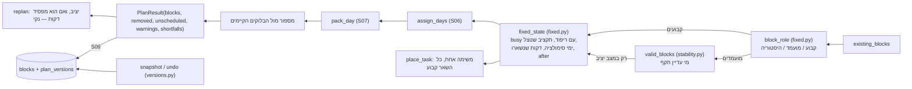

# S08 — תכנון מחדש יציב, נעילת בלוקים, גרסאות תוכנית וביטול: תוכנית עבודה

> **For agentic workers:** REQUIRED SUB-SKILL: Use superpowers:subagent-driven-development (recommended) or superpowers:executing-plans to implement this plan task-by-task. Steps use checkbox (`- [ ]`) syntax for tracking.

**מטרה:** המתכנן מפסיק לבנות את הלוח מחדש בכל קריאה. בלוק שהושלם, ננעל או כבר התחיל לא זז; בלוק עתידי שעדיין תקף נשאר במקומו; משימה מתוכננת רק על הדקות שנשארו לה; משימה בודדת מונחת "במקום הפנוי הבא" בלי לגעת בשאר; וכל שינוי נשמר כגרסה שאפשר לבטל.

**גישה:** מנוע אחד. כל בלוק קיים מקבל תפקיד: קבוע, מועמד או היסטוריה. הקבועים יורדים מהזמינות, מהתקציב היומי ומהדקות של המשימה שלהם, והמנוע של S06/S07 ממלא רק את מה שנשאר. "יציב" פירושו שגם המועמדים התקפים נכנסים כקבועים. אם היציבות עולה במשימות שלא נכנסות, חוזרים לתכנון נקי. הביטול הוא snapshot של הבלוקים העתידיים לפני השינוי.

**כלים:** Python 3.14, ‏uv, ‏hypothesis, ‏Alembic עם SQL מפורש, ‏psycopg 3, ‏Postgres 17 (`btree_gist`). אין תלות חדשה ב-Python.

**מסמך תכנון:** `docs/spec/2026-10-19-studyflow-v2-design.md`, סעיף 7.6 (שלבים 6–8 והאינווריאנטים), 7.4 (`plan_versions`, ‏`blocks.plan_version_id`), 11.8 ו-11.16. במפת הדרכים שב-[artifact](https://claude.ai/code/artifact/29a3c52e-d399-425e-90b6-7c05e9146bfa) זו משימה S08, והיא מוכנה כש"שינוי קטן לא מזיז את שאר הלוח, וביטול מחזיר מצב קודם".

## איך החלקים מתחברים



- **`block_role`** מחליט מה כל בלוק קיים: קבוע (לא זז לעולם), מועמד (נשאר אם תקף), או היסטוריה (לא משפיע).
- **`fixed_state`** הופך קבוצת בלוקים קבועים לקלט של המנוע: זמן תפוס, תקציב שכבר נוצל בכל יום, ימים שכבר יש בהם סימולציה, משימות עם הדקות שנשארו, ומגבלת "רק אחרי" למי שתלוי במשימה עם בלוק קבוע.
- **`plan`** (נקי): רק הקבועים נשארים. **`plan(keep_valid=True)`** (יציב): גם המועמדים התקפים. **`replan`** בוחר ביניהם.
- **`place_task`** מניח משימה אחת כשכל הבלוקים החיים קבועים. זו הפונקציה של דחייה, סקירת בוקר ומשימה שנוספה.
- **`versions.py`** הוא הפורמט של ה-snapshot והחישוב הטהור של ביטול. הכתיבה למסד וה-endpoints הם S09.

## מה מצאתי לפני התכנון (2026-11-14)

| נושא | מצב |
|---|---|
| Dependabot | 3 ענפים פתוחים (uv: 7 עדכונים, ‏setup-uv 10.3.3, ‏web: 6 עדכונים). ה-CI של שלושתם ירוק, הבדיקות המקומיות עברו (api 356, ‏web 133, ‏lint, ‏typecheck, ‏build). הועברו ל-`main` ב-ff ‏(`4dabf3c`) ונדחפו |
| ה-artifact | 8 שורות S08 ב"פריטים פתוחים להמשך". הסטטוס של S08 עבר ל"בעבודה" |
| תקציב יומי | היום `plan()` לא סופר בלוקים שהושלמו: מי שלמד 240 דקות היום מקבל בתכנון מחדש עוד 240 להיום |
| הפסקות | זמן תפוס נחתך מהחלון בדיוק, ולכן בלוק חדש יכול להתחיל בדקה שבלוק שהושלם נגמר |
| יום לימוד של רגע בזמן | אין פונקציה כזו. `study_days` חותכת יום לפי סוף החלון האחרון של היום הקודם, ולא לפי שעת השינה שלו |
| `npm audit` | 9 פגיעויות moderate בתלויות פיתוח של web ‏(`minimatch` דרך eslint). לא קשור ל-S08, נרשם ב"באגים שנרשמו" |

## ההחלטות שלי

| נושא | החלטה | למה | על מה ויתרנו |
|---|---|---|---|
| שורות S08 ב-artifact | **נכנסים:** דקות שנשארו; ימים מפוצלים (תקציב, הפסקות, סימולציה אחת ביום); exclusion constraint; ‏`pack_day` עם סימולציה שנייה ובדיקת המעגל; שתי ההשלמות ל-properties. **נדחים ל-S12:** כלל ה-rerun, הרזרבה של 70 דקות, היום השמור לסימולציה | שלושת הנדחים הם איכות של שלב 3 (אילו משימות נכנסות), ולא יציבות. אף אחד מהם לא מאבד משימה בשקט: הם רק מדווחים משימה שאולי הייתה נכנסת. ב-S12 יהיו תוכניות אמיתיות למדוד עליהן, ועד אז `replan` חוזר לתכנון נקי כשהיציבות מפסידה דקות | לתקן אותם עכשיו, לפי קלטים של גנרטור ובלי נתון אמיתי |
| הגבול מול S09 | S08: הדומיין הטהור, המיגרציה, והוכחה במסד שהסכמה מחזיקה מחזור של שינוי וביטול. S09: ה-endpoints, השירות שכותב `PlanResult` למסד, ה-enum של הסיבות | S09 מחליט על ה-pool, על הטרנזקציה ועל המיפוי. שירות כתיבה עכשיו היה מנחש אותם | ביטול שעובד מקצה לקצה כבר ב-S08 |
| תפקיד של בלוק קיים | `N` הוא `now` מעוגל לדקה. **קבוע:** `done`; או `planned` שנגמר אחרי `N` והוא `pinned` או כבר התחיל. **מועמד:** `planned`, לא `pinned`, מתחיל ב-`N` או אחריו. **היסטוריה:** `planned` שנגמר עד `N`, ‏`missed`, ‏`skipped` | בלוק שהתחיל הוא מה שהמשתמש לומד עכשיו, ואסור למחוק אותו מתחתיו. בלוק שעבר בלי סימון הוא חוב: הדקות שלו חוזרות למשימה, והשורה נשארת לסקירת הבוקר | `pinned` שתופס זמן גם כשהוא `missed` (כך ב-S07) |
| דקות שנשארו | `r = estimated − Σ דקות הבלוקים הקבועים של המשימה`. ‏`r ≤ 0`: המשימה מכוסה. ‏`1 ≤ r ≤ 4`: מתוכננות 5 דקות. סימולציה עם בלוק קבוע כלשהו מכוסה | 5 הוא המינימום של `Task` ושל המסד. סימולציה לא מתפצלת, אז אין "שארית" לתכנן | לדייק דקה־דקה, ולהחזיק במנוע משימה שהמסד לא מקבל |
| תקציב יומי | מכל יום יורדות הדקות של הבלוקים הקבועים שהתחילו בו, גם אלה שלפני `now` | "דקות לימוד ביום" הן ליום כולו, לא למה שנשאר ממנו | תקציב מלא לכל תכנון מחדש |
| יום הלימוד של רגע | `study_date`: היום המוקדם שבשעות הערות שלו (קימה עד שינה) נופל הרגע; בזמן שינה, היום שהסתיים. `study_days` חותכת כל יום משעת השינה של קודמו | כך כל חלון של יום `d` שייך ל-`d` גם בלילה של מעבר שעון, והתקציב נספר באותו יום שבו הבלוק שובץ | לפי תאריך מקומי, שמעביר בלוק של אחרי חצות ליום הבא |
| הפסקה ליד בלוק קבוע | זמן תפוס הוא הבלוק ועוד 10 דקות מכל צד | בלוק חדש לא נצמד לבלוק שהושלם. ההפסקה הארוכה נספרת רק בין הבלוקים החדשים של היום | לחשב הפסקה ארוכה מול בלוקים קבועים |
| תלות מול בלוק קבוע | מי שתלוי במשימה שיש לה בלוק קבוע שנגמר אחרי `N` נכנס רק ביום לימוד שאחרי היום של הבלוק הקבוע האחרון שלה | האריזה של יום לא רואה בלוקים קבועים, ולכן "אחריו באותו יום" לא מובטח. יום אחרי תמיד נכון | שיבוץ באותו יום אחרי הבלוק |
| בלוק `pinned` ששובר תלות | נשאר. סדר התלויות מובטח לבלוקים שהמתכנן מניח או משאיר | "בלוק שהמשתמש קבע לא זז" (7.4). להזיז אותו שובר את ההבטחה היחידה של הנעילה | להזיז נעול כדי לשמור סדר |
| מועמד תקף | בתוך חלון פתוח של היום שלו; עד היום האחרון של המבחן; לא חופף קבוע או מועמד שכבר נשאר; בתוך הדקות של המשימה; בתוך התקציב של היום; סימולציה אחת ביום; והדרישה המוקדמת שלו שלמה ונגמרת לפניו | "בלוק עתידי שעדיין תקף נשאר איפה שהוא" (7.6 שלב 6). תקף הוא חוקי: בלי ריפוד של 10 דקות, כדי שבלוק שהמשתמש גרר לידו לא ידחוף אותו | תקפות לפי הכללים של הנחה חדשה, שמזיזה שכנים של בלוק נעול |
| מה `replan` מחזיר | קודם יציב. אם נשארו בו דקות בדוח, מריצים גם נקי, והיציב נבחר אם הדקות שלו בדוח לא יותר משל הנקי | יציבות לא עולה במשימה. שינוי קטן לא עובר כאן בכלל אלא ב-`place_task`, ושינוי גלובלי מקבל תצוגה מקדימה (11.16) | דרגות ביניים (לשחרר רק מבחן אחד): יותר יציבות, הרבה יותר קוד |
| `place_task` | כל הבלוקים החיים קבועים, חוץ מאלה ב-`release`. המשימה נכנסת כולה או לא משתנה כלום | "הנחת משימה בודדת היא פונקציה נפרדת" (7.6 שלב 7). כישלון חוזר לקורא, ו-S09 מחליט אם להציע תכנון מחדש | הנחה חלקית |
| מספור חלקים | כל הבלוקים החיים של משימת `todo` (קבועים, נשארים וחדשים), לפי זמן, 1 עד n. ‏`missed` ו-`skipped` לא נספרים | "חלק 2 מתוך 3" מתאר את התוכנית החיה. בלוק קיים חוזר עם ה-`block_id` שלו, ו-S09 מעדכן רק את המספור שלו | מספור שכולל היסטוריה |
| `snapshot` | הבלוקים שהם `planned` ונגמרים אחרי `now`, כפי שהיו **לפני** השינוי, ב-`{"v": 1, "blocks": [...]}` | זה מה ששינוי יכול לגעת בו. מספר גרסה מאפשר לשנות פורמט בלי לשבור גרסאות ישנות | snapshot של אחרי השינוי, שמחייב שתי גרסאות לכל ביטול |
| ביטול | מחזיר רק בלוקים שמתחילים ב-`now` או אחריו ולא מתנגשים במה שקרה מאז. מה שלא חזר מדווח ב-`dropped`. גרסה שבוטלה מסומנת ב-`undone_at` | העבר לא נכתב מחדש: בלוק שהושלם או התחיל בינתיים נשאר. `undone_at` שומר יומן, ו-`authenticated` לא צריך DELETE | מחיקת הגרסה; redo |
| `reason` | במסד: slug (`^[a-z][a-z_]{0,39}$`). ה-enum של הסיבות נכתב ב-S09, עם ה-endpoints שמייצרים אותן | רשימה סגורה במסד היא מיגרציה לכל מקור שינוי חדש, ו-S08 לא יודע מי יקרא | CHECK עם רשימה |
| חפיפה במסד | `EXCLUDE USING gist (user_id WITH =, tstzrange(starts_at, ends_at) WITH &&) WHERE (status IN ('planned', 'done')) DEFERRABLE INITIALLY DEFERRED` | "אין חפיפות" הוא אינווריאנט, והמסד הופך באג של המתכנן לשגיאה במקום ללוח שבור. deferred, כי תכנון מחדש מוחק ומכניס באותה טרנזקציה. `missed` ו-`skipped` לא תופסים זמן גם במתכנן | בדיקה רק בקוד |

## מה לא נכלל ולמה

- **כלל ה-rerun, הרזרבה של 70 דקות בימים מפוצלים, היום השמור לסימולציה:** S12 (למעלה).
- **כתיבת `PlanResult` ו-`plan_versions` למסד, ‏`/plan/replan`, ‏`/plan/undo`, ה-enum של `reason`, ושגיאת חפיפה (`23P01`) כשמחזירים בלוק `skipped` ל-`planned`:** S09.
- **מחיקת גרסאות ישנות (למשל 20 אחרונות למשתמש):** S21, עם עבודות הניקוי.
- **גרירה שמשאירה רווח של 10 דקות:** S18.

## אילוצים גלובליים

- Python 3.14, ‏uv, ‏`exclude-newer = "7 days"`. אין תלות חדשה.
- `ruff check`, ‏`ruff format --check`, ‏`mypy` (strict) ו-`pytest` עם `filterwarnings = ["error"]`. הבדיקות הקיימות (356) נשארות ירוקות, חוץ ממה שהתוכנית משנה במפורש. בדיקות המתכנן לא נוגעות במסד.
- המתכנן טהור: בלי `datetime.now()`, בלי I/O, בלי אקראיות (גם לא `uuid4`), ובלי לולאה על `set`, ‏`frozenset` או `dict` שהסדר שלו לא נקבע מהקלט כשהסדר משפיע על התוצאה. אותו קלט נותן תמיד אותו פלט.
- כל `datetime` aware. בתוך `Interval`: ‏UTC ודקה שלמה.
- החוזה של `capacity.py` לא משתנה: לא הקבועים, לא `day_fits`, ‏`room`, ‏`simulation_window`.
- **בלוק קבוע לא זז:** אין פלט שבו בלוק קבוע חסר, שה-`interval` שלו השתנה, או שה-`id` שלו ב-`removed`. החריג היחיד: בלוק שהקורא משחרר במפורש ב-`release` של `place_task` (דחייה), אחרי הסקירה הסופית.
- property שנכשל לא מוחלש ולא מקבל `assume`. מדווחים את הדוגמה המינימלית ועוצרים ב-`DONE_WITH_CONCERNS`.
- הטיפוסים של הדומיין משקפים את ה-`CHECK` של המיגרציות. מיגרציה: SQL מפורש, RLS, ‏policy ו-grants באותה מיגרציה, ו-`downgrade` שעובד.
- לא נוגעים ב-`legacy/`.
- הקוד, ההערות והודעות הקומיט באנגלית. התוכנית והדיווחים בעברית.
- git רץ בשיחה הראשית, וה-subagents לא מריצים git (גם לא `git stash` או `git checkout`). מוסיפים קבצים לפי שם, ובודקים `git status --short --untracked-files=all` לפני כל קומיט. לפני push: ‏`gitleaks git --redact --no-banner .`. אין force-push.
- **הריפו ב-`/Users/eyalatar/studyflow`.** תיקיית העבודה של הסשן, `~/Desktop/MyProject/studyflow`, היא העתק ישן. כל subagent עובד רק בנתיבים מלאים תחת `/Users/eyalatar/studyflow`, והפקודות רצות מתוך `/Users/eyalatar/studyflow/api`. קבצים זמניים רק מחוץ לריפו, ונמחקים בסוף. מי שמריץ בדיקת מוטציות מוחק אחריה `__pycache__`.

## על מה לשים לב בבדיקה

1. **בלוק שהמשתמש לומד עכשיו:** תכנון מחדש באמצע בלוק. מה שצריך לקרות: הבלוק נשאר, והדקות שלו נספרות. Task 2.
2. **יום שכבר נלמד בו:** 240 דקות שהושלמו היום ותקציב של 240. מה שצריך לקרות: שום בלוק חדש היום. Task 2 ו-Task 7.
3. **משימה שהמשתמש קיצר או האריך:** מה שצריך לקרות: הבלוקים המאוחרים משתחררים, ולא נשאר חלק חדש קצר מ-30 דקות כשאפשר להימנע. Task 3.
4. **ביטול אחרי שעבר זמן:** בלוק מה-snapshot שהשעה שלו עברה, או שהמקום שלו נתפס בבלוק שהושלם. מה שצריך לקרות: הוא לא חוזר, והוא מדווח ב-`dropped`. Task 5.
5. **אותו קלט פעמיים:** `replan` על התוצאה של עצמו. מה שצריך לקרות: שום בלוק לא זז. Task 3 ו-Task 7.

## מי עושה מה

| Task | מה | מי | תלוי ב- |
|---|---|---|---|
| 0 | פתיחה: Dependabot, הסטטוס, הענף והתוכנית | אני (נעשה, חוץ מהקומיט) | — |
| 1 | יסודות: טיפוסים, ‏`study_date`, ‏`open_windows`, ‏`pack_day` | subagent | 0 |
| 2 | בלוקים קבועים במנוע: `fixed.py`, ‏`assign_days`, ‏`plan` | subagent | 1 |
| 3 | יציבות: `valid_blocks`, ‏`plan(keep_valid=True)`, ‏`replan` | subagent | 2 |
| 4 | `place_task` | subagent | 3 |
| 5 | `versions.py`: ‏snapshot וביטול | subagent | 1 |
| 6 | מיגרציה 0003 ובדיקות המסד | subagent | 5 |
| 7 | properties: תרחישי תכנון מחדש, וההשלמות של S07 | subagent | 4, 5 |
| 8 | מסמך התכנון והלשונית שלו | אני | 7 |
| 9 | סקירה סופית, מיגרציה ל-dev, מיזוג וסגירה | אני | 8 |

## מבנה הקבצים

```
api/app/domain/planner/model.py          ExistingBlock.id, PlannedBlock.block_id, PlanResult.removed, DEPENDENT_TOO_EARLY
api/app/domain/planner/availability.py   + start_minute, study_date, open_windows; study_days נחתכת משעת השינה של היום הקודם
api/app/domain/planner/pack.py           סימולציה שנייה ביום זורקת
api/app/domain/planner/fixed.py          (חדש) BlockRole, block_role, FixedState, fixed_state
api/app/domain/planner/assign.py         used, simulation_days, after
api/app/domain/planner/stability.py      (חדש) valid_blocks
api/app/domain/planner/plan.py           plan(keep_valid), replan, מספור מול בלוקים קיימים
api/app/domain/planner/place.py          (חדש) place_task
api/app/domain/planner/versions.py       (חדש) SnapshotBlock, snapshot, parse_snapshot, undo
api/app/domain/planner/__init__.py       + השמות החדשים
api/migrations/versions/0003_plan_versions.py   (חדש)
api/tests/db/supabase_shim.sql           + schema extensions
api/tests/db/test_plan_versions.py       (חדש)
api/tests/planner/…                      בדיקות לכל מודול, strategies.py, test_replan_properties.py (חדש)
מסמך התכנון (7.4, 7.6, 11.8) והלשונית שלו ב-artifact
```

---

### Task 0: פתיחה

נעשה לפני כתיבת התוכנית: Dependabot מוזג, הסטטוס "בעבודה", והענף `s08-stable-replan` נפתח מ-`main` (`4dabf3c`).

- [ ] **Step 1: קומיט של התוכנית**
  `git add docs/archive/plans/2026-11-14-s08-stable-replan.md && git commit -m "docs(plan): add the S08 stable replanning plan"`

---

### Task 1: יסודות

**למה:** שאר ה-Tasks מדברים בטיפוסים האלה, והתקציב היומי צריך כלל אחד שאומר לאיזה יום לימוד שייך רגע בזמן.

**Files:**
- Modify: `api/app/domain/planner/model.py`, ‏`availability.py`, ‏`pack.py`, ‏`plan.py` (רק כדי שייבנה), ‏`__init__.py`
- Modify: `api/tests/planner/test_model.py`, ‏`test_availability.py`, ‏`test_pack.py`, ‏`test_plan.py`, ‏`test_properties.py`, ‏`strategies.py`

**Interfaces (Produces):**
- `model.py`:
  - `ExistingBlock` מקבל שדה ראשון `id: UUID` (נבדק ב-`isinstance`).
  - `PlannedBlock` מקבל שדה אחרון `block_id: UUID | None = None` (נבדק: `UUID` או `None`). ‏`None` הוא בלוק חדש; אחרת זה בלוק קיים שנשאר במקומו.
  - `PlanResult` מקבל שדה חובה `removed: tuple[UUID, ...]`, אחרי `blocks`: המזהים של בלוקים קיימים שיוצאים מהלוח.
  - `UnscheduledReason.DEPENDENT_TOO_EARLY = "dependent_too_early"`, אחרון ב-enum.
- `availability.py`:
  - `start_minute(now: datetime) -> datetime`: ‏`now` ב-UTC, מעוגל קדימה לדקה שלמה (מה ש-`study_days` עושה היום בפנים). ‏`now` נאיבי: `PlannerInputError`.
  - `study_date(profile: Profile, instant: datetime) -> date`: עם `L` התאריך המקומי של `instant`: היום הראשון מבין `L − 1`, ‏`L` ש-`instant` נופל ב-`[wake, sleep)` שלו (לפי `local_span(day, wake_time, sleep_time, tz)`, בלי `study_start_delay`). אם אין כזה: `L` כש-`instant` אחרי הקימה של `L`, אחרת `L − 1`.
  - `open_windows(profile: Profile, exams: Sequence[Exam], now: datetime) -> dict[date, tuple[Interval, ...]]`: לכל יום לימוד, החלונות אחרי החיתוך ב-`now`, ביום הקודם וב-cutoffs, **בלי** busy ו**בלי** הסינון של 30 דקות. אותם ימים ואותו סדר כמו `study_days`.
  - `study_days`: החיתוך מול היום הקודם הוא מסוף שעות הערות שלו (`local_span(day − 1, wake_time, sleep_time, tz)[1]`), תמיד, במקום מ-`previous[-1].end`. ‏`study_days` ו-`open_windows` חולקות את אותו חישוב.
- `pack.py`: יותר מסימולציה אחת ב-`items` זורק `RuntimeError` (עם התאריך).
- `plan.py`: רק `removed=()` ב-`PlanResult`. ההתנהגות לא משתנה ב-Task הזה.
- `strategies.py`: ‏`existing_blocks_for` נותן לכל בלוק `id` (‏`st.uuids()`, ייחודי).

- [ ] **Step 1: הבדיקות**

  | קובץ | בדיקה | מצופה |
  |---|---|---|
  | `test_model.py` | `test_existing_block_needs_a_uuid_id` | `id="x"` זורק `PlannerInputError` |
  | | `test_planned_block_id_is_a_uuid_or_none` | `block_id="x"` זורק; `None` ו-`uuid4()` נבנים |
  | `test_availability.py` | `test_study_date_follows_waking_hours` (parametrize), פרופיל `Asia/Jerusalem`, קימה 08:00, שינה 01:00 | 2 בנובמבר 10:00 מקומי → 2 בנובמבר; 3 בנובמבר 00:30 → 2 בנובמבר; 3 בנובמבר 03:00 (שינה) → 2 בנובמבר; 3 בנובמבר 08:00 → 3 בנובמבר |
  | | `test_study_date_in_overlapping_waking_hours` | הפרופיל של `test_overlapping_waking_hours_do_not_share_a_window`: רגע ב-`04:15Z` ב-6 בספטמבר (ער גם לפי ה-5 וגם לפי ה-6) → 5 בספטמבר |
  | | `test_open_windows_keep_short_pieces` | `now` 20 דקות לפני סוף חלון: `study_days` לא מחזירה את השארית, ו-`open_windows` מחזירה אותה |
  | | `test_start_minute` | `…:00:01` → הדקה הבאה; דקה שלמה לא זזה; נאיבי זורק |
  | `test_properties.py` | `test_every_window_belongs_to_its_study_day` (על `planner_inputs()`, ‏`PROPERTY_SETTINGS`) | לכל חלון של `study_days` (עם busy) ושל `open_windows`: ‏`study_date(profile, w.start) == day` וגם `study_date(profile, w.end − דקה) == day` |
  | `test_pack.py` | `test_a_second_simulation_raises` | שתי סימולציות ביום: `RuntimeError` |
  | | `test_a_dependency_cycle_inside_the_day_raises` | A ו-B באותו יום, ‏`prerequisite={A: B, B: A}`: ‏`RuntimeError` |

  הבדיקה `test_overlapping_waking_hours_do_not_share_a_window` הקיימת נשארת ירוקה בלי שינוי. אם היא או בדיקה קיימת אחרת נכשלת בגלל החיתוך החדש, לא משנים אותה: מדווחים.

- [ ] **Step 2: הבדיקות נכשלות** — `uv run pytest tests/planner -q` (‏`ImportError`/`TypeError` על השמות החדשים).
- [ ] **Step 3: מימוש**, ועדכון כל מקום שבונה `ExistingBlock` או `PlanResult`.
- [ ] **Step 4: הכל ירוק** — `uv run pytest -q && uv run ruff check . && uv run ruff format --check . && uv run mypy`
- [ ] **Step 5: קומיט (בשיחה הראשית)** — `feat(api): add block ids, study_date and open windows to the planner`

---

### Task 2: בלוקים קבועים במנוע

**למה:** זה הלב של "בלוקים שהושלמו או ננעלו לא זזים": הם מקטינים את המשימה, את התקציב ואת הזמינות, והמנוע מתכנן רק את השארית.

**Files:**
- Create: `api/app/domain/planner/fixed.py`, ‏`api/tests/planner/test_fixed.py`
- Modify: `assign.py`, ‏`plan.py`, ‏`__init__.py`; ‏`tests/planner/test_plan.py`, ‏`test_assign.py`, ‏`test_plan_properties.py`, ‏`factories.py`

**Interfaces:**
- Consumes: Task 1.
- Produces, ב-`fixed.py`:
  - `class BlockRole(Enum)`: ‏`FIXED`, ‏`CANDIDATE`, ‏`HISTORY`.
  - `block_role(block: ExistingBlock, start: datetime) -> BlockRole`, כש-`start = start_minute(now)`:
    - `DONE` → `FIXED`.
    - `PLANNED`, ‏`interval.end > start`, ו-(`pinned` או `interval.start < start`) → `FIXED`.
    - `PLANNED`, ‏`interval.start >= start`, לא `pinned` → `CANDIDATE`.
    - כל השאר → `HISTORY`.
  - `@dataclass(frozen=True, slots=True, kw_only=True) class FixedState`: ‏`tasks: tuple[Task, ...]`, ‏`busy: tuple[Interval, ...]`, ‏`used: Mapping[date, int]`, ‏`simulation_days: frozenset[date]`, ‏`after: Mapping[UUID, date]`.
  - `fixed_state(profile: Profile, tasks: Sequence[Task], fixed: Sequence[ExistingBlock], start: datetime) -> FixedState`. ‏`fixed` הוא הבלוקים שהקורא החליט שהם קבועים, בסדר הקלט:
    1. `busy`: לכל בלוק ב-`fixed` שנגמר אחרי `start`: ‏`Interval(b.start − BREAK_MINUTES, b.end + BREAK_MINUTES)`.
    2. `used[d]`: סכום הדקות של כל הבלוקים ב-`fixed` ש-`study_date(profile, b.interval.start) == d`.
    3. `simulation_days`: ה-`study_date` של כל בלוק ב-`fixed` שהמשימה שלו בקלט והיא `SIMULATION`.
    4. `tasks`: לפי סדר הקלט. משימה שאינה `TODO`, או `TODO` בלי בלוקים ב-`fixed`: כמו שהיא. ‏`TODO` עם בלוקים: סימולציה יוצאת מהרשימה; אחרת `r = estimated_minutes − Σ דקות`, ‏`r ≤ 0` יוצאת, ואחרת `replace(task, estimated_minutes=max(5, r))`.
    5. `after[T.id] = d`: לכל `T` שנשארה ברשימה, היא `TODO`, ו-`T.depends_on` הוא משימת `TODO` בקלט שיש לה ב-`fixed` בלוק שנגמר אחרי `start`: ‏`d` הוא ה-`study_date` המאוחר ביותר של הבלוקים האלה.
- Produces, ב-`assign.py`: ‏`assign_days(profile, exams, tasks, now, busy=(), *, used: Mapping[date, int] | None = None, simulation_days: Collection[date] = (), after: Mapping[UUID, date] | None = None)`. בלי הפרמטרים החדשים ההתנהגות זהה להיום.
  - התקציב של יום מתחיל ב-`max(0, daily_study_minutes − used.get(date, 0))`.
  - יום ב-`simulation_days` לא מקבל סימולציה: לא בשמירת הימים, לא בשיבוץ ולא ב-`no_window`.
  - "יום מחזיק סימולציה" ו"משימה נכנסת שלמה ליום ריק" (`_holds_simulation`, ‏`_is_multi_day`) נמדדים מול התקציב ההתחלתי של אותו יום, ולא מול `daily_study_minutes`. ‏`over_budget` נשאר מול `daily_study_minutes`.
  - משימה ב-`after` היא מועמדת רק ביום ש-`date > after[id]`. בדוח: כשאין לה יום כשיר כזה, הסיבה `DEPENDENCY_TOO_LATE` עם `blocked_by = task.depends_on`, באותו מקום בסדר כמו סיבות התלות הקיימות (ואחריהן).
- Produces, ב-`plan.py`: ‏`plan(profile, exams, tasks, existing_blocks, now, *, keep_valid: bool = False) -> PlanResult`. ב-Task הזה `keep_valid=True` זורק `NotImplementedError`.
  1. `start = start_minute(now)`; תפקיד לכל בלוק; ‏`fixed` = הקבועים.
  2. `state = fixed_state(profile, tasks, fixed, start)`.
  3. `assign_days(profile, exams, state.tasks, now, state.busy, used=state.used, simulation_days=state.simulation_days, after=state.after)`, ואריזה כמו היום, עם `state.tasks`.
  4. **מספור:** לכל משימת `TODO` בקלט (גם מכוסה): הבלוקים הקבועים שלה והחדשים, לפי `interval.start`, מקבלים 1 עד n. ‏`blocks` הוא כל אלה, ממוינים לפי `(start, end)`; קבוע חוזר עם `block_id` שלו ועם ה-`interval` המקורי. בלוק קבוע של משימה שאינה `TODO` או שאינה בקלט לא מופיע ב-`blocks`.
  5. `removed`: ה-`id` של כל `CANDIDATE`, לפי סדר הקלט.
  6. `shortfalls`: כמו היום, עם אותם `state` ופרמטרים בכל הרצת ניסיון.
  - שני בלוקים ב-`existing_blocks` עם אותו `id`: ‏`PlannerInputError`.
- `__init__.py` מייצא `BlockRole`, ‏`FixedState`, ‏`block_role`, ‏`fixed_state`, ‏`start_minute`, ‏`study_date`, ‏`open_windows`.
- `factories.py`: ‏`make_block(task, start, end, *, status=BlockStatus.PLANNED, pinned=False, id=None) -> ExistingBlock` (בלי `id`: ‏`uuid4()`), ו-`as_existing(result: PlanResult) -> list[ExistingBlock]`: כל בלוק ב-`result.blocks` כ-`PLANNED` לא נעול, עם `block_id` שלו, או עם `uuid5(NAMESPACE_OID, f"{task_id}:{start.isoformat()}")` כשהוא חדש.

- [ ] **Step 1: הבדיקות**

  ב-`test_fixed.py`: ‏`test_block_role` (parametrize) על כל שורה בהגדרה של `block_role`, כולל `pinned` + `MISSED` → `HISTORY`, ‏`pinned` + `PLANNED` שנגמר בדיוק ב-`start` → `HISTORY`, ו-`PLANNED` לא נעול שמתחיל בדיוק ב-`start` → `CANDIDATE`. ובדיקה ישירה אחת ל-`fixed_state` על כל חמשת השדות.

  ב-`test_plan.py`, עם `make_profile()` (חלון `07:00Z–15:00Z` ב-1–3 בנובמבר, תקציב 240), מבחן `nov(5)`, וה-`NOW` של הקובץ אלא אם כתוב אחרת:

  | בדיקה | קלט | מצופה |
  |---|---|---|
  | `test_a_done_block_shortens_its_task` | A ‏`learn` 120; בלוק `DONE` של A ב-1 בנובמבר `07:00–08:00` (‏`b1`) | `blocks`: ‏`b1` כ-1/2 עם `block_id=b1`, וחדש `08:10–09:10` כ-2/2; ‏`removed == ()`; ‏`unscheduled == ()` |
  | `test_a_covered_task_gets_no_new_block` | A 60; בלוק נעול של A ב-1 בנובמבר `13:00–14:00` | `blocks` הוא הבלוק הזה בלבד, 1/1 |
  | `test_fixed_minutes_count_against_the_day` | X ‏`learn` בסטטוס `DONE` עם בלוק `DONE` ב-1 בנובמבר `07:00–10:00`; ‏A ‏`learn` 120 | A ב-2 בנובמבר `07:00–09:00` (ב-1 בנובמבר נשארו 60 דקות תקציב) |
  | `test_a_simulation_with_a_fixed_block_is_covered` | סימולציה 180 עם בלוק נעול של 120 דקות | אין בלוק חדש, ו-`unscheduled == ()` |
  | `test_a_day_with_a_fixed_simulation_takes_no_other` | מבחן `nov(3)` (יום לימוד אחד); ‏S1 סימולציה 60 עם בלוק נעול `13:00–14:00`; ‏S2 סימולציה 60 | S2 בדוח עם `NO_CONTIGUOUS_WINDOW`, ואין לה בלוק |
  | `test_a_dependent_waits_a_day_after_a_fixed_block` | P 60 עם בלוק נעול ב-2 בנובמבר `07:00–08:00`; ‏T 60 תלויה ב-P | T ב-3 בנובמבר `07:00–08:00` |
  | `test_a_dependent_with_no_later_day_reports_its_prerequisite` | כנ"ל, והבלוק הנעול של P ב-3 בנובמבר | T בדוח: `DEPENDENCY_TOO_LATE`, ‏`blocked_by == P.id` |
  | `test_a_small_remainder_is_five_minutes` | A 60; בלוק `DONE` של A, ‏`07:00–07:58` | בלוק חדש של 5 דקות, `08:08–08:13` |
  | `test_a_fresh_plan_removes_the_candidates` | A 60; בלוק `PLANNED` לא נעול של A ב-`10:00–11:00` (‏`c1`) | `removed == (c1,)`; ‏A ב-`07:00–08:00`, 1/1, ‏`block_id is None` |
  | `test_history_blocks_do_nothing` | `now = Z(2026, 11, 2, 6)`; ‏A 60 עם בלוק `MISSED` ב-1 בנובמבר `07:00–08:00` ובלוק `PLANNED` לא נעול ב-1 בנובמבר `09:00–10:00` | שניהם לא ב-`blocks` ולא ב-`removed`; ‏A ב-2 בנובמבר `07:00–08:00`, 1/1 |
  | `test_a_block_in_progress_stays` | `now = Z(2026, 11, 1, 7, 30)`; ‏A 120 עם בלוק `PLANNED` לא נעול `07:00–08:00` | הבלוק נשאר כ-1/2 עם ה-`block_id` שלו; חדש `08:10–09:10` כ-2/2; ‏`removed == ()` |
  | `test_duplicate_block_ids_are_rejected` | שני בלוקים עם אותו `id` | `PlannerInputError` |

  `test_done_and_pinned_blocks_are_busy` הקיימת משתנה: הפרופיל מקבל `daily_study_minutes=480` (כדי שהתקציב לא יסתיר את מה שנבדק), לבלוקים יש `id`, והמצופה: A ב-`09:10–11:10`, ‏`removed` הוא ה-`id` של הבלוק ה-`PLANNED` הלא נעול. הבלוק ה-`MISSED` לא ב-`removed`.

  ב-`test_assign.py`: בדיקה אחת לכל פרמטר חדש של `assign_days` (‏`used` מקטין תקציב של יום; יום ב-`simulation_days` לא מקבל סימולציה; ‏`after` דוחה משימה ליום שאחרי), ובדיקה ש-`used` הופך משימה למתפרסת: תקציב 240, ‏`used` של 150 בכל יום, משימה של 180 → 90 + 90 בשני ימים.

  ב-`test_plan_properties.py`, ה-properties הקיימים מתעדכנים רק כך: ה-busy, ‏`used`, ‏`simulation_days`, ‏`after` והמשימות באים מ-`fixed_state` על הבלוקים הקבועים (במקום ה-`_busy` המקומי); בדיקות החלונות, החפיפה, ההפסקות וסכומי הימים חלות על הבלוקים החדשים (`block_id is None`); ו"סכום הבלוקים של משימה" הופך ל: משימה שאינה בדוח — סכום הבלוקים החדשים שלה שווה ל-`estimated_minutes` שלה ב-`state.tasks` (או אין חדשים והיא לא ברשימה); משימה בדוח — אין לה בלוקים חדשים. אף בדיקה לא נמחקת.

- [ ] **Step 2: הבדיקות נכשלות** — `uv run pytest tests/planner -q`
- [ ] **Step 3: מימוש**
- [ ] **Step 4: הכל ירוק** — `uv run pytest -q && uv run ruff check . && uv run ruff format --check . && uv run mypy && CI=true uv run pytest tests/planner -q`
- [ ] **Step 5: קומיט (בשיחה הראשית)** — `feat(api): plan around fixed blocks with remaining minutes and day budgets`

---

### Task 3: יציבות

**למה:** "בלוק עתידי שעדיין תקף נשאר איפה שהוא, ורק מה שחייב זז" (7.6 שלב 6).

**Files:**
- Create: `api/app/domain/planner/stability.py`, ‏`api/tests/planner/test_stability.py`, ‏`api/tests/planner/test_replan.py`
- Modify: `plan.py`, ‏`__init__.py`

**Interfaces:**
- Consumes: ‏`block_role`, ‏`fixed_state`, ‏`open_windows`, ‏`study_date`, ‏`last_study_day`, ‏`resolve_dependencies`, ‏`plan`.
- Produces, ב-`stability.py`: ‏`valid_blocks(profile, exams, tasks, existing_blocks, now) -> tuple[ExistingBlock, ...]`: המועמדים שנשארים, לפי `(interval.start, id)`. "חי" = קבוע או מועמד שנשאר. שלושה מעברים, כל אחד רק מוריד:
  1. **כל מועמד לבדו.** נשאר רק אם: המשימה שלו בקלט והיא `TODO` ולא על מעגל תלויות; המבחן שלה בקלט; עם `d = study_date(profile, b.interval.start)`: ‏`d <= last_study_day(exam, profile)` ו-`b.interval` כולו בתוך חלון אחד של `open_windows(...)[d]`; הוא לא חופף אף בלוק קבוע (חפיפה ממש, בלי ריפוד); ואם המשימה סימולציה: אין לה בלוק קבוע, ו-`b.interval.minutes == estimated_minutes`.
  2. **לפי הזמן**, על מי שנשאר, בסדר `(start, id)`. מועמד יוצא אם: הוא חופף מועמד שכבר נשאר; או שדקות הקבועים של המשימה שלו + דקות המועמדים שלה שכבר נשארו + הדקות שלו גדולות מ-`estimated_minutes`; או ש-`used[d]` של הקבועים + דקות המועמדים שכבר נשארו ביום `d` + הדקות שלו גדולות מ-`daily_study_minutes`; או שהוא סימולציה וב-`d` כבר יש סימולציה (קבועה או שנשארה).
  3. **לפי התלויות**, משימה אחרי הדרישה המוקדמת שלה (`resolve_dependencies(tasks).prerequisite`; בתוך אותה דרגה, לפי סדר הקלט). למשימה `T` עם דרישה מוקדמת `P`:
     - `P` **שלמה** כשהדקות החיות שלה הן לפחות `estimated_minutes`, או שהיא סימולציה עם בלוק חי. אם `P` לא שלמה: כל המועמדים של `T` יוצאים.
     - אחרת, מועמד `b` של `T` יוצא אם יש ל-`P` בלוק חי שנגמר אחרי `b.interval.start`; או ש-`T` או `P` סימולציה ויש ל-`P` בלוק חי ש-`study_date` שלו אינו מוקדם מזה של `b`.
     - ואחרי זה, לכל משימה (גם בלי דרישה מוקדמת): כל עוד `0 < r < MIN_PART_MINUTES` ויש לה מועמד שנשאר, המועמד המאוחר ביותר שלה יוצא (`r` הוא `estimated_minutes` פחות הדקות החיות).
- Produces, ב-`plan.py`:
  - `plan(..., keep_valid=True)`: ‏`fixed` הוא הקבועים ועוד `valid_blocks(...)`; ‏`removed` הוא המועמדים שלא נשארו. כל השאר כמו ב-Task 2 (מועמד שנשאר חוזר ב-`blocks` עם `block_id` שלו).
  - `replan(profile, exams, tasks, existing_blocks, now) -> PlanResult`: ‏`stable = plan(..., keep_valid=True)`. אם `stable.unscheduled` ריק: מחזירים אותו. אחרת `fresh = plan(...)`, ומחזירים את `stable` אם `Σ minutes` של `stable.unscheduled` קטן או שווה לזה של `fresh.unscheduled`, ואחרת את `fresh`.
- `__init__.py` מייצא `valid_blocks` ו-`replan`.

- [ ] **Step 1: הבדיקות**

  ב-`test_replan.py`. "לוח" = `as_existing(plan(profile, [exam], tasks, [], NOW))`. הפרופיל והמבחן כמו ב-Task 2.

  | בדיקה | קלט | מצופה |
  |---|---|---|
  | `test_replanning_an_unchanged_plan_moves_nothing` | A 300, ‏B 120, ‏C 60; לוח; `replan` עם אותו קלט | `removed == ()`; לכל בלוק יש `block_id`; ה-`interval` והמספור זהים ללוח |
  | `test_a_new_task_goes_into_free_time` | לוח של A 120; מוסיפים B 60 | הבלוקים של A במקומם עם `block_id`; ‏B בלוק חדש `09:10–10:10` ב-1 בנובמבר; ‏`removed == ()` |
  | `test_a_removed_task_frees_its_blocks_only` | לוח של A 120 ו-B 120; ‏B יוצאת מהקלט | `removed` הוא הבלוקים של B; הבלוק של A במקומו |
  | `test_an_earlier_exam_date_moves_only_late_blocks` | לוח של A 240, ‏B 240, ‏C 120 (ימים 1, 2, 3); המבחן זז ל-`nov(4)` (ימי לימוד 1–2) | הבלוקים של A ו-B במקומם; הבלוק של C ב-`removed`; ‏C בדוח עם `NOT_ENOUGH_TIME` |
  | `test_a_lower_daily_budget_releases_the_end_of_the_day` | לוח של A 120 ו-B 120 (שניהם ב-1 בנובמבר); התקציב יורד ל-180 | הבלוק של A במקומו; הבלוק של B ב-`removed`, ו-B ב-2 בנובמבר `07:00–09:00` |
  | `test_a_shorter_task_releases_its_last_block` | לוח של A 300 (‏240 + 60); ‏A יורדת ל-240 | הבלוק של 1 בנובמבר במקומו, 1/1; הבלוק של 2 בנובמבר ב-`removed` |
  | `test_a_small_growth_does_not_leave_a_short_part` | לוח של A 300 (‏240 + 60); ‏A עולה ל-310 | הבלוק של 2 בנובמבר ב-`removed`; בלוק חדש של 70 דקות ב-2 בנובמבר `07:00–08:10`; אין בלוק של 10 דקות |
  | `test_dependents_follow_a_prerequisite_that_moves` | לוח של P 240 ו-T 240 (‏T תלויה ב-P; ימים 1 ו-2); המשתמש נועל בלוק של משימה אחרת X (‏`DONE`, לא בקלט) על 1 בנובמבר `07:00–11:00` | הבלוק של P יוצא (חופף קבוע), וגם הבלוק של T (‏P לא שלמה); ב-`blocks` הבלוק האחרון של P נגמר לפני הראשון של T |
  | `test_a_candidate_next_to_a_pinned_block_stays` | לוח של A 60 (`07:00–08:00`); בלוק נעול של B 60 (בקלט) ב-`08:00–09:00` | הבלוק של A במקומו; ‏`removed == ()` |
  | `test_replan_falls_back_when_stability_costs_minutes` | לוח של A 240 (מבחן E1 ב-`nov(5)`, ב-1 בנובמבר); נוסף מבחן E2 ב-`nov(3)` (יום לימוד יחיד: 1 בנובמבר) עם B 240 | `replan(...) == plan(...)` (נקי): B ב-1 בנובמבר, ‏A ב-2 בנובמבר, הבלוק הישן של A ב-`removed`, ‏`unscheduled == ()` |
  | `test_replan_keeps_the_stable_plan_on_a_tie` | לוח של A 240 (מבחן `nov(3)`, יום יחיד); נוספת B 240 לאותו מבחן | B בדוח גם ביציב וגם בנקי; התוצאה היא היציבה: הבלוק של A עם `block_id`, ‏`removed == ()` |

  ב-`test_stability.py`: בדיקה ישירה של `valid_blocks` לכל תנאי במעבר 1 ובמעבר 2 שהטבלה לא מכסה (משימה לא בקלט; משימה `DONE`; בלוק מחוץ לחלון; בלוק אחרי היום האחרון של המבחן; סימולציה שהאורך שלה השתנה; שני מועמדים חופפים — המוקדם נשאר; סימולציה שנייה באותו יום), ובדיקה שהפלט ממוין לפי `(start, id)`.

- [ ] **Step 2: הבדיקות נכשלות**
- [ ] **Step 3: מימוש**
- [ ] **Step 4: הכל ירוק** — הפקודה של Task 2, Step 4.
- [ ] **Step 5: קומיט (בשיחה הראשית)** — `feat(api): keep valid future blocks in place when replanning`

---

### Task 4: `place_task`

**למה:** 7.6 שלב 7: דחייה, סקירת בוקר ומשימה שנוספה מניחות משימה אחת בלי לבנות את הלוח.

**Files:**
- Create: `api/app/domain/planner/place.py`, ‏`api/tests/planner/test_place.py`
- Modify: `__init__.py`; ‏`plan.py` רק אם צריך לחשוף עזר משותף (מספור, אריזה)

**Interfaces:**
- Produces: `place_task(profile, exams, tasks, existing_blocks, task_id: UUID, now, *, release: Collection[UUID] = (), not_before: datetime | None = None) -> PlanResult`.
  1. בדיקות קלט (`PlannerInputError`): ‏`task_id` הוא משימת `TODO` בקלט; כל `id` ב-`release` הוא בלוק קיים של המשימה הזו בסטטוס `PLANNED`; ‏`not_before` aware.
  2. `start = start_minute(now)`. **חיים** = כל בלוק שהוא `FIXED` או `CANDIDATE`, חוץ מאלה ב-`release`.
  3. דרישה מוקדמת `P` (`T.depends_on`, משימת `TODO` בקלט): אם `P` לא שלמה לפי הבלוקים החיים (ההגדרה של Task 3) → הכישלון `DEPENDENCY_NOT_SCHEDULED` עם `blocked_by=P.id`.
  4. `state = fixed_state(profile, [T], חיים, start)`, ועליו `after[T.id]` לפי הבלוקים החיים של `P` שנגמרים אחרי `start` (אותו כלל כמו ב-`fixed_state`, כש-`P` לא ברשימת המשימות). אם `T` מכוסה: מחזירים הצלחה בלי בלוק חדש.
  5. `assign_days(profile, exams, state.tasks, max(start, not_before), state.busy, used=state.used, simulation_days=state.simulation_days, after=...)`, ואריזה. משימה שלא נכנסה כולה → כישלון עם הסיבה של המנוע.
  6. **תלויים:** לכל משימת `TODO` `D` בקלט ש-`D.depends_on == task_id` ויש לה בלוקים חיים: אם בלוק חי או חדש של `T` נגמר אחרי תחילת הבלוק החי הראשון של `D`, או ש-`T` או `D` סימולציה והיום של הבלוק האחרון של `T` אינו מוקדם מהיום של הראשון של `D` → כישלון `DEPENDENT_TOO_EARLY` עם `blocked_by=D.id` (ה-`D` הראשונה בסדר הקלט).
  7. **הצלחה:** `blocks` = כל הבלוקים החיים של `T` והחדשים, ממוספרים (כמו ב-`plan`); ‏`removed` = ה-`release` לפי סדר `existing_blocks`; ‏`unscheduled=()`; ‏`warnings` של המנוע; ‏`shortfalls=()`.
  8. **כישלון:** `blocks=()`, ‏`removed=()`, ‏`unscheduled=(Unscheduled(task_id, minutes=הדקות שנשארו, reason, blocked_by),)`, ‏`shortfalls=()`. שום דבר לא משתנה.
- `__init__.py` מייצא `place_task`.

- [ ] **Step 1: הבדיקות, ב-`test_place.py`** (אותו פרופיל; "לוח" כמו ב-Task 3)

  | בדיקה | קלט | מצופה |
  |---|---|---|
  | `test_a_new_task_takes_the_next_free_slot` | לוח של A 120 ו-B 60; נוספת C 60; ‏`place_task(C)` | `blocks` הוא בלוק אחד של C, ‏`10:40–11:40` ב-1 בנובמבר, 1/1 (הלוח: A ‏`07:00–09:00`, ‏B ‏`09:30–10:30`, ועוד 10 דקות ריפוד); ‏`removed == ()` |
  | `test_deferring_a_block_moves_only_that_block` | לוח של A 120 ו-B 60; ‏`release` = הבלוק של B, ‏`not_before = Z(2026, 11, 2, 0)` | `removed` הוא הבלוק של B; ‏B ב-2 בנובמבר `07:00–08:00`; אין ב-`blocks` בלוק של A |
  | `test_a_missed_block_is_placed_again` | `now = Z(2026, 11, 2, 6)`; ‏A 60 עם בלוק `MISSED` ב-1 בנובמבר | A ב-2 בנובמבר `07:00–08:00`, 1/1 |
  | `test_only_the_remainder_is_placed` | A 120 עם בלוק `DONE` של 60 | בלוק חדש אחד של 60, כ-2/2, והבלוק ה-`DONE` כ-1/2 |
  | `test_an_unfinished_prerequisite_blocks_the_task` | T תלויה ב-P; ל-P אין בלוקים | כישלון: `DEPENDENCY_NOT_SCHEDULED`, ‏`blocked_by == P.id`, ‏`blocks == ()` |
  | `test_a_task_goes_after_its_prerequisite` | P 60 עם בלוק מתוכנן ב-2 בנובמבר; ‏`place_task(T)` | T ב-3 בנובמבר |
  | `test_a_dependent_that_comes_first_fails_the_placement` | לוח של P 60 ו-D 60 (‏D תלויה ב-P, שתיהן ב-1 בנובמבר); ‏`release` = הבלוק של P, ‏`not_before = Z(2026, 11, 2, 0)` | כישלון: `DEPENDENT_TOO_EARLY`, ‏`blocked_by == D.id`; ‏`removed == ()` |
  | `test_no_room_changes_nothing` | מבחן `nov(3)`; לוח של A 240; ‏`place_task(B 60)` | כישלון: `NOT_ENOUGH_TIME`; ‏`blocks == ()` |
  | `test_bad_requests_are_rejected` (parametrize) | `task_id` לא בקלט; משימה `DONE`; ‏`release` של בלוק של משימה אחרת; ‏`release` של בלוק `DONE`; ‏`not_before` נאיבי | `PlannerInputError` |

- [ ] **Step 2: הבדיקות נכשלות**
- [ ] **Step 3: מימוש**
- [ ] **Step 4: הכל ירוק** — הפקודה של Task 2, Step 4.
- [ ] **Step 5: קומיט (בשיחה הראשית)** — `feat(api): place a single task in the next free slot`

---

### Task 5: ‏snapshot וביטול

**למה:** 7.6 שלב 6 ו-11.8: כל שינוי שומר את מה שהיה, כדי שאפשר לבטל.

**Files:**
- Create: `api/app/domain/planner/versions.py`, ‏`api/tests/planner/test_versions.py`
- Modify: `__init__.py`

**Interfaces (Produces):**
- `SNAPSHOT_VERSION: Final = 1`
- `class SnapshotError(ValueError)`
- `@dataclass(frozen=True, slots=True, kw_only=True) class SnapshotBlock`: ‏`id: UUID`, ‏`task_id: UUID`, ‏`interval: Interval`, ‏`part_index: int`, ‏`part_count: int`, ‏`pinned: bool`, ‏`status: BlockStatus`. אותן בדיקות כמו `ExistingBlock` ו-`PlannedBlock` (‏`PlannerInputError`).
- `snapshot(blocks: Sequence[SnapshotBlock], now: datetime) -> dict[str, object]`: ‏`{"v": 1, "blocks": [...]}` עם הבלוקים שהם `PLANNED` ו-`interval.end > start_minute(now)`, לפי `(start, id)`. כל בלוק: `{"id", "task_id", "starts_at", "ends_at", "part_index", "part_count", "pinned"}`; המזהים כ-`str`, הזמנים ב-`isoformat()` של UTC (למשל `"2026-11-01T07:00:00+00:00"`). הפלט עובר `json.dumps` כמו שהוא.
- `parse_snapshot(data: object) -> tuple[SnapshotBlock, ...]`: ההפך (הסטטוס `PLANNED`). כל דבר אחר זורק `SnapshotError`: לא `dict`, ‏`v` שאינו 1, מפתח חסר או מיותר, טיפוס שגוי, זמן בלי offset, או בלוק שלא עובר את הבדיקות של `SnapshotBlock`.
- `@dataclass(frozen=True, slots=True, kw_only=True) class UndoResult`: ‏`delete: tuple[UUID, ...]`, ‏`restore: tuple[SnapshotBlock, ...]`, ‏`dropped: tuple[SnapshotBlock, ...]`.
- `undo(saved: Sequence[SnapshotBlock], current: Sequence[SnapshotBlock], now: datetime) -> UndoResult`, עם `start = start_minute(now)`:
  - **פתוחים** = הבלוקים ב-`current` שהם `PLANNED` ומתחילים ב-`start` או אחריו. שאר `current` הוא **סגור**, ולא נוגעים בו.
  - בלוק מ-`saved` **חוזר** אם הוא מתחיל ב-`start` או אחריו, ה-`id` שלו אינו של בלוק סגור, והוא לא חופף בלוק סגור שהסטטוס שלו `PLANNED` או `DONE`. אחרת הוא ב-`dropped`.
  - בלוק פתוח ששווה בכל שדה לבלוק שחוזר נשאר כמו שהוא: לא ב-`delete` ולא ב-`restore`.
  - `delete` = ה-`id` של שאר הפתוחים, לפי סדר `current`. ‏`restore` = שאר החוזרים, ו-`dropped`, שניהם לפי `(start, id)`.
- `__init__.py` מייצא את כל השמות.

- [ ] **Step 1: הבדיקות, ב-`test_versions.py`**

  | בדיקה | מצופה |
  |---|---|
  | `test_snapshot_keeps_future_planned_blocks` | מתוך: `DONE`, ‏`MISSED`, ‏`PLANNED` שנגמר לפני `now`, ‏`PLANNED` שהתחיל ועוד לא נגמר, ‏`PLANNED` עתידי נעול — רק שני האחרונים, לפי זמן |
  | `test_snapshot_round_trips_through_json` | `parse_snapshot(json.loads(json.dumps(snapshot(blocks, now))))` שווה לבלוקים שנשמרו |
  | `test_snapshot_format` | בלוק אחד: ה-`dict` המדויק, כולל `"v": 1` ו-`"starts_at": "2026-11-01T07:00:00+00:00"` |
  | `test_parse_rejects_bad_snapshots` (parametrize) | `None`; רשימה; ‏`{"v": 2, "blocks": []}`; בלי `blocks`; בלוק בלי `task_id`; בלוק עם מפתח מיותר; ‏`starts_at` בלי offset; ‏`ends_at` לפני `starts_at`; ‏`part_index` 0 → `SnapshotError` |
  | `test_undo_restores_the_saved_blocks` | `saved` = A ב-`07:00–08:00`; ‏`current` = A ב-`10:00–11:00` (‏`id` אחר) → `delete` הוא הנוכחי, ‏`restore` הוא השמור, ‏`dropped == ()` |
  | `test_undo_leaves_identical_blocks_alone` | בלוק שווה ב-`saved` וב-`current` → לא ב-`delete` ולא ב-`restore` |
  | `test_undo_does_not_rewrite_the_past` | `now` אחרי תחילת בלוק שמור → הוא ב-`dropped`; בלוק `current` שכבר התחיל לא ב-`delete` |
  | `test_undo_skips_a_slot_taken_by_a_done_block` | בלוק שמור שחופף בלוק `DONE` ב-`current` → `dropped` |
  | `test_undo_skips_a_block_completed_since` | בלוק שמור שה-`id` שלו הוא עכשיו `DONE` ב-`current` → `dropped`, ולא ב-`delete` |
  | `test_undo_removes_blocks_added_since` | בלוק פתוח ב-`current` שאין ב-`saved` → ב-`delete` |

- [ ] **Step 2: הבדיקות נכשלות**
- [ ] **Step 3: מימוש**
- [ ] **Step 4: הכל ירוק** — `uv run pytest -q && uv run ruff check . && uv run ruff format --check . && uv run mypy`
- [ ] **Step 5: קומיט (בשיחה הראשית)** — `feat(api): add plan snapshots and a pure undo`

---

### Task 6: מיגרציה 0003

**למה:** 7.4: ‏`plan_versions` ו-`blocks.plan_version_id` נוצרים ב-S08. ואיתם ההגנה מפני חפיפה.

**Files:**
- Create: `api/migrations/versions/0003_plan_versions.py`, ‏`api/tests/db/test_plan_versions.py`
- Modify: `api/tests/db/supabase_shim.sql` (‏`CREATE SCHEMA IF NOT EXISTS extensions`), ובדיקות קיימות ב-`tests/db` שסופרות טבלאות, עמודות או revisions

**Interfaces (Produces):** revision ‏`"0003"`, ‏`down_revision = "0002"`, באותו סגנון כמו `0002` (SQL מפורש ב-`op.execute`):

```sql
CREATE EXTENSION IF NOT EXISTS btree_gist WITH SCHEMA extensions;

CREATE TABLE app.plan_versions (
    id uuid NOT NULL DEFAULT gen_random_uuid(),
    user_id uuid NOT NULL,
    reason text NOT NULL,
    snapshot jsonb NOT NULL,
    created_at timestamptz NOT NULL DEFAULT now(),
    undone_at timestamptz,
    CONSTRAINT plan_versions_pkey PRIMARY KEY (id),
    CONSTRAINT plan_versions_user_id_fkey FOREIGN KEY (user_id)
        REFERENCES auth.users (id) ON DELETE CASCADE,
    CONSTRAINT plan_versions_reason_format CHECK (reason ~ '^[a-z][a-z_]{0,39}$'),
    -- IS TRUE: a missing key makes jsonb_typeof NULL, and a CHECK passes on NULL.
    CONSTRAINT plan_versions_snapshot_shape CHECK ((
        jsonb_typeof(snapshot) = 'object'
        AND jsonb_typeof(snapshot -> 'v') = 'number'
        AND jsonb_typeof(snapshot -> 'blocks') = 'array'
    ) IS TRUE),
    CONSTRAINT plan_versions_snapshot_size CHECK (pg_column_size(snapshot) <= 1048576),
    CONSTRAINT plan_versions_id_user_id_key UNIQUE (id, user_id)
);
CREATE INDEX plan_versions_user_created_at_idx ON app.plan_versions (user_id, created_at DESC);
ALTER TABLE app.plan_versions ENABLE ROW LEVEL SECURITY;
CREATE POLICY plan_versions_owner ON app.plan_versions FOR ALL TO authenticated
    USING (user_id = (SELECT auth.uid())) WITH CHECK (user_id = (SELECT auth.uid()));
GRANT SELECT, INSERT ON app.plan_versions TO authenticated;
GRANT UPDATE (undone_at) ON app.plan_versions TO authenticated;

ALTER TABLE app.blocks
    ADD COLUMN plan_version_id uuid,
    ADD CONSTRAINT blocks_plan_version_fkey FOREIGN KEY (plan_version_id, user_id)
        REFERENCES app.plan_versions (id, user_id) ON DELETE SET NULL (plan_version_id),
    ADD CONSTRAINT blocks_no_overlap EXCLUDE USING gist (
        user_id WITH =, tstzrange(starts_at, ends_at) WITH &&
    ) WHERE (status IN ('planned', 'done')) DEFERRABLE INITIALLY DEFERRED;
CREATE INDEX blocks_plan_version_idx ON app.blocks (plan_version_id)
    WHERE plan_version_id IS NOT NULL;
```

`downgrade`: מוריד את האינדקס, שני ה-constraints והעמודה מ-`blocks`, ואת `app.plan_versions`. ה-extension נשאר. ה-docstring של המיגרציה אומר ש-`plan_version_id` הוא הגרסה שכתבה את הבלוק לאחרונה, ושאין DELETE ל-`authenticated` (גרסה שבוטלה מסומנת ב-`undone_at`).

אם `EXCLUDE` לא מוצא operator class ל-`uuid` כשה-extension ב-`extensions`: לא מעבירים את ה-extension לסכמה אחרת ולא מוותרים על ה-constraint. מדווחים.

- [ ] **Step 1: הבדיקות, ב-`test_plan_versions.py`** (עם ה-fixtures הקיימים `db`, ‏`api_db`, ‏`make_user`, ‏`user_transaction`)

  | בדיקה | מצופה |
  |---|---|
  | `test_overlapping_live_blocks_are_rejected_at_commit` | שני בלוקים `planned` חופפים של אותו משתמש: ה-INSERT עובר, וה-commit נכשל ב-`ExclusionViolation` |
  | `test_touching_blocks_are_allowed` | `07:00–08:00` ו-`08:00–09:00` |
  | `test_missed_and_skipped_blocks_may_overlap` | בלוק `missed` או `skipped` שחופף בלוק `planned` |
  | `test_two_users_may_overlap` | אותו זמן לשני משתמשים |
  | `test_blocks_can_swap_places_in_one_transaction` | שני בלוקים מחליפים זמנים בשני UPDATE באותה טרנזקציה |
  | `test_a_version_belongs_to_its_user` | משתמש ב' לא רואה ולא מעדכן גרסה של א' (0 שורות); INSERT עם `user_id` של אחר נדחה |
  | `test_a_block_cannot_point_at_another_users_version` | `ForeignKeyViolation` |
  | `test_deleting_a_version_keeps_its_blocks` | בתור owner: אחרי DELETE של הגרסה, ‏`plan_version_id IS NULL` ו-`user_id` נשאר |
  | `test_authenticated_cannot_delete_or_rewrite_a_version` | DELETE, ו-UPDATE של `snapshot` או `reason`: ‏`InsufficientPrivilege`; ‏UPDATE של `undone_at` עובר |
  | `test_reason_and_snapshot_are_checked` (parametrize) | `reason` מתוך `''`, ‏`'Replan'`, ‏`'a b'`, 41 תווים; ‏`snapshot` מתוך `'[]'`, ‏`'{}'`, ‏`'{"v": "1", "blocks": []}'`, ‏`'{"v": 1, "blocks": {}}'` → `CheckViolation` |
  | `test_a_change_and_its_undo_round_trip` | בתוך `user_transaction`: משימה ושלושה בלוקים עתידיים; ‏`snapshot(...)` של הדומיין נשמר ב-`plan_versions`; טרנזקציה שנייה מוחקת שניים ומכניסה שניים אחרים, אחד מהם על הזמן של בלוק שנמחק; טרנזקציה שלישית קוראת את ה-snapshot, מריצה `parse_snapshot` ו-`undo`, מוחקת את `delete`, מכניסה את `restore` ומסמנת `undone_at`. בסוף שורות `blocks` (‏`id`, ‏`task_id`, זמנים, מספור, ‏`pinned`, ‏`status`) שוות למה שהיה בהתחלה |
  | `test_downgrade_removes_what_0003_added` | אחרי `downgrade` ל-`0002`: אין `app.plan_versions`, אין `blocks.plan_version_id`, אין `blocks_no_overlap`; ‏`upgrade` חוזר עובד. על מסד נפרד, כמו ב-`test_migrations.py` |

- [ ] **Step 2: הבדיקות נכשלות** — `uv run pytest tests/db -q`
- [ ] **Step 3: מימוש**
- [ ] **Step 4: הכל ירוק** — `uv run pytest -q && uv run ruff check . && uv run ruff format --check . && uv run mypy`
- [ ] **Step 5: קומיט (בשיחה הראשית)** — `feat(api): add plan versions and the block overlap constraint`

---

### Task 7: properties

**למה:** 7.6: "תכנון מחדש לא מזיז בלוקים שהושלמו או שננעלו" הוא אינווריאנט לבדיקת property. בלי תרחישים שנראים כמו לוח אמיתי אחרי כמה ימים, הוא לא נבדק באמת.

**Files:**
- Modify: `api/tests/planner/strategies.py`, ‏`test_plan_properties.py`
- Create: `api/tests/planner/test_replan_properties.py`

**Interfaces:**
- Consumes: ‏`plan`, ‏`replan`, ‏`place_task`, ‏`valid_blocks`, ‏`block_role`, ‏`fixed_state`, ‏`study_days`, ‏`study_date`, ‏`snapshot`, ‏`parse_snapshot`, ‏`undo`, ‏`as_existing`.
- Produces, ב-`strategies.py`:
  - `class ReplanScenario(NamedTuple)`: ‏`profile`, ‏`exams`, ‏`tasks`, ‏`existing_blocks`, ‏`now`, בסדר של `replan`.
  - `replan_scenarios()`: (1) ליבה כמו `plan_inputs()` בלי בלוקים, ו-`plan` עליה ב-`now0`. (2) הבלוקים של התוצאה הופכים לקיימים (‏`id` דטרמיניסטי כמו ב-`as_existing`), ולכל אחד מוגרלים `pinned` וסטטוס (רוב `PLANNED`; גם `DONE`, ‏`MISSED`, ‏`SKIPPED`), ועוד 0–3 בלוקים נעולים במקומות אקראיים (מ-`existing_blocks_for`). (3) `now = now0 +` 0 עד 72 שעות, בדקות. (4) 0–3 שינויים מתוך: משימה חדשה; משימה שיוצאת; ‏`estimated_minutes` אחר; משימה שעוברת ל-`DONE`; ‏`daily_study_minutes` אחר; מבחן שזז עד 3 ימים לכל כיוון; מבחן חדש עם 1–3 משימות; ‏`study_windows` אחר. ה-docstring של המודול מתעדכן.
- Produces, ב-`test_replan_properties.py` (כולן עם `PROPERTY_SETTINGS`). "חי" ו"קבוע" לפי `block_role` עם ה-`now` של התרחיש; "נשאר" = מועמד שה-`id` שלו ב-`result.blocks`; "חדש" = `block_id is None`.

  `test_replanning_keeps_the_invariants`, על `replan(*scenario)`, וגם על `plan(*scenario)` ועל `plan(*scenario, keep_valid=True)`:
  1. כל בלוק קבוע של משימת `TODO` בקלט נמצא ב-`blocks` עם ה-`block_id` וה-`interval` שלו. אף `id` של קבוע לא ב-`removed`. כל `block_id` ב-`blocks` הוא של קבוע או של מועמד, עם ה-`interval` המקורי.
  2. כל מועמד נמצא בדיוק באחד: ב-`blocks` או ב-`removed`. ‏`removed` מכיל רק מועמדים. בלוק היסטוריה לא מופיע באף אחד.
  3. כל בלוק חדש כולו בתוך חלון אחד של `study_days(profile, exams, now, state.busy)`, כש-`state = fixed_state(profile, tasks, קבועים + נשארים, start)`. מכאן שהוא לא חופף אף בלוק חי ורחוק 10 דקות מכל אחד.
  4. אין חפיפה בין שני בלוקים שנשארו, ולא בין בלוק שנשאר לקבוע.
  5. לכל `study_date` שיש בו בלוק חדש או בלוק שנשאר: סכום הדקות של כל הבלוקים החיים שמתחילים בו (קבועים, נשארים, חדשים) לכל היותר `daily_study_minutes`.
  6. לכל `study_date`: לכל היותר סימולציה אחת מבין החדשות והנשארות, ואף אחת כזו ביום שיש בו סימולציה קבועה.
  7. לכל משימת `TODO`, עם `L` סכום הדקות החיות שלה ב-`blocks`, ‏`E = estimated_minutes`, ו-`K` הדקות של הקבועים והנשארים שלה: אם היא ב-`unscheduled` (פעם אחת), אין לה בלוק חדש, ו-`minutes == max(5, E − K)` (לסימולציה: `K == 0` ו-`minutes == E`). סימולציה עם בלוק קבוע או נשאר מכוסה: אין לה בלוק חדש והיא לא בדוח (החלטת המשתמש אחרי finding 1 של Task 7). אחרת `L >= E`, ואם יש לה בלוק חדש: `L − E <= 4`. למשימה שאינה `TODO` אין בלוק ב-`blocks`, והיא לא ב-`unscheduled`.
  8. המספור: הבלוקים של כל משימה ב-`blocks`, לפי זמן, הם `1..n` עם `part_count == n`.
  9. סימולציה חדשה היא בלוק אחד באורך `E`. משימה עם יותר מבלוק חדש אחד: כל חדש לפחות `MIN_PART_MINUTES`.
  10. תלויות: לכל `T` עם בלוק חדש או בלוק שנשאר, ועם דרישה מוקדמת `P` (מ-`resolve_dependencies(tasks)`): ‏`P` לא ב-`unscheduled`, וכל בלוק של `P` ב-`blocks` נגמר עד תחילת הבלוק הראשון של `T` שהוא חדש או נשאר. כשאחת מהן סימולציה: ה-`study_date` של כל בלוק של `P` מוקדם מזה של אותו בלוק של `T`.
  11. כל בלוק חדש נגמר עד `exam_cutoff` של המבחן שלו, וה-`study_date` שלו לא אחרי `last_study_day`.

  `test_replan_is_never_worse_than_a_fresh_plan`: עם `U` = סכום ה-`minutes` ב-`unscheduled`: ‏`U(replan) <= U(plan)`, ‏`U(replan) <= U(plan(keep_valid=True))`, וכש-`U(יציב) <= U(נקי)`: ‏`replan == יציב`.

  `test_replanning_twice_moves_nothing`: ‏`r = replan(*s)`; ‏`s2` הוא `s` שבו `existing_blocks` הוא: הקבועים וההיסטוריה של `s` כמו שהם, המועמדים שנשארו, והבלוקים החדשים כ-`PLANNED` לא נעולים עם `id` דטרמיניסטי. ‏`r2 = replan(*s2)`: ‏`r2.removed == ()` ו-`U(r2) <= U(r)`.

  `test_valid_blocks_are_candidates`: כל בלוק ב-`valid_blocks(*s)` הוא מועמד, והפלט ממוין לפי `(start, id)` בלי כפילויות.

  `test_placing_one_task_touches_nothing_else`: מגרילים משימת `TODO` מהתרחיש (אם אין, `place_task` לא נקרא והבדיקה עוברת בלי `assume`) ומריצים `place_task(*s, task_id)`. בהצלחה: כל בלוק ב-`blocks` הוא של המשימה הזו; כל בלוק חי שלה נמצא שם עם ה-`interval` שלו; ‏`removed == ()`; החדשים עומדים ב-3, 5, 6, 9 ו-11 מול **כל** הבלוקים החיים; ואם יש לה דרישה מוקדמת עם בלוקים חיים, כולם נגמרים לפני הבלוק החדש הראשון. בכישלון: `blocks == ()`, ‏`removed == ()`, ו-`unscheduled` אחד, של המשימה.

  `test_undo_returns_the_plan_before_the_change`: ‏`before` = הבלוקים של התרחיש כ-`SnapshotBlock`, אחרי נרמול כמו במסד: בלוק `planned` או `done` שחופף בלוק `planned`/`done` שכבר נשאר לא נכנס (החלטת המשתמש אחרי finding 3 של Task 7); ‏`saved = parse_snapshot(json.loads(json.dumps(snapshot(before, now))))`; ‏`after` = `before` אחרי החלת `replan` (מוחקים `removed`, מעדכנים מספור של קיימים, מוסיפים חדשים); ‏`u = undo(saved, after, now)`. אחרי החלת `u` על `after`, קבוצת הבלוקים שהם `PLANNED` ומתחילים ב-`start` או אחריו שווה לאותה קבוצה ב-`before`, וכל שאר הבלוקים של `after` לא השתנו. ‏`u.dropped` מכיל רק בלוקים שהתחילו לפני `start`.

  `test_same_scenario_same_output`: ‏`replan(*s) == replan(*s)`.
- Produces, ב-`test_plan_properties.py` (ההשלמות של S07):
  - `test_the_report_holds_only_todo_tasks_of_the_input`: כל `task_id` ב-`unscheduled` הוא משימת `TODO` מהקלט, פעם אחת.
  - **כיסוי של `daily_minutes`:** ענף שלישי בגנרטור, "תקציב צר": כמו הצפוף, עם `daily_study_minutes` מתוך 30–90 וחלונות רחבים (3–4 חלונות), כך שהתקציב הוא מה שחסר. מודדים בסקריפט זמני, על 200 דוגמאות של `plan_inputs()` עם `derandomize=True`, לפני ואחרי: כמה `ExamShortfall` נוצרו, ולכמה יש `daily_minutes` שאינו `None`. היעד: לפחות 100 עם הצעה (ב-S07: 22 מתוך 183). המספרים נכנסים לדוח.

- [ ] **Step 1: `replan_scenarios` והמדידה** — בדוח: ב-200 תרחישים, כמה בלוקים קבועים, מועמדים והיסטוריה; בכמה תרחישים `replan` החזיר את הנקי; בכמה `removed` לא ריק.
- [ ] **Step 2: ה-properties**
- [ ] **Step 3: הכל ירוק** — `uv run pytest -q && uv run ruff check . && uv run ruff format --check . && uv run mypy && CI=true uv run pytest tests/planner -q --durations=10`
  זמן הריצה של `tests/planner` נמדד ונכנס לדוח. היעד: עד 120 שניות עם `CI=true`. אם עובר, מדווחים איזו בדיקה איטית, ולא מורידים `max_examples`.
  property שנכשל: לא מחלישים, לא מוסיפים `assume`, ולא מתקנים את קוד המתכנן. מדווחים את הדוגמה המינימלית ועוצרים ב-`DONE_WITH_CONCERNS`.
- [ ] **Step 4: קומיט (בשיחה הראשית)** — `test(api): add replanning scenarios and stability properties`

---

### Task 8: מסמך התכנון והלשונית שלו

- [ ] **Step 1:** 7.6: החתימות (`plan`, ‏`replan`, ‏`place_task`), תפקידי הבלוקים, הדקות שנשארו, התקציב היומי ו-`study_date`, הריפוד, כללי התקפות, הבחירה בין יציב לנקי, המספור, הקוד `dependent_too_early`, והאינווריאנטים המעודכנים. 7.4: ‏`plan_versions` (‏`undone_at`, ‏`reason`, פורמט ה-snapshot), ‏`blocks.plan_version_id`, ‏`blocks_no_overlap`. ‏11.8: ה-snapshot הוא של לפני השינוי.
- [ ] **Step 2:** אותם שינויים בלשונית "מסמך תכנון v2" ב-artifact.
- [ ] **Step 3: קומיט** — `docs: record the S08 replanning decisions`

---

### Task 9: סקירה סופית, מיגרציה, מיזוג וסגירה

- [ ] **Step 1:** סקירה של כל הענף עם Opus, גל תיקונים אחד, וסקירה ממוקדת של טווח התיקון.
- [ ] **Step 2:** אימות מתוך `api/`: `find app tests -name __pycache__ -type d -prune -exec rm -rf {} + && uv run pytest -q && uv run ruff check . && uv run ruff format --check . && uv run mypy && CI=true uv run pytest tests/planner -q`.
- [ ] **Step 3:** המיגרציה על פרויקט ה-dev דרך ה-SQL Editor, עם בדיקה בקטלוג.
- [ ] **Step 4:** ‏`gitleaks git --redact --no-banner .`, ‏push לענף, מיזוג `--ff-only` ל-`main`, ‏push, מחיקת הענף מקומית וב-GitHub. ב-Chrome: ה-CI של api ושל secret-scan ירוק.
- [ ] **Step 5:** ב-artifact: ‏S08 "הושלם"; שורות S08 שטופלו יוצאות; שלוש הנדחות עוברות ל-S12; שורות חדשות ל-S09, ‏S18 ו-S21; ‏`npm audit` ב"באגים שנרשמו".
- [ ] **Step 6:** ‏memory בשתי התיקיות, רשימת ה-Rulings, ומחיקת תיקיית ה-sdd.
