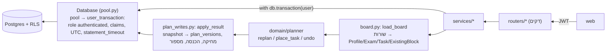

# S09 — API לליבה: מבחנים, משימות, בלוקים, תוכנית ו"היום": תוכנית עבודה

> **For agentic workers:** REQUIRED SUB-SKILL: Use superpowers:subagent-driven-development (recommended) or superpowers:executing-plans to implement this plan task-by-task. Steps use checkbox (`- [ ]`) syntax for tracking.

**מטרה:** ה-API מחובר למסד ומגיש את הליבה: פרופיל, מבחנים, משימות, בלוקים, קריאת התוכנית ו"היום", תכנון מחדש עם תצוגה מקדימה, וביטול. כל פעולה רצה בטרנזקציה אחת בשם המשתמש (RLS), וכל endpoint נבדק גם מול משתמש אחר.

**גישה:** routers דקים, services עם הלוגיקה, וטרנזקציה מפורשת בתוך ה-service (`with db.transaction(user) as conn:`), כך שה-commit, כולל בדיקת החפיפה הדחויה (`blocks_no_overlap`), קורה לפני שהתשובה יוצאת. ה-service טוען את "הלוח" של המשתמש מהמסד וממפה אותו לטיפוסי המתכנן. המתכנן הטהור של S06–S08 מחליט, ושכבת כתיבה אחת (`apply_result`) כותבת את `PlanResult` ואת `plan_versions`.

**כלים:** Python 3.14, ‏uv, ‏FastAPI, ‏psycopg 3 עם `psycopg-pool` (התלות החדשה היחידה), ‏Alembic עם SQL מפורש, ‏Postgres 17.

**מסמך תכנון:** `docs/spec/2026-10-19-studyflow-v2-design.md`, סעיפים 7.3, 7.4, 7.6 (שלבים 6–8), 7.7, 10 ו-11.16. במפת הדרכים שב-[artifact](https://claude.ai/code/artifact/29a3c52e-d399-425e-90b6-7c05e9146bfa) זו משימה S09, והיא מוכנה כש"כל endpoint נבדק, כולל בעלות בין משתמשים".

## איך החלקים מתחברים



- **`Database`** מחזיק pool של חיבורים בתפקיד `studyflow_api`. ‏`transaction(user)` לוקח חיבור ומריץ `user_transaction`: מעבר ל-`authenticated`, ה-claims, ‏`TimeZone` UTC ו-`statement_timeout`, בפקודה אחת. בלי זה אין גישה לטבלאות.
- **`load_board`** קורא את הפרופיל, המבחנים, המשימות והבלוקים הרלוונטיים, ומחזיר את הקלט של המתכנן. כל ההחלטות על מחיקות רכות, מבחנים שעברו וסדר יציב נמצאות שם בלבד.
- **`apply_result`** הוא המקום היחיד שכותב תוצאת מתכנן: snapshot של הלוח לפני השינוי ל-`plan_versions`, מחיקת `removed`, הכנסת בלוקים חדשים ועדכון המספור. ‏`undo_version` הוא הצד השני שלו.
- **נעילה לכל משתמש:** כל פעולה שמשנה את הלוח מתחילה ב-`SELECT … FOR UPDATE` על שורת הפרופיל, כך ששתי בקשות של אותו משתמש לא קוראות את אותו לוח וכותבות שתיהן.

## מה מצאתי לפני התכנון (2026-11-15)

| נושא | מצב |
|---|---|
| Dependabot | שני ענפים. ה-uv ‏(#8) כבר ב-`main` (נכנס ב-S08), וה-cherry-pick שלו ריק. ה-web ‏(#9, 8 עדכונים): ה-CI ב-PR ירוק (2/2), ומקומית עברו lint, ‏typecheck, ‏133 בדיקות ו-build. הוא הועבר ל-`main` ב-ff ‏(`7365e67`) ונדחף |
| ה-artifact | 8 שורות S09 ב"פריטים פתוחים להמשך". הסטטוס של S09 עבר ל"בעבודה" |
| `user_transaction` | קיים ונבדק (RLS, ‏`claim.sub`), אבל אין pool, אין endpoint שמשתמש בו, ו-`DATABASE_URL` לא נקרא בשום מקום |
| תשובת 500 | ה-handler של `Exception` רץ ב-`ServerErrorMiddleware`, מחוץ ל-`CORSMiddleware`, ולכן לתשובה אין כותרות CORS |
| `plan_versions` | ל-`authenticated` יש INSERT על כל העמודות (כולל `created_at` ו-`undone_at`) ו-UPDATE חופשי של `undone_at`, כולל איפוס |
| `blocks` | אין CHECK לדקה שלמה. בלוק עם שניות יגרום ל-`Interval` של המתכנן לזרוק, כלומר 500 |
| המתכנן | `resolve_dependencies` כבר מתעלם מתלות במשימה שאינה בקלט. ‏`place_task` דורש ש-`release` יהיו בלוקים חיים מתוכננים של המשימה |

## ההחלטות שלי

| נושא | החלטה | למה | על מה ויתרנו |
|---|---|---|---|
| שורות S09 ב-artifact | **נכנסים:** ‏500 בלי CORS; חיבור `user_transaction` ל-endpoints (pool, ‏commit לפני התשובה, פרופיל בכניסה הראשונה, ‏timezone, ‏`set_config` אחד, ‏`statement_timeout`); מיפוי שורות למתכנן; בדיקות הטיפוס במודל; כתיבת `PlanResult` ו-`plan_versions`; דחייה של בלוק שהתחיל (כהחלטה, למטה). **נדחים:** ה-timeout של supabase-js ו-refreshSession ל-S13; ההתחברות של `studyflow_api` דרך ה-pooler לסוף הסשן (צריך סיסמה מהמשתמש) | S09 הוא ה-API. ה-web עוד לא קורא לאף endpoint חדש, וב-S13 הלקוח מקבל קריאות כתיבה ואז מטפלים בו כולו. ה-pooler תלוי בסיסמה שרק המשתמש קובע | לגעת ב-web עכשיו בשביל באג של פיתוח בלבד |
| מה נכנס מ-7.7 | `GET/PATCH /me`; ‏`GET/POST /exams`, ‏`PATCH/DELETE /exams/{id}`; ‏`GET /exams/{id}/tasks`, ‏`POST /tasks`, ‏`PATCH/DELETE /tasks/{id}`; ‏`POST /blocks/{id}/complete`, ‏`uncomplete`, ‏`defer`, ‏`PATCH /blocks/{id}` (רק `pinned`); ‏`GET /plan`, ‏`GET /today`; ‏`POST /plan/replan`; ‏`POST /plan/undo` | זו הליבה שמסכי S13–S15 צריכים. ‏`GET /exams/{id}/tasks` לא בטבלה, אבל מסך המבחן ודוח "לא נכנס" לא עובדים בלעדיו | — |
| מה לא נכנס | חומרים (S10), ‏`/plans/generate` ו-`/jobs` (S10/S12), ‏XP, רצף ותגים ב-`complete` (S19), ‏Push (S16), ‏`/me/export` ו-`DELETE /me` (S15, "ייצוא ומחיקת חשבון"), ‏`/progress` (S19), ‏`/plan/change-requests` (S20), הזזת בלוק ב-`PATCH` (S18, גרירה) | לכל אחד יש scope במפת הדרכים, ובחלקם התלות (טבלאות, worker) עוד לא קיימת | — |
| טרנזקציה | ה-service פותח `with db.transaction(user) as conn:` ומחזיר רק אחרי שהיא נסגרה. לא dependency עם `yield` | `blocks_no_overlap` נבדק ב-COMMIT. כך שגיאת חפיפה הופכת ל-409 באותה בקשה, ולא קשורה להתנהגות של FastAPI בסיום dependency | dependency גנרי שעוטף כל endpoint |
| sync מול async | endpoints רגילים (`def`), psycopg סינכרוני, ‏`ConnectionPool` עם `max_size=10` | הקוד הקיים סינכרוני, ‏FastAPI מריץ אותם ב-thread pool, וה-pooler של Supabase החינמי מגביל חיבורים בכל מקרה | async מלא |
| הגדרות ה-pool | `min_size=1`, ‏`max_size=10`, ‏`timeout=5` שניות להמתנה לחיבור, ‏`prepare_threshold=None`, ‏`check=ConnectionPool.check_connection` | בלי prepared statements החיבור עובד גם מול pooler במצב transaction. ‏`check` מוריד חיבור שה-pooler סגר | — |
| `user_transaction` | פקודה אחת: `select set_config('role','authenticated',true), set_config('request.jwt.claims',…,true), set_config('request.jwt.claim.sub',…,true), set_config('TimeZone','UTC',true), set_config('statement_timeout','5s',true)` | פחות סבבים למסד. ‏`set_config('role', …, true)` שקול ל-`SET LOCAL ROLE`. ‏5 שניות: כל שאילתה של ה-API קטנה, ומה שנתקע עדיף שייכשל | שלוש פקודות כמו היום |
| בלי `DATABASE_URL` | האפליקציה עולה, ו-endpoint שצריך מסד מחזיר 503 ‏`database_unavailable` | בדיקות האימות וה-health רצות בלי Postgres. ב-S21 production יכול לדרוש אותו בעלייה | כישלון בעלייה |
| שעון | `app.state.clock` (ברירת מחדל `datetime.now(UTC)`), ובבדיקות שעון קפוא | המתכנן מקבל `now`. בלי שעון מוזרק אי אפשר לבדוק "היום" ותכנון מחדש | — |
| פרופיל בכניסה הראשונה | `ensure_profile`: ‏`INSERT … ON CONFLICT DO NOTHING` ואז `SELECT`. ‏`GET /me` קורא לה, וכל service שצריך פרופיל גם כן | "פרופיל בכניסה הראשונה" בלי endpoint נוסף, ו-API שלא נופל אם ה-web לא קרא קודם ל-`/me` | יצירה ב-webhook של Supabase |
| timezone | `GET /me` מחזיר את `timezone`. ה-web משווה לדפדפן ושולח `PATCH /me {"timezone": …}` אם שונה. השם נבדק עם `parse_timezone` | 7.3 בלי כותרת חדשה בכל בקשה. בכניסה הראשונה מחוץ לישראל יש בקשה אחת עם אזור ברירת המחדל, ואין עוד תוכנית שתושפע | כותרת `X-Timezone` בכל בקשה |
| שינוי בפרופיל | `PATCH /me` רק שומר. אם השתנה שדה שמשפיע על התוכנית (`timezone`, שעות, דקות, חלונות, ימי מנוחה), התשובה כוללת `plan_affected: true`, וה-web מציע תצוגה מקדימה | 7.6 שלב 8 ו-11.16: שינוי גלובלי מקבל תצוגה מקדימה ואישור | תכנון מחדש אוטומטי |
| מיפוי למתכנן | **מבחנים:** בלי `deleted_at`, ובלי מבחן שתאריכו לפני התאריך המקומי של היום. **משימות:** בלי `deleted_at`, של מבחן שנכנס, לפי `(created_at, id)`; ‏`depends_on` שמצביע על משימה שלא נכנסה הופך ל-`None`. **בלוקים:** `planned` ו-`done` שנגמרים אחרי `now − 48h`, של כל המשימות (גם שנמחקו) | מבחן שעבר היה מוסיף לדוח משימות שאין מה לעשות איתן. בלוק שהושלם של משימה שנמחקה עדיין תופס את הזמן ואת התקציב של היום. 48 שעות מכסות את יום הלימוד הנוכחי גם למי שקם מוקדם וישן אחרי חצות. ‏`(created_at, id)` יציב עד שתגיע עמודת סדר (S11) | להעביר למתכנן הכל ולסנן אחר כך |
| `plan_versions` | נוצרת רק כשהלוח באמת משתנה (מחיקה, הכנסה או מספור). ‏`reason` הוא `VersionReason`: ‏`replan`, ‏`defer`, ‏`task_added`, ‏`task_changed`, ‏`task_deleted`, ‏`exam_deleted`. ‏`complete`, ‏`uncomplete` ונעילה לא יוצרים גרסה | ביטול של סימון ביצוע הוא `uncomplete`. ‏`undo` לא יכול לבטל נעילה (בלוק שננעל אחרי השינוי סגור, 7.6 שלב 6), אז גרסה לנעילה הייתה "בטל" שלא עושה כלום | גרסה לכל כתיבה |
| ביטול | `POST /plan/undo {"version_id"}` מבטל רק את הגרסה האחרונה שלא בוטלה, ואחרת 409 ‏`stale_plan`. הביטול לא יוצר גרסה; הוא מסמן `undone_at`, וביטול נוסף הולך לגרסה שלפניה | מחסנית ביטולים בלי "לבטל את הביטול". ‏`version_id` מונע מלשונית ישנה לבטל שינוי שלא ראתה | redo |
| ביטול של מחיקה או הוספה | `plan_versions` מקבלת `exam_id` ו-`task_id`. ביטול של `exam_deleted` או `task_deleted` מחזיר את `deleted_at` ל-NULL לפני השחזור; ביטול של `task_added` מוחק את המשימה (מחיקה רכה) | "מחיקה רכה עם אפשרות ביטול" (7.4) ו"בטל" אחד אחרי משימה שנוספה (7.6 שלב 8). בלי זה השחזור היה מדלג על הבלוקים של משימה מחוקה | endpoint נפרד של שחזור |
| מה הביטול כותב | מוחק את `delete` ואז מכניס את `restore` (אותו `id`, ולכן קודם מוחקים); משחזר רק בלוקים שהמשימה שלהם עדיין `todo` ולא מחוקה (השאר מצטרפים ל-`dropped`); ממספר מחדש; ומניח מחדש עם `place_task` את המשימות של `dropped`, אחת אחת, בסדר ה-snapshot | זה מה ש-7.6 שלב 6 מגדיר, ובלי הסינון ה-FK או המשימה שהושלמה ייכשלו | — |
| תצוגה מקדימה | `POST /plan/replan {"preview": true}` מחזיר את השינוי ו-`basis` (‏SHA-256 של קלט המתכנן בלי `now`). ‏`{"preview": false, "basis": …}` מחשב שוב עם `now` עדכני וכותב, ואם ה-`basis` לא תואם: 409 ‏`stale_plan` | המשתמש מאשר את מה שראה (11.16). חישוב מחדש בכתיבה שומר על בלוקים שהתחילו בינתיים | לשמור את התצוגה בצד השרת |
| שינוי קטן | `POST /tasks`, שינוי משך/סוג/תלות/מיקוד ב-`PATCH /tasks`, ו-`defer`: ‏`place_task`, עם `release` של הבלוקים המועמדים של המשימה בעריכה ובדחייה | 7.6 שלב 7: בלי לגעת בשאר הלוח | `replan` לכל שינוי |
| הנחה שנכשלה | `POST /tasks` ו-`PATCH /tasks`: השדות נשמרים, הלוח לא משתנה, והתשובה כוללת `placement: {"placed": false, "reason", "blocked_by"}`. ‏`defer`: ‏409 ‏`placement_failed` עם `reason` ו-`blocked_by`, ושום דבר לא משתנה | משימה שהמשתמש הקליד לא נעלמת בגלל שאין לה מקום. דחייה שלא הצליחה היא בקשה שלא בוצעה. בשני המקרים ה-web מציע תכנון מחדש | — |
| מחיקה, `done` או `skipped` של משימה, מחיקת מבחן | מחיקה רכה (או שינוי הסטטוס), ומחיקת הבלוקים `planned` שלהם שמתחילים ב-`now` (מעוגל) או אחריו, כולל נעולים, עם גרסה. בלוק שכבר התחיל נשאר | משימה שאין בה צורך לא תופסת זמן עתידי. בלוק שמתנהל עכשיו לא נמחק מתחת למשתמש (אותו כלל כמו קבוע ב-S08) | להשאיר את הבלוקים עד תכנון מחדש |
| שינוי תאריך או קושי של מבחן, מבחן חדש | נשמר, והתשובה כוללת `plan_affected: true` | שינוי גלובלי: תצוגה מקדימה ואישור | — |
| דחייה של בלוק שהתחיל | הבלוק משתחרר כולו, וכל הדקות שלו מונחות מחדש | מי שדוחה בלוק באמצע כנראה לא לומד עכשיו. אם בכל זאת למד, הוא מקבל כמה דקות עודפות, ולא מאבד זמן לימוד | לסמן את החלק שעבר כ-`done` |
| `complete` | `planned`, ‏`missed` או `skipped` → `done`; ‏`done` → בלי שינוי (200). המשימה עוברת ל-`done` כשאין לה בלוק `planned` שנגמר אחרי `now` ו-`is_complete(task, דקות ה-done, has_live_block=True)` | 7.7: טרנזקציה אחת לבלוק ולמשימה. XP, רצף ותגים מצטרפים לאותה טרנזקציה ב-S19 | — |
| `uncomplete` | `done` → `planned`; משימה ב-`done` חוזרת ל-`todo` | ההפך המדויק של `complete` | — |
| שגיאות מסד | `ExclusionViolation` ‏(23P01) → 409 ‏`plan_conflict`; ‏`PoolTimeout`, ‏`OperationalError`, ‏`QueryCanceled` → 503 ‏`database_unavailable` | חפיפה היא התנגשות במצב, לא באג בשרת. מסד שלא עונה הוא זמני | 500 לכולן |
| תשובת 500 | middleware פנימי (בתוך CORS) שתופס כל חריגה ומחזיר את ה-problem של `internal_error` | כך גם לתשובת 500 יש כותרות CORS, וה-web מציג שגיאת שרת במקום "לא הצלחנו להגיע" | — |
| הפניה למשאב של משתמש אחר | 404 ‏`not_found`, גם כשההפניה בגוף הבקשה (`exam_id`, ‏`depends_on_task_id`) | RLS מסתיר את השורה, וסעיף 10 דורש 404 | 422 |
| תלות | `depends_on_task_id` רק למשימה של אותו משתמש שלא נמחקה; מעגל תלויות → 422 ‏`dependency_cycle` | המתכנן מדווח מעגל, אבל עדיף לא לאפשר אותו | — |
| `GET /plan` | `from` ו-`to` הם תאריכים מקומיים (ברירת מחדל: יום הלימוד של היום ושישה אחריו), עד 62 ימים. בלוק שייך ליום לפי `study_date` של ההתחלה. לכל בלוק `state` נגזר: ‏`done`, ‏`missed`, ‏`skipped`, ‏`upcoming`, ‏`in_progress`, ‏`overdue`. בנוסף `unplaced` (משימות `todo` שהבלוקים החיים שלהן לא מכסים אותן, עם הדקות החסרות) ו-`undo` (הגרסה האחרונה שלא בוטלה) | GET לא כותב ולא מריץ מתכנן. הסיבות של "לא נכנס" באות מהתצוגה המקדימה | להריץ `replan` בכל GET |
| זמנים בתשובות | ISO 8601 ב-UTC (`…Z`) | 7.3: ה-API מחזיר offset, והממשק מציג לפי אזור הזמן | — |

## מה לא נכלל ולמה

- **ה-timeout של supabase-js ו-refreshSession לפני ניתוק:** S13, עם קריאות הכתיבה של ה-web.
- **ההתחברות של `studyflow_api` דרך ה-pooler:** בסוף הסשן, אחרי המיזוג. המשתמש קובע סיסמה ב-psql ושם את `DATABASE_URL` ב-`api/.env`. אם לא יספיק, השורה עוברת ל-S13.
- **הזזת בלוק (`starts_at`/`ends_at` ב-`PATCH /blocks`):** S18. בלוק שזז נעשה נעול, ובלוק נעול סגור לביטול, ולכן ההזזה צריכה החלטה משלה על "בטל".
- **שאר ה-endpoints של 7.7:** בטבלת ההחלטות למעלה.

## אילוצים גלובליים

- Python 3.14, ‏uv, ‏`exclude-newer = "7 days"`. תלות חדשה אחת: `psycopg[binary,pool]` (כלומר `psycopg-pool`).
- `ruff check`, ‏`ruff format --check`, ‏`mypy` (strict) ו-`pytest` עם `filterwarnings = ["error"]`. ‏558 הבדיקות הקיימות נשארות ירוקות, חוץ ממה שהתוכנית משנה במפורש.
- **routers דקים:** פענוח הבקשה, קריאה לפונקציה אחת ב-service, והחזרת מודל. אין SQL ב-router.
- **SQL:** רק דרך `conn.execute` עם פרמטרים (`%s`). אין f-string עם ערך מהבקשה. כל שאילתה רצה בתוך `db.transaction(user)`.
- **בעלות:** כל שאילתה מסננת גם `user_id = %s` במפורש, למרות ש-RLS כבר מסנן (הגנה כפולה, וזה גם עוזר לאינדקסים).
- **זמן:** כל `datetime` aware. ‏`now` מגיע מ-`app.state.clock` ולא מ-`datetime.now()` ב-service. זמן שנשמר בבלוק הוא דקה שלמה ב-UTC.
- **שגיאות:** רק `ApiError(code)` עם קוד שקיים ב-`PROBLEMS`; כותרת בעברית למשתמש, בלי פרטים פנימיים.
- property או בדיקה שנכשלים לא מוחלשים ולא מקבלים `assume` או `xfail` מצד ה-implementer. מדווחים את הדוגמה המינימלית ועוצרים ב-`DONE_WITH_CONCERNS`. החריג היחיד: Task 7 (בדיקות בלבד) מסמן ממצא ב-`xfail(strict=True)` עם הדוגמה, וממשיך.
- מיגרציה: SQL מפורש, ‏grants באותה מיגרציה, ו-`downgrade` שעובד.
- לא נוגעים ב-`legacy/` וב-`web/`.
- הקוד, ההערות והודעות הקומיט באנגלית. התוכנית והדיווחים בעברית.
- git רץ בשיחה הראשית, וה-subagents לא מריצים git (גם לא `git stash` או `git checkout`). מוסיפים קבצים לפי שם, ובודקים `git status --short --untracked-files=all` לפני כל קומיט. לפני push: ‏`gitleaks git --redact --no-banner .`. אין force-push.
- **הריפו ב-`/Users/eyalatar/studyflow`.** תיקיית העבודה של הסשן, `~/Desktop/MyProject/studyflow`, היא העתק ישן. כל subagent עובד רק בנתיבים מלאים תחת `/Users/eyalatar/studyflow`, והפקודות רצות מתוך `/Users/eyalatar/studyflow/api`. קבצים זמניים רק מחוץ לריפו, ונמחקים בסוף. מי שמריץ בדיקת מוטציות מוחק אחריה `__pycache__`.
- בדיקות ה-API עם מסד רצות מול ה-Postgres המקומי (`postgresql@17`) דרך הפיקסצ'רים של `tests/fixtures_db.py`, בתפקיד `studyflow_api`.

## על מה לשים לב בבדיקה

1. **שתי בקשות במקביל של אותו משתמש** (שתי לשוניות, לחיצה כפולה): מה שצריך לקרות: הן רצות בזו אחר זו, ושום בלוק לא נכפל. Task 4 (`lock_user`) ו-Task 7 (בדיקה עם שני threads).
2. **שגיאת חפיפה ב-COMMIT:** בלוק `missed` שמסומן `done` על זמן שבלוק אחר תפס בינתיים. מה שצריך לקרות: 409 ‏`plan_conflict`, והמסד לא השתנה. Task 6.
3. **משתמש שמחליף אזור זמן** (מכשיר שני בחו"ל): מה שצריך לקרות: `GET /today` מחשב את היום לפי האזור החדש מיד אחרי `PATCH /me`, והבלוקים נשארים באותם רגעים. Task 4 ו-Task 7.
4. **ביטול אחרי שעבר זמן:** בלוק מה-snapshot שהשעה שלו עברה, או שהמשימה שלו הושלמה. מה שצריך לקרות: הוא לא חוזר, והמשימות של מה שלא חזר מונחות מחדש. Task 5 ו-Task 7.
5. **כותרת עם `<script>`:** מה שצריך לקרות: נשמרת ומוחזרת כמחרוזת JSON כמו שהיא, עם `Content-Type: application/json`. Task 6.

## מי עושה מה

| Task | מה | מי | תלוי ב- |
|---|---|---|---|
| 0 | פתיחה: Dependabot, הסטטוס, הענף והתוכנית | אני (נעשה, חוץ מהקומיט) | — |
| 1 | יסודות: pool, ‏`user_transaction`, שעון, שגיאות, 500 עם CORS, פיקסצ'רים | subagent | 0 |
| 2 | מיגרציה 0004 ובדיקות המסד | subagent | 0 (במקביל ל-1) |
| 3 | בדיקות הטיפוס במודל המתכנן | subagent | 0 (במקביל ל-1 ו-2) |
| 4 | פרופיל, הלוח והמיפוי למתכנן, `GET/PATCH /me` | subagent | 1 |
| 5 | כתיבת תוצאות וגרסאות, `GET /plan`, ‏`GET /today`, ‏`/plan/replan`, ‏`/plan/undo` | subagent | 2, 4 |
| 6 | מבחנים ומשימות | subagent | 5 |
| 7 | בלוקים | subagent | 5 (במקביל ל-6) |
| 8 | בדיקות בלבד: בעלות לכל endpoint ותרחישים מקצה לקצה | subagent (Opus) | 6, 7 |
| 9 | מסמך התכנון והלשונית שלו | אני | 8 |
| 10 | סקירה סופית, מיגרציה ל-dev, מיזוג וסגירה | אני | 9 |

## מבנה הקבצים

```
api/pyproject.toml, api/uv.lock                psycopg[binary,pool]
api/app/config.py                              database_url
api/app/db/session.py                          set_config אחד, statement_timeout
api/app/db/pool.py                             (חדש) Database
api/app/deps.py                                (חדש) DatabaseDep, Now
api/app/errors.py                              קודים חדשים, ApiError.extra, שגיאות מסד, middleware ל-500
api/app/main.py                                lifespan, database, clock, routers
api/app/services/__init__.py                   (חדש)
api/app/services/profiles.py                   (חדש) ensure_profile, update_profile, lock_user
api/app/services/board.py                      (חדש) Board, BlockRow, load_board, fingerprint
api/app/services/plan_writes.py                (חדש) VersionReason, apply_result, delete_open_blocks, renumber, undo_version
api/app/services/plan_views.py                 (חדש) plan_view, today_view
api/app/services/replans.py                    (חדש) preview_replan, apply_replan
api/app/services/exams.py, tasks.py, blocks.py (חדשים)
api/app/schemas/{me,exams,tasks,blocks,plan}.py (חדשים) מודלי Pydantic
api/app/routers/me.py                          GET/PATCH /me
api/app/routers/{exams,tasks,blocks,plan}.py   (חדשים)
api/app/domain/planner/model.py                בדיקות טיפוס
api/migrations/versions/0004_api_hardening.py  (חדש)
api/tests/fixtures_db.py                       (חדש, מ-tests/db/conftest.py) + database, clock, db_app, api, make_api_user
api/tests/api/…                                (חדש) בדיקות לכל router
api/tests/db/test_api_hardening.py             (חדש)
api/tests/planner/test_model.py                בדיקות הטיפוס
api/.env.example                               DATABASE_URL
מסמך התכנון (7.3, 7.4, 7.7) והלשונית שלו ב-artifact
```

---

### Task 0: פתיחה

נעשה לפני כתיבת התוכנית: Dependabot מוזג, הסטטוס "בעבודה", והענף `s09-core-api` נפתח מ-`main` (`7365e67`).

- [ ] **Step 1: קומיט של התוכנית**
  `git add docs/archive/plans/2026-11-15-s09-core-api.md && git commit -m "docs(plan): add the S09 core API plan"`

---

### Task 1: יסודות

**למה:** כל endpoint אחר צריך pool, טרנזקציה בשם המשתמש, שעון ומיפוי שגיאות. הפיקסצ'רים כאן הם הבסיס לכל בדיקות ה-API.

**Files:**
- Modify: `api/pyproject.toml`, ‏`api/uv.lock` (`uv add "psycopg[binary,pool]"`), ‏`api/app/config.py`, ‏`api/app/db/session.py`, ‏`api/app/errors.py`, ‏`api/app/main.py`, ‏`api/.env.example`
- Create: `api/app/db/pool.py`, ‏`api/app/deps.py`, ‏`api/tests/fixtures_db.py`, ‏`api/tests/api/__init__.py`, ‏`api/tests/api/test_foundation.py`
- Modify: `api/tests/conftest.py` (`pytest_plugins = ["tests.fixtures_db"]`), ‏`api/tests/db/conftest.py` (הפיקסצ'רים עוברים ל-`fixtures_db.py`; נשאר ריק או נמחק), ‏`api/tests/test_errors.py`, ‏`api/tests/db/test_rls.py` רק אם צריך

**Interfaces (Produces):**
- `config.py`: ‏`Settings.database_url: str | None = None` (מ-`DATABASE_URL`). מחרוזת ריקה → `None`.
- `db/session.py`: ‏`user_transaction(conn, user)` — אותה חתימה ואותו חוזה, ופקודת `set_config` אחת כמו בטבלת ההחלטות. ‏`STATEMENT_TIMEOUT: Final = "5s"`.
- `db/pool.py`:
  - `class Database`: ‏`__init__(self, conninfo: str, *, min_size: int = 1, max_size: int = 10, timeout: float = 5.0)`; ‏`open() -> None` (פותח את ה-pool ומחכה לחיבור הראשון); ‏`close() -> None`; ‏`transaction(self, user: CurrentUser) -> ContextManager[psycopg.Connection[DictRow]]`: חיבור מה-pool (`row_factory=dict_row`), ‏`user_transaction`, ‏commit ביציאה רגילה, rollback בחריגה.
- `deps.py`:
  - `get_database(request) -> Database`: ‏`request.app.state.database`; ‏`None` → `ApiError("database_unavailable")`. ‏`DatabaseDep = Annotated[Database, Depends(get_database)]`.
  - `get_now(request) -> datetime`: ‏`request.app.state.clock()`, נבדק aware ומומר ל-UTC. ‏`Now = Annotated[datetime, Depends(get_now)]`.
- `main.py`: ‏`create_app(settings=None, *, signing_keys=None, database: Database | None = None, clock: Callable[[], datetime] | None = None)`. ‏`database` מבחוץ לא נפתח ולא נסגר באפליקציה (הבדיקות מנהלות אותו). בלעדיו ועם `settings.database_url`: ‏lifespan יוצר `Database`, פותח וסוגר. ‏`app.state.database` (אולי `None`), ‏`app.state.clock`.
- `errors.py`:
  - `ApiError(code, *, headers=None, extra: Mapping[str, object] | None = None)`; ‏`extra` נכנס לגוף ה-problem כשדות נוספים (לא דורס `type`, ‏`title`, ‏`status`, ‏`code`).
  - קודים חדשים ב-`PROBLEMS` (כולם עכשיו, כדי ש-Tasks 5–7 לא ייגעו בקובץ):

    | code | status | title |
    |---|---|---|
    | `database_unavailable` | 503 | השירות לא זמין כרגע. נסו שוב בעוד רגע. |
    | `plan_conflict` | 409 | השינוי מתנגש בבלוק אחר בלוח. רעננו ונסו שוב. |
    | `stale_plan` | 409 | התוכנית השתנתה בינתיים. רעננו ונסו שוב. |
    | `placement_failed` | 409 | לא מצאנו מקום פנוי למשימה. אפשר לתכנן מחדש את הלוח. |
    | `invalid_state` | 409 | אי אפשר לבצע את הפעולה הזו במצב הנוכחי. |
    | `nothing_to_undo` | 409 | אין שינוי לבטל. |
    | `dependency_cycle` | 422 | התלות הזו יוצרת מעגל בין משימות. |
    | `exam_in_past` | 422 | תאריך המבחן כבר עבר. |

  - handlers: ‏`psycopg.errors.ExclusionViolation` → `plan_conflict`; ‏`psycopg_pool.PoolTimeout`, ‏`psycopg.OperationalError`, ‏`psycopg.errors.QueryCanceled` → `database_unavailable` (עם `logger.warning` של שם המחלקה בלבד).
  - `CatchAllMiddleware` (ASGI טהור, נרשם **לפני** `CORSMiddleware` ב-`create_app`, כלומר בתוכו): חריגה שלא טופלה → `logger.exception` ותשובת `internal_error`. אם התשובה כבר התחילה לצאת, החריגה ממשיכה הלאה.
- `tests/fixtures_db.py`: ‏`migrated_database_url`, ‏`db`, ‏`api_db`, ‏`make_user` (כמו היום) ובנוסף:
  - `database` (scope session): ‏`Database` על ה-URL המהוגר עם `user="studyflow_api"`, פתוח.
  - `class FrozenClock`: ‏`now: datetime` (ברירת מחדל `2026-11-15T06:00:00Z`), ‏`__call__()`, ‏`set(value)`, ‏`advance(**kwargs)`. פיקסצ'ר `clock`.
  - `db_app(settings, jwks, database, clock, db)`: ‏`create_app(settings, signing_keys=StaticKeys(jwks), database=database, clock=clock)`. תלוי ב-`db` כדי שכל בדיקה תתחיל ממסד ריק.
  - `api(db_app) -> TestClient` עם `raise_server_exceptions=False`.
  - `make_api_user(db, make_token) -> Callable[[], ApiUser]`; ‏`ApiUser(id: UUID, headers: dict[str, str])`: שורה ב-`auth.users` וטוקן עם `sub` שלו.

- [ ] **Step 1: הבדיקות** (`tests/api/test_foundation.py`, ‏`tests/test_errors.py`, ‏`tests/db/test_rls.py`)

  | בדיקה | מצופה |
  |---|---|
  | `test_transaction_sets_role_claims_timezone_and_timeout` | בתוך `database.transaction(user)`: ‏`current_user = 'authenticated'`, ‏`auth.uid() = user.id`, ‏`current_setting('TimeZone') = 'UTC'`, ‏`current_setting('statement_timeout') = '5s'` |
  | `test_transaction_commits_on_exit_and_rolls_back_on_error` | INSERT לפרופיל ויציאה רגילה: השורה קיימת (נבדק דרך `db`). חריגה בתוך הבלוק: השורה לא קיימת, והחריגה עוברת |
  | `test_settings_do_not_leak_between_transactions` | שתי טרנזקציות רצופות של שני משתמשים על pool עם `max_size=1`: ‏`auth.uid()` של כל אחת הוא שלה, ובין לבין `current_setting('request.jwt.claim.sub', true)` ריק |
  | `test_statement_timeout_becomes_503` | endpoint בדיקה זמני (נרשם בבדיקה על אפליקציה) שמריץ `select pg_sleep(6)` → 503 ‏`database_unavailable`, עם כותרות CORS כשנשלח `Origin` מורשה |
  | `test_exclusion_violation_becomes_409` | endpoint בדיקה שמכניס שני בלוקים חופפים `planned` באותה טרנזקציה → 409 ‏`plan_conflict` |
  | `test_unhandled_error_is_500_with_cors_headers` | endpoint בדיקה שזורק `RuntimeError`, עם `Origin` מורשה → 500 ‏`internal_error`, ‏`access-control-allow-origin` קיים, ‏`application/problem+json` |
  | `test_no_database_is_503` | `create_app` בלי מסד ובלי `database_url`, ‏endpoint שתלוי ב-`DatabaseDep` → 503 |
  | `test_api_error_extra_fields` | `ApiError("placement_failed", extra={"reason": "not_enough_time"})` → בגוף `reason`, ו-`code` לא נדרס גם אם `extra` מכיל `code` |
  | `test_clock_is_injected` | endpoint בדיקה שמחזיר את `Now` → הערך של `clock` |

  הבדיקות של `test_rls.py` ו-`test_plan_versions.py` נשארות ירוקות בלי שינוי בהתנהגות.

- [ ] **Step 2: הבדיקות נכשלות** — `uv run pytest tests/api tests/test_errors.py -q`
- [ ] **Step 3: מימוש**
- [ ] **Step 4: הכל ירוק** — `uv run pytest -q && uv run ruff check . && uv run ruff format --check . && uv run mypy`
- [ ] **Step 5: קומיט (בשיחה הראשית)** — `feat(api): connect user transactions through a pool, with a clock and database errors`

---

### Task 2: מיגרציה 0004

**למה:** שתי שורות S09 ב-artifact (ההרשאות של `plan_versions`, ובלוק שאינו בדקה שלמה), ושתי עמודות שהביטול של מחיקה צריך.

**Files:**
- Create: `api/migrations/versions/0004_api_hardening.py`, ‏`api/tests/db/test_api_hardening.py`
- Modify: `api/tests/db/test_migrations.py` (ה-head הוא `0004`), ‏`api/tests/db/test_plan_versions.py` רק אם בדיקה קיימת שמכניסה `created_at` או `undone_at` כ-`authenticated` צריכה להשתנות (לדווח)

**Interfaces (Produces), במיגרציה:**
- `app.blocks`: ‏`CONSTRAINT blocks_whole_minutes CHECK (date_trunc('minute', starts_at) = starts_at AND date_trunc('minute', ends_at) = ends_at)`. (אם Postgres דורש פונקציה immutable, ‏`(extract(epoch FROM starts_at) % 60) = 0` לשני השדות.)
- `app.plan_versions`:
  - `ADD COLUMN exam_id uuid`, ‏`ADD COLUMN task_id uuid`, עם `FOREIGN KEY (exam_id, user_id) REFERENCES app.exams (id, user_id) ON DELETE SET NULL (exam_id)` ואותו דבר ל-`task_id` מול `app.tasks`.
  - `REVOKE INSERT ON app.plan_versions FROM authenticated`; ‏`GRANT INSERT (user_id, reason, snapshot, exam_id, task_id) ON app.plan_versions TO authenticated`. ‏`SELECT` ו-`UPDATE (undone_at)` נשארים.
  - פונקציה `app.plan_versions_undo_once()` (‏`plpgsql`, ‏`SET search_path = ''`) וטריגר `BEFORE UPDATE`: אם `OLD.undone_at IS NOT NULL` או `NEW.undone_at IS NULL` → `RAISE EXCEPTION` עם `ERRCODE = 'check_violation'`; אחרת `NEW.undone_at := now()`.
- `downgrade`: מסיר את הטריגר, הפונקציה, העמודות וה-CHECK, ומחזיר `GRANT INSERT ON app.plan_versions TO authenticated`.

- [ ] **Step 1: הבדיקות** (`tests/db/test_api_hardening.py`, בתפקיד `authenticated` דרך `user_transaction` אלא אם כתוב אחרת)

  | בדיקה | מצופה |
  |---|---|
  | `test_block_times_must_be_whole_minutes` | בלוק עם `starts_at` של `…:00:30` → `CheckViolation`; ‏`ends_at` עם מיקרו-שניות → `CheckViolation`; דקה שלמה נכנסת |
  | `test_authenticated_cannot_set_created_at_or_undone_at` | INSERT עם `created_at` → `InsufficientPrivilege`; עם `undone_at` → `InsufficientPrivilege`; עם `user_id, reason, snapshot` → נכנס |
  | `test_undone_at_is_set_once_to_now` | `UPDATE … SET undone_at = '2000-01-01'` → הערך הוא `now()` של הטרנזקציה; עדכון שני → `CheckViolation`; ‏`SET undone_at = NULL` על שורה שלא בוטלה → `CheckViolation` |
  | `test_version_links_to_own_exam_and_task_only` | `exam_id` של משתמש אחר → `ForeignKeyViolation`; מחיקה (קשה, בתור `db`) של המבחן → `exam_id` הופך ל-NULL והשורה נשארת |
  | `test_downgrade_and_upgrade_again` | `downgrade` ל-`0003` ו-`upgrade` ל-`head` על מסד זמני עוברים |

- [ ] **Step 2: הבדיקות נכשלות** — `uv run pytest tests/db -q`
- [ ] **Step 3: מימוש**
- [ ] **Step 4: הכל ירוק** — `uv run pytest -q && uv run ruff check . && uv run ruff format --check . && uv run mypy`
- [ ] **Step 5: קומיט** — `feat(api): restrict plan version writes and require whole-minute blocks`

---

### Task 3: בדיקות הטיפוס במודל המתכנן

**למה:** שורת S09 ב-artifact. ה-API ממפה שורות לטיפוסים האלה, וטיפוס שגוי צריך ליפול ב-`PlannerInputError` עם הודעה, ולא ב-`TypeError` או בתוצאה שגויה בשקט.

**Files:**
- Modify: `api/app/domain/planner/model.py`, ‏`api/tests/planner/test_model.py`

**Interfaces (Produces):** כל שדה int (‏`Profile.daily_study_minutes`, ‏`rest_days_before_exam`; ‏`Exam.difficulty`; ‏`Task.estimated_minutes`, ‏`focus`; ‏`PlannedBlock.part_index`, ‏`part_count`; ‏`ExamShortfall.minutes`, ‏`daily_minutes` כשאינו `None`; ‏`Unscheduled.minutes`) נבדק ב-`type(x) is int` (לא `bool`). ‏`Profile.study_windows` הוא `frozenset`. ‏`Exam.exam_date` הוא `date` ולא `datetime` (`type(x) is dt.date`). ‏`wake_time`/`sleep_time` הם `dt.time`. ‏`study_start_delay` הוא `timedelta`. הכל `PlannerInputError`, לפני כל השוואה שיכולה לזרוק `TypeError`.

- [ ] **Step 1: הבדיקות** — ‏`test_model.py`, ‏parametrize אחד לכל טיפוס: ‏`study_windows=None` ו-`["morning"]` (רשימה); ‏`exam_date=datetime(2026, 11, 20, 9)`; ‏`focus=True`, ‏`difficulty=2.0`, ‏`estimated_minutes="60"`, ‏`daily_study_minutes=True`; ‏`PlannedBlock(part_index=True)`; ‏`ExamShortfall(minutes=1.5)`, ‏`ExamShortfall(daily_minutes=True)`; ‏`wake_time="08:00"`. כולם `PlannerInputError`.
- [ ] **Step 2: נכשלות** — `uv run pytest tests/planner/test_model.py -q`
- [ ] **Step 3: מימוש**
- [ ] **Step 4: הכל ירוק** — `uv run pytest -q && uv run ruff check . && uv run ruff format --check . && uv run mypy && CI=true uv run pytest tests/planner -q`
- [ ] **Step 5: קומיט** — `fix(api): reject wrong types in the planner model`

---

### Task 4: פרופיל, הלוח והמיפוי למתכנן

**למה:** כל פעולה על התוכנית מתחילה ב"מי המשתמש ומה הלוח שלו". המיפוי כאן מחליט מה המתכנן רואה.

**Files:**
- Create: `api/app/services/__init__.py`, ‏`api/app/services/profiles.py`, ‏`api/app/services/board.py`, ‏`api/app/schemas/__init__.py`, ‏`api/app/schemas/me.py`, ‏`api/tests/api/test_me.py`, ‏`api/tests/api/test_board.py`
- Modify: `api/app/routers/me.py`; ‏`api/tests/test_me.py` (הבדיקות שצריכות פרופיל עוברות ל-`tests/api/test_me.py`; בדיקות האימות נשארות על `client` בלי מסד ומצפות ל-401 לפני כל גישה למסד)

**Interfaces:**
- Consumes: Task 1 (`Database`, ‏`DatabaseDep`, ‏`Now`, ‏`ApiError`).
- Produces, ב-`services/profiles.py`:
  - `@dataclass(frozen=True) ProfileRow`: כל עמודות `app.profiles`.
  - `ensure_profile(conn, user_id: UUID) -> ProfileRow`.
  - `lock_user(conn, user_id: UUID) -> ProfileRow`: ‏`ensure_profile` ואז `SELECT … FOR UPDATE`.
  - `update_profile(conn, user_id: UUID, changes: Mapping[str, object]) -> tuple[ProfileRow, bool]`: ‏`UPDATE` של העמודות שב-`changes` בלבד (רשימת עמודות סגורה, לא מהבקשה), מחזיר את השורה ואם השתנה שדה שמשפיע על התוכנית (`PLAN_FIELDS = frozenset({"timezone", "wake_time", "sleep_time", "daily_study_minutes", "study_windows", "rest_days_before_exam"})`, ורק אם הערך באמת שונה).
  - `to_planner_profile(row: ProfileRow) -> Profile`.
- Produces, ב-`services/board.py`:
  - `@dataclass(frozen=True) BlockRow`: ‏`id`, ‏`task_id`, ‏`starts_at`, ‏`ends_at`, ‏`part_index`, ‏`part_count`, ‏`pinned`, ‏`status: BlockStatus`, ‏`plan_version_id`.
  - `@dataclass(frozen=True) Board`: ‏`profile_row: ProfileRow`, ‏`profile: Profile`, ‏`exams: tuple[Exam, ...]`, ‏`tasks: tuple[Task, ...]`, ‏`blocks: tuple[BlockRow, ...]`, ‏`now: datetime`; ומאפיינים `existing -> tuple[ExistingBlock, ...]` ו-`snapshot_blocks -> tuple[SnapshotBlock, ...]` (באותו סדר כמו `blocks`).
  - `load_board(conn, user_id: UUID, now: datetime, *, lock: bool = False) -> Board`: לפי כללי המיפוי בטבלת ההחלטות. ‏`lock=True` קורא קודם ל-`lock_user`. בלוקים ממוינים לפי `(starts_at, id)`.
  - `fingerprint(board: Board) -> str`: ‏SHA-256 hex של JSON קנוני (מפתחות ממוינים) של הפרופיל, המבחנים, המשימות והבלוקים (כולל `status`, ‏`pinned`, זמנים ומספור), בלי `now`.
- Produces, ב-API:
  - `GET /me` → `MeResponse`: ‏`id`, ‏`email`, ‏`display_name`, ‏`timezone`, ‏`wake_time`, ‏`sleep_time` (‏`"HH:MM"`), ‏`daily_study_minutes`, ‏`study_windows` (רשימה בסדר הקבוע morning, afternoon, evening, night), ‏`rest_days_before_exam`, ‏`notify_lead_minutes`, ‏`onboarding_completed_at`.
  - `PATCH /me` עם `MePatch` (כל השדות אופציונליים, `extra="forbid"`): ‏`display_name` (1–100 אחרי strip), ‏`timezone` (‏`parse_timezone`, אחרת 422), ‏`wake_time`/`sleep_time` (דקה שלמה, שונים זה מזה אחרי המיזוג עם הקיים), ‏`daily_study_minutes` 30–960, ‏`study_windows` 1–4 ערכים שונים מתוך ה-enum, ‏`rest_days_before_exam` 0–14, ‏`notify_lead_minutes` 0–120. גוף ריק → 422. התשובה: `MeResponse` ועוד `plan_affected: bool`.

- [ ] **Step 1: הבדיקות**

  `tests/api/test_me.py`:

  | בדיקה | מצופה |
  |---|---|
  | `test_first_get_creates_the_profile` | `GET /me` → 200 עם ברירות המחדל של 0002 (‏`Asia/Jerusalem`, ‏`08:00`, ‏`23:00`, ‏240, ‏`["morning","afternoon"]`, ‏1, ‏10); שורה אחת ב-`app.profiles`; קריאה שנייה לא יוצרת עוד |
  | `test_patch_timezone_and_plan_affected` | `PATCH {"timezone": "Europe/London"}` → `plan_affected: true`; ‏`PATCH {"display_name": "דנה"}` → `false`; אותו timezone שוב → `false` |
  | `test_patch_rejects_invalid_values` (parametrize) | `"asia/jerusalem"`, ‏`daily_study_minutes: 20`, ‏`study_windows: []`, ‏`["morning","morning"]`, ‏`wake_time: "08:00:30"`, ‏`wake_time` ששווה ל-`sleep_time` הקיים, שדה לא מוכר, גוף ריק → 422, והפרופיל לא השתנה |
  | `test_two_users_see_their_own_profile` | `PATCH` של א' לא משנה את `GET /me` של ב' |

  `tests/api/test_board.py` (‏`load_board` ישירות בתוך `database.transaction`, עם שורות שהוכנסו דרך `db`):

  | בדיקה | מצופה |
  |---|---|
  | `test_deleted_and_past_exams_are_left_out` | מבחן מחוק, מבחן של אתמול (לפי `Asia/Jerusalem`), מבחן של היום ומבחן עתידי → `exams` הם של היום והעתידי; משימות המבחנים שיצאו לא ב-`tasks` |
  | `test_tasks_keep_creation_order_and_drop_dangling_dependencies` | שלוש משימות עם `created_at` שונים → לפי הסדר; תלות במשימה מחוקה → `depends_on is None` |
  | `test_blocks_window_and_statuses` | בלוק `done` של משימה מחוקה מאתמול בערב (בתוך 48 שעות) → ב-`blocks`; בלוק `planned` מלפני שלושה ימים → לא; ‏`missed` → לא |
  | `test_fingerprint_ignores_now_and_sees_changes` | אותו לוח בשני `now` → אותו ערך; שינוי `pinned` של בלוק → ערך אחר |
  | `test_lock_serializes_two_transactions` | שני threads, כל אחד `load_board(lock=True)` ומחכה 0.3 שניות → זמן כולל ≥ 0.6 שניות |

- [ ] **Step 2: נכשלות** — `uv run pytest tests/api tests/test_me.py -q`
- [ ] **Step 3: מימוש**
- [ ] **Step 4: הכל ירוק** — `uv run pytest -q && uv run ruff check . && uv run ruff format --check . && uv run mypy`
- [ ] **Step 5: קומיט** — `feat(api): load the user's board for the planner and serve GET/PATCH /me`

---

### Task 5: כתיבת תוצאות, קריאת התוכנית, תכנון מחדש וביטול

**למה:** זו השכבה שכל שינוי בלוח עובר דרכה, והיא נבדקת כאן פעם אחת על ידי `replan` ו-`undo` לפני ש-Tasks 6–7 משתמשים בה.

**Files:**
- Create: `api/app/services/plan_writes.py`, ‏`api/app/services/plan_views.py`, ‏`api/app/services/replans.py`, ‏`api/app/schemas/plan.py`, ‏`api/app/routers/plan.py`, ‏`api/tests/api/test_plan_writes.py`, ‏`api/tests/api/test_plan_views.py`, ‏`api/tests/api/test_replan.py`, ‏`api/tests/api/test_undo.py`, ‏`api/tests/api/factories.py`
- Create (ריקים, ש-Tasks 6–7 ימלאו): `api/app/routers/exams.py`, ‏`tasks.py`, ‏`blocks.py`, כל אחד עם `router = APIRouter()`
- Modify: `api/app/main.py` (רושם את `plan`, ‏`exams`, ‏`tasks`, ‏`blocks`)

**Interfaces:**
- Consumes: Task 2 (העמודות `exam_id`, ‏`task_id`, הטריגר), Task 4 (`load_board`, ‏`Board`, ‏`fingerprint`, ‏`lock_user`).
- Produces, ב-`services/plan_writes.py`:
  - `class VersionReason(StrEnum)`: ‏`REPLAN = "replan"`, ‏`DEFER = "defer"`, ‏`TASK_ADDED = "task_added"`, ‏`TASK_CHANGED = "task_changed"`, ‏`TASK_DELETED = "task_deleted"`, ‏`EXAM_DELETED = "exam_deleted"`.
  - `apply_result(conn, user_id, board: Board, result: PlanResult, reason: VersionReason, *, exam_id: UUID | None = None, task_id: UUID | None = None) -> UUID | None`: לפי ה"גישה" למעלה. בלי שינוי (אין `removed`, אין בלוק חדש, ואין בלוק קיים שהמספור שלו השתנה): ‏`None` ולא נכתב כלום. אחרת: גרסה עם `snapshot(board.snapshot_blocks, board.now)`, ‏`DELETE` של `removed` (‏`status = 'planned'` בלבד), ‏`INSERT` של החדשים, ‏`UPDATE` של המספור; לכל בלוק שנכתב `plan_version_id` = הגרסה. מחזיר את המזהה.
  - `delete_open_blocks(conn, user_id, board: Board, task_ids: Collection[UUID], reason: VersionReason, *, exam_id=None, task_id=None) -> UUID | None`: מוחק את הבלוקים `planned` של המשימות שמתחילים ב-`start_minute(board.now)` או אחריו (כולל נעולים), עם גרסה; בלי בלוקים כאלה: ‏`None`. אחר כך `renumber`.
  - `renumber(conn, user_id, now) -> None`: לכל משימת `todo` לא מחוקה, הבלוקים החיים שלה (`done`, ו-`planned` שנגמר אחרי `start_minute(now)`) לפי `(starts_at, id)` מקבלים `part_index` 1..n ו-`part_count` n. רק שורות שהשתנו מתעדכנות.
  - `latest_version(conn, user_id) -> VersionRow | None`: הגרסה האחרונה שלא בוטלה לפי `(created_at, id)`. ‏`VersionRow`: ‏`id`, ‏`reason`, ‏`created_at`, ‏`exam_id`, ‏`task_id`, ‏`snapshot`.
  - `undo_version(conn, user_id, version_id: UUID, now) -> UndoOutcome`: אחרי `lock_user`: הגרסה חייבת להיות `latest_version`, אחרת `ApiError("stale_plan")` (ואם אין אף גרסה: `nothing_to_undo`). סדר: (1) תופעת הלוואי של הסיבה (`exam_deleted`/`task_deleted` → `deleted_at = NULL`; ‏`task_added` → `deleted_at = now`); (2) `load_board`; (3) `parse_snapshot` (‏`SnapshotError` → `logger.error` ו-`invalid_state`); (4) `current` = כל הבלוקים של המשתמש שנגמרים אחרי `now − 48h` או שה-`id` שלהם ב-snapshot, כ-`SnapshotBlock` עם הסטטוס האמיתי; (5) `undo(saved, current, now)`; (6) מ-`restore` יוצאים ל-`dropped` בלוקים שהמשימה שלהם אינה `todo`, מחוקה, או של מבחן מחוק; (7) `DELETE` של `delete`, ‏`INSERT` של `restore` עם `plan_version_id = NULL`; (8) `renumber`; (9) לכל משימה של `dropped` (ייחודית, בסדר ה-snapshot, רק אם היא `todo` ולא מחוקה): ‏`load_board` מחדש ו-`place_task`; הצלחה נכתבת ישירות (בלי גרסה חדשה), כישלון נאסף; (10) `UPDATE … SET undone_at = now()`.
  - `UndoOutcome`: ‏`restored: int`, ‏`deleted: int`, ‏`replaced: tuple[UUID, ...]`, ‏`unplaced: tuple[Unscheduled, ...]`.
- Produces, ב-`services/plan_views.py`:
  - `block_state(row: BlockRow, now) -> str` לפי ההגדרה בטבלת ההחלטות.
  - `plan_view(conn, user_id, now, from_date: date | None, to_date: date | None) -> PlanView` ו-`today_view(conn, user_id, now) -> TodayView`. בלוק נכלל רק אם המשימה והמבחן שלו לא מחוקים.
- Produces, ב-`services/replans.py`: ‏`preview_replan(conn, user_id, now) -> ReplanOutcome` ו-`apply_replan(conn, user_id, now, basis: str) -> ReplanOutcome` (‏`lock=True`, ‏basis לא תואם → `stale_plan`, ואז `replan` ו-`apply_result(REPLAN)`).
- Produces, ב-API (`schemas/plan.py`, ‏`routers/plan.py`):
  - `BlockOut`: ‏`id`, ‏`task_id`, ‏`exam_id`, ‏`task_title`, ‏`task_kind`, ‏`exam_name`, ‏`starts_at`, ‏`ends_at`, ‏`study_date`, ‏`part_index`, ‏`part_count`, ‏`pinned`, ‏`status`, ‏`state`.
  - `GET /plan?from=YYYY-MM-DD&to=YYYY-MM-DD` → `{"from", "to", "blocks": [BlockOut], "unplaced": [{"task_id", "exam_id", "title", "minutes"}], "undo": {"version_id", "reason", "created_at"} | null}`. ‏`to < from` או טווח של יותר מ-62 ימים → 422.
  - `GET /today` → `{"date", "blocks": [BlockOut], "planned_minutes", "done_minutes"}` (‏`date` = `study_date(profile, now)`; הדקות של בלוקים `planned` ו-`done` של היום).
  - `POST /plan/replan` עם `{"preview": bool = true, "basis": str | null}` (‏`preview: false` בלי `basis` → 422) → `{"basis", "changed", "version_id", "added": [{"task_id", "starts_at", "ends_at", "part_index", "part_count"}], "removed": [BlockOut], "unscheduled": [{"task_id", "minutes", "reason", "blocked_by"}], "shortfalls": [{"exam_id", "minutes", "daily_minutes"}], "warnings": [str]}`.
  - `POST /plan/undo` עם `{"version_id"}` → `{"restored", "deleted", "replaced", "unplaced"}`.
- `tests/api/factories.py`: ‏`insert_exam(db, user_id, *, name="מבחן", exam_date, difficulty=3, deleted=False) -> UUID`, ‏`insert_task(db, user_id, exam_id, *, title="משימה", kind="learn", minutes=60, focus=5, depends_on=None, status="todo", created_at=None) -> UUID`, ‏`insert_block(db, user_id, task_id, starts_at, ends_at, *, status="planned", pinned=False, part_index=1, part_count=1) -> UUID`, ‏`set_profile(db, user_id, **columns)`, ו-`Z(...)` ל-UTC.

- [ ] **Step 1: הבדיקות.** פרופיל הבדיקות: ‏`timezone="UTC"`, קימה 06:00, שינה 23:00, חלונות `morning` ו-`afternoon`, ‏240 דקות, ‏`rest_days_before_exam=0`; ‏`clock` ב-`2026-11-16T05:00:00Z` (יום שני).

  | קובץ | בדיקה | מצופה |
  |---|---|---|
  | `test_replan.py` | `test_preview_writes_nothing` | מבחן ב-20 בנובמבר, משימה של 120 → `preview` מחזיר `added` לא ריק ו-`basis`; אין בלוקים ואין גרסאות במסד |
  | | `test_apply_writes_blocks_and_a_version` | `preview` ואז `apply` עם ה-`basis` → הבלוקים במסד שווים ל-`added`, כל אחד עם `plan_version_id` של הגרסה; גרסה אחת עם `reason = 'replan'` ו-snapshot ריק (`{"v":1,"blocks":[]}`) |
  | | `test_apply_with_a_stale_basis_is_409` | `preview`, ואז הוספת משימה דרך `db`, ואז `apply` → 409 ‏`stale_plan`, ושום דבר לא נכתב |
  | | `test_replan_of_an_unchanged_plan_changes_nothing` | `apply` פעמיים (עם `preview` ביניהן) → השני `changed: false`, ‏`version_id: null`, ואין גרסה שנייה |
  | | `test_unscheduled_and_shortfalls_are_reported` | משימה של 600 דקות למבחן מחר → `unscheduled` עם `not_enough_time` ו-`shortfalls` למבחן |
  | `test_undo.py` | `test_undo_restores_the_blocks_before_the_change` | `apply` (A), שינוי הערכת המשימה דרך `db` ו-`apply` נוסף (B), ‏`undo(B)` → הבלוקים העתידיים זהים (זמנים ומשימות) לאלה שאחרי A; ל-B יש `undone_at` |
  | | `test_only_the_latest_version_can_be_undone` | `undo(A)` כש-B קיימת → 409 ‏`stale_plan`; אחרי `undo(B)`, ‏`undo(A)` עובד; ‏`undo(A)` שוב → 409 (‏`nothing_to_undo` כשאין גרסאות פתוחות) |
  | | `test_undo_skips_blocks_of_finished_tasks_and_replaces_dropped` | snapshot עם בלוק של משימה שבינתיים `done` → לא חוזר, ואין FK error; snapshot עם בלוק שהשעה שלו עברה (‏`clock.advance`) → לא חוזר, והמשימה שלו מונחת מחדש (ב-`replaced`) |
  | `test_plan_writes.py` | `test_apply_result_without_changes_writes_nothing` | `PlanResult` שמחזיר את הלוח כמו שהוא → `None`, אין גרסה |
  | | `test_renumber_counts_live_blocks_only` | משימה עם בלוק `missed`, בלוק `done` ושני `planned` עתידיים → המספור של `done` ושני ה-`planned` הוא 1/3, ‏2/3, ‏3/3, וה-`missed` לא השתנה |
  | | `test_delete_open_blocks_keeps_started_and_past` | בלוק שהתחיל, בלוק עתידי נעול, בלוק עתידי → נמחקים רק שני העתידיים |
  | `test_plan_views.py` | `test_block_state` (parametrize) | ‏`done`/`missed`/`skipped` לפי הסטטוס; ‏`planned` שנגמר לפני `now` → `overdue`; שמכיל את `now` → `in_progress`; עתידי → `upcoming` |
  | | `test_plan_range_by_study_date` | פרופיל עם שינה ב-01:00: בלוק ב-00:30 של 17 בנובמבר נכלל ב-`from=to=2026-11-16`; טווח של 63 ימים → 422; ‏`to < from` → 422 |
  | | `test_today_follows_the_profile_timezone` | קימה 08:00, שינה 23:00, שעון ב-`2026-11-17T06:30Z`, בלוק `07:00Z–08:00Z` ב-17 בנובמבר: עם `Asia/Jerusalem` (‏08:30 מקומי) ‏`GET /today` מחזיר `date: "2026-11-17"` עם הבלוק; עם `UTC` (לפני הקימה) ‏`date: "2026-11-16"` |
  | | `test_unplaced_and_undo_in_plan` | משימה של 120 עם בלוק `planned` עתידי של 60 → `unplaced` עם 60; אחרי `apply` → `undo.version_id` הוא של הגרסה |
  | | `test_deleted_task_blocks_are_hidden` | בלוק של משימה מחוקה לא ב-`GET /plan` ולא ב-`GET /today` |

- [ ] **Step 2: נכשלות** — `uv run pytest tests/api -q`
- [ ] **Step 3: מימוש**
- [ ] **Step 4: הכל ירוק** — `uv run pytest -q && uv run ruff check . && uv run ruff format --check . && uv run mypy`
- [ ] **Step 5: קומיט** — `feat(api): read the plan and today, replan with a preview, and undo plan versions`

---

### Task 6: מבחנים ומשימות

**Files:**
- Create: `api/app/services/exams.py`, ‏`api/app/services/tasks.py`, ‏`api/app/schemas/exams.py`, ‏`api/app/schemas/tasks.py`, ‏`api/tests/api/test_exams.py`, ‏`api/tests/api/test_tasks.py`
- Modify: `api/app/routers/exams.py`, ‏`api/app/routers/tasks.py`

**Interfaces:**
- Consumes: Task 5 (`apply_result`, ‏`delete_open_blocks`, ‏`VersionReason`, ‏`load_board`, ‏`factories.py`).
- Produces, ב-API:
  - `ExamOut`: ‏`id`, ‏`name`, ‏`exam_date`, ‏`difficulty`, ‏`created_at`. ‏`ExamCreate`: ‏`name` (1–200 אחרי strip), ‏`exam_date` (לא לפני התאריך המקומי של היום → אחרת 422 ‏`exam_in_past`), ‏`difficulty` 1–5 (ברירת מחדל 3). ‏`ExamPatch`: אותם שדות, אופציונליים, `extra="forbid"`.
  - `GET /exams` → `[ExamOut]` לא מחוקים, לפי `(exam_date, created_at, id)`.
  - `POST /exams` → 201 `{"exam": ExamOut, "plan_affected": true}`.
  - `PATCH /exams/{id}` → `{"exam": ExamOut, "plan_affected": bool}` (true כש-`exam_date` או `difficulty` השתנו).
  - `DELETE /exams/{id}` → `{"version_id": UUID | null, "plan_affected": true}`: ‏`deleted_at = now`, ו-`delete_open_blocks` של כל המשימות שלו עם `EXAM_DELETED` ו-`exam_id`. מבחן שכבר מחוק → 404.
  - `TaskOut`: ‏`id`, ‏`exam_id`, ‏`title`, ‏`kind`, ‏`estimated_minutes`, ‏`focus`, ‏`depends_on_task_id`, ‏`status`, ‏`source`, ‏`created_at`. ‏`TaskCreate`: ‏`exam_id`, ‏`title` (1–200 אחרי strip), ‏`kind`, ‏`estimated_minutes` 5–600, ‏`focus` 1–10 (ברירת מחדל 5), ‏`depends_on_task_id` (אופציונלי). ‏`TaskPatch`: ‏`title`, ‏`kind`, ‏`estimated_minutes`, ‏`focus`, ‏`depends_on_task_id` (‏`null` מסיר), ‏`status`; ‏`extra="forbid"`.
  - `Placement`: ‏`placed: bool`, ‏`reason: str | None`, ‏`blocked_by: UUID | None`.
  - `GET /exams/{id}/tasks` → `[TaskOut]` לא מחוקות, לפי `(created_at, id)`.
  - `POST /tasks` → 201 `{"task": TaskOut, "placement": Placement, "version_id": UUID | null}`: ‏`source = 'user'`; המבחן חייב להיות של המשתמש ולא מחוק (אחרת 404) ולא עבר (‏`exam_in_past`); ‏`depends_on_task_id` של המשתמש ולא מחוקה (אחרת 404); ואז `place_task` ו-`apply_result(TASK_ADDED, task_id=…)`.
  - `PATCH /tasks/{id}` → `{"task": TaskOut, "placement": Placement | null, "version_id": UUID | null}`:
    - רק `title`: אין שינוי בלוח, ‏`placement: null`.
    - `estimated_minutes`, ‏`kind`, ‏`focus` או `depends_on_task_id`: ‏`place_task` עם `release` = הבלוקים המועמדים של המשימה (`planned`, לא נעולים, מתחילים ב-`start_minute(now)` או אחריו), ו-`apply_result(TASK_CHANGED, task_id=…)`. כישלון: השדות נשמרים, ‏`placement.placed = false`, הלוח לא משתנה.
    - `status` ל-`done` או `skipped`: ‏`delete_open_blocks(TASK_CHANGED)`. ל-`todo`: ‏`place_task` כמו בשינוי משך.
    - מעגל תלויות (הליכה על `depends_on_task_id` מהמטרה החדשה) → 422 ‏`dependency_cycle`, ושום דבר לא נשמר.
  - `DELETE /tasks/{id}` → `{"version_id": UUID | null}`: ‏`deleted_at = now`, ‏`delete_open_blocks(TASK_DELETED, task_id=…)`.
  - כל ה-endpoints האלה שמשנים לוח קוראים ל-`load_board(lock=True)`.

- [ ] **Step 1: הבדיקות** (אותו פרופיל ושעון כמו ב-Task 5)

  | קובץ | בדיקה | מצופה |
  |---|---|---|
  | `test_exams.py` | `test_exam_crud` | `POST` → 201 ו-`plan_affected`; ‏`GET` ממוין לפי תאריך; ‏`PATCH {"name"}` → `plan_affected: false`; ‏`PATCH {"exam_date"}` → `true` |
  | | `test_exam_validation` (parametrize) | שם ריק או רווחים, 201 תווים, ‏`difficulty: 6`, ‏`exam_date` של אתמול (‏`exam_in_past`), שדה לא מוכר → 422 |
  | | `test_delete_exam_removes_future_blocks_and_undo_brings_them_back` | מבחן עם משימה ושני בלוקים עתידיים ובלוק `done` מהבוקר → `DELETE`: הבלוקים העתידיים נמחקו, ה-`done` נשאר, ‏`GET /exams` בלעדיו; ‏`POST /plan/undo` עם ה-`version_id` → המבחן חזר ושני הבלוקים חזרו באותם זמנים |
  | `test_tasks.py` | `test_create_task_places_it` | `POST /tasks` 90 דקות → `placement.placed`, בלוקים של 90 דקות במסד עם `plan_version_id`, ו-`version_id` עם `reason = 'task_added'` |
  | | `test_create_task_that_does_not_fit_is_kept` | מבחן מחר ומשימה של 600 → 201, ‏`placed: false`, ‏`reason: "not_enough_time"`, המשימה ב-`GET /exams/{id}/tasks`, אין בלוקים ואין גרסה |
  | | `test_undo_of_an_added_task_removes_it` | `POST /tasks` ואז `undo` → המשימה לא ב-`GET /exams/{id}/tasks`, ואין לה בלוקים |
  | | `test_shorten_a_split_task` (רגרסיה: "שינוי משך במשימה מפוצלת") | משימה של 300 בשני חלקים → `PATCH {"estimated_minutes": 120}` → סכום הבלוקים 120, ממוספרים 1..n |
  | | `test_delete_a_task_with_parts` (רגרסיה: "מחיקת חלק ממשימה מפוצלת") | משימה בשני חלקים שאחד מהם `done` → `DELETE` → נשאר רק ה-`done`; משימות אחרות לא זזו |
  | | `test_mark_task_done_frees_its_future_blocks` | `PATCH {"status": "done"}` → הבלוקים העתידיים נמחקו |
  | | `test_dependency_rules` | תלות במשימה של משתמש אחר → 404; ‏A→B ואז `PATCH B {"depends_on_task_id": A}` → 422 ‏`dependency_cycle` |
  | | `test_title_is_stored_as_text` | כותרת `<script>alert(1)</script>` → מוחזרת זהה, ‏`content-type` הוא `application/json` |
  | | `test_task_validation` (parametrize) | `estimated_minutes: 4`, ‏`601`, ‏`focus: 0`, ‏`kind: "lecture"`, ‏`exam_id` מחוק (404), ‏`exam_id` של מבחן שעבר (422) |

- [ ] **Step 2: נכשלות** — `uv run pytest tests/api/test_exams.py tests/api/test_tasks.py -q`
- [ ] **Step 3: מימוש**
- [ ] **Step 4: הכל ירוק** — `uv run pytest -q && uv run ruff check . && uv run ruff format --check . && uv run mypy`
- [ ] **Step 5: קומיט** — `feat(api): add exams and tasks endpoints with single-task placement and soft delete`

---

### Task 7: בלוקים

**Files:**
- Create: `api/app/services/blocks.py`, ‏`api/app/schemas/blocks.py`, ‏`api/tests/api/test_blocks.py`
- Modify: `api/app/routers/blocks.py`

**Interfaces:**
- Consumes: Task 5 (`apply_result`, ‏`VersionReason.DEFER`, ‏`BlockOut`, ‏`block_state`, ‏`load_board`).
- Produces, ב-API (בלוק של משימה או מבחן מחוקים → 404):
  - `POST /blocks/{id}/complete` → `{"block": BlockOut, "task_status": str}` לפי טבלת ההחלטות.
  - `POST /blocks/{id}/uncomplete` → אותו מבנה; בלוק שאינו `done` → 409 ‏`invalid_state`.
  - `POST /blocks/{id}/defer` עם `{"not_before": AwareDatetime | null}` → `{"blocks": [BlockOut], "version_id": UUID}` (הבלוקים של המשימה אחרי ההנחה). בלוק שאינו `planned`, או שנגמר עד `start_minute(now)` → 409 ‏`invalid_state`. כישלון של `place_task` → 409 ‏`placement_failed` עם `extra={"reason", "blocked_by"}`, ושום דבר לא השתנה.
  - `PATCH /blocks/{id}` עם `{"pinned": bool}` (‏`extra="forbid"`, השדה חובה) → `BlockOut`; רק בלוק `planned` שנגמר אחרי `now`, אחרת 409 ‏`invalid_state`. בלי גרסה.

- [ ] **Step 1: הבדיקות**

  | בדיקה | מצופה |
  |---|---|
  | `test_complete_marks_block_and_task` | משימה של 60 עם בלוק אחד → `complete` → הבלוק `done`, ‏`task_status: "done"`; שוב `complete` → 200 בלי שינוי |
  | `test_complete_one_part_keeps_the_task_open` | משימה בשני חלקים → `complete` לראשון → `task_status: "todo"` |
  | `test_uncomplete_reopens_the_task` | אחרי `complete` מלא → `uncomplete` → הבלוק `planned`, המשימה `todo`; ‏`uncomplete` לבלוק `planned` → 409 |
  | `test_complete_a_missed_block_on_taken_time_is_409` | בלוק `missed` מאתמול, ובלוק `planned` של משימה אחרת באותו זמן → `complete` → 409 ‏`plan_conflict`, והבלוק עדיין `missed` |
  | `test_defer_moves_only_this_task` | שתי משימות מתוכננות → `defer` לבלוק של A → הבלוק של A זז, הבלוקים של B באותם זמנים ובאותם מזהים, וגרסה `defer` |
  | `test_defer_with_not_before` | `not_before` מחר ב-10:00 UTC → כל הבלוקים החדשים מתחילים ב-10:00 או אחריו |
  | `test_defer_that_cannot_fit_changes_nothing` | מבחן מחר, ‏`not_before` אחרי הסוף של היום האחרון → 409 ‏`placement_failed` עם `reason`, והבלוק במקומו |
  | `test_defer_a_started_block_releases_it_whole` | השעון באמצע בלוק של 60 → `defer` → סכום הבלוקים העתידיים של המשימה 60 |
  | `test_defer_a_past_block_is_409` | בלוק שנגמר לפני `now` → 409 ‏`invalid_state` |
  | `test_pin_and_unpin` | `PATCH {"pinned": true}` → `pinned`; ‏`replan` לא מזיז אותו; ‏`PATCH {"starts_at": …}` → 422 |
  | `test_undo_of_a_defer` | `defer` ואז `undo` → הבלוק חזר למקומו |

- [ ] **Step 2: נכשלות** — `uv run pytest tests/api/test_blocks.py -q`
- [ ] **Step 3: מימוש**
- [ ] **Step 4: הכל ירוק** — `uv run pytest -q && uv run ruff check . && uv run ruff format --check . && uv run mypy`
- [ ] **Step 5: קומיט** — `feat(api): complete, uncomplete, defer and pin blocks`

---

### Task 8: בדיקות בלבד — בעלות ותרחישים מקצה לקצה

**למה:** ההגדרה של S09 היא "כל endpoint נבדק, כולל בעלות בין משתמשים". ב-S05 הסקירה הסופית מצאה דליפה בין משתמשים, ולכן כאן יש בדיקה אחת שמכסה כל endpoint, ובדיקה שנכשלת כשנוסף endpoint שלא כוסה.

**Files:**
- Create: `api/tests/api/test_ownership.py`, ‏`api/tests/api/test_scenarios.py`
- **לא נוגעים בקוד של `app/`.** ממצא נרשם כבדיקה עם `@pytest.mark.xfail(strict=True, reason="<ממצא>: <דוגמה מינימלית>")` ומדווח.

- [ ] **Step 1: `test_ownership.py`**
  - טבלה `CASES` של `(method, path_template, body_factory)` לכל endpoint שמקבל מזהה בנתיב או בגוף: `PATCH/DELETE /exams/{exam}`, ‏`GET /exams/{exam}/tasks`, ‏`POST /tasks` (עם `exam_id` של א', ועם `depends_on_task_id` של א'), ‏`PATCH/DELETE /tasks/{task}`, ‏`PATCH /tasks/{own}` עם `depends_on_task_id` של א', ‏`POST /blocks/{block}/complete|uncomplete|defer`, ‏`PATCH /blocks/{block}`, ‏`POST /plan/undo` עם `version_id` של א'.
  - `test_other_user_gets_404` (parametrize על `CASES`): לא' יש מבחן, משימה, בלוק וגרסה; ב' קורא → 404 ‏`not_found` (ב-undo: 404 או 409, ובכל מקרה הגרסה של א' לא בוטלה); ואחרי כל קריאה, dump של כל השורות של א' (exams, tasks, blocks, plan_versions, profiles) זהה ל-dump שלפני.
  - `test_lists_show_only_own_rows`: ‏`GET /exams`, ‏`GET /plan`, ‏`GET /today`, ‏`GET /me` של ב' לא מכילים שום מזהה של א'; ‏`POST /plan/replan` של ב' (preview ו-apply) לא נוגע בבלוקים של א'.
  - `test_every_route_is_covered`: לכל route ב-`app.routes` (חוץ מ-`/health`, ‏`/docs`, ‏`/openapi.json`, ‏`/redoc`): או שהוא ב-`CASES`, או שהוא ברשימה מפורשת של endpoints בלי מזהה (`GET/PATCH /me`, ‏`GET/POST /exams`, ‏`GET /plan`, ‏`GET /today`, ‏`POST /plan/replan`), שנבדקים ב-`test_lists_show_only_own_rows`.
  - `test_unauthenticated_everywhere` (parametrize על כל ה-routes): בלי טוקן → 401.
- [ ] **Step 2: `test_scenarios.py`** — מקצה לקצה דרך ה-API בלבד (בלי `db` חוץ מיצירת משתמשים):
  - `test_onboarding_to_undo_to_defer`: ‏`PATCH /me`, שני מבחנים, חמש משימות (כולל סימולציה ותחקיר שתלוי בה), ‏`replan` preview + apply, ‏`complete` לבלוק ראשון, ‏`defer` לבלוק אחר, ‏`undo` של הדחייה, ‏`GET /today` ו-`GET /plan` עקביים לאורך הדרך (אין חפיפות, כל משימה מכוסה או ב-`unplaced`, אין בלוק של משימה מחוקה).
  - `test_tasks_do_not_vanish` (רגרסיה: "משימות שנעלמות", "מיפוי משימות אחרי הסרה"): מחיקת משימה באמצע רשימה ואז `replan` → כל שאר המשימות עדיין עם הבלוקים שלהן או ב-`unplaced`, ומזהי הבלוקים של משימות שלא הושפעו לא השתנו.
  - `test_second_device_timezone` (רגרסיה: "כניסה ממכשיר שני"): ‏`PATCH /me {"timezone": "America/New_York"}` → `GET /today` מחשב את התאריך לפי ניו יורק, וזמני הבלוקים במסד לא השתנו.
  - `test_concurrent_requests_do_not_double_place`: שני threads שולחים במקביל `POST /tasks` של אותה משתמשת (משימות שונות) → אין חפיפות, ושתי המשימות מונחות או אחת מהן ב-`placed: false`; ‏500 או 409 לא מופיעים.
  - `test_dst_week_in_jerusalem`: פרופיל `Asia/Jerusalem`, שעון ב-23 באוקטובר 2026 (שבוע המעבר לשעון חורף), ‏`replan` apply → כל בלוק בתוך שעות הערות המקומיות, ו-`GET /plan` של השבוע מחזיר כל בלוק ביום הלימוד הנכון.
- [ ] **Step 3: הכל רץ** — `uv run pytest tests/api -q` ירוק, חוץ מ-xfail strict מתועדים. דיווח: כל ממצא עם הדוגמה.
- [ ] **Step 4: קומיט** — `test(api): cover cross-user ownership on every endpoint and core scenarios end to end`

---

### Task 9: מסמך התכנון

- [ ] 7.7: הטבלה מסמנת מה נבנה ב-S09 ומה נדחה; ההחלטות של "מי שבונה, S09": טרנזקציה ב-service, pool, שגיאות 409/503, ‏`GET /exams/{id}/tasks`, ‏`PATCH /blocks` רק `pinned`, תצוגה מקדימה עם `basis`, הנחה שנכשלה, שעון מוזרק.
- [ ] 7.3: ה-timezone נשלח ב-`PATCH /me` כשהוא שונה מהדפדפן; "היום" לפי `study_date`.
- [ ] 7.4: ‏`plan_versions.exam_id/task_id`, ההרשאות לפי עמודה, הטריגר, ‏`VersionReason`, ‏`blocks_whole_minutes`, ומה הביטול כותב.
- [ ] 7.6 שלב 8: מה כל פעולה מפעילה בפועל.
- [ ] הלשונית "מסמך תכנון v2" ב-artifact, אותם שינויים.
- [ ] קומיט: `docs(spec): record the S09 API decisions`

### Task 10: סגירה

- [ ] סקירה של כל הענף (Opus), עם דגש על דליפה בין משתמשים, טרנזקציות, ומה שנכתב ב-`apply_result` וב-`undo_version`. גל תיקונים אחד, וסקירה ממוקדת על הטווח שלו.
- [ ] אימות מתוך `api/`: `find app tests -name __pycache__ -type d -prune -exec rm -rf {} + && uv run pytest -q && uv run ruff check . && uv run ruff format --check . && uv run mypy && CI=true uv run pytest tests/planner -q`. מדידה של זמן התגובה של `POST /plan/replan` (preview ו-apply) על לוח של 3 מבחנים ו-30 משימות.
- [ ] מיגרציה 0004 על פרויקט ה-dev דרך ה-SQL Editor, עם בדיקה מקדימה לקריאה בלבד (גרסת alembic `0003`, ואין בלוקים עם שניות), ווידוא בקטלוג.
- [ ] gitleaks, ‏push, מיזוג ff-only, ‏push, מחיקת הענף, ‏CI ירוק (api, ‏secret-scan).
- [ ] artifact, ‏memory, הודעה לשיחת הניהול, ובקשה מהמשתמש לסיסמה של `studyflow_api` כדי לבדוק את ה-pooler.
