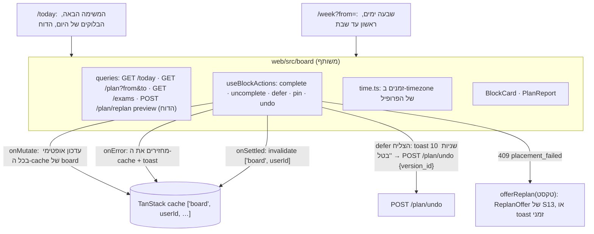

# S14 — מסך "היום" ותצוגת שבוע: תוכנית עבודה

> **For agentic workers:** REQUIRED SUB-SKILL: Use superpowers:subagent-driven-development (recommended) or superpowers:executing-plans to implement this plan task-by-task. Steps use checkbox (`- [ ]`) syntax for tracking.

**מטרה:** סטודנט שיש לו תוכנית פותח את האפליקציה בטלפון ורואה מה עושים עכשיו: המשימה הבאה, הבלוקים של היום, ומה לא נכנס ללוח ולמה. הוא מסמן ביצוע, דוחה, נועל ומבטל, והמסך מתעדכן בלי רענון. במסך "שבוע" הוא רואה את שבעת הימים ופועל עליהם באותו אופן.

**גישה:** ארבע שכבות, שלוש מהן ב-web:
1. **שכבת הלוח המשותפת** (`web/src/board/`): טיפוסים לפי ה-API, hooks של TanStack Query, פעולות על בלוק עם עדכון אופטימי ו-toast של "בטל", עזרי זמן לפי אזור הזמן של הפרופיל, כרטיס בלוק ודוח "לא נכנס". גם "היום" וגם "שבוע" נבנים עליה.
2. **מסך "היום"** (`web/src/today/`, ‏`pages/TodayPage.tsx`).
3. **מסך "שבוע"** (`web/src/week/`), עם route וניווט.
4. **API:** ביטול של `task_changed` מחזיר רק את השדות שהשתנו.

**כלים:** כמו S13: ‏Vite 8, ‏React 19, ‏TypeScript strict, ‏React Router 8, ‏TanStack Query 5, ‏Tailwind 4, ‏React Aria Components 1.22, ‏Vitest 5. ב-API: ‏Python 3.14, ‏psycopg 3. בלי תלויות חדשות.

**מסמך תכנון:** `docs/spec/2026-10-19-studyflow-v2-design.md`: ‏7.9 (המסכים, בלי `alert`/`confirm`, "בטל" ל-10 שניות, נגישות AA), ‏7.6 שלבים 5–8 (הדוח, דחייה דרך `place_task`, הנחה שנכשלה), ‏7.3 (תצוגה באזור הזמן של המשתמש), ‏7.7 (ה-endpoints). במפת הדרכים: S14, "הזרימה היומית עובדת במובייל בלי רענון דף".

## איך החלקים מתחברים

- **למה שכבה משותפת:** "היום" ו"שבוע" מציגים את אותם בלוקים מאותו API, עם אותן פעולות. אם כל מסך כותב את הפעולות לבד, אחד מהם ישכח rollback או invalidation, ואחרי פעולה ב"שבוע" המסך "היום" יציג מצב ישן. כל ה-queries של הלוח יושבים תחת מפתח אחד, `['board', userId, …]`, ולכן פעולה אחת מעדכנת ומרעננת את שני המסכים בבת אחת.
- **למה עדכון אופטימי רק ל-complete, ‏uncomplete ו-pin:** בשלושתן התוצאה ידועה מראש (סטטוס או `pinned` של בלוק אחד), אז הכפתור מגיב מיד גם ברשת איטית. בדחייה המתכנן בשרת בוחר את המקום החדש, והוא יכול גם להיכשל, ולכן אין מה לנחש: הכפתור מציג "דוחה…", ואחרי התשובה ה-cache מתרענן. בשגיאה ה-cache חוזר לצילום שנשמר לפני הפעולה, ו-toast מסביר. כך לא נשאר על המסך מצב שהשרת לא מכיר.
- **למה הביטול שונה בין הפעולות:** לפי 7.6 שלב 8, ‏complete, ‏uncomplete ונעילה לא יוצרים גרסת תוכנית, כי הביטול שלהן הוא הפעולה ההפוכה. לכן ה-"בטל" שלהן שולח את הפעולה ההפוכה. דחייה כן יוצרת גרסה, וה-"בטל" שלה שולח `POST /plan/undo` עם ה-`version_id` מהתשובה. אם בינתיים נוצרה גרסה אחרת, השרת מחזיר `nothing_to_undo` או `stale_plan`, וה-toast מציג את הטקסט שלו.
- **למה הדוח מגיע מהתצוגה המקדימה:** ‏`GET /plan` מחזיר `unplaced` (משימה ודקות), אבל לא סיבות, כי GET לא מריץ מתכנן (7.7). את הסיבות (`unscheduled[].reason`) ואת `shortfalls` מחזיר רק `POST /plan/replan {preview: true}`, שלא כותב כלום ולוקח כ-7ms. לכן הדוח מריץ את התצוגה המקדימה כ-query, רק כשיש `unplaced`. שם המבחן מגיע מ-`GET /exams`.
- **למה הזמנים לפי אזור הזמן של הפרופיל ולא של הדפדפן:** ה-API קובע את `study_date` של כל בלוק לפי האזור של הפרופיל (7.3). אם השעות יוצגו לפי הדפדפן, משתמש בחו"ל יראה בלוק של 23:30 תחת יום אחר ממה שהשרת חושב. ‏`TimezoneSync` של S13 מעדכן את הפרופיל כשהדפדפן מדווח אזור אחר, ולכן ברוב המקרים השניים שווים. הקיבוץ לימים לוקח תמיד את `study_date` מהשרת, ולא מחשב אותו מחדש. משך של בלוק נמדד בין שני רגעים בזמן, ולא לפי השעון שעל הקיר. בלילה של מעבר לשעון חורף, בלוק מ-00:30 עד 01:30 נמשך שעתיים, וכך הוא מוצג.
- **למה refetch כל דקה:** ‏`state` (‏`upcoming`, ‏`in_progress`, ‏`overdue`) נגזר בשרת לפי `now`. אם המסך נשאר פתוח, בלוק שהתחיל צריך לעבור ל"עכשיו" בלי רענון. ‏`refetchInterval` של 60 שניות, ו-refetch כשחוזרים לחלון (ברירת המחדל של TanStack Query), עושים את זה.

## מה מצאתי לפני התכנון (2026-11-16)

| נושא | מצב |
|---|---|
| `GET /today` | ‏`date`, ‏`blocks`, ‏`planned_minutes`, ‏`done_minutes`. בלי `unplaced` ובלי `undo` |
| `GET /plan` | ‏`from`, ‏`to`, ‏`blocks`, ‏`unplaced[]` (‏`task_id`, ‏`exam_id`, ‏`title`, ‏`minutes`), ‏`undo` (הגרסה האחרונה שאפשר לבטל). ברירת מחדל: שבעה ימים מהיום |
| בלוק | ‏`id`, ‏`task_id`, ‏`exam_id`, ‏`task_title`, ‏`task_kind`, ‏`exam_name`, ‏`starts_at`, ‏`ends_at` (UTC), ‏`study_date`, ‏`part_index`, ‏`part_count`, ‏`pinned`, ‏`status`, ‏`state` |
| complete / uncomplete | ‏`{block, task_status}`. ‏uncomplete של בלוק שאינו `done` → ‏409 `invalid_state` |
| defer | ‏`{blocks, version_id}`. בלוק שכבר נגמר, או שאינו `planned` → ‏409 `invalid_state`; לא נכנס → ‏409 `placement_failed` עם `reason` ו-`blocked_by` |
| pin | ‏`PATCH /blocks/{id} {pinned}` → ‏`BlockOut`. רק בלוק `planned` שלא נגמר |
| `Me` ב-web | רק `id` ו-`email`. ‏S13 (Task 2) מרחיב אותו לכל השדות, כולל `timezone`, בקובץ `api/me.ts` שלו |
| `ReplanOffer` | עוד לא ב-`main`. הענף של S13 לא נדחף |
| ה-API של ביטול `task_changed` | ‏`task_before` שומר את כל ששת השדות, ו-`_restore_task` כותב את כולם |

## ההחלטות שלי

1. **המשימה הבאה:** הבלוק של היום שמצבו `in_progress`, ואם אין, הראשון שמצבו `upcoming`. אם היום אין כזה, הבלוק הראשון `upcoming` מ-`GET /plan` של השבוע, עם היום שלו ("מחר, 09:00"). בלוק `overdue` הוא לא "המשימה הבאה": הוא מופיע ברשימה של היום עם סימון "עבר הזמן" וכפתור "בוצע", ואין לו "דחייה", כי השרת לא דוחה בלוק שעבר (הוא נשאר לסקירת הבוקר, S18).
2. **הכפתורים לפי מצב:** ‏`upcoming` ו-`in_progress`: "בוצע", "דחייה", "נעילה"/"שחרור". ‏`overdue`: "בוצע". ‏`done`: "ביטול הסימון". ‏`missed` ו-`skipped`: "בוצע" (השרת מאפשר). כל כפתור עם `aria-label` שכולל את שם המשימה, כי ברשימה יש כמה "בוצע".
3. **דחייה בלי בחירת זמן:** כפתור "דחייה" שולח `defer` בלי `not_before`, והשרת שם את המשימה במקום הפנוי הבא אחרי סוף הבלוק (7.6 שלב 8). ה-toast אומר לאן היא זזה ("נדחה לראשון 14:00") עם "בטל". בחירת זמן מדויק שייכת לגרירה ולסקירת הבוקר (S18).
4. **הנחה שנכשלה:** ‏409 `placement_failed` → ‏toast עם `codeText('placement_failed')` ועם הסיבה (`unscheduledText(reason)`), ופעולה "תכנון מחדש". הלוח לא משתנה, וזה מה שהמסך מראה.
5. **`offerReplan` כמתאם אחד:** ‏`web/src/board/offerReplan.ts` הוא המקום היחיד שקורא להצעת תכנון מחדש. ‏`ReplanOffer` של S13 עוד לא ב-`main`, אז עד שיגיע ההצעה היא toast עם הטקסט ופעולה "לדוח" שמנווטת ל-`/today#report`, לדוח שמבוסס על התצוגה המקדימה. ב-rebase לפני המיזוג: אם `useReplanOffer` כבר ב-`main`, המתאם קורא לו, וזה שינוי של שורה. אם לא, נרשמת שורה במפת הדרכים לחבר אותו אחרי S13. אני לא בונה גרסה משלי לרכיב.
6. **הדוח "לא נכנס":** כרטיס במסך "היום" (עוגן `#report`), רק כש-`unplaced` לא ריק. לכל מבחן עם `shortfall`: ‏`shortfallText(שם, דקות, daily_minutes)`. לכל משימה: הכותרת, הדקות, והסיבה ב-`unscheduledText`. כשיש `daily_minutes`, כפתור "להעלות ל-X ביום" שולח `PATCH /me {daily_study_minutes}` עם המקסימום מכל המבחנים, ואחריו `offerReplan`, כי שינוי בשעות הוא שינוי גלובלי שדורש תצוגה מקדימה ואישור (7.6 שלב 8). זה עונה על הפריט של ה-eval של S12 ("הצעה להעלות את הדקות היומיות"). ההגדרות המלאות נשארות ל-S15.
7. **השבוע מתחיל ביום ראשון**, כמו בלוח הישראלי. ‏`/week` בלי פרמטר מציג את השבוע של היום (לפי `GET /today`.date), ו-`/week?from=YYYY-MM-DD` שבוע אחר. ‏"הקודם", "הבא" ו"השבוע". הטווח (7 ימים) בתוך המגבלה של 62. יום בלי בלוקים: "יום פנוי". ב"שבוע" כל בלוק הוא שורה קומפקטית עם כפתור "פעולות" שפותח `Menu` של React Aria, כדי ששלושה כפתורים לכל בלוק לא יעמיסו את המובייל. הכלל של 7.9 ("לכל פעולה כפתור גלוי") מתקיים, כי כפתור התפריט גלוי.
8. **ניווט:** שני קישורים בכותרת של `AppShell` ("היום", "שבוע"), עם `NavLink` ו-`aria-current`. זה שינוי קטן בקובץ משותף, ו-S13 מוסיף שם שורה אחת אחרת.
9. **ה-timezone של הפרופיל:** עד ש-`Me` של S13 מגיע עם `timezone`, הפונקציה `useProfileTimezone()` ב-`board/time.ts` קוראת את השדה מאותה תשובה של `GET /me` (השרת כבר מחזיר אותו), בבדיקה בזמן ריצה, ונופלת לאזור של הדפדפן. ב-rebase אחרי S13 היא קוראת את השדה המוקלד.
10. **מצבים:** טעינה (`role="status"`), שגיאה בלי נתונים (`role="alert"` וכפתור "לנסות שוב"), ושגיאת רענון כשיש נתונים: הנתונים נשארים, ושורה קטנה אומרת שהם אולי לא עדכניים. יום ריק בלי שום בלוק עתידי: "אין משימות בלוח", בלי ניחושים.
11. **ההתקדמות של היום:** "X מתוך Y דקות" לפי `done_minutes` ו-`planned_minutes + done_minutes`, עם `meter`. אלה דקות אמיתיות מהשרת, לא אחוז מזויף (סעיף 4).
12. **ביטול `task_changed` ב-API:** ‏`task_before` שומר רק את השדות שהשתנו, ו-`_restore_task` מעדכן רק אותם. גרסאות ישנות עם כל ששת השדות עדיין נקראות. שדה לא מוכר, או אובייקט ריק, הם `SnapshotError` כמו היום. בלי מיגרציה: העמודה היא JSONB.
13. **הדקות היומיות בניתוח (פריט ה-eval של S12):** לא נוגע בניתוח ב-S14. העברת הדקות היומיות לפרומפט משנה את הקלט של Claude, ודורשת eval בתשלום כדי לדעת אם זה עזר. חיתוך של סימולציה לאורך היום בקוד היה מעוות אותה (מבחן של 3 שעות שמתורגל בשעתיים). נרשם ל-S20 עם הנימוק. ב-S14 הדוח מציג את זה ומציע להעלות את הדקות.

## Global Constraints

- כל טקסט שהמשתמש רואה ב-`src/i18n/he.ts`: ‏`he.board` (משותף), ‏`he.today`, ‏`he.week`. לא נוגעים בקטעים של S13.
- RTL עם logical properties בלבד; רכיבים מ-React Aria Components; נתוני שרת דרך TanStack Query; בלי `alert`, ‏`confirm` ו-`dangerouslySetInnerHTML`.
- צבעים רק ממשתני `index.css`. בלי צבעים חדשים, כדי ש-`theme.test.ts` ימשיך לכסות הכל.
- פעולה שאפשר לבטל: toast עם "בטל" ל-`UNDO_TIMEOUT_MS`.
- גובה מגע 44px (`Button` כבר נותן), ותוויות לכל כפתור.
- `npm run dev` על 5173 בלבד.
- מסד הבדיקות: `STUDYFLOW_TEST_DB=studyflow_test_s14` (ולכל subagent ערך משלו).

## Review Focus

1. **שגיאה אחרי עדכון אופטימי** — ‏complete שנכשל (רשת או 409) מחזיר את הבלוק למצבו, גם ב-cache של "שבוע", ומציג toast. בדיקה ב-Task 2.
2. **"בטל" אחרי שהלוח השתנה** — ביטול דחייה שמקבל `nothing_to_undo` מציג את הטקסט ולא נשאר במצב ביניים. בדיקה ב-Task 2.
3. **זמנים במעבר שעון ובאזור אחר** — בלוק שחוצה את המעבר לשעון חורף מוצג 00:30–01:30 עם "שעתיים"; פרופיל באזור אחר מהדפדפן מציג לפי הפרופיל. בדיקה ב-Task 2 (`time.test.ts`) וב-Task 3.
4. **שני מסכים, cache אחד** — פעולה ב"שבוע" מתעדכנת גם ב"היום" בלי רענון. בדיקה ב-Task 4.
5. **ביטול `task_changed` ישן** — לא דורס כותרת שנערכה אחריו. בדיקה ב-Task 1.

## מה רץ במקביל

| גל | משימות | למה אפשר |
|---|---|---|
| 1 | Task 1 (API, subagent) ‖ Task 2 (שכבת הלוח, subagent) | ‏Task 1 רק ב-`api/`, ‏Task 2 רק ב-`web/` |
| 2 | Task 3 ("היום") ‖ Task 4 ("שבוע") | קבצים נפרדים; ב-`he.ts` כל אחד רק בקטע שלו (`today`, ‏`week`), ו-Edit מסרב לכתוב על קובץ שהשתנה מאז הקריאה |
| 3 | סקירה של כל הענף, תיקונים, בדיקה בדפדפן, rebase, מיזוג | |

הכל בעץ העבודה של `~/studyflow-s14`, לא ב-worktrees, כי worktree נוצר מ-`main` ולא מהענף (לקח של S12). כל subagent מקבל רשימת קבצים, ו-git רק בשיחה הראשית.

## קבצים משותפים עם S13

- **משותפים, שינוי קטן:** `web/src/app/routes.tsx` (route אחד ל-`/week`), ‏`web/src/app/AppShell.tsx` (ניווט בכותרת), ‏`web/src/i18n/he.ts` (הקטעים `board`, ‏`today`, ‏`week` בלבד).
- **של S14 בלבד:** `web/src/board/**`, ‏`web/src/today/**`, ‏`web/src/week/**`, ‏`web/src/pages/TodayPage.tsx` (ובדיקה שלו).
- **לא נוגעים:** `web/src/api/me.ts` (S13 מרחיב אותו), ‏`web/src/onboarding/**`, ‏`web/src/plan/**`, ‏`OnboardingGate.tsx`, ‏`TimezoneSync.tsx`.

---

### Task 1: ביטול `task_changed` מחזיר רק את מה שהשתנה

**Files:**
- Modify: `api/app/services/plan_writes.py` (`task_before`, ‏`_restore_task`), ‏`api/app/services/tasks.py` (מעבירים גם את השורה אחרי השינוי)
- Test: `api/tests/api/test_undo.py`

**Interfaces (Produces):** ‏`task_before(before: Mapping, after: Mapping | None = None) -> dict` — עם `after`, רק השדות מ-`TASK_BEFORE_FIELDS` שהערך שלהם שונה. ‏`_restore_task` מעדכן רק את המפתחות שב-JSON, וכולם חייבים להיות מ-`TASK_BEFORE_FIELDS` (אחרת `SnapshotError`).

- [ ] **Step 1: בדיקות נכשלות** — שינוי משך (גרסה) ואז שינוי כותרת (בלי גרסה) ואז ביטול: המשך חוזר והכותרת החדשה נשארת; ‏`task_before` של הגרסה מכיל רק `estimated_minutes`; ‏`done` שנעשה אחרי שינוי משך לא חוזר ל-`todo` בביטול של גרסת המשך (אם `status` לא השתנה בה); גרסה ישנה עם כל ששת השדות עדיין מבוטלת כמו היום; ‏`task_before` עם מפתח לא מוכר → ‏`SnapshotError`; שחזור `depends_on` שהיה יוצר מעגל (A תלוי ב-B, משנים את A ל-C, ואז B נערך להיות תלוי ב-A, ומבטלים): התלות של A נשארת `NULL`.
- [ ] **Step 2:** `uv run pytest tests/api/test_undo.py -q` — נכשלות.
- [ ] **Step 3:** מימוש.
- [ ] **Step 4:** `uv run pytest -q && uv run ruff check . && uv run ruff format --check . && uv run mypy` — עוברים.
- [ ] **Step 5:** commit.

### Task 2: שכבת הלוח המשותפת

**Files:**
- Create: `web/src/board/types.ts`, ‏`api.ts`, ‏`actions.ts`, ‏`time.ts`, ‏`offerReplan.ts`, ‏`BlockCard.tsx`, ‏`PlanReport.tsx`, ובדיקות (`time.test.ts`, ‏`actions.test.tsx`, ‏`BlockCard.test.tsx`, ‏`PlanReport.test.tsx`), ו-`web/src/test/boardFixtures.ts` (בלוקים לדוגמה).
- Modify: `he.board` בלבד.

**Interfaces (Produces):**
- טיפוסים: `Block`, ‏`BlockState`, ‏`Today`, ‏`Plan`, ‏`Unplaced`, ‏`ReplanPreview`, ‏`ExamSummary` (`id`, ‏`name`).
- מפתחות: `boardKey(userId)` = `['board', userId]`, ומתחתיו `'today'`, ‏`['plan', from, to]`, ‏`'exams'`, ‏`'report'`.
- hooks: `useToday()`, ‏`usePlan(from?, to?)` (שניהם `refetchInterval: 60_000`), ‏`useBoardExams()`, ‏`useReport(enabled)` (התצוגה המקדימה), ‏`useBlockActions(): { complete(b), uncomplete(b), defer(b), setPinned(b, pinned), pending(id): boolean }`, ‏`useRaiseDailyMinutes()`.
- `useProfileTimezone(): string`, ‏`formatTime(iso, tz)`, ‏`formatRange(block, tz)`, ‏`blockMinutes(block)`, ‏`formatDay(date)` (יום בשבוע ותאריך, בעברית), ‏`addDays(date, n)`, ‏`weekStart(date)` (ראשון), ‏`durationText(minutes)`.
- `useOfferReplan(): (reasonText?: string) => void`.
- `<BlockCard block tz variant="full" | "compact" />` — זמן, משך, כותרת, מבחן, חלק X מתוך Y, תג מצב, סימון נעילה, ופעולות לפי החלטה 2 (ב-`compact`: ‏`Menu` מכפתור "פעולות").
- `<PlanReport />` — הדוח של החלטה 6, עם `id="report"`.

- [ ] **Step 1: בדיקות נכשלות** —
  - `time.test.ts`: ‏`formatRange` לפי האזור שניתן ולא לפי הדפדפן; בלוק מ-`2026-10-24T21:30Z` עד `23:30Z` ב-`Asia/Jerusalem` → ‏"00:30–01:30" ו-`blockMinutes` = 120; ‏`weekStart('2026-11-19')` = ‏`'2026-11-15'`; ‏`addDays` על פני סוף חודש; ‏`durationText` ‏(45 → "45 דקות", ‏90 → "שעה וחצי").
  - `actions.test.tsx`: ‏complete מעדכן מיד את הבלוק ל-`done` ב-cache של `today` וגם של `plan`, ושולח `POST /blocks/{id}/complete`; toast "בטל" שולח `uncomplete`; כשל (רשת) מחזיר את הבלוק ל-`upcoming` בשני ה-caches ומציג את `errorMessage`; ‏defer מצליח → toast עם היום והשעה החדשים ו"בטל" שולח `POST /plan/undo {version_id}`; ‏`nothing_to_undo` בביטול → toast עם הטקסט שלו; ‏409 `placement_failed` עם `reason: 'not_enough_time'` → toast עם שני הטקסטים ופעולה "לדוח", וה-cache לא משתנה; pin מעדכן `pinned` מיד, ו"בטל" מחזיר; אחרי כל פעולה `['board', userId]` מתרענן.
  - `BlockCard.test.tsx`: הכפתורים לפי כל מצב (החלטה 2), עם `aria-label` שכולל את הכותרת; "חלק 2 מתוך 3"; ‏`compact` פותח תפריט עם אותן פעולות.
  - `PlanReport.test.tsx`: בלי `unplaced` לא מוצג ולא שולח preview; עם `unplaced`: ‏`shortfallText` עם שם המבחן, ‏`unscheduledText` לכל משימה; "להעלות ל-5 שעות ביום" שולח `PATCH /me {daily_study_minutes: 300}` וקורא ל-`offerReplan`; ‏`daily_minutes: null` → בלי הכפתור.
- [ ] **Step 2–4:** הרצה, מימוש, ‏`npm test && npm run lint && npm run typecheck`.
- [ ] **Step 5:** commit.

### Task 3: מסך "היום"

**Files:**
- Create: `web/src/today/NextBlock.tsx`, ‏`TodayBlocks.tsx`, ‏`DayProgress.tsx`, ובדיקות; ‏`web/src/today/today.test.tsx` (המסך דרך `renderRoute`).
- Modify: `web/src/pages/TodayPage.tsx` (מחליף את ה-placeholder), ‏`web/src/pages/TodayPage.test.tsx` (נמחק, הבדיקות ב-`today/`), ‏`he.today` בלבד.

- [ ] **Step 1: בדיקות נכשלות** — המשימה הבאה: `in_progress` לפני `upcoming`; אין היום → הראשון מהשבוע עם "מחר"; ‏`overdue` לא נבחר. הבלוקים של היום לפי הסדר, עם המצבים. ביצוע → המסך מתעדכן בלי refetch ידני, ו"בטל" מחזיר. דחייה, ודחייה שנכשלה (409). נעילה. ההתקדמות "60 מתוך 180 דקות". יום ריק עם בלוק מחר: "אין בלוקים היום" והמשימה הבאה מחר. אין שום בלוק: "אין משימות בלוח". שגיאת רשת ב-`GET /today` → ‏`alert` עם "לנסות שוב", שעובד. יום של מעבר שעון: ‏`date: '2026-10-25'` עם בלוק שחוצה את המעבר מוצג 00:30–01:30. פרופיל ב-`America/New_York` מציג לפי האזור הזה. הדוח מופיע כשיש `unplaced`.
- [ ] **Step 2–4:** הרצה, מימוש, בדיקות + lint + typecheck.
- [ ] **Step 5:** commit.

### Task 4: מסך "שבוע", route וניווט

**Files:**
- Create: `web/src/week/WeekPage.tsx`, ‏`WeekDay.tsx`, ובדיקות.
- Modify: `web/src/app/routes.tsx` (‏`/week`), ‏`web/src/app/AppShell.tsx` (ניווט), ‏`web/src/app/routes.test.tsx`, ‏`he.week` (ו-`he.shell` לתוויות הניווט).

- [ ] **Step 1: בדיקות נכשלות** — ‏`/week` שולח `GET /plan?from=<ראשון>&to=<שבת>` לפי `GET /today`.date; שבעה ימים עם כותרת (יום ותאריך), סימון "היום", ו"יום פנוי"; בלוקים מקובצים לפי `study_date` של השרת; "הבא" ו"הקודם" משנים את `?from=`; פעולה מהתפריט (ביצוע) מעדכנת את השבוע, ואחרי מעבר ל"היום" הבלוק כבר `done` בלי בקשה חדשה שמחכים לה; הניווט בכותרת מסמן את המסך הנוכחי ב-`aria-current="page"`; ‏`?from=` לא תקין → השבוע הנוכחי; שגיאת רשת → ‏`alert` ו"לנסות שוב".
- [ ] **Step 2–4:** הרצה, מימוש, בדיקות + lint + typecheck + build.
- [ ] **Step 5:** commit.

### Task 5: סקירה, דפדפן וסגירה

- [ ] סקירה של כל הענף (Opus), ותיקונים.
- [ ] בדיקה בדפדפן במסך רחב ובמובייל (375px) על `npm run dev`: מול פרויקט הפיתוח אם יש `DATABASE_URL` ולוח, אחרת עם API מזויף. צילומי מסך.
- [ ] rebase על `origin/main`; אם S13 מוזג: ‏`useReplanOffer` ו-`Me.timezone` (החלטות 5 ו-9). כל הבדיקות שוב.
- [ ] עדכון מסמך התכנון (7.9, ‏7.7) והטאב שלו, מפת הדרכים, gitleaks, מיזוג, מחיקת הענף ב-`origin`.
