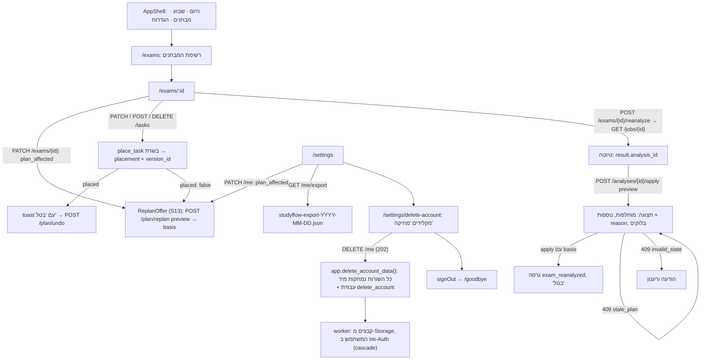

# S15 — מסך מבחן והגדרות: תוכנית עבודה

> **For agentic workers:** REQUIRED SUB-SKILL: Use superpowers:subagent-driven-development (recommended) or superpowers:executing-plans to implement this plan task-by-task. Steps use checkbox (`- [ ]`) syntax for tracking.

**מטרה:** אחרי האונבורדינג הסטודנט יכול לנהל כל מבחן במסך משלו (ציר עד המבחן, נושאים, משימות עם עריכה במקום, חומרים, ניתוח חוזר), ולשנות את ההעדפות שלו במסך ההגדרות (שעות קימה ושינה, השעה שאחרי הקימה, תחביב, ימי מנוחה, שעות ביום, חלונות). כל עריכה מפעילה הנחה של משימה עם "בטל", או תכנון מחדש עם תצוגה מקדימה. בהגדרות יש גם ייצוא של כל הנתונים לקובץ JSON, ומחיקת חשבון מיידית.

**השער במפת הדרכים:** "עריכה מפעילה תכנון מחדש עם תצוגה מקדימה".

**גישה:** ארבעה חלקים ב-API, שלושה ב-web:
1. **מיגרציה 0009** (Task 1): שלוש עמודות העדפה ב-`profiles`, הרשאת UPDATE ל-`materials.kind`, ופונקציה אחת שמוחקת את כל הנתונים של המשתמש.
2. **API:** העדפות ומתכנן (Task 2), משימות ונושאים (Task 3), סוג חומר (Task 4), ייצוא ומחיקת חשבון (Task 5).
3. **web:** מסך המבחן (Tasks 6, 7) ומסך ההגדרות (Task 8).

**כלים:** כמו ב-S13: ‏React 19, ‏TypeScript strict, ‏React Router 8, ‏TanStack Query 5, ‏Tailwind 4, ‏React Aria Components 1.22, ‏Vitest 5; ב-API ‏Python 3.14, ‏psycopg 3, ‏httpx2. בלי תלויות חדשות.

**מסמך תכנון:** סעיפים 7.4 (הטבלאות), 7.6 (המתכנן, שלבים 1–2 ו-8), 7.7 (ה-API), 7.8 (העבודות), 7.9 (המסכים), 7.11 (פרטיות), 11.13 (התחביב), 11.15 (ימי מנוחה).

## איך החלקים מתחברים

- **למה עריכה של משימה היא "שינוי קטן" ועריכה של מבחן או העדפה היא "שינוי גלובלי":** כך קבע 7.6 שלב 8, וה-API של S09 כבר מממש את זה. ‏`PATCH /tasks/{id}` מניח את המשימה מחדש בעצמו (`place_task`) ומחזיר `placement` ו-`version_id`. ה-web רק מציג את התוצאה: הנחה שהצליחה מקבלת toast עם "בטל" (שולח `POST /plan/undo`), והנחה שנכשלה פותחת את `ReplanOffer` עם הסיבה. ‏`PATCH /exams` ו-`PATCH /me` רק שומרים ומחזירים `plan_affected`, וה-web פותח את `ReplanOffer`, שמראה תצוגה מקדימה לפני כל כתיבה. לכן S15 לא כותב לוגיקת תכנון חדשה ב-web, רק מחבר את מה שקיים.
- **למה מחיקת משימה נשלחת מיד ולא אחרי 10 שניות:** היא מחיקה רכה עם גרסה (S09), כמו מחיקת מבחן ב-S13. "בטל" שולח `POST /plan/undo` עם ה-`version_id`, והשרת מחזיר גם את המשימה וגם את הבלוקים שלה. מחיקה קשה (חומר) נשארת עם ההשהיה של S13.
- **למה `reason` נשלף מ-`analyses.output` לפי `position`:** ‏S11 לא שומר את ה-`reason` בטבלת המשימות, ושומר את הפלט המלא ב-`analyses.output`. משימה של ניתוח נכתבת עם `analysis_id` ועם `position` = המקום שלה במערך `output.tasks` (מ-1). לכן `output->'tasks'->(position-1)->>'reason'` הוא הנימוק שלה, בלי עמודה חדשה ובלי לשכפל טקסט.
- **למה ההעדפות החדשות הן עמודות בפרופיל:** 7.6 שלב 1 אמר ש"השעה שאחרי הקימה" היא ברירת מחדל בטיפוס של הדומיין, ו"עמודה בפרופיל תתווסף רק אם מסך ההגדרות יחשוף אותה". מסך ההגדרות חושף אותה עכשיו, וגם את התחביב (11.13). המתכנן כבר יודע לקבל `study_start_delay`; התחביב נכנס ל-`day_windows` כזמן שיורד מהחלונות, ולכן כל השלבים (התקציב, `day_fits`, האריזה, תקפות של בלוק קיים) רואים אותו בלי שינוי נוסף.
- **למה המחיקה בשני שלבים:** ה-API לא מחזיק את המפתח הסודי של Supabase (7.11), ובלי המפתח אי אפשר למחוק קבצים מ-Storage או משתמש מ-Auth. לכן `DELETE /me` מוחק מיד, באותה טרנזקציה, את כל השורות של המשתמש בסכמה `app` (דרך פונקציה אחת שרצה בהרשאות של בעל הסכמה, כי ל-`authenticated` אין DELETE על `plan_versions`, ‏`ai_usage`, ‏`analyses`, ‏`jobs` ו-`profiles`, וזה בכוונה), ומכניס עבודת `delete_account`. ה-worker מוחק את הקבצים, ואז את המשתמש ב-Auth, וה-`ON DELETE CASCADE` שכל טבלה ב-`app` כבר עושה מ-`auth.users` מוחק גם את שורת העבודה עצמה וכל מה שנוצר בשניות שביניהם.

## מה מצאתי לפני התכנון (2026-11-16)

| נושא | מצב |
|---|---|
| ‏`study_start_delay` | קיים בדומיין (`Profile`, ברירת מחדל שעה, 0–6 שעות), לא במסד |
| תחביב | לא קיים בשום מקום. ‏11.13: כבוי כברירת מחדל, ונדלק בהגדרות |
| משמרת לילה | ‏`exam_cutoff` חותך בחצות את הלילה שלפני יום המנוחה, ולכן מי שקם בערב מאבד כמעט את כל יום הלימוד האחרון |
| ‏`ProfileRow(**values)` מ-`SELECT *` | עמודה חדשה בפרופיל שוברת קוד ישן שרץ על אותו מסד (`TypeError`) |
| משימות ב-API | ‏`TaskOut` בלי `topic_id`, ‏`material_id`, ‏`position`; אין endpoint לנושאים |
| ‏`reason` | נשמר רק ב-`analyses.output`; ‏`AddedTaskOut` של התצוגה המקדימה בלעדיו |
| חומרים | ל-`authenticated` אין UPDATE על `kind`; אין `PATCH /materials/{id}` |
| תאריך מבחן | ה-web (S13) מתיר ממחר, ה-API (S09) מהיום |
| מחיקת חשבון וייצוא | לא קיימים. כל הטבלאות ב-`app` מפנות ל-`auth.users` עם `ON DELETE CASCADE` |
| ‏S14 | בענף `s14-today-week`: ‏`AppShell` עם ניווט (היום, שבוע), ‏`/week`. אין מיגרציה |

## ההחלטות שלי

1. **שלוש עמודות ב-`profiles` (מיגרציה 0009):** ‏`study_start_delay_minutes` (0–360, ברירת מחדל 60), ‏`hobby_start` (‏`time`, ‏NULL = כבוי) ו-`hobby_minutes` (15–240, ‏NULL = כבוי), עם CHECK ששניהם NULL או ששניהם מלאים, ו-`hobby_start` בדקה שלמה. שלושתן משפיעות על הלוח (`plan_affected`).
2. **התחביב הוא זמן תפוס בכל יום**, מ-`hobby_start` באורך `hobby_minutes`, לפי השעון המקומי. הוא יורד מהחלונות ב-`day_windows`, כמו שעת הקימה. לא בלוק במסד: אין לו משימה, ואין מה לסמן "בוצע". בלוק שכבר קבוע (`done`, ‏`pinned`, שהתחיל) לא זז בגלל התחביב (7.6 שלב 6).
3. **משמרת לילה:** כשיש ימי מנוחה (`rest_days_before_exam ≥ 1`), הלילה שלפני יום המנוחה **לא** נחתך בחצות, כי יום המנוחה עצמו שומר על המנוחה, ויום הלימוד האחרון נגמר בשעת השינה של המשתמש. בלי ימי מנוחה החיתוך בחצות נשאר, כי שעת המבחן לא ידועה ויכולה להיות בבוקר. זה משנה החלטה של S06 (7.6 שלב 2), ומתועד שם.
4. **`ProfileRow` לוקח רק את השדות שלו** מ-`SELECT *`, כך שעמודה חדשה במסד לא שוברת קוד ישן שרץ מולו (S13 ו-S14 רצים מול אותו פרויקט פיתוח).
5. **תאריך מבחן ממחר, גם ב-API:** ‏`POST /exams` ושינוי תאריך ב-`PATCH /exams` דוחים את היום (‏422 ‏`exam_in_past`), כי ביום המבחן אין לימוד (7.6 שלב 2) ומבחן של היום לא יקבל אף משימה. ‏`reanalyze` ו-`POST /tasks` לא משתנים: מבחן קיים שתאריכו היום ממשיך להתנהג כמו קודם. הטקסט של `exam_in_past` מתעדכן ל"תאריך המבחן צריך להיות מחר או אחר כך".
6. **נושאים:** ‏`GET /exams/{id}/topics` מחזיר את הנושאים של הניתוח האחרון שהוחל (`applied`), ועוד כל נושא שמשימה חיה של המבחן מצביעה עליו (נושאים ישנים לא נמחקים, S12), עם `gaps` של אותו ניתוח ו-`draft_analysis_id` (טיוטה שמחכה לאישור, אם יש). ‏`PATCH /topics/{id}` משנה `name` ו-`weight` בלבד: זו "עריכה במקום" של נושא, ולא משפיעה על הלוח.
7. **משימות:** ‏`TaskOut` מקבל `topic_id`, ‏`material_id`, ‏`position`, ו-`GET /exams/{id}/tasks` מחזיר גם `reason` (null למשימה של המשתמש). ‏`POST /tasks` ו-`PATCH /tasks/{id}` מקבלים `topic_id` (נושא של אותו מבחן; אחר → 404, כמו הפניה למשאב של משתמש אחר). ‏`topic_id` לא משפיע על הלוח. ‏`material_id` ו-`position` לקריאה בלבד: הם של הניתוח.
8. **סוג חומר:** ‏`PATCH /materials/{id} {kind}`. השינוי לא מנתח מחדש: מסך המבחן מציע "ניתוח חוזר" אחרי שינוי, כי הסוג משפיע על הניתוח (סימולציה לכל מבחן עבר) ולא על הלוח.
9. **מחיקת חשבון:** ראו "איך החלקים מתחברים". בלי "בטל" של 10 שניות, כי בעל המוצר החליט על מחיקה מיידית בלי תקופת חסד, ו-"בטל" היה מחייב להשאיר את הנתונים 10 שניות אחרי שהמשתמש אישר. מסך האישור, שבו מקלידים את המילה "מחיקה", מחליף אותו: הוא עוצר לחיצה בטעות, וזה מה ש"בטל" נועד לעשות. ה-API מחזיר 202 עם `job_id`; ה-web מתנתק (`signOut` מקומי) ועובר ל-`/goodbye`.
   - **הפונקציה** `app.delete_account_data()`: ‏`SECURITY DEFINER`, ‏`search_path` ריק, בלי ארגומנטים: היא מוחקת רק את `auth.uid()`, ונכשלת כשאין משתמש. ‏EXECUTE רק ל-`authenticated`.
   - **ה-worker** מוצא את הקבצים לפי `storage.objects` (‏`bucket_id = 'materials'` ותיקייה ראשונה = המשתמש), ולא לפי `materials`, שכבר נמחקה. הוא מוחק אותם ב-Storage API (עד 100 בבקשה), ואז מוחק את המשתמש ב-Auth Admin API (`DELETE /auth/v1/admin/users/{id}`; ‏404 = כבר נמחק). כשל זמני → ניסיון חוזר של התור.
   - **בקשה עם JWT ישן** אחרי שהמשתמש נמחק מ-Auth: ‏`ensure_profile` נכשל על ה-FK ל-`auth.users`, וזה 401 (ה-web מתנתק), לא 500.
   - **מה נשאר אחרי מחיקה** (מתועד ב-7.11): לוגים של ה-API וה-worker (מזהה משתמש, בלי תוכן), יומן הביקורת של Supabase Auth, הגיבויים של Supabase עד שהם מתחלפים, ועותק אצל Anthropic של מה שנשלח לניתוח לפי מדיניות השמירה שלה. קובץ שהדפדפן מעלה בדיוק בזמן המחיקה עלול להישאר ב-Storage; הניקוי של קבצים יתומים (S21) תופס אותו.
10. **ייצוא:** ‏`GET /me/export` מחזיר JSON אחד עם `Content-Disposition: attachment`: ‏`format: "studyflow-export"`, ‏`version: 1`, ‏`exported_at`, ‏`profile` (כולל האימייל מה-JWT), ‏`exams` (גם מחוקים, עם `deleted_at`), ‏`tasks` (גם מחוקות), ‏`blocks`, ‏`topics`, ‏`materials` (מטא-דאטה בלבד: בלי `text_by_page` ובלי `storage_path`), ‏`analyses` (סטטוס, תאריכים ו-`output`, כי הנימוקים והנושאים הם מידע עליו) ו-`ai_usage` (מודל, טוקנים, תאריך). בלי `plan_versions` (עותקים פנימיים של בלוקים לביטול) ובלי `jobs` (תפעול). ה-web שומר אותו בשם `studyflow-export-YYYY-MM-DD.json`.
11. **ניווט:** ‏`AppShell` מקבל שני קישורים, "מבחנים" (`/exams`) ו"הגדרות" (`/settings`), ליד הניווט של S14. ‏`/goodbye` מחוץ ל-`RequireAuth`.
12. **מסך המבחן מוסיף מבחן ובונה לו תוכנית:** ברשימת המבחנים יש "הוספת מבחן" (`POST /exams`). מבחן בלי משימות `ai` חיות מציג "בניית תוכנית למבחן" (`POST /plans/generate`, שמנתח רק מבחנים כאלה, 7.6 שלב 8) עם מעקב אחרי העבודה; מבחן שכבר נותח מציג "ניתוח חוזר".
13. **הציר עד המבחן:** ‏`GET /plan?from=היום&to=min(יום לפני המבחן, היום+61)`, מסונן למבחן: לכל יום, הדקות המתוכננות והדקות שהושלמו, ימי המנוחה ויום המבחן. ‏62 ימים הם הגבול של `GET /plan` (S09), ומבחן רחוק יותר מציג הערה שהציר מראה את 62 הימים הקרובים.
14. **התראות:** בהגדרות רק placeholder ("התראות יגיעו בקרוב"), בלי שדה. ‏S16 בונה אותן.
15. **בדיקה בדפדפן מול Postgres מקומי**, ולא מול המסד של פרויקט הפיתוח: מיגרציה 0009 מוסיפה עמודות לפרופיל, ו-S14, שרץ במקביל מול אותו פרויקט עם `ProfileRow` הישן, היה נשבר. ההתחברות נשארת דרך Supabase Auth של פרויקט הפיתוח (ה-JWT נבדק מול ה-JWKS), וה-`DATABASE_URL` של ה-API בבדיקה מצביע על מסד מקומי עם המיגרציות והמשתמש. מיגרציה 0009 מוחלת על פרויקט הפיתוח אחרי המיזוג.

## Global Constraints

- כל טקסט ב-`he.ts`, בקטעים `exam` ו-`settings` (ו-`he.shell` לשני הקישורים); בלי טקסט קשיח ברכיבים. קוד לטקסט רק דרך `codeText`.
- צבעים רק ממשתני `index.css` (`bg-surface`, ‏`text-ink-muted`, ‏`border-line-strong` לשדות, ‏`bg-danger` וכו'). בלי `alert`, ‏`confirm`, ‏`dangerouslySetInnerHTML`.
- כל endpoint חדש: בעלות (משתמש ב' מקבל 404, או לא רואה שורות של א'), ו-`user_id` מפורש בכל שאילתה מעל RLS.
- מפתחות query של הלוח: `['plan', userId]` ו-`['today', userId]` מתרעננים אחרי כל שינוי בלוח. מפתחות חדשים: `['tasks', userId, examId]`, ‏`['topics', userId, examId]`.
- ‏`legacy/` לא נוגעים. הקבצים של S14 (`TodayPage.tsx`, ‏`board/**`, ‏`today/**`, ‏`week/**`, ‏`he.today`, ‏`he.week`) לא נוגעים.
- בדיקות API מקבילות: כל סוכן עם `STUDYFLOW_TEST_DB` משלו, ובלי `tests/db` (רק השיחה הראשית מריצה אותו).
- סוכנים לא מריצים git. סוכן מדווח על פגם בתוכנית במקום לעקוף אותו.

## Review Focus

- המחיקה: הפונקציה מוחקת רק את `auth.uid()`; משתמש אחר לא נפגע; העבודה לא נמחקת לפני שה-worker לקח אותה; נתיב Storage מחוץ לתיקיית המשתמש לא נמחק לעולם.
- ייצוא: אין בו `text_by_page`, ‏`storage_path` או שורות של משתמש אחר.
- התחביב והחיתוך: בדיקות property של המתכנן עדיין עוברות; בלוק קבוע לא זז.
- עריכה במקום: אין כתיבה בלי שהמשתמש אישר (Enter או "שמירה"), ואין שתי בקשות על אותה עריכה.

## מה רץ במקביל

| גל | משימות | למה |
|---|---|---|
| 1 | Task 1 (השיחה הראשית), Task 0 (השיחה הראשית) | המיגרציה ו-`ProfileRow` הן תנאי ל-2, 4, 5; השלדים של הניתוב וה-`he.ts` מונעים התנגשויות בין סוכני ה-web |
| 2 | Tasks 2, 3, 4, 5, 6, 7, 8 במקביל | קבצים נפרדים (ראו כל משימה); כל אחד עם מסד בדיקות משלו |
| 3 | איחוד, ownership, סקירה סופית, בדפדפן | השיחה הראשית |

קבצים משותפים שהשיחה הראשית מכינה מראש בגל 1, כדי שהסוכנים לא ייגעו בהם: `api/app/main.py` (routers של `topics` ו-`account`), ‏`api/app/jobs/ingest.py` (‏`HANDLERS`), ‏`api/tests/api/test_ownership.py` (בגל 3), ‏`web/src/app/routes.tsx`, ‏`web/src/app/AppShell.tsx`, השלד של `he.exam` ו-`he.settings`.

## קבצים משותפים עם S14

`web/src/app/routes.tsx` ו-`web/src/app/AppShell.tsx` (שינוי קטן: קישורים ו-routes), ‏`web/src/i18n/he.ts` (קטעים חדשים, ‏`he.shell`), ‏`web/src/onboarding/api.ts` (hooks קיימים לשימוש חוזר; בלי שינוי שבירה). מי שממזג שני עושה rebase ומאחד.

---

### Task 0: שלדי ה-web (השיחה הראשית)

**קבצים:** `web/src/app/routes.tsx`, ‏`web/src/app/AppShell.tsx`, ‏`web/src/i18n/he.ts`, ‏`web/src/exam/ExamsPage.tsx`, ‏`web/src/exam/ExamPage.tsx`, ‏`web/src/exam/AnalysisSection.tsx`, ‏`web/src/exam/MaterialsSection.tsx`, ‏`web/src/settings/SettingsPage.tsx`, ‏`web/src/settings/DeleteAccountPage.tsx`, ‏`web/src/settings/GoodbyePage.tsx`.

- [ ] routes: ‏`/exams`, ‏`/exams/:examId`, ‏`/settings`, ‏`/settings/delete-account` בתוך `OnboardingGate`; ‏`/goodbye` ציבורי.
- [ ] ‏AppShell: קישורים "מבחנים" ו"הגדרות".
- [ ] ‏`he.exam = { …, analysis: {}, materials: {} }`, ‏`he.settings = {}`; רכיבי stub.
- [ ] commit.

### Task 1: מיגרציה 0009 ו-`ProfileRow` (השיחה הראשית)

**קבצים:** `api/migrations/versions/0009_settings_and_account.py`, ‏`api/app/services/profiles.py`, ‏`api/tests/db/test_migration_0009.py`, ‏`api/app/routers/topics.py` (stub), ‏`api/app/routers/account.py` (stub), ‏`api/app/main.py`, ‏`api/app/domain/materials.py` (‏`JOB_DELETE_ACCOUNT`).

- [ ] בדיקה: העמודות וה-CHECK (שניהם NULL או שניהם מלאים, טווחים, דקה שלמה); ‏`authenticated` יכול לעדכן `materials.kind` ולא עמודה אחרת מחוץ לרשימה; ‏`app.delete_account_data()` מוחקת את כל השורות של המשתמש בכל טבלה ב-`app`, ולא נוגעת במשתמש אחר; בלי משתמש (`auth.uid()` ריק) היא נכשלת; ‏`anon` לא יכול להריץ אותה; ‏downgrade חוזר.
- [ ] המיגרציה, ו-`ProfileRow` עם השדות החדשים, שלוקח רק את השדות שלו.
- [ ] ‏`ensure_profile`: הפרת FK ל-`auth.users` → ‏`ApiError("unauthorized")` (‏401).
- [ ] commit.

### Task 2: העדפות ומתכנן

**קבצים:** `api/app/domain/planner/model.py`, ‏`api/app/domain/planner/availability.py`, ‏`api/tests/planner/` (קובץ חדש `test_hobby_and_cutoff.py`, ועדכון אסטרטגיות אם צריך), ‏`api/app/services/profiles.py` (‏`UPDATABLE_COLUMNS`, ‏`PLAN_FIELDS`, ‏`to_planner_profile`), ‏`api/app/schemas/me.py`, ‏`api/app/routers/me.py`, ‏`api/tests/api/test_me_preferences.py`.

- [ ] בדיקות דומיין: התחביב יורד מהחלונות בכל יום (גם תחביב שחוצה חצות, ובלילה של מעבר שעון); בלוק קבוע בתוך התחביב לא זז; ‏`rest_days ≥ 1` → הלילה שלפני יום המנוחה לא נחתך (משמרת לילה מקבלת את כל יום הלימוד האחרון); ‏`rest_days = 0` → החיתוך בחצות נשאר. בדיקות ה-property הקיימות עוברות, והאסטרטגיות מייצרות גם תחביב.
- [ ] ‏`Profile.hobby: tuple[dt.time, int] | None` (בדיקת טווחים כמו ה-CHECK), ‏`day_windows` מחסיר אותו; ‏`exam_cutoff` לפי החלטה 3.
- [ ] ‏`GET /me` מחזיר `study_start_delay_minutes`, ‏`hobby_start` (‏`HH:MM` או null), ‏`hobby_minutes`. ‏`PATCH /me` מקבל אותם; ‏`hobby_start` ו-`hobby_minutes` נשלחים יחד (שניהם null = כבוי; אחד בלי השני → 422); כל אחד מהשלושה הוא שדה תוכנית (`plan_affected`).
- [ ] בדיקת API שמראה שהעדפה משפיעה על הלוח: תחביב חדש → `plan_affected: true` → ‏`POST /plan/replan` מזיז בלוקים מתוך שעות התחביב.

### Task 3: משימות, נושאים ותאריך מבחן

**קבצים:** `api/app/schemas/tasks.py`, ‏`api/app/services/tasks.py`, ‏`api/app/routers/exams.py`, ‏`api/app/routers/topics.py`, ‏`api/app/services/topics.py` (חדש), ‏`api/app/schemas/topics.py` (חדש), ‏`api/app/schemas/generation.py`, ‏`api/app/services/analyses.py`, ‏`api/app/services/exams.py`, ‏`api/tests/api/test_topics.py`, ‏`api/tests/api/test_tasks_topics.py`, עדכון הבדיקות הקיימות של תאריך מבחן.

- [ ] ‏`TaskOut` + `topic_id`, ‏`material_id`, ‏`position`; ‏`GET /exams/{id}/tasks` מחזיר `TaskListItem` עם `reason`.
- [ ] ‏`topic_id` ב-`POST`/`PATCH /tasks` (של אותו מבחן ושל המשתמש, אחרת 404); בלי הנחה מחדש כשרק הוא השתנה.
- [ ] ‏`GET /exams/{id}/topics` → `{analysis_id, draft_analysis_id, topics[], gaps[]}`; ‏`PATCH /topics/{id}` עם `name`, ‏`weight`.
- [ ] ‏`AddedTaskOut.reason` בתצוגה המקדימה של `apply`.
- [ ] תאריך מבחן: ‏`POST /exams` ושינוי תאריך ב-`PATCH` דוחים את היום.
- [ ] בעלות לכל endpoint חדש (בקובץ הבדיקות של המשימה; את `CASES` ב-`test_ownership.py` מעדכנת השיחה הראשית).

### Task 4: סוג חומר

**קבצים:** `api/app/routers/materials.py`, ‏`api/app/services/materials.py`, ‏`api/app/schemas/materials.py`, ‏`api/tests/api/test_material_kind.py`.

- [ ] ‏`PATCH /materials/{id} {kind}` → ‏200 עם החומר; חומר של אחר → 404; ‏`kind` לא מוכר או שדה אחר → 422.

### Task 5: ייצוא ומחיקת חשבון

**קבצים:** `api/app/routers/account.py`, ‏`api/app/services/account.py` (חדש), ‏`api/app/schemas/account.py` (חדש), ‏`api/app/jobs/account.py` (חדש), ‏`api/app/jobs/auth_admin.py` (חדש), ‏`api/app/jobs/storage.py` (‏`delete_many`), ‏`api/app/jobs/worker.py` (‏`auth_admin` ל-`JobContext`, כמו `ai_client_factory`), ‏`api/app/jobs/__main__.py`, ‏`api/app/jobs/ingest.py` (רישום ב-`HANDLERS`), ‏`api/tests/api/test_account.py`, ‏`api/tests/jobs/test_delete_account.py`.

- [ ] ‏`GET /me/export`: המבנה של החלטה 10, ‏`Content-Disposition`; בלי `text_by_page`, ‏`storage_path` ושורות של אחר.
- [ ] ‏`DELETE /me` → ‏202 ‏`{job_id}`; מיד אחריו כל הטבלאות ב-`app` ריקות למשתמש חוץ משורת העבודה; משתמש אחר לא נפגע.
- [ ] העבודה: מוחקת את כל הקבצים בתיקיית המשתמש (ולא נתיב אחר), ואז את המשתמש ב-Auth; אחריה `auth.users` ו-`app` ריקים למשתמש (כולל `jobs`), ‏Storage המזויף ריק לו ומלא למשתמש האחר; ‏Storage או Auth לא זמינים → ניסיון חוזר; ‏404 מ-Auth = הצלחה.
- [ ] בקשה עם JWT של משתמש שנמחק → 401.

### Task 6: מסך המבחן — רשימה, כותרת, ציר ומשימות

**קבצים:** `web/src/exam/ExamsPage.tsx`, ‏`web/src/exam/ExamPage.tsx`, ‏`web/src/exam/ExamHeader.tsx`, ‏`web/src/exam/Timeline.tsx`, ‏`web/src/exam/TopicList.tsx`, ‏`web/src/exam/TaskList.tsx`, ‏`web/src/exam/TaskRow.tsx`, ‏`web/src/exam/AddTask.tsx`, ‏`web/src/exam/api.ts`, ‏`web/src/exam/types.ts`, ובדיקות `*.test.tsx` לידם; ‏`he.exam` (חוץ מ-`analysis` ו-`materials`).

- [ ] רשימת מבחנים עם הוספה; מסך מבחן עם עריכת שם, תאריך וקושי במקום → `plan_affected` → ‏`offer()`.
- [ ] ציר עד המבחן (החלטה 13).
- [ ] נושאים (עם עריכת שם ומשקל) ומשימות לפי נושא, עם `reason`, משך, סוג, מיקוד, סטטוס, והבלוק הבא.
- [ ] עריכה במקום → הנחה: ‏toast עם "בטל" (`POST /plan/undo`), או `offer(unscheduledText…)` כשההנחה נכשלה; הוספה ומחיקה עם "בטל".
- [ ] בדיקות לכל אלה.

### Task 7: מסך המבחן — חומרים וניתוח

**קבצים:** `web/src/exam/AnalysisSection.tsx`, ‏`web/src/exam/AnalysisPreview.tsx`, ‏`web/src/exam/analysis.ts`, ‏`web/src/exam/MaterialsSection.tsx`, ובדיקות; ‏`he.exam.analysis`, ‏`he.exam.materials`; שינוי קטן ב-`web/src/onboarding/MaterialItem.tsx` או `ExamMaterials.tsx` אם צריך.

- [ ] חומרים: הרשימה וההעלאה של S13 (שימוש חוזר), ושינוי סוג (`PATCH /materials/{id}`) עם הצעה לניתוח חוזר.
- [ ] ניתוח: מבחן בלי משימות `ai` → "בניית תוכנית למבחן" (`POST /plans/generate` ומעקב); עם → "ניתוח חוזר" (`POST /exams/{id}/reanalyze` → ‏`GET /jobs/{id}` → `result.analysis_id`, או `draft_analysis_id` מ-`GET /exams/{id}/topics`) → תצוגה מקדימה (מוחלפות, נשארות, נוספות עם `reason`, בלוקים, דוח) → אישור עם `basis` → toast עם "בטל". ‏`stale_plan` → תצוגה חדשה; ‏`invalid_state` → הודעה ורענון; ‏`ai_quota_exceeded` עם שעת האיפוס.
- [ ] בדיקות לכל אלה.

### Task 8: מסך ההגדרות, ייצוא ומחיקת חשבון

**קבצים:** `web/src/settings/**` (‏`SettingsPage.tsx`, ‏`PreferencesForm.tsx`, ‏`ExportSection.tsx`, ‏`DeleteAccountPage.tsx`, ‏`GoodbyePage.tsx`, ‏`api.ts`, ובדיקות), ‏`web/src/api/me.ts` (השדות החדשים של `Me` ו-`MePatch`), ‏`he.settings`.

- [ ] העדפות: שעות ביום, חלונות, קימה ושינה (עם הערה למשמרת לילה), השעה שאחרי הקימה, תחביב (מתג, שעה, משך), ימי מנוחה. "שמירה" שולחת רק את מה שהשתנה → `plan_affected` → ‏`offer()`.
- [ ] התראות: placeholder.
- [ ] ייצוא: ‏`GET /me/export` → קובץ.
- [ ] מחיקה: מסך עם הסבר מה נמחק, שדה שבו מקלידים "מחיקה", כפתור שנדלק רק אז → ‏`DELETE /me` → ‏`signOut` → ‏`/goodbye`. שגיאה → הודעה, בלי התנתקות.
- [ ] בדיקות לכל אלה.

### Task 9: איחוד, סקירה, דפדפן וסגירה (השיחה הראשית)

- [ ] אחרי כל סוכן: כל הבדיקות, ‏lint, ‏typecheck; commit לפי שם קובץ.
- [ ] ‏`CASES` ב-`test_ownership.py` לכל route חדש; ‏`tests/db` לבד.
- [ ] סקירה סופית של כל הענף (Opus), ותיקונים.
- [ ] דפדפן מול Postgres מקומי (החלטה 15), רחב ומובייל (iframe של 390px), עם screenshot של מסך המבחן ושל ההגדרות.
- [ ] מסמך התכנון (7.4, 7.6, 7.7, 7.9, 7.11) והטאב שלו ב-artifact; שורות S15 במפת הדרכים; ‏rebase, בדיקות, gitleaks, ‏push ל-`main`, מחיקת הענף, מיגרציה 0009 על פרויקט הפיתוח.
