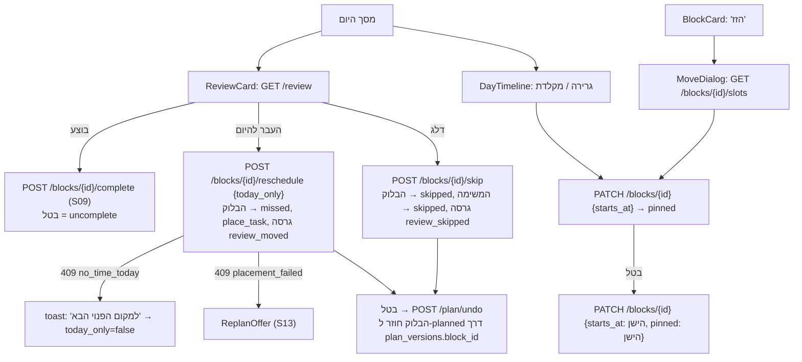

# S18 — סקירת בוקר וגרירה בתוך היום: תוכנית עבודה

> **For agentic workers:** REQUIRED SUB-SKILL: Use superpowers:subagent-driven-development (recommended) or superpowers:executing-plans to implement this plan task-by-task. Steps use checkbox (`- [ ]`) syntax for tracking.

**מטרה:** בלוק שעבר זמנו בלי סימון מחכה בכרטיס "סקירת בוקר" בראש מסך "היום". לכל בלוק יש שלוש פעולות, כל אחת עם "בטל": "בוצע", "העבר להיום" ו"דלג". בלוק שעוד לא התחיל אפשר להזיז לשעה פנויה באותו יום, בקפיצות של 15 דקות, בשלוש דרכים: גרירה בציר היום (עכבר או מגע), מקלדת, או כפתור "הזז" שפותח רשימה של שעות פנויות. הבלוק שזז ננעל, והבלוקים שלידו לא זזים.

**השער במפת הדרכים:** "שתיהן עובדות, והבדיקות ירוקות".

**גישה:** שני חלקים ב-API, שלושה ב-web:
1. **API:** סקירה (Task A, כולל מיגרציה 0012), והזזה (Task B).
2. **web:** כרטיס הסקירה (Task C), שלושת התיקונים מ-S14 (Task E), וציר היום עם גרירה, מקלדת ו"הזז" (Task D).

**כלים:** כמו ב-S15. בלי תלויות חדשות: הגרירה בנויה על Pointer Events, ולא על ספריית drag-and-drop. ה-Pointer Events מטפלים בעכבר, במגע ובעט באותו קוד, ואת המקלדת ממילא צריך לכתוב בעצמנו. ספרייה הייתה מוסיפה בעיקר משקל ל-bundle.

**מסמך תכנון:** 7.4 (`plan_versions`), 7.6 שלבים 6–8 (תקפות, `place_task`, מה מפעיל מה), 7.7 (ה-API), 7.9 (התוספות והנגישות).

## איך החלקים מתחברים

- **למה הסקירה משתמשת ב-`place_task` ולא בדחייה:** דחייה (`defer`) משחררת בלוק חי ומניחה אותו מחדש. בלוק שעבר זמנו כבר לא חי: לפי 7.6 שלב 6 הוא "היסטוריה", הוא לא תופס זמן, והדקות שלו חוזרות למשימה. לכן "העבר להיום" לא צריך לשחרר כלום. מספיק לסמן את הבלוק `missed` ולקרוא ל-`place_task` של המשימה, שמניח בדיוק את הדקות שחסרות לה. זה גם מה ש-7.6 שלב 7 קבע: "סקירת הבוקר ודחייה משתמשות בה".
- **למה צריך את מיגרציה 0012:** "בטל" של "העבר" ושל "דלג" צריך להחזיר שני דברים. הבלוקים העתידיים חוזרים מה-snapshot, כמו בכל גרסה. אבל הבלוק שנסקר נמצא בעבר, וה-snapshot שומר רק בלוקים שנגמרים אחרי "עכשיו". לכן הגרסה צריכה לזכור איזה בלוק סומן `missed` או `skipped`, כדי שהביטול יחזיר אותו ל-`planned`, ומשם לכרטיס הסקירה. זו עמודה אחת, `plan_versions.block_id`.
- **למה הזזה לא יוצרת גרסה:** כמו נעילה (S09), הביטול של הזזה הוא הפעולה ההפוכה: `PATCH` עם השעה הקודמת ועם מצב הנעילה הקודם. גרסה הייתה גם נכשלת כאן. כלל ה-undo של S08 משאיר "בלוק שהמשתמש נעל אחרי השינוי" במקומו, ובלוק שהוזז הוא בדיוק כזה.
- **למה רשת 15 הדקות נאכפת ב-web ולא בשרת:** השרת בודק את מה שחייב להיות נכון תמיד: הבלוק עוד לא התחיל, הוא נשאר באותו יום ובשעות הערות, והוא לא חופף בלוק אחר. הרשת היא צורת האינטראקציה (7.9). אילו השרת היה אוכף אותה, "בטל" לא היה יכול להחזיר בלוק לשעה המקורית שלו, שהמתכנן קבע (למשל 09:05). ‏`GET /blocks/{id}/slots` מחזיר רק נקודות על הרשת, כך שהרשימה ב"הזז" תמיד על הרשת.

## מה מצאתי לפני התכנון (2026-11-16)

| נושא | מצב |
|---|---|
| `missed` / `skipped` | קיימים ב-enum ובמתכנן (היסטוריה), אבל אף קוד לא כותב אותם |
| בלוק שעבר זמנו | ב-S14 הוא מוצג ברשימה של היום עם "בוצע" בלבד; `defer` דוחה אותו (409) |
| `GET /today` | בלי גבולות היום; ‏`planned_minutes` כולל בלוקים שעברו |
| `PATCH /blocks/{id}` | רק `pinned` (S09: "הזזה ב-S18") |
| `plan_versions.reason` | רק CHECK של פורמט, בלי enum במסד: סיבה חדשה לא צריכה מיגרציה |
| ‏`delete_open_blocks` | יוצר גרסה רק כשיש בלוקים, או עם `always_version` |
| S14 | הפוקוס הולך לאיבוד אחרי "בוצע" על המשימה הבאה; ה-meter מתעדכן רק אחרי רענון; שני חלקים של אותה משימה נותנים כפתורים עם אותו שם נגיש |

## ההחלטות שלי

1. **מה נכנס לסקירה:** בלוק `planned` שנגמר (`ends_at ≤ now`), של משימה `todo` שלא נמחקה, של מבחן חי שתאריכו לא עבר, ש-`study_date` שלו הוא בשבעת ימי הלימוד האחרונים (כולל היום). בלוק של היום שעבר זמנו נכנס גם הוא, כי זה אותו מצב, וכך מי שפספס בבוקר יכול להעביר לערב. בלוק ישן משבוע לא מוצג. הוא כבר היסטוריה במתכנן, והדקות שלו חוזרות למשימה בתכנון מחדש הבא, כך שרשימה ארוכה של החלטות על העבר רק מכבידה.
2. **"בוצע"** הוא `complete` הקיים, וה"בטל" שלו הוא `uncomplete`, כמו ב-S14.
3. **"העבר להיום"** (`POST /blocks/{id}/reschedule {"today_only": true}`): הבלוק עובר ל-`missed`, ו-`place_task` מניח את הדקות שחסרות למשימה מ"עכשיו". אם יש בלוק חדש שלא נופל ביום הלימוד של היום, התשובה היא 409 `placement_failed` עם `reason: "no_time_today"`, ושום דבר לא משתנה. אז ה-toast מציע "למקום הפנוי הבא" (`today_only: false`). הנחה שנכשלה מסיבה אחרת פותחת את `ReplanOffer`. נכתבת תמיד גרסה `review_moved` עם `task_id` ו-`block_id`, גם כשלמשימה כבר לא חסרות דקות (תכנון מחדש כבר כיסה אותן), כדי שהביטול יחזיר את הבלוק לסקירה.
4. **"דלג"** (`POST /blocks/{id}/skip`) מדלג על **המשימה**: הבלוק עובר ל-`skipped`, המשימה עוברת ל-`skipped`, והבלוקים הפתוחים שלה נמחקים, כמו `PATCH /tasks {status: skipped}`. נכתבת גרסה `review_skipped` עם `task_before = {"status": "todo"}` ו-`block_id`. הנימוק: במתכנן, בלוק `skipped` הוא היסטוריה, והדקות שלו חוזרות למשימה. לכן דילוג על הבלוק בלבד לא היה מוריד כלום: המשימה הייתה נשארת חסרה, ומופיעה בדוח "לא נכנס" עם סיבה לא נכונה. דילוג על המשימה הוא הפעולה היחידה שעקבית עם הדומיין. מי שרוצה לעשות אותה אחר כך לוחץ "העבר". מסך המבחן (S15) מחזיר משימה ל-`todo` גם אחרי שה-toast נעלם.
5. **ביטול** של `review_moved` ושל `review_skipped` עובר ב-`POST /plan/undo` הקיים. ה-snapshot מחזיר את הבלוקים העתידיים, ‏`task_before` מחזיר את הסטטוס של המשימה (רק ב-`review_skipped`), והבלוק שב-`block_id` חוזר ל-`planned` אם הוא עדיין `missed` או `skipped`.
6. **מיגרציה 0012:** `plan_versions.block_id uuid` עם FK משולש `(block_id, user_id) → blocks(id, user_id)` ו-`ON DELETE SET NULL (block_id)`, כמו שאר ה-FK בין הטבלאות. ל-`authenticated` יש INSERT גם לעמודה הזו. ה-`down_revision` מותאם לפני המיזוג למה שיש ב-`origin/main` (S16 ו-S19 מביאים את 0010 ואת 0011).
7. **הזזה** (`PATCH /blocks/{id} {"starts_at", "pinned"?}`): הבלוק `planned` ועוד לא התחיל (`starts_at > now`), אחרת 409 `invalid_state`. המשך נשמר. ההתחלה החדשה בדקה שלמה, לא לפני `now`, והבלוק כולו בתוך שעות הערות (מ-`wake_time` עד `sleep_time`) של אותו יום לימוד, אחרת 422 `outside_day`. חפיפה עם בלוק `planned` או `done` אחר: 409 `slot_taken` עם `blocked_by`. ‏`pinned` נקבע ל-`true`, אלא אם הבקשה שולחת ערך אחר (זה מה שה"בטל" שולח). אחרי ההזזה החלקים של המשימה ממוספרים מחדש לפי הזמן.
8. **שעות הערות ולא חלונות הלימוד:** בלוק נעול "נמצא איפה שהמשתמש שם אותו" (7.6). החלונות הם העדפה של המתכנן, לא גבול להחלטה ידנית. גם "השעה שאחרי הקימה" היא העדפה של המתכנן, ולכן הגבול הוא `wake_time` עצמו. גבולות היום מגיעים ל-web ב-`GET /today` (`day_starts_at`, `day_ends_at`) וב-`GET /blocks/{id}/slots`.
9. **ריפוד אחרי גרירה (השורה מ-S08): הגרירה לא מחייבת הפסקה.** מותר להצמיד בלוק לבלוק אחר. הנימוקים: (א) זו החלטה מפורשת של המשתמש, ויש מי שלומדים שני בלוקים קצרים ברצף; (ב) עם קפיצות של 15 דקות, הפסקה חובה של 10 דקות הייתה פוסלת גם את השעה הרבע הבאה; (ג) המתכנן ממשיך לרפד סביב בלוק נעול (10 דקות ב-`fixed_state`, ו-30 ב-`place_task`), כך שרק המשתמש יוצר רצף, אף פעם לא המתכנן. התקפות בלי ריפוד (S08) נשארת כמו שהיא: בלוק צמוד שהמשתמש יצר נשאר צמוד בתכנון מחדש, וזו הכוונה.
10. **`GET /blocks/{id}/slots`:** כל ההתחלות על רשת של 15 דקות לפי השעון המקומי של הפרופיל, שבהן הזזה הייתה מצליחה (בלי השעה הנוכחית). ‏`MoveDialog` מציג אותן כרשימה, כך שהחלופה בלי גרירה עובדת גם ב"שבוע", לכל יום.
11. **ציר היום ב-web:** מתג "רשימה / ציר" בכותרת של הבלוקים של היום. ברירת המחדל היא רשימה, והבחירה נשמרת ב-`localStorage` לכל דפדפן. בציר, בלוק `upcoming` נגרר דרך ידית ("גרירה") עם `touch-action: none`, כך שגלילה במגע על שאר הציר עובדת. בזמן הגרירה מוצגת צללית במקום החדש, ירוקה כשהשעה פנויה ואדומה כשהיא תפוסה. בשחרור על שעה תפוסה הבלוק חוזר למקומו, עם הודעה. רשימה וציר יחד היו מכפילים כל כרטיס, וכך גם את השמות הנגישים.
12. **מקלדת:** הידית היא כפתור. Enter או רווח מתחילים הזזה; חץ למעלה ולמטה זזים 15 דקות; PageUp ו-PageDown זזים שעה; Enter מאשר ו-Escape מבטל. ‏live region מכריז על השעה החדשה ואם היא פנויה. הציר אנכי, ולכן ב-RTL לא צריך להפוך את החצים. חצים ימינה ושמאלה לא בשימוש.
13. **הרשימה של היום** כבר לא מציגה בלוק שעבר זמנו, כי הוא בכרטיס הסקירה. כך אין שני כרטיסים לאותו בלוק.
14. **תיקוני S14:** (א) **פוקוס:** אחרי "בוצע", "ביטול סימון", נעילה או הזזה, הפוקוס עובר לכפתור הראשון של הכרטיס של אותו בלוק, איפה שהוא מופיע עכשיו. בסקירה, הפוקוס עובר לשורה הבאה, ואם אין כזו לכותרת הכרטיס. (ב) **ה-meter:** העדכון האופטימי מעדכן גם את `planned_minutes` ואת `done_minutes` של היום, לפי השינוי בסטטוס. (ג) **שמות נגישים:** לבלוק עם כמה חלקים, השם בכל התוויות כולל "חלק 1 מתוך 2". זה שונה ממה שהשורה הציעה (להוסיף את השעה), כי מספר החלק ייחודי לכל משימה בכל יום ובכל מסך, והוא לא תלוי באזור הזמן.

## Global Constraints

- כל טקסט ב-`he.ts`: בקטעים `review` ו-`move` (השלד כבר קיים), ובקטעים `board` ו-`today` לתוויות קיימות. בלי טקסט קשיח ברכיבים. קוד הופך לטקסט רק דרך `codeText` או `unscheduledText`. הקודים `no_time_today`, ‏`slot_taken` ו-`outside_day` כבר ב-`he.codes`.
- צבעים רק ממשתני `index.css`. בלי `alert`, בלי `confirm`, בלי `dangerouslySetInnerHTML`. כל פעולה עם כפתור גלוי.
- כל endpoint חדש: בעלות (משתמש ב' מקבל 404), ו-`user_id` מפורש בכל שאילתה מעל RLS. כל פעולה שמשנה את הלוח מתחילה בנעילה של המשתמש.
- כל ה-queries של הלוח תחת `['board', userId]`. ‏`reviewKey` כבר קיים ב-`web/src/board/api.ts`.
- `legacy/` לא נוגעים. לא נוגעים ב-`web/src/progress/**`, ב-`api/app/domain/gamification/**`, ב-`web/src/notifications/**`, ב-service worker וב-PWA, ולא בגוף הטרנזקציה של `complete_block`.
- בדיקות API מקבילות: כל סוכן עם `STUDYFLOW_TEST_DB` משלו (`studyflow_test_s18a`, ‏`studyflow_test_s18b`), ובלי `tests/db`, שרק השיחה הראשית מריצה.
- סוכנים לא מריצים git. סוכן שמוצא פגם בתוכנית מדווח עליו, ולא עוקף אותו.
- web: ‏`export PATH="$HOME/.nvm/versions/node/v24.22.1/bin:$PATH"` לפני כל פקודת npm.

## Review Focus

- הסקירה: ביטול מחזיר בדיוק את מה שהיה (הבלוק ל-`planned`, הבלוקים העתידיים, הסטטוס של המשימה), ולא נוגע בבלוקים של משימות אחרות. ‏`today_only` לא כותב כלום כשהוא נכשל.
- הזזה: אי אפשר להזיז בלוק שהתחיל, `done`, של משתמש אחר, או אל מחוץ ליום. שכן לא זז לעולם. חפיפה ב-COMMIT עדיין מגיעה כ-409.
- גרירה במגע: גלילה של הדף עובדת, והגרירה מתחילה רק מהידית. ‏`pointercancel` מחזיר את הבלוק.
- נגישות: כל מה שאפשר לעשות בגרירה אפשר לעשות במקלדת ובכפתור "הזז".

## מה רץ במקביל

| גל | משימות | למה |
|---|---|---|
| 0 | Task 0 (השיחה הראשית) | החוזים: טיפוסים, fixtures, קודים ושלד `he.review` / `he.move`, כדי שסוכני ה-web לא יתנגשו |
| 1 | Tasks A, B, C, E במקביל | קבצים נפרדים (ראו כל משימה); ל-A ול-B מסד בדיקות נפרד |
| 2 | Task D | נוגע ב-`BlockCard.tsx` וב-`actions.ts`, ש-E משנה, ומחבר את כרטיס הסקירה של C למסך |
| 3 | איחוד, סקירה סופית, דפדפן וסגירה | השיחה הראשית |

**קבצים משותפים:** ‏`web/src/i18n/he.ts` (כל סוכן בקטע שלו), ‏`api/app/main.py` (רק A, router של `review`), ‏`api/app/errors.py` (A ו-B מוסיפים קודים, כל אחד בשורות משלו), ‏`api/tests/api/test_ownership.py` (A ו-B מוסיפים בדיקה בסוף הקובץ).

---

### Task 0: חוזים (השיחה הראשית)

**קבצים:** `web/src/board/types.ts`, ‏`web/src/board/api.ts`, ‏`web/src/test/boardFixtures.tsx`, ‏`web/src/i18n/he.ts`.

- [x] `Today.day_starts_at` / `day_ends_at`; ‏`Review`, ‏`RescheduleResult`, ‏`SkipResult`, ‏`Slots`; ‏`reviewKey`.
- [x] ‏`makeToday` עם גבולות יום (07:00–23:00 בירושלים).
- [x] ‏`he.codes`: ‏`no_time_today`, ‏`slot_taken`, ‏`outside_day`; שלד `he.review`, ‏`he.move`.
- [x] commit עם התוכנית.

### Task A: סקירה ב-API, ומיגרציה 0012

**קבצים:** `api/migrations/versions/0012_review_block.py`, ‏`api/app/services/plan_writes.py`, ‏`api/app/services/review.py` (חדש), ‏`api/app/routers/review.py` (חדש), ‏`api/app/schemas/review.py` (חדש), ‏`api/app/main.py`, ‏`api/app/errors.py` (אם צריך), ‏`api/tests/api/test_review.py` (חדש), ‏`api/tests/api/test_undo.py`, ‏`api/tests/api/test_ownership.py` (בסוף).

- [x] מיגרציה 0012 (החלטה 6), עם `down_revision = "0009"` בינתיים, ו-downgrade שמחזיר את ה-GRANT של 0008.
- [x] `VersionReason.REVIEW_MOVED = "review_moved"`, ‏`REVIEW_SKIPPED = "review_skipped"`; ‏`block_id` ב-`VersionRow`, ב-`create_version`, ב-`apply_result` וב-`delete_open_blocks`; ‏`_undo_side_effect` מחזיר את הבלוק ל-`planned` ומחזיר את `task_before` ב-`review_skipped`.
- [x] `GET /review` → ‏`{"blocks": [BlockOut]}` לפי `starts_at` (החלטה 1).
- [x] `POST /blocks/{id}/reschedule` עם גוף `{"today_only": bool = true}` (אופציונלי) → ‏`{"blocks", "version_id"}`, כמו `DeferResponse` (החלטה 3).
- [x] `POST /blocks/{id}/skip` → ‏`{"task_status": "skipped", "version_id"}` (החלטה 4).
- [x] בלוק שלא בסקירה (לא `planned`, עוד לא נגמר, משימה לא `todo`) → 409 `invalid_state`; של אחר → 404.
- [x] בדיקות: כל פעולה עם ביטול; ‏`today_only` שנכשל לא משנה כלום; ‏`today_only: false` מניח מחר; בלוק של לפני 8 ימים לא בסקירה; משימה בלי דקות חסרות; בעלות.

### Task B: הזזה ב-API

**קבצים:** `api/app/services/moves.py` (חדש), ‏`api/app/services/blocks.py`, ‏`api/app/routers/blocks.py`, ‏`api/app/schemas/blocks.py`, ‏`api/app/schemas/plan.py` (‏`TodayOut`), ‏`api/app/services/plan_views.py` (‏`today_view`), ‏`api/app/errors.py`, ‏`api/tests/api/test_moves.py` (חדש), ‏`api/tests/api/test_board.py`, ‏`api/tests/api/test_ownership.py` (בסוף).

- [x] `PATCH /blocks/{id}`: ‏`{"pinned"?, "starts_at"?}`, לפחות אחד (אחרת 422). ‏`pinned` לבד מתנהג כמו היום (החלטה 7).
- [x] `GET /blocks/{id}/slots` → ‏`{"study_date", "day_starts_at", "day_ends_at", "slots"}` (החלטה 10).
- [x] `GET /today` מחזיר `day_starts_at` / `day_ends_at`: ‏`local_span(today, wake_time, sleep_time)`, או null.
- [x] קודים: `slot_taken` (409, עם `blocked_by`), ‏`outside_day` (422).
- [x] בדיקות: הזזה לשטח פנוי ננעלת; צמוד לשכן מותר והשכן לא זז; חפיפה → 409; בלוק שהתחיל או `done` → 409; ליום אחר, לפני `now`, אחרי השינה → 422; "בטל" (חזרה לשעה מחוץ לרשת עם `pinned: false`); ‏renumber של שני חלקים; ‏slots על רשת של 15 דקות לפי השעון המקומי (גם ב-`Asia/Kathmandu`, ‏+05:45); ‏`replan` אחרי הזזה לא מזיז את הבלוק; בעלות.

### Task C: כרטיס הסקירה ב-web

**קבצים:** `web/src/board/review.ts` (חדש), ‏`web/src/today/ReviewCard.tsx` (חדש), ‏`web/src/today/ReviewCard.test.tsx` (חדש), ‏`he.review` ב-`web/src/i18n/he.ts`. לא נוגעים ב-`TodayPage.tsx` (Task D מחבר).

- [x] `useReview()` (‏`GET /review` תחת `reviewKey`, עם refetch של דקה); ‏`useReviewActions()` עם `moveToday(block)`, ‏`moveNext(block)`, ‏`skip(block)`, ‏`pending(id)`. ‏"בוצע" משתמש ב-`useBlockActions().complete`. אחרי כל פעולה כל הלוח מתרענן.
- [x] "העבר": toast עם לאן זה זז ו"בטל" (`POST /plan/undo`). ‏`no_time_today` → ‏toast עם הסיבה ופעולה "למקום הפנוי הבא". סיבה אחרת → ‏`useOfferReplan()`.
- [x] "דלג": toast "דילגת על …" עם "בטל".
- [x] `ReviewCard`: לא מוצג כשאין בלוקים. כותרת "סקירת בוקר", שורה לכל בלוק (כותרת, יום ושעה, מבחן, חלק), שלושה כפתורים עם שמות נגישים שכוללים את הכותרת (ואת החלק). הפוקוס אחרי פעולה עובר לשורה הבאה, ובסוף לכותרת (`tabIndex={-1}`).
- [x] בדיקות: שלוש הפעולות עם "בטל"; ‏`no_time_today` ואז "למקום הפנוי הבא"; ‏`placement_failed` פותח את `ReplanOffer`; פוקוס; כרטיס ריק לא מוצג.

### Task E: שלושת התיקונים מ-S14

**קבצים:** `web/src/board/actions.ts`, ‏`web/src/board/BlockCard.tsx`, ‏`web/src/board/focus.ts` (חדש), ‏`web/src/today/DayProgress.tsx` (אם צריך), ‏`he.board` (התוויות), והבדיקות שלהם: `web/src/board/*.test.tsx`, ‏`web/src/today/today.test.tsx`, ‏`web/src/week/week.test.tsx`.

- [x] **meter:** ‏`patchBlock` מעדכן ב-`Today` גם את `planned_minutes` ואת `done_minutes` לפי המעבר בסטטוס (planned→done ו-done→planned). ה-rollback מחזיר גם אותם.
- [x] **פוקוס:** `focus.ts`, מאגר קטן ברמת ה-board (‏`requestFocus(blockId)`). ‏`BlockCard` שמתרנדר עם בלוק שביקשו לו פוקוס ממקד את הכפתור הראשון שלו, ומנקה את הבקשה. כל הפעולות האופטימיות מבקשות פוקוס לבלוק שלהן.
- [x] **שמות:** פונקציה אחת, `blockName(block)`: הכותרת, ועם כמה חלקים גם "(חלק i מתוך n)". כל התוויות של הכפתורים והתפריט עוברות דרכה.
- [x] בדיקות: ה-meter זז לפני תשובת השרת וחוזר בכשל; הפוקוס אחרי "בוצע" על המשימה הבאה נמצא על "ביטול סימון" של אותו בלוק ברשימה; שני חלקים באותו יום עם שמות שונים.

### Task D: ציר היום, גרירה, מקלדת ו"הזז"

**קבצים:** `web/src/board/move.ts` (חדש: ‏`useMoveBlock`, ‏`snapToGrid`, ‏`freeAt`), ‏`web/src/board/MoveDialog.tsx` (חדש), ‏`web/src/today/DayTimeline.tsx` (חדש), ‏`web/src/board/actionsFor.ts`, ‏`web/src/board/BlockCard.tsx`, ‏`web/src/pages/TodayPage.tsx`, ‏`web/src/today/TodayBlocks.tsx`, ‏`he.move`, ובדיקות: `web/src/board/move.test.ts`, ‏`web/src/board/MoveDialog.test.tsx`, ‏`web/src/today/DayTimeline.test.tsx`, ‏`web/src/today/today.test.tsx`.

- [x] `useMoveBlock()`: ‏`PATCH /blocks/{id} {starts_at}` אופטימי (זמנים ו-`pinned`) בכל ה-cache של הלוח, עם rollback; ‏toast "הבלוק זז ל-HH:MM ונעול" עם "בטל", שמחזיר את השעה ואת `pinned` הקודמים; ‏`slot_taken` ו-`outside_day` → ‏toast עם הטקסט. פוקוס לבלוק (Task E).
- [x] `snapToGrid(instant, tz)`: עיגול לרבע השעה הקרוב לפי השעון המקומי. ‏`freeAt(block, start, day, blocks, now)`: אותם כללים כמו בשרת (החלטה 7).
- [x] `actionsFor`: ‏`'move'` לבלוק `upcoming`. ‏`BlockCard` (בשני ה-variants): "הזז" פותח `MoveDialog`, שטוען `GET /blocks/{id}/slots` ומציג את השעות כרשימת בחירה (ListBox) עם "הזזה" ו"ביטול".
- [x] `DayTimeline`: ציר אנכי של שעות הערות, בלוקים לפי זמן, החלק שעבר מוצלל, קו של "עכשיו", ידית גרירה לבלוק `upcoming` (החלטות 11–12). להשתמש בסקיל `frontend-design`.
- [x] `TodayPage`: ‏`ReviewCard` (מ-C) מעל המשימה הבאה; הרשימה בלי בלוקים שעברו זמנם (החלטה 13); מתג "רשימה / ציר".
- [x] בדיקות: גרירה (pointer events ב-jsdom) לשטח פנוי שולחת `PATCH` עם שעה על הרשת; גרירה לשטח תפוס לא שולחת כלום ומחזירה; קפיצות של 15 דקות; מקלדת (חצים, PageUp, Enter, Escape) תחת `dir="rtl"`; הבלוק שזז מוצג נעול; "הזז" בלי גרירה; "בטל".

### Task 9: איחוד, סקירה, דפדפן וסגירה (השיחה הראשית)

- [x] כל הבדיקות, lint, typecheck, build; ‏`tests/db` לבד.
- [x] סקירה של כל הענף (Opus), תיקונים.
- [x] בדפדפן: מובייל (מגע, 390px) ומסך רחב, עם screenshot, מול ה-API המקומי.
- [x] מיגרציה 0012 על פרויקט הפיתוח (נוהל SQL Editor), אחרי ש-`down_revision` הותאם ל-`origin/main`.
- [x] מסמך התכנון (7.4, 7.6, 7.7, 7.9) והטאב שלו; מפת הדרכים; rebase, ‏push ל-main, מחיקת הענף.

## סיכום (2026-11-17)

- **מה נבנה:** כל המשימות A–E כמתוכנן, ועוד ה-XP של S19 ב-toast של "בוצע" (השורה של S19 במפת הדרכים). מיגרציה 0012 נשענת על `UNIQUE (id, user_id)` של 0011 (S19) ולא מוסיפה אותו שוב.
- **סקירה סופית:** בלי ממצאים קריטיים או חשובים. תוקנו: פעולות הסקירה שומרות על חלון שבעת הימים של `GET /review`; גרירה שנתקעת כשהידית נעלמת (`lostpointercapture` ובלוק שהתחיל); מקלדת לא מציעה שעה שעברה; פוקוס חוזר לשורה אחרי "העבר" שנכשל; "בטל" נשלח פעם אחת (גם בדחייה). "הזזה לדקה הנוכחית" נבדק, ואינו באג: `start_minute` מעגל קדימה. נרשם בטבלת הבאגים: מספרי החלקים בכרטיס הסקירה אחרי `renumber`.
- **בדפדפן:** פורט 5173 תפוס בבדיקת S16 באייפון, ולכן הבדיקה רצה על build זמני ב-`vite preview` בפורט 4199, מול ה-API האמיתי (פורט 8018) ומסד מקומי, עם JWKS מקומי במקום Google. נבדקו: "העבר להיום" → ‏`no_time_today` → "למקום הפנוי הבא" → "בטל"; "בוצע" עם XP ותג; גרירה בעכבר (19:00, נעול) וגרירה לשטח תפוס (נדחתה); מקלדת (צללית אדומה, הכרזה, Escape); ב-390px גרירה במגע (`pointerType: touch`, ‏`touch-action: none` רק על הידית, בלי גלילה אופקית), "הזז" עם רשימת שעות, ו"בטל". ‏12 צילומים ב-`~/studyflow-manager/s18-screens/`. הבדיקה מול חשבון Google אמיתי נשארת ל-S17, וגם מגע אמיתי באייפון.
- **מיגרציה 0012 בפרויקט הפיתוח:** הוחלה דרך ה-SQL Editor אחרי dry-run מקומי. בפרויקט הפיתוח ה-head היה 0010 (השרשרת של S16, מעל 0011), ולכן ה-UPDATE של `alembic_version` קיבל 0010 או 0011. אומת בקטלוג: 0012, העמודה, ה-FK וההרשאה.
