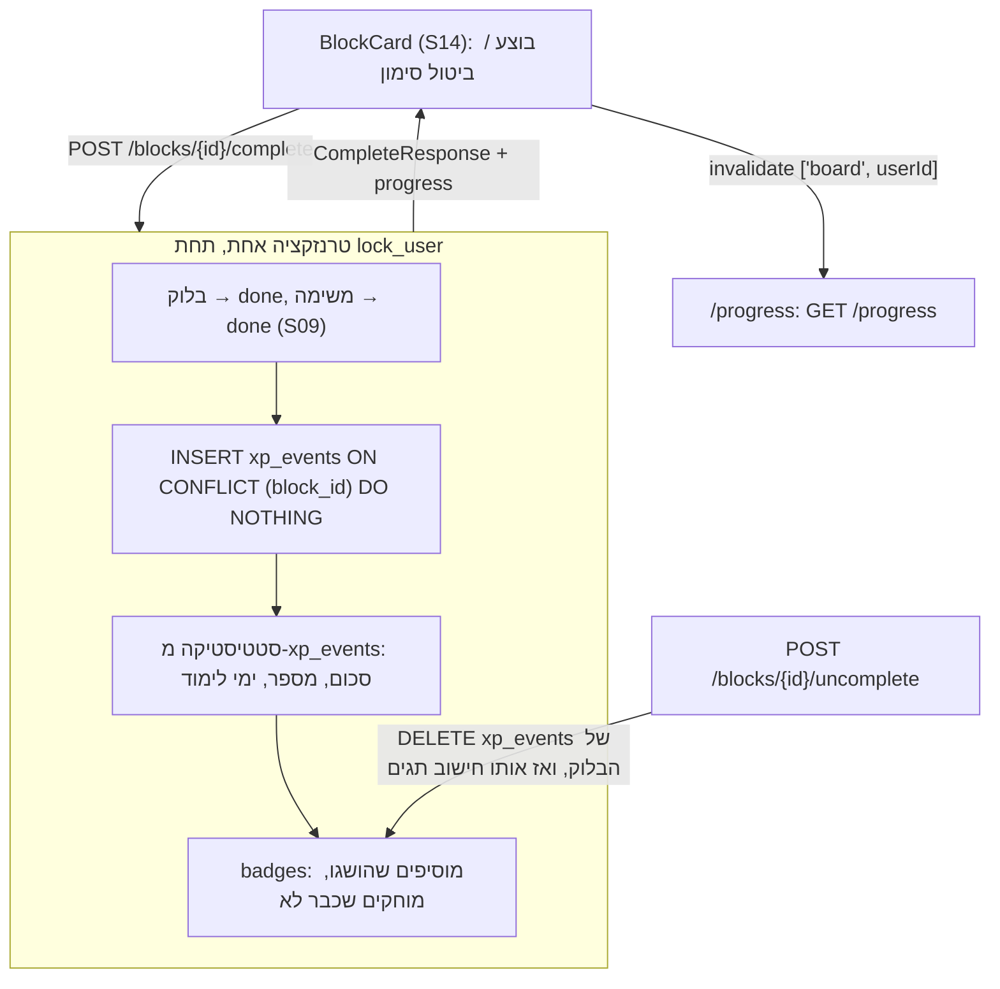

# S19 — גיימיפיקציה: XP, רמות, רצף ימי לימוד ותגים: תוכנית עבודה

> **For agentic workers:** REQUIRED SUB-SKILL: Use superpowers:subagent-driven-development (recommended) or superpowers:executing-plans to implement this plan task-by-task. Steps use checkbox (`- [ ]`) syntax for tracking.

**מטרה:** כל בלוק שהסטודנט מסמן "בוצע" נותן לו XP, פעם אחת בלבד. מה-XP נגזרות רמה (1–50), ומימי הלימוד נגזר רצף. התגים מסמנים אבני דרך. לוח התקדמות שקט (`/progress`) מציג את כל אלה.

**השער במפת הדרכים:** "סימון ביצוע מעדכן XP פעם אחת בלבד".

**גישה:** שלושה חלקים:
1. **מיגרציה 0011** (Task 1): הטבלאות `xp_events` ו-`badges`, עם RLS.
2. **API:** דומיין טהור ב-`api/app/domain/gamification` (Task 2), ושירות שמצטרף לטרנזקציה של `complete` ו-`uncomplete`, ‏`GET /progress` וייצוא (Task 3).
3. **web:** לוח ההתקדמות ב-`web/src/progress/**` וקישור ניווט אחד (Tasks 0, 4).

**כלים:** כמו ב-S15, בלי תלויות חדשות.

**מסמך תכנון:** סעיפים 7.3 (זמן), 7.4 (הטבלאות והרצף), 7.7 (`complete` בטרנזקציה אחת, `GET /progress`), 7.9 (לוח התקדמות בטון שקט), 8 (`backend/gamification/utils.py`), 11.11 (רצף לפי ימי לימוד, בלי "שבירת רצף").

## איך החלקים מתחברים



- **למה XP הוא יומן ולא מונה:** בקוד הישן היה מונה `total_xp` שמעדכנים בכל סימון, ולכן סימון כפול או ביטול שלא עבר נתנו XP כפול. כאן כל בלוק הוא לכל היותר שורה אחת ב-`xp_events` (`block_id` unique), והסכום, הרמה והרצף מחושבים ממנה. אין מה "לסנכרן": המספר הוא תמיד מה שהיומן אומר.
- **למה "פעם אחת" מוגן פעמיים:** `complete` כבר תופס את הנעילה של המשתמש (`lock_user`, ‏S09), ולכן שתי קריאות במקביל רצות בזו אחר זו, והשנייה רואה בלוק `done` ולא נותנת כלום. ה-unique על `block_id` הוא רשת ביטחון במסד: גם קוד עתידי ששוכח את הנעילה לא יכול לכתוב שתי שורות לאותו בלוק, ו-`ON CONFLICT DO NOTHING` הופך ניסיון כזה לאפס XP במקום לשגיאה.
- **למה התגים נגזרים ולא נצברים:** כל תג הוא תנאי על ארבעה מספרים שמחושבים מהיומן (סך XP, רמה, מספר בלוקים, הרצף הארוך ביותר). אחרי כל `complete` או `uncomplete` השירות מחשב את קבוצת התגים שהתנאי שלהם מתקיים, מוסיף את החדשים עם `earned_at` ומוחק את מה שכבר לא מתקיים. כך תג תמיד מתאים למה שבאמת נלמד, ו"בוצע" ואחריו "בטל" לא משאירים תג.
- **למה תגי רצף לפי הרצף הארוך ביותר:** הרצף הנוכחי יורד לאפס ביום בלי לימוד, בלי שום פעולה של המשתמש. אם התג היה תלוי ברצף הנוכחי, הוא היה נעלם מעצמו. "הגעת ל-7 ימים ברצף" נשאר נכון גם אחרי הפסקה.
- **למה `GET /progress` לא כותב:** הוא מחשב הכול מהיומן ומחזיר. הכתיבה היחידה לתגים היא בתוך `complete` ו-`uncomplete`, באותה טרנזקציה עם הבלוק (7.7).
- **איך ה-web מתרענן בלי לגעת ב-`board/`:** המפתח של לוח ההתקדמות הוא `['board', userId, 'progress']`, ילד של המפתח של הלוח. ‏`useBlockActions` (S14) כבר מרענן את `['board', userId]` אחרי כל פעולה, ו-TanStack Query מרענן גם את הילדים. לכן אין צורך אפילו בשורה ב-`board/`. השדה `progress` בתשובה של `complete` מוכן ל-toast של S17/S18.

## מה מצאתי לפני התכנון (2026-11-16)

| נושא | מצב |
|---|---|
| הקוד הישן | ‏XP = ‏`round(focus × שעות הבלוק × 10)`, עם רצפה של רבע שעה ו-focus 5 כברירת מחדל; רמה = ‏`min(50, floor(xp / 1000) + 1)`; רצף לפי **כניסות**; 21 תגים, אחד מהם "שבירת רצף" |
| `complete` / `uncomplete` | ב-`app/services/blocks.py`, תחת `lock_user`; ‏`done` → ‏`done` לא משנה כלום; ‏`uncomplete` מחזיר את הבלוק ל-`planned` |
| בלוקים `done` | לא נמחקים בשום מקום בקוד, חוץ מ-cascade של מחיקת משימה או מבחן קשה (מחיקת חשבון) |
| `blocks` | אין `UNIQUE (id, user_id)`, ולכן FK משולב מ-`xp_events` עוד לא אפשרי |
| `focus` | ‏`NOT NULL DEFAULT 5`, ‏1–10 |
| יום של בלוק | ‏`study_date(profile, instant)` במתכנן: בלוק אחרי חצות של מי שהולך לישון מאוחר שייך ליום הלימוד הקודם, כמו שמסך "היום" מציג אותו |
| מחיקת חשבון | ‏`app.delete_account_data()` (0009) מוחקת כל טבלה בשמה; ‏S16 צפוי לגעת בה ב-0010 בשביל `push_subscriptions` |
| ייצוא | רשימת עמודות מפורשת ב-`app/services/account.py` |
| מפת הדרכים | אין שורות פתוחות שמתויגות S19 |

## ההחלטות שלי

1. **הנוסחה נשמרת:** ‏`xp = round(focus × minutes / 6)` (זה `focus × שעות × 10`), כש-`minutes` הוא אורך הבלוק בדקות, עם רצפה של 15 דקות. ‏`round` של Python (חצי לזוגי), כמו בקוד הישן. רמה = ‏`min(50, total // 1000 + 1)`. בלוק של שעה במיקוד 5 = 50 XP; רמה 2 אחרי כ-20 שעות לימוד.
2. **`uncomplete` מוחק את רשומת ה-XP של הבלוק.** כך `complete` שוב נותן XP פעם אחת, והסכום תמיד שווה לבלוקים שבאמת `done`. החלופה, להשאיר את הרשומה, הייתה נותנת XP על בלוק שהמשתמש אמר שלא עשה, ומונעת XP כשהוא באמת יסיים אותו.
3. **תגים נגזרים מהיומן, ונמחקים כשהתנאי כבר לא מתקיים** (ראו "איך החלקים מתחברים"). ‏`earned_at` הוא הרגע שבו התג נכתב לאחרונה.
4. **רשימת התגים:** הרשימה הישנה בלי `streak_broken_once` (מסמך התכנון), ובלי שניים נוספים:
   - `first_login` יוצא: הוא נספר לפי כניסות, וב-v2 אין מעקב כניסות (11.11). בפועל הוא היה ניתן יחד עם `first_task` בכל פעם.
   - `week_streak` יוצא: הוא אותו תנאי בדיוק כמו `iron_will_7` (רצף של 7), ושני תגים זהים ברגע אחד הם רעש.
   - נשארים 18: ‏`first_task`; ‏`task_master_10/20/50/100` (בלוקים שהושלמו); ‏`iron_will_7/10/14/30/100` (רצף ארוך ביותר); ‏`knowledge_seeker_5/10/20/25/50` (רמה); ‏`xp_1000/5000/10000`.
   - ‏`task_master` סופר בלוקים ולא משימות, כמו בקוד הישן (שם `tasks_completed` עלה בכל סימון של בלוק).
5. **יום לימוד של בלוק:** ‏`study_date(profile, min(starts_at, now))`, באזור הזמן של הפרופיל ברגע הסימון, ונשמר בעמודה `xp_events.study_date`.
   - **למה `study_date` ולא התאריך המקומי:** כך הבלוק נספר ביום שבו מסך "היום" הציג אותו. בלוק של 00:30 אצל מי שהולך לישון ב-02:00 שייך ליום הקודם, ולא שובר את הרצף.
   - **למה `min(starts_at, now)`:** בלוק שעבר זמנו ומסומן מאוחר (שכחתי לסמן אתמול, וסקירת הבוקר של S18) נספר ביום שלו. בלוק עתידי שסומן מוקדם נספר היום, כי הלימוד קרה היום, ולא נותן מראש יום ברצף של מחר.
   - **למה לשמור את התאריך ולא לחשב אותו כל פעם:** משתמש שעובר אזור זמן, או משנה שעת שינה, לא משנה בדיעבד את הימים שכבר נספרו. הרצף ההיסטורי יציב.
   - **מעבר שעון:** ‏`study_date` עובד עם `zoneinfo`, ותאריכים עוקבים הם עוקבים גם כשביניהם יום של 23 או 25 שעות. נבדק בלילות המעבר ב-`Asia/Jerusalem`.
6. **הרצף:** ‏`current` הוא מספר ימי הלימוד הרצופים שנגמרים היום, או אתמול אם היום עוד לא נלמד (הרצף עדיין חי עד סוף היום). יום בלי לימוד מאפס אותו. ‏`longest` הוא הריצה הארוכה ביותר אי פעם. "היום" = ‏`study_date(profile, now)`.
7. **בלי XP רטרואקטיבי** לבלוקים שכבר `done` לפני S19. אין עדיין משתמשים אמיתיים (הבטא בסמסטר ב'), ולכן מילוי לאחור היה מזכה רק נתוני בדיקה בפרויקט הפיתוח. הוא גם היה מחייב לכתוב את `study_date` מחדש ב-SQL, כלומר מקור שני לכלל הזה. בלוק ישן שמבטלים את הסימון שלו ומסמנים שוב מקבל XP כרגיל.
8. **מבנה הטבלאות (מיגרציה 0011):**
   - `xp_events`: ‏`id`, ‏`user_id`, ‏`block_id` (‏unique, ‏NULL אפשרי), ‏`xp` (‏0–100000), ‏`study_date`, ‏`created_at`. ‏FK ‏`(block_id, user_id)` → ‏`blocks (id, user_id)` עם `ON DELETE SET NULL (block_id)`: אם בלוק נמחק יום אחד בעבודת ניקוי, ה-XP שנצבר נשאר. לשם כך `blocks` מקבל `UNIQUE (id, user_id)`.
   - `badges`: ‏`user_id`, ‏`badge_key` (slug), ‏`earned_at`, ‏PK ‏`(user_id, badge_key)`.
   - **`user_id` מפנה ל-`profiles (id)` עם `ON DELETE CASCADE`**, ולא ל-`auth.users`. ‏`app.delete_account_data()` מוחקת את הפרופיל, וה-cascade מוחק גם את שתי הטבלאות, בלי לשנות את הפונקציה. ‏S16 משנה אותה במקביל (0010), ושתי מיגרציות שמחליפות אותה היו דורסות זו את זו. הפרופיל עצמו מפנה ל-`auth.users`, ולכן גם המחיקה ב-Auth מוחקת הכול.
   - **הרשאות ל-`authenticated`:** ‏SELECT, ‏DELETE, ו-INSERT רק לעמודות שה-API כותב (`user_id`, ‏`block_id`, ‏`xp`, ‏`study_date` / ‏`user_id`, ‏`badge_key`). בלי UPDATE. ‏RLS לפי `user_id = auth.uid()`.
9. **תשובת `complete` ו-`uncomplete`** מקבלת שדה `progress`: ‏`{xp_change, total_xp, level, level_up, badges_earned, badges_lost}`. ‏`xp_change` הוא 0 כשלא השתנה כלום (בלוק שכבר `done`). ‏S17/S18 מחברים אותו ל-toast; S19 לא נוגע ב-toast.
10. **`GET /progress`:**
    ```json
    {"total_xp": 1240, "level": 2, "level_start_xp": 1000, "next_level_xp": 2000, "max_level": 50,
     "blocks_done": 31,
     "streak": {"current": 4, "longest": 9, "studied_today": true, "today": "2026-11-16"},
     "days": [{"date": "2026-11-03", "xp": 0}, "… 14 ימים, עד היום"],
     "badges": [{"key": "iron_will_7", "group": "streak", "threshold": 7,
                 "earned": true, "earned_at": "2026-11-12T18:03:00Z"}]}
    ```
    ‏`next_level_xp` הוא null ברמה 50. ‏`badges` הוא כל 18 התגים בסדר קבוע, גם אלה שלא הושגו, כדי שהלוח יראה מה הבא.
11. **ייצוא:** ‏`xp_events` (‏`id`, ‏`block_id`, ‏`xp`, ‏`study_date`, ‏`created_at`) ו-`badges` (‏`badge_key`, ‏`earned_at`) נכנסים לרשימה המפורשת.
12. **לוח ההתקדמות** (`/progress`, קישור "התקדמות" אחרי "מבחנים"): רמה עם פס התקדמות לרמה הבאה, סך XP, רצף נוכחי וארוך ביותר, 14 הימים האחרונים כשורת נקודות, ותגים בקבוצות (שהושגו בצבע, הבאים בגוון חלש עם הסף). בלי אנימציות, קונפטי או אדום על רצף שנשבר: "טון שקט" (7.9). רצף 0 מוצג כהזמנה ("היום הוא יום טוב להתחיל"), לא כאשמה.

## Global Constraints

- כל טקסט ב-`he.ts`, בקטע `he.progress` (ו-`he.shell.progress` לקישור); שמות התגים ב-`he.progress.badges`.
- צבעים רק ממשתני `index.css`. בלי `alert`, ‏`confirm`, ‏`dangerouslySetInnerHTML`.
- ‏`web/src/board/**`, ‏`web/src/today/**`, ‏`web/src/notifications/**` וה-PWA לא נוגעים.
- ‏`user_id` מפורש בכל שאילתה מעל RLS.
- בדיקות API מקבילות: כל סוכן עם `STUDYFLOW_TEST_DB` משלו (`studyflow_test_s19_<n>`). ‏`tests/db` רץ רק בסוכן של המיגרציה ובשיחה הראשית.
- סוכנים לא מריצים git. סוכן מדווח על פגם בתוכנית במקום לעקוף אותו.

## Review Focus

- XP פעם אחת: שתי קריאות במקביל, `complete` על `done`, ‏`uncomplete` ואז `complete`.
- התגים תואמים תמיד את היומן, אחרי כל רצף של פעולות.
- הרצף: אזור הזמן של המשתמש, מעבר שעון, יום בלי לימוד, בלוק שסומן מאוחר או מוקדם.
- בעלות: משתמש ב' לא רואה ולא משנה XP או תגים של א'.
- ייצוא ומחיקה כוללים את שתי הטבלאות.

## מה רץ במקביל

| גל | משימות | למה |
|---|---|---|
| 1 | Task 0 (השיחה הראשית) | השלד של ה-route, הקישור וה-`he.progress`, כדי שסוכן ה-web לא ייגע בקבצים משותפים |
| 2 | Tasks 1, 2, 4 במקביל | המיגרציה (‏`migrations/`, ‏`tests/db/`), הדומיין (‏`app/domain/gamification/`, ‏`tests/gamification/`) וה-web (‏`web/src/progress/`) לא חולקים קובץ |
| 3 | Task 3 | השירות צריך את הטבלאות ואת הדומיין |
| 4 | Task 5 (השיחה הראשית) | איחוד, ownership, סקירה, דפדפן, מסמכים, מיזוג |

## קבצים משותפים עם סשנים אחרים

- `api/tests/db/test_schema.py` ו-`test_settings_and_account.py`: רשימת הטבלאות. ‏S16 מוסיף בהן `push_subscriptions`; מי שממזג שני מאחד ב-rebase.
- `api/migrations/versions/0011_*`: ‏`down_revision` לפי `origin/main` לפני המיזוג (0009 אם 0010 עוד לא מוזגה).
- `web/src/app/AppShell.tsx`, ‏`routes.tsx`, ‏`he.ts`: קישור, route וקטע חדשים בלבד.
- `api/app/services/blocks.py` ו-`api/app/schemas/blocks.py`: ‏S18 עשוי להוסיף הזזה. השינוי כאן הוא קריאה אחת בכל פעולה ושדה אחד בתשובה.

---

### Task 0: שלדים (השיחה הראשית)

**קבצים:** `web/src/app/routes.tsx`, ‏`web/src/app/AppShell.tsx`, ‏`web/src/i18n/he.ts`, ‏`web/src/progress/ProgressPage.tsx` (stub), ‏`api/app/domain/gamification/__init__.py` (ריק), ‏`api/app/routers/progress.py` (stub), ‏`api/app/main.py`.

- [ ] route ‏`/progress` בתוך `OnboardingGate`; קישור "התקדמות" ב-AppShell; ‏`he.shell.progress`, ‏`he.progress = {}`.
- [ ] commit.

### Task 1: מיגרציה 0011

**קבצים:** `api/migrations/versions/0011_xp_and_badges.py`, ‏`api/tests/db/test_xp_and_badges.py`, ‏`api/tests/db/test_schema.py` (רשימת הטבלאות), ‏`api/tests/db/test_settings_and_account.py` (`_USER_COLUMN`, ‏`_fill`).

- [ ] בדיקות: הטבלאות, העמודות וה-CHECK; ‏unique על `block_id` (שורה שנייה לאותו בלוק נדחית); ‏FK משולב (בלוק של משתמש אחר נדחה); מחיקת בלוק משאירה את השורה עם `block_id` NULL; ‏RLS (משתמש לא רואה ולא מוחק של אחר); ‏`authenticated` בלי UPDATE ובלי INSERT לעמודות אחרות; מחיקת פרופיל (וגם `delete_account_data()`) מוחקת את שתי הטבלאות; ‏downgrade חוזר.
- [ ] המיגרציה.

### Task 2: הדומיין

**קבצים:** `api/app/domain/gamification/__init__.py`, ‏`xp.py`, ‏`levels.py`, ‏`streak.py`, ‏`badges.py`, ‏`api/tests/gamification/` (חדש).

- [ ] ‏`block_xp(focus, minutes)`: הנוסחה, הרצפה, גבולות (focus 1–10, דקות חיוביות).
- [ ] ‏`level_for(total)`, ‏`level_bounds(level)`: גבולות 999/1000, רמה 50 כתקרה.
- [ ] ‏`streak(days, today) -> Streak(current, longest, studied_today)`: ריק; היום בלבד; אתמול בלבד (עדיין חי); פער של יום; ימים לא ממוינים וכפולים; ימים עתידיים לא נספרים ב-current.
- [ ] ‏`BADGES` (18, בסדר קבוע עם `group` ו-`threshold`), ‏`earned(stats) -> frozenset[str]`; כל סף ומתחתיו.
- [ ] בדיקות property (hypothesis): ‏`longest ≥ current`; ‏`earned` מונוטוני בכל אחד מהמספרים.

### Task 3: השירות, ה-endpoints והייצוא

**קבצים:** `api/app/services/gamification.py` (חדש), ‏`api/app/services/blocks.py`, ‏`api/app/schemas/blocks.py`, ‏`api/app/schemas/progress.py` (חדש), ‏`api/app/routers/progress.py`, ‏`api/app/services/account.py`, ‏`api/tests/api/test_gamification.py` (חדש), ‏`api/tests/api/test_account.py`.

- [ ] ‏`record_completion(conn, user_id, block, focus, profile, now)` ו-`revoke_completion(conn, user_id, block_id)`, שתיהן מסיימות ב-`sync_badges` ומחזירות `ProgressChange`.
- [ ] ‏`complete_block` קורא ל-`record_completion` רק כשהסטטוס השתנה; ‏`uncomplete_block` ל-`revoke_completion`. ‏`CompleteOutcome.progress`.
- [ ] ‏`GET /progress` (החלטה 10).
- [ ] ייצוא: שתי הטבלאות.
- [ ] בדיקות: XP פעם אחת, גם בשתי קריאות במקביל (שני threads, שני חיבורים); ‏`complete` על `done` → ‏`xp_change` 0; ‏`uncomplete` ואז `complete`; רמה ו-`level_up` במעבר 1000; רצף באזור הזמן של המשתמש, כולל יום בלי לימוד, בלוק אחרי חצות, מעבר לשעון חורף ולשעון קיץ, בלוק שסומן מאוחר ובלוק עתידי שסומן מוקדם, ושינוי אזור זמן שלא משנה ימים שכבר נספרו; תגים: נוספים ונמחקים; בעלות; ייצוא; ‏`DELETE /me` מוחק את שתי הטבלאות.

### Task 4: לוח ההתקדמות ב-web

**קבצים:** `web/src/progress/**` (‏`ProgressPage.tsx`, ‏`api.ts`, ‏`types.ts`, ‏`LevelCard.tsx`, ‏`StreakCard.tsx`, ‏`BadgeGrid.tsx`, ובדיקות), ‏`he.progress` (רק הקטע הזה ב-`he.ts`).

- [ ] ‏`useProgress()` תחת `['board', userId, 'progress']`.
- [ ] המסך לפי החלטה 12, במובייל וברחב; טעינה, שגיאה עם "נסה שוב", משתמש חדש (0 XP, רצף 0).
- [ ] נגישות: פס ההתקדמות עם `role="progressbar"` ו-`aria-valuenow`; תג שלא הושג מסומן בטקסט ולא רק בצבע.
- [ ] בדיקות: הצגה, משתמש חדש, רמה 50, שגיאה, והרענון אחרי invalidate של `['board', userId]`.

### Task 5: איחוד, סקירה, דפדפן וסגירה (השיחה הראשית)

- [ ] אחרי כל סוכן: כל הבדיקות, ‏lint, ‏typecheck; commit לפי שם קובץ.
- [ ] ‏`test_ownership.py`: ‏`/progress` ברשימת ה-endpoints בלי מזהה; ‏`complete` של ב' על בלוק של א' לא כותב XP.
- [ ] סקירה סופית של כל הענף, ותיקונים.
- [ ] דפדפן מול Postgres מקומי, רחב ומובייל (iframe של 390px), עם screenshot.
- [ ] מסמך התכנון (7.4, 7.7, 7.9, 11) והטאב שלו ב-artifact; שורה ל-S17/S18 על ה-toast; ‏rebase, ‏`down_revision`, בדיקות, gitleaks, ‏push ל-`main`, מחיקת הענף, מיגרציה 0011 על פרויקט הפיתוח.
