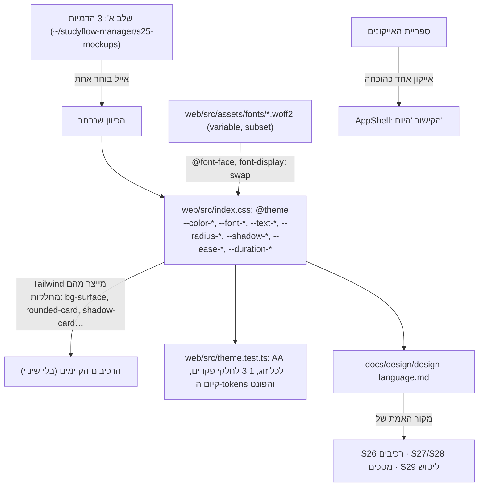

# S25 — כיוון עיצובי ושפה עיצובית: תוכנית עבודה

> **For agentic workers:** REQUIRED SUB-SKILL: Use superpowers:subagent-driven-development (recommended) or superpowers:executing-plans to implement this plan task-by-task. Steps use checkbox (`- [ ]`) syntax for tracking.

**מטרה:** ל-StudyFlow יש שפה עיצובית אחת, שאייל בחר מתוך שלוש הדמיות, והיא כתובה בשני מקומות: כ-tokens ב-`web/src/index.css` (צבעים, טיפוגרפיה, ריווח, פינות, צללים, תנועה), וכמסמך `docs/design/design-language.md` ש-S26–S28 בונים לפיו בלי לשאול. המסכים הקיימים לא מעוצבים מחדש; הם רק מקבלים את הערכים החדשים ונשארים קריאים.

**השער במפת הדרכים:** "אייל בחר כיוון אחד מתוך 3 הדמיות, והשפה כתובה בקוד ובמסמך עיצוב".

**גישה:** שני שלבים, ועצירה ביניהם.
1. **שלב א' (Task 1):** שלוש הדמיות של מסך "היום" בטלפון, מחוץ לריפו, ושאלה לאייל. זו נקודת האישור היחידה שלו בכל שלב העיצוב.
2. **שלב ב' (Tasks 2–7):** ה-tokens, הפונט, בדיקת הניגודיות, ספריית האייקונים, מסמך העיצוב, בדיקה בדפדפן וסגירה.

**כלים:** Tailwind 4 (`@theme`), ‏Vitest 5, ‏React Aria Components 1.22. תלות חדשה אחת: ספריית האייקונים. כלי בנייה חד־פעמי, שלא נכנס לריפו כתלות: `fonttools` (דרך `uvx`) לחיתוך הפונט.

**מסמך תכנון:** סעיף 7.9, הקטע "עיצוב ו-UX" והקטע "צבעים" (S13).

## איך החלקים מתחברים

- **למה tokens ולא עיצוב של רכיבים:** ב-S13 נקבע שהרכיבים משתמשים רק בשמות (`bg-surface`, ‏`text-ink-muted`, ‏`bg-brand`), ושהעיצוב מחליף רק את הערכים. לכן החלפה של 16 ערכים ב-`index.css` משנה את כל המסכים בבת אחת, בלי לגעת בקובץ רכיב אחד. זו גם הסיבה ש-S25 יכול לרוץ במקביל ל-S16 ול-S18: הוא לא נוגע בקבצים שלהם.
- **למה `@theme` של Tailwind 4:** כל משתנה ב-`@theme` הופך גם למשתנה CSS וגם למחלקה. ‏`--radius-card: 12px` נותן `rounded-card`, ‏`--shadow-card` נותן `shadow-card`, ‏`--text-title` נותן `text-title`. כך S26 כותב `rounded-card` ולא `rounded-xl`, ושינוי עתידי של הפינות נעשה בשורה אחת.
- **למה הבדיקה קוראת את ה-CSS מהדיסק:** Vitest לא טוען CSS. הבדיקה מחלצת את הערכים בביטוי רגולרי ומחשבת ניגודיות לפי הנוסחה של WCAG. כל זוג חדש של טקסט ורקע שהמסמך מתיר נכנס לרשימה, כך שמי שישנה צבע בעתיד יקבל בדיקה אדומה ולא מסך לא קריא.
- **למה הפונט ב-`src/assets` ולא ב-`public`:** Vite נותן לקובץ שמיובא מ-CSS שם עם hash, ולכן אפשר לשמור אותו במטמון לתמיד. ‏`web/public/**` שייך ל-S16 (ה-PWA), ושם אין hash.
- **למה אייקון אחד בלבד:** הניווט החדש (תחתון בטלפון, תפריט פרופיל) הוא של S26. ‏S25 רק מוכיח שהספרייה מותקנת, עוברת build, ולא מנפחת את ה-bundle.

## מה מצאתי לפני התכנון (2026-11-17)

| נושא | מצב |
|---|---|
| צבעים | 16 משתני `--color-*` ב-`index.css`, כחול `#1d4ed8` על אפור קר. אין tokens אחרים |
| פונט | אין הגדרה; פונט המערכת |
| פינות וצללים | מחלקות Tailwind ישירות ברכיבים (`rounded-xl`, ‏`rounded-2xl`, ‏`rounded-lg`, ‏`shadow-lg`) |
| בדיקה | `theme.test.ts`: ‏12 זוגות טקסט ב-4.5:1, ‏4 זוגות של חלקי פקדים ב-3:1 |
| ניווט | שורת קישורים עליונה בכל הרוחבים (S15) |
| אייקונים | אין ספרייה |
| `min-release-age=7` | גרסה של ספריית האייקונים שיצאה בשבוע האחרון לא תותקן; מתקינים את האחרונה שעוברת |

## ההחלטות שלי

1. **שלוש ההדמיות נבדלות בארבעה צירים, לא רק בצבע:** צבע המותג, הפונט, צורת הכרטיס וצפיפות. אחרת הבחירה היא בין גוונים, ואייל לא רואה שלוש אפשרויות אמיתיות.
   - **א. נייר:** Assistant, כחול `#2f5aa8`, כרטיס עם קו דק ופינות 12px בלי צל, רשימה לפי שעה עם קווי הפרדה, צפיפות בינונית.
   - **ב. ענן:** Rubik, סגול `#5847b8`, כרטיסים בלי קו עם פינות 20–28px וצל רך, המשימה הבאה בצבע מלא, ניווט צף, צפיפות נמוכה.
   - **ג. סרגל:** IBM Plex Sans Hebrew, כחול־ירקרק `#0e5f73`, משטחים אפורים שטוחים עם פינות 6px, פס התקדמות מחולק לפי בלוקים, צפיפות גבוהה.
2. **צבע המותג אף פעם לא ירוק, כתום או אדום:** אלה שמורים למצב (בוצע, עבר הזמן, שגיאה). לכן שלושת המותגים הם כחול, סגול וכחול־ירקרק.
3. **ההדמיות מציגות את התוכן האמיתי של המסך** (הטקסטים מ-`he.ts`, ארבעת הכפתורים של בלוק, פס הדקות), אבל כבר עם הניווט התחתון ועם שורות קומפקטיות, כי זה מה ש-S26–S27 יבנו. ההדמיה מראה כיוון, לא מפרט של מסך.
4. **הפונטים בהדמיה נטענים מ-Google**, רק שם. במוצר הפונט שנבחר מאוחסן אצלנו (Task 3).
5. **ספריית האייקונים: `lucide-react`.** קו דק ואחיד (עובי שניתן לקבוע, 1.5–2), רישיון ISC, כל אייקון הוא רכיב נפרד ולכן רק מה שמיובא נכנס ל-bundle (כ-1KB לאייקון), יותר מ-1,500 אייקונים, ויש בה כל מה שהניווט צריך. החלופות: Phosphor (שישה משקלים, מיותר כשרוצים קו אחד), Heroicons (מעט אייקונים, אין נעילה או דגל במשקל דק), Tabler (דומה, אבל הקהילה והתחזוקה של Lucide רחבות יותר). הגרסה והגודל נבדקים בזמן ההתקנה (Task 5).
6. **שמות הצבעים הקיימים לא משתנים.** מוסיפים רק מה שחסר לשפה, וזוגות חדשים נכנסים לבדיקה. **(אחרי הבחירה):** נוסף `canvas`, הרקע של העמוד, כי `surface-muted` משמש גם כמילוי של תגים והערות בתוך כרטיס, ואם העמוד היה מקבל את אותו ערך הם היו נעלמים.
7. **`body` מקבל את הפונט, את צבע הרקע ואת גודל הבסיס**; הרכיבים הקיימים לא מקבלים מחלקות חדשות. המעבר שלהם ל-`rounded-card` ולשאר ה-tokens החדשים הוא של S26.
8. **(אחרי הבחירה) אייל בחר בכיוון א', נייר, בלי שילובים.** ההדמיות נשמרו גם ב-`docs/archive/design/mockups/`.
9. **(אחרי הבחירה) `font-medium` ו-`font-bold` ממופים ל-600** ב-`@theme`, כך שהמסכים הקיימים עומדים בכלל של שני משקלים בלי לגעת ברכיבים.
10. **(אחרי הבחירה) Task 6 נכתב בשיחה הראשית ולא בסוכן**, כי המסמך נגזר ישירות מה-tokens ומההדמיה שכבר היו בהקשר שלה. במקומו רץ במקביל סוכן שצילם את המסכים הקיימים.
11. **(אחרי הבחירה) הבדיקה בדפדפן רצה על build עם נתוני דמה**, בפורט אחר: התחברות עם Google עובדת רק ב-5173, ש-S16 מחזיק. קובצי ה-harness זמניים ולא נכנסו לריפו.

## Global Constraints

- הקבצים של S25 בלבד: `web/src/index.css`, ‏`web/src/theme.test.ts`, ‏`web/src/assets/fonts/**`, ‏`docs/design/**`, התוכנית הזו, מסמך התכנון, ‏`web/package.json` ו-`package-lock.json` (האייקונים), ושינוי של שורה ב-`web/src/app/AppShell.tsx` (האייקון).
- לא נוגעים ב-`web/src/today/**`, ‏`web/src/board/**` (S18), ‏`web/src/notifications/**`, ‏`web/public/**`, קונפיגורציית ה-PWA (S16), ‏`legacy/`.
- פורט 5173 של S16: לא עוצרים אותו. הבדיקה בדפדפן רצה על `vite build` ו-`vite preview` בפורט אחר, או מחכה.
- סוכנים לא מריצים git.
- אין קריאות ל-Claude API.

## Review Focus

- כל זוג טקסט ורקע שהמסמך מתיר נמצא בבדיקה, והבדיקה לא הוחלשה.
- אף רכיב קיים לא השתנה חוץ מהאייקון האחד.
- הפונט: `font-display: swap`, ‏`unicode-range` לעברית וללטינית, קובץ variable אחד לכל טווח, רישיון OFL עם קובץ הרישיון בתיקייה.
- המסמך מספיק ל-S26 בלי לשאול: לכל token יש "מתי כן" ו"מתי לא".

## מה רץ במקביל

| גל | משימות | למה |
|---|---|---|
| 1 | Task 1 (השיחה הראשית) | ההדמיות, ואז עצירה לשאלה |
| 2 | Task 2 → Task 3 → Task 4 בשיחה הראשית; Task 5 (אייקונים) ו-Task 6 (מסמך) בסוכנים במקביל | 2–4 נוגעות באותם שני קבצים (`index.css`, ‏`theme.test.ts`), ולכן רצות אחת אחרי השנייה. האייקונים (`package.json`, ‏`AppShell.tsx`) והמסמך (`docs/design/`) בקבצים נפרדים |
| 3 | Task 7 (השיחה הראשית) | איחוד, כל הבדיקות, דפדפן, סקירה, מיזוג |

## קבצים משותפים עם S16 ו-S18

`web/src/app/AppShell.tsx` (שורה אחת, האייקון), ‏`web/package.json` ו-`package-lock.json` (S16 מוסיף את `vite-plugin-pwa`). מי שממזג שני עושה rebase; ב-lock מריצים `npm install` מחדש במקום לפתור ידנית.

---

### Task 1: שלוש הדמיות ושאלה לאייל (השיחה הראשית)

**קבצים:** `~/studyflow-manager/s25-mockups/index.html`, ‏`a.png`, ‏`b.png`, ‏`c.png` (מחוץ לריפו).

- [x] קובץ HTML אחד: שלוש מסגרות של 390px, מסך "היום" מלא ב-RTL (כותרת, פס התקדמות, המשימה הבאה עם שלושת הכפתורים, "עוד היום", ניווט תחתון), ומתחת לכל אחת השם, משפט, לוח הצבעים והפונט.
- [x] ניגודיות: סקריפט שמחשב כל זוג טקסט ורקע בכל כיוון. הכול מעל 4.5:1, וגבולות הפקדים מעל 3:1.
- [x] צילום של כל מסגרת ב-Chrome headless ‏(`?only=a|b|c`, ‏390×844, פי 2).
- [x] commit ו-push של התוכנית, ועצירה ב"שאלה לאייל:".

### Task 2: ה-tokens (השיחה הראשית, אחרי הבחירה)

**קבצים:** `web/src/theme.test.ts`, ‏`web/src/index.css`.

- [x] בדיקה קודם: הזוגות הקיימים נשארים; נוספים הזוגות החדשים של הכיוון; בדיקה שכל token שהמסמך מונה קיים (`--font-sans`, סולם `--text-*` עם גובה שורה, ‏`--radius-*`, ‏`--shadow-*`, ‏`--ease-*`, ‏`--duration-*`); בדיקה שיש כלל `prefers-reduced-motion`. הבדיקה אדומה.
- [x] `index.css`: ערכי הצבע של הכיוון באותם שמות; טיפוגרפיה (סולם של חמישה גדלים, שני משקלים, גובה שורה לכל גודל); ריווח (הסולם של Tailwind, עם הערכים המותרים במסמך); פינות (`control`, ‏`card`, ‏`pill`); צללים; תנועה (משך ועקומה), וכלל גלובלי שמבטל מעברים ב-`prefers-reduced-motion`.
- [x] הבדיקה ירוקה; commit.

### Task 3: הפונט (השיחה הראשית)

**קבצים:** `web/src/assets/fonts/` (שני קובצי woff2 וקובץ הרישיון), ‏`web/src/index.css`, ‏`web/src/theme.test.ts`.

- [x] בדיקה קודם: יש `@font-face` עם `font-display: swap`, עם `unicode-range`, והקבצים שהוא מפנה אליהם קיימים וקטנים מ-60KB כל אחד.
- [x] מורידים את קובץ ה-variable מהמאגר הרשמי של הפונט (לא מ-Google Fonts API), חותכים עם `uvx --from 'fonttools[woff]' pyftsubset` לעברית (U+0590–05FF, סימני פיסוק, ‏₪) וללטינית בסיסית, ושומרים עם קובץ ה-OFL.
- [x] `@font-face` לכל טווח, ו-`--font-sans` עם גיבוי לפונט המערכת; commit.

### Task 4: בדיקת AA לכל זוג חדש (השיחה הראשית)

- [x] מעבר על המסמך (Task 6): כל זוג שהוא מתיר נמצא ב-`PAIRS` או ב-`NON_TEXT_PAIRS`; commit.

### Task 5: ספריית האייקונים (סוכן)

**קבצים:** `web/package.json`, ‏`web/package-lock.json`, ‏`web/src/app/AppShell.tsx`, בדיקה קיימת של ה-shell אם יש.

- [x] `npm install lucide-react` (הגרסה האחרונה שעוברת את `min-release-age`); בדיקת הרישיון ב-`node_modules`.
- [x] אייקון אחד ליד "היום" בניווט, `aria-hidden`, בלי שינוי אחר בניווט.
- [x] `npm run build` לפני ואחרי, והפרש הגודל נרשם בדוח.

### Task 6: מסמך העיצוב (סוכן)

**קבצים:** `docs/design/design-language.md`, ‏`docs/design/direction.png` (ההדמיה שנבחרה).

- [x] עקרונות; טבלת tokens עם "מתי כן / מתי לא"; טיפוגרפיה; כרטיס וכפתור; ניווט בטלפון ובמחשב; תנועה; נגישות; דוגמאות "כן / לא".

### Task 7: איחוד, דפדפן, סקירה וסגירה (השיחה הראשית)

- [x] כל הפקודות של `web/` ושל `api/`.
- [x] דפדפן: כל המסכים הקיימים ב-390px וברוחב מלא, עם צילומים; אם 5173 תפוס, על `build` ו-`preview`.
- [x] סקירת קוד, תיקונים.
- [x] סעיף 7.9 במסמך התכנון, לשונית המסמך ב-artifact, ומפת הדרכים ("הושלם").
- [x] `git fetch`, ‏rebase, כל הבדיקות, gitleaks, ‏`git push origin s25-design-language:main`, ורק אחרי שהצליח מחיקת הענף ב-`origin`.

## מה נמצא בבדיקה בדפדפן (17.11.2026)

14 מסכים צולמו ב-390px וב-1280px (42 צילומים ב-`~/studyflow-manager/s25-screens/`), על build עם נתוני דמה בפורט 4199. אין גלילה אופקית ב-390, אין שגיאות בקונסול, ו-Assistant נטען בשני הטווחים. לא צולמו: `/auth/callback`, מסך שגיאת התצורה, מצבי שגיאה, ריק וטעינה, דיאלוגים, toasts, תפריטים פתוחים ומצבי hover ופוקוס.

- **נרשם במסמך העיצוב (סעיף 10) ל-S26 ול-S28:** כפתור כבוי חלש מדי; עמודות "מתוכנן" בציר המבחן ב-`brand-soft` על לבן; צבעי `slate` ו-`red` קשיחים בעמודי הכניסה.
- **נרשם ב"באגים שנרשמו" (לא קשור ל-S25):** טווחי השעות של חלונות הלימוד מוצגים הפוך ב-RTL; סיומת של שם קובץ קופצת לשמאל; עמודות "יום המבחן" ו"יום מנוחה" בציר צפופות; הקישור ב-404 לא בצבע המותג.
