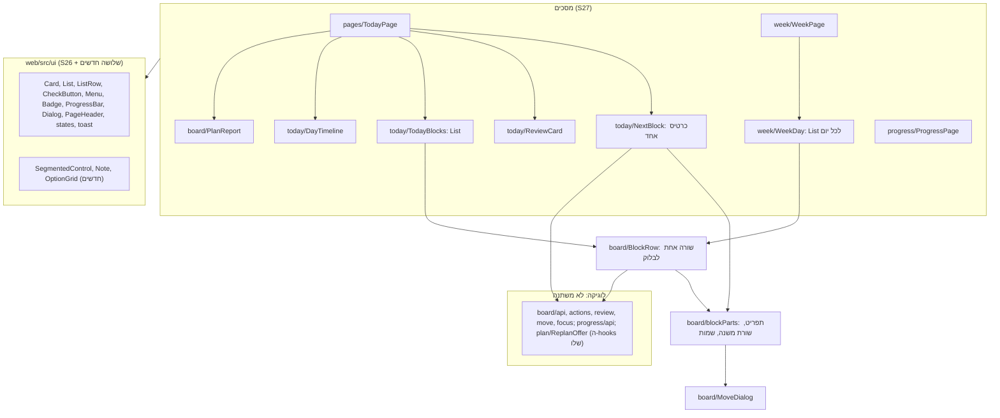

# S27 — עיצוב המסכים היומיים (היום, שבוע, התקדמות): תוכנית עבודה

> **For agentic workers:** REQUIRED SUB-SKILL: Use superpowers:subagent-driven-development (recommended) or superpowers:executing-plans to implement this plan task-by-task. Steps use checkbox (`- [ ]`) syntax for tracking.

**מטרה:** שלושת המסכים שהסטודנט פותח כל יום, "היום", "שבוע" ו"התקדמות", עוברים לשפת "נייר": אותם רכיבים של `web/src/ui/`, אותם tokens, אותו ניסוח. במסך "היום" העין נוחתת קודם על המשימה הבאה ועל הכפתור "בוצע".

**השער במפת הדרכים:** "שלושת המסכים בעיצוב החדש בטלפון ובמחשב, וכל פעולה יומית נשארת בלחיצה אחת".

**גישה:** משנים רק את שכבת התצוגה. ה-hooks שמדברים עם השרת (`board/api.ts`, ‏`actions.ts`, ‏`review.ts`, ‏`move.ts`, ‏`progress/api.ts`) לא משתנים בכלל, חוץ מטקסטים של toast שעוברים דרך `he.ts`. כל רכיב מסך מוחלף בהרכבה של רכיבי `ui/`. שלושה רכיבים חסרים נוספים ל-`ui/` כקבצים חדשים.

**כלים:** React 19, ‏TypeScript strict, ‏React Aria Components 1.22, ‏Tailwind 4, ‏lucide-react, ‏Vitest. בלי תלויות חדשות, בלי מיגרציה, בלי שינוי ב-API.

**מסמכים:** `docs/design/design-language.md` (כולו; 5.8, 6, 8, 9, 10), ההדמיה `docs/archive/design/mockups/a.png`, סעיף 7.9 במסמך התכנון.

## איך החלקים מתחברים



- **למה שורה אחת (`BlockRow`) לשני המסכים:** עד היום `BlockCard` צייר שני דברים שונים, כרטיס עם שורת כפתורים ב"היום" ושורה עם כפתור "פעולות" ב"שבוע". לפי 5.2 בלוק ברשימה הוא שורה: שעה, שם, שורת משנה, ובקצה עיגול הסימון. כשיש רכיב אחד, "בוצע" נמצא באותו מקום ובאותה לחיצה בשני המסכים, ושינוי עתידי נעשה פעם אחת.
- **למה המשימה הבאה היא רכיב נפרד (`NextBlock`) ולא גרסה של השורה:** היא הדבר האחד שעומד בפני עצמו במסך (5.1), ורק לה יש כפתור ראשי. שני הרכיבים חולקים את אותם חלקים קטנים (`blockParts`): שם הבלוק, שורת המשנה, התפריט ופתיחת "הזזה".
- **למה הלוגיקה לא זזה:** ה-scope מוגדר כ"מראה, מבנה וניסוח". כל פעולה עדיין קוראת לאותו hook (`useBlockActions`, ‏`useReviewActions`, ‏`useMoveBlock`), ולכן העדכון האופטימי, ה-"בטל" והרענון של הלוח נשארים בדיוק כפי שנבדקו ב-S14 וב-S18. הבדיקות של ההתנהגות נשארות, ומשתנות רק שאילתות שנשענו על ה-DOM הישן (`article`, כפתור "פעולות").
- **למה רכיבים חדשים הם קבצים חדשים:** S28 רץ במקביל ומשתמש באותה תיקייה. קובץ חדש לא מתנגש ב-rebase; שינוי ברכיב קיים כן. מה שצריך שינוי ברכיב קיים נרשם ל-S29.

## מה מצאתי לפני התכנון (2026-11-17)

| נושא | מצב |
|---|---|
| `BlockCard` | שני variants; ב"היום" עד ארבעה כפתורים בכל בלוק (ראשי בכל אחד), ב"שבוע" כפתור "פעולות" שתופס שליש מהשורה בטלפון |
| `NextBlock` | מעטפת `bg-brand-soft` סביב כרטיס: כרטיס בתוך כרטיס, ורקע מותג לאזור שלם (אסור לפי 5.1) |
| `ReviewCard` | מעל המשימה הבאה, עם כפתור ראשי בכל שורה ופס כתום בצד. הוא הדבר הראשון שהעין רואה |
| `ReplanOffer`, ‏`MoveDialog` | כל אחד בונה `ModalOverlay` משלו |
| `DayTimeline` | קו "עכשיו" אדום; `ink-muted` על `success-soft` ועל `warning-soft` (זוג אסור); אייקון גרירה שמצויר ביד; `bg-surface/60` |
| `progress/` | 18 קופסאות לתגים, פס רמה בכחול, `text-4xl`, ריבועי 14 הימים בכחול |
| toast | ניסוחים לא אחידים ("דילגת" מול "קיבלתם", "הלוח עודכן." עם נקודה), וחלקים מחוברים בנקודה אמצעית |
| רכיבים חסרים ב-`ui/` | מתג בין שתי תצוגות, הערה שקטה בתוך מסך, רשת של אפשרויות לבחירה (שעות פנויות) |
| מפת הדרכים | שורה אחת מתויגת S27 ב"פריטים פתוחים" (ההחלפות של סעיף 10, והכפתור "פעולות" בטלפון). בטבלת הבאגים אין שורה של S27 |

## ההחלטות שלי

1. **"פעולה יומית בלחיצה אחת" פירושו "בוצע" בכל מקום, ו"דחייה" במשימה הבאה.** בכל שורה יש עיגול סימון (לחיצה אחת, כמו בהדמיה). במשימה הבאה "בוצע" ו"דחייה" הם כפתורים. שאר הפעולות על שורה ברשימה (דחייה, הזזה, נעילה) נמצאות בתפריט "⋯", כפי ש-5.2 קובע במפורש. לפני S27 כל בלוק ב"היום" הציג עד ארבעה כפתורים, וזה מה שהפך את המסך לערימת כפתורים; ב"שבוע" "בוצע" יורד משתי לחיצות לאחת.
2. **במשימה הבאה: כפתור ראשי "בוצע" (מתרחב, עם ✓), "דחייה" משני, והיתר לפי מספרם.** פעולה נוספת אחת (בלוק שכבר התחיל: נעילה) היא כפתור, כמו בהדמיה. שתיים (בלוק שעוד לא התחיל: הזזה ונעילה) נכנסות לתפריט "⋯", כי ארבעה כפתורים לא נכנסים בשורה של 318px בלי להישבר.
3. **סדר המסך "היום":** כותרת, פס ההתקדמות, המשימה הבאה, סקירת הבוקר, "עוד היום" (רשימה או ציר), הדוח "לא נכנס". סקירת הבוקר יורדת מתחת למשימה הבאה (ב-S18 היא הייתה מעליה), כי הדרישה של ה-scope היא שהמשימה הבאה תהיה הדבר הראשון שהעין רואה. בטלפון הסקירה עדיין נכנסת במסך הראשון.
4. **בסקירת הבוקר אין כפתור ראשי.** "בוצע" ו"העבר להיום" משניים, "דלג" שקט. הכפתור הראשי היחיד במסך הוא "בוצע" של המשימה הבאה. הכרטיס לבן רגיל, בלי פס צבעוני: הכותרת והמשפט אומרים מה נדרש.
5. **תג מצב בשורה נמצא בשורת המשנה**, לא בקצה: בקצה יש כבר תפריט ועיגול. בלוק שבוצע לא מקבל תג: ה-✓ והקו החוצה כבר אומרים את זה. "נעול" הוא אייקון מנעול עם המילה (5.5).
6. **"שבוע":** כל יום הוא כותרת קטע (יום ותאריך, תג "היום", וסך הזמן בקצה) ומתחתיה `List` של `BlockRow`. יום פנוי הוא שורה אחת. המעבר בין שבועות עובר ל-`PageHeader`: שני כפתורי אייקון (חץ) ו"השבוע". שבוע בלי אף בלוק מציג `EmptyState` במקום שבע שורות "יום פנוי".
7. **"התקדמות":** הרמה היא המספר הגדול היחיד; הפס הוא `ProgressBar` (ירוק על `line`, 5.6) עם "240 מתוך 1,000 XP". המשפט "עוד 760 XP לרמה 3" יורד, כי הוא אותו מידע פעם שנייה. 14 הימים: יום שנלמד מלא ב-`success` (ירוק = בוצע), יום שלא נלמד הוא מסגרת, והיום מסומן בטבעת. התגים הופכים מ-18 קופסאות לרשימה לפי קבוצה (5.2: רשימה לפני כרטיסים): תג שהושג עם אייקון ירוק והתאריך, תג שעוד לא הושג עם עיגול מקווקו ו"12 מתוך 20". בלי אדום, בלי אנימציה.
8. **ציר היום:** קו "עכשיו" ב-`brand` ("אתה כאן"), לא באדום. בלוק שעוד לא התחיל הוא לבן עם קו; "עכשיו" ב-`brand-soft`; "בוצע" ב-`success-soft`; הטקסט בתוך בלוק צבעוני ב-`ink` (הזוג `ink-muted` על רקע מצב אסור). הצללית של מקום תפוס נשארת ב-`danger` (זו סירוב, כלומר שגיאה) ומקבלת גם מילה ("תפוס"), כדי שהמידע לא יהיה רק בצבע.
9. **שלושה רכיבים חדשים ב-`ui/`:** `SegmentedControl` (המתג "רשימה / ציר"), ‏`Note` (הערה שקטה בתוך מסך או דיאלוג: "לא הצלחנו לרענן", "אין שעה פנויה"), ‏`OptionGrid` (רשת לבחירה אחת מתוך הרבה אפשרויות קצרות: השעות הפנויות). כולם עם בדיקה, בדף הרכיבים וב-5.8.
10. **toast:** כל הודעה על פעולה שהצליחה היא משפט קצר בסביל, בלי נושא ובלי נקודה בסוף ("סומן כבוצע", "נדחה למחר בשעה 09:00", "הוזז ל-15:30 וננעל"), ובלשון רבים כשפונים למשתמש ("דילגתם", "קיבלתם"). החלקים של "בוצע" (XP, רמה, תג) מחוברים בנקודה ורווח, לא בנקודה אמצעית (5.2). המראה עצמו הוא של `ui/toast` ולא משתנה: הצלחה בירוק עם ✓, שגיאה באדום עם אייקון.
11. **מסך ריק ב"היום":** בלי משימות בכלל: `EmptyState` עם קישור "למבחנים" (משם מוסיפים מבחן ובונים תוכנית). כשכל המשימות נגמרו: `EmptyState` בלי פעולה. הקישור הוא ניווט בלבד, לא קריאה חדשה לשרת.
12. **`isDisabled` נשאר על הכפתורים של בלוק בזמן פעולה** ולא הופך ל-`isPending`: הפוקוס שחוזר אחרי פעולה (`focus.ts`) מחפש `button:not([disabled])`, והבדיקות של S18 בודקות `toBeDisabled`. זו התנהגות, ולא נוגעים בה. `isPending` נכנס רק לכפתור "להעלות ל-…" של הדוח ול"אישור" של `ReplanOffer`.
13. **בדיקה בדפדפן על build עם נתוני דמה** (פורט 4227, סביבת הצילום של S26 עם תוספת `?shot=empty|later|error|loading`), ולא מול ה-API האמיתי: 5173 שייך ל-S16, ואין שינוי בלוגיקה שצריך שרת כדי לבדוק אותו.

## Global Constraints

- רק רכיבי `web/src/ui/` וה-tokens. אסור בקבצים של ה-scope בסופו: `text-xs`…`text-4xl`, ‏`font-medium`, ‏`font-bold`, ‏`rounded-md`/`lg`/`xl`/`2xl`, ‏`shadow-sm`/`lg`/`xl`, ‏`min-h-11`, ‏`slate-*`, צבע עם שקיפות (חוץ מ-`bg-ink/40` של `ui/Dialog`), ‏`<button>`/`<input>` גולמי (חוץ מידית הגרירה של הציר, שהיא pointer-events גולמי בכוונה).
- **לא משנים קובץ קיים ב-`web/src/ui/`.** רכיב חסר: קובץ חדש. צורך בשינוי: לדווח, ונרשם ל-S29.
- **לא משנים לוגיקה:** אין שינוי ב-`board/api.ts`, ‏`actions.ts` (חוץ מהמחבר של הטקסט ב-`progressText.ts`), ‏`review.ts`, ‏`move.ts`, ‏`focus.ts`, ‏`progress/api.ts`, מפתחות query, או סדר הקריאות.
- בדיקה משתנה רק כשהיא נשענת על מבנה DOM או על טקסט שהשתנה. לא מוחקים בדיקת התנהגות ולא מחלישים אותה.
- כל טקסט ב-`he.ts`, כל סוכן רק בקטע שלו. קוראים את הקובץ מחדש רגע לפני כל עריכה, כי סוכן אחר עורך קטע אחר באותו זמן.
- זוגות צבע רק מסעיף 2 של מסמך העיצוב. `ink-muted` לא על רקע של מצב. שעה או טווח שעות ב-`dir="ltr"` עם `tabular-nums`. פרטים בשורת משנה מופרדים בפסיק ובנקודה.
- אייקונים רק מ-`lucide-react`, ‏`strokeWidth={ICON_STROKE}`, 18px ליד טקסט ו-14px בשורת משנה, `aria-hidden`.
- יעד מגע 44px, שם נגיש לכל פקד (עם שם הבלוק), רק logical properties.
- סוכנים לא מריצים git, לא נוגעים ב-`legacy/`, ב-`web/.shots/` או בקבצים של משימה אחרת, ומריצים רק את קובצי הבדיקה שלהם (`npx vitest run <path>`), כי קבצים של סוכן אחר באמצע עבודה. פגם בתוכנית מדווחים, לא עוקפים.

## Review Focus

- **פוקוס אחרי פעולה:** אחרי "בוצע" במשימה הבאה הבלוק עובר לרשימה; הפוקוס צריך להגיע לעיגול של אותו בלוק ולא ליפול ל-`<body>`. נבדק ב-`today.test.tsx` (Task 4).
- **שני חלקים של אותה משימה באותו יום:** לעיגול ולתפריט של כל חלק שם נגיש שונה ("חלק 1 מתוך 2"). נבדק ב-`BlockRow.test.tsx` (Task 2).
- **שם ארוך בלי רווחים** לא מרחיב את העמוד ב-390px: בשורה, בכרטיס הבא ובבלוק של הציר. נבדק בצילום (Task 8) עם בלוק כזה בנתוני הדמה.
- **שורה בזמן פעולה:** העיגול והתפריט כבויים עד שהפעולה נגמרת, ו"דוחה…" מוצג רק בבלוק שנדחה. נבדק ב-`BlockRow.test.tsx`.
- **יום בלי בלוקים כשהבלוק הבא מחר:** המשימה הבאה מוצגת עם "מחר, 09:00", ואין רשימה ריקה עם כותרת. נבדק ב-`today.test.tsx`.

## מה רץ במקביל

| גל | משימות | למה |
|---|---|---|
| 0 | Task 0 (השיחה הראשית) | ניסוחי ה-toast ב-`he.ts` וצילומי ה"לפני", לפני שסוכנים נוגעים בקבצים |
| 1 | Tasks 1, 2, 3 במקביל | קבצים נפרדים: `ui/` החדשים, `board/BlockRow` + `today/NextBlock`, ‏`progress/` |
| 2 | Tasks 4, 5, 6, 7 במקביל | תלויים בגל 1 (הרכיבים החדשים וה-`BlockRow`), ונפרדים זה מזה |
| 3 | Task 8 (השיחה הראשית) | איחוד, כל הבדיקות, צילומים ומעבר עליהם, סקירה, מסמכים, מיזוג |

## קבצים משותפים

- `web/src/i18n/he.ts`: כל משימה עורכת רק את הקטע שלה (ראו כל משימה).
- `web/src/dev/ComponentsPage.tsx`, ‏`web/src/dev/devText.ts`, ‏`docs/design/design-language.md`: רק Task 1 ו-Task 8, ורק תוספות. S28 מוסיף שם קטעים משלו; מי שממזג שני עושה rebase ומאחד.

---

### Task 0: ניסוחי ה-toast וצילומי "לפני" (השיחה הראשית)

**קבצים:** `web/src/i18n/he.ts` (`board`, ‏`review`, ‏`move`, ‏`replan.applied`), ‏`web/src/board/progressText.ts`, ‏`web/src/board/progressText.test.ts`.

- [x] צילומי "לפני" של שלושת המסכים, בכל המצבים, ל-`~/studyflow-manager/s27-screens/before/`.
- [x] `progressText.ts`: המחבר בין החלקים הוא `'. '`; הבדיקה מתעדכנת לאותו מחבר.
- [x] `he.ts`: ‏`move.moved` → "הוזז ל-… וננעל"; ‏`board.pinnedDone` → "ננעל במקומו"; ‏`review.skipped` → "דילגתם על …"; ‏`replan.applied` → "הלוח עודכן" (בלי נקודה).
- [x] הבדיקות עוברות; commit.

### Task 1: שלושה רכיבים חדשים ב-`ui/`

**קבצים (חדשים):** `web/src/ui/SegmentedControl.tsx`, ‏`Note.tsx`, ‏`OptionGrid.tsx`, ובדיקה לכל אחד (`*.test.tsx`); תוספת ב-`web/src/dev/` (קטע חדש לכל רכיב, לפי המבנה הקיים של `displaySections.tsx` / `fieldSections.tsx`, והטקסטים ב-`devText.ts`).

**ממשקים (מה שהמשימות האחרות צורכות):**

```tsx
// SegmentedControl: בחירה אחת מתוך 2–3 תצוגות של אותו תוכן. על ToggleButtonGroup של React Aria.
export interface SegmentedControlProps<T extends string> {
  'aria-label': string
  options: readonly { id: T; label: string }[]
  value: T
  onChange: (value: T) => void
}
// Note: הערה שקטה בתוך מסך, כרטיס או דיאלוג (5.1: מילוי surface-muted עם rounded-control).
export interface NoteProps {
  tone?: 'neutral' | 'warning'   // neutral: surface-muted + ink; warning: warning-soft + ink
  role?: 'status' | 'alert'      // כשההערה מופיעה אחרי פעולה וצריך להכריז עליה
  title?: string                 // שורה ראשונה מודגשת (text-small font-semibold)
  action?: ReactNode             // כפתור שקט בקצה: "לנסות שוב"
  children: ReactNode
}
// OptionGrid: בחירה אחת מרשת של אפשרויות קצרות (שעות). על ListBox של React Aria, layout="grid".
export interface OptionGridProps {
  'aria-label': string
  options: readonly { id: string; label: string }[]
  value: string | null
  onChange: (value: string | null) => void
  ltr?: boolean                  // התווית בתוך dir="ltr" (שעה)
}
```

- [x] בדיקות קודם. `SegmentedControl`: תפקיד `radiogroup` עם `radio` לכל אפשרות (כך React Aria מציג קבוצה של בחירה אחת), האפשרות הנבחרת מסומנת, לחיצה קוראת ל-`onChange` עם ה-id, לחיצה על הנבחרת לא מבטלת בחירה, חצים במקלדת עוברים בין האפשרויות. `Note`: מציג ילדים, כותרת ופעולה; `role` עובר; בלי `role` אין תפקיד. `OptionGrid`: ‏`listbox` עם שם, `option` לכל אפשרות, לחיצה בוחרת וקוראת ל-`onChange`, האפשרות הנבחרת `aria-selected`.
- [x] מראה. `SegmentedControl`: מסילה `bg-surface-muted rounded-control p-1`, כל אפשרות `min-h-touch px-4 text-small font-semibold text-ink-muted`, הנבחרת `bg-surface text-ink` עם `border border-line-strong` (בלי צל; שאינה נבחרת עם `border-transparent`), טבעת פוקוס. המנצח בין מצבים נקבע ב-render props של React Aria ולא ב-`data-[…]` מתחרים (ראו "סדר המחלקות" ב-5.8). `Note`: ‏`rounded-control px-3 py-2 text-small text-ink`, הפעולה בשורה עם הטקסט ונשברת מתחתיו כשצר. `OptionGrid`: ‏`grid grid-cols-3 sm:grid-cols-4 gap-2`, גובה מרבי עם גלילה, כל אפשרות `min-h-touch rounded-control border border-line-strong bg-surface text-small font-semibold tabular-nums`; נבחרת: `border-brand bg-brand text-on-brand` עם ✓ קטן (לא רק צבע); hover: ‏`bg-surface-muted` רק כשאינה נבחרת.
- [x] דף הרכיבים: קטע לכל רכיב, בכל המצבים. `ComponentsPage.test.tsx` ממשיך לעבור (ומתעדכן אם הוא סופר קטעים).
- [x] `npx vitest run src/ui src/dev`, ‏`npx eslint src/ui src/dev`, ‏`npx tsc -b` נקי בקבצים האלה.

### Task 2: `BlockRow` ו-`NextBlock`

**קבצים:** חדשים: `web/src/board/BlockRow.tsx`, ‏`web/src/board/blockParts.tsx`, ‏`web/src/board/BlockRow.test.tsx`. משתנים: `web/src/today/NextBlock.tsx`. נמחקים: `web/src/board/BlockCard.tsx`, ‏`BlockCard.test.tsx` (הבדיקות שלו עוברות ל-`BlockRow.test.tsx`, כל אחת מהן). `he.ts`: רק `board` (בלי `board.report`).

**ממשקים:**

```tsx
// board/BlockRow.tsx: <li> אחד; חייב לשבת בתוך <List>.
export function BlockRow(props: { block: Block; tz: string }): JSX.Element
// today/NextBlock.tsx: אותם props כמו היום.
export function NextBlock(props: { block: Block; tz: string; when?: string }): JSX.Element
```

- [x] **`blockParts.tsx`** מחזיק את מה ששני הרכיבים חולקים: הרצת פעולה (`run`, כמו ב-`BlockCard` היום, ו"הזזה" שפותחת את `MoveDialog`), התוויות והשמות הנגישים, `BlockMenu` (`ui/Menu` עם `IconButton` של `Ellipsis`, ‏`aria-label={he.board.actionsLabel(name)}`, פריט לכל פעולה עם אייקון: דחייה `CalendarClock`, הזזה `MoveVertical`, נעילה `Lock`, שחרור `LockOpen`), ושורת המשנה.
- [x] **`BlockRow`** הוא `ui/ListRow`:
  - `leading`: שעת ההתחלה, `<span dir="ltr">`.
  - `title`: שם המשימה; `done` כשהבלוק בוצע.
  - `subtitle`: ‏`he.board.meta(exam, kind, duration)` = "הסתברות, תרגול. שעה"; לבלוק מפוצל ". חלק 1 מתוך 2"; אחריו `Badge` לפי המצב (`in_progress` → ‏`brand`, ‏`overdue` → ‏`warning`, ‏`missed` ו-`skipped` → ‏`neutral`; ל-`done` ול-`upcoming` אין תג); בזמן דחייה `Badge neutral` עם "דוחה…"; בלוק נעול: ‏`Lock` של 14px והמילה "נעול".
  - `trailing`: ‏`BlockMenu` עם כל הפעולות חוץ מ-`complete` ו-`uncomplete` (רק אם יש כאלה), ואחריו `CheckButton` (`isDone`, שם נגיש `completeLabel(name)` או `uncompleteLabel(name)`, ‏`isDisabled={pending}`). העיגול אחרון ב-DOM, ולכן בקצה השורה כמו בהדמיה.
  - `useFocusRequest(block.id, ref)`: ה-`ref` על עטיפה (`className="contents"`) של ה-`CheckButton` בלבד, כדי שהפוקוס אחרי "בוצע" יגיע לעיגול ולא לתפריט.
- [x] **`NextBlock`** הוא `ui/Card` עם `role="region"` ו-`aria-labelledby`:
  - שורה ראשונה: `h2` "המשימה הבאה" ב-`text-small font-semibold text-brand-strong`, ובקצה `Badge` של המצב, או `when` ("מחר, 09:00") ב-`text-small font-semibold`.
  - `h3` עם שם המשימה ב-`text-title font-semibold break-words`.
  - שורת משנה: הטווח ב-`dir="ltr"`, ואחריו ", שעה וחצי. אלגוריתמים, לימוד" (`he.board.nextMeta`), חלק, מנעול.
  - כפתורים (`flex gap-2`): ‏"בוצע" ראשי, `flex-1`, עם `Check`; "דחייה" משני ("דוחה…" בזמן דחייה); ולפי החלטה 2: פעולה נוספת אחת ככפתור משני, שתיים ומעלה ב-`BlockMenu` עם `IconButton variant="secondary"`. לכולם `isDisabled={pending}` ושם נגיש עם שם הבלוק.
  - `useFocusRequest` על שורת הכפתורים.
- [x] בדיקות (קודם): כל מה ש-`BlockCard.test.tsx` בדק, מותאם ל-DOM החדש; ובנוסף: שני חלקים של אותה משימה נותנים שמות שונים; "דוחה…" רק בבלוק שנדחה; בלוק `upcoming` במשימה הבאה מציג תפריט עם "הזזה" ו"נעילה", ובלוק `in_progress` מציג "נעילה" ככפתור; בשורה של בלוק `overdue` אין תפריט.
- [x] `npx vitest run src/board/BlockRow.test.tsx`; ‏eslint ו-tsc נקיים בקבצים האלה. (`TodayBlocks.tsx` ו-`WeekDay.tsx` עוד מייבאים את `BlockCard`; הם של Tasks 4 ו-7. כדי ש-tsc לא יישבר בינתיים, להשאיר ב-`BlockCard.tsx` re-export זמני: `variant="compact"` ו-`"full"` שניהם מחזירים `<BlockRow>`; Task 8 מוחק אותו.)

### Task 3: מסך ההתקדמות

**קבצים:** `web/src/progress/ProgressPage.tsx`, ‏`LevelCard.tsx`, ‏`StreakCard.tsx`, ‏`DayStrip.tsx`, ‏`BadgeGrid.tsx`, ‏`ProgressPage.test.tsx`; ‏`he.ts`: רק `progress`.

- [x] `ProgressPage`: ‏`PageHeader` מחוץ לתנאי; `LoadingState shape="card"` ואחריו `shape="list"`; ‏`ErrorState` עם `onRetry`; התוכן ב-`space-y-section`, שני הכרטיסים ב-`grid gap-4 md:grid-cols-2`.
- [x] `LevelCard`: ‏`Card role="region"` (שם: "רמה"); "רמה 4" ב-`text-display font-semibold tabular-nums`, ובקצה סך ה-XP ב-`text-small text-ink-muted`; ‏`ui/ProgressBar` עם `label={t.barLabel(next)}`, ‏`value`, ‏`max`, ‏`valueText={t.barValue(…)}`; מתחתיו מספר הבלוקים ב-`text-small text-ink-muted`. ברמה הגבוהה ביותר: המשפט `t.max` ב-`text-small font-semibold`, בלי פס. `toNext` יורד מהמסך ומ-`he.ts` (החלטה 7).
- [x] `StreakCard`: ‏`Card role="region"` עם `SectionHeading`; שני המספרים ב-`text-title font-semibold tabular-nums` עם תווית `text-small text-ink-muted`; המשפט ב-`text-body`; ‏`DayStrip`.
- [x] `DayStrip`: תא שנלמד `bg-success`, שלא נלמד `border border-line-strong bg-surface`, היום `ring-2 ring-brand ring-offset-2`; `rounded-badge`; אות היום ב-`text-caption`? לא: `text-caption` שמור לניווט, ולכן האותיות ב-`text-small text-ink-muted`. המשפט לקורא מסך נשאר.
- [x] `BadgeGrid`: ‏`SectionHeading` "תגים" עם הסיכום בקצה; לכל קבוצה `SectionHeading level={3}` ו-`List` של `ListRow`: ‏`leading` אייקון 18px (`Award` ב-`text-success` לתג שהושג, `CircleDashed` ב-`text-ink-muted` לשאר), `title` שם התג, `subtitle` התיאור (ולתג שהושג גם ". הושג ב-…"), ‏`trailing` לתג שלא הושג: "12 מתוך 20" ב-`text-small text-ink-muted tabular-nums`, ועוד `<span className="sr-only">עוד לא הושג</span>`.
- [x] הבדיקות: כל הבדיקות הקיימות נשארות; משתנות רק `badgeItem` (שם התג כבר לא `heading`), הטעינה (`role="status"`), והשורה של `toNext`. נוספת בדיקה שהכותרת מופיעה גם בזמן טעינה.
- [x] `npx vitest run src/progress`; ‏eslint ו-tsc נקיים בקבצים האלה.

### Task 4: מסך "היום"

**קבצים:** `web/src/pages/TodayPage.tsx`, ‏`web/src/today/DayProgress.tsx`, ‏`TodayBlocks.tsx`, ‏`TodayViewSwitch.tsx`, ‏`today.test.tsx`; ‏`he.ts`: רק `today`, ו-`move.viewLabel`/`list`/`timeline` לקריאה.

- [x] `TodayPage`: ‏`PageHeader title subtitle={formatDay(date)}` מחוץ לכל תנאי; טעינה: `LoadingState shape="card"` ו-`LoadingState shape="list" rows={3}`; שגיאה: `ErrorState`; רענון שנכשל ושגיאת `plan`: ‏`Note` עם כפתור שקט "לנסות שוב". הסדר לפי החלטה 3, ב-`space-y-section`.
- [x] מסכים ריקים (החלטה 11): בלי משימות: `EmptyState icon={CalendarCheck} title description action={<ButtonLink to="/exams">…</ButtonLink>}`; כל המשימות נגמרו: `EmptyState` בלי פעולה. "אין בלוקים היום" כשהבלוק הבא ביום אחר: שורה ב-`text-small text-ink-muted` מעל המשימה הבאה.
- [x] `DayProgress`: ‏`ui/ProgressBar label valueText`. אותו תנאי (`total <= 0` → כלום).
- [x] `TodayBlocks`: ‏`SectionHeading` ובקצה ה-`toolbar`; ‏`List aria-label={title}` של `BlockRow`. בלי בלוקים ובלי toolbar: כלום, כמו היום.
- [x] `TodayViewSwitch`: ‏`ui/SegmentedControl`.
- [x] `today.test.tsx`: כל בדיקה נשארת; שאילתות על `article`, על כפתורי "דחייה"/"נעילה" בשורות ועל סדר הקטעים מותאמות. הפוקוס אחרי "בוצע" במשימה הבאה: על העיגול של אותו בלוק ברשימה. נוספות: הכותרת מופיעה בזמן טעינה; מסך ריק עם הקישור.
- [x] `npx vitest run src/today/today.test.tsx src/today/todayView.test.ts src/today/chooseNext.test.ts`; ‏eslint ו-tsc נקיים בקבצים האלה.

### Task 5: `MoveDialog`, ‏`PlanReport`, ‏`ReplanOffer`

**קבצים:** `web/src/board/MoveDialog.tsx`, ‏`MoveDialog.test.tsx`, ‏`PlanReport.tsx`, ‏`PlanReport.test.tsx`, ‏`web/src/plan/ReplanOffer.tsx`, ‏`ReplanOffer.test.tsx`; ‏`he.ts`: ‏`replan`, ‏`board.report`, ‏`move` (רק המפתחות של הדיאלוג).

- [x] `MoveDialog`: ‏`ui/Dialog` עם `title`, ‏`description={he.move.dialogLead}`, ‏`onSubmit` ו-`footer` ("הזזה" `type="submit"` ו-`flex-1`, כבוי עד שנבחרה שעה; "ביטול" משני). התוכן נטען רק כשהדיאלוג פתוח (כמו היום, כדי שכל פתיחה תשאל את השרת מחדש). השעה הנוכחית ב-`text-small`; טעינה `LoadingState shape="text" rows={2} label={he.move.loading}`; שגיאה `ErrorState`; אין שעות: ‏`Note`; השעות: ‏`OptionGrid ltr`.
- [x] `PlanReport`: ‏`Card tone="warning" title role="region" id="report"` (ה-`id` נשאר: ‏`useScrollToReport` מחפש אותו); בלי `ink-muted` בתוכו; "בודקים למה…" ב-`role="status"`; כשל: ‏`Note role="alert"` עם "לנסות שוב"; הרשימות ב-`text-small`; הסיבה אחרי נקודתיים ולא אחרי קו מפריד; הכפתור "להעלות ל-…" ראשי עם `isPending`.
- [x] `ReplanOffer`: ‏`ui/Dialog` (`title`, ‏`description={reasonText}`, ‏`footer`: "אישור" ראשי `flex-1` עם `isPending={apply.isPending}` וכבוי עד שיש תצוגה מקדימה, "לא עכשיו"/"סגירה" משני). ההערה של `stale_plan`: ‏`Note tone="warning" role="status"`; טעינה `LoadingState shape="text"`; שגיאה `ErrorState`; "מה לא נכנס ללוח": ‏`Note tone="warning" title`; כשל של אישור: טקסט `text-small text-danger` עם `role="alert"`. ה-hooks, ה-`useEffect` של התצוגה המקדימה ו-`ReplanOfferProvider` לא משתנים.
- [x] הבדיקות נשארות; מותאמות רק שאילתות DOM (למשל הכפתור "סגירה" של הדיאלוג נוסף לכפתור שבתחתית, ולכן `getByRole('button', { name: he.common.close })` עלול למצוא שניים).
- [x] `npx vitest run src/board/MoveDialog.test.tsx src/board/PlanReport.test.tsx src/plan`; ‏eslint ו-tsc נקיים בקבצים האלה.

### Task 6: סקירת הבוקר וציר היום

**קבצים:** `web/src/today/ReviewCard.tsx`, ‏`ReviewCard.test.tsx`, ‏`DayTimeline.tsx`, ‏`DayTimeline.test.tsx`; ‏`he.ts`: ‏`review`, ו-`move` (רק המפתחות של הציר).

- [x] `ReviewCard` (החלטה 4): ‏`ui/Card`; ה-`h2` נשאר אלמנט משלו עם `ref` ו-`tabIndex={-1}` (הוא מחזיק את הפוקוס אחרי השורה האחרונה), ב-`text-body font-semibold`; המשפט ב-`text-small text-ink-muted`; השורות מופרדות ב-`border-t border-line`; בכל שורה שם (`text-body font-semibold`), שורת משנה אחת ("אתמול, 18:30–19:30. הסתברות", הטווח ב-`dir="ltr"`), ושלושה כפתורים: "בוצע" משני, "העבר להיום" משני, "דלג" שקט. `data-review-row`, ‏`aria-labelledby`, ‏`isDisabled={pending}` וכל ה-refs וה-effects של הפוקוס נשארים בדיוק.
- [x] `DayTimeline` (החלטה 8): כותרת `SectionHeading` עם ה-`toolbar`; המסגרת `rounded-card border border-line bg-surface`; השעות ב-`text-small text-ink-muted`; קו "עכשיו" ב-`bg-brand`; הבלוקים `rounded-control` לפי המצב (`upcoming`: ‏`border border-line-strong bg-surface` עם `border-s-4 border-s-brand`; ‏`in_progress`: ‏`bg-brand-soft border-s-4 border-s-brand-strong`; ‏`done`: ‏`bg-success-soft border-s-4 border-s-success`; ‏`overdue`: ‏`bg-warning-soft border-s-4 border-s-warning`; ‏`missed`/`skipped`: ‏`bg-surface-muted border-s-4 border-s-line-strong`); שם הבלוק `text-small font-semibold`, והשורה השנייה `text-small` ב-`text-ink` (ב-`upcoming` ו-`missed`/`skipped` מותר `text-ink-muted`); בוצע: `font-normal line-through`; "נעול": ‏`Lock` 14px והמילה; הידית: ‏`GripVertical` מ-lucide, ‏`w-touch`, ‏hover ‏`bg-surface-muted`, כבויה `text-line-strong`; הצללית: ‏`rounded-control`, ובה `he.move.candidate(range, free)` (הטווח ב-`dir="ltr"` והמילה "פנוי"/"תפוס" אחריו). `opacity-50` של הבלוק שנגרר נשאר. כל ה-handlers, הקבועים (`PX_PER_MINUTE` ועוד), ה-live region וה-`data-*` נשארים.
- [x] הבדיקות נשארות; מותאמות רק שאילתות DOM.
- [x] `npx vitest run src/today/ReviewCard.test.tsx src/today/DayTimeline.test.tsx`; ‏eslint ו-tsc נקיים בקבצים האלה.

### Task 7: מסך "שבוע"

**קבצים:** `web/src/week/WeekPage.tsx`, ‏`WeekDay.tsx`, ‏`week.test.tsx`; ‏`he.ts`: רק `week`.

- [x] `WeekPage` (החלטה 6): ‏`PageHeader title subtitle={range} action={…}`; הפעולה היא `role="group"` עם `aria-label={he.week.moves}`: ‏`IconButton variant="secondary"` "הקודם" (`ChevronRight`), ‏`Button variant="secondary"` "השבוע", ‏`IconButton variant="secondary"` "הבא" (`ChevronLeft`); השמות הנגישים הם אותם טקסטים של היום. טעינה: `LoadingState shape="list" rows={7}`; שגיאה: `ErrorState`; רענון שנכשל: ‏`Note tone="warning"`; שבוע בלי בלוקים: ‏`EmptyState icon={CalendarDays}`.
- [x] `WeekDay`: ‏`<section aria-labelledby aria-current>`; שורת כותרת עם `SectionHeading` (היום והתאריך), ‏`Badge tone="brand"` "היום" ליום הנוכחי, ובקצה הסך ב-`text-small text-ink-muted tabular-nums`; מתחתיה `List` של `BlockRow`. יום פנוי: אותה שורת כותרת עם "יום פנוי" בקצה ו-`border-b border-line`, בלי רשימה. בין ימים `space-y-section`.
- [x] `week.test.tsx`: הבדיקות נשארות; `article` → שורה ברשימה, "פעולות → בוצע" → העיגול; נוספת בדיקה של שבוע ריק ושל הכותרת בזמן טעינה.
- [x] `npx vitest run src/week`; ‏eslint ו-tsc נקיים בקבצים האלה.

### Task 8: איחוד, צילומים, סקירה וסגירה (השיחה הראשית)

- [x] מחיקת ה-re-export הזמני של `BlockCard`; ‏`npm test`, ‏`npm run lint`, ‏`npm run typecheck`, ‏`npm run build`.
- [x] grep שמוכיח שאין מחלקות ישנות בקבצים של ה-scope.
- [x] צילומי "אחרי" ב-390 וב-1280 בכל המצבים, ומעבר שלי על כל אחד; תיקונים.
- [x] סקירת קוד סופית (סוכן), ותיקונים.
- [x] `design-language.md`: שלוש שורות ב-5.8, סעיף 10 מעודכן (מה S27 החליף, מה נרשם ל-S29); מסמך התכנון 7.9 והלשונית שלו ב-artifact; מפת הדרכים: S27 "הושלם", השורה ב"פריטים פתוחים" נסגרת, ופריטים שנדחו נרשמים.
- [x] בדיקות ה-API בלי `tests/db`; ‏gitleaks; ‏fetch, ‏rebase, כל הבדיקות שוב, ‏push ל-`main`, מחיקת הענף.

---

## מה השתנה בביצוע (18.11.2026)

- **Task 2:** ‏`blockParts.tsx` מחזיק רק רכיבים (`BlockMenu`, ‏`StateBadge`, ‏`PinnedMark`), וה-hook והפונקציות עברו ל-`board/blockControls.ts`, כי כלל ה-lint `react-refresh/only-export-components` לא מרשה קובץ שמייצא גם וגם.
- **Task 5:** ה-`footer` של `ui/Dialog` הוא prop, ולכן ה-state של `MoveDialog` (השעה שנבחרה) ושל `ReplanOffer` (התצוגה המקדימה והאישור) עלה מעל הדיאלוג. `ReplanOffer` מרכיב `ReplanSession` עם `key` חדש בכל פתיחה, כך שכל פתיחה עדיין שואלת את השרת. בלוח מעודכן הכפתור התחתון הוא "הבנתי".
- **Task 6:** המילוי האפור על החלק של היום שכבר עבר ירד מהציר; קו "עכשיו" עבר מתחת לבלוקים, כדי שלא יחצה את השם של הבלוק הנוכחי.
- **Task 7:** ה-fake של `/plan` בבדיקות מסנן עכשיו לפי `from`/`to`, כמו השרת, כי "שבוע ריק" נקבע לפי שבעת הימים שעל המסך.
- **Task 8, מהצילומים:** המתג "רשימה / ציר" חתך את "רשימה" (עבר ל-grid של עמודות שוות); עטיפה עם `display: contents` ביטלה את הרווח מתחת לסקירת הבוקר; הכפתור של הדוח "לא נכנס" הפך למשני (כפתור ראשי אחד במסך); "בוצע" של המשימה הבאה מוגבל ל-320px במחשב.
- **Task 8, מהסקירה הסופית:** תשובה שמגיעה אחרי ש-`ReplanOffer` נסגר לא מפעילה תצוגה מקדימה; המנעול במשימה הבאה מחובר בנקודה; `he.board.actions` נמחק.
- **S16 מוזג באמצע:** ‏rebase בלי התנגשויות. כרטיס ההתקנה ל-iOS (`InstallHint`) צולם במסך "היום"; הוא של S16 ולא שונה, ונרשם ל-S29.
