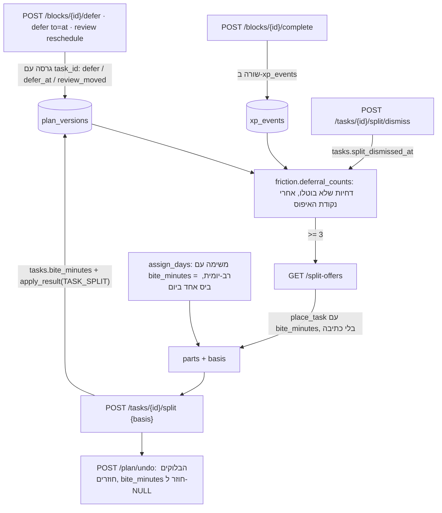

# S44 — זיהוי דחיינות ופיצול בלחיצה, חלק א' (שרת): תוכנית עבודה

> **For agentic workers:** REQUIRED SUB-SKILL: Use superpowers:subagent-driven-development (recommended) or superpowers:executing-plans to implement this plan task-by-task. Steps use checkbox (`- [ ]`) syntax for tracking.

**מטרה:** משימה שנדחתה 3 פעמים ברצף מקבלת מהשרת הצעת פיצול עם תצוגה מקדימה אמיתית מהמתכנן; לחיצה אחת מפצלת אותה ל"ביסים" ומשבצת אותם מחדש, עם גרסת תוכנית ו-"בטל". "Not now" נשמר, וההצעה חוזרת רק אחרי 3 דחיות נוספות.

**השער במפת הדרכים:** "אחרי דחייה שלישית ההצעה מופיעה פעם אחת, והפיצול משבץ את החלקים בלי עריכה ידנית ועם 'בטל'". בחלק א' נבנה רק השרת; השורה נשארת "בעבודה" עד שהממשק ייבנה אחרי S32.

**גישה:** מיגרציה 0015 (שתי עמודות ב-`tasks` ואינדקס), שדה חדש במתכנן (`Task.bite_minutes`) שהמתכנן מכבד בכל מקום, ושירות `friction` עם שלוש נקודות קצה: `GET /split-offers`, ‏`POST /tasks/{id}/split`, ‏`POST /tasks/{id}/split/dismiss`.

**כלים:** Python 3.14, ‏FastAPI, ‏psycopg 3, ‏Hypothesis (בדיקות property). בלי תלויות חדשות.

**מסמך תכנון:** `docs/spec/2026-10-19-studyflow-v2-design.md` (7.6 המתכנן, 7.7 ה-API); מסמך הביקורת `docs/design/2026-11-21-archi-ux-audit.md` סעיף 15.

## איך החלקים מתחברים

- **למה הספירה נגזרת מההיסטוריה ולא נשמרת כמונה:** כל דחייה שהמשתמש ביקש כבר כותבת גרסת תוכנית עם `task_id` (`defer`, ‏`defer_at`, ‏`review_moved`), וכל ביצוע כותב שורה ב-`xp_events`. הספירה היא שאילתה: גרסאות מהסוגים האלה של המשימה, ש-`undone_at` שלהן ריק, ושנוצרו אחרי נקודת האיפוס. נקודת האיפוס היא המאוחרת מבין: הביצוע האחרון של בלוק של המשימה (`xp_events.created_at`), הפיצול האחרון שלא בוטל (גרסה `task_split`), ו-`tasks.split_dismissed_at`. כך:
  - **undo** של דחייה מסמן את הגרסה `undone_at`, והיא יוצאת מהספירה מעצמה. undo של פיצול מחזיר את ההצעה. ‏uncomplete מוחק את שורת ה-XP, והאיפוס שהיא גרמה נעלם. מונה היה מחייב לכתוב קוד תיקון בכל אחד מהמסלולים האלה.
  - **תכנון מחדש שהמשתמש לא ביקש** (‏`replan`, אירוע תפוס שמפנה בלוקים, זמן פנוי, עריכת משימה) כותב גרסה מסוג אחר, או בלי `task_id`, ולכן לא נספר.
  - **משימה שמתפצלת לכמה ימים:** הספירה היא למשימה, לא לבלוק. דחייה של כל אחד מהבלוקים שלה נספרת, וביצוע של כל אחד מהם מאפס. מה שנתקע הוא הנושא, וזה מה שסעיף 15 מבקש לזהות.
  - כל הזמנים שמושווים הם של שעון המסד (`clock_timestamp()`), גם ה-dismiss, כדי שלא יתערבב עם ה-`now` של הבקשה (שבבדיקות קפוא).
- **מה זה "פיצול":** המתכנן היום שם את כל הדקות של משימה ביום אחד כבלוק רציף. פיצול שומר על המשימה (אותו id, אותן תלויות, אותו סך דקות) ומגדיר לה `bite_minutes`: אורך ביס. ‏`assign_days` מתייחס למשימה כזו כמשימה רב-יומית שמקבלת **ביס אחד ביום** (הכלל הקיים "חלק אחד ביום" של משימה רב-יומית), כל ביס באורך `bite_minutes`, והשארית האחרונה (פחות מביס + 30) נכנסת בחתיכה אחת. מאחר שזה שדה של המשימה, כל תכנון מחדש עתידי שומר על הביסים.
- **למה לא משימות חדשות:** פיצול למשימות נפרדות היה משנה את רשימת המשימות של המבחן, מחייב לחווט מחדש תלויות (למשימה יש תלות אחת בלבד), ומסבך את ה-undo. שדה במשימה נוגע רק במתכנן.

## ההחלטות שלי

1. **כלל הביס, לכל אורך:** בלוק החיכוך הוא הבלוק המתוכנן הבא של המשימה שעוד לא התחיל, באורך L. ביס = `max(30, 5 × floor(L / 15))`, כלומר שליש מהבלוק ולא פחות מ-30. ‏60 → 2×30, ‏75 → 30+45, ‏90 → 3×30, ‏120 → 3×40, ‏180 → 3×60. אין הצעה ל-L < 60, כי אי אפשר לחתוך אותו לשני חלקים של 30 לפחות (המינימום של המתכנן).
   **סטייה מברירת המחדל "2×30 לבלוק של 60–90":** ל-60 זה בדיוק 2×30. ל-90, שני ביסים של 30 היו מוחקים בשקט 30 דקות לימוד שהתוכנית צריכה, והמתכנן מבטיח שאף דקה לא נעלמת. לכן 90 → 3×30, והטקסט של הכפתור נבנה מהנתונים (`Split into 3×30m`). מי שרוצה פחות זמן משנה את ההערכה של המשימה.
2. **ביס אחד ביום:** הביסים נפרשים על ימים שונים. ככה זה "ביס" ולא אותו בלוק עם הפסקה באמצע, ואין צורך לשנות את האריזה או את כללי הקיבולת. אם אין מספיק ימים עד המבחן, אין הצעה (התצוגה המקדימה נכשלת), ו-`POST .../split` מחזיר `placement_failed`.
3. **מה משתחרר בפיצול:** כל הבלוקים המתוכננים של המשימה שעוד לא התחילו, גם נעולים. הפיצול הוא פעולה מפורשת על המשימה הזו (כמו defer שמשחרר בלוק נעול), ואחריו כל בלוק עתידי שלה הוא ביס. בלוק שרץ עכשיו ובלוקים שבוצעו נשארים ונספרים. בלוקים של משימות אחרות לא זזים (‏`place_task`), התלויות נבדקות ב-`place_task` (כולל `dependent_too_early`), והזמינות (S35) היא חלק מהפרופיל.
4. **נקודת קצה ייעודית ולא שדה ב-`/today` ו-`/plan`:** התצוגה המקדימה מריצה את המתכנן לכל משימה בהצעה; ב-`/today` וב-`/plan` זה היה מאט כל טעינה, ונוגע ב-`plan_views.py` שגם S32 עובד מולו. הממשק קורא ל-`GET /split-offers` במסך היום.
5. **basis כמו ב-replan:** ההצעה מחזירה `basis` (‏`fingerprint` של הלוח, שעכשיו כולל `bite_minutes` כשהוא מוגדר), ו-`split` דוחה ב-`stale_plan` אם הלוח השתנה. כך מה שמוצג הוא מה שנכתב.
6. **פיצול רק כשיש הצעה פעילה:** `split` בלי הצעה (פחות מ-3, אחרי "Not now", בלוק קצר) מחזיר 409 ‏`no_split_offer`. ‏`dismiss` בלי הצעה מחזיר גם הוא 409 ‏`no_split_offer`, כדי שלא יבלע בשקט.
7. **undo:** הפיצול כותב גרסה `task_split` עם `task_before = {"bite_minutes": <הערך הקודם>}`. ה-undo מחזיר את הבלוקים מהתמונה (המסלול הכללי) ואת `bite_minutes`.
8. **XP:** הנוסחה של S19 לינארית בדקות, ולכן פיצול לא מוסיף XP, חוץ מעיגול (עד +1 לכל חלק). כדי שזה יהיה מובטח, לבלוק של משימה עם `bite_minutes` ה-XP הוא `block_xp(focus, כל הדקות שבוצעו במשימה) − ה-XP שכבר ניתן לבלוקים האחרים שלה`, ולא פחות מ-0. כך סך ה-XP של משימה מפוצלת אף פעם לא עולה על XP של בלוק אחד באותו אורך.
9. **תגים:** `task_master` סופר בלוקים, כמו שהחליט S19 (כמו ב-legacy). ביס של 30 דקות ומעלה הוא בלוק לימוד אמיתי, וההצעה מופיעה רק אחרי 3 דחיות, אז אי אפשר "לחרוש" תגים בפיצולים. לא משנים את התגים.
10. **"זמן פנוי" (S35) לא מכבד ביס:** כשהמשתמש אומר "יש לי עכשיו 90 דקות", הוא בחר ללמוד עכשיו, וזה בדיוק מה שהפיצול ניסה להשיג. ‏`free_time.py` לא משתנה.
11. **טקסטים:** שתי כותרות שגיאה חדשות באנגלית ב-`app/errors.py` (S39 מתרגם את השאר במקביל; השורות שלי בסוף המילון כדי לצמצם התנגשות).

## Global Constraints

- מיגרציה **0015**, ‏`down_revision = "0013"`. ‏SQL מפורש ב-`op.execute`. ‏RLS כבר קיים על `tasks`; אין טבלה חדשה.
- `MIN_PART_MINUTES = 30` של המתכנן הוא המינימום של כל ביס.
- סף ההצעה: **3** דחיות רצופות.
- ממשק המוצר באנגלית, בגוף ראשון של Archi, בלי אימוג׳י. מסמכים ו-commits בעברית.
- לא נוגעים ב-`web/` וב-`legacy/`.
- בדיקות על `STUDYFLOW_TEST_DB=studyflow_test_s44`.

## Review Focus

1. undo מיד אחרי פיצול: הבלוק הארוך חוזר למקומו, `bite_minutes` חוזר ל-NULL, וההצעה חוזרת (הגרסה בוטלה). ‏→ Task 3.
2. דחייה שבוטלה ב-undo לא נספרת; uncomplete מחזיר את הספירה שלפני הביצוע. ‏→ Task 3.
3. משימה עם תלות: פיצול לא משבץ ביס אחרי הבלוק הראשון של משימה שתלויה בה (‏`dependent_too_early`) ולא לפני התנאי שלה. ‏→ Task 2 (property) ו-Task 3 (שגיאה).
4. משתמש אחר לא רואה הצעות של A, ו-split/dismiss על משימה של A מחזירים 404 בלי לשנות שורה. ‏→ Task 4.
5. אחרי פיצול, replan מלא שומר על הביסים (אף בלוק עתידי לא ארוך מביס + 29). ‏→ Task 2.

---

## מה רץ במקביל

| שלב | משימות | הערה |
| --- | --- | --- |
| 1 | Task 1 (השיחה הראשית) | המיגרציה והשדה במודל: כל השאר תלוי בהם |
| 2 | Task 2 ‖ Task 3 | Task 2 נוגע רק ב-`app/domain/planner/assign.py` ובבדיקות המתכנן; Task 3 בשירות, בנתבים ובסכמות. Task 3 נבדק עם Task 2 אחרי האיחוד |
| 3 | Task 4 | בעלות, תיעוד; אחרי האיחוד |
| 4 | Task 5 (השיחה הראשית) | סקירה סופית, תיקונים, מיגרציה על dev, מיזוג |

**קבצים משותפים:** `app/errors.py` (גם S39), `app/services/plan_writes.py` (‏undo), `app/services/gamification.py` ו-`app/services/blocks.py` (‏XP). רק Task 3 נוגע בהם.

### Task 1: מיגרציה 0015, ‏`Task.bite_minutes`, הלוח וה-fingerprint (השיחה הראשית, `opus`: מיגרציה וחוזה המתכנן)

**Files:**
- Create: `api/migrations/versions/0015_task_split.py`, `api/app/domain/planner/split.py`, `api/tests/db/test_task_split_schema.py`, `api/tests/planner/test_split.py`
- Modify: `api/app/domain/planner/model.py` (‏`Task`), `api/app/domain/planner/__init__.py`, `api/app/services/board.py` (‏`load_board`, ‏`fingerprint`), `api/app/services/account.py` (ייצוא)

**Interfaces — Produces:**
- `tasks.bite_minutes smallint NULL CHECK (bite_minutes BETWEEN 30 AND 300)`, ‏`tasks.split_dismissed_at timestamptz NULL`; אינדקס `plan_versions_user_task_idx ON app.plan_versions (user_id, task_id, created_at) WHERE task_id IS NOT NULL`.
- `Task.bite_minutes: int | None = None` (‏30–300 או None, אחרת `PlannerInputError`).
- `split.bite_for(block_minutes: int) -> int | None` — הכלל מהחלטה 1. ‏`split.SPLIT_THRESHOLD = 3`.

- [ ] בדיקות: `test_bite_for` (59→None, 60→30, 75→30, 90→30, 105→35, 120→40, 180→60); ‏`Task(bite_minutes=29)` ו-`True` נדחים; בדיקת מסד: העמודות קיימות, ה-CHECK דוחה 29, ‏`tests/db/test_schema.py` ו-`test_migrations.py` ירוקים (head אחד: 0015).
- [ ] מימוש; `load_board` קורא `bite_minutes`; ‏`fingerprint` מוסיף `"bite_minutes"` למשימה רק כשהוא לא None (שה-basis של לוחות קיימים לא ישתנה).
- [ ] commit.

### Task 2: המתכנן מכבד ביסים (‏`opus`: לוגיקת מתכנן ובדיקות property)

**Files:** Modify `api/app/domain/planner/assign.py`; Test `api/tests/planner/test_assign_bites.py`, ‏`api/tests/planner/test_bite_properties.py`

**Interfaces — Consumes:** `Task.bite_minutes`. **Produces:** אין API חדש; ההתנהגות של `assign_days`, ‏`place_task`, ‏`plan`, ‏`replan`.

- כלל: משימה (לא סימולציה) עם `bite_minutes = B` ו-`estimated_minutes >= B + 30` היא רב-יומית. החלק שלה ביום הוא `B` כשהשארית `>= B + 30`, אחרת כל השארית; עדיין חסום ב-`budget` וב-`room`, ועם הכלל הקיים "השארית האחרונה לפחות 30".
- [ ] בדיקות דוגמה: משימה של 90 עם B=30 ושלושה ימים פנויים → שלושה בלוקים של 30 בשלושה ימים; 75 עם B=30 → 30 ואז 45; ‏`place_task` עם `release` של הבלוק הארוך → ביסים, ושאר הבלוקים במקומם; מבחן בעוד יומיים ו-90 עם B=30 → `unscheduled`.
- [ ] בדיקות property (Hypothesis, עם `tests/planner/strategies.py`): לכל לוח אקראי עם משימה מפוצלת, אחרי `plan` ואחרי `replan`: אין בלוק של המשימה ארוך מ-`B + 29`; לכל היותר בלוק אחד שלה ביום; סך הדקות נשמר; כל האינווריאנטים הקיימים (בלי חפיפה, תקציב יומי, תלויות, זמינות) עוברים. ‏`place_task` אחרי פיצול לא מזיז שום בלוק של משימה אחרת.
- [ ] כל `tests/planner` ירוק; commit.

### Task 3: שירות ההצעה, הפיצול, ה-dismiss, ה-undo וה-XP (השיחה הראשית, `opus`: חיבור למתכנן ולגרסאות)

**Files:**
- Create: `api/app/services/friction.py`, `api/app/routers/friction.py`, `api/app/schemas/friction.py`, `api/tests/api/test_friction.py`
- Modify: `api/app/main.py` (נתב), `api/app/errors.py`, `api/app/services/plan_writes.py` (‏`VersionReason.TASK_SPLIT`, צד ה-undo), `api/app/services/gamification.py` + `api/app/services/blocks.py` (‏XP), `api/app/schemas/tasks.py` (‏`TaskOut.bite_minutes`)

**Interfaces — Produces:**
- `deferral_counts(conn, user_id, task_ids) -> dict[UUID, int]`
- `split_offers(conn, user_id, now) -> SplitOffersView`; ‏`split_task(conn, user_id, task_id, basis, now) -> SplitOutcome`; ‏`dismiss_offer(conn, user_id, task_id, now) -> None`
- `GET /split-offers` → `SplitOffersResponse`; ‏`POST /tasks/{task_id}/split` (‏`{"basis": str}`) → `SplitResponse`; ‏`POST /tasks/{task_id}/split/dismiss` → 204.
- שגיאות: `no_split_offer` (409) "I don't have a split to offer for this task right now." ; קיימות: `not_found`, `stale_plan`, `placement_failed`.

- [ ] בדיקות (נכשלות קודם): אין הצעה אחרי 2 דחיות, יש אחרי 3 (‏defer, ‏defer to=at, ‏review reschedule כולם נספרים); replan / אירוע תפוס / עריכת משימה לא נספרים; ביצוע בלוק של המשימה מאפס; uncomplete מחזיר; undo של דחייה מוריד מהספירה; dismiss מעלים, ו-3 דחיות נוספות מחזירות; ההצעה של 90 דקות מציגה `bite_minutes: 30` ושלושה `parts` ששווים למה ש-split כותב; split עם basis ישן → `stale_plan`; split בלי הצעה → `no_split_offer`; undo של split → הבלוק המקורי חוזר, `bite_minutes` NULL וההצעה חוזרת; XP של שלושה ביסים ≤ XP של בלוק אחד של 90 (כולל מקרה עיגול: focus 3, ביסים של 35).
- [ ] מימוש; lint, mypy; commit.

### Task 4: בעלות ותיעוד לממשק (‏`sonnet`: בדיקות בעלות לפי תבנית קיימת; התיעוד בשיחה הראשית)

**Files:** Modify `api/tests/api/test_ownership.py`, `docs/spec/2026-10-19-studyflow-v2-design.md`

- [ ] שלוש נקודות הקצה ב-`test_ownership.py`: split ו-dismiss על משימה של A מ-B → 404 והשורות של A לא השתנו; `GET /split-offers` של B לא מראה את A; ‏`test_every_route_is_covered` ירוק.
- [ ] סעיף במסמך התכנון: הסכמות, דוגמאות JSON, מה הממשק מציג (ההודעה של Archi, ‏`Split into N×Bm`, ‏"Not now", ‏"Undo").
- [ ] commit.

### Task 5: סקירה סופית, dev ומיזוג (השיחה הראשית; הסקירה `fable`: מתכנן וגרסאות, הסקירה הסופית מצאה באגים בכל scope כזה)

- [ ] כל הפקודות של `api/` (ובדיקה ש-`web/` לא השתנה), gitleaks.
- [ ] סקירה סופית של הענף, תיקונים, הרצה חוזרת.
- [ ] המיגרציה על פרויקט ה-dev (נוהל SQL Editor; בדיקת `alembic_version` = 0013 ו-`down_revision` מול `origin/main`).
- [ ] rebase על `origin/main`, בדיקות, `git push origin s44-friction:main`, מחיקת הענף.
- [ ] מפת הדרכים: S44 נשאר "בעבודה"; שורה ב"פריטים פתוחים": "S44: הממשק של הצעת הפיצול, אחרי S32".
