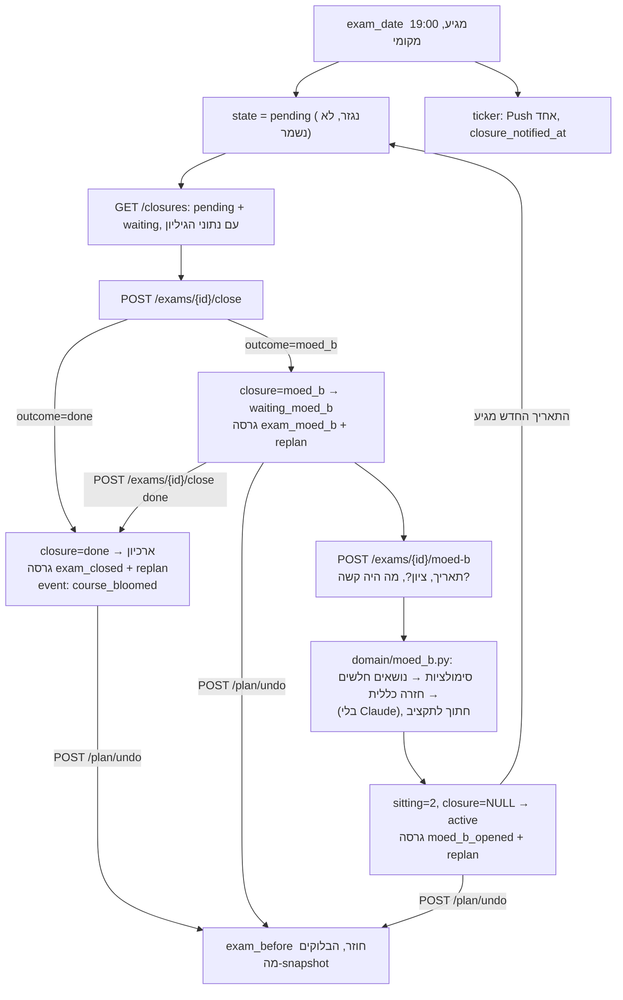

# S45 — סגירת מבחן ומועד ב' (חלק א': שרת): תוכנית עבודה

> **For agentic workers:** REQUIRED SUB-SKILL: Use superpowers:subagent-driven-development (recommended) or superpowers:executing-plans to implement this plan task-by-task. Steps use checkbox (`- [ ]`) syntax for tracking.

**מטרה:** מבחן שהתאריך שלו הגיע נסגר בטקס קצר עם Archi, באחד משני מסלולים. ‏`done`: הקורס עובר לארכיון ההישגים, הזמן שלו משתחרר למבחנים האחרים (תכנון מחדש עם גרסה ו"בטל"), והתשובה מחזירה אירוע "פריחה מלאה" לגן. ‏`moed_b`: החומרים, הניתוח והמשימות נשמרים בהמתנה, ולא משובצים. כשמתפרסם מועד ב', נקודת קצה אחת פותחת סבב ממוקד מהחומרים הקיימים, בלי קריאה ל-Claude. חלק א' הוא השרת בלבד: הממשק (גיליון הסגירה, הפריחה בגן) ייבנה אחרי S32 ו-S33, ולכן כל החוזה מתועד במסמך התכנון.

**מקור:** סעיף 16 במסמך הביקורת (`docs/design/2026-11-21-archi-ux-audit.md`).

**גישה:** מיגרציה 0016 (Task 1), ואחריה ארבעה חלקים שרצים במקביל: סגירה ו-undo (Task 2), מועד ב' (Task 3), תזכורת Push (Task 4), והשלמות בשירותים הקיימים: רשימת המבחנים, ייצוא, מחיקה, התקדמות (Task 5). בסוף תיעוד, סקירה ומיזוג.

**כלים:** Python 3.14, ‏psycopg 3, ‏FastAPI, ‏pytest. בלי תלויות חדשות. אין שינוי ב-`web/`.

## איך החלקים מתחברים

- **למה עמודות ב-`exams` ולא טבלה חדשה:** מבחן הוא "קורס" אחד שעובר לכל היותר שני מועדים. כל מקום שקורא מבחנים (המתכנן, הסקירה, הייצוא, המחיקה, RLS) כבר עובד על שורת `exams`, ולכן מצב על השורה הוא תנאי `WHERE` אחד, בלי join. טבלת "מועדים" הייתה מוסיפה RLS, ייצוא, מחיקה ו-undo חדשים, בשביל שורה אחת או שתיים לכל מבחן. מה שצריך לשמור ממועד א' כשהתאריך מתחלף (התאריך, הציון, מה היה קשה) נכנס לעמודות `first_*` / `moed_b_*`, שמותרות רק כש-`sitting = 2`.
- **למה "ממתין לסגירה" נגזר ולא נשמר:** הוא תלוי בזמן ובאזור הזמן של המשתמש. עמודה הייתה דורשת עבודת רקע שמעדכנת אותה, ונשברת כשמשנים אזור זמן. נשמרת רק ההחלטה (`closure`), ו-`domain/closure.py` מחשב את המצב: `active`, ‏`pending`, ‏`waiting_moed_b`, ‏`done`.
- **למה 19:00 מקומי:** הביקורת אומרת "בערב של יום המבחן". רוב המבחנים באוניברסיטאות בארץ נגמרים עד 16:00, ומשמרת הערב נגמרת בסביבות 19:00. ב-19:00 המבחן כמעט תמיד מאחורי הסטודנט, והערב עוד לפניו. אותה שעה פותחת את הגיליון ושולחת את ה-Push, כך שהתזכורת לא מגיעה לפני שיש מה לפתוח. השעה המקומית מחושבת עם `zoneinfo` (שעה שנופלת בפער של שעון קיץ זזה קדימה, כמו בכל `domain/time.py`).
- **למה `tasks.sitting`:** במועד ב' נוצרות משימות חדשות לאותו מבחן, ומשימות מועד א' (גם אלה שלא נעשו) נשארות להיסטוריה. המתכנן לוקח רק משימות שה-`sitting` שלהן שווה ל-`sitting` של המבחן. טריגר `BEFORE INSERT` קובע את `sitting` של משימה חדשה לפי המבחן, כך שכל נתיב שיוצר משימות (ידני, ניתוח, מועד ב') נכון בלי שינוי בקוד שלו.
- **למה `plan_versions.exam_before`:** כמו `task_before` ו-`busy_event_before`. הביטול צריך להחזיר את שדות המבחן שהשינוי נגע בהם (closure, ‏closed_at, ‏sitting, ‏exam_date…), וה-snapshot שומר רק בלוקים.
- **למה תכנון מחדש מלא ולא רק מחיקת בלוקים:** "משחרר את הזמן למבחנים האחרים" פירושו שהמבחנים האחרים יכולים לקבל את המקום. ‏`replan` של S08 יציב (משנה מעט), והכול נכתב בגרסה אחת עם ה-snapshot של הלוח לפני הסגירה, כך ש"בטל" מחזיר הכול בצעד אחד.

## מה מצאתי לפני התכנון (2026-11-21)

| נושא | מצב |
|---|---|
| מבחן שעבר | ‏`load_board` לוקח רק `exam_date >= today`. אין שום מצב סגירה, ואין ארכיון |
| ‏S19 | XP ותגים נספרים רק מבלוקים (`xp_events`, ‏`badges`). אין XP או תג על סיום מבחן, ולכן הסגירה לא נותנת XP, והאירוע שלה הוא רק לתצוגה. הרשומות לא נמחקות בסגירה |
| ‏S16 | ‏`NotificationTicker` שולח תזכורות בלוקים פעם בדקה, כבעל הסכמה. הטקסטים עדיין בעברית (S39 מעביר לאנגלית) |
| ‏S12 | ‏`exam_budgets` נותן תקציב דקות לכל מבחן; ‏`_exams_to_analyze` ו-`_replaced_tasks` לא מכירים מועדים |
| בדיקת תאריך | ‏`tasks.py`, ‏`analyses.py`, ‏`generation.py`, ‏`review.py`, ‏`blocks.py` בודקים `exam_date < today`. מבחן שנסגר ביום המבחן עצמו עוד עובר את הבדיקה |
| הרשאות | ל-`authenticated` יש SELECT/INSERT/UPDATE/DELETE מלאים על `exams` ו-`tasks` (0002), ולכן עמודות חדשות לא צריכות GRANT. ‏INSERT על `plan_versions` הוא לפי עמודות (0014), וצריך להוציא אותו מחדש |
| מיגרציות | ה-head ב-`main` הוא 0013 (‏0014 → 0013). ‏S44 לוקח את 0015; ‏0016 שלי מצביעה על 0015 |

## ההחלטות שלי

1. **מודל:** עמודות ב-`exams` (נימוק למעלה). ‏`sitting` ‏(1 או 2), ‏`closure` ‏(NULL, ‏`done`, ‏`moed_b`), ‏`closed_at`, ‏`closure_notified_at`, ‏`first_exam_date`, ‏`first_grade` ‏(0–100), ‏`moed_b_notes` ‏(עד 1,000 תווים), ‏`moed_b_topic_ids` ‏(עד 50). ‏CHECK: ‏`closure` ו-`closed_at` יחד; ‏`moed_b` רק ב-sitting 1; שדות מועד א' רק ב-sitting 2.
2. **שלושה מועדים לא קיימים:** במועד ב' האפשרות היחידה היא `done`. מועד מיוחד (ג') הוא מקרה נדיר, ואפשר להוסיף אותו אחר כך בלי לשבור את המודל (להרחיב את ה-CHECK).
3. **מבחן ממתין שתאריכו טעה:** ‏`PATCH /exams/{id}` עם תאריך עתידי מחזיר אותו ל-`active`. מבחן `done` או `waiting_moed_b` לא מקבל `exam_date` או `difficulty` ב-PATCH (409 ‏`invalid_state`): מועד ב' נפתח רק דרך נקודת הקצה שלו. שינוי שם מותר תמיד.
4. **שני המסלולים מתכננים מחדש:** גם `moed_b` מוציא את המבחן מהתכנון, ולכן גם הוא כותב גרסה (`exam_moed_b`) עם תכנון מחדש, וגם הוא ניתן לביטול.
5. **התוכנית של מועד ב' בלי Claude:** יש כבר נושאים (S11), משימות מועד א' עם `kind`, ‏`topic_id` ודקות, ותקציב (`exam_budgets`). זה מספיק לתוכנית ממוקדת דטרמיניסטית, בלי עלות ובלי המתנה לעבודת רקע. הסדר:
   1. **סימולציות:** עד שתי סימולציות ממועד א' (כותרת ודקות), כל אחת עם `simulation_review` שתלוי בה. אם לא היו, סימולציה אחת `Full practice exam` ‏(150 דקות) וסקירה `Practice exam review` ‏(60).
   2. **נושאים חלשים:** הנושאים שנבחרו, ועוד נושאים ששמם מופיע בטקסט החופשי (השוואה בלי רישיות). לכל נושא: משימת `review` בשם הנושא (חצי מדקות ה-learn/review שלו במועד א', בין 45 ל-120), והעתק של משימות ה-practice שלו (או practice אחת של 60 דקות בשם הנושא).
   3. **חזרה כללית:** `review` אחת לכל נושא אחר, ‏`30 + 15·weight` דקות. כל אחת תלויה במשימת הנושא החלש האחרונה, כך שהמתכנן (שמעדיף review על practice) לא מקדים אותה לתרגול של הנושאים החלשים.
   4. **בלי נושאים:** חזרה כללית אחת לכל משימת learn של מועד א' (חצי מהדקות, לפחות 30).
   5. **תקציב:** אם הסכום עובר את `exam_budgets` של התאריך החדש, יורדות משימות החזרה הכללית מהסוף. סימולציות ונושאים חלשים לא נחתכים; מה שלא נכנס מדווח כ-shortfall רגיל.
   
   המשימות נכתבות עם `source = 'ai'` (נוצרו על ידי המערכת ולא על ידי המשתמש, כמו משימות ניתוח: ניתוח חוזר יכול להחליף אותן), ‏`topic_id` של הנושא, ו-`position` לפי הסדר. כותרות שמועתקות ממועד א' נשארות בשפת המשתמש; רק ברירות המחדל באנגלית.
6. **התאמת טקסט חופשי:** רק שם נושא מלא שמופיע בטקסט. עברית עם תחיליות (ב-, ה-, ו-) תתפספס לפעמים, ולכן הממשק יציע את הנושאים כבחירה, והטקסט נשמר להיסטוריה. קריאה ל-Claude לא שווה את העלות והזמן בשביל זה עכשיו; אם יידרש, היא תשתמש במכסה של S12.
7. **ביטול מועד ב'** מסורב (409 ‏`invalid_state`) אם למשימה של מועד ב' יש התקדמות, כמו ביטול ניתוח (`_check_no_progress`). אחרת משימות מועד ב' נמחקות (רך), והמבחן חוזר ל-`waiting_moed_b` עם התאריך הקודם.
8. **נקודת קצה ייעודית `GET /closures`** ולא שדה ב-`GET /today`: סגירה ממתינה לא שייכת ליום מסוים (היא נשארת עד שמחליטים), ו-`plan.py` / ‏`plan_views.py` בעבודה ב-S44 במקביל.
9. **Push:** פעם אחת, ביום המבחן מ-19:00 עד חצות מקומי, רק למי שיש לו מנוי (S16), ורק אם המבחן עוד לא נסגר. ‏`closure_notified_at` נקבע ב-UPDATE אחד לפני השליחה (לכל היותר פעם אחת, כמו בתזכורות הבלוקים). החישוב של השעה המקומית בפייתון ולא ב-SQL, כי אזור זמן שה-Postgres לא מכיר היה מפיל את כל הסבב. פתיחת מועד ב' מאפסת את `closure_notified_at`. הטקסט באנגלית, בקול של Archi:
   - כותרת: `You made it through <exam>.`
   - גוף: `How did it feel? Tell me, and I'll sort out what comes next.`
10. **ארכיון בהתקדמות:** ‏`GET /progress` מקבל `archive`: המבחנים שנסגרו `done`, עם הדקות שנלמדו ואחוז הביצוע. ה-XP והתגים לא משתנים, כי הם לא תלויים במבחן.
11. **אחוז הביצוע:** סכום הדקות המוערכות של משימות `done` חלקי סכום הדקות של `todo` ו-`done` (בלי `skipped`), של המועד הנוכחי. "כמה נלמד": סכום הדקות של בלוקים `done` של המועד הנוכחי.
12. **ייצוא:** העמודות החדשות נכנסות לייצוא, ו-`EXPORT_VERSION` נשאר 1, כי השינוי רק מוסיף שדות. מחיקת החשבון לא משתנה: ‏`delete_account_data()` כבר מוחק `exams` ו-`tasks`; נוספת בדיקה שמכסה את המצבים החדשים.
13. **`blocks.py` לא משתנה:** S44 עובד בו. אחרי הסגירה אין למבחן בלוקים עתידיים, ולכן דחייה של בלוק שלו לא אפשרית בפועל. נרשם כפריט פתוח קטן אם הסקירה תמצא אחרת.

## Global Constraints

- נוגעים רק ב-`api/` ובמסמכים. לא ב-`web/`.
- כל טקסט למשתמש באנגלית, בגוף ראשון של Archi, בלי אימוג'י.
- כל שינוי בלוח נכתב בגרסה אחת תחת `lock_user`, ו-`POST /plan/undo` מבטל אותו.
- בדיקה לפני קוד; ‏commit לכל משימה; ‏`ruff check`, ‏`ruff format --check`, ‏`mypy`, ‏`pytest` ירוקים.
- כל subagent מריץ בדיקות על מסד משלו: `STUDYFLOW_TEST_DB=studyflow_test_s45_<task>`.

## Review Focus

- ה-undo של שלוש הסיבות החדשות: מה חוזר, מה נמחק, ומה קורה כשבינתיים היה שינוי.
- בעלות: כל endpoint מסרב למבחן של משתמש אחר (404) ולמבחן שנמחק.
- ה-CHECK-ים של 0016 מול כל מעבר מצב.
- הזמן: 19:00 באזור זמן אחר, וביום מעבר שעון.

## מה רץ במקביל

| Task | מודל | למה | תלוי ב- | קבצים |
|---|---|---|---|---|
| 1. מיגרציה 0016, ‏`domain/closure.py`, סינון ב-`board.py`, שלדים | opus | מיגרציה ו-RLS, ‏CHECK-ים ומעברי מצב | — | `migrations/versions/0016_*.py`, ‏`app/domain/closure.py`, ‏`app/services/board.py`, ‏`app/main.py`, שלדי routers |
| 2. סגירה, ‏`GET /closures`, ו-undo לשלוש הסיבות | opus | חיבור למתכנן, גרסה ו-undo | 1 | `app/services/closures.py`, ‏`app/routers/closures.py`, ‏`app/schemas/closures.py`, ‏`app/services/plan_writes.py` |
| 3. מועד ב': בונה התוכנית ונקודת הקצה | opus | לוגיקת מתכנן עדינה (סדר, תלות, תקציב) | 1 | `app/domain/moed_b.py`, ‏`app/services/moed_b.py`, ‏`app/routers/moed_b.py`, ‏`app/schemas/moed_b.py` |
| 4. Push בערב המבחן | sonnet | תבנית קיימת (S16) עם בדיקות | 1 | `app/jobs/closure_notifications.py`, ‏`app/domain/closure_text.py`, שורה ב-`app/jobs/notifications.py` |
| 5. רשימת מבחנים, PATCH, סינונים, ייצוא, מחיקה, ארכיון | sonnet | שינויים רגילים לפי תוכנית מפורטת | 1 | `app/services/exams.py`, ‏`schemas/exams.py`, ‏`routers/exams.py`, ‏`tasks.py`, ‏`analyses.py`, ‏`generation.py`, ‏`review.py`, ‏`account.py`, ‏`gamification.py`, ‏`schemas/progress.py` |
| 6. תיעוד במסמך התכנון | השיחה הראשית | ריכוז של כל החוזה | 2–5 | `docs/spec/…` |
| 7. סקירה סופית | fable | הסקירה של כל הענף | 6 | — |

Tasks 2–5 רצים במקביל, כל אחד ב-worktree משלו. הקבצים שלהם זרים זה לזה; ‏`main.py` ושלדי ה-routers נכתבים ב-Task 1, כך שאף אחד מהם לא נוגע בהם. ‏Task 3 קורא ל-`create_version` ו-`write_changes` הקיימים, ו-undo של `moed_b_opened` נכתב ב-Task 2 (שהוא היחיד שנוגע ב-`plan_writes.py`), לפי החוזה שמוגדר כאן: הגרסה שומרת `exam_id` ו-`exam_before`, ומשימות מועד ב' הן `sitting = 2` של המבחן.

## קבצים משותפים עם S39 ו-S44

- `app/services/board.py`, ‏`app/services/plan_writes.py`: גם S44 עשוי לגעת. מתאחדים ב-rebase לפני המיזוג.
- `plan_versions` INSERT grant: אם 0015 של S44 מוסיפה עמודה ל-`plan_versions`, ה-GRANT של 0016 חייב לכלול אותה. נבדק ב-rebase.
- `app/jobs/notifications.py`: שורה אחת בלבד (הקריאה מה-ticker). הטקסט החדש בקובץ נפרד, כדי לא להתנגש עם S39.

### Task 1: מיגרציה 0016, מצב הסגירה, וסינון המתכנן

**Files:** `api/migrations/versions/0016_exam_closure.py`, ‏`api/app/domain/closure.py`, ‏`api/app/services/board.py`, ‏`api/app/main.py`, שלדי `api/app/routers/closures.py` ו-`api/app/routers/moed_b.py`; בדיקות `tests/db/test_exam_closure_schema.py`, ‏`tests/test_closure_domain.py`, ‏`tests/api/test_board.py`.

- [ ] בדיקות למיגרציה: כל CHECK (closure בלי closed_at, ‏moed_b ב-sitting 2, ‏first_* ב-sitting 1, ציון 101, הערה של 1,001 תווים, 51 נושאים), הטריגר (משימה חדשה מקבלת את ה-sitting של המבחן), ‏INSERT של `exam_before` כ-`authenticated`, ו-downgrade/upgrade.
- [ ] המיגרציה: העמודות, ה-CHECK-ים, ‏`tasks.sitting` עם הטריגר `tasks_set_sitting`, ‏`plan_versions.exam_before` (jsonb object) עם GRANT INSERT מחדש, אינדקס חלקי `exams_closure_due_idx (exam_date) WHERE closure IS NULL AND closure_notified_at IS NULL AND deleted_at IS NULL`, ו-downgrade מלא.
- [ ] `domain/closure.py` (טהור): ‏`CLOSURE_HOUR = 19`, ‏`closure_opens_at(exam_date, tz)`, ‏`exam_state(...)`, ‏`closure_options(state, sitting)`, ו-`completion_percent(...)`, עם בדיקות ל-DST ולאזור זמן אחר.
- [ ] `load_board`: ‏`closure IS NULL`, ומשימות רק מה-sitting של המבחן.
- [ ] שלדי routers רשומים ב-`main.py`.

### Task 2: סגירה ו-undo

**Files:** `app/services/closures.py`, ‏`app/routers/closures.py`, ‏`app/schemas/closures.py`, ‏`app/services/plan_writes.py`; בדיקות `tests/api/test_closures.py`.

- [ ] `GET /closures` → `{"pending": [...], "waiting": [...]}`, כל פריט עם `exam_id`, ‏`exam_name`, ‏`exam_date`, ‏`color_index`, ‏`sitting`, ‏`state`, ‏`options`, ‏`opens_at`, ‏`studied_minutes`, ‏`tasks_done`, ‏`tasks_total`, ‏`completion_percent`, ‏`topics` (`id`, ‏`name`).
- [ ] `POST /exams/{id}/close {"outcome"}`: ‏pending → done / moed_b; ‏waiting_moed_b → done; אחרת 409 ‏`invalid_state`. גרסה (`exam_closed` / ‏`exam_moed_b`) עם `exam_before`, מחיקת הבלוקים הפתוחים של המבחן, ‏`replan` על הלוח בלי המבחן, ו-`write_changes` לאותה גרסה. התשובה: `exam`, ‏`version_id`, ‏`event` (`{"kind": "course_bloomed", …}` ב-done, ‏null ב-moed_b), ‏`replan` (`added`, ‏`removed`, ‏`unscheduled`).
- [ ] undo: ‏`exam_before` חוזר (רשימה סגורה של שדות, ובדיקת צורה כמו `_restore_event`); ‏`moed_b_opened`: סירוב עם התקדמות, מחיקה רכה של משימות sitting 2, ואז `exam_before`.
- [ ] בדיקות: מקצה לקצה לשני המסלולים, בעלות (404 למשתמש אחר ולמבחן שנמחק), ‏409 לפני 19:00 ובמבחן שכבר נסגר, ‏undo של כל סיבה, ומבחן אחר שמקבל את הזמן שהתפנה.

### Task 3: מועד ב'

**Files:** `app/domain/moed_b.py`, ‏`app/services/moed_b.py`, ‏`app/routers/moed_b.py`, ‏`app/schemas/moed_b.py`; בדיקות `tests/test_moed_b_domain.py`, ‏`tests/api/test_moed_b.py`.

- [ ] `domain/moed_b.py` (טהור): ‏`build_moed_b_tasks(topics, tasks, weak_topic_ids, notes, budget)` לפי החלטה 5, עם בדיקות לכל כלל (סדר, תלות, ברירות מחדל, תקציב, בלי נושאים, התאמת טקסט).
- [ ] `POST /exams/{id}/moed-b {"exam_date", "grade"?, "hard_topic_ids"?, "hard_notes"?}`: רק ב-`waiting_moed_b`; תאריך כמו ביצירת מבחן; נושאים של המבחן הזה בלבד (422 אחרת). גרסה `moed_b_opened` עם `exam_before`, עדכון המבחן (sitting 2, ‏closure NULL, שדות מועד א'), הכנסת המשימות, ‏`replan` ו-`write_changes`. התשובה: `exam`, ‏`version_id`, ‏`tasks_created`, ‏`weak_topics`, ‏`unscheduled`, ‏`shortfalls`.
- [ ] בדיקות מקצה לקצה, כולל סגירה של מועד ב' כ-done כשמגיע התאריך החדש, ו-undo (עם הקוד של Task 2 אחרי האיחוד).

### Task 4: Push בערב המבחן

**Files:** `app/domain/closure_text.py`, ‏`app/jobs/closure_notifications.py`, שורה ב-`app/jobs/notifications.py`; בדיקות `tests/jobs/test_closure_notifications.py`.

- [ ] הטקסט (החלטה 9) וה-payload (`url: "/today"`, ‏`tag: "exam-closure:<id>"`).
- [ ] `send_closure_notifications(conn, sender, now)`: מועמדים לפי `exam_date` בין אתמול למחר ב-UTC (האינדקס החלקי), בדיקת השעה המקומית בפייתון, ‏UPDATE של `closure_notified_at` עם `IS NULL` לפני השליחה, ואותה כתיבה חזרה למנויים כמו ב-S16.
- [ ] בדיקות: לפני 19:00 לא, אחרי כן פעם אחת, לא אחרי חצות, לא בלי מנוי, לא למבחן שנסגר או נמחק, אזור זמן אחר.

### Task 5: השלמות בשירותים הקיימים

- [ ] `ExamOut`: ‏`sitting`, ‏`state`, ‏`closed_at`, ‏`first_exam_date`, ‏`first_grade`. ‏`GET /exams` מחשב את `state`.
- [ ] `PATCH /exams/{id}`: החלטה 3.
- [ ] סינון מבחן סגור ומועד נוכחי ב-`tasks.py`, ‏`analyses.py`, ‏`generation.py` (`_exams_to_analyze`, ‏`_replaced_tasks`), ‏`review.py`; ‏`GET /exams/{id}/tasks` מחזיר את המועד הנוכחי.
- [ ] ייצוא: העמודות החדשות של `exams` ו-`tasks.sitting`. מחיקה: בדיקה עם מבחן `done`, מבחן בהמתנה ומשימות sitting 2.
- [ ] `GET /progress`: ‏`archive`.

### Task 6: תיעוד (השיחה הראשית)

- [ ] במסמך התכנון: 7.4 (העמודות), 7.7 (נקודות הקצה), 7.10 (ה-Push), וסעיף "חוזה לממשק של S45": סכמות, דוגמאות JSON, ומה הגיליון מציג, עם הטקסטים באנגלית.

### Task 7: איחוד, סקירה, מיגרציה על dev, מיזוג (השיחה הראשית)

- [ ] איחוד הענפים, כל הבדיקות, סקירה סופית (`fable`), תיקונים.
- [ ] rebase על `origin/main`; ‏0016 מצביעה על 0015 אם מוזג, אחרת על ה-head; head אחד.
- [ ] המיגרציה על פרויקט הפיתוח (SQL Editor), אחרי בדיקת `alembic_version`.
- [ ] gitleaks, ‏push ל-`main`, מחיקת הענף; במפה: S45 נשאר "בעבודה", ושורה ב"פריטים פתוחים".
