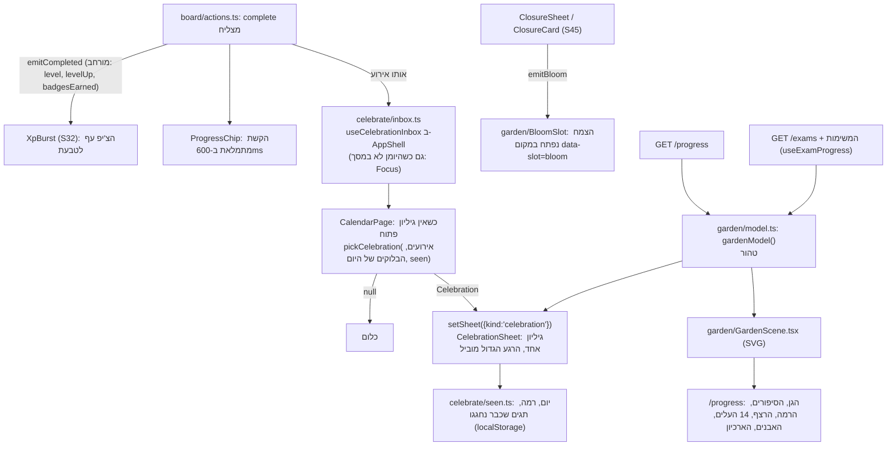

# S33 — גיימיפיקציה במרכז: רצף, רמה, XP, הגן והתגים: תוכנית עבודה

> **For agentic workers:** REQUIRED SUB-SKILL: Use superpowers:subagent-driven-development to implement this plan task-by-task. Steps use checkbox (`- [ ]`) syntax for tracking. המנהל (השיחה הראשית) מריץ מפתח אחד לכל Task, ואחריו סוקר. git רץ רק בשיחה הראשית.

**מטרה:** סימון "Done" מרגיש כמו משהו שגדל. ה-XP עף לטבעת והטבעת מתמלאת, יום שהושלם נחגג פעם אחת, עלייה ברמה, שלב חדש בגן ותג חדש מקבלים גיליון חגיגה קצר אחד, ומסך ההתקדמות נפתח בגן שמצויר בקוד: עץ במרכז שגדל עם הרמה, צמח לכל מבחן שגדל עם ההתקדמות שלו ופורח כשהמבחן נסגר, אבן לכל תג ופרחים לרצף. לחיצה על כל דבר בגן מספרת את הסיפור שלו.

**השער במפת הדרכים:** "סימון Done מראה XP, רצף ורמה מיד, וכל חגיגה עובדת גם עם reduced motion" (מסמך היומן, סעיף 7). אחרי המיזוג S33 עובר ל"הושלם", ונקודת החיבור של S45 (הפריחה) נסגרת.

**העובדה שמשנה את ה-scope:** בעל המוצר **לא** יביא איורים. מפת הדרכים חיכתה ל"שש אנימציות של Archi על רקע שקוף, שמונה תגים מאוירים ואיורי הגן". במקום זה הצוות מכין כל נכס בעצמו, בקוד: התגים והגן כ-SVG ב-tokens בלבד, והתנועה של Archi כ-CSS מעל ששת החיתוכים הקיימים, בלי לגעת בקובצי התמונה.

**גישה:** **בלי שינוי ב-`api/` ובלי מיגרציה.** השרת כבר נותן הכול: `progress` בתשובה של `complete` (`xp_change`, ‏`total_xp`, ‏`level`, ‏`level_up`, ‏`badges_earned`, ‏`badges_lost`), ‏`GET /progress` (רמה, רצף, 14 ימים, 18 תגים, ‏`archive`), ‏`GET /exams` (עם `state`) והמשימות של כל מבחן (האחוז של `exam/examProgress.ts`). שלוש תיקיות חדשות: `web/src/garden/` (המודל הטהור והאיורים: הגן ואבני התגים), ‏`web/src/celebrate/` (תיבת האירועים, הכללים והגיליון), והטקסטים ב-`web/src/i18n/enGarden.ts` (`en.garden`).

**כלים:** ‏React 19, ‏TypeScript strict, ‏TanStack Query 5, ‏Tailwind 4, ‏React Aria Components, ‏Vitest. בלי תלויות חדשות (בלי Lottie, בלי Rive).

**מקורות, לפי סדר הכוח:** ‏`CLAUDE.md`; מסמך הביקורת `docs/design/2026-11-21-archi-ux-audit.md` (הנחיות 11, 2, 3, 5 וצ׳ק-ליסט הנכסים); ‏`docs/design/archi-voice.md`; ההדמיה המחייבת `docs/design/prototype/all-screens.html` (המסך "Progress and the garden" ו-"The day is complete"); ‏`docs/spec/2026-11-18-archie-look-and-gamification.md`, סעיף 4 כולו; ‏`docs/design/design-language.md` סעיפים 2.2, 2.7, 2.10, 5.7, 6א, 7, 8, 9.

## איך החלקים מתחברים



- **למה אירוע ולא state:** כמו `board/xpEvents.ts` ו-`closure/bloomEvents.ts`: רענון של ה-cache אף פעם לא מנגן חגיגה שוב. האירוע של `complete` כבר קיים, והוא רק מקבל שלושה שדות.
- **למה תיבת אירועים ב-`AppShell` ולא מאזין ביומן:** ב-Focus Mode (S42) מסמנים Done ואז חוזרים ליומן. מאזין ביומן לא היה שומע את האירוע; התיבה שומרת אותו בזיכרון עד שהיומן פנוי.
- **למה הגיליון הוא ענף של `SheetState`:** "גיליון אחד פתוח בכל רגע" (6א) הוא כבר חוק של `CalendarSheets`. ענף חדש מקבל אותו בחינם: הוא לא נפתח מעל גיליון אחר, ופתיחה של אחר מחליפה אותו.
- **למה מודל טהור לגן:** כל החלטה (איזה שלב, כמה עלים, איזה צמח פורח, מה הסיפור) נבדקת בבדיקת יחידה בלי DOM, וה-SVG רק מצייר את מה שהמודל אמר. כך גם גיליון החגיגה מצייר "לפני ואחרי" מאותה פונקציה.

## מה מצאתי בקוד (25.11.2026)

1. **השרת שלם.** ‏`ProgressChange` (‏`api/app/services/gamification.py`) מגיע בתשובה של `complete`, ו-`board/actions.ts` שורה 240 כבר שולח ממנו `emitCompleted({ blockId, xp })` (רק כש-`xp_change > 0` ולא ב-Undo). ‏`level_up` ו-`badges_earned` מגיעים לדפדפן ונכנסים רק ל-toast (`board/progressText.ts`).
2. **18 תגים בחמש קבוצות**, לא שמונה ולא ארבע: `first` (1), ‏`blocks` (4: 10/20/50/100), ‏`streak` (5: 7/10/14/30/100), ‏`level` (5: 5/10/20/25/50), ‏`xp` (3: 1000/5000/10000). מסמך ארצ׳י (4.5) אומר "ארבע קבוצות", וההדמיה מציגה "4 of 8". ראו החלטה 6.
3. **רגע ה-XP של S32 קיים** (`calendar/XpBurst.tsx`, ‏600ms, שקט עם reduced motion), אבל הקשת של `ProgressChip` קופצת בלי מעבר, ו-`setQueryData` בתשובה מעדכן `total_xp` ו-`level` לפני הרענון.
4. **הטבעת של היום** (`ui/ProgressRing`) כבר עוברת ב-`--duration-slow` ב-`stroke-brand-strong`. מסמך ארצ׳י אומר "ירוק נבט", אבל `sprout` אינו 3:1 (2.2). נשאר כמו שהוא.
5. **רצועת הימים של היומן** כבר מסמנת יום שהרצף נשמר בו ב-`StreakLeafIcon` (S32), והצ'יפ בסרגל כבר עלה ומספר (S31). סעיף 4.2 נקודה 2 ו-4.3 נקודה 1 בנויים.
6. **ל-Archi יש רק נשימה** (`archie-breathe` ב-`archie.css`) ושכבות החלקיקים של כל מצב. אין קפיצה ואין נדנוד. אין קובץ אנימציה, ולא יהיה.
7. **`sky-from` / `sky-to` / `sky`** מוגדרים בשתי הערכות (בערב: שמי לילה, ‏`#1d2a3a` / ‏`#33465a` / ‏`#26364a`), ואף מסך לא משתמש בהם (S43). הזוג `ink` על כל אחד מהם נבדק ב-`theme.test.ts`.
8. **ההדמיה המחייבת מציגה את "היום הושלם" כגיליון** ("A sheet that closes with one tap", Archi `eureka` על הקצה, כותרת בפונט התצוגה, צ'יפ XP וצ'יפ רצף, "Close"), ומסמך ארצ׳י (4.2) מדבר על "כרטיס קטן". ההדמיה נכתבה אחרי מסמך הביקורת וגוברת.
9. **יום מנוחה שובר את הרצף בשרת** ("יום בלי לימוד מאפס אותו", מסמך התכנון, S19). ההדמיה מציירת ספלי תה ב-14 הימים ("Rest days are tea cups, not gaps"), ובמסך ההתקדמות אין שום נתון על ימי מנוחה שעברו. ראו "החלטות לבעל המוצר" 3.
10. **ביום מנוחה אין רגע ש"מסיים" את היום**: אין בלוקים לסמן. היומן כבר מציג את Archi `rest` ביום כזה (`calendar/archi.ts`, ‏`restDay`). אין מה לבנות ל"טקס התה במקום אאוריקה" מעבר לזה.
11. **"עלה כל 100 XP" מתנגש בעלייה ברמה:** אם העלים נספרים מתחילת הרמה, ברמה החדשה הם חוזרים לאפס והגן נראה קטן יותר דווקא ברגע החגיגה. ראו החלטה 4.
12. **נקודת החיבור של S45:** ‏`closure/bloomEvents.ts` (`onBloom`) בלי מאזין; ‏`SheetFigure` ב-`closure/MoedBSheet.tsx` (prop ‏`bloom`) ו-`exam/ClosureCard.tsx` עוטפים את Archi `eureka` ב-`data-slot="bloom"`. ‏`progress.archive` הוא המקור לפריחה.
13. **`enCalendar.test.ts` מחייב בדיוק שישה קובצי `enCalendar*.ts`**: הטקסטים החדשים נכנסים ל-`i18n/enGarden.ts`.
14. **`colorGuards.test.ts`** מתיר צבע גולמי רק ב-`index.css`, ‏`archie/`, ‏`pwa/manifest.ts`, ‏`theme/theme.ts`, ‏`commitments/downscale.ts`. הגן והתגים מחוץ לרשימה, ולכן כל צבע בהם הוא מחלקת token (`fill-sand`, ‏`stroke-line-strong`, ‏`examColor(i).fill`) או `var(--color-…)`.
15. **`calendar/examProgress.ts` → `useExamProgress(ids)`** נותן את האחוז של כל מבחן מהמשימות שלו (הנוסחה של מסך המבחנים). הגן משתמש בו בלי שאילתה חדשה.
16. **אין `Popover` ב-`ui/`.** ‏`Dialog` מקבל `title: ReactNode` ו-`figure`, ולכן כותרת בפונט התצוגה ו-Archi על הקצה לא דורשים שינוי ברכיב.

## ההחלטות שלי

1. **אין שינוי בשרת.** *למה:* כל מה שהחגיגות והגן צריכים כבר מגיע (ממצא 1, 15); שינוי היה מוסיף מיגרציה ו-RLS בלי מידע חדש.
2. **האירוע של Done מתרחב, לא מוחלף:** ‏`CompletedEvent` מקבל `level: number`, ‏`levelUp: boolean`, ‏`badgesEarned: string[]`. הוא נשלח כש-`undo !== true` ו-(`xp_change > 0` או `level_up` או `badges_earned.length > 0`); ‏`XpBurst` ממשיך להתעלם מ-`xp === 0`. *למה:* בלוק של משימה מפוצלת יכול לקבל 0 XP ועדיין להשלים תג `blocks_*` (S44), ותג כזה ראוי לחגיגה.
3. **גיליון חגיגה אחד לכל רגע, והרגע הגדול מוביל.** הסדר: שלב חדש בגן > רמה > תג > היום הושלם. מה שקרה יחד איתו מופיע בגיליון כשורה אחת לכל דבר, לא כגיליון נוסף. *למה:* Done אחד שסוגר את היום ונותן תג היה פותח שלושה גיליונות ברצף; "Archi מופיע בכל רגע פעם אחת לכל היותר" (3.3).
4. **הגן גדל בשלוש מהירויות, וכל אחת אמיתית:**
   - **בכל 100 XP:** עלה חדש בצבע `sprout` על הצמח שבמרכז, ‏`floor((total_xp − level_start_xp) / 100)`, ‏0–9 (ברמה 50: 9).
   - **בכל רמה:** טבעת מגורפת נוספת בחול סביב הצמח שבמרכז, ‏`min(level − 1, 8)`. כשהרמה עולה, תשעת העלים "הופכים" לטבעת: העלים מתאפסים, והטבעת נשארת לתמיד.
   - **בכל שלב (4.4):** הצמח שבמרכז מתחלף בצורה הבאה.
   *למה:* העלים הם מה שביקש מסמך ארצ׳י (הגדילה נראית אחרי כל יום לימוד); הטבעות פותרות את ממצא 11, כך שהגן אף פעם לא נראה קטן יותר אחרי עלייה ברמה. זה מבצע את ההצעה שחיכתה לאייל; ראו "החלטות לבעל המוצר" 1.
5. **הצמח של כל מבחן:** צמח אחד לכל מבחן חי, לפי האחוז שלו: ‏`0` → `seed` (גבעול חול קטן), ‏`1–33` → `sprout`, ‏`34–66` → `stem` (שני עלים), ‏`67–100` → `bud` (ניצן סגור בצבע המבחן). מבחן ב-`progress.archive` → `bloom` (פרח פתוח בצבע המבחן). ‏`pending` ו-`waiting_moed_b` גדלים לפי האחוז כמו `active`. עד שמונה צמחים: קודם מבחנים שאינם `done` לפי `exam_date`, אחריהם הארכיון לפי הסדר של השרת. *למה:* רק הטקס פותח את הפרח (הנחיה 16, ‏`Nailed it`), כך שמבחן ב-100% שעוד לא נסגר הוא ניצן; והארכיון הוא מקור האמת, ולכן Undo של סגירה מחזיר את הפרח לניצן בלי אירוע הפוך (החלטה 14 של S45).
6. **התגים: חמש צורות אבן, אחת לכל קבוצה, עם סמל חרוט ונקודות דרגה:**

   | קבוצה | האבן | הסמל החרוט | נקודות |
   | --- | --- | --- | --- |
   | `first` | חלוק עגול ונמוך | נבט (שני עלים) | 1 |
   | `blocks` | אבן נהר שטוחה ורחבה | סימן Done (הקו של `CheckMarkIcon`) | 1–4 לפי הסדר (10, 20, 50, 100) |
   | `streak` | אבן עומדת גבוהה וצרה | עלה הרצף | 1–5 (7, 10, 14, 30, 100) |
   | `level` | שתי אבנים זו על זו (cairn) | עץ קטן | 1–5 (5, 10, 20, 25, 50) |
   | `xp` | אבן מלוטשת בפאות | ניצוץ ה-XP | 1–3 (1000, 5000, 10000) |

   שהושג: מילוי `gold-soft`, קו `gold-ink`, סמל ונקודות `gold-ink`. שעוד לא: קו מקווקו `line-strong`, מילוי `surface-muted`, סמל `ink-muted`, ובלי נקודות מלאות (עיגולים ריקים). *למה:* ההדמיה והתג של S19 משתמשים בזהב לתגים (2.2), אבן לכל תג היא מסמך ארצ׳י 4.5, וקבוצה אחת = צורה אחת מבדילה 18 תגים בלי 18 איורים שונים. המספר עצמו כתוב בשם התג מתחת לאבן, ולכן הנקודות הן קישוט שאינו נושא מידע לבד.
7. **אין איור שקוד לא יכול לעשות טוב, חוץ מאחד:** המרקם של "גזירות הנייר" באיורי ארצ׳י (קצוות לא אחידים, גרעין של נייר). התחליף: אותה שפה של האייקונים (5.7): צורה עם "מילוי נייר" (המילוי בצבע ובשקיפות 14% של `PAPER` רק כשהצבע הוא `currentColor`; בגן המילוי מלא ב-token), קו 1.75 בקצוות עגולים, ובלי צללים. *למה:* צל הנייר של `archie-paper` הוא `rgba` שמותר רק ב-`archie/`; והקו האחיד של האייקונים הוא כבר "הקו המצויר ביד" של המוצר.
8. **הגן בתכלת שחר, ובערב בשמי לילה:** הרקע של הסצנה הוא מעבר `sky-from` → `sky-to` (‏`bg-linear-to-b from-sky-from to-sky-to` על הכרטיס, לא בתוך ה-SVG), והאדמה `sand` עם קווי גריפה ב-`line`. אין טקסט על השמיים: הסיפורים בכיתוב מתחת לסצנה, על `surface`. *למה:* ממצא 7 (S43 השאיר את ה-tokens האלה לגן), הנחיה 3 (אין שמיים מאחורי Archi, אבל הגן הוא סצנה ולא רקע שלו, כמו שההדמיה אומרת), ובלי זוג טקסט חדש.
9. **הגן אינטראקטיבי (הנחיה 11):** כל צמח, אבן, קבוצת פרחים והצמח שבמרכז הם `<g role="button" tabIndex={0}>` בתוך ה-SVG, עם שטח לחיצה שקוף של 44 יחידות לפחות (`fill="transparent"`, בלי `pointer-events: none`), Enter ורווח, ושם נגיש. לחיצה בוחרת את הפריט, טבעת הפוקוס והבחירה מצוירות כקו `stroke-brand` מקווקו סביבו, והסיפור שלו נכתב בכיתוב שמתחת לסצנה (`<p role="status">`). בלי בחירה הכיתוב הוא הסיכום של הגן. *למה:* אין `Popover` ב-`ui/` (ממצא 16), וגיליון היה שובר את "גיליון אחד"; כיתוב אחד שמתחלף הוא גם ה-live region.
10. **הסיפורים אומרים רק מה שקרה באמת**, מהנתונים: אחוז, שם, תאריך סגירה, שעות, שם תג ותאריך. אין "Planted when you completed 100% of …" (הדוגמה של הביקורת), כי אין בשרת רגע כזה. *למה:* הכלל החדש של הצוות: כל משפט של Archi מתאר את מה שהמוצר באמת עושה.
11. **הרגעים, המצבים והתנועה:**

    | רגע | איפה | Archi | התנועה (רק בלי reduced motion) |
    | --- | --- | --- | --- |
    | Done | הבלוק, הסרגל | — | ‏`XpBurst` כמו ב-S32; הקשת של `ProgressChip` מתמלאת ב-600ms |
    | היום הושלם | גיליון ביומן | `eureka`, ‏`entrance="hop"` | קפיצה אחת (‏‎−6px וחזרה, 400ms), ושכבת ההילה והניצוצות של `eureka` |
    | עלייה ברמה | גיליון ביומן | `eureka`, ‏`hop` | הקפיצה; הטבעת הגדולה בגיליון מתמלאת מ-0 ב-600ms |
    | שלב חדש בגן | גיליון ביומן | `eureka`, ‏`hop` | הגן "אחרי" נכנס (שקיפות 0→1 ו-`scale(0.96)`→1, ‏600ms) ליד "לפני" |
    | תג חדש | גיליון ביומן | `eureka`, ‏`hop` | האבן יורדת 8px למקומה ונכנסת בשקיפות, 400ms |
    | פריחה (S45) | `data-slot="bloom"` בגיליון הסגירה ובכרטיס | אין: הצמח במקומו | חמשת עלי הכותרת נפתחים בזה אחר זה (`scale(0.4)`→1), עד 1,200ms |
    | פתיחת מסך ההתקדמות | הגן | — | הצמח שבמרכז מתנדנד פעם אחת (‏`rotate` ‏±1.5°, ‏1,200ms) ועלה אחד נופל ונמוג (עד 1,500ms); פעם אחת לכל כניסה למסך |
    | רצף שנשבר | כרטיס הרצף | `flow` (`ArchiSays size="sm"`) | השכבה של `flow` בלבד |
    | יום מנוחה | היומן | `rest` (קיים, S32) | בלי שינוי |

    *למה:* ששת החיתוכים לא משתנים (הם הנכס היחיד של הדמות); קפיצה של 6px עומדת בכלל "תזוזה של 8px לכל היותר, בלי bounce" (8), והיא ה-"archi-eureka, חגיגה קופצנית" של צ׳ק-ליסט הנכסים. הפריחה מחליפה את `eureka` כי זה מה ש-S45 הכין (`data-slot`), והגיליון של הסגירה כבר פתוח: חגיגה נוספת הייתה גיליון מעל גיליון.
12. **הקפיצה נכנסת ל-`Archie` כ-prop, לא כעטיפה:** ‏`entrance?: 'hop'`, מחלקה `archie-hop` ב-`archie/archie.css` על ה-`Frame`, פעם אחת בעלייה, דרך ה-`useReducedMotion` של `Archie.tsx`. ב-`avatar` אין `entrance`. *למה:* `Archie.tsx` הוא "נקודת ההחלפה היחידה" של הדמות (7); כשיגיע אי פעם קובץ אנימציה, רק הוא משתנה.
13. **מתי "היום הושלם" נחגג:** כשאירוע Done של המפגש הזה סימן בלוק שה-`study_date` שלו הוא היום, ואחרי הסימון כל הבלוקים של היום שנספרים (לא `missed`, לא `skipped`) הם `done`; פעם אחת לכל יום לימוד במכשיר. פתיחה של היומן בערב, אחרי שהיום כבר הושלם, לא חוגגת. סימון של בלוק מאתמול בסקירת הבוקר לא חוגג. *למה:* החגיגה היא תגובה לפעולה (3.3: "חוץ מ'בוצע'"), לא הודעה; ופעם ביום מונעת חגיגה שנייה אחרי "Mark as not done" וסימון מחדש.
14. **רמה ותג נחגגים פעם אחת במכשיר:** ‏`celebrate/seen.ts` שומר `{ day: string | null, level: number, badges: string[] }` ב-`localStorage` במפתח `archi.celebrated.<userId>`. רמה נחגגת רק כש-`level > seen.level`; תג רק כשאינו ב-`seen.badges`. תג שאבד לא נאמר (4.5), ולא יוצא מ-`seen`. אחסון חסום: זיכרון המודול. *למה:* ביטול סימון וסימון מחדש מחזירים `level_up: true` מהשרת; בלי זיכרון אותה רמה הייתה נחגגת פעמיים.
15. **מתי הגיליון נפתח:** ‏`CalendarPage` מושך מהתיבה כש-`sheet === null`, ‏`!tasksOpen`, ו-`closure` לא עומד להיפתח לבד באותו רגע (הסגירה קודמת: היא החלטה, החגיגה יכולה לחכות). אירוע שגילו מעל 15 דקות נזרק. הגיליון קורא ל-`noteArchiInterrupt(Date.now())`, כך ש-`BreakNotice` לא קופץ אחריו. *למה:* "אף פעם לא מעל גיליון אחר"; ו-Archi פעם ב-20 דקות.
16. **הגיליון קצר ונסגר בלחיצה:** ‏`Dialog` עם `figure` (Archi על הקצה, כמו `FreeTimeSheet`), כותרת `font-display font-bold` ‏`text-[2.5rem]` (ההדמיה: 50px; ‏40px כדי שמשפט ארוך ייכנס ב-390px), גוף, צ'יפים, וכפתור ראשי אחד "Close". X, ‏Escape וה-scrim סוגרים. אין סגירה לבד. התנועה נגמרת תוך 1,500ms (8). *למה:* ההדמיה (ממצא 8) ו-4.7.
17. **מסך ההתקדמות, מלמעלה:** ‏`h1`; הגן (כרטיס מלא ברוחב, ‏`h2` נסתר "Your garden"); שני כרטיסים (רמה עם טבעת של 58px בזהב, ו-"620 of 1,000 XP"; רצף עם עלה בעיגול `brand-soft` ו-"Longest: 15 days"); "Last 14 days" כשורת עלים; התגים כאבנים ברשת של 4 עמודות לפי קבוצה; הארכיון (S45, בלי שינוי). *למה:* זה הסדר של ההדמיה ושל 4.6.
18. **14 הימים כעלים:** לכל יום `StreakLeafIcon` ‏18px: יום עם XP ב-`text-success` עם מילוי מלא (`fill-current` על הצורה), יום בלי XP ב-`text-ink-muted` בקו בלבד, והיום עם קו תחתון `border-b-2 border-brand`. המשפט מתחת נשאר. בלי ספלי תה (ממצא 9). *למה:* "מפת הרצף כשורת עלים" (4.6), צורה ולא רק צבע.
19. **רצף שנשבר:** כש-`current === 0` ו-`longest > 0`: בכרטיס הרצף `ArchiSays mood="flow" size="sm"` עם `en.garden.streak.paused`, ובגן הפרחים הופכים לניצנים: מספר הניצנים הוא אורך הרצף האחרון שנראה ב-14 הימים (מהסוף: מדלגים על ימים בלי XP, וסופרים ימים רצופים עם XP), עד 6. *למה:* 4.3 ("הפרחים לא נעלמים בבת אחת, רק מתכנסים לניצנים"), מתוך הנתון היחיד שיש.
20. **ה-XP של התוכנית הראשונה:** בלי תנועה חדשה. הצ'יפ "+50 XP" של "Your plan is ready" (S34) הוא הרגע, ובאונבורדינג אין טבעת בסרגל לעוף אליה. הגן ברמה 1 מציג זרע ואת הצמחים של המבחנים כזרעים, ולכן "The first seed in your garden" נעשה נכון במסך ההתקדמות. *למה:* ממצא 1 של S34; משפט שהוא עכשיו אמת.
21. **שני משכים חדשים ב-`index.css`:** ‏`--duration-celebrate: 600ms` ו-`--duration-ceremony: 1500ms` (ליד `--duration-slow`, עם הערה). לא צבע, ולכן לא נוגעים ב-`theme.test.ts`. *למה:* 600ms ו-1.5 שניות הם מספרים של מסמך העיצוב (8), וכל קובץ שמנגן חגיגה צריך אותם בשם אחד.
22. **אין token צבע חדש.** הגזע `clay`, העלווה `sprout` ו-`brand`, החול `sand`, המים `sky`, האבנים בגן `surface-muted` עם קו `line-strong` (ושל תג שהושג `gold-soft` / `gold-ink`), והפרחים `examColor(i).fill`. *למה:* לכולם יש ערך ערב שנבדק (2.10); אם הצילומים יראו צורך, המנהל מוסיף token בשתי הערכות ב-Task 11, עם הבדיקה.

## Global Constraints

- **לא נוגעים ב-`api/`.** אם מפתח מגלה שהחוזה לא מספיק, הוא עוצר ומדווח למנהל מה חסר.
- **החוזה, מילה במילה:**
  - `POST /blocks/{id}/complete` → `{ block, progress?: { xp_change, total_xp, level, level_up, badges_earned: string[], badges_lost: string[] } }` (`board/types.ts`, ‏`CompleteResult`).
  - `GET /progress` → `{ total_xp, level, level_start_xp, next_level_xp: number | null, max_level, blocks_done, streak: { current, longest, studied_today, today }, days: { date, xp }[14], badges: { key, group: 'first' | 'blocks' | 'streak' | 'level' | 'xp', threshold, earned, earned_at }[18], archive: ArchivedExam[] }`.
  - `GET /exams` → לכל מבחן `id`, ‏`name`, ‏`exam_date`, ‏`color_index`, ‏`state?` (דרך `examState()`).
- **השלבים, הספים והמספרים:** שלב לפי רמה `seed` 1–2, ‏`sprout` 3–5, ‏`sapling` 6–10, ‏`young` 11–20, ‏`bonsai` 21–35, ‏`garden` 36–50. עלים `floor((total_xp − level_start_xp) / 100)` בתחום 0–9 (ברמה 50: 9). טבעות `min(level − 1, 8)`. פרחי רצף: `current % 7` פרחים, ו-`min(floor(current / 7), 4)` ענפי פריחה. ניצנים: החלטה 19, עד 6. צמח מבחן: החלטה 5, עד 8.
- **הזמנים:** חגיגה רגילה 600ms (`--duration-celebrate`); כל תנועה בגיליון נגמרת עד 1,500ms (`--duration-ceremony`); קפיצה ‎−6px ב-400ms; תזוזה של כניסה עד 8px; בלי bounce ובלי סיבוב, חוץ מנדנוד הצמח ±1.5° בפתיחת מסך ההתקדמות (4.6).
- **`prefers-reduced-motion`:** אין שום `animate`, ‏`@keyframes` או `transition` חדש שרץ. מוצג מצב הסיום ומשפט. ‏CSS: כל מחלקה חדשה בתוך `@media (prefers-reduced-motion: no-preference)` או עם `motion-reduce:animate-none motion-reduce:transition-none`; JS: ‏`prefersReducedMotion()` לכניסה, ‏`useReducedMotion()` לתנועה שעוקבת אחרי ההגדרה (`ui/reducedMotion.ts`).
- **ששת קובצי Archi לא משתנים** (`web/src/assets/archie/*`), וגם לא `docs/design/prototype/archie/`. הדמות רק דרך `Archie` / `ArchiSays` / `ArchiLead`, במצבים הקיימים.
- **צבע רק דרך tokens:** מחלקות `fill-*`, ‏`stroke-*`, ‏`bg-*`, ‏`text-*`, ‏`from-*`, ‏`to-*` של ה-tokens, ‏`examColor(i).fill`, או `var(--color-…)`. אין hex, ‏`rgb()`, ‏`hsl()`, ‏`white`/`black` או צבע מהלוח של Tailwind מחוץ ל-`archie/` ול-`index.css`. אין שקיפות על טקסט. אין token צבע חדש (החלטה 22). ‏`colorGuards.test.ts`, ‏`theme.test.ts` ו-`sourceGuards.test.ts` ירוקים בלי שינוי ברשימת ההיתר.
- **אנגלית בלבד ב-`web/src`**, בקול של Archi בגוף ראשון (`archi-voice.md`): משפט נגמר בנקודה, כפתור וכותרת לא; בלי `!`; בלי `·`; תאריך מלא `16 November 2026`, קצר `16 Nov`; מספרים דרך `formatNumber`; משך דרך `durationText`; יחיד ורבים נכונים; איות בריטי. כל טקסט דרך `en`; אין טקסט ישיר ב-JSX. **כל משפט אומר רק מה שהמוצר באמת עושה ומה שהנתונים אומרים.**
- **תוכן משתמש** (שם מבחן): ב-JSX דרך `ui/UserText`, בתוך מחרוזת דרך `isolate()`.
- **אפס אימוג׳י.** אייקון רק מ-`web/src/ui/icons/`. האיורים (הגן ואבני התגים) הם רכיבים ב-`web/src/garden/`, לא אייקונים, ולא נכנסים ל-`ARCHI_ICONS`.
- **רכיבי `ui/` לא משתנים.** אין צורך: `ProgressRing` כבר עובר, ו-`Dialog` כבר מקבל `figure` ו-`title: ReactNode`.
- **הגיליונות:** ענף `celebration` ב-`SheetState`; גיליון אחד בכל רגע; הפוקוס חוזר למי שפתח (או ל-"Your plan" כשנפל ל-`<body>`).
- **נגישות:** כל פקד 44px (גם בתוך ה-SVG); ‏`h1` אחד בכל מסך, קטע חדש `h2`; ה-SVG של הגן הוא `role="group"` עם `aria-label` של הסיכום, והקישוטים בתוכו `aria-hidden`; כל שינוי של מצב נאמר במילים (כותרת הגיליון, הכיתוב, ה-toast הקיים).
- **ההתנהגות הקיימת לא משתנה:** ה-toast של Done (`completeText`), ‏`XpBurst`, ‏`BreakNotice`, גיליון הסגירה, השורות בפס וה-Undo. בדיקה קיימת משתנה רק כשהיא נשענת על מבנה שהשתנה (למשל ה-DOM של `BadgeGrid`, ‏`DayStrip`, ‏`LevelCard`), והמפתח מדווח עליה.
- **פקודות**, מתוך `web/`: ‏`npm test -- <pattern>`, ‏`npm run typecheck`, ‏`npm run lint`, ובכל משימה שנוגעת במסך גם `npm run build`. לא מריצים `npm run dev`.
- מסמכים ו-commits בעברית, מונחים טכניים באנגלית.

## Review Focus

1. **אמת בכל משפט:** כל מחרוזת ב-`en.garden` מתאימה למה שהמסך עושה (טבעת אחת לכל רמה, עלה לכל 100 XP, פרח רק בסגירה, אבן לכל תג שהושג), ומשתמשת רק בנתונים שיש. → Tasks 1, 7, 9.
2. **פעם אחת:** היום הושלם נחגג פעם אחת לכל יום במכשיר; רמה ותג פעם אחת; Undo של "Not done" (`undo: true`) לא חוגג; רענון לא חוגג; "Mark as not done" וסימון מחדש לא חוגגים שוב. → Tasks 2, 3, 9.
3. **אף פעם לא מעל גיליון:** החגיגה מחכה לגיליון פתוח, לגיליון המשימות בטלפון ולסגירה שנפתחת לבד; Focus → יומן מנגן את מה שחיכה; אירוע ישן מ-15 דקות נזרק. → Tasks 3, 9.
4. **Reduced motion:** בכל רגע של הטבלה בהחלטה 11 אין `animate` ואין `@keyframes` פעיל, ומצב הסיום מוצג (העלים, הטבעת המלאה, הפרח הפתוח, האבן במקומה). → Tasks 6, 7, 9, 10.
5. **שתי ערכות:** הגן, האבנים והגיליון ב-Day וב-Dusk, בלי צבע גולמי; השמיים בערב הם שמי לילה; האבנים שהושגו נבדלות מהפתוחות גם בצורה. → Tasks 4, 5, Task 11.
6. **הפריחה:** ‏Undo של סגירה מוריד את הפרח (הגן קורא את `archive`); ‏`emitBloom` מנגן פעם אחת במקום `data-slot="bloom"`; רענון לא מנגן. → Tasks 2, 10.
7. **הגן במקלדת ובקורא מסך:** Tab עובר על כל פריט פעם אחת; Enter ורווח בוחרים; הכיתוב נאמר; שם מבחן בעברית בסיפור נשאר בסדר הנכון. → Task 7.
8. **ביצועים:** הגן לא שולח בקשה חדשה מעבר ל-`GET /progress`, ‏`GET /exams` והמשימות שהיומן כבר מביא; אין אנימציה שרצה בלולאה. → Tasks 5, 7.

## סדר ותלויות

| Task | נשען על | מודל |
| --- | --- | --- |
| 1 הטקסטים (`enGarden.ts`) | — | opus (fable when available) |
| 2 המודל הטהור של הגן והחגיגות | 1 | opus |
| 3 האירוע המורחב ותיבת החגיגות | 2 | opus |
| 4 אבני התגים (SVG) | 2 | opus (fable when available) |
| 5 הגן (SVG) | 2 | opus (fable when available) |
| 6 התנועה: הקפיצה של Archi, הקשת, המשכים | — | sonnet |
| 7 הגן במסך ההתקדמות, הסיפורים | 2, 5, 6 | opus |
| 8 שאר מסך ההתקדמות: רמה, רצף, 14 עלים, אבנים | 1, 2, 4 | sonnet |
| 9 גיליון החגיגה ביומן | 1–6 | opus (fable when available) |
| 10 הפריחה במקום `data-slot="bloom"` | 2, 5, 6 | sonnet |
| 11–14 | 10 | המנהל |

**מה יכול לרוץ במקביל** (אם המנהל מריץ שני מפתחים, כל אחד ב-worktree משלו מאותו commit, וממזג לפי הסדר): ‏6 עם 1–5 (קבצים נפרדים: `archie/`, ‏`app/ProgressChip.tsx`, ‏`index.css`); ‏3 עם 4 ועם 5 אחרי 2; ‏4 עם 5. כל השאר אחד אחרי השני.

**קבצים משותפים:** `web/src/i18n/enGarden.ts` ו-`en.ts` (רק Task 1; משימה מאוחרת שחסר לה מפתח מוסיפה אותו תחת `en.garden` באותו קול ומדווחת). ‏`web/src/garden/model.ts` (רק Task 2; משימה שצריכה שינוי מדווחת). ‏`web/src/calendar/CalendarPage.tsx` ו-`CalendarSheets.tsx` (רק Task 9). ‏`web/src/progress/ProgressPage.tsx` (Task 7 מוסיף את הגן; Task 8 משנה את השאר). ‏`web/src/dev/` (Tasks 4, 5: קובץ sections משלהם כל אחד).

---

### Task 1: הטקסטים של הגן והחגיגות (`opus`, ‏fable when available: הקול של Archi, והכלל "כל משפט אמיתי")

**Files:**
- Create: `web/src/i18n/enGarden.ts`, `web/src/i18n/enGarden.test.ts`
- Modify: `web/src/i18n/en.ts` (import ו-`garden: enGarden`, ליד `closure: enClosure`)

**מה נבנה.** כל מה ש-Archi אומר ב-S33. מספרים מגיעים מעוצבים (`formatNumber` במסך), משך כמחרוזת מוכנה (`durationText`), תאריך מוכן (`longDate`), שם תג מוכן (מ-`en.progress.badges.items`).

`en.garden`:

| מפתח | חתימה | הפלט |
| --- | --- | --- |
| `scene.title` | `string` | `Your garden` |
| `scene.summary` | `(stage: string, plants: number, blooms: number, stones: number) => string` | `A young tree, 3 exam plants, 1 in full bloom, and 5 stones.`; ‏0 צמחים: בלי החלק; 0 פריחות: בלי `, 1 in full bloom`; 0 אבנים: בלי החלק. תמיד יחיד ורבים |
| `scene.stage` | `Record<'seed' \| 'sprout' \| 'sapling' \| 'young' \| 'bonsai' \| 'garden', string>` | `A seed`, ‏`A sprout`, ‏`A seedling`, ‏`A young tree`, ‏`A bonsai`, ‏`A whole zen garden` |
| `scene.hint` | `string` | `Tap anything in the garden to hear its story.` |
| `story.tree` | `(stage: string, level: number, leaves: number) => string` | `A young tree at level 12. It grows a leaf for every 100 XP, and I rake a ring around it at every level.` ‏(`leaves` לא נאמר כשהוא 0; כשהוא חיובי נוסף בסוף: ` 4 new leaves so far.`) |
| `story.plant` | `(name: string, percent: number) => string` | `${isolate(name)}: 62% of the plan done. It grows as you finish its tasks.` |
| `story.plantWaiting` | `(name: string, percent: number) => string` | `${isolate(name)} is waiting for Moed B, with 62% of the plan done.` |
| `story.plantPending` | `(name: string) => string` | `${isolate(name)} is ready for its closing. You’ll find it at the top of your calendar.` |
| `story.bloom` | `(name: string, date: string, studied: string) => string` | `${isolate(name)} bloomed when you closed it on 16 November 2026. You studied 21 hours for it.`; ‏`studied` ריק → בלי המשפט השני |
| `story.stone` | `(badge: string, date: string \| null) => string` | `10 blocks. You earned this stone on 13 November 2026.`; ‏`null` → `10 blocks. You earned this stone.` |
| `story.flowers` | `(current: number) => string` | `A 5-day streak, a flower for each day. Every 7 days they open into a branch.` |
| `story.buds` | `string` | `Your streak paused, so the flowers closed into buds. One block today starts a new one.` |
| `streak.paused` | `string` | כמו `story.buds` (הכרטיס של הרצף) |
| `streak.longest` | `(days: string) => string` | `Longest: 15 days` |
| `days.title` | `string` | `Last 14 days` |
| `celebrate.close` | `string` | `Close` |
| `celebrate.dayTitle` | `string` | `That’s every block for today` |
| `celebrate.dayBody` | `(blocks: number, duration: string) => string` | `4 blocks, 4 hours 45 min.` ‏(1: `1 block, 45 min.`) |
| `celebrate.tomorrow` | `(time: string) => string` | `Tomorrow starts at 09:00.` |
| `celebrate.levelTitle` | `(level: number) => string` | `Level 4` |
| `celebrate.levelBody` | `string` | `I’ve raked one more ring around your tree.` |
| `celebrate.stageTitle` | `(stage: string) => string` | `Your garden is ${lower(stage)} now` (למשל `Your garden is a young tree now`) |
| `celebrate.stageBody` | `(level: number) => string` | `Level 11. Here it is before and after.` |
| `celebrate.before` / `celebrate.after` | `string` | `Before` / `After` |
| `celebrate.badgeTitle` | `(badge: string) => string` | השם עצמו (`10 blocks`) |
| `celebrate.badgeBody` | `string` | `I’ve set its stone in your garden.` |
| `celebrate.alsoLevel` | `(level: number) => string` | `You reached level 4.` |
| `celebrate.alsoBadges` | `(names: string[]) => string` | `New badge: 10 blocks.` / ‏`New badges: 10 blocks and A week straight.` |
| `celebrate.alsoDay` | `string` | `And that’s every block for today.` |
| `celebrate.xpToday` | `(xp: string) => string` | `+60 XP today` |
| `celebrate.streak` | `(days: number) => string` | `5-day streak` |
| `badge.towards` | `(current: string, threshold: string) => string` | `3 of 10` |
| `badge.earnedOn` | `(date: string) => string` | `Earned 13 Nov` |

- הטקסטים בטבלה מחייבים במשמעות, במספרים ובעובדות. ניסוח שנשמע לא טבעי מותר לשפר בתוך `archi-voice.md`, **בלי להוסיף עובדה שהמוצר לא עושה**, ולדווח למנהל.
- הערת כותרת לקובץ: הטקסטים של S33, הגן והחגיגות.

**בדיקות (נכתבות קודם, נכשלות), ב-`enGarden.test.ts`:**
- [ ] `scene.summary` לכל צירוף של אפסים (ארבעה מקרים) ויחיד/רבים (`1 exam plant`, ‏`1 stone`).
- [ ] `story.plant('הסתברות', 62)` עוטף את השם בתווי `isolate` ובלי מירכאות; ‏`story.bloom` עם `studied` ריק.
- [ ] `celebrate.alsoBadges` ל-1, 2 ו-3 שמות (פסיק ו-`and`).
- [ ] `celebrate.dayBody(1, '45 min')` ביחיד.
- [ ] אף ערך לא מכיל `!`, ‏`·`, אימוג׳י, או `Archi` כנושא (ה-regex של `enCalendar.test.ts`); כותרות וכפתורים (`close`, ‏`dayTitle`, ‏`levelTitle`, ‏`stageTitle`, ‏`before`, ‏`after`, ‏`days.title`, ‏`scene.title`) לא נגמרים בנקודה; כל משפט אחר נגמר בנקודה.

**צעדים:**
- [ ] בדיקות נכשלות: `npm test -- enGarden`.
- [ ] מימוש; `npm test -- enGarden en.test enCalendar sourceGuards`, ‏`npm run typecheck`, ‏`npm run lint`.
- [ ] commit: `feat(web): S33 הטקסטים של הגן והחגיגות`.

**קריטריוני קבלה:** הכול בגוף ראשון, באנגלית טבעית ובאיות בריטי; "are exactly the six" של `enCalendar.test.ts` ירוק.

### Task 2: המודל הטהור של הגן והחגיגות (`opus`: הרבה כללים קטנים שחייבים להתאים זה לזה ולמשפטים)

**Files:**
- Create: `web/src/garden/model.ts`, `web/src/garden/model.test.ts`, `web/src/celebrate/rules.ts`, `web/src/celebrate/rules.test.ts`, `web/src/celebrate/seen.ts`, `web/src/celebrate/seen.test.ts`, `web/src/garden/testFixtures.ts`

**תלוי ב:** Task 1.

**Interfaces — Produces:**

```ts
// garden/model.ts
export type Stage = 'seed' | 'sprout' | 'sapling' | 'young' | 'bonsai' | 'garden'
export type PlantGrowth = 'seed' | 'sprout' | 'stem' | 'bud' | 'bloom'
export type ExamPlantState = 'active' | 'pending' | 'waiting_moed_b' | 'done'
export interface GardenExam { id: string; name: string; colorIndex: number; examDate: string; state: ExamPlantState; percent: number }
export interface GardenPlant { id: string; name: string; colorIndex: number; growth: PlantGrowth; state: ExamPlantState; percent: number; closedOn: string | null; studiedMinutes: number }
export interface GardenStone { key: string; group: BadgeGroup; tier: number; tiers: number; earnedAt: string | null }
export interface GardenModel {
  stage: Stage; level: number; leaves: number; rings: number
  plants: GardenPlant[]          // up to 8, in the order of decision 5
  stones: GardenStone[]          // earned badges only, in BADGES order
  flowers: number; branches: number; buds: number
  streakCurrent: number
}
export function stageFor(level: number): Stage
export function badgeTier(badges: Badge[], key: string): { group: BadgeGroup; tier: number; tiers: number }
export function gardenModel(input: { progress: Progress; exams: GardenExam[]; timeZone: string }): GardenModel
export type GardenItem = { kind: 'tree' } | { kind: 'plant'; id: string } | { kind: 'stone'; key: string } | { kind: 'flowers' }
export function storyOf(model: GardenModel, item: GardenItem, badgeName: (key: string) => string): string
export function summaryOf(model: GardenModel): string

// celebrate/seen.ts
export interface Celebrated { day: string | null; level: number; badges: string[] }
export function readCelebrated(userId: string): Celebrated     // default { day: null, level: 1, badges: [] }
export function writeCelebrated(userId: string, value: Celebrated): void

// celebrate/rules.ts
export interface DoneEvent { blockId: string; xp: number; level: number; levelUp: boolean; badgesEarned: string[]; at: number }
export type CelebrationLead = 'stage' | 'level' | 'badge' | 'day'
export interface Celebration {
  lead: CelebrationLead
  level: number | null           // when a level was reached
  stageBefore: Stage | null; stageAfter: Stage | null
  badges: string[]               // new, not seen before, in BADGES order
  day: string | null             // the study day completed, when it was
}
export const CELEBRATION_TTL_MS = 15 * 60_000
export function pickCelebration(input: {
  events: DoneEvent[]; now: number; today: string; todayBlocks: Block[]; seen: Celebrated; badgeOrder: string[]
}): { celebration: Celebration | null; seen: Celebrated }
```

הכללים:
- `stageFor`: הספים של Global Constraints.
- `gardenModel`: ‏`leaves` ו-`rings` לפי Global Constraints (ברמה `max_level` או `next_level_xp === null`: ‏`leaves = 9`). ‏`plants`: ‏`exams` שאינם `done` לפי `examDate` ואז `id`, ואחריהם `progress.archive` (‏`growth: 'bloom'`, ‏`closedOn` = התאריך המקומי של `closed_at` דרך `todayIn(timeZone, new Date(closed_at))`, או `exam_date` כש-`null`; ‏`studiedMinutes`); מבחן שמופיע גם ב-`exams` וגם ב-`archive` נספר פעם אחת, כפרח; חיתוך ל-8. ‏`growth` של מבחן שאינו בארכיון: החלטה 5. ‏`stones`: רק `earned`, עם `tier` (1-based) ו-`tiers` (מספר התגים בקבוצה) לפי הסדר של `progress.badges`. ‏`flowers`, ‏`branches`: Global Constraints, ורק כש-`current > 0`. ‏`buds`: כש-`current === 0`, החלטה 19 (על `progress.days`), אחרת 0.
- `storyOf` ו-`summaryOf` רק מרכיבים את הטקסטים של `en.garden` (Task 1); ‏`story.tree` מקבל את `en.garden.scene.stage[stage]`.
- `seen.ts`: מפתח `archi.celebrated.<userId>`, JSON; קריאה שזורקת, JSON שבור או צורה לא נכונה → ברירת המחדל; כתיבה שזורקת נבלעת; עותק בזיכרון של המודול גובר (כמו `closure/seen.ts`).
- `pickCelebration`:
  - אירועים שגילם מעל `CELEBRATION_TTL_MS` (לפי `at`) נזרקים. אין אירוע → `null` ו-`seen` כמו שהוא.
  - **רמה:** ‏`max(level)` של האירועים עם `levelUp`; נחשבת רק אם `> seen.level`. ‏`stageBefore = stageFor(seen.level)`, ‏`stageAfter = stageFor(level)`; ‏`lead: 'stage'` כשהם שונים.
  - **תגים:** האיחוד של `badgesEarned`, בלי מה שב-`seen.badges`, לפי `badgeOrder`.
  - **יום:** יש אירוע שה-`blockId` שלו בלוק ב-`todayBlocks` עם `study_date === today`; כל הבלוקים של היום שאינם `missed` או `skipped` הם `done` (כמו `archiMoment`); ‏`seen.day !== today`.
  - `lead` לפי החלטה 3. ‏`seen` החדש: ‏`level = max(seen.level, level)`, ‏`badges` עם החדשים, ‏`day = today` כשהיום נחגג.

**בדיקות (נכתבות קודם, נכשלות):**
- [ ] `stageFor` בכל גבול: 1, 2, 3, 5, 6, 10, 11, 20, 21, 35, 36, 50.
- [ ] `gardenModel`: ‏`total_xp: 3450`, ‏`level: 4`, ‏`level_start_xp: 3000` → ‏`leaves: 4`, ‏`rings: 3`, ‏`stage: 'sprout'`; רמה 50 → `leaves: 9`, ‏`rings: 8`.
- [ ] צמחים: אחוזים 0, 1, 33, 34, 66, 67, 100 → `seed`, ‏`sprout`, ‏`sprout`, ‏`stem`, ‏`stem`, ‏`bud`, ‏`bud`; מבחן בארכיון → `bloom` עם `closedOn` מקומי; מבחן גם ב-`exams` (`done`) וגם בארכיון → פרח אחד; עשרה מבחנים → שמונה, הלא-סגורים קודם.
- [ ] רצף: ‏`current: 15` → `flowers: 1`, ‏`branches: 2`; ‏`current: 35` → `branches: 4`; ‏`current: 0` עם `days` שבהם ארבעה ימים רצופים עם XP ואחריהם יומיים בלי → `buds: 4`; ‏`current: 0` בלי שום XP → `buds: 0`.
- [ ] `storyOf` לכל `kind`, ושם עברי עובר דרך `isolate`.
- [ ] `seen`: ‏write ואז read; משתמש אחר → ברירת מחדל; אחסון שזורק (`test/fakeStorage.ts`) → עדיין עובד באותה טעינה; JSON שבור → ברירת מחדל.
- [ ] `pickCelebration`: ‏Done שסוגר את היום → `lead: 'day'`; אותו דבר כש-`seen.day === today` → `null`; בלוק מאתמול → בלי יום; ‏`levelUp` לרמה 3 מ-`seen.level: 2` → `lead: 'stage'` (`seed` → `sprout`); לרמה 4 מ-3 → `lead: 'level'`; ‏`levelUp` לרמה שכבר נחגגה → בלי רמה; תג שב-`seen` → לא נחגג; רמה ותג ויום יחד → `lead: 'level'`, ‏`badges` ו-`day` מלאים; אירוע בן 16 דקות → `null`.

**צעדים:**
- [ ] בדיקות נכשלות: `npm test -- garden/ celebrate/`.
- [ ] מימוש; `npm test`, ‏`npm run typecheck`, ‏`npm run lint`.
- [ ] commit: `feat(web): S33 המודל של הגן וכללי החגיגות`.

**קריטריוני קבלה:** הכול טהור חוץ מ-`seen.ts`; אין מספר קסם מחוץ לקבועים בשם; הבדיקות הקיימות ירוקות.

### Task 3: האירוע המורחב ותיבת החגיגות (`opus`: אירוע שחי מחוץ ל-React, Undo, StrictMode)

**Files:**
- Create: `web/src/celebrate/inbox.ts`, `web/src/celebrate/inbox.test.ts`
- Modify: `web/src/board/xpEvents.ts`, `web/src/board/actions.ts`, `web/src/board/xpEvents.test.ts`, `web/src/board/actions.test.tsx`, `web/src/app/AppShell.tsx`

**תלוי ב:** Task 2 (`DoneEvent`).

- `CompletedEvent` מקבל `level: number`, ‏`levelUp: boolean`, ‏`badgesEarned: string[]`. ‏`actions.ts`: התנאי של החלטה 2 (`undo !== true` ו-(`xp_change > 0` או `level_up` או `badges_earned.length > 0`)), והשדות מ-`progress`. ‏`XpBurst` לא משתנה חוץ מ-`if (event.xp <= 0) return` בתחילת המאזין.
- `inbox.ts`: ‏`useCelebrationInbox()` (מנוי ל-`onCompleted` ב-effect, עם cleanup) שדוחף `DoneEvent` עם `at: Date.now()` לרשימה של המודול; ‏`takeEvents(): DoneEvent[]` (מחזיר ומרוקן); ‏`subscribeInbox(listener)` ו-`useInboxSize()` (`useSyncExternalStore`), כדי שהיומן יידע שיש מה למשוך. ‏StrictMode: מנוי כפול לא מכפיל אירוע (ההירשמות בעטיפה של `onCompleted` ו-cleanup מוחק). תקרה של 20 אירועים.
- `AppShell`: ‏`useCelebrationInbox()` פעם אחת, למעלה, לכל המסכים של משתמש מחובר (כולל `bare` של Focus).

**בדיקות (נכתבות קודם, נכשלות):**
- [ ] `actions.test.tsx`: ‏Done עם `level_up: true` ו-`badges_earned: ['first_task']` שולח אירוע עם השדות; ‏Done עם `xp_change: 0` ו-`badges_earned: ['task_master_10']` שולח; ‏Done עם `undo: true` לא שולח; ‏`xp_change: 0` בלי כלום → לא שולח.
- [ ] `inbox.test.ts`: אירוע נכנס ו-`takeEvents` מרוקן; שני מנויים (StrictMode) → אירוע אחד; ‏21 אירועים → 20, הישן יצא.
- [ ] `XpBurst`: אירוע עם `xp: 0` לא מעיף צ'יפ.

**צעדים:**
- [ ] בדיקות נכשלות: `npm test -- xpEvents actions inbox XpBurst`.
- [ ] מימוש; `npm test`, ‏`npm run typecheck`, ‏`npm run lint`.
- [ ] commit: `feat(web): S33 האירוע של Done נושא רמה ותגים, ותיבת החגיגות`.

**קריטריוני קבלה:** ה-toast של Done לא משתנה; אין קריאה חדשה לשרת.

### Task 4: אבני התגים (`opus`, ‏fable when available: איור בקוד שצריך להיראות כמו המוצר)

**Files:**
- Create: `web/src/garden/BadgeStone.tsx`, `web/src/garden/BadgeStone.test.tsx`, `web/src/dev/gardenSections.tsx`
- Modify: `web/src/dev/ComponentsPage.tsx` (שורת import וה-section)

**תלוי ב:** Task 2 (`BadgeGroup`, ‏`badgeTier`).

**Interfaces — Produces:**

```ts
export function BadgeStone(props: { group: BadgeGroup; tier: number; tiers: number; earned: boolean; size?: number; className?: string }): JSX.Element
// size in px, default 48; viewBox 0 0 48 48; aria-hidden always (the tile says it in words).
export function StoneShape(props: { group: BadgeGroup; earned: boolean }): JSX.Element   // the stone alone, for the garden (a <g>, no <svg>)
```

- הצורות, הסמלים והנקודות: החלטה 6. הסמלים מצוירים מחדש באותו קו של האייקונים (1.75, קצוות עגולים), לא מיובאים כ-`<svg>` בתוך `<svg>`; הנקודות בשורה מתחת לסמל, מלאות עד `tier`, ריקות אחריו (`tiers` נקודות בסך הכול).
- הצבעים, כמחלקות בלבד: שהושג `fill-gold-soft stroke-gold-ink`, סמל ונקודות `stroke-gold-ink` / ‏`fill-gold-ink`; שעוד לא: `fill-surface-muted stroke-line-strong` עם `strokeDasharray="3 3"`, סמל `stroke-ink-muted`, נקודות ריקות `stroke-line-strong`.
- כל הצורות נכנסות לריבוע של 48 עם 3 יחידות אוויר, ונראות טוב ב-32, ‏48 ו-72px.
- `gardenSections.tsx`: שורה לכל קבוצה, כל הדרגות, שהושג ושעוד לא, ב-48px, על `surface` ועל `canvas`.

**בדיקות (נכתבות קודם, נכשלות):**
- [ ] לכל קבוצה: `data-group` על ה-`<svg>`, ומספר הנקודות המלאות שווה ל-`tier`.
- [ ] `earned={false}`: יש `stroke-dasharray` ואין `fill-gold-soft`.
- [ ] ה-SVG `aria-hidden="true"` ובלי `role`.

**צעדים:**
- [ ] בדיקות נכשלות: `npm test -- BadgeStone`.
- [ ] מימוש; צילום מסך ידני אינו חלק מהמשימה (Task 11); `npm test`, ‏`npm run typecheck`, ‏`npm run lint`, ‏`npm run build`.
- [ ] commit: `feat(web): S33 אבני התגים, חמש צורות בקוד`.

**קריטריוני קבלה:** בלי צבע גולמי; חמש צורות שנבדלות זו מזו בצללית גם בלי צבע; ‏`colorGuards` ירוק.

### Task 5: הגן (`opus`, ‏fable when available: הסצנה המרכזית של המוצר, בקוד)

**Files:**
- Create: `web/src/garden/GardenScene.tsx`, `web/src/garden/parts.tsx`, `web/src/garden/garden.css`, `web/src/garden/GardenScene.test.tsx`
- Modify: `web/src/dev/gardenSections.tsx` (שלב לכל אחד מששת השלבים, וכל צורת צמח)

**תלוי ב:** Task 2 (`GardenModel`). ‏`StoneShape` של Task 4 אם כבר מוזג; אחרת אבן זמנית מ-`parts.tsx` שמוחלפת במשימה 7 (המפתח מדווח).

**Interfaces — Produces:**

```ts
export interface GardenSceneProps {
  model: GardenModel
  selected?: GardenItem | null
  onSelect?: (item: GardenItem) => void      // without it nothing is focusable (the sheet's before/after)
  play?: 'open' | null                        // the opening motion of the progress screen (Task 7 passes it)
  label: string                               // the accessible name of the group (summaryOf)
  className?: string
}
export function GardenScene(props: GardenSceneProps): JSX.Element
export function PlantShape(props: { growth: PlantGrowth; colorIndex: number; opening?: boolean }): JSX.Element  // a <g>, for the bloom slot
```

- **הסצנה:** ‏`<svg viewBox="0 0 360 160" overflow="visible" preserveAspectRatio="xMidYMax meet" className="block h-auto w-full max-h-64">`, בתוך עטיפה `relative overflow-hidden rounded-card bg-linear-to-b from-sky-from to-sky-to` (השמיים ב-CSS, כך שגם השוליים בצדדים שמיים). האדמה: צורה `fill-sand` מ-`x=-200` עד `x=560`, מ-`y=112` עד התחתית, עם שלושה קווי גריפה גליים `stroke-line` ‏1.25.
- **המרכז (`x=180`, בסיס `y=118`):** הצמח של `stage`, גובה מ-14 (זרע: חלוק אחד `fill-surface-muted stroke-line-strong` וגבעול חול) עד 92 (גן: בונסאי מלא, ענף פריחה, ובריכה `fill-sky` אליפטית משמאל). גזע `fill-clay`, עלווה `fill-sprout` עם קווים `stroke-brand`. ‏`leaves` עלים קטנים `fill-sprout` בעשר נקודות קבועות על העלווה (בזרע ובנבט: סביב הבסיס). ‏`rings` אליפסות `stroke-line-strong` ‏1.25 בלי מילוי סביב הבסיס, מרווח 7 יחידות.
- **הצמחים:** שמונה מקומות קבועים על קו האדמה, ארבעה משמאל לצמח שבמרכז וארבעה מימינו, לסירוגין (`x`: 140, 220, 104, 256, 68, 292, 32, 328), בגובה 22–40. גבעול `stroke-brand`, עלים `fill-sprout`, ניצן ופרח `examColor(colorIndex).fill` עם קו `stroke-ink` ‏1. פרח: חמישה עלי כותרת ומרכז `fill-gold`.
- **האבנים:** ‏`StoneShape` ב-60% מהגודל, בשורה בחזית (`y` 128–140), מסודרות משני הצדדים של הבסיס, עד 18.
- **פרחי הרצף והניצנים:** בפינה הימנית הקדמית; פרח רצף `fill-gold-soft stroke-gold-ink`, ענף פריחה כמו `BlossomIcon` מוגדל; ניצן `fill-surface-muted stroke-line-strong`.
- **אינטראקציה:** כש-`onSelect` קיים: כל פריט (המרכז, כל צמח, כל אבן, קבוצת הפרחים או הניצנים) הוא `<g role="button" tabIndex={0} aria-label={…} data-item={…}>` עם `onClick`, ו-`onKeyDown` ל-Enter ולרווח (`preventDefault` ברווח). שטח הלחיצה: `<rect>` או `<circle>` שקוף של 44 יחידות לפחות. נבחר או בפוקוס מקלדת (`:focus-visible` דרך מחלקה ב-`garden.css`): קו `stroke-brand` ‏2 מקווקו סביב שטח הלחיצה. ה-`aria-label` של פריט: השם הקצר (`en.garden.scene.stage[stage]`, שם המבחן, שם התג, `story.flowers` הקצר). ה-`<svg>` עצמו `role="group"` עם `aria-label={label}`; כל קישוט `aria-hidden`.
- **התנועה** (רק דרך `garden.css`, הכול בתוך `@media (prefers-reduced-motion: no-preference)`): ‏`play === 'open'` → המרכז `garden-sway` (‏`rotate` ‏0 → 1.5° → ‏−1.5° → 0, ‏`--duration-ceremony`, פעם אחת, `transform-origin` בבסיס) ועלה אחד `garden-leaf-fall` (‏`translate(0, 0)` → ‏`translate(-12px, 40px)` ושקיפות 1 → 0, ‏`--duration-ceremony`). ‏`PlantShape opening` → כל עלה כותרת `garden-petal` (‏`scale(0.4)` ושקיפות 0 → 1, ‏240ms, ‏`animation-delay` ‏0/120/240/360/480ms). בלי `play` ובלי `opening` אין אנימציה.

**בדיקות (נכתבות קודם, נכשלות):**
- [ ] לכל שלב יש `data-stage` נכון על המרכז; ‏`leaves: 4` → ארבעה `[data-leaf]`; ‏`rings: 3` → שלוש `[data-ring]`.
- [ ] שלושה צמחים → שלושה `[data-item^="plant:"]` במקומות 140, 220, 104; פרח → `examColor(i).fill` על עלי הכותרת.
- [ ] בלי `onSelect` אין `tabindex` בכלל; עם `onSelect`: ‏Enter ורווח קוראים לו עם הפריט, וכל `role="button"` יש לו `aria-label`.
- [ ] `play` חסר → אין מחלקה `garden-sway` בעץ.

**צעדים:**
- [ ] בדיקות נכשלות: `npm test -- GardenScene`.
- [ ] מימוש; `npm test`, ‏`npm run typecheck`, ‏`npm run lint`, ‏`npm run build`.
- [ ] commit: `feat(web): S33 הגן כסצנת SVG בקוד`.

**קריטריוני קבלה:** הסצנה נקראת ב-Day וב-Dusk (המנהל בודק בצילומים); בלי צבע גולמי; כל תנועה פעם אחת ובתוך 1.5 שניות.

### Task 6: התנועה המשותפת: הקפיצה של Archi, הקשת והמשכים (`sonnet`: שלושה שינויים קטנים ומדויקים)

**Files:**
- Modify: `web/src/archie/Archie.tsx`, `web/src/archie/archie.css`, `web/src/archie/Archie.test.tsx`, `web/src/app/ProgressChip.tsx`, `web/src/app/ProgressChip.test.tsx`, `web/src/index.css`

- `index.css`: ‏`--duration-celebrate: 600ms;` ו-`--duration-ceremony: 1500ms;` אחרי `--duration-theme`, עם הערה (החלטה 21).
- `Archie`: prop ‏`entrance?: 'hop'`. ב-`card` וב-`scene`, כש-`entrance === 'hop'` ו-`!reduced`: מחלקה `archie-hop` על ה-`Frame` פעם אחת בעלייה (state שנכבה ב-`animationend`). ‏`archie.css`: ‏`@keyframes archie-hop` (‏`translateY(0)` → ‏`translateY(-6px)` ב-40% → ‏`translateY(0)`, ‏400ms, ‏`ease-standard`), ובתוך ה-`@media (prefers-reduced-motion: reduce)` הקיים `animation: none`. ב-`avatar` מתעלמים מ-`entrance`.
- `ProgressChipView`: לקשת `transition-[stroke-dasharray] duration-(--duration-celebrate) ease-standard motion-reduce:transition-none`. כשהרמה משתנה, הקשת מקבלת `key={level}`, כדי שמ-98% של הרמה הקודמת היא לא "תחזור אחורה" באנימציה.

**בדיקות (נכתבות קודם, נכשלות):**
- [ ] `Archie entrance="hop"` → `archie-hop` על ה-frame; עם reduced motion (‏`matchMedia` מזויף) → בלי; ‏`avatar` → בלי.
- [ ] `ProgressChipView`: לקשת יש את מחלקת המעבר; שינוי `level` מחליף את האלמנט (`key`), שינוי `total_xp` באותה רמה לא.

**צעדים:**
- [ ] בדיקות נכשלות: `npm test -- Archie ProgressChip`.
- [ ] מימוש; `npm test`, ‏`npm run typecheck`, ‏`npm run lint`, ‏`npm run build`.
- [ ] commit: `feat(web): S33 קפיצה של Archi, הקשת שמתמלאת ומשכי החגיגה`.

**קריטריוני קבלה:** ששת קובצי ה-webp לא נגעו; בלי `entrance` אין שום שינוי בפיקסלים.

### Task 7: הגן במסך ההתקדמות והסיפורים (`opus`: נתונים משלושה מקורות, מקלדת וקורא מסך)

**Files:**
- Create: `web/src/progress/GardenCard.tsx`, `web/src/progress/GardenCard.test.tsx`
- Modify: `web/src/progress/ProgressPage.tsx`, `web/src/progress/ProgressPage.test.tsx`

**תלוי ב:** Tasks 2, 5, 6.

- `GardenCard({ progress })`: ‏`useExams()` (`onboarding/api.ts`), ‏`useExamProgress(ids)` (`calendar/examProgress.ts`) על המבחנים שאינם `done`, ‏`useProfileTimezone()`; ‏`gardenModel(...)` ב-`useMemo`. בזמן שהמבחנים או המשימות נטענים: הגן בלי צמחים של מבחנים פעילים (הארכיון כבר כאן), בלי הודעה. כישלון של `GET /exams`: אותו דבר, בשקט.
- המבנה: `section` עם `h2` נסתר `scene.title`; ‏`GardenScene` עם `label={summaryOf(model)}`, ‏`selected`, ‏`onSelect`, ‏`play={firstMount ? 'open' : null}` (פעם אחת לכל עלייה של המסך, `useRef`); ומתחת `<p role="status" className="text-body">` עם `storyOf(model, selected, badgeName)`, ובלי בחירה `scene.hint` ב-`text-small text-ink-muted` (`summaryOf` כבר בשם הקבוצה). לחיצה על הפריט הנבחר שוב מבטלת את הבחירה. ‏Escape בתוך הסצנה מבטל.
- `ProgressPage`: ‏`GardenCard` ראשון, מתחת ל-`PageHeader` ומעל הכרטיסים (בזמן טעינה: `LoadingState shape="card"` אחד בגובה הגן).
- `badgeName` מ-`en.progress.badges.items` (כמו `progressText.ts`).

**בדיקות (נכתבות קודם, נכשלות):**
- [ ] מבחן פעיל ב-62% ומבחן בארכיון: שני צמחים; לחיצה על הראשון → הכיתוב `story.plant(name, 62)`; Enter על הפרח → `story.bloom` עם התאריך המקומי ושעות; לחיצה שנייה → `scene.hint`.
- [ ] Tab עובר: המרכז, הצמחים, האבנים, הפרחים, ואז הכרטיס הבא; כל פריט פעם אחת.
- [ ] `GET /exams` נכשל → הגן מוצג עם הארכיון, בלי `ErrorState`.
- [ ] `play` רק בעלייה הראשונה (רענון של `GET /progress` לא מוסיף `garden-sway`).
- [ ] הבדיקות הקיימות של `ProgressPage` ירוקות (הן מחפשות לפי תפקיד ושם, לא לפי מיקום).

**צעדים:**
- [ ] בדיקות נכשלות: `npm test -- GardenCard ProgressPage`.
- [ ] מימוש; `npm test`, ‏`npm run typecheck`, ‏`npm run lint`, ‏`npm run build`.
- [ ] commit: `feat(web): S33 הגן במסך ההתקדמות, והסיפור של כל דבר בו`.

**קריטריוני קבלה:** בלי בקשה חדשה לשרת; הכיתוב הוא ה-live region היחיד של הגן.

### Task 8: שאר מסך ההתקדמות: רמה, רצף, 14 עלים ואבנים (`sonnet`: מסך קיים, כללים מפורטים)

**Files:**
- Create: `web/src/progress/LevelRing.tsx`
- Modify: `web/src/progress/LevelCard.tsx`, `web/src/progress/StreakCard.tsx`, `web/src/progress/DayStrip.tsx`, `web/src/progress/BadgeGrid.tsx`, ובדיקות `ProgressPage.test.tsx`, `DayStrip.test.tsx`

**תלוי ב:** Tasks 1, 2, 4.

- `LevelRing({ size, stroke, percent, level })`: אותו ציור של הטבעת ב-`ProgressChip` (מסילה `stroke-gold-track`, קשת `stroke-gold`, מרכז `fill-surface`, המספר ב-700), בלי קישור; ‏`aria-hidden`. ‏`ProgressChip` לא משתנה (אפשר לייבא ממנו את `levelPercent` אם מייצאים אותו; לא לשנות את ה-DOM שלו).
- `LevelCard` (החלטה 17): ‏`LevelRing size={58} stroke={6}`, לידו `t.level(level)` ב-`text-title font-semibold` ו-`t.barValue(...)` ב-`text-small text-ink-muted tabular-nums`; מתחת `t.blocksDone`. ה-`ProgressBar` יוצא; כדי שקורא מסך ישמע את ההתקדמות, הטבעת עטופה ב-`div role="img" aria-label={t.barValue(...)}`. ברמה העליונה `t.max`.
- `StreakCard`: עיגול 58px ‏`bg-brand-soft` עם `StreakLeafIcon size={30} className="text-brand-strong"`, לידו `t.days(current)` ו-`en.garden.streak.longest(t.days(longest))`; המשפט הקיים (`start` / `studiedToday` / `keepGoing`) מתחת, ובמקומו, כש-`current === 0 && longest > 0`, ‏`ArchiSays mood="flow" size="sm"` עם `en.garden.streak.paused`. ‏`DayStrip` יוצא מהכרטיס.
- `DayStrip` (החלטה 18): קטע משלו אחרי הכרטיסים: כותרת `en.garden.days.title` (‏`SectionHeading level={2}`) והמשפט `t.summary` בצד; 14 עלים כמו בהחלטה 18, והאותיות של הימים מתחת.
- `BadgeGrid`: הכותרת והסיכום כמו היום; לכל קבוצה `h3` ו-`ul` ברשת `grid-cols-4 gap-2` (מתחת ל-360px: ‏`grid-cols-3`); אריח: `li` על `surface` עם `border border-line rounded-card`, ‏`BadgeStone size={44}`, השם ב-`text-small font-medium text-center`, ומתחת `badge.earnedOn(dayMonth)` או `badge.towards(...)` ב-`text-caption text-ink-muted tabular-nums`; לא הושג: גבול `border-dashed` ו-`<span className="sr-only">{t.notEarned}</span>`. **התיאור (`description`) לא מוצג באריח**, כי השם כבר אומר את אותו דבר ("10 blocks" / "10 study blocks done"); המפתחות שלו נשארים ב-`en.ts` (ה-toast לא משתמש בהם, אבל מחיקה שלהם אינה חלק מה-scope).

**בדיקות (נכתבות קודם, נכשלות):**
- [ ] רמה 4 עם 620 מתוך 1,000: ‏`Level 4` ו-`620 of 1,000 XP`, ו-`role="img"` עם השם.
- [ ] רצף 0 עם `longest: 3` → המשפט של `paused` ו-Archi `flow`; רצף 0 עם `longest: 0` → `start`.
- [ ] 14 עלים: ימים עם XP מסומנים `data-day="studied"`, היום `data-today`.
- [ ] תגים: 18 אריחים בחמש קבוצות; שהושג עם `Earned 13 Nov`; שלא עם `3 of 10` ו-"Not earned yet" למקלדת וקורא מסך.

**צעדים:**
- [ ] בדיקות נכשלות: `npm test -- ProgressPage DayStrip`.
- [ ] מימוש; `npm test`, ‏`npm run typecheck`, ‏`npm run lint`, ‏`npm run build`.
- [ ] commit: `feat(web): S33 מסך ההתקדמות: טבעת הרמה, הרצף, 14 העלים והאבנים`.

**קריטריוני קבלה:** הסדר של ההדמיה; ‏`ArchiveList` לא השתנה; ‏`text-success` רק על צורה, לא על טקסט שאינו בזוג מותר.

### Task 9: גיליון החגיגה ביומן (`opus`, ‏fable when available: רגע רגשי, תזמון מול גיליונות אחרים)

**Files:**
- Create: `web/src/celebrate/CelebrationSheet.tsx`, `web/src/celebrate/celebrationFlow.test.tsx`
- Modify: `web/src/calendar/CalendarSheets.tsx` (ענף `celebration`), `web/src/calendar/CalendarPage.tsx` (המשיכה מהתיבה)

**תלוי ב:** Tasks 1–6.

- `SheetState` מקבל `{ kind: 'celebration'; celebration: Celebration }`. ההערה בראש `CalendarSheets` מקבלת שורה על הענף.
- **המשיכה** ב-`CalendarPage` (החלטה 15): effect שתלוי ב-`useInboxSize()`, ‏`sheet`, ‏`tasksOpen`, ‏`todayData`, ‏`userId`, ובזה שהסגירה לא נפתחת לבד באותו מעבר (ה-effect של הסגירה רץ קודם; אם הוא קרא ל-`setSheet`, זה מחכה). כשהכול פנוי: ‏`takeEvents()`, ‏`pickCelebration({ events, now: Date.now(), today, todayBlocks, seen: readCelebrated(userId), badgeOrder })`, ‏`writeCelebrated(userId, seen)` מיד (גם כשהגיליון יוחלף אחר כך), ואם יש חגיגה: ‏`noteArchiInterrupt(Date.now())` ו-`setSheet({ kind: 'celebration', celebration })`.
- **`CelebrationSheet({ celebration, progress, todayBlocks, tomorrowFirst, tz, onClose })`:** ‏`Dialog` עם `figure={<div className="w-[150px]"><Archie mood="eureka" entrance="hop" decorative /></div>}`, כותרת `<span className="font-display text-[2.5rem] leading-none font-bold">…</span>`.
  - `lead: 'day'`: כותרת `dayTitle`; גוף `dayBody(n, durationText(minutes))` מהבלוקים של היום שבוצעו; ‏`tomorrow(time)` רק כשיש בלוק מתוכנן מחר (`tomorrowFirst`, מה-`ahead` של `useCalendarData`); צ'יפים: ‏`xpToday` (‏`bg-gold-soft text-gold-ink`, ‏`XpSparkIcon`) רק כשב-`progress.days` יש את היום עם XP חיובי, ו-`streak` (‏`bg-brand-soft text-brand-strong`, ‏`StreakLeafIcon`) רק כש-`current > 0`.
  - `lead: 'level'`: כותרת `levelTitle(level)`; ‏`LevelRing size={96}` שמתמלא מ-0 לאחוז ב-`--duration-celebrate` (בלי reduced motion; עם: מלא מיד); גוף `levelBody`.
  - `lead: 'stage'`: כותרת `stageTitle(en.garden.scene.stage[after])`; שני `GardenScene` קטנים זה ליד זה (מתחת ל-`sm` זה מעל זה), עם התוויות `before` / `after`, ‏`gardenModel` של היום עם `level` אחר לכל אחד (`before`: הרמה הקודמת, בלי עלים חדשים); "אחרי" במחלקה `garden-enter` (החלטה 11); גוף `stageBody(level)`.
  - `lead: 'badge'`: כותרת `badgeTitle(name)` של הראשון; ‏`BadgeStone size={96} earned` במחלקה `garden-settle`; גוף `badgeBody`.
  - **השורות של מה שקרה יחד** (החלטה 3), אחרי הגוף, `text-body`: ‏`alsoLevel` כשיש רמה והיא לא מובילה; ‏`alsoBadges` לתגים שאינם המוביל; ‏`alsoDay` כשהיום הושלם והוא לא מוביל.
  - כפתור ראשי אחד `close`. ‏X, ‏Escape, scrim סוגרים. בלי `isPending`, בלי שגיאה: אין קריאה לשרת.
- `garden-enter` ו-`garden-settle` ב-`garden/garden.css` (Task 5 הוסיף את הקובץ): כניסה `opacity` 0→1 ו-`scale(0.96)`→1 ב-`--duration-celebrate`; ירידה `translateY(-8px)`→0 ושקיפות ב-400ms; הכול בתוך `prefers-reduced-motion: no-preference`.

**בדיקות (נכתבות קודם, נכשלות), ב-`celebrationFlow.test.tsx` עם `test/renderRoute.tsx` ו-`calendar/testFixtures.ts`:**
- [ ] Done על הבלוק האחרון של היום → דיאלוג בשם `That’s every block for today`, עם `4 blocks, …` ו-`+60 XP today`; ‏Close → הפוקוס חוזר; Done נוסף על בלוק אחר באותו יום (אחרי "Mark as not done") → אין דיאלוג.
- [ ] Done עם `level_up` לרמה 3 → `Your garden is a sprout now` עם `Before` ו-`After`, ושורת `And that’s every block for today.` כשהיום גם הושלם.
- [ ] Done עם `badges_earned: ['first_task']` → `First step` ו-`I’ve set its stone in your garden.`
- [ ] גיליון הפעולות פתוח בזמן ה-Done (Done מתוכו נסגר ופותח toast): החגיגה נפתחת רק אחרי שהוא נסגר; גיליון המשימות בטלפון פתוח → מחכה; סגירה שנפתחת לבד → הסגירה קודם, והחגיגה אחריה.
- [ ] אירוע שנכנס לתיבה כשהיומן לא במסך (Done ב-`/focus/:id`) → אחרי הניווט ליומן הדיאלוג נפתח; אחרי 16 דקות (שעון מזויף) → לא.
- [ ] עם reduced motion: אין `archie-hop`, ‏`garden-enter` או `garden-settle` פעילים (המחלקות לא מוצמדות, או ה-`@media` לא מתאים; הבדיקה בודקת שאין קריאה ל-`Element.animate` ושהמחלקה של Archi חסרה).
- [ ] הבדיקות הקיימות של היומן (`calendarFlow`, ‏`closureFlow`, ‏`splitFlow`, ‏`phone`) ירוקות בלי שינוי בציפיות.

**צעדים:**
- [ ] בדיקות נכשלות: `npm test -- celebrationFlow`.
- [ ] מימוש; `npm test`, ‏`npm run typecheck`, ‏`npm run lint`, ‏`npm run build`.
- [ ] commit: `feat(web): S33 גיליון החגיגה ביומן: היום הושלם, רמה, שלב בגן ותג`.

**קריטריוני קבלה:** לכל היותר גיליון אחד בכל רגע; אין חגיגה בלי פעולה של המשתמש במפגש הזה; ה-toast של Done ממשיך לומר את הכול במילים.

### Task 10: הפריחה במקום `data-slot="bloom"` (`sonnet`: נקודת חיבור מוכנה, שני מקומות)

**Files:**
- Create: `web/src/garden/BloomSlot.tsx`, `web/src/garden/bloomPlay.ts`, `web/src/garden/BloomSlot.test.tsx`
- Modify: `web/src/closure/MoedBSheet.tsx` (`SheetFigure`, רק הענף של `bloom`), `web/src/exam/ClosureCard.tsx` (הכרטיס של `done`), `web/src/app/AppShell.tsx` (שורה אחת: `useBloomListener()`)

**תלוי ב:** Tasks 2, 5, 6.

- `bloomPlay.ts`: ‏`useBloomListener()` (מנוי ל-`onBloom` ב-effect) שרושם `exam_id` ברשימה של המודול; ‏`takeBloom(examId): boolean` (מחזיר `true` פעם אחת לכל אירוע ומוחק).
- `BloomSlot({ examId, colorIndex, size })`: ‏`<div data-slot="bloom">` עם `<svg viewBox="0 0 48 64">` ו-`PlantShape growth="bloom" colorIndex opening={play}`, כש-`play = takeBloom(examId) && !prefersReducedMotion()` נקבע פעם אחת בעלייה (`useState(() => …)`). ‏`aria-hidden`: הכותרת של הגיליון והכרטיס כבר אומרות `is in full bloom`.
- `SheetFigure` עם `bloom`: במקום Archi, ‏`BloomSlot` ברוחב 118px (צריך `examId` ו-`colorIndex`: ‏`SheetFigure` מקבל אותם כ-props אופציונליים, ו-`ClosureSheet` מעביר אותם במצב "אחרי" של `done`). ‏`ClosureCard` של `done`: ‏`ArchiSays` מוחלף בשורה של `BloomSlot size={72}` והמשפט `c.archived.say(name)` ב-`text-body font-semibold`. ההערה של S45 על `data-slot` מתעדכנת ("S33: here").
- ‏Undo בגיליון מחזיר לשאלה, שם Archi `eureka` חוזר (בלי שינוי); בגן הפרח יורד כי `archive` התרענן.

**בדיקות (נכתבות קודם, נכשלות):**
- [ ] `emitBloom` ואז עלייה של `BloomSlot` → עלי הכותרת עם `garden-petal`; עלייה שנייה (רענון) → בלי.
- [ ] עם reduced motion → בלי `garden-petal`, הפרח פתוח.
- [ ] `ClosureSheet` אחרי `Nailed it` → `[data-slot="bloom"] svg`, ואין `img` של Archi בתוך ה-slot; הבדיקות הקיימות של `ClosureSheet` ו-`closureScreens` ירוקות (מי שחיפש את ה-alt של Archi ב-slot מתעדכן, והמפתח מדווח).

**צעדים:**
- [ ] בדיקות נכשלות: `npm test -- BloomSlot ClosureSheet closureScreens`.
- [ ] מימוש; `npm test`, ‏`npm run typecheck`, ‏`npm run lint`, ‏`npm run build`.
- [ ] commit: `feat(web): S33 הפריחה בגיליון הסגירה ובכרטיס המבחן שנסגר`.

**קריטריוני קבלה:** ‏`emitBloom` לא השתנה; הפריחה מתנגנת פעם אחת לכל סגירה, ורק במקום שבו היא קרתה.

---

## משימות המנהל (השיחה הראשית; לא נשלחות כמשימת מימוש)

### Task 11: צילומים ביום ובערב — **מנהל** (subagent של `sonnet` לצילום; המנהל משווה)

- [ ] סביבת צילום ב-`~/studyflow-manager/screens/s33-shots-harness/`, העתק של `~/studyflow-manager/screens/s45-shots-harness` (יום, Dusk וסריקת ניגודיות בערב), בפורט **4233** לאפליקציה ו-**4333** להדמיה, עם `WEB_DIR` של ה-worktree הזה ו-`OUT_DIR` ‏`~/studyflow-manager/screens/s33-screens/`. נתוני הדמה של S32 (השבוע 22–28.11.2026, שלישי 24, ‏11:25; בערב 21:05), ועוד: ‏`GET /progress` בשישה מצבים, אחד לכל שלב (רמות 1, 4, 8, 14, 27, 40), עם רצף 0 אחרי ריצה של 4, רצף 5, ורצף 15; תגים בכל קבוצה, חלקם הושגו; ‏`archive` של שניים; ‏`GET /exams` עם ארבעה מבחנים (0%, 30%, 62%, 100%) ומבחן `waiting_moed_b`; ותשובות `complete` עם `level_up` ל-3 ול-4, ‏`badges_earned`, ובלוק אחרון של היום.
- [ ] מצבים, ב-390×844 וב-1280×800, ב-Day וב-Dusk: מסך ההתקדמות בששת השלבים; פריט נבחר בגן (עץ, צמח, פרח של ארכיון, אבן, פרחים, ניצנים); מקלדת על פריט; אבני התגים בכל קבוצה (ב-`/dev/components`); גיליון "היום הושלם"; רמה; שלב בגן (לפני ואחרי); תג; הצירוף רמה+תג+יום; הפריחה בגיליון הסגירה ובכרטיס; שם מבחן ארוך בעברית בסיפור; 200% טקסט; reduced motion.
- [ ] להשוות להדמיה ("Progress and the garden", "The day is complete"), להנחיות 11, 2, 3 ו-5, ולסעיפים 2.10 ו-8. לבדוק במיוחד: הגן בערב (שמי לילה, חול, עלווה, צבעי המבחנים על השמיים הכהים); האבנים שהושגו מול הפתוחות בערב (`gold-soft` הכהה); הכותרת בפונט התצוגה נכנסת ב-390px; הגיליון בטלפון בלי גלילה; שטחי הלחיצה בגן לא חופפים בין צמחים שכנים ב-390px.
- [ ] כל פער: תיקון דרך מפתח (במודל של המשימה המקורית), או רישום כסטייה מודעת ב-design-language. token צבע חדש רק כאן, בשתי הערכות, עם `theme.test.ts`.

### Task 12: סקירה סופית — **מנהל** (הסוקר: `opus`, ‏fable when available)

- [ ] `superpowers:requesting-code-review` על כל הענף מול התוכנית הזו, ה-Global Constraints, ה-Review Focus, מסמך הביקורת (11, 2, 3, 5) ומסמך הקול. הסוקר קורא את `en.garden` כטקסט ובודק כל משפט מול מה שהקוד עושה; מחפש ב-`web/src` (מחוץ לבדיקות) צבע גולמי מחוץ ל-`archie/` ו-`index.css`, ‏`@keyframes` מחוץ ל-`@media (prefers-reduced-motion: no-preference)` ב-`garden.css`, ושינוי בקובצי `assets/archie`.
- [ ] תיקונים דרך מפתח, ובדיקה חוזרת של מה שתוקן.

### Task 13: מסמכים — **מנהל**

- [ ] `docs/design/design-language.md`: סעיף חדש "6ג. הגן והחגיגות (S33)" (הגן, השלבים, העלים והטבעות, הצמחים, האבנים, הסיפורים, גיליון החגיגה והכללים שלו, הפריחה); ב-5.7 השורה של `SproutIcon`, ‏`StoneIcon`, ‏`BlossomIcon` בלי "(התגים המאוירים עצמם ב-S33)", ושורה על `garden/BadgeStone`; ב-2.2 `sky-*`: "הגן (S33)"; ב-2.10 `sky-*`: "הגן בערב"; ב-7 `entrance="hop"`; ב-8 שני המשכים ומה שנבנה; ב-6א טבלת "נקודות החיבור": השורה של S33 יוצאת (נבנתה); ב-11 הפסקה של S33 נכתבת מחדש כ"הושלם"; סטיות שהתקבלו ב-Task 11.
- [ ] `docs/spec/2026-11-18-archie-look-and-gamification.md`: סעיף 1 ו-6 ("איורים מגיעים מאייל"): הוחלט שהצוות מכין אותם בקוד (25.11.2026); ‏4.4 ההחלטה על 100 XP והטבעות; ‏4.5 חמש קבוצות; ‏4.2 הגיליון; ‏4.3 ניצנים מ-14 הימים; מה שנחתך ("מה נרשם ל-scopes אחרים").
- [ ] מסמך התכנון הראשי: פסקה "(S33)" בסעיף הגיימיפיקציה (7.9 / ההחלטות של S19) עם החלטות 2–5, 13–15 ו-19 של התוכנית; ‏"בלי אנימציות" של S19 כבר בוטל (שורה 475) — להפנות לכאן.
- [ ] מפת הדרכים (artifact, עם כלי ה-Docs): השורה של S33; "נכסים: איורי הגן, התגים ו-Archi המונפש" יוצאים מ"מחכה לאייל" ונרשמים כ"נבנו בקוד"; הפריטים שב"מה נרשם ל-scopes אחרים"; כל באג שהמפתחים דיווחו עליו.

### Task 14: כל הפקודות, מיזוג ומפת הדרכים — **מנהל**

- [ ] כל הפקודות של `web/` (`npm test`, ‏`lint`, ‏`typecheck`, ‏`build`); ב-`api/` רק בדיקה שלא השתנה דבר (`git diff --stat origin/main -- api/` ריק). ‏gitleaks נקי. ‏`git diff --stat origin/main -- web/src/assets/archie` ריק.
- [ ] `git fetch`, ‏`git rebase origin/main`, וכל הבדיקות שוב.
- [ ] `git push origin s33-gamification:main` (רק fast-forward); בדיקה שה-push הצליח, ורק אחר כך מחיקת הענף. התוכנית עוברת ל-`docs/archive/plans/`.
- [ ] מפת הדרכים: S33 "הושלם", עם ה-commit של `main`. הודעה לאייל: מה נבנה, ההחלטות, מה נבדק, וההחלטות הפתוחות למטה.

## מה נרשם ל-scopes אחרים

- **S29 (ליטוש):** גיוון בניסוחים של החגיגות (שלושה לכל רגע, כמו `calendar/archi.ts`); ‏`Popover` ב-`ui/`, ואז הסיפור של פריט בגן יכול לצאת מהכיתוב לבועה ליד הפריט; ‏axe על הגן.
- **S41 (תנועה של Archi):** נשימה ומצמוץ, נפנוף, כתיבה ולגימה (צ׳ק-ליסט הנכסים) — בקוד, באותה דרך של `entrance="hop"`, בלי קבצים חדשים.
- **שרת, רק אם יוחלט:** ימי מנוחה שלא שוברים את הרצף, ו-`rest` לכל יום ב-`days` של `GET /progress` (ראו "החלטות לבעל המוצר" 3). אז 14 הימים מציירים ספל תה, כמו בהדמיה.
- **שרת, רק אם יוחלט:** "סיפור" אמיתי לכל צמח (הרגע שבו מבחן עבר 50% ו-100%), אם הוא רוצה את הדוגמה של הביקורת ("Planted when you completed 100% of …"). היום אין בשרת רגע כזה, ולכן הסיפורים אומרים מצב ולא רגע.
- **אם יגיעו אי פעם איורים:** ‏`garden/parts.tsx` ו-`BadgeStone.tsx` הם נקודות ההחלפה, כמו `Archie.tsx`.

## החלטות לבעל המוצר

1. **הגן גדל בכל 100 XP** (ההחלטה שחיכתה לאייל ב-4.4), ובכל רמה נוספת טבעת בחול (החלטה 4).
   - **א (בתוכנית):** עלה לכל 100 XP, טבעת לכל רמה, צורה חדשה לכל שלב. נוסחת ה-XP לא משתנה.
   - **ב:** רק ששת השלבים. פשוט יותר, אבל הגן קפוא שבועות.
   - **ההמלצה:** א, ולהחליט סופית מול הצילומים.
2. **התגים הם חמש צורות אבן (אחת לכל קבוצה) עם נקודות דרגה, לא 18 איורים שונים** (החלטה 6). ההדמיה הראתה 8.
   - **א (בתוכנית):** חמש צורות, סמל לקבוצה, נקודות לדרגה.
   - **ב:** סמל שונה לכל אחד מ-18 התגים. יותר עבודה, ופחות קריא כמשפחה.
   - **ההמלצה:** א.
3. **ימי מנוחה ב-14 הימים.** ההדמיה מציירת ספל תה, אבל השרת לא יודע מה היה יום מנוחה, ויום כזה שובר את הרצף.
   - **א (בתוכנית):** בלי ספלים; יום בלי לימוד הוא עלה ריק.
   - **ב:** scope קטן בשרת: יום מנוחה מתוכנן לא שובר את הרצף, ו-`days` מסמן אותו. משנה את חוק הרצף של S19.
   - **ההמלצה:** א עכשיו, ו-ב כהחלטה נפרדת על החוק עצמו.
4. **"היום הושלם" הוא גיליון** (ההדמיה), לא כרטיס קטן (מסמך ארצ׳י).
   - **א (בתוכנית):** גיליון שנסגר בלחיצה, פעם ביום.
   - **ב:** כרטיס שצף כמו ההפסקה ונסגר לבד.
   - **ההמלצה:** א, כי ההדמיה מחייבת; ב אם הגיליון ירגיש כבד בצילומים.
