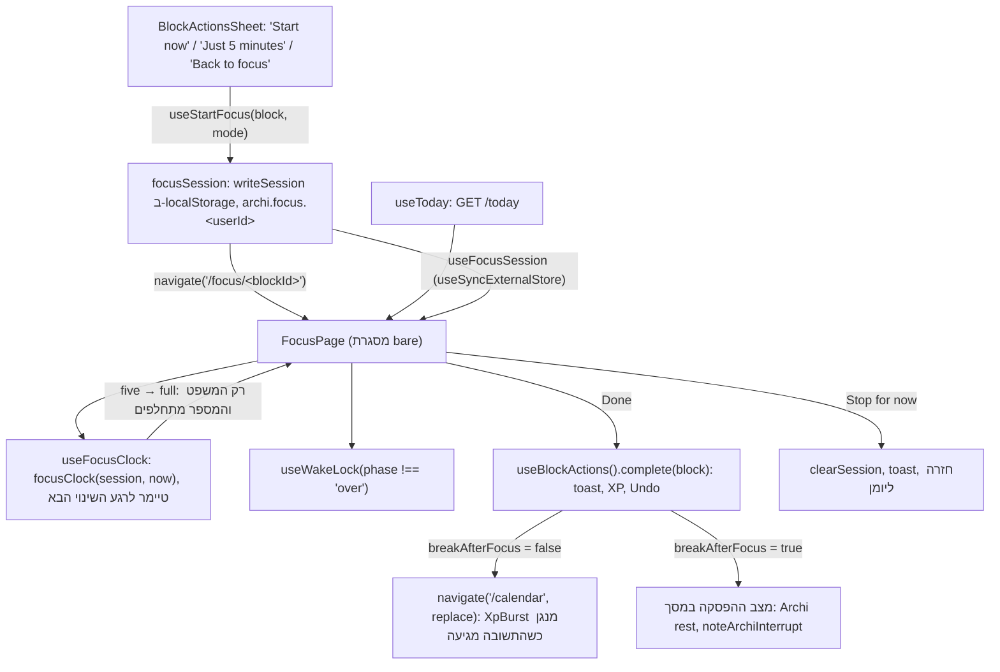

# S42 — Focus Mode ו-"Just 5 minutes": תוכנית עבודה

> **For agentic workers:** REQUIRED SUB-SKILL: Use superpowers:subagent-driven-development to implement this plan task-by-task. Steps use checkbox (`- [ ]`) syntax for tracking. המנהל (השיחה הראשית) מריץ מפתח אחד לכל Task, לפי הסדר, ואחריו סוקר. git רץ רק בשיחה הראשית.

**מטרה:** לחיצה על "Start now" בגיליון הפעולות של בלוק פותחת מסך מיקוד נקי: טיימר עדין, שם המשימה, ו-Archi שלומד לצד הסטודנט עד סוף הבלוק. בסוף: Done עם רגע ה-XP הקיים, או טקס ההפסקה כשחל כלל 90 הדקות. "Just 5 minutes" פותח את אותו מסך עם משימה זעירה של חמש דקות, ובסופן הטיימר ממשיך לשאר הבלוק בלי לעצור, בלי שאלה ובלי לחיצה.

**השער במפת הדרכים:** "'Start now' פותח מסך מיקוד שנגמר בסימון הבלוק, ו-'Just 5 minutes' ממשיך לבלוק המלא בלי הפסקה בזרימה". אחרי המיזוג של התוכנית הזו השורה של S42 עוברת ל"הושלם".

**גישה:** בלי שינוי ב-`api/` ובלי מיגרציה. "מפגש מיקוד" הוא מצב של המכשיר: מתי התחיל, מתי ייגמר, והאם התחיל בחמש דקות. הוא נשמר ב-`localStorage` לכל משתמש, והטיימר מחושב משעון הקיר, ולכן הוא שורד רענון, נעילת טלפון ולשונית ברקע. הסימון בסוף הוא ה-`complete` הקיים של `useBlockActions` (אופטימי, עם ה-toast, ה-XP וה-Undo). המסך הוא נתיב חדש `/focus/:blockId` בתוך השלד, שמבקש מהשלד מסגרת "חשופה" (בלי סרגל עליון ובלי ניווט תחתון).

**כלים:** ‏React 19, ‏TypeScript strict, ‏React Router 7, ‏TanStack Query 5, ‏Tailwind 4, ‏React Aria Components, ‏Vitest. בלי תלויות חדשות.

**מקורות, לפי סדר הכוח:** ‏`CLAUDE.md`; מסמך הביקורת `docs/design/2026-11-21-archi-ux-audit.md` (הנחיות 12 ו-17; גם 3, 5, 6, 8, 10 וצ׳ק-ליסט הנכסים); ‏`docs/design/archi-voice.md`; מסמך התכנון הראשי, 7.7 (בלוקים, ‏`complete`, ‏XP) ו-7.9; ‏`docs/design/design-language.md` סעיפים 6, 6א, 7, 8, 9; ההדמיה `docs/design/prototype/all-screens.html`; התוכנית של S32 (`docs/archive/plans/2026-11-18-s32-calendar.md`, "גיליון הפעולות הוא המקום הטבעי לכפתור Start now").

## איך החלקים מתחברים



- **למה המצב במכשיר ולא בשרת:** השער לא מבקש לזכור כמה דקות למדו בפועל. ה-XP נגזר מהדקות המתוכננות של הבלוק (7.7: ‏`round(focus × דקות / 6)`), ו-`complete` מקבל בלוק `planned` בכל מצב שעון. לכן אין מה לכתוב בשרת, ומפגש שמתחיל בטלפון לא צריך להופיע במחשב.
- **למה `localStorage` ולא `sessionStorage`:** בטלפון מערכת ההפעלה הורגת לשונית ברקע, ואפליקציה מותקנת נפתחת מחדש בלשונית חדשה. `sessionStorage` היה מאבד את המפגש בדיוק ברגע שהסטודנט חוזר מהספר.
- **למה נתיב ולא דיאלוג מעל היומן:** נתיב שורד רענון בלי קוד נוסף, נותן `h1` ופוקוס דרך `useRouteFocus`, וכפתור "אחורה" של הדפדפן עושה את הדבר הצפוי. דיאלוג מלא-מסך מעל היומן היה משאיר את הניווט ואת היומן בעץ ובסדר ה-Tab.
- **למה הטיימר משעון הקיר:** בטלפון נעול JavaScript לא רץ, ו-`setInterval` נעצר. הטיימר לא סופר: כל ציור מחשב `endsAt - Date.now()`, וחזרה ללשונית (`visibilitychange`) מציירת מיד.

## מה מצאתי בקוד (25.11.2026)

1. **בהדמיה אין מסך מיקוד.** חיפוש של `focus`, ‏`timer`, ‏`session`, ‏`Start now`, ‏`5 min` ב-`all-screens.html` מחזיר רק את "Start now" של גיליון הזמן הפנוי ואת "Focus 7/10" של מסך המבחן. המודל הוויזואלי הקרוב הוא "The day is complete" (סעיף s7): Archi גדול ממורכז שעומד על קצה המשטח, כותרת, שורת משנה, וכפתור ראשי אחד ברוחב מלא. מצב ההפסקה הוא "A break" של אותו סעיף. ראו החלטה 6.
2. **השם "focus" כבר תפוס פעמיים.** ‏`board/focus.ts` הוא פוקוס של מקלדת אחרי פעולה (`useFocusRequest`), ו-"Focus 7/10" הוא ציון הריכוז של משימה (`en.exams…focus`). לכן הקוד החדש יושב בתיקייה `web/src/session/`, הקבצים נקראים `focusSession.ts` ו-`FocusPage.tsx`, והטקסטים ב-`en.focus` עם המילה "Focus" רק בכותרת הנסתרת ובטקסט של כפתור החזרה.
3. **במילון הקול "session" אסור** (בלוק הוא Block, לא slot / session). ה-`Start Session` של הנחיה 17 נכתב בממשק `Start now` (המילה של הנחיה 12). בקוד "session" מותר.
4. **"Start now" של `FreeTimeSheet` הוא דבר אחר:** הוא מקדים בלוקים ל"עכשיו" (`POST /plan/free-time`) ולא פותח מסך. הוא לא משתנה כאן. ראו "החלטות לבעל המוצר" 2.
5. **`BlockActionsSheet` מקבל היום רק `block` ו-`tz`.** כדי להחליט אם אפשר להתחיל צריך גם `today` ו-`now`. ‏`CalendarSheets` כבר מחזיק את שניהם, ומעביר אותם הלאה.
6. **`actionsFor` מחזיר `complete` גם לבלוק `upcoming`,** ו-7.7 מתיר `complete` לבלוק `planned` בכל זמן. לכן Done של בלוק שהתחיל מוקדם (מפגש של 10:00 לבלוק של 14:00) עובד בלי שינוי בשרת.
7. **ה-`state` של בלוק הוא מהרענון האחרון,** ו-`plannedState` ב-`board/actions.ts` לא מיוצא. כל החלטה לפי שעון בתוכנית הזו נעשית מ-`starts_at`, ‏`ends_at` ו-`now`, לא מ-`state`.
8. **`breakRun` (calendar/archi.ts) קורא את הזמנים המתוכננים של הבלוקים,** ודורש שהרצף נגמר ב-30 הדקות האחרונות (`since >= 0`). בלוק שהתחיל מוקדם וסומן Done לפני הזמן המתוכנן שלו לא ייתן הפסקה ב-`BreakNotice`. לכן המסך מחשב את ההפסקה בעצמו, עם הזמנים האמיתיים של המפגש. ראו החלטה 9.
9. **`XpBurst` מעופף רק כשהתיבה `[data-check="<id>"]` והטבעת `[data-part="level"]` נראות.** במסך המיקוד אין אף אחת מהן. הוא מותקן ב-`CalendarPage`, ולכן Done שחוזר ליומן מיד (הסימון אופטימי, והתשובה מגיעה אחרי הניווט) מנגן אותו שם. ראו החלטה 8.
10. **השלד (`AppShell`) מכיר שתי בקשות מסגרת:** `fullBleed` ו-`ownPhoneHeader` (`app/shellFrame.ts`). אין דרך לבקש מסך בלי סרגל ובלי ניווט. נוספת בקשה שלישית, `bare`.
11. **`enCalendar.test.ts` קובע שיש בדיוק שישה קובצי `enCalendar*.ts`.** הטקסטים של S42 בקובץ חדש `i18n/enFocus.ts`, ש-`en.ts` מייבא כ-`en.focus`, כמו `enExams`.
12. **אין שימוש ב-Wake Lock בקוד.** ‏`navigator.wakeLock` קיים בכרום ובאנדרואיד, ובספארי מ-16.4 (ובאפליקציה מותקנת ב-iOS מ-18.4). jsdom לא מכיר אותו, והבדיקות מזייפות אותו.

## ההחלטות שלי

1. **מי יכול להתחיל (`canFocus`):** בלוק `status === 'planned'` של יום הלימוד של היום (`study_date === today`) ש-`Date.parse(ends_at) > now`. כלומר, לפי השעון: עוד לא התחיל, או רץ עכשיו. *למה:* בלוק שנגמר שייך לסקירת הבוקר ול-Done; בלוק של יום אחר הוא "זמן פנוי", שכבר יש לו גיליון שמזיז את התוכנית, ופתיחה שלו כאן הייתה מבלבלת את הרצף ואת סיכום היום.
2. **כמה זמן המפגש (`newSession`):**
   - בלוק שרץ (`starts_at <= now`): מעכשיו עד `ends_at` של הבלוק. *למה:* "עד סוף הבלוק" (הנחיה 12), והיומן נשאר נכון: הבלוק הבא לא נדרס.
   - בלוק שעוד לא התחיל: מעכשיו, באורך הבלוק (`blockMinutes(block)`). הבלוק לא זז ביומן. *למה:* הזזה הייתה כתיבה בשרת שעלולה להיכשל או לדחוק בלוקים אחרים, והסטודנט ביקש ללמוד, לא לשנות את התוכנית; אחרי Done הבלוק מסומן בכל מקרה.
3. **"Just 5 minutes" (`mode: 'five'`):** אותו מפגש בדיוק (אותו `endsAt`), ועוד `fiveEndsAt = startedAt + 5 דקות`. בחמש הדקות הראשונות המספר הגדול סופר את החמש, ו-Archi אומר משימה זעירה לפי סוג המשימה. ב-`fiveEndsAt` מתחלפים רק המשפט, המספר והתווית שמתחתיו; הטבעת לא קופצת (היא תמיד מראה את כל המפגש), אין צליל, אין דיאלוג ואין כפתור. הכפתור מוצג רק כש-`endsAt - now > 5 דקות`. *למה:* "בלי לקטוע את הזרימה" (הנחיה 17) פירושו שאין שום דבר שהסטודנט צריך לענות עליו; וחמש דקות לבלוק שנשארו בו שלוש הן כפתור שמבטיח משהו שלא יקרה.
4. **הטיימר עדין:** דקות בלבד, מעוגלות למעלה (`24 min`), בלי שניות. הטבעת (`ui/ProgressRing`, ‏`size={208}`) מתמלאת לפי `elapsed / total` של כל המפגש. הציור הבא מתוזמן בדיוק לרגע שבו המספר או השלב מתחלפים (`nextChangeAt`), ולא כל שנייה. *למה:* שניות רצות יוצרות לחץ, וזה ההפך ממסך שקט; וטיימר לרגע השינוי מדויק ולא מעיר את המעבד בלי סיבה.
5. **המצב נשמר ב-`localStorage`, במפתח `archi.focus.<userId>`, מפגש אחד לכל היותר:** `{ v: 1, blockId, startedAt, endsAt, fiveEndsAt }` (מספרים במילישניות). מפגש שנגמר לפני יותר מ-12 שעות נמחק כשקוראים אותו. התחלה של בלוק אחר מחליפה את המפגש. אחסון שזורק (מצב פרטי, חסום): המסך עובד מהזיכרון, ורענון מתחיל מפגש חדש. *למה:* ראו "איך החלקים מתחברים"; ו-12 שעות מנקות מפגש ישן בלי למחוק את זה של אתמול בלילה לפני שהסטודנט ראה את הסוף שלו.
6. **המסך:** נתיב `/focus/:blockId` בתוך `OnboardingGate`, עם `useShellFrame({ bare: true })`. מלמעלה, בעמודה אחת ממורכזת (`max-w-md`, גובה `min-h-dvh`, ‏`px-page`): כפתור חזרה (`IconButton` עם `ChevronLeft`) בקצה ההתחלה; Archi בגודל `scene` (רוחב `w-[220px]`, ובמחשב `lg:w-[260px]`) עומד על קו `border-b border-line`; המשפט שלו ממורכז מתחת; הטבעת עם המספר; שם המשימה כ-`h1`; שורת המבחן והסוג; והכפתורים בתחתית. *למה:* המודל של "The day is complete" (Archi מוביל, משטח אחד, כפתור אחד), והנחיה 3: Archi על המשטח, בלי רקע ובלי מסגרת.
7. **Archi במסך:** המצב `wisdom` כל עוד המפגש רץ (קו הדיו בקצה המכחול הוא הכי קרוב ל"כתיבה מרוכזת"), ‏`joy` כשהזמן נגמר ועוד לא סומן, ‏`rest` בהפסקה, ‏`flow` כשהבלוק כבר לא ביומן. הקבוע `FOCUS_MOOD` ב-`session/FocusPage.tsx`, עם הערה. *למה:* כמו `wisdom` במקום `archi-thinking` ב-S44: כשיגיע `archi-writing` (צ׳ק-ליסט הנכסים) מחליפים שורה אחת.
8. **הסוף:** הזמן נגמר → המסך לא מסמן לבד; Archi אומר שזה הבלוק, והכפתור הראשי הוא Done. ‏Done זמין גם קודם (כפתור משני, "סיימתי מוקדם"). אחרי Done: `actions.complete(block)`, ‏`clearSession`, ואז אחד משניים: אם `breakAfterFocus` → מצב ההפסקה במסך; אחרת `navigate('/calendar', { replace: true })`, ושם ה-toast ("Marked as done. +20 XP", עם Undo) ומעוף ה-XP. *למה:* סימון אוטומטי היה אומר "בוצע" גם כשהסטודנט קם באמצע; ו-`replace` מונע ש"אחורה" יחזיר למסך של מפגש שנגמר.
9. **ההפסקה (`breakAfterFocus`):** ‏`breakRun` על הבלוקים של היום, כשהבלוק של המפגש מוחלף בבלוק `done` מ-`startedAt` עד `now` (הזמנים האמיתיים). אם יש רצף → מצב ההפסקה: Archi `rest`, ‏`en.calendar.archi.breakTitle` ו-`breakBody(<השעה של הבלוק הבא>)`, הבלוק הבא עם האייקון שלו (כמו `BreakNotice`), וכפתור ראשי "Back to my calendar". המסך קורא ל-`noteArchiInterrupt(now)` (חדש ב-`calendar/archi.ts`), כדי ש-`BreakNotice` ביומן לא יגיד את אותו דבר שוב בעשרים הדקות הבאות. ההפסקה הזו לא שואלת את `archiMayInterrupt`. *למה:* זה הטקס שהמפגש מוביל אליו, לא הפרעה; והזמנים המתוכננים לא יודעים שהסטודנט התחיל מוקדם (ממצא 8).
10. **עזיבה וחזרה:** כפתור החזרה ו"אחורה" של הדפדפן עוזבים את המסך, והמפגש ממשיך לרוץ (השעון לא עוצר). בגיליון הפעולות של אותו בלוק, כל עוד המפגש לא נגמר, "Start now" ו-"Just 5 minutes" מתחלפים בכפתור אחד "Back to focus", שחוזר לאותו מפגש. ‏"Stop for now" (כפתור שקט במסך) מוחק את המפגש, חוזר ליומן בלי סימון, ו-toast מידע. *למה:* יציאה לרגע (לבדוק משהו ביומן) לא צריכה לאפס את הלמידה, ועצירה מכוונת צריכה להיות מילה ברורה ולא תוצאה של "אחורה".
11. **פתיחה של `/focus/<id>` בלי מפגש שמור לבלוק הזה** (קישור ישיר, אחסון חסום): אם `canFocus` → מפגש חדש `full` נכתב בטעינה; אם הבלוק `planned` ונגמר → מצב "הבלוק נגמר" עם Done ו-Back; אם הבלוק `done` → "כבר מסומן" עם Back; אם הבלוק לא ב-`GET /today` או שאינו `planned` / `done` → "כבר לא ביומן" עם Back. בשלושת האחרונים המפגש נמחק. *למה:* כל כתובת מגיעה למצב שיש בו פעולה הגיונית אחת, ובלוק שנדחה או דולג בלשונית אחרת לא משאיר טיימר יתום.
12. **Done שלנו גובר על "כבר מסומן":** ה-`complete` האופטימי הופך את הבלוק ל-`done` ב-cache מיד. המסך מחזיק `finished` מקומי מרגע הלחיצה, וכל עוד הוא דולק הוא מציג את ההפסקה (או שכבר ניווט), ולא את "כבר מסומן". Undo מה-toast מחזיר את הבלוק ל-`planned` ולא מחזיר מפגש. *למה:* אחרת הלחיצה של הסטודנט הייתה נראית כמו שינוי ממקום אחר.
13. **Wake Lock:** ‏`useWakeLock(active)`, ‏`active = phase !== 'over' && !finished`. בקשה ל-`navigator.wakeLock.request('screen')` כשהדף גלוי, בקשה מחדש ב-`visibilitychange` לגלוי (הדפדפן משחרר לבד כשהדף מוסתר), שחרור כשלא פעיל או ביציאה. בלי תמיכה או בסירוב: כלום, בלי הודעה. *למה:* מסך שנכבה באמצע קריאה מוציא מהריכוז, אבל זו תוספת, לא תנאי.
14. **קורא מסך:** ה-`h1` הוא שם המשימה (`UserText`), אותו אלמנט בכל המצבים (בזמן טעינה הטקסט שלו הוא `en.focus.title`), כך ש-`useRouteFocus` נוחת עליו. הטבעת היא `meter` עם `aria-label={en.focus.timerLabel}` ו-`aria-valuetext` במילים. המשפט של Archi ב-`<p role="status">`: הוא נאמר רק כשהוא מתחלף (מעבר מחמש הדקות, סוף הזמן, הפסקה), ולא כל דקה. *למה:* טיימר שמכריז כל דקה מפריע בדיוק כמו טיימר שמצפצף.
15. **reduced motion:** אין שום `animate` או מעבר חדש במסך. הטבעת כבר `motion-reduce:transition-none`, ו-Archi עוצר את השכבה שלו לבד. *למה:* 8 בשפה העיצובית; המסך שקט גם בלי ההגדרה.
16. **בלי התראות, בלי צליל, בלי סטטיסטיקה.** כשהזמן נגמר והטלפון נעול, לא קורה כלום עד שהסטודנט חוזר. *למה:* מחוץ לשער, והתראה בסוף בלוק היא scope משלו (רשום למטה).
17. **רק tokens:** המסך משתמש רק ב-`bg-canvas`, ‏`bg-surface`, ‏`text-ink`, ‏`text-ink-muted`, ‏`border-line`, ‏`examColor()` ו-`ProgressRing` (שכבר על tokens). בלי זוג טקסט חדש, ולכן בלי שינוי ב-`theme.test.ts`. *למה:* S43 מחליף את ערכי ה-tokens למצב ערב; מסך שנשען רק עליהם עובד בשני המצבים בלי לגעת בו.

## Global Constraints

- **לא נוגעים ב-`api/`.** אם מפתח מגלה שהשער לא מתקיים בלי שרת, הוא עוצר ומדווח למנהל מה חסר.
- **לא נוגעים ב-`web/src/index.css`, ב-`web/src/theme.test.ts` ובמסך ההגדרות (`web/src/settings/`, ‏`i18n/enSettingsScreen.ts`).** S43 בונה אותם במקביל. צבע רק דרך tokens קיימים ו-`examColor()`; אין `#`, ‏`rgb(`, ‏`bg-white`, ‏`text-slate-*` ואין שקיפות על טקסט.
- **הקבועים, מילה במילה:**
  - הנתיב: `FOCUS_PATH = '/focus'`, והכתובת `/focus/<blockId>` (`focusPath(blockId)`).
  - מפתח האחסון: `` `archi.focus.${userId}` ``; הערך `{ v: 1, blockId: string, startedAt: number, endsAt: number, fiveEndsAt: number | null }`.
  - `FIVE_MINUTES_MS = 300_000`; ‏`SESSION_MAX_AGE_MS = 43_200_000` (12 שעות אחרי `endsAt`).
  - `ProgressRing size={208}`.
  - `FOCUS_MOOD = { running: 'wisdom', over: 'joy', rest: 'rest', gone: 'flow' }`.
- **אין שינוי בהתנהגות של `useBlockActions`, ‏`XpBurst`, ‏`BreakNotice`, ‏`FreeTimeSheet`, ‏`NextCard`.** ‏`calendar/archi.ts` רק מקבל פונקציה חדשה (`noteArchiInterrupt`) ושום דבר קיים בו לא משתנה.
- **אנגלית בלבד ב-`web/src`,** בקול של Archi בגוף ראשון (`archi-voice.md`): משפט של Archi נגמר בנקודה, כפתור וכותרת לא; בלי סימן קריאה; שעון 24 שעות; `45 min`; יחיד ורבים נכונים; המילה "session" לא מופיעה בטקסט. כל טקסט דרך `en` (קובץ חדש `i18n/enFocus.ts`, ‏`en.focus`); אין טקסט ישיר ב-JSX (lint). אות עברית רק בבדיקות.
- **תוכן משתמש** (שם המשימה, שם המבחן): ב-JSX דרך `ui/UserText`, בתוך מחרוזת דרך `isolate()`.
- **אפס אימוג׳י.** אייקונים רק מ-`web/src/ui/icons/`. הדמות רק דרך `Archie`.
- **רכיבים רק מ-`web/src/ui/`,** ולא משנים רכיב קיים שם. כפתור ראשי אחד בכל מצב של המסך ובגיליון.
- **נגישות:** כל פקד 44px; `h1` אחד; ‏`meter` לטיימר; live region אחד (`role="status"`) שמשתנה רק במעבר שלב; לכל מצב יש כפתור גלוי שמוציא ממנו.
- **reduced motion:** אין `animate`, ‏`transition` או `animation` חדשים במסך המיקוד.
- **פקודות**, מתוך `web/`: ‏`npm test -- <pattern>`, ‏`npm run typecheck`, ‏`npm run lint`. לא מריצים `npm run dev`.
- מסמכים ו-commits בעברית, מונחים טכניים באנגלית.

## Review Focus

1. **רענון באמצע:** מפגש של חמש דקות, רענון בדקה 3 → אותו שלב, אותו מספר (2 דקות), ואותו `endsAt`. רענון אחרי הסוף → מצב הסוף עם Done, לא מפגש חדש. → Tasks 2, 4.
2. **חמש הדקות נגמרות כשהמסך פתוח:** בלי דיאלוג, בלי כפתור חדש, בלי שינוי ב-`endsAt`; המשפט מתחלף פעם אחת, ה-live region אומר אותו פעם אחת, והטבעת לא קופצת אחורה. → Tasks 2, 4.
3. **טלפון נעול או לשונית ברקע:** שלושים דקות בלי טיימר שרץ, ואז `visibilitychange` → המספר הנכון מיד, ואם הזמן נגמר, מצב הסוף. → Task 3.
4. **בלוק שרץ מול בלוק שעוד לא התחיל:** רץ 14:00–15:30 ונלחץ ב-14:20 → מסתיים ב-15:30 (70 דקות). מתחיל ב-16:00 ונלחץ ב-11:25 → 11:25–12:25 לבלוק של שעה, והבלוק לא זז ביומן. → Task 2.
5. **Done:** ‏`POST /blocks/<id>/complete` אחד גם בשתי לחיצות; ה-toast עם ה-XP וה-Undo; בלי הפסקה → היומן, ומעוף ה-XP כשהתשובה מגיעה; עם הפסקה → מצב ההפסקה, ו-`BreakNotice` לא מופיע ביומן אחריו. → Tasks 4, 5.
6. **הבלוק השתנה ממקום אחר:** סומן, נדחה או דולג בלשונית אחרת בזמן שהמסך פתוח → אחרי הרענון מצב "כבר מסומן" / "כבר לא ביומן", והמפגש נמחק. ה-Done של המסך עצמו לא מציג "כבר מסומן" (החלטה 12). → Task 4.
7. **שתי לשוניות:** מפגש שהתחיל בלשונית אחת מופיע כ-"Back to focus" בגיליון של השנייה (`storage` event). → Task 2.
8. **בשני הנושאים (S43):** אין צבע גולמי בקבצים החדשים, ואין זוג טקסט חדש. → כל המשימות; המנהל בודק בצילומים של Task 6 גם במצב ערב אם S43 כבר מוזג.

## סדר ותלויות

המשימות רצות אחת אחרי השנייה, לפי המספר.

| Task | נשען על | מודל |
| --- | --- | --- |
| 1 הטקסטים (`en.focus`) | — | opus (fable when available) |
| 2 המפגש: חישוב ואחסון (קוד טהור ו-store) | 1 | sonnet |
| 3 המסגרת `bare`, השעון וה-Wake Lock | 2 | opus |
| 4 מסך המיקוד והנתיב | 1, 2, 3 | opus (fable when available) |
| 5 הכניסה מהיומן: "Start now", ‏"Just 5 minutes", ‏"Back to focus" | 1, 2, 4 | sonnet |
| 6–9 | 5 | המנהל |

**קבצים משותפים בתוך ה-scope:** `web/src/i18n/enFocus.ts` (רק Task 1 כותב; משימה מאוחרת שחסר לה מפתח מוסיפה אותו באותו קול ומדווחת). `web/src/session/focusSession.ts` (Task 2 יוצר; Task 5 רק מייבא). `web/src/app/routes.tsx` (רק Task 4). `web/src/calendar/CalendarSheets.tsx`, ‏`BlockActionsSheet.tsx` (רק Task 5).

**קבצים ש-S42 ו-S43 (מצב ערב) עשויים לגעת בשניהם**, ומי שממוזג שני עושה rebase ובודק:
- `web/src/i18n/en.ts`: S42 מוסיף שורת import ומפתח `focus`; S43 כנראה מוסיף טקסטים של המתג.
- `web/src/app/AppShell.tsx` ו-`web/src/app/AppShell.test.tsx`: S42 מוסיף את `bare`; S43 עשוי להוסיף שם את החלת הנושא או את המתג (בתפריט הפרופיל או בסרגל).
- `web/src/app/shellFrame.ts`: רק S42, אלא אם S43 מוסיף שם משהו.
- `docs/design/design-language.md` (S42: סעיף 6ב חדש ושורה ב-6; S43: סעיף 2), מסמך התכנון הראשי (7.9), ומפת הדרכים: שני המנהלים מעדכנים, בסעיפים שונים.
- **לא משותפים:** `web/src/index.css`, ‏`theme.test.ts`, ‏`web/src/settings/` (S42 לא נוגע בהם).
- אם S45 (סגירת מבחן, חלק הממשק) רץ באותו זמן: הוא מוסיף ענף ל-`calendar/CalendarSheets.tsx`, ו-Task 5 משנה שם את ה-props של `BlockActionsSheet`. שינויים קטנים בשורות שונות.

---

### Task 1: הטקסטים של מסך המיקוד (`opus`, fable when available: ניסוחים בקול של Archi)

**Files:**
- Create: `web/src/i18n/enFocus.ts`, `web/src/i18n/enFocus.test.ts`
- Modify: `web/src/i18n/en.ts` (שורת import ו-`focus: enFocus`, ליד `exams: enExams`)

**מה נבנה.** כל מה שהמסך והגיליון אומרים, באובייקט `enFocus` אחד. פונקציות מקבלות מספרים ושעות מוכנים; אין בהן חישוב זמן.

| מפתח | חתימה | הפלט (מחייב במשמעות; הניסוח המדויק מותר לשיפור בתוך `archi-voice.md`, עם דיווח) |
| --- | --- | --- |
| `title` | `string` | `Focus` (הכותרת בזמן טעינה, ושם הלשונית אם יידרש) |
| `start` | `string` | `Start now` |
| `startLabel` | `(title: string) => string` | `Start now: <title>` (עם `isolate`) |
| `five` | `string` | `Just 5 minutes` |
| `fiveLabel` | `(title: string) => string` | `Just 5 minutes: <title>` |
| `resume` | `string` | `Back to focus` |
| `back` | `string` | `Back to my calendar` (גם ה-`aria-label` של כפתור החץ) |
| `stop` | `string` | `Stop for now` |
| `stopped` | `string` | toast: `I stopped the timer. The block is still on your calendar.` |
| `timerLabel` | `string` | `Time left` |
| `minutesLeft` | `(n: number) => string` | המספר הגדול: `24` (רק הספרות; ראו `unit`) |
| `unit` | `(n: number) => string` | מתחת למספר: `min left` (ב-1: `min left` גם כן; אין `mins`) |
| `ofFive` | `string` | מתחת למספר בחמש הדקות: `of your 5 minutes` |
| `until` | `(time: string) => string` | `Until 15:00` |
| `valueText` | `(n: number, until: string) => string` | `24 minutes left, until 15:00` (ב-1: `1 minute left, until 15:00`) |
| `running` | `readonly [string, string, string]` | שלושה משפטים שקטים בזמן שהמפגש רץ, לבחירה לפי היום בשנה (כמו `archiLine`). למשל `I’m right here, studying with you.` |
| `fiveTask` | `Record<TaskKind, string>` | המשימה הזעירה, לפי סוג: `learn`, ‏`review`: `Just open the file and read page 1 with me.` (מסמך הביקורת, 17); ‏`practice`: `Just open the first question and read it with me.`; ‏`simulation`: `Just open the exam and read the first question with me.`; ‏`simulation_review`: `Just open your answers and look at the first one with me.`; ‏`custom`: `Just take the first small step with me.` |
| `fiveDone` | `(until: string) => string` | `That’s five minutes. I’ll keep going with you until 15:00.` (לא שאלה, ובלי פועל שמבקש תשובה) |
| `over` | `string` | `That’s the block. You stayed with it.` |
| `ended` | `string` | `This block has already ended. You can still mark it done.` |
| `alreadyDone` | `string` | `This block is already marked done.` |
| `gone` | `string` | `This block isn’t on your calendar anymore.` |
| `notToday` | `string` | `I can only start a block of today that hasn’t ended yet.` |
| `meta` | `(exam: string, kind: string) => string` | `<exam>, Learning` (עם `isolate` לשם המבחן; ‏`kind` מ-`en.board.kinds`) |

- `enFocus.ts` לא מייבא מ-`en.ts` (מעגל): `isolate` מ-`./bidi`, ו-`TaskKind` כ-`import type` מ-`../board/types`.
- הערת כותרת לקובץ: הטקסטים של מסך המיקוד ושל הכניסה אליו (S42), חלק מ-`en` כ-`en.focus`.

**בדיקות (נכתבות קודם, נכשלות), ב-`enFocus.test.ts`:**
- [ ] `valueText(1, '15:00')` = `1 minute left, until 15:00`; ‏`valueText(24, '15:00')` = `24 minutes left, until 15:00`.
- [ ] `startLabel('פרק 3: גרפים')` ו-`fiveLabel(...)` ו-`meta('אלגוריתמים', 'Learning')`: השם עטוף בתווי הבידוד של `isolate`.
- [ ] ל-`fiveTask` יש מפתח לכל אחד מששת ה-`TaskKind` (רשימה מפורשת בבדיקה), וכל ערך מסתיים בנקודה.
- [ ] `running` באורך 3; כל משפט של Archi (`running`, ‏`fiveTask`, ‏`fiveDone`, ‏`over`, ‏`ended`, ‏`alreadyDone`, ‏`gone`, ‏`notToday`, ‏`stopped`) מסתיים בנקודה; הכפתורים (`start`, ‏`five`, ‏`resume`, ‏`back`, ‏`stop`) לא.
- [ ] אף ערך לא מכיל `!`, ‏`session`, ‏`Session` או `·`.
- [ ] `en.focus.start` הוא `Start now` (החיבור ב-`en.ts`).

**צעדים:**
- [ ] בדיקות נכשלות: `npm test -- enFocus`.
- [ ] מימוש; `npm test -- enFocus en.test enCalendar sourceGuards`, ‏`npm run typecheck`, ‏`npm run lint`.
- [ ] commit: `feat(web): S42 הטקסטים של מסך המיקוד`.

**קריטריוני קבלה:** הכול בגוף ראשון, בלי "Archi" כנושא; בלי אימוג׳י, בלי סימן קריאה, בלי "session"; ‏`enCalendar.test.ts` ("are exactly the six") ירוק בלי שינוי.

### Task 2: המפגש: חישוב, אחסון ו-store (`sonnet`: קוד טהור עם ערכים מדויקים, ו-store קטן)

**Files:**
- Create: `web/src/session/focusSession.ts`, `web/src/session/focusSession.test.ts`
- Modify: `web/src/calendar/archi.ts` (רק `noteArchiInterrupt`), `web/src/calendar/archi.test.ts` (מקרה אחד)

**מה נבנה.** כל החוקים של המפגש כפונקציות טהורות, ועוד store מעל `localStorage` ששני המסכים (הגיליון והמסך) קוראים. אין כאן רכיב.

**Interfaces — Produces** (ב-`focusSession.ts`):

```ts
export const FOCUS_PATH = '/focus'
export const FIVE_MINUTES_MS = 300_000
export const SESSION_MAX_AGE_MS = 43_200_000
export type FocusMode = 'full' | 'five'
export interface FocusSession { v: 1; blockId: string; startedAt: number; endsAt: number; fiveEndsAt: number | null }
export type FocusPhase = 'five' | 'full' | 'over'
export interface FocusClock {
  phase: FocusPhase
  // To the end of the phase: fiveEndsAt in 'five', endsAt in 'full', 0 in 'over'.
  phaseLeftMs: number
  elapsedMs: number   // now - startedAt, clipped to 0..totalMs
  totalMs: number     // endsAt - startedAt
  // When the shown minute or the phase changes next; null in 'over'.
  nextChangeAt: number | null
}

export function focusPath(blockId: string): string            // `/focus/${encodeURIComponent(blockId)}`
export function canFocus(block: Block, today: string, now: number): boolean
export function canStartFive(block: Block, now: number): boolean
export function newSession(block: Block, mode: FocusMode, now: number): FocusSession
export function focusClock(session: FocusSession, now: number): FocusClock
export function minutesLeft(ms: number): number
export function isLive(session: FocusSession | null, blockId: string, now: number): boolean
export function breakAfterFocus(todayBlocks: Block[], block: Block, session: FocusSession, now: number): boolean

export function focusStorageKey(userId: string): string        // `archi.focus.${userId}`
export function readSession(userId: string, now: number, storage?: Pick<Storage, 'getItem' | 'removeItem'>): FocusSession | null
export function writeSession(userId: string, session: FocusSession, storage?: Pick<Storage, 'setItem'>): void
export function clearSession(userId: string, storage?: Pick<Storage, 'removeItem'>): void
export function useFocusSession(): FocusSession | null
export function useStartFocus(): (block: Block, mode: FocusMode) => void
```

הכללים:
- `canFocus`: ‏`block.status === 'planned' && block.study_date === today && Date.parse(block.ends_at) > now`.
- `newSession`: ‏`running = Date.parse(block.starts_at) <= now`; ‏`endsAt = running ? Date.parse(block.ends_at) : now + blockMinutes(block) * 60_000`; ‏`fiveEndsAt = mode === 'five' ? Math.min(now + FIVE_MINUTES_MS, endsAt) : null`; ‏`startedAt = now`; ‏`v: 1`.
- `canStartFive`: ה-`endsAt` ש-`newSession(block, 'five', now)` היה נותן, פחות `now`, גדול מ-`FIVE_MINUTES_MS`.
- `focusClock`: ‏`over` כש-`now >= endsAt`; ‏`five` כש-`fiveEndsAt !== null && now < fiveEndsAt`; אחרת `full`. ‏`nextChangeAt`: עם `end` = סוף השלב ו-`left = end - now`, ‏`end - (minutesLeft(left) - 1) * 60_000` (הרגע שבו המספר יורד באחד, או סוף השלב כשנשארה דקה).
- `minutesLeft`: ‏`ms <= 0` → 0; אחרת `Math.ceil(ms / 60_000)`.
- `isLive`: ‏`session !== null && session.blockId === blockId && focusClock(session, now).phase !== 'over'`.
- `breakAfterFocus`: ‏`breakRun` (מ-`calendar/archi.ts`) על `todayBlocks` שבהם הבלוק עם `block.id` מוחלף ב-`{ ...block, status: 'done', state: 'done', starts_at: iso(session.startedAt), ends_at: iso(now) }` (ואם הוא לא שם, מתווסף), עם `now`. ‏`true` כשהתוצאה אינה `null`.
- **אחסון:** ברירת המחדל של `storage` היא `window.localStorage` בתוך `try` (כמו `defaultStorage` ב-`calendar/archi.ts`); כל קריאה וכתיבה בתוך `try`, ואחסון שזורק הוא "אין מפגש" בלי שגיאה. ‏`readSession` מחזיר `null` ומוחק כש: אין ערך; ‏JSON שבור; ‏`v !== 1`; שדה חסר או מסוג אחר; או `now - endsAt > SESSION_MAX_AGE_MS`.
- **store:** ‏`useFocusSession` הוא `useSyncExternalStore` עם `subscribe` שמאזין לרשימת מאזינים של המודול (ש-`writeSession` ו-`clearSession` קוראים להם) ול-`window` ‏`storage` (לשונית אחרת, רק למפתח של המשתמש). ה-snapshot חייב להיות יציב: ממוטמן לפי המחרוזת הגולמית שבאחסון, כך שאותה מחרוזת מחזירה אותו אובייקט. המשתמש מ-`useBoardUserId()`; בלי משתמש → `null`. **כשהאחסון זורק,** ה-store מחזיק את המפגש האחרון שנכתב בזיכרון של המודול (לפי משתמש), כדי שהמסך יעבוד עד רענון (החלטה 5).
- `useStartFocus`: ‏`(block, mode)` → אם `isLive(session, block.id, now)` ו-`mode === 'full'` (כפתור "Back to focus" שולח `full`) — לא כותבים, רק מנווטים; אחרת `writeSession(userId, newSession(block, mode, Date.now()))`; ואז `navigate(focusPath(block.id))`.
- **ב-`calendar/archi.ts`:** ‏`export function noteArchiInterrupt(now: number, storage = defaultStorage()): void` שכותב את `INTERRUPT_KEY` ל-`String(now)` בתוך `try`, בלי לבדוק כלום. ‏`archiMayInterrupt` לא משתנה.

**בדיקות (נכתבות קודם, נכשלות), ב-`focusSession.test.ts`, עם `makeBlock` של `test/boardFixtures.tsx`:**
- [ ] `canFocus`: בלוק מתוכנן של היום שעוד לא התחיל → `true`; שרץ → `true`; שנגמר → `false`; ‏`done` → `false`; של מחר → `false`. ההחלטה לפי הזמנים גם כש-`state` אומר אחרת (בלוק עם `state: 'upcoming'` ש-`ends_at` שלו עבר → `false`).
- [ ] `newSession` (Review Focus 4): בלוק 12:00–13:30Z שרץ, ‏`now` ב-12:20Z → ‏`endsAt` = ‏13:30Z; בלוק 14:00–15:00Z, ‏`now` ב-09:25Z → ‏`endsAt` = ‏10:25Z; ‏`five` → `fiveEndsAt` = ‏`now + 300_000`; בלוק שרץ ונשארו בו 3 דקות, ‏`five` → `fiveEndsAt === endsAt`.
- [ ] `canStartFive`: נשארו 6 דקות → `true`; ‏5 בדיוק → `false`; ‏3 → `false`.
- [ ] `focusClock`: במפגש `five` של 60 דקות: ב-`+0` ‏`phase: 'five'`, ‏`phaseLeftMs: 300_000`, ‏`minutesLeft` 5, ‏`nextChangeAt = startedAt + 60_000`; ב-`+4:30` ‏`nextChangeAt = fiveEndsAt`; ב-`fiveEndsAt` ‏`phase: 'full'`, ‏`phaseLeftMs = 55 דקות`, ‏`elapsedMs = 300_000` (רציף, Review Focus 2); ב-`endsAt` ‏`over`, ‏`nextChangeAt: null`, ‏`elapsedMs === totalMs`.
- [ ] `minutesLeft`: ‏`0 → 0`, ‏`1 → 1`, ‏`60_000 → 1`, ‏`60_001 → 2`, ‏`-5 → 0`.
- [ ] `breakAfterFocus`: שני בלוקים `done` של 45 דקות שנגמרו לפני 5 דקות, ומפגש של 30 דקות שנגמר עכשיו → `true`; אותו מפגש בלי הבלוקים → `false`; בלוק שהתוכנן ל-14:00 אבל המפגש שלו רץ 10:00–11:30 → `true` ב-11:30 (ממצא 8).
- [ ] אחסון, עם `Storage` מזויף: כתיבה וקריאה חוזרות; ‏JSON שבור, ‏`v: 2` ומפגש שנגמר לפני 13 שעות → `null` והמפתח נמחק; ‏`getItem` שזורק → `null` בלי שגיאה; המפתח הוא `archi.focus.user-a`.
- [ ] `useFocusSession` (עם `renderHook` בתוך `renderBoard` או `QueryClientProvider` ו-`AuthProvider` כמו בבדיקות הקיימות): ‏`writeSession` מעדכן את ה-hook; שני ציורים בלי שינוי מחזירים אותו אובייקט (`toBe`); אירוע `storage` עם המפתח מעדכן; אירוע עם מפתח של משתמש אחר לא.
- [ ] `useStartFocus`: מפגש חי לאותו בלוק + `full` → לא נכתב מחדש (אותו `startedAt`) והכתובת `/focus/block-1`; בלי מפגש → נכתב; מפגש חי לבלוק אחר → מוחלף.
- [ ] ב-`archi.test.ts`: אחרי `noteArchiInterrupt(t)`, ‏`archiMayInterrupt(t + 60_000)` מחזיר `false`, ו-`archiMayInterrupt(t + 20 * 60_000)` מחזיר `true`.

**צעדים:**
- [ ] בדיקות נכשלות: `npm test -- focusSession archi.test`.
- [ ] מימוש; `npm test -- session calendar`, ‏`npm run typecheck`, ‏`npm run lint`.
- [ ] commit: `feat(web): S42 המפגש: החוקים, השעון והאחסון`.

**קריטריוני קבלה:** כל הפונקציות חוץ משני ה-hooks טהורות ומקבלות `now`; אין `Date.now()` בתוכן חוץ מ-`useStartFocus`; בדיקות היומן הקיימות ירוקות בלי שינוי.

### Task 3: המסגרת `bare`, השעון וה-Wake Lock (`opus`: טיימרים, נראות הדף ומצבי דפדפן)

**Files:**
- Modify: `web/src/app/shellFrame.ts`, `web/src/app/AppShell.tsx`, `web/src/app/shellFrame.test.tsx` או `web/src/app/AppShell.test.tsx` (איפה שהבדיקות של `fullBleed` יושבות)
- Create: `web/src/session/useFocusClock.ts`, `web/src/session/useWakeLock.ts`, `web/src/session/hooks.test.tsx`

**תלוי ב:** Task 2 (`focusClock`, ‏`FocusSession`).

**מה נבנה.**

1. **`bare` ב-`ShellFrame`:** שדה שלישי `bare: boolean` (ברירת מחדל `false` ב-`PLAIN_FRAME` וב-`useShellFrame`). ב-`AppShell`, כש-`frame.bare`:
   - ה-`<header>` כולו (כולל ה-`nav`) לא מצויר. קישור הדילוג נשאר.
   - `main` בלי `pb-[calc(7rem+…)]`, בלי `max-w-3xl px-page py-section`; המסך מביא את הריפוד שלו.
   - `InstallHint` לא מצויר.
   - `ToastRegion` נשאר (ה-toast של "Stop for now" ושל Done).
   - הערה ליד השדה: מסך שעומד לבד (S42, מסך המיקוד): בלי סרגל ובלי ניווט, והמסך מביא כפתור יציאה משלו.
2. **`useFocusClock(session: FocusSession | null): { now: number; clock: FocusClock | null }`:**
   - `now` ב-state; effect שמתזמן `setTimeout` ל-`clock.nextChangeAt - Date.now()` (לפחות 0, לכל היותר `2_147_483_647`), ובסופו מעדכן את `now` (וכך מתזמן את הבא). ב-`over` אין טיימר.
   - `visibilitychange` (כשהדף נעשה גלוי) ו-`pageshow` מעדכנים את `now` מיד (Review Focus 3).
   - בלי `session`: ‏`clock: null`, בלי טיימר.
3. **`useWakeLock(active: boolean): void`:**
   - אם `!('wakeLock' in navigator)` → כלום.
   - `active` ו-`document.visibilityState === 'visible'` → `navigator.wakeLock.request('screen')`; ה-sentinel נשמר ב-ref. ‏promise שנדחה → נבלע.
   - `visibilitychange` לגלוי, כש-`active` וה-sentinel שוחרר (`released`) או חסר → בקשה מחדש.
   - `active` שנהיה `false` או unmount → `sentinel.release()` (נבלע אם נכשל), ומאזין ה-`visibilitychange` מוסר.
   - בקשה שחוזרת אחרי שכבר לא פעיל → משוחררת מיד (מירוץ).

**בדיקות (נכתבות קודם, נכשלות):**
- [ ] `AppShell` עם מסך בדיקה שקורא `useShellFrame({ bare: true })`: אין `banner` ואין `navigation` בשם `en.shell.mainNav`; קישור הדילוג קיים; ‏`main` בלי `max-w-3xl`; toast שמוצג מופיע. אחרי ניווט למסך רגיל: הסרגל והניווט חוזרים.
- [ ] `useFocusClock` עם `vi.useFakeTimers()`: מפגש `five` של 60 דקות → בדיוק טיימר אחד ממתין (`vi.getTimerCount() === 1`); ‏`advanceTimersByTime(60_000)` → ‏`minutesLeft(clock.phaseLeftMs)` הוא 4; ‏`advanceTimersByTime(240_000)` → ‏`phase: 'full'`; ‏`setSystemTime(+30 דקות)` בלי לקדם טיימרים, ואז `visibilitychange` עם `visibilityState: 'visible'` → המספר הנכון מיד; ‏`over` → `getTimerCount() === 0`.
- [ ] `useWakeLock` עם `navigator.wakeLock` מזויף (`vi.stubGlobal` / `Object.defineProperty`): ‏`active` → ‏`request('screen')` פעם אחת; הסתרה וחזרה של הדף עם sentinel משוחרר → בקשה שנייה; ‏`active: false` → ‏`release` נקרא; unmount → ‏`release`; בלי `wakeLock` → לא זורק; ‏`request` שנדחה → אין שגיאה שלא נתפסה.

**צעדים:**
- [ ] בדיקות נכשלות: `npm test -- hooks AppShell shellFrame`.
- [ ] מימוש; `npm test -- app session`, ‏`npm run typecheck`, ‏`npm run lint`.
- [ ] commit: `feat(web): S42 מסגרת bare בשלד, שעון המפגש ו-Wake Lock`.

**קריטריוני קבלה:** בלי `bare` שום דבר בשלד לא משתנה (בדיקות `AppShell` הקיימות ירוקות); אין `setInterval` בקבצים החדשים; כל מאזין מוסר ב-cleanup.

### Task 4: מסך המיקוד והנתיב (`opus`, fable when available: עיצוב, Archi מוביל, מצבים ונגישות)

**Files:**
- Create: `web/src/session/FocusPage.tsx`, `web/src/session/FocusPage.test.tsx`
- Modify: `web/src/app/routes.tsx` (הנתיב `${FOCUS_PATH}/:blockId`, בתוך `OnboardingGate`, ליד `CALENDAR_PATH`), `web/src/app/routes.test.tsx` אם הוא מונה נתיבים

**תלוי ב:** Tasks 1–3.

**מה נבנה.** המסך עצמו, לפי החלטות 6–15.

1. **נתונים:** ‏`useShellFrame({ bare: true })`; ‏`blockId` מ-`useParams`; ‏`useToday()`; ‏`useFocusSession()`; ‏`useProfileTimezone()`; ‏`useBlockActions()`; ‏`useFocusClock(session לבלוק הזה או null)`; ‏`useWakeLock(...)`.
2. **המצב של המסך** (פונקציה טהורה `focusView(...)` באותו קובץ, מיוצאת לבדיקות), לפי הסדר:
   - `finished` מקומי דולק (החלטה 12) → `'break'` (רק כשהוחלט שיש הפסקה; אחרת המסך כבר ניווט).
   - `today` בטעינה → `'loading'`; בשגיאה → `'error'` (`ErrorState` עם `refetch`).
   - הבלוק לא ב-`today.blocks`, או `status` שאינו `planned` / `done` → `'gone'`.
   - `status === 'done'` → `'alreadyDone'`.
   - יש מפגש שמור לבלוק → `'five'` / `'full'` / `'over'` לפי `focusClock`.
   - אין מפגש, ו-`canFocus` → כותבים `newSession(block, 'full', Date.now())` ב-effect (פעם אחת, גם ב-StrictMode) → `'full'`.
   - אין מפגש, הבלוק `planned` ו-`ends_at` עבר → `'ended'`.
   - אחרת → `'notToday'`.
   - ב-`gone`, ‏`alreadyDone`, ‏`notToday` ו-`ended` המפגש נמחק (`clearSession`) אם הוא שייך לבלוק הזה.
3. **הפריסה** (כל המצבים): `div` ב-`min-h-dvh flex flex-col bg-canvas px-page pb-[calc(1.5rem+env(safe-area-inset-bottom))] pt-[calc(0.75rem+env(safe-area-inset-top))]`. בראש: `IconButton` עם `ChevronLeft` ו-`aria-label={en.focus.back}`, בקצה ההתחלה, שמנווט ל-`CALENDAR_PATH` עם `replace` (המפגש נשאר). מתחת, עמודה `mx-auto w-full max-w-md flex-1 flex flex-col items-center justify-center gap-5 text-center`:
   - Archi: ‏`<Archie mood={…} size="scene" decorative />` בתוך `w-[220px] lg:w-[260px]`, עומד על `border-b border-line` ברוחב העמודה (החלטה 3 של הביקורת: בלי רקע ובלי מסגרת).
   - המשפט: `<p role="status" className="text-[17px] leading-[1.3] font-semibold">`. בזמן `five`: ‏`fiveTask[block.task_kind]`. בזמן `full` אחרי חמש: ‏`fiveDone(formatTime(endsAt))`. בזמן `full` בלי חמש: ‏`running[dayOfYear % 3]` (אותו כלל בחירה של `archiLine`). ‏`over`: ‏`over`. שאר המצבים: הטקסט שלהם. הפסקה: `en.calendar.archi.breakTitle`.
   - הטיימר (רק ב-`five`, ‏`full`, ‏`over`): ‏`<ProgressRing size={208} value={elapsedMs} max={totalMs} aria-label={en.focus.timerLabel} valueText={en.focus.valueText(n, until)}>` כשבמרכז: המספר `minutesLeft(phaseLeftMs)` ב-`text-[44px] font-semibold leading-none tabular-nums`, ומתחתיו `text-small text-ink-muted` עם `ofFive` (בחמש) או `unit(n)`. מתחת לטבעת `until(formatTime(endsAt, tz))` ב-`text-small text-ink-muted tabular-nums`.
   - `h1` (`tabIndex={-1}`, אותו אלמנט בכל המצבים): ‏`<UserText>{block.task_title}</UserText>` ב-`text-[20px] font-semibold`, ובטעינה `en.focus.title`. מתחת: אייקון `KIND_ICON[task_kind]` בצבע `examColor(...).text` ו-`en.focus.meta(exam_name, en.board.kinds[task_kind])` ב-`text-small text-ink-muted`.
   - הכפתורים, `w-full flex flex-col gap-2`:
     - `five` / `full`: ‏Done `variant="secondary"` (‏`aria-label={en.board.completeLabel(name)}`, ‏`isDisabled={actions.pending(block.id)}`), ו-`variant="quiet"` ‏`en.focus.stop`.
     - `over`: ‏Done `variant="primary"`, ו-`quiet` ‏`en.focus.back` שמוחק את המפגש וחוזר ליומן.
     - `ended`: ‏Done `primary`, ‏`back` `secondary`.
     - `alreadyDone`, ‏`gone`, ‏`notToday`, ‏`break`: ‏`back` `primary`.
   - **הפסקה:** במקום הטבעת, `breakBody(<השעה של הבלוק הבא>)` ושורת הבלוק הבא (אייקון בצבע המבחן ו-`UserText truncate`), בדיוק כמו ב-`BreakNotice` (הבלוק הבא: `nextToday(todayBlocks)` אחרי הסימון).
4. **Done:** ‏`const brk = breakAfterFocus(today.blocks, block, session ?? newSession(block, 'full', now), Date.now())` לפני הקריאה (כשהבלוק עוד `planned` ב-cache); ‏`actions.complete(block)`; ‏`clearSession(userId)`; ‏`setFinished(true)`. אם `brk` → `noteArchiInterrupt(Date.now())` והמצב `break`; אחרת `navigate(CALENDAR_PATH, { replace: true })`. לחיצה שנייה לא שולחת דבר (`pending` מנטרל, ו-`finished` נבדק בראש ה-handler).
5. **Stop for now:** ‏`clearSession(userId)`, ‏`toast.show({ text: en.focus.stopped, tone: 'info' })`, ‏`navigate(CALENDAR_PATH, { replace: true })`.
6. **Wake Lock:** ‏`useWakeLock(view === 'five' || view === 'full')`.
7. **הנתיב:** ב-`routes.tsx`, ‏`{ path: `${FOCUS_PATH}/:blockId`, Component: FocusPage }` עם `FOCUS_PATH` מיובא מ-`session/focusSession.ts` (לא מ-`routes.tsx`, שמייבא את המסך). `CALENDAR_PATH` במסך: ליטרל `'/calendar'` עם הערה, כמו ב-`OnboardingGate.tsx`, כדי לא ליצור ייבוא מעגלי.

**בדיקות (נכתבות קודם, נכשלות), ב-`FocusPage.test.tsx`, דרך `renderRoute('/focus/<id>')` עם `createFakeApi` (`GET /me`, ‏`GET /today`, ‏`POST /blocks/<id>/complete`), ‏`vi.useFakeTimers({ shouldAdvanceTime: true })` ו-`setSystemTime`:**
- [ ] מפגש שמור `full` לבלוק שרץ: ה-`h1` הוא שם המשימה בתוך `data-user-text`, ויש לו הפוקוס אחרי ניווט; ‏`meter` בשם `Time left` עם `aria-valuetext` של `valueText(n, until)`; אין `banner` ואין ניווט ראשי (המסגרת `bare`).
- [ ] מפגש `five`: המשפט הוא `fiveTask[kind]`; המספר 5 ו-`ofFive`; אחרי `advanceTimersByTime(300_000)` המשפט הוא `fiveDone(until)`, אין `dialog` ואין כפתור חדש, ו-`aria-valuenow` גדל ולא ירד (Review Focus 2).
- [ ] רענון (Review Focus 1): ‏`unmount`, וציור מחדש של אותו נתיב עם אותו אחסון אחרי 3 דקות → המספר 2 באותו שלב; אחרי `endsAt` → מצב `over` עם Done ראשי.
- [ ] Done בלי הפסקה: ‏`POST /blocks/<id>/complete` אחד גם בשתי לחיצות; הכתובת `/calendar`; ה-toast של `completeText` עם `en.common.undo`; האחסון ריק.
- [ ] Done עם הפסקה (שני בלוקים `done` של 45 דקות לפניו): המסך נשאר, ‏`breakTitle` ב-`role="status"`, הבלוק הבא מוצג, ‏`Back to my calendar` ראשי; ‏`archiMayInterrupt(now)` מחזיר `false` אחרי זה. המסך לא מציג `alreadyDone` אחרי שה-cache הפך את הבלוק ל-`done` (החלטה 12).
- [ ] `GET /today` בלי הבלוק → `gone` והאחסון ריק; הבלוק `done` → `alreadyDone`; הבלוק `planned` שנגמר בלי מפגש → `ended` עם Done; בלוק של מחר בלי מפגש → `notToday`.
- [ ] בלי מפגש שמור ובלוק שאפשר להתחיל → נכתב מפגש `full` אחד (גם ב-StrictMode של `renderRoute`), עם `endsAt` לפי `newSession`.
- [ ] Stop for now → האחסון ריק, הכתובת `/calendar`, ‏toast ‏`en.focus.stopped`, ושום `POST`.
- [ ] כפתור החזרה → `/calendar`, והמפגש נשאר באחסון.
- [ ] `stubMedia({ reducedMotion: true })` ו-`Element.prototype.animate` מרוגל: לא נקרא במסך.
- [ ] `navigator.wakeLock` מזויף: ‏`request` ב-`full`, ‏`release` אחרי `over`.
- [ ] (`focusView`, טהור): הסדר של המצבים בטבלה של סעיף 2, מקרה לכל שורה.

**צעדים:**
- [ ] בדיקות נכשלות: `npm test -- FocusPage`.
- [ ] מימוש; `npm test`, ‏`npm run typecheck`, ‏`npm run lint`, ‏`npm run build`.
- [ ] commit: `feat(web): S42 מסך המיקוד: טיימר, Archi, Done והפסקה`.

**קריטריוני קבלה:** כפתור ראשי אחד לכל היותר בכל מצב; כל פקד 44px; אין טקסט ישיר ב-JSX; שם המשימה ושם המבחן דרך `UserText` / `isolate`; אין צבע גולמי; אין `animate` או `transition` חדשים; ‏`FOCUS_MOOD` הוא קבוע אחד עם הערה על `archi-writing`.

### Task 5: הכניסה מהיומן: "Start now", ‏"Just 5 minutes", ‏"Back to focus" (`sonnet`: כפתורים בגיליון קיים וזרימה מקצה לקצה)

**Files:**
- Modify: `web/src/calendar/BlockActionsSheet.tsx`, `web/src/calendar/CalendarSheets.tsx`, `web/src/calendar/sheetsBlock.test.tsx`
- Create: `web/src/session/focusFlow.test.tsx`

**תלוי ב:** Task 1 (הטקסטים), Task 2 (`canFocus`, ‏`canStartFive`, ‏`isLive`, ‏`useFocusSession`, ‏`useStartFocus`), Task 4 (הנתיב קיים).

**מה נבנה.**
1. **`BlockActionsSheet`:** ‏props חדשים `today: string` ו-`now: number`. ‏`CalendarSheets` מעביר את שלו.
2. כש-`canFocus(block, today, now)`, בראש רשימת הכפתורים ולפני Done:
   - אם `isLive(session, block.id, now)`: כפתור `primary` אחד `en.focus.resume` שקורא ל-`startFocus(block, 'full')` (שרק מנווט, Task 2).
   - אחרת: `primary` ‏`en.focus.start` (‏`aria-label={en.focus.startLabel(name)}`) → `startFocus(block, 'full')`; ומיד מתחתיו, אם `canStartFive(block, now)`: ‏`secondary` ‏`en.focus.five` (‏`aria-label={en.focus.fiveLabel(name)}`) → `startFocus(block, 'five')`.
   - Done הופך ל-`secondary` (כפתור ראשי אחד בגיליון). כשאי אפשר להתחיל, Done נשאר `primary` כמו היום.
   - כל אחד מהם סוגר את הגיליון (`then(...)`) לפני הניווט.
3. שום דבר אחר בגיליון לא משתנה (Defer, ‏Move, ‏Lock, ‏Skip, ההערה).

**בדיקות (נכתבות קודם, נכשלות):**

ב-`sheetsBlock.test.tsx` (ה-`setupActions` מקבל גם `today` ו-`now`):
- [ ] בלוק של היום שעוד לא התחיל: הכפתורים `startLabel(name)` ו-`fiveLabel(name)` קיימים, ‏Start now ראשון ברשימה, ו-Done אינו ה-`primary` (המחלקה של `BUTTON_REST.primary` רק על Start now).
- [ ] בלוק שנשארו בו 4 דקות: Start now בלי Just 5 minutes.
- [ ] בלוק שנגמר, בלוק `done` ובלוק של מחר: אין Start now, ו-Done (או Mark as not done) כמו היום. הבדיקה הקיימת "shows the five buttons of an upcoming block" ממשיכה לעבור.
- [ ] מפגש חי לבלוק באחסון: רק `resume`, בלי Start now ו-Just 5 minutes; מפגש שנגמר → Start now חוזר.
- [ ] Start now → ‏`onClose` נקרא, הכתובת `/focus/<id>`, ובאחסון מפגש `fiveEndsAt: null`; ‏Just 5 minutes → ‏`fiveEndsAt = now + 300_000`.

ב-`focusFlow.test.tsx` (דרך `openCalendar('/calendar', { blocks })` של `calendar/testFixtures.ts`, השעון של `CAL_NOW`, מחשב):
- [ ] לחיצה על בלוק של היום שרץ → גיליון → Start now → מסך המיקוד עם שם המשימה כ-`h1`, בלי הסרגל העליון.
- [ ] Done במסך → חזרה ליומן, ‏`POST /blocks/<id>/complete`, ‏toast עם ה-XP ו-Undo, והבלוק מסומן ברשת. (מעוף ה-XP עצמו לא נבדק כאן: jsdom בלי `animate`.)
- [ ] Just 5 minutes על בלוק של שעה שעוד לא התחיל → במסך `fiveTask`; ‏`advanceTimersByTime(300_000)` → ‏`fiveDone`, אותו `endsAt` באחסון, ואין `dialog` (השער).
- [ ] כפתור החזרה במסך → היומן; פתיחת אותו בלוק → `Back to focus` → אותו מפגש (אותו `startedAt`).
- [ ] Undo ב-toast אחרי Done → הבלוק חוזר ל-`planned` ברשת, ואין מפגש באחסון.
- [ ] בדיקות היומן הקיימות (`calendarFlow`, ‏`phone`, ‏`CalendarPage`, ‏`sheets*`, ‏`splitFlow`) ירוקות; אם בדיקה קיימת קבעה ש-Done הוא ה-`primary` לבלוק שאפשר להתחיל, היא מתעדכנת ומדווחת.

**צעדים:**
- [ ] בדיקות נכשלות: `npm test -- sheetsBlock focusFlow`.
- [ ] מימוש; `npm test`, ‏`npm run typecheck`, ‏`npm run lint`, ‏`npm run build`.
- [ ] commit: `feat(web): S42 Start now ו-Just 5 minutes בגיליון הפעולות של בלוק`.

**קריטריוני קבלה:** כפתור `primary` אחד בגיליון; אין שינוי ב-`board/actions.ts`, ‏`NextCard.tsx`, ‏`FreeTimeSheet.tsx`; אין טקסט ישיר ב-JSX.

---

## משימות המנהל (השיחה הראשית; לא נשלחות כמשימת מימוש)

### Task 6: צילומים מול ההדמיה — **מנהל** (subagent של `sonnet` לצילום; המנהל משווה)

- [ ] סביבת צילום ב-`~/studyflow-manager/screens/s42-shots-harness/` (העתק של `~/studyflow-manager/screens/s44-shots-harness`), בפורט **4242** לאפליקציה ו-**4342** להדמיה (לא 5173 ולא הפורטים של S43), עם `WEB_DIR` של ה-worktree הזה ו-`OUT_DIR` ‏`~/studyflow-manager/screens/s42-screens/`. נתוני הדמה של S32 (השבוע 22–28.11.2026, היום שלישי 24, ‏11:25), ומפגש שמור ב-`localStorage` לכל מצב (ה-harness כותב אותו לפני הטעינה).
- [ ] מצבים, ב-390×844 וב-1280×800: גיליון הפעולות עם Start now ו-Just 5 minutes, ועם Back to focus; המסך ב-`five` (דקה 2), ב-`full` אחרי חמש, ב-`full` רגיל, ב-`over`; ההפסקה; ‏`gone`; ‏`ended`; שם משימה ארוך בעברית; ‏reduced motion; ‏200% טקסט. אם S43 כבר מוזג: אותם מצבים גם במצב ערב.
- [ ] להשוות ל-"The day is complete" ול-"A break" בהדמיה (אין בה מסך מיקוד) ולהנחיות 12, 17, 3 ו-8. לבדוק במיוחד: Archi עומד על הקו ולא צף; המסך נכנס ב-390×844 בלי גלילה (Archi, משפט, טבעת, שם, שני כפתורים); המעבר מחמש הדקות לא נראה כמו "סוף".
- [ ] כל פער: תיקון דרך מפתח (במודל של המשימה המקורית), או רישום כסטייה מודעת ב-6ב.

### Task 7: סקירה סופית — **מנהל** (הסוקר: `opus`, fable when available)

- [ ] `superpowers:requesting-code-review` על כל הענף מול התוכנית הזו, ה-Global Constraints, ה-Review Focus, מסמך הביקורת (12, 17) ומסמך הקול. הסוקר קורא את `en.focus` כטקסט, ומחפש ב-`web/src/session/` צבע גולמי, `setInterval`, ‏`animate` ו-`Date.now()` מחוץ למקומות שהתוכנית התירה.
- [ ] תיקונים דרך מפתח, ובדיקה חוזרת של מה שתוקן.

### Task 8: מסמכים — **מנהל**

- [ ] `docs/design/design-language.md`: סעיף חדש **6ב. מסך המיקוד (S42)**: הנתיב והמסגרת `bare`, המפגש ומקומו (`localStorage`, מפתח, 12 שעות), החלטות 1–3 (מי מתחיל, כמה זמן, חמש הדקות), הפריסה, מצבי Archi (`wisdom` עד `archi-writing`), Done וההפסקה (`breakAfterFocus`, ‏`noteArchiInterrupt`), עזיבה וחזרה, Wake Lock, קורא מסך; סטיות שהתקבלו ב-Task 6. בסעיף 6 שורה על `bare` ליד `fullBleed` ו-`ownPhoneHeader`. ב-6א, ‏`BlockActionsSheet`: ‏Start now, ‏Just 5 minutes, ‏Back to focus, ו-Done משני כשאפשר להתחיל.
- [ ] מסמך התכנון הראשי, 7.9: "החלטות של מי שבונה, S42" (בלי שינוי בשרת, למה; המפגש במכשיר; ה-XP לפי הדקות המתוכננות; מה לא נבנה: התראה בסוף, דקות אמיתיות).
- [ ] מפת הדרכים (artifact, עם כלי ה-Docs): הפריטים שב"מה נרשם ל-scopes אחרים" נרשמים; כל באג שהמפתחים דיווחו עליו.

### Task 9: כל הפקודות, מיזוג ומפת הדרכים — **מנהל**

- [ ] כל הפקודות של `web/` (‏`npm test`, ‏`lint`, ‏`typecheck`, ‏`build`); ב-`api/` רק בדיקה שלא השתנה דבר (`git diff --stat origin/main -- api/` ריק). ‏gitleaks נקי.
- [ ] `git fetch`, ‏`git rebase origin/main` (אם S43 מוזג קודם: לבדוק את `en.ts`, ‏`AppShell.tsx` ו-`design-language.md`, ולהריץ שוב את בדיקות `app/` ו-`session/`), וכל הבדיקות שוב.
- [ ] `git push origin s42-focus:main` (רק fast-forward); בדיקה שה-push הצליח, ורק אחר כך מחיקת הענף. התוכנית עוברת ל-`docs/archive/plans/`.
- [ ] מפת הדרכים: S42 "הושלם", עם ה-commit של `main`. הודעה לאייל: מה נבנה, ההחלטות, מה נבדק, וההחלטות הפתוחות למטה.

## מה נרשם ל-scopes אחרים

- **נכסים (צ׳ק-ליסט הביקורת):** אנימציה `archi-writing`. כשתגיע, ‏`FOCUS_MOOD.running` מתחלף מ-`wisdom`; ‏`archi-tea` להפסקה מחליף את `rest`.
- **התראה בסוף בלוק** (Push כשהזמן נגמר והטלפון נעול): צריכה worker ותזמון בשרת, ולא נבנית כאן (החלטה 16).
- **דקות אמיתיות:** אם ירצו XP או סטטיסטיקה לפי הזמן שלמדו בפועל, צריך שדה בשרת (למשל `focused_minutes` ב-`POST /blocks/{id}/complete` ועמודה ב-`blocks` במיגרציה משלה). השער לא דורש את זה, ולכן אין כאן שינוי בשרת.
- **"Start now" בכרטיס "Up next"** ו**חיבור "Start now" של הזמן הפנוי למסך המיקוד**: ראו "החלטות לבעל המוצר".
- **מפגש שנמשך מעבר לסוף יום הלימוד** (אחרי שעת השינה הבלוק יוצא מ-`GET /today`, והמסך יציג `gone`): מקרה קצה שלא מטופל; אם יקרה, לחפש את הבלוק גם ב-cache של הלוח.

## החלטות לבעל המוצר

1. **איפה "Start now" מופיע.** התוכנית שמה אותו רק בגיליון הפעולות של בלוק (לחיצה על בלוק ברשת, בשורה של "Later today" או בגיליון המשימות בטלפון), כמו שהתוכנית של S32 הציעה.
   - **א (מה שבתוכנית):** רק בגיליון. כרטיס "Up next" נשאר Done ו-Defer.
   - **ב:** גם בכרטיס "Up next", ככפתור שלישי או במקום Defer.
   - **ההמלצה:** א, ולהחליט סופית מול הצילומים של Task 6. ב משנה את הכרטיס ש-S32 עיצב, ושלושה כפתורים ב-272px צפופים.
2. **"Start now" של "I have free time now".** היום הוא מקדים בלוקים לעכשיו ונסגר עם toast. אחרי S42 יש שני כפתורים באותו שם שעושים דברים שונים.
   - **א (מה שבתוכנית):** לא נוגעים; הבלוק שהוקדם רץ עכשיו, והסטודנט פותח אותו ו-Start now.
   - **ב:** אחרי הצלחה, המסך עובר ישר למיקוד של הבלוק הראשון שהוקדם.
   - **ההמלצה:** ב, כ-scope קטן אחרי S42: זו הכוונה של מי שלוחץ "Start now", אבל צריך למצוא את הבלוק החדש אחרי הרענון (התשובה מחזירה `placed_task_ids`, לא בלוקים), וזה מעבר לשער.
3. **סימון אוטומטי בסוף הזמן.** התוכנית לא מסמנת לבד: בסוף Archi אומר שזה הבלוק, ו-Done הוא הכפתור הראשי (החלטה 8). האפשרות האחרת: סימון אוטומטי כשהזמן נגמר והמסך פתוח. **ההמלצה:** כמו בתוכנית, כי סימון בלי הסטודנט עלול לתת XP על בלוק שלא נלמד.
