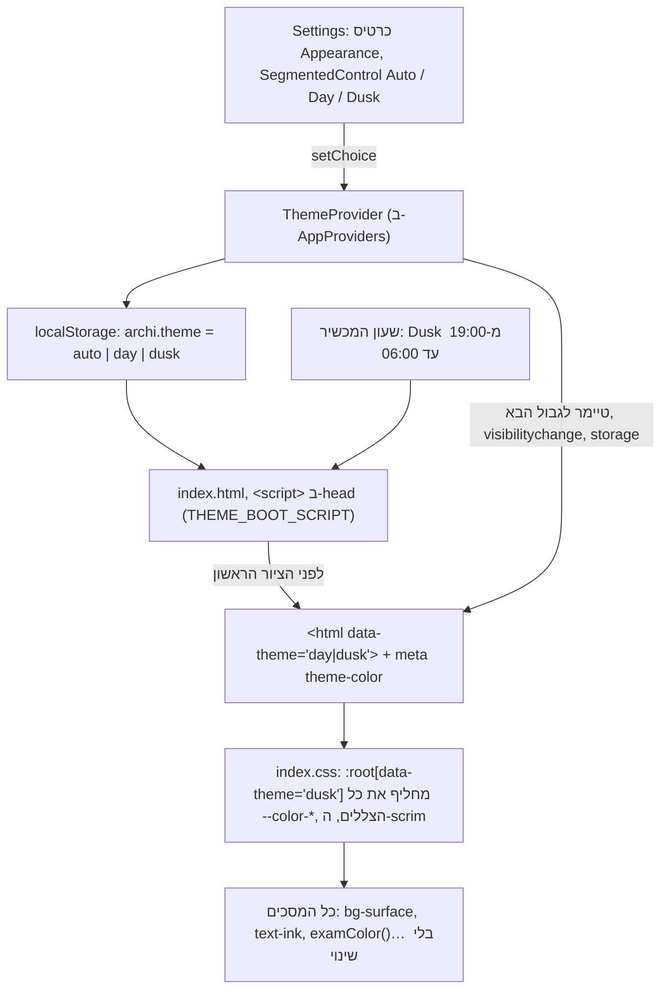

# S43 — Dusk mode, מצב ערב חמים: תוכנית עבודה

> **For agentic workers:** REQUIRED SUB-SKILL: Use superpowers:subagent-driven-development to implement this plan task-by-task. Steps use checkbox (`- [ ]`) syntax for tracking. המנהל (השיחה הראשית) מריץ מפתח אחד לכל Task, לפי הסדר, ואחריו סוקר. git רץ רק בשיחה הראשית.

**מטרה:** ערכת צבעים שנייה לערב, "Dusk": עץ כהה, ירוק יער עמוק ואור עששית רך. היא נדלקת לבד לפי השעה ("Auto"), ואפשר לבחור אותה או את היום ידנית בהגדרות. כל מסך נשאר אותו מסך: רק הערכים של ה-tokens מתחלפים.

**השער במפת הדרכים:** "כל מסך עומד ב-WCAG AA במצב הערב, והמעבר לא שובר אף צילום". מתורגם כאן לשלוש בדיקות: (1) כל זוג צבעים של `theme.test.ts` נבדק גם על ערכי הערב; (2) בצילומים של כל המסכים במצב ערב סריקת ניגודיות בדף לא מוצאת טקסט מתחת לסף; (3) הצילומים של מצב היום **זהים בפיקסלים** לאלה של `main`, חוץ ממסך ההגדרות שקיבל כרטיס חדש. אחרי המיזוג השורה של S43 עוברת ל"הושלם".

**גישה:** בלי שינוי ב-`api/` ובלי מיגרציה. הבחירה נשמרת במכשיר (`localStorage`). ערכי הערב הם בלוק אחד ב-`index.css` שמחליף את משתני הצבע תחת `:root[data-theme='dusk']`. סקריפט קטן ב-`<head>` של `index.html` קובע את `data-theme` לפני הציור הראשון, ו-`ThemeProvider` ב-React שומר עליו מעודכן (שעון, הגדרה, לשונית אחרת).

**כלים:** ‏React 19, ‏TypeScript strict, ‏Tailwind 4, ‏React Aria Components, ‏Vitest. בלי תלויות חדשות.

**מקורות, לפי סדר הכוח:** ‏`CLAUDE.md`; מסמך הביקורת `docs/design/2026-11-21-archi-ux-audit.md` (הנחיה 14, וגם 2, 3, 5 וצ׳ק-ליסט הנכסים); ‏`docs/design/archi-voice.md`; ‏`docs/design/design-language.md` (סעיפים 2, 5.3, 6, 7, 8, 9); ההדמיה `docs/design/prototype/all-screens.html`; מסמך התכנון הראשי 7.9 ו-7.4 (`profiles`).

## איך החלקים מתחברים



- **למה tokens ולא `dark:` במחלקות:** כל רכיב כבר משתמש רק בשמות (`bg-surface`, ‏`text-ink`, ‏`examColor()`), ו-Tailwind 4 מתרגם כל מחלקה ל-`var(--color-…)`. החלפה של הערכים במקום אחד צובעת מחדש את כל האפליקציה בלי לגעת במסך אחד, וזה מה שמבטיח שמצב היום לא ישתנה בפיקסל.
- **למה סקריפט ב-`<head>` ולא רק React:** React מצייר אחרי שהמודולים נטענו. בלי הסקריפט, מי שפותח את האפליקציה ב-23:00 היה רואה הבזק של פשתן בהיר ואז מעבר לכהה. סקריפט רגיל (לא module) רץ בזמן הפענוח, לפני ה-paint הראשון.
- **למה הסקריפט נבנה מ-TypeScript:** השעות, המפתח והצבעים כתובים פעם אחת ב-`theme/theme.ts`. ‏`themeBoot.ts` בונה מהם את מחרוזת הסקריפט, ו-`vite.config.ts` כותב אותה ל-`index.html` (כמו `%BOOT_TEXTS%` של S16). בדיקה מריצה את המחרוזת ומשווה אותה ל-`resolveTheme()` בכל שעה, כך שהסקריפט וה-React לא יכולים להתפצל.
- **למה במכשיר ולא בפרופיל:** הסקריפט רץ לפני ההתחברות ולפני `GET /me`, גם במסך הכניסה, ולכן רק מה שבמכשיר זמין לו. גם אור החדר הוא של המכשיר: טלפון בחושך וטאבלט ליד חלון יכולים לרצות דברים שונים. יש לזה תקדים: מתג "רשימה / ציר" של S18 ורמז ההתקנה של S16 ב-`localStorage`. בלי שדה שרת, בלי מיגרציה.

## מה מצאתי בקוד (25.11.2026)

1. **אין בהדמיה אף מסך כהה או ערב.** ב-`all-screens.html` יש רק אייקוני `evening` ו-`night` ומסגרת טלפון כהה (`#2b2119`). ב-`archie-moods.html` (מ-S31) יש טיוטה של פלטה כהה תחת `prefers-color-scheme: dark` (`--bg:#191510; --surface:#231d16; --ink:#efe5d4; --muted:#b4a28b; --leaf:#8fbf6a; --gold:#e5b862`), והיא נקודת המוצא לגווני העץ כאן.
2. **השם `-dawn` הוא של ההדמיה בלבד.** ‏`docs/design/prototype/archie/<mood>-dawn.jpg` (וגם `-clear`, ‏`-mist`) הם שלוש גרסאות שמיים של האיור, ש-S39 השתמש בהן כדי לגזור את הדמות. הנכסים של האפליקציה (`web/src/assets/archie/<mood>-450.webp`, ‏`-900.webp`) בלי סיומת גוון ובלי רקע. לכן "התשתית של `-dawn`" שהביקורת מזכירה היא היום ה-tokens: מצב הערב לא צריך גרסת שמיים.
3. **הגזירות של Archi נקיות על רקע כהה.** הרכבתי את ששת הקבצים על `#1f1a14` ו-`#2a231b` ובדקתי את פיקסלי הקצה (אלפא 10–200): הצבע הממוצע שלהם חום-שמנת (למשל `rgb(151 124 108)` ב-`intentions`), ואף פיקסל אינו כחלחל, כלומר לא נשארה הילה של השמיים. רואים רק את הפגם הידוע של שיער רך ב-`flow`. **לא נדרשת גרסת ערב כדי לעבור את השער.** גרסה מוארת באור עששית היא אפשרות אמנותית לבעל המוצר (ראו "מה נרשם").
4. **צבעים קשיחים שעוקפים tokens ושוברים מעבר ערכה:**
   - `ui/Dialog.tsx`: הרקע מאחורי דיאלוג הוא `bg-ink/35`. בערב `ink` בהיר, והרקע היה נעשה שכבת שמנת. → token חדש `scrim` (Task 1).
   - `ring-offset-2` ב-`FOCUS_RING`, ‏`FOCUS_RING_NATIVE` (`ui/styles.ts`) וב-`ui/TileList.tsx` בלי צבע: ב-Tailwind 4 ברירת המחדל של `--tw-ring-offset-color` היא `#fff`, ובערב טבעת הפוקוס הייתה מקבלת הילה לבנה של 2px. → כלל ב-`@layer base` לערב בלבד (Task 1).
   - הצללים ב-`index.css` הם `rgb(59 42 30 / …)` (קליפת עץ): על רקע כהה הם נעלמים. → ערכי צל לערב (Task 1).
   - `index.html`: ‏`<meta name="theme-color" content="#4f7a3a">` קבוע. → הסקריפט וה-provider מעדכנים אותו (Tasks 3, 4). הערך הקבוע נשאר, כי `pwa/manifest.test.ts` משווה אותו ל-`brand`.
   - `pwa/manifest.ts`: ‏`theme_color` ו-`background_color` קבועים, ומניפסט לא יכול להשתנות לפי שעה. נשארים של היום (מסך הפתיחה של אפליקציה מותקנת בהיר לרגע גם בלילה; נרשם).
   - `index.html`, מסך הקריסה של S16: ‏`background:#4f7a3a;color:#fff` בסגנון inline. הוא מופיע רק כשהמודולים לא נטענו, ואז גם `index.css` לא נטען. נשאר.
   - `archie/motionLayer.tsx`, ‏`archie/emitters.ts`, ‏`archie/archie.css`: צבעי הנייר של האיור (עלים, זהב, עשן, אדים, הדגשה בהירה של אדוות החול `rgba(255,250,235,.7)`). הם חלק מהאמנות, כמו הגזירות עצמן, ונשארים. בצילומי הערב בודקים אם חלקיק כהה (עלה `#7d4a2a`) נבלע ברקע; אם כן, נרשם ל-S41.
   - `commitments/downscale.ts`: ‏`fillStyle = '#ffffff'` מצייר רקע לבן לתמונת מערכת שעות לפני העלאה. עיבוד תמונה, לא ממשק. נשאר.
   - `dev/paletteSections.tsx`: ‏`border-on-brand/70` בדף הרכיבים בלבד. נשאר.
   - כל השאר כבר דרך tokens: ‏`AppShell` (`bg-surface/97`), הקווים של זמן תפוס (`BusyBlock`, ‏`WeekPainter`: ‏`var(--color-…)`), הצל של ציר המבחן (`exam/Timeline.tsx`: ‏`color-mix` עם `line-strong`), מילוי הנייר של האייקונים (`currentColor` ב-14%).
5. **שימושים שמתנהגים נכון בערב בלי שינוי:** ‏`InkButton`, ה-toast והיום הנבחר ב-`DayStrip` הם `bg-inverse text-on-inverse`; בערב `inverse` בהיר (שמנת של עששית), והם נשארים "ההפך מהעמוד". ‏`Switch` (ידית `on-brand` על `brand`), ‏`NextCard` (גבול וטקסט `on-brand` על צבע המבחן), ‏`ProgressRing` ו-`ProgressChip` נשענים על זוגות שנבדקים גם בערב.
6. **`gold` משמש רק בשני מקומות:** הקשת של טבעת הרמה (`app/ProgressChip.tsx`) והכפתור Defer בהחלקה (`calendar/TimeGrid.tsx`, ‏`bg-gold` עם `text-ink`). הזוג `ink` על `gold` מחייב בערב זהב כהה (ענבר), ולכן "אור העששית" בא מ-`gold-ink`, ‏`now-text`, ‏`warning` ומהזוהר של העמוד, לא מ-`gold`.
7. **`sky-from`, ‏`sky-to`, ‏`sky` לא בשימוש באף מסך** (רק בדף הרכיבים). מקבלים ערכי לילה כדי שהבלוק יהיה שלם.
8. **מסמכים שסותרים את ה-scope:** ההערה בראש `index.css` ("There is no dark mode"), העיקרון הראשון ב-`design-language.md` ("בהיר בלבד") ומסמך התכנון 7.9 ("בהיר בלבד, בלי מצב כהה"). מסמך הביקורת גובר (CLAUDE.md), ו-Task 1 ו-Task 8 מעדכנים אותם.
9. **ה-harnesses של הצילומים לא משתמשים ב-`web/index.html`:** לכל אחד `index.html` משלו, בלי הסקריפט. לכן ה-harness קובע את הערכה ב-`evaluateOnNewDocument` (מפתח ב-`localStorage` ו-`data-theme`), וה-`ThemeProvider` שבתוך `AppProviders` שומר עליה.
10. **`theme.test.ts` קורא צבע עם regex שמחזיר את ההופעה הראשונה** (`--color-${name}:`). בלוק הערב חייב לבוא **אחרי** `@theme`, ובדיקות הערב קוראות רק מתוך הבלוק שלו.

## ההחלטות שלי

1. **ערכי הערב (הטבלה ב-Global Constraints).** עץ אגוז כהה לעמוד ולמשטחים, טקסט בצבע נייר שמנת מואר, ירוק עלה בהיר יותר כמילוי הכפתור הראשי עם טקסט כהה עליו, וירוק יער עמוק (`#23331f`) לרקעים של "נוכחי" ו"נבחר". *למה:* זה התיאור של הנחיה 14, וכל 123 הזוגות של הבדיקה עוברים (AA ‏4.92–15.21, ‏3:1 ‏3.43–9.40).
2. **בערב `on-brand` כהה, והצבעים החזקים בהירים.** הכפתור הראשי, `success`, ‏`danger` והצבע החזק של כל מבחן הם מילוי בהיר עם `on-brand` כהה (`#16120e`) עליו; ה-soft של מבחן הוא גוון כהה של אותו צבע, ו-`ink` הבהיר עליו. *למה:* כך אותם זוגות של היום (`on-brand` על `exam-N`, ‏`ink` על `exam-N-soft`, ‏`exam-N` על `surface` כסימן של 3:1) נשארים נכונים בערב, ו-`examColor()` לא משתנה בשורה.
3. **`inverse` בערב הוא שמנת.** ה-toast, כפתור Google והיום הנבחר בפס הימים בהירים על העמוד הכהה. *למה:* תפקיד ה-token הוא "ההפך מהעמוד"; toast כהה על עמוד כהה לא היה נראה, וצל לא מבדיל על כהה.
4. **הכלל של Auto: Dusk מ-19:00 עד 06:00 לפי השעון המקומי של המכשיר, בלי קשר לפרופיל ובלי מצב הכהה של המערכת.** *למה:* הסקריפט רץ לפני `GET /me` ולפני ההתחברות; שעת השינה בפרופיל אומרת מתי היום נגמר ולא מתי מחשיך; ומי שמצב המערכת שלו כהה כל היום היה מקבל ערב בצהריים. שעון המכשיר (ולא אזור הזמן של הפרופיל), כי העיניים נמצאות איפה שהמכשיר. השעות הן החלטה של בעל המוצר (ראו בסוף).
5. **שלוש אפשרויות: Auto (ברירת מחדל), Day, Dusk**, ב-`SegmentedControl` בכרטיס חדש "Appearance" במסך ההגדרות, אחרי Reminders ולפני Account. *למה:* `SegmentedControl` הוא "מעבר שפועל מיד" (5.8), והבחירה לא שייכת ל-Save של ההעדפות; ליד Reminders, כי שניהם "במכשיר הזה".
6. **המעבר בזמן שהאפליקציה פתוחה:** כשהערכה מתחלפת (גבול שעה, בחירה, לשונית אחרת) ה-`<html>` מקבל `data-theme-switching` ל-400ms, וכל הצבעים עוברים ב-400ms (`--duration-theme`). בטעינה אין מעבר. עם `prefers-reduced-motion` אין מעבר בכלל: לא מוסיפים את התכונה, והכלל ב-CSS יושב בתוך `@media (prefers-reduced-motion: no-preference)`. *למה:* החלפה של כל צבעי המסך בבת אחת היא הבזק; 400ms הם "שקיעה" קצרה ולא אנימציה שמחכים לה.
7. **אין הבזק בטעינה:** `THEME_BOOT_SCRIPT` ב-`<head>`, מיד אחרי `meta theme-color`. *למה:* ראו "איך החלקים מתחברים".
8. **`theme-color` של הדפדפן:** ביום `#4f7a3a` (כמו היום), בערב `#1b1612` (ה-`canvas` של הערב). המניפסט נשאר של היום. *למה:* פס ירוק בוהק מעל עמוד כהה בלילה סותר את המטרה; למניפסט אין דרך להשתנות.
9. **זוהר עששית:** בערב בלבד, ל-`body` מעבר רדיאלי עדין מלמעלה, מ-`--color-canvas-glow` (`#2c2219`) אל `--color-canvas`. כל זוג טקסט נבדק גם על `canvas-glow`. *למה:* זה "אור העששית הרך" של ההנחיה, במקום אחד ובלי לגעת ברכיב; אם בעל המוצר לא רוצה אותו, מוחקים שורה אחת (החלטה בסוף).
10. **`scrim` חדש לשני המצבים:** ‏`--color-scrim` ‏(`#3b2a1e` ביום, `#080604` בערב) ו-`--scrim-opacity` ‏(35% ביום, 60% בערב); ‏`Dialog` משתמש ב-`bg-scrim/(--scrim-opacity)`. *למה:* ביום זה בדיוק `bg-ink/35` של היום (אותו `color-mix` של Tailwind), ולכן הצילומים לא זזים; בערב הרקע מאחורי הדיאלוג נשאר כהה.
11. **הבחירה במכשיר, במפתח `archi.theme`**, ערך לא מוכר או `localStorage` שזורק → `auto`. כתיבה שנכשלה (גלישה פרטית) עדיין מחליפה את הערכה לשיחה הנוכחית. *למה:* החלטה 4 וסעיף "למה במכשיר"; המפתח בסגנון של `archi.lastInterrupt`.
12. **Archi לא מקבל גרסת ערב ב-scope הזה.** *למה:* מה שמצאתי בסעיף 3; ‏`Archie.tsx` הוא נקודת ההחלפה היחידה, וכשיגיעו קבצים `-dusk` הוא יבחר לפי `useTheme().theme` בשורה אחת.
13. **שומר על צבעים קשיחים:** בדיקה חדשה סורקת את `web/src` ונכשלת על hex, ‏`rgb()`/`hsl()` או צבע מהלוח של Tailwind מחוץ לרשימת היתר. *למה:* זה מה ששובר מעבר ערכה, ו-S42 ומי שאחריו יכתבו מסכים חדשים.

## Global Constraints

- **לא נוגעים ב-`api/`.** בלי מיגרציה, בלי שדה בפרופיל.
- **לא נוגעים בהתנהגות של הגיליונות ביומן** (`calendar/CalendarSheets.tsx`, ‏`BlockActionsSheet.tsx` ושאר `calendar/*Sheet.tsx`). S42 עובד עליהם במקביל.
- **ערכי היום לא משתנים.** אף ערך בתוך `@theme` לא זז, ו-`VALUES` הקיים ב-`theme.test.ts` נשאר כמו שהוא. הצילומים של מצב היום זהים בפיקסלים ל-`main` (חוץ ממסך ההגדרות).
- **ערכי הערב, מילה במילה** (תחת `:root[data-theme='dusk']` ב-`index.css`, אחרי `@theme`). היחסים מחושבים בנוסחה של `theme.test.ts`:

  | token | ערב | יחסים עיקריים |
  | --- | --- | --- |
  | `canvas` | `#1b1612` | `ink` ‏14.53 |
  | `canvas-glow` (ערב בלבד) | `#2c2219` | `ink` ‏12.59, ‏`ink-muted` ‏7.19, ‏`line-strong` ‏3.75 |
  | `surface` | `#251e18` | `ink` ‏13.31, ‏`ink-muted` ‏7.60 |
  | `surface-muted` | `#322920` | `ink-muted` ‏6.59, ‏`line-strong` ‏3.43 |
  | `field` | `#15110d` | `ink` ‏15.21, ‏`line-strong` ‏4.52, ‏`brand` ‏7.28 |
  | `ink` | `#f1e6d3` | |
  | `ink-muted` | `#bfae96` | |
  | `line` | `#3d332a` | קישוט |
  | `line-strong` | `#8a7a66` | 3.43–4.52 על הרקעים |
  | `brand` | `#7fae63` | ‏`on-brand` עליו 7.22; על הרקעים 5.52–7.28 |
  | `brand-strong` | `#9cc47f` | טקסט 7.20–9.50 |
  | `brand-soft` | `#23331f` | `ink` ‏10.86, ‏`brand-strong` ‏6.78, ‏`brand` ‏5.20 |
  | `on-brand` | `#16120e` | |
  | `sprout` | `#5f8a45` | קישוט |
  | `clay` / `on-clay` | `#c98558` / `#16120e` | 6.19 |
  | `sand` | `#8a6f50` | קישוט |
  | `gold` | `#845a18` | `ink` עליו 4.92 |
  | `gold-soft` / `gold-ink` | `#3a2d14` / `#f0c36a` | 8.13 |
  | `gold-track` | `#2b241a` | (`gold` עליו 2.52, קישוט) |
  | `sky-from` / `sky-to` / `sky` | `#1d2a3a` / `#33465a` / `#26364a` | `ink` ‏11.77 / 7.85 / 9.95 |
  | `now` / `now-text` | `#e0784f` / `#ec8c66` | 4.73–6.23 / 5.77–7.61 |
  | `danger` / `danger-soft` | `#f08a6c` / `#3d1f17` | טקסט 5.81–7.65; על ה-soft 6.08 |
  | `success` / `success-soft` | `#9cc47f` / `#23331f` | (שווים ל-`brand-strong` / `brand-soft`, כמו ביום) |
  | `warning` / `warning-soft` | `#e2b05a` / `#382a12` | טקסט 7.19–9.47; על ה-soft 7.02 |
  | `inverse` / `on-inverse` | `#efe3cc` / `#241c15` | 13.20 |
  | `inverse-action` / `inverse-success` / `inverse-danger` | `#2f5a22` / `#3f6a2c` / `#9a3518` | 6.34 / 4.99 / 5.71 |
  | `busy` / `busy-soft` / `busy-line` | `#a39684` / `#2c261f` / `#463d33` | `ink-muted` על ה-soft 6.92; ‏`busy` עליו 5.17 |
  | `scrim` (שני המצבים) | יום `#3b2a1e`, ערב `#080604` | |

  צבעי המבחנים בערב (`exam-N` / `-soft` / `-line`):

  | N | שם | חזק | soft | line | `on-brand` על החזק | חזק על soft | `ink` על soft / line |
  | --- | --- | --- | --- | --- | --- | --- | --- |
  | 0 | זית | `#b5c36e` | `#2a2d18` | `#4a5128` | 9.76 | 7.39 | 11.43 / 6.80 |
  | 1 | טרקוטה | `#e8946d` | `#3a221a` | `#63392a` | 7.89 | 6.24 | 11.94 / 7.91 |
  | 2 | אבן כחולה | `#94b6d1` | `#1d2833` | `#34495b` | 8.76 | 7.03 | 12.11 / 7.56 |
  | 3 | שזיף | `#cf9cc0` | `#33212e` | `#573a4e` | 8.14 | 6.56 | 12.16 / 8.02 |
  | 4 | חרדל | `#dcb558` | `#352a12` | `#5c4a1f` | 9.58 | 7.24 | 11.40 / 6.93 |
  | 5 | מנטה כהה | `#7cc6b3` | `#17302b` | `#2a5249` | 9.39 | 7.08 | 11.38 / 7.08 |
  | 6 | ורד עתיק | `#e494a5` | `#3a1f25` | `#633844` | 8.06 | 6.47 | 12.12 / 7.80 |
  | 7 | אדמה | `#d0a682` | `#33261c` | `#574131` | 8.39 | 6.59 | 11.85 / 7.71 |

  החזק על `surface`: 6.96–8.61; על `canvas`: 7.60–9.40.

- **שאר הערכים בבלוק הערב:**
  - `color-scheme: dark;` ו-`--scrim-opacity: 60%;` (ביום, ב-`:root`: ‏`--scrim-opacity: 35%;`).
  - `--shadow-raised: 0 1px 3px rgb(0 0 0 / 0.5);`
  - `--shadow-overlay: 0 1px 2px rgb(0 0 0 / 0.4), 0 18px 40px -10px rgb(0 0 0 / 0.65);`
  - `--shadow-lift: 0 12px 28px rgb(0 0 0 / 0.6);`
  - `--shadow-sheet: 0 -10px 40px rgb(0 0 0 / 0.6);`
  - הזוהר: `:root[data-theme='dusk'] body { background-image: radial-gradient(120% 70% at 50% 0%, var(--color-canvas-glow), var(--color-canvas) 72%); }`
  - טבעת הפוקוס: `@layer base { :root[data-theme='dusk'] *, :root[data-theme='dusk'] ::before, :root[data-theme='dusk'] ::after { --tw-ring-offset-color: var(--color-surface); } }` (ב-`base` כדי ש-`ring-offset-inverse` של ה-toast, שב-`utilities`, ימשיך לנצח).
  - המעבר: `--duration-theme: 400ms;` ב-`:root`, ו-`@media (prefers-reduced-motion: no-preference) { :root[data-theme-switching] *, :root[data-theme-switching] ::before, :root[data-theme-switching] ::after { transition-property: color, background-color, border-color, outline-color, fill, stroke, box-shadow; transition-duration: var(--duration-theme); transition-timing-function: var(--ease-standard); } }`
- **הכלל של Auto:** ‏`DUSK_STARTS_MIN = 1140` (19:00), ‏`DAY_STARTS_MIN = 360` (06:00); דקה מקומית `m = getHours()*60 + getMinutes()`; ‏Dusk כש-`m >= 1140 || m < 360`. מפתח: `THEME_STORAGE_KEY = 'archi.theme'`; ערכים `'auto' | 'day' | 'dusk'`; ברירת מחדל `'auto'`. ‏`THEME_COLOR = { day: '#4f7a3a', dusk: '#1b1612' }`. התכונה: `data-theme="day"` או `data-theme="dusk"` על `<html>`.
- **הטקסטים, מילה במילה** (ב-`web/src/i18n/enSettingsScreen.ts`, תחת `appearance`, גרש מסולסל `’`):
  - `title: 'Appearance'`
  - `intro: 'In the evening I turn the page to warm wood and lantern light, so your eyes can rest.'`
  - `label: 'Theme'` (השם של הקבוצה, `aria-label`)
  - `auto: 'Auto'`, ‏`day: 'Day'`, ‏`dusk: 'Dusk'`
  - `autoNote: (from: string, until: string) => \`I switch to Dusk at ${from} and back to Day at ${until}.\`` (`from` ו-`until` מ-`clockOf` של `theme/theme.ts`: ‏`19:00` ו-`06:00`)
  - `dayNote: 'I’ll keep the day colours on, whatever the hour.'`
  - `duskNote: 'I’ll keep Dusk on, whatever the hour.'`
  - `device: 'I keep this choice on this device only.'`
  - מותר לשפר ניסוח בתוך כללי `archi-voice.md` (איות בריטי, גוף ראשון, בלי סימן קריאה) ולדווח; `Auto`, ‏`Day`, ‏`Dusk` ו-`Appearance` לא משתנים.
- **אנגלית בלבד ב-`web/src`**, בקול של Archi; כל טקסט דרך `en`; אין טקסט ישיר ב-JSX. אפס אימוג׳י; אייקונים רק מ-`web/src/ui/icons/`; רכיבים רק מ-`web/src/ui/`.
- **צבע רק דרך tokens.** אין hex, ‏`rgb()`, ‏`hsl()` או מחלקה מהלוח של Tailwind ברכיב (Task 2 אוכף). בלי שקיפות על טקסט או על בלוק.
- **נגישות:** כל פקד 44px; הבחירה בהגדרות היא `radiogroup` אחד (של `SegmentedControl`); אין מידע שנישא רק בצבע.
- **פקודות**, מתוך `web/`: ‏`npm test -- <pattern>`, ‏`npm run typecheck`, ‏`npm run lint`, ‏`npm run build`. לא מריצים `npm run dev`. אם אין `node_modules` ב-worktree: ‏`npm ci` פעם אחת.
- מסמכים ו-commits בעברית, מונחים טכניים באנגלית.

## Review Focus

1. **הבזק בטעינה:** טעינה ב-23:00 עם `auto` → ה-`<html>` כבר `data-theme="dusk"` לפני ש-`main.tsx` רץ (הבדיקה של Task 3 מריצה את הסקריפט ב-jsdom; בצילומים: הצילום הראשון של עמוד ב-21:30 כבר כהה). → Tasks 3, 6.
2. **הסקריפט וה-React מסכימים:** לכל אחת מ-48 חצאי השעות ולכל אחת משלוש הבחירות (ועוד ערך זבל ו-`localStorage` שזורק), התוצאה של המחרוזת שווה ל-`resolveTheme`. → Task 3.
3. **גבול השעה בזמן שהאפליקציה פתוחה:** ב-18:59:30 עם `auto`, אחרי 30 שניות הערכה Dusk בלי רענון; לשונית שחזרה מרקע אחרי הגבול מתעדכנת מיד (`visibilitychange`). → Task 4.
4. **שתי לשוניות:** בחירה בלשונית אחת מחליפה את הערכה בשנייה (`storage`). → Task 4.
5. **reduced motion:** אין `data-theme-switching` בשום מעבר. → Task 4.
6. **מצב היום לא זז:** הצילומים של היום זהים בפיקסלים ל-`main` (חוץ מההגדרות); הכלל של `ring-offset` והזוהר חלים רק בערב; ה-scrim ביום זהה ל-`bg-ink/35`. → Tasks 1, 6.
7. **טבעת הפוקוס בערב:** בלי הילה לבנה, גם בכפתור בתוך כרטיס וגם ב-toast (שם הרווח נשאר `inverse`). → Tasks 1, 6.
8. **אפליקציה מותקנת ב-iOS:** פס המצב בערב (`theme-color` ו-`apple-mobile-web-app-status-bar-style` שלא מוגדר). לא נבדק אוטומטית; נרשם לבדיקה בטלפון אמיתי. → Task 8.

## סדר ותלויות

המשימות רצות אחת אחרי השנייה, לפי המספר.

| Task | נשען על | מודל |
| --- | --- | --- |
| 1 ערכי הערב ב-`index.css` והבדיקות שלהם | — | sonnet |
| 2 שומר על צבעים קשיחים | — | haiku |
| 3 הכלל, הבחירה והסקריפט שבראש הדף | 1 | opus |
| 4 `ThemeProvider` והמעבר החי | 3 | opus |
| 5 הכרטיס Appearance בהגדרות | 4 | opus (fable when available) |
| 6–9 | 5 | המנהל |

**קבצים משותפים בתוך ה-scope:** `web/src/index.css` ו-`web/src/theme.test.ts` (רק Task 1). ‏`web/index.html`, ‏`web/vite.config.ts` (רק Task 3). ‏`web/src/app/AppProviders.tsx` (רק Task 4). ‏`web/src/i18n/enSettingsScreen.ts`, ‏`web/src/settings/SettingsPage.tsx` (רק Task 5).

**קבצים ש-S42 (Focus Mode, במקביל) עשוי לגעת בהם:** ‏`web/src/index.css` (שלנו; S42 משתמש ב-tokens בלבד ולא אמור לשנות אותו), ‏`web/src/i18n/en.ts` (S42 מוסיף טקסטים; אנחנו לא נוגעים בו: הטקסטים שלנו ב-`enSettingsScreen.ts`, שכבר מחובר ל-`en.settingsScreen`), ‏`web/src/ui/Dialog.tsx` (שלנו, Task 1; אם S42 משתמש בו, בלי שינוי), ‏`web/src/app/AppProviders.tsx` (שלנו, Task 4), ומסך ההגדרות (שלנו). מי שממוזג שני עושה rebase; אם S42 ממוזג קודם, Task 6 מוסיף את מסך המיקוד לצילומי שתי הערכות.

---

### Task 1: ערכי הערב ב-`index.css` והבדיקות שלהם (`sonnet`: הערכים נתונים, העבודה היא CSS מדויק ובדיקות)

**Files:**
- Modify: `web/src/index.css`, `web/src/ui/Dialog.tsx` (שורה אחת)
- Test: `web/src/theme.test.ts`, `web/src/ui/Dialog.test.tsx` (רק הציפייה של המחלקה)

**מה נבנה.** בלוק אחד של ערכי ערב שמחליף כל משתנה צבע, הצללים, ה-scrim, טבעת הפוקוס והזוהר, וכלל המעבר. מצב היום לא משתנה.

1. **ב-`@theme`** (תוספת בלבד): ‏`--color-scrim: #3b2a1e;` עם הערה (הרקע מאחורי דיאלוג; השקיפות ב-`--scrim-opacity`).
2. **ב-`:root` הקיים** (של ה-durations): ‏`--duration-theme: 400ms;` ו-`--scrim-opacity: 35%;`, עם הערות.
3. **אחרי `:root` ולפני `body`:** הבלוק `:root[data-theme='dusk'] { … }` עם **כל** ה-`--color-*` של `TOKENS` ו-`--color-canvas-glow`, בערכים של Global Constraints, ‏`--color-scrim: #080604;`, ‏`--scrim-opacity: 60%;`, ארבעת הצללים, ו-`color-scheme: dark;`. כל קבוצה עם הערה קצרה (כמו ב-`@theme`) שאומרת מה התפקיד בערב. הבלוק נגמר ב-`}` בתחילת שורה (הבדיקה מזהה אותו כך).
4. **אחרי `body`:** כלל הזוהר, הכלל של `--tw-ring-offset-color` ב-`@layer base`, וכלל המעבר בתוך `@media (prefers-reduced-motion: no-preference)`, מילה במילה מ-Global Constraints.
5. **ההערה בראש הקובץ:** במקום "There is no dark mode (a decision of the user: "light")": יש שתי ערכות, Day (‏`@theme`) ו-Dusk (‏`:root[data-theme='dusk']`, S43, הנחיה 14 של הביקורת); `theme/` קובע את `data-theme`; כל token חדש מקבל ערך בשתיהן, והבדיקה נכשלת אחרת.
6. **`ui/Dialog.tsx`:** ‏`bg-ink/35` → ‏`bg-scrim/(--scrim-opacity)`, ובהערה מעל: למה (בערב `ink` בהיר).

**בדיקות (נכתבות קודם, נכשלות), ב-`theme.test.ts`:**
- [ ] עוזר `duskBlock`: התוכן של `:root\[data-theme='dusk'\]\s*\{([\s\S]*?)\n\}`, ועוזר `duskColor(name)` שקורא ממנו בלבד (`#rrggbb`, אחרת זורק). בדיקה: הבלוק קיים, ומופיע אחרי `@theme {` (האינדקס שלו גדול יותר), כדי ש-`color()` ימשיך לקרוא את היום.
- [ ] **הבלוק שלם:** כל שם צבע ברשימת `TOKENS` (החלק של `--color-*`, ועוד `scrim`) מוגדר בבלוק כ-`#rrggbb`. (אם חסר, ערך של היום היה דולף לערב.)
- [ ] **`DUSK_VALUES`**: טבלה כמו `VALUES`, עם כל ערכי הערב של Global Constraints (כולל `canvas-glow` ו-`scrim`), ‏`it.each` שמשווה ל-`duskColor`.
- [ ] **אותם זוגות בערב:** `it.each(PAIRS)` עם `duskColor` ≥ 4.5; ‏`it.each(NON_TEXT_PAIRS)` ≥ 3; ‏`it.each(LARGE_TEXT_PAIRS)` ≥ 3. (לבנות את שלושת המערכים פעם אחת ולהשתמש בהם לשתי הערכות; `LARGE_TEXT_PAIRS` מוגדר היום בסוף הקובץ, להעביר אותו למעלה.)
- [ ] **הזוהר:** `TEXT` על `canvas-glow` ≥ 4.5, ו-`line-strong`, ‏`brand`, ‏`now` על `canvas-glow` ≥ 3 (ערב בלבד).
- [ ] **הכללים של צבעי המבחנים בערב:** שמונת החזקים שונים זה מזה, ואף אחד אינו `brand` או `brand-strong` של הערב; ‏`busy-soft` שונה מ-`surface-muted` ומ-`exam-7-soft` של הערב.
- [ ] **שאר הבלוק:** מכיל `color-scheme: dark`, ‏`--scrim-opacity: 60%`, ואת ארבעת `--shadow-*` (כל אחד עם `rgb(0 0 0 /`).
- [ ] **`--scrim-opacity: 35%`** מוגדר מחוץ לבלוק, ו-`--duration-theme: 400ms`.
- [ ] **טבעת הפוקוס:** יש `@layer base {` שמכיל `:root[data-theme='dusk'] *` ו-`--tw-ring-offset-color: var(--color-surface)`.
- [ ] **המעבר:** `data-theme-switching` מופיע רק בתוך בלוק `@media (prefers-reduced-motion: no-preference)`.
- [ ] **הזוהר רק בערב:** `radial-gradient` מופיע רק בשורה שמתחילה ב-`:root[data-theme='dusk'] body`.
- [ ] ‏`VALUES` הקיים וכל בדיקות היום ירוקות בלי שינוי.
- [ ] ב-`Dialog.test.tsx`: הציפייה למחלקה של הרקע מתעדכנת ל-`bg-scrim/(--scrim-opacity)`.

**צעדים:**
- [ ] בדיקות נכשלות: `npm test -- theme Dialog`.
- [ ] מימוש; `npm test -- theme Dialog manifest`, ‏`npm run typecheck`, ‏`npm run lint`, ‏`npm run build` (ה-build מוודא ש-Tailwind מבין את `bg-scrim/(--scrim-opacity)`; לבדוק ב-CSS שנבנה ב-`dist/assets/*.css` שיש כלל עם `color-mix(` ו-`var(--scrim-opacity)`).
- [ ] commit: `feat(web): S43 ערכי הערב (Dusk) ב-index.css, scrim ובדיקות הניגודיות שלהם`.

**קריטריוני קבלה:** אין שינוי באף ערך בתוך `@theme` חוץ מהתוספת של `scrim`; כל 123 הזוגות עוברים בערב; כל צבע של `TOKENS` מוגדר בשתי הערכות; בלי `!important`.

### Task 2: שומר על צבעים קשיחים (`haiku`: בדיקת קוד מכנית עם רשימת היתר נתונה)

**Files:**
- Create: `web/src/test/colorGuards.test.ts`

**מה נבנה.** בדיקה שסורקת את כל קובצי `.ts`, ‏`.tsx` ו-`.css` תחת `web/src` (בלי `*.test.ts`, ‏`*.test.tsx` ובלי `src/test/`), באותו אופן ש-`sourceGuards.test.ts` אוסף קבצים (לקרוא אותו ולהעתיק את ה-walk ואת `name()`), ונכשלת על:
- hex: `/(?<![\w&])#(?:[0-9a-fA-F]{8}|[0-9a-fA-F]{6}|[0-9a-fA-F]{3})\b/`
- פונקציית צבע: `/\b(?:rgba?|hsla?)\(/`
- צבע מהלוח של Tailwind: `/\b(?:bg|text|border|ring|fill|stroke|from|via|to|outline|divide|decoration|placeholder|caret|accent|shadow)-(?:white|black)\b/` ו-`/\b(?:bg|text|border|ring|fill|stroke|from|via|to|outline|divide|decoration|placeholder|caret|accent|shadow)-(?:slate|gray|zinc|neutral|stone|red|orange|amber|yellow|lime|green|emerald|teal|cyan|sky|blue|indigo|violet|purple|fuchsia|pink|rose)-\d{2,3}\b/`
- שקיפות על טקסט: `/\btext-[a-z-]+\/\d/`

**רשימת היתר** (קבצים שלמים, כל אחד עם הערה של שורה למה): `index.css` (מקור ה-tokens), `archie/` כולה (צבעי הנייר של האיור), `pwa/manifest.ts` (מניפסט לא קורא CSS), `theme/` כולה (`theme-color` של הדפדפן, Task 3), `commitments/downscale.ts` (רקע לבן לתמונה לפני העלאה). ‏`theme/` עוד לא קיימת: היתר לתיקייה שלא קיימת לא נכשל.

ההודעה בכישלון: רשימת `file:line: <השורה>`, כדי שמי שנכשל יראה מה לתקן.

**בדיקות:**
- [ ] הבדיקה עוברת על העץ הנוכחי (אחרי Task 1, ‏`Dialog.tsx` כבר בלי `bg-ink/35`; הוא לא נתפס בכל מקרה, כי `ink/35` אינו `text-`).
- [ ] "the patterns catch what they are for" (כמו ב-`sourceGuards.test.ts`): כל ביטוי תופס דוגמה (`'#4f7a3a'`, ‏`'rgb(0 0 0)'`, ‏`'bg-white'`, ‏`'text-slate-600'`, ‏`'text-ink/70'`) ולא תופס את מה שמותר (`'#main'`, ‏`'href="#report"'`, ‏`'bg-sky-from'`, ‏`'bg-surface/97'`, ‏`'&#123;'`).

**צעדים:**
- [ ] לכתוב; `npm test -- colorGuards`, ‏`npm run typecheck`, ‏`npm run lint`.
- [ ] אם הבדיקה נתפסת על משהו שלא ברשימה: לא מתקנים קוד במשימה הזו; מדווחים למנהל עם השורה.
- [ ] commit: `test(web): S43 שומר על צבעים קשיחים מחוץ ל-tokens`.

**קריטריוני קבלה:** קובץ אחד חדש; אין שינוי בקוד המוצר; כל פריט ברשימת היתר עם סיבה.

### Task 3: הכלל, הבחירה והסקריפט שבראש הדף (`opus`: סקריפט שחייב להתאים לקוד בכל שעה, בלי הבזק)

**Files:**
- Create: `web/src/theme/theme.ts`, `web/src/theme/themeBoot.ts`, `web/src/theme/theme.test.ts`, `web/src/theme/themeBoot.test.ts`
- Modify: `web/index.html`, `web/vite.config.ts`

**תלוי ב:** Task 1 (הערך `canvas` של הערב שה-`THEME_COLOR` חוזר עליו).

**Interfaces — Produces** (ב-`theme.ts`, בלי React ובלי DOM מעבר ל-`Storage`):

```ts
export type ThemeChoice = 'auto' | 'day' | 'dusk'
export type Theme = 'day' | 'dusk'
export const THEME_CHOICES: readonly ThemeChoice[]          // ['auto', 'day', 'dusk']
export const THEME_STORAGE_KEY = 'archi.theme'
export const DUSK_STARTS_MIN = 1140                         // 19:00
export const DAY_STARTS_MIN = 360                           // 06:00
// The colour of the browser's bar: index.html's meta theme-color. Day repeats --color-brand (as
// index.html and the manifest do), dusk repeats the dusk --color-canvas.
export const THEME_COLOR: Readonly<Record<Theme, string>>   // { day: '#4f7a3a', dusk: '#1b1612' }
export function isThemeChoice(value: unknown): value is ThemeChoice
export function resolveTheme(choice: ThemeChoice, now: Date): Theme
export function nextSwitchAt(now: Date): Date               // the next 06:00 or 19:00, local, strictly after now
export function readChoice(storage: Pick<Storage, 'getItem'> | null): ThemeChoice   // anything else, or a throw → 'auto'
export function writeChoice(storage: Pick<Storage, 'setItem'> | null, choice: ThemeChoice): boolean  // false when it throws
export function deviceStorage(): Storage | null             // window.localStorage, or null when reading it throws
export function clockOf(minutes: number): string            // 1140 → '19:00', 360 → '06:00' (the 24-hour form of en-IL)
```

הכללים:
- `resolveTheme`: ‏`day` → `'day'`; ‏`dusk` → `'dusk'`; ‏`auto` → לפי `m = now.getHours() * 60 + now.getMinutes()`: ‏`m >= DUSK_STARTS_MIN || m < DAY_STARTS_MIN` → `'dusk'`, אחרת `'day'`.
- `nextSwitchAt`: בונה את 06:00 ו-19:00 של היום ושל מחר ב-`new Date(y, mo, d, h, 0, 0, 0)` (שעון מקומי, כך שמעבר לשעון חורף נכון), ומחזיר את המוקדם שגדול מ-`now`.
- **`themeBoot.ts`:** ‏`export const THEME_BOOT_SCRIPT: string`, נבנה בתבנית מהקבועים של `theme.ts`, ב-ES5 (`var`, ‏`function`, בלי חץ ובלי `const`), כ-IIFE אחד:
  1. `c = 'auto'`; ‏`try { c = localStorage.getItem(<key>) } catch (e) {}`; אם `c` אינו אחד משלושת הערכים → `'auto'`.
  2. `t` לפי הכלל של `resolveTheme` עם `new Date()`.
  3. `document.documentElement.setAttribute('data-theme', t)`.
  4. `meta[name="theme-color"]` אם קיים → `content` מ-`THEME_COLOR[t]`.
  וגם `export function fillThemeBoot(html: string): string`: מחליף את `%THEME_BOOT%` (בדיוק פעם אחת; זורק אם אין או יש יותר) ב-`THEME_BOOT_SCRIPT`. הערה בראש הקובץ: למה סקריפט רגיל בראש הדף, ולמה הוא נבנה מהקבועים.
- **`index.html`:** מיד אחרי `<meta name="theme-color" …>`: ‏`<script>%THEME_BOOT%</script>`, עם הערת HTML של שתי שורות (קובע את הערכה לפני הציור הראשון; המקור `src/theme/themeBoot.ts`). ה-meta עצמו נשאר `#4f7a3a`.
- **`vite.config.ts`:** ה-handler של `productName()` מוסיף `fillThemeBoot(...)` לשרשרת, אחרי `fillBootTexts`. לעדכן את ההערה מעל הפונקציה.

**בדיקות (נכתבות קודם, נכשלות):**

ב-`theme/theme.test.ts`:
- [ ] `resolveTheme('auto', …)`: ‏05:59 → dusk; ‏06:00 → day; ‏18:59 → day; ‏19:00 → dusk; ‏00:30 → dusk; ‏12:00 → day. ‏`day` ו-`dusk` מחזירים את עצמם בכל שעה.
- [ ] `nextSwitchAt`: מ-12:00 → 19:00 של אותו יום; מ-19:00 בדיוק → 06:00 של מחר; מ-02:00 → 06:00 של אותו יום; מ-05:59:59 → 06:00 של אותו יום. (עם `process.env.TZ` שלא משנה את התוצאה: לבנות את הקלט ב-`new Date(y, m, d, h, mi)`.)
- [ ] `clockOf(1140) === '19:00'`, ‏`clockOf(360) === '06:00'`, ‏`clockOf(0) === '00:00'`.
- [ ] `readChoice`: ‏`'dusk'` → dusk; ‏`null` → auto; ‏`'night'` → auto; storage שזורק → auto; ‏`null` (אין storage) → auto. ‏`writeChoice` שזורק → `false`, ולא זורק הלאה.
- [ ] `THEME_COLOR.day` שווה ל-`--color-brand` של `index.css`, ו-`THEME_COLOR.dusk` ל-`--color-canvas` של בלוק הערב (לקרוא את ה-CSS מהדיסק, כמו `manifest.test.ts`).

ב-`theme/themeBoot.test.ts` (‏jsdom):
- [ ] **הסקריפט שווה לקוד:** לכל `h` ב-0–23, ‏`mi` ב-0 ו-30, ולכל ערך אחסון ב-`['auto', 'day', 'dusk', null, 'garbage']`: לקבוע `vi.setSystemTime(new Date(2026, 10, 25, h, mi))`, לשים את הערך ב-`localStorage`, להריץ `new Function(THEME_BOOT_SCRIPT)()`, ולבדוק ש-`document.documentElement.dataset.theme === resolveTheme(readChoice(localStorage), new Date())`.
- [ ] `localStorage.getItem` שזורק (`vi.spyOn(Storage.prototype, 'getItem')`) → לפי `auto`, בלי חריגה.
- [ ] עם `<meta name="theme-color">` במסמך: ה-`content` הוא `THEME_COLOR` של הערכה; בלעדיו: אין חריגה.
- [ ] הסקריפט ES5: לא מכיל `=>`, ‏`const `, ‏`let `, ‏`` ` ``.
- [ ] `fillThemeBoot`: מחליף placeholder אחד; זורק בלי placeholder ועם שניים.
- [ ] `web/index.html` מהדיסק (כמו ב-`manifest.test.ts`): ‏`%THEME_BOOT%` מופיע פעם אחת, בתוך `<head>`, אחרי ה-`meta theme-color` ולפני כל `<script type="module"` ו-`<link rel="stylesheet"`.

**צעדים:**
- [ ] בדיקות נכשלות: `npm test -- theme/ themeBoot`.
- [ ] מימוש; `npm test -- theme manifest bootFallback`, ‏`npm run typecheck`, ‏`npm run lint`, ‏`npm run build`, ובדיקה ש-`dist/index.html` מכיל את הסקריפט ולא את `%THEME_BOOT%`.
- [ ] commit: `feat(web): S43 הכלל של Auto, הבחירה במכשיר והסקריפט שקובע את הערכה לפני הציור`.

**קריטריוני קבלה:** השעות, המפתח והצבעים כתובים רק ב-`theme.ts`; הסקריפט נבנה מהם; `theme.ts` בלי React; אין שינוי בהתנהגות של `index.html` ביום (ה-meta נשאר `#4f7a3a` עד שהסקריפט רץ, והוא כותב אותו ערך).

### Task 4: `ThemeProvider` והמעבר החי (`opus`: טיימרים, אירועי דפדפן ו-reduced motion, בלי דליפה)

**Files:**
- Create: `web/src/theme/ThemeProvider.tsx`, `web/src/theme/ThemeProvider.test.tsx`
- Modify: `web/src/app/AppProviders.tsx`

**תלוי ב:** Task 3.

**Interfaces — Produces:**

```ts
export interface ThemeState {
  choice: ThemeChoice
  theme: Theme
  setChoice(choice: ThemeChoice): void
}
export function ThemeProvider(props: { children: ReactNode; now?: () => Date; storage?: Storage | null }): JSX.Element
export function useTheme(): ThemeState   // throws outside ThemeProvider
```

הכללים:
- **מצב התחלתי:** `choice = readChoice(storage)`, ‏`theme = resolveTheme(choice, now())`. ברירות המחדל: `now = () => new Date()`, ‏`storage = deviceStorage()`.
- **החלה על המסמך** (`useLayoutEffect` על `theme`): ‏`document.documentElement.dataset.theme = theme`, וה-`content` של `meta[name="theme-color"]` (אם קיים) ל-`THEME_COLOR[theme]`. בהחלה הראשונה בלי מעבר. בכל החלה אחרת שבה הערכה **השתנתה**, ורק אם `!prefersReducedMotion()` (`ui/reducedMotion.ts`): ‏`data-theme-switching` על ה-`<html>`, ומחיקה שלו אחרי 400ms (קבוע `THEME_SWITCH_MS = 400` ב-`ThemeProvider.tsx`, עם הערה שהוא שווה ל-`--duration-theme`). מעבר חדש באמצע מעבר מאפס את הטיימר.
- **שעון** (רק כש-`choice === 'auto'`): ‏`setTimeout` עד `nextSwitchAt(now())` ועוד 1000ms, ובו חישוב מחדש ותזמון הבא. ‏`visibilitychange` (כש-`visible`) ו-`focus` מחשבים מחדש מיד, כי טיימר בלשונית ברקע או במחשב שנרדם מתעכב.
- **לשונית אחרת:** אירוע `storage` עם `key === THEME_STORAGE_KEY` → ‏`choice = readChoice(storage)` וחישוב מחדש.
- **`setChoice`:** ‏`writeChoice(storage, choice)` (גם כשנכשל ממשיכים), ‏`choice` חדש, וחישוב מחדש.
- **ניקוי:** כל טיימר ומאזין יורד ב-unmount. ה-provider **לא** מוחק את `data-theme` ב-unmount (הדף לא היה חוזר ללא ערכה).
- **`AppProviders`:** ‏`<ThemeProvider>` מיד בתוך `I18nProvider`, עוטף את כל השאר; הערה של שורה למה כאן (גם מסכי הכניסה והאונבורדינג, וגם ה-harness של הצילומים, שמשתמשים ב-`AppProviders`).

**בדיקות (נכתבות קודם, נכשלות), ב-`ThemeProvider.test.tsx`** (‏`vi.useFakeTimers()`, storage מזויף כ-`Map` מאחורי `getItem`/`setItem`, ‏`stubMedia` או `vi.stubGlobal('matchMedia', …)` ל-reduced motion):
- [ ] ב-12:00 בלי ערך: ‏`data-theme="day"`, ‏`choice` ‏`auto`; ב-21:30: ‏`dusk`. ‏`meta theme-color` מתעדכן בהתאם.
- [ ] ב-18:59:30 עם `auto`: אחרי `advanceTimersByTime(31_000)` → ‏`dusk`, ומיד אחר כך יש `data-theme-switching`, ואחרי 400ms אין. ובטעינה הראשונה אין `data-theme-switching`.
- [ ] עם reduced motion: אותו מעבר בלי `data-theme-switching` בשום רגע.
- [ ] `setChoice('dusk')` ב-12:00 → ‏`dusk`, וב-storage `'dusk'`; ‏`setChoice('auto')` → ‏`day`. ‏`setChoice('day')` ב-12:00 כשכבר `day` → בלי `data-theme-switching`.
- [ ] `choice` ‏`day` ב-18:59:30: אחרי דקה עדיין `day` (אין שעון כשלא `auto`).
- [ ] אירוע `storage` עם המפתח והערך `'dusk'` → ‏`dusk`; אירוע עם מפתח אחר → בלי שינוי.
- [ ] `visibilitychange` אחרי שהשעון קפץ מעבר לגבול (`vi.setSystemTime` בלי להריץ טיימרים) → הערכה מתעדכנת.
- [ ] storage שזורק בכתיבה: ‏`setChoice('dusk')` עדיין מחליף ל-`dusk`, בלי חריגה.
- [ ] unmount: ‏`vi.getTimerCount()` חוזר ל-0, ומאזינים לא נקראים יותר.
- [ ] `useTheme` מחוץ ל-provider זורק.

**צעדים:**
- [ ] בדיקות נכשלות: `npm test -- ThemeProvider`.
- [ ] מימוש; `npm test` (כל הבדיקות: `AppProviders` עוטף את רוב הבדיקות של המסכים, ואף אחת לא אמורה להשתנות), ‏`npm run typecheck`, ‏`npm run lint`.
- [ ] commit: `feat(web): S43 ThemeProvider: הערכה מתעדכנת לפי השעה, הבחירה ולשונית אחרת`.

**קריטריוני קבלה:** בדיקות קיימות ירוקות בלי שינוי בציפיות; אין `setInterval`; אין `data-theme-switching` עם reduced motion; אין טיימר שנשאר אחרי unmount.

### Task 5: הכרטיס Appearance בהגדרות (`opus` (fable when available): עיצוב ובחירת המילים של Archi)

**Files:**
- Create: `web/src/settings/AppearanceSection.tsx`, `web/src/settings/AppearanceSection.test.tsx`
- Modify: `web/src/i18n/enSettingsScreen.ts` (קבוצה `appearance`), `web/src/settings/SettingsPage.tsx`
- Test: גם `web/src/settings/SettingsPage.test.tsx` (מקרה אחד), ו-`web/src/i18n/en.test.ts` אם הוא סופר מפתחות או בודק פונקציות

**תלוי ב:** Task 4.

**מה נבנה.** כרטיס אחד, באותה תבנית של כרטיס Reminders שב-`SettingsPage`:

```tsx
<Card role="region" title={t.appearance.title}>
  <p className="mb-4 max-w-prose text-small text-ink-muted">{t.appearance.intro}</p>
  <SegmentedControl aria-label={t.appearance.label} options={…auto/day/dusk…} value={choice} onChange={setChoice} />
  <p className="mt-3 max-w-prose text-small text-ink-muted">{note}</p>
</Card>
```

- `note`: ב-`auto` ‏`autoNote(clockOf(DUSK_STARTS_MIN), clockOf(DAY_STARTS_MIN))` (`clockOf` של Task 3; ‏`formatTime` של `board/time.ts` מקבל רגע ISO ואזור זמן ולא דקות, ולכן לא הוא; לא לכתוב `'19:00'` בקוד), ב-`day` ‏`dayNote`, ב-`dusk` ‏`duskNote`; ובשורה שאחריו `device`.
- המקום ב-`SettingsPage`: אחרי כרטיס Reminders ולפני כרטיס Account, עם הערה של שורה (במכשיר הזה, כמו Reminders; פועל מיד, לכן אחרי ה-Save).
- הכרטיס לא תלוי ב-`useMe`: הוא מוצג גם בטעינה ובשגיאה של הפרופיל.
- `SegmentedControl` לא משתנה. אם בצילום רוחב שלוש האפשרויות לא נכנס ב-390px, מדווחים ולא משנים את הרכיב.
- הטקסטים מ-Global Constraints; מותר לשפר ניסוח בכללי `archi-voice.md` ולדווח למנהל.

**בדיקות (נכתבות קודם, נכשלות):**

ב-`AppearanceSection.test.tsx` (בתוך `ThemeProvider` עם storage מזויף ו-`now` קבוע):
- [ ] אזור בשם `Appearance`; ‏`radiogroup` בשם `Theme` עם שלוש אפשרויות בסדר `Auto`, ‏`Day`, ‏`Dusk`; ‏`Auto` נבחר כברירת מחדל, וההערה היא `autoNote('19:00', '06:00')`.
- [ ] לחיצה על `Dusk` → ‏`document.documentElement.dataset.theme === 'dusk'`, ה-storage `'dusk'`, וההערה `duskNote`. ‏`Day` ב-21:30 → ‏`day` וההערה `dayNote`.
- [ ] מקלדת: Tab לקבוצה, חץ ימינה עובר ל-`Day` ומחיל אותו (ההתנהגות של `SegmentedControl`).
- [ ] השורה `device` מוצגת תמיד.

ב-`SettingsPage.test.tsx`:
- [ ] הכרטיס `Appearance` בא אחרי `Reminders` ולפני `Account` (סדר האזורים לפי `getAllByRole('region')`), וגם כש-`GET /me` נכשל.

**צעדים:**
- [ ] בדיקות נכשלות: `npm test -- AppearanceSection SettingsPage`.
- [ ] מימוש; `npm test -- settings en.test sourceGuards colorGuards`, ‏`npm run typecheck`, ‏`npm run lint`, ‏`npm run build`.
- [ ] commit: `feat(web): S43 הבחירה בין Auto, ‏Day ו-Dusk במסך ההגדרות`.

**קריטריוני קבלה:** כל הטקסטים מ-`en`, בגוף ראשון, בלי "Archi" כנושא, בלי סימן קריאה; אין שעה כתובה כמחרוזת ב-JSX; רכיבים רק מ-`ui/`; 44px לכל אפשרות.

---

## משימות המנהל (השיחה הראשית; לא נשלחות כמשימת מימוש)

### Task 6: צילומים של כל המסכים בשתי הערכות — **מנהל** (subagent של `sonnet` לצילום ולסריקה; המנהל משווה)

- [ ] **סביבה אחת חדשה** ב-`~/studyflow-manager/screens/s43-shots-harness/`: העתק של `s44-shots-harness` (בה כבר נתוני S32 ו-S44, ו-`tool/` עם `puppeteer-core`), ואליה מתמזגים מ-`s34-shots-harness` ה-`data.ts` (כניסה, אונבורדינג, מבחנים, הגדרות, מחיקה, 404, ‏terms) ורשימת המצבים של `shoot.mjs`, וגם `timetable-photo.png`. פורטים **4243** לאפליקציה ו-**4343** להדמיה (לא 5173, ‏4232, ‏4234, ‏4244). ‏`WEB_DIR` ברירת מחדל: `~/studyflow-manager/worktrees/s43/web`; ‏`OUT_DIR`: ‏`~/studyflow-manager/screens/s43-screens/`.
- [ ] **ערכה לכל ריצה:** משתנה `SHOTS_THEME=day|dusk|both` (ברירת מחדל `both`), ופלט ל-`<OUT_DIR>/day/` ול-`<OUT_DIR>/dusk/`. ב-`openPage`, ב-`evaluateOnNewDocument` לפני כל סקריפט: ‏`localStorage.setItem('archi.theme', theme)` ו-`document.documentElement.dataset.theme = theme` (ל-harness אין את הסקריפט של `index.html`; ה-`ThemeProvider` שבתוך `AppProviders` שומר על הערכה). השעון הקפוא נשאר `2026-11-24T09:25:00Z` (11:25).
- [ ] **מצבים נוספים:** `settings-appearance` (הכרטיס, ‏Auto נבחר) בשתי הערכות; `auto-evening`: יומן עם `archi.theme` ‏`auto` והשעון קפוא על `2026-11-24T19:30:00Z` (21:30), שצריך לצאת כהה בלי שום בחירה; דיאלוג פתוח וגיליון פתוח (ה-scrim), toast עם Undo (ה-`inverse` השמנת), טבעת פוקוס על כפתור בכרטיס ועל ה-Undo של ה-toast (Tab), ה-swipe עם Defer ו-Skip בטלפון, רגע ה-XP, וההפסקה (`scene=break`: ‏Archi ‏`rest` עם האדים).
- [ ] **סריקת ניגודיות בכל צילום ערב**, בתוך הדף, בלי תלות חדשה: לכל אלמנט גלוי עם טקסט ישיר, ‏`color` מול הרקע האטום הראשון במעלה העץ (`background-color` עם אלפא 1, או ה-`canvas` של הערב אם אין), יחס לפי נוסחת WCAG; סף 4.5, ו-3 לטקסט ≥ 24px או ≥ 18.66px עם משקל ≥ 700. אלמנטים `aria-hidden` וכבויים (`[disabled]`, ‏`[aria-disabled=true]`) נרשמים בנפרד ולא נכשלים. הפלט: `<OUT_DIR>/dusk/_contrast.txt`. כל שורה מתחת לסף: תיקון דרך מפתח (בדרך כלל זוג שאינו ברשימה המותרת), או הסבר בכתב למה אינה טקסט.
- [ ] **מצב היום לא זז:** צילום של סט היום גם מ-`main` (worktree זמני על `main`, או `WEB_DIR` של `~/studyflow/web` אם הוא נקי ועל `main`), והשוואה בפיקסלים (‏Python ‏PIL, ‏`ImageChops.difference(a, b).getbbox() is None`) לכל קובץ חוץ מ-`settings*`. כל הבדל: תיקון, לא קבלה.
- [ ] **מבט של עין:** אין בהדמיה מסך ערב, ולכן משווים את הערב ליום ולהנחיה 14. לבדוק במיוחד: Archi על הכהה (קצוות, השיער של `flow`, האבן הזוהרת, החלקיקים: עלה כהה שנבלע נרשם ל-S41); הקווים של זמן תפוס; קו "עכשיו"; הבלוקים בשמונת הצבעים; הזוהר בראש העמוד; הצ'יפ הזהוב והטבעת; ההבדל בין `surface` ל-`canvas` (כרטיס על עמוד).
- [ ] אם S42 כבר במיזוג ב-`main` כשהמשימה הזו רצה: rebase קודם, ומסך המיקוד נכנס לשתי הערכות.

### Task 7: סקירה סופית — **מנהל** (הסוקר: `opus` (fable when available))

- [ ] `superpowers:requesting-code-review` על כל הענף מול התוכנית הזו, ה-Global Constraints, ה-Review Focus, הנחיה 14 ומסמך הקול. הסוקר בודק שערכי הערב ב-`index.css` שווים לטבלה, שהסקריפט נבנה מהקבועים, ומחפש ב-`web/src` צבע שלא דרך token מחוץ לרשימת היתר.
- [ ] תיקונים דרך מפתח, ובדיקה חוזרת של מה שתוקן.

### Task 8: מסמכים — **מנהל**

- [ ] `docs/design/design-language.md`: עיקרון 1 ("בהיר בלבד") מוחלף ב"שתי ערכות, יום וערב (S43)"; סעיף חדש **2.10 Dusk** עם טבלת הערכים והיחסים, הכללים (`on-brand` כהה, החזקים בהירים, `inverse` שמנת, הזוהר, ה-scrim), והכלל "כל token חדש מקבל ערך בשתי הערכות, והבדיקה נכשלת אחרת"; 2.7 מוסיף "hex או `rgb()` ברכיב" עם הפניה ל-`colorGuards.test.ts`; 4 (הצללים בערב); 5.8 (`SegmentedControl` גם לבחירה שפועלת מיד בהגדרות); 6 (`theme-color` לפי ערכה, המניפסט נשאר); 7 (Archi על הכהה: נבדק, בלי גרסה); 8 (`--duration-theme`, ‏`data-theme-switching`, ובלי מעבר עם reduced motion); 9 (הזוגות נבדקים בשתי הערכות); 11, "מה נבנה": S43; סטיות שהתקבלו ב-Task 6.
- [ ] מסמך התכנון הראשי 7.9: "בהיר בלבד, בלי מצב כהה" → שתי ערכות; פסקה קצרה: הבחירה במכשיר (`archi.theme`), הכלל של Auto, הסקריפט בראש הדף, ולמה לא בפרופיל.
- [ ] מפת הדרכים (artifact, עם כלי ה-Docs): S43 "הושלם"; הפריטים של "מה נרשם ל-scopes אחרים"; בדיקה בטלפון אמיתי של פס המצב באפליקציה מותקנת ב-iOS בערב (Review Focus 8); וכל באג שהמפתחים דיווחו.

### Task 9: כל הפקודות, מיזוג ומפת הדרכים — **מנהל**

- [ ] כל הפקודות של `web/` (‏`npm test`, ‏`lint`, ‏`typecheck`, ‏`build`); ב-`api/` רק בדיקה שלא השתנה דבר (`git diff --stat origin/main -- api/` ריק). ‏gitleaks נקי.
- [ ] `git fetch`, ‏`git rebase origin/main` (אם S42 נכנס בינתיים: גם `colorGuards` ו-`theme.test.ts` על הקבצים שלו), וכל הבדיקות שוב.
- [ ] `git push origin s43-dusk:main` (רק fast-forward); בדיקה שה-push הצליח, ורק אחר כך מחיקת הענף. התוכנית עוברת ל-`docs/archive/plans/`.
- [ ] הודעה לאייל: מה נבנה, ההחלטות, מה נבדק (כולל השוואת הפיקסלים של היום), וההחלטות הפתוחות.

## מה נרשם ל-scopes אחרים

- **נכסים (צ׳ק-ליסט הביקורת):** גרסה של ששת האיורים באור עששית חם, `web/src/assets/archie/<mood>-dusk-450.webp` ו-`-900.webp`, אם בעל המוצר ירצה. לא נדרשת לשער (הקצוות נקיים). כשיגיעו, `Archie.tsx` בוחר לפי `useTheme().theme`.
- **S41 (תנועה של Archi):** צבעי החלקיקים בערב, אם צילומי Task 6 מראים עלה או עשן שנבלעים ברקע הכהה.
- **S42 (Focus Mode):** המסך החדש נבדק בשתי הערכות (ה-harness של S43 מוכן לזה), ו-`colorGuards.test.ts` רץ גם על הקבצים שלו.
- **S33 / S41 (הגן והחגיגה):** ה-`sky-*` של הערב מוגדרים כשמי לילה, אבל אף מסך לא משתמש בהם; איך הגן נראה בערב הוא החלטה של ה-scope שבונה אותו.
- **PWA:** מסך הפתיחה של אפליקציה מותקנת (`background_color`) נשאר בהיר גם בלילה; ‏`apple-mobile-web-app-status-bar-style` לא מוגדר, ולבדוק בטלפון אמיתי.
- **רק אם יוחלט:** קיצור לבחירה בתפריט הפרופיל; סנכרון הבחירה בין מכשירים דרך הפרופיל (שדה ומיגרציה).

## החלטות לבעל המוצר

1. **המראה של הערב.** הערכים בטבלה של Global Constraints. **ההמלצה:** לבנות כמו בתוכנית ולהחליט מול הצילומים של Task 6, בעיקר על שלושה דברים: כמה בהיר הטקסט (`ink` ‏`#f1e6d3`, ‏14.5:1 על העמוד; אפשר לעמעם ל-`#e6d9c3` בלי לרדת מ-12); הירוק של הכפתור הראשי (`#7fae63` עם טקסט כהה, במקום לבן על ירוק כמו ביום); וה-toast שהופך לשמנת.
2. **השעות של Auto.**
   - **א (בתוכנית):** ‏19:00–06:00.
   - **ב:** ‏18:00–06:00 (בחורף מחשיך ב-17:00).
   - **ג:** לפי שקיעה. דורש מיקום, ולכן לא.
   - **ההמלצה:** א. שינוי הוא שני קבועים ב-`theme/theme.ts`.
3. **Auto ומצב הכהה של המערכת.**
   - **א (בתוכנית):** רק לפי השעה.
   - **ב:** גם כשהמערכת כהה.
   - **ההמלצה:** א. Dusk הוא מצב ערב, ומי שהמערכת שלו כהה כל היום יבחר Dusk ידנית.
4. **הזוהר בראש העמוד** (`canvas-glow`). **ההמלצה:** להשאיר, ולהחליט מול הצילומים. הסרה היא שורה אחת ב-`index.css`.
5. **גרסת עששית לאיורים של Archi.** **ההמלצה:** לא עכשיו. הגזירות נקיות על הכהה, וזה נכס שרק אתה יכול להפיק.
