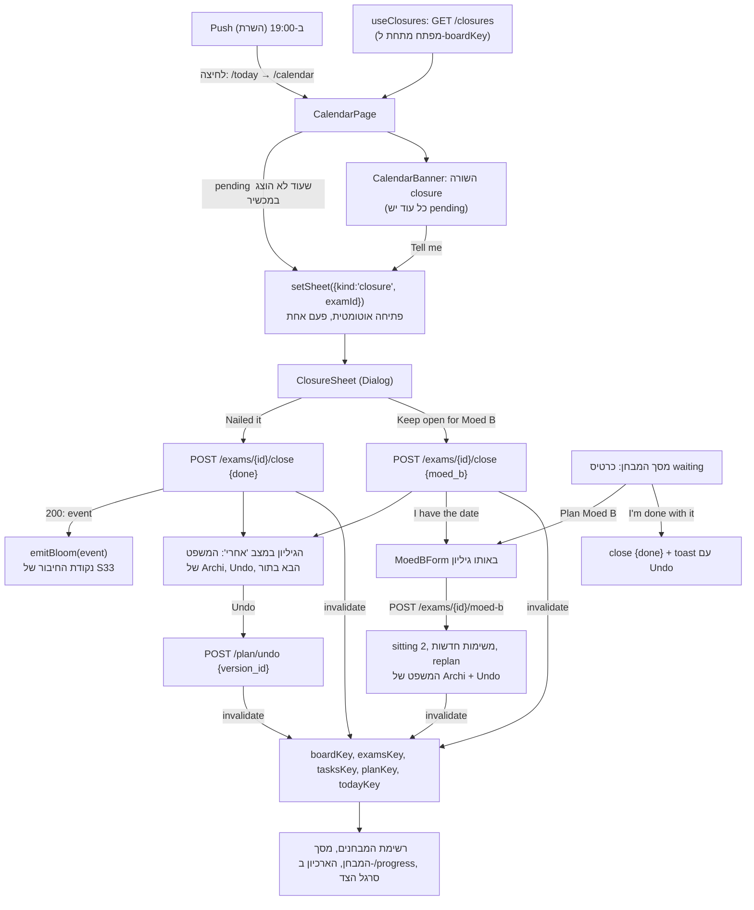

# S45 — סגירת מבחן ומועד ב', חלק ב' (הממשק): תוכנית עבודה

> **For agentic workers:** REQUIRED SUB-SKILL: Use superpowers:subagent-driven-development to implement this plan task-by-task. Steps use checkbox (`- [ ]`) syntax for tracking. המנהל (השיחה הראשית) מריץ מפתח אחד לכל Task, לפי הסדר, ואחריו סוקר. git רץ רק בשיחה הראשית.

**מטרה:** בערב של יום המבחן Archi פותח ביומן גיליון סגירה קצר: "You made it through <exam>. How did it feel?". ‏`Nailed it` סוגר את המבחן, מעביר אותו לארכיון ומפנה את הזמן שלו; ‏`Keep open for Moed B` שומר את החומרים בהמתנה שקטה. כשמועד ב' מתפרסם, טופס קצר בונה ממנו תוכנית חדשה מהחומרים הקיימים. לכל החלטה יש "Undo".

**השער במפת הדרכים:** "מבחן שהתאריך שלו עבר נסגר באחד משני המסלולים, ומועד ב' בונה תוכנית חדשה מהחומרים הקיימים". אחרי המיזוג של התוכנית הזו השורה של S45 עוברת ל"הושלם", והפריחה בגן נשארת פריט פתוח של S33 (נקודת חיבור בשם, ראו החלטה 14).

**גישה:** בלי שינוי ב-`api/` ובלי מיגרציה. השרת של S45 (חלק א', `docs/archive/plans/2026-11-21-s45-exam-closure.md`) נותן הכול: `GET /closures`, ‏`POST /exams/{id}/close`, ‏`POST /exams/{id}/moed-b`, ‏`POST /plan/undo`, ‏`state` ו-`sitting` ב-`GET /exams`, ‏`archive` ב-`GET /progress`, וה-Push של 19:00. הממשק יושב בתיקייה חדשה `web/src/closure/` (הנתונים, הפעולות, הגיליון והטופס), ומתחבר בארבעה מקומות: ענף `closure` ב-`CalendarSheets` (נקודת החיבור ש-S32 השאיר), שורה `closure` בפס של היומן, מסך המבחנים ומסך המבחן (S34), ומסך ההתקדמות.

**כלים:** ‏React 19, ‏TypeScript strict, ‏TanStack Query 5, ‏Tailwind 4, ‏React Aria Components, ‏Vitest. בלי תלויות חדשות.

**מקורות, לפי סדר הכוח:** ‏`CLAUDE.md`; מסמך הביקורת `docs/design/2026-11-21-archi-ux-audit.md` (הנחיה 16, ו-6, 8 לקול ולהובלה של Archi); ‏`docs/design/archi-voice.md`; מסמך התכנון הראשי, סעיף 7.13 ("מה הגיליון מציג" הוא החוזה לממשק), ו-7.4, 7.7, 7.10; ‏`docs/design/design-language.md` סעיפים 2.10 (Dusk), 6א (היומן, הגיליונות, הפס ונקודות החיבור), 7, 8, 9; ההדמיה `docs/design/prototype/all-screens.html`.

## איך החלקים מתחברים



- **למה `closuresKey` מתחת ל-`boardKey`:** כל פעולת לוח וכל Undo כבר מרעננים את כל מה שמתחת למפתח הזה (כמו `splitOffersKey` של S44), ולכן אחרי סגירה, Undo או פתיחת מועד ב' הגיליון, השורה והארכיון מתעדכנים בלי קוד נוסף.
- **למה הגיליון הוא רכיב של `closure/` ולא של `calendar/`:** אותו גיליון נפתח גם ממסך המבחן (מבחן שממתין שבוע אחרי). הענף ב-`CalendarSheets` רק מצייר אותו.
- **למה "אחרי" הוא מצב של הגיליון ולא toast:** הסגירה היא טקס, והעיניים של הסטודנט על הגיליון. toast מתחת לגיליון פתוח היה מוסתר ב-scrim, והמשפט של Archi ("is in full bloom") הוא בדיוק מה שהגיליון צריך להראות. ה-Undo יושב שם.
- **למה מועד ב' לא צריך מסך בנייה:** ‏`POST /exams/{id}/moed-b` בונה את התוכנית באותה בקשה, בלי Claude ובלי עבודת רקע (החלטה 5 של תוכנית השרת). לכן אין `job` לעקוב אחריו כמו במסך הבנייה של האונבורדינג: הכפתור ממתין עד התשובה, וזהו.

## מה מצאתי בקוד (25.11.2026)

1. **בהדמיה אין גיליון סגירה, אין פריחה ואין ארכיון.** חיפוש של `bloom`, ‏`archive`, ‏`moed`, ‏`closure`, ‏`made it through`, ‏`nailed` מחזיר רק את מקום הגן ב-"Progress and the garden" (S33). המודל הוויזואלי: "The plan is ready" (Archi `eureka` עומד על הכרטיס של החדשות שלו, ומתחתיו כפתור אחד) לרגע של `done`, ו-`FreeTimeSheet` (Dialog עם `figure`) למבנה הגיליון.
2. **נקודת החיבור קיימת ומתועדת**: ההערה בראש `calendar/CalendarSheets.tsx` ובסוף ההערה של `CalendarPage.tsx`, והשורה ב"נקודות החיבור" של 6א: ‏`{ kind: 'closure'; examId: string }` ב-`SheetState`.
3. **`POST /plan/undo` מבטל רק את הגרסה האחרונה** (`undo_version` → `stale_plan` אחרת). חלון ה-Undo הוא אפוא "עד הפעולה הבאה על הלוח", לא זמן קבוע. אין בשרת "פתיחה מחדש" של מבחן מהארכיון. ראו החלטה 8 ו"החלטות לבעל המוצר" 2.
4. **מבחן שנסגר הוא היסטוריה בשרת:** הוספה, עריכה וסימון של משימות, ניתוח ובנייה של מבחן עם `closure` (או שהתאריך שלו עבר) נענים ב-`exam_in_past`; ‏`PATCH` של תאריך או קושי במבחן `done` או `waiting_moed_b` נענה ב-409. מסך המבחן של היום היה מציג פקדים שנכשלים. ראו החלטה 12.
5. **`Exam` ב-`onboarding/types.ts` לא מכיר את השדות החדשים** (`sitting`, ‏`state`, ‏`closed_at`, ‏`first_exam_date`, ‏`first_grade`), אף שהשרת כבר מחזיר אותם. גם `Progress` ב-`progress/types.ts` בלי `archive`.
6. **שני מפתחות למבחנים:** ‏`examsKey` של `onboarding/api.ts` הוא `['exams', userId]` (מחוץ ללוח), ו-`examsKey` של `board/api.ts` מתחת ל-`boardKey`. ‏`useExams()` (מסך המבחנים, מסך המבחן, היומן) קורא את הראשון, ולכן הפעולות של S45 חייבות לרענן גם אותו במפורש.
7. **`ExamsList` בסרגל הצד** מציג כל מבחן עם `exam_date >= today`, ולכן ביום המבחן, אחרי `Nailed it`, המבחן עוד היה מופיע תחת "Your exams".
8. **`Row` ב-`calendar/BannerRow.tsx` תמיד פותח פאנל במקום** (`aria-expanded`). השורה `closure` פותחת דיאלוג, ולכן צריך לה צורה שנייה של הכפתור (`aria-haspopup="dialog"`, בלי `aria-expanded` ובלי פאנל). ‏`BannerRow.tsx` הוא של היומן, לא של `ui/`, ומותר להרחיב אותו.
9. **`enCalendar.test.ts` מחייב בדיוק שישה קובצי `enCalendar*.ts`.** הטקסטים של S45 נכנסים לקובץ חדש `i18n/enClosure.ts` (`en.closure`), שאינו מתחיל ב-`enCalendar`.
10. **אין `textarea` ב-`web/src/ui/`.** ‏`TextField` הוא שורה אחת. ראו החלטה 11.
11. ה-Push של השרת: ‏`url: "/today"` ו-`tag: "exam-closure:<id>"`. ‏`/today?x` מפנה ל-`/calendar?x`. בלי מזהה מבחן ב-URL.
12. קריאה בלי handler ב-`createFakeApi` נדחית ב-404. בדיקות קיימות של היומן, של מסך המבחנים ושל ההתקדמות ימשיכו לעבור רק אם `GET /closures` שנכשל שותק (אין שורה, אין גיליון, אין הודעה), וכך הוא נבנה.

## ההחלטות שלי

1. **מתי ואיפה הגיליון נפתח לבד:** ביומן בלבד, כשיש ב-`GET /closures` פריט `pending` שהגיליון שלו עוד לא הוצג במכשיר הזה, ואין גיליון אחר פתוח. *למה:* השרת מחליט מתי הסגירה נפתחת (19:00 מקומי ביום המבחן, `opens_at`), והיומן הוא המסך שנפתח מה-Push ומהבית; גיליון שקופץ מעל מסך אחר (מבחן, הגדרות, מיקוד) היה מפריע באמצע משהו.
2. **פעם אחת לכל מבחן ומועד, במכשיר:** "הוצג" נשמר ב-`localStorage` במפתח `archi.closure.<userId>`, רשימה של `"<examId>:<sitting>"` (עד 50, הישנים נזרקים). פתיחה של האפליקציה למחרת או אחרי שבוע, כשהגיליון עוד לא הוצג, פותחת אותו אז, עם אותו משפט. *למה:* הגיליון הוא הזמנה ולא נדנוד; אחרי שהוצג פעם אחת, השורה בפס מחזיקה את ההחלטה הפתוחה. ‏`sitting` במפתח, כי מועד ב' של אותו מבחן נפתח לסגירה שוב. אחסון חסום: זיכרון של המודול (כמו `focusSession.ts`), כלומר לכל היותר פעם אחת לכל טעינה.
3. **סגירה בלי החלטה ("Not now"):** ה-X, ‏Escape או לחיצה על ה-scrim סוגרים את הגיליון, וההחלטה נשארת פתוחה. מה שמחזיר אותו: השורה `closure` בפס של היומן (ראשונה, לפני `review`), שנשארת כל עוד יש `pending`, והכרטיס במסך המבחן. *למה:* Archi לא כופה טקס; מבחן שלא נסגר לא מפריע לתוכנית (השרת כבר לא משבץ לו), ולכן אין סיבה לחסום.
4. **כמה מבחנים באותו יום:** הגיליון עוסק במבחן אחד, הראשון ב-`pending` (השרת ממיין לפי תאריך). אחרי החלטה, במצב "אחרי", הכפתור הראשי הוא `Tell me about <next exam>` כשיש עוד `pending`, ואחרת `Close`. השורה בפס אומרת את המספר כשיש יותר מאחד. *למה:* החלטה אחת בכל רגע, בלי לסגור ולפתוח שוב; ושני מבחנים באותו יום הם מקרה אמיתי בתקופת מבחנים.
5. **מבנה הגיליון:** ‏`Dialog` עם `figure` (Archi `eureka` עומד על הקצה העליון, כמו ב-`FreeTimeSheet`), הכותרת היא המשפט של Archi, מתחתיה שורת הסיכום (`You studied … and finished …% of the plan.`), ושני כפתורים זה מתחת לזה: ראשי `Nailed it`, משני `Keep open for Moed B` (רק כש-`moed_b` ב-`options`). *למה:* הנחיה 8 (Archi מוביל, ומתחתיו רק הפקדים), וכפתור ראשי אחד (10. כן / לא).
6. **מצב "אחרי" בתוך הגיליון:** אחרי `done`: ‏Archi נשאר `eureka`, המשפט `<exam> is in full bloom. I've freed up its time for what's next.` אחרי `moed_b`: ‏Archi `rest`, המשפט `I'll keep everything for <exam> safe and quiet. …`, וכפתור משני `I have the date` שפותח את טופס מועד ב' באותו גיליון. בשניהם: ‏`Undo` (`quiet`) והכפתור הראשי של החלטה 4. *למה:* ראו "איך החלקים מתחברים"; ובישראל מועדי ב' מתפרסמים לרוב עם לוח המבחנים, כך שלחלק מהסטודנטים התאריך כבר ידוע באותו ערב.
7. **הסגירה לא אופטימית:** הכפתור במצב `isPending` עד התשובה, השני מנוטרל, והגיליון לא נסגר בזמן הזה (`isDismissable={false}`, ‏`isKeyboardDismissDisabled`). *למה:* השרת מתכנן מחדש את כל הלוח באותה בקשה, ורק הוא יודע אם המבחן עדיין `pending`; כמו הפיצול ב-S44.
8. **Undo:** בגיליון ובטופס, כפתור `Undo` כל עוד הם פתוחים; ב-"I'm done with it" של מסך המבחן, toast עם Undo ל-`UNDO_TIMEOUT_MS`. תמיד דרך `undoOnce`. ‏`stale_plan` או `nothing_to_undo` → הודעה בתוך הגיליון (`Note`) עם טקסט הקוד, וכפתור ה-Undo נעלם. ‏Undo של `moed_b_opened` שנדחה ב-`invalid_state` (כבר למדו במועד ב') → `closure.moedB.cantUndo`. Undo מוצלח בגיליון מחזיר אותו למצב השאלה של אותו מבחן, עם `closure.sheet.undone` ב-live region. *למה:* השרת מבטל רק את הגרסה האחרונה (ממצא 3), ולכן החלון האמיתי הוא "עד הפעולה הבאה"; Undo בתוך הגיליון הפתוח הוא המקום שבו הסטודנט עוד מסתכל על ההחלטה.
9. **"ארכיון" נראה כך:**
   - **רשימת המבחנים:** כרטיס אחד למבחנים הנוכחיים (`active`, ‏`pending`, ‏`waiting_moed_b`), ממוינים לפי תאריך, והמונה שבכותרת סופר רק אותם. מתחתיו כרטיס שני תחת `h2` ‏"Archive" למבחנים `done`, מהאחרון שנסגר (`closed_at`). שורה בארכיון: האות בצבע המבחן, השם, ‏`Closed on 16 Nov. 86% of the plan done`, וצ'יפ `Done`; שורה עדיין מקשרת למסך המבחן. ה-chip של שורה נוכחית: ‏`pending` → `How did it go?`; ‏`waiting_moed_b` → `Waiting for Moed B`; ‏`active` כמו היום. במועד ב' (`sitting === 2`) הפירוט מתחיל ב-`Moed B. `.
   - **מסך המבחן:** ראו החלטה 12.
   - **מסך ההתקדמות:** אחרי התגים, `h2` ‏"Archive" ורשימה (`List` על `Card`) מ-`progress.archive`: האות, השם, ‏`Closed on 16 November 2026` ו-`21 hours studied, 86% of the plan`. בלי ארכיון אין קטע. *למה:* "ארכיון ההישגים" של הביקורת הוא הסיפור של מה שנסגר; בגן של S33 כל פריט כזה יהיה צמח פורח, והרשימה היא הצורה שלו בלי איורים.
10. **טופס מועד ב' (`MoedBForm`):** ‏Archi `wisdom` מוביל ב-`When is Moed B?`; שדות: ‏`DatePicker` (חובה, ממחר ועד 730 יום, אותו `dateError` של `exam/examForm.ts` מול ה-`today` של `exam/api.useToday`); ציון (`TextField`, ‏`inputMode="numeric"`, אופציונלי, מספר שלם 0–100); ‏`What felt hard?` כ-`CheckboxCards` מ-`topics` של הפריט (לא מוצג כשאין נושאים); וטקסט חופשי אופציונלי עד 1,000 תווים. כפתור `Plan my Moed B`, ובזמן הבקשה `Planning…` עם `isPending`, והגיליון לא נסגר. *למה:* אלה שדות החוזה (7.13) ובדיוק הגבולות של `MoedBRequest`, והבדיקה בדפדפן חוסכת סבב עם השרת.
11. **הטקסט החופשי הוא `TextField` של שורה אחת עם `maxLength={1000}`**, בלי רכיב `textarea` חדש. *למה:* אסור לשנות את `ui/` ב-scope הזה, והבחירה בנושאים היא הקלט העיקרי (החלטה 6 של השרת); `textarea` נרשם ל-S29.
12. **מסך המבחן לפי המצב:**
    - `active` במועד א': כמו היום. ביום המבחן לפני 19:00 אין שום שינוי (השרת עוד לא פתח את הסגירה).
    - `active` במועד ב': כמו היום, ובכותרת שורה נוספת `Moed A was on 16 November 2026, grade 55.` (בלי ציון: בלי החלק השני).
    - `pending`: כפתור העריכה **נשאר**, כי תאריך שגוי שמתוקן לעתיד מחזיר את המבחן ל-`active` (החלטה 3 של השרת). במקום `Timeline`, ‏`TaskList`, החומרים, הניתוח והסימולציה: כרטיס `ClosureCard` עם המשפט של Archi וכפתור `Tell me` שפותח את `ClosureSheet` של המבחן הזה.
    - `waiting_moed_b`: בלי כפתור העריכה (השרת מסרב), וכרטיס `ClosureCard`: ‏`<exam> is waiting for Moed B.`, השורה `I'm keeping its 3 files and 17 tasks for Moed B.` (קבצים מ-`useMaterials`, משימות מ-`tasks_total` של הפריט), ושני כפתורים: ראשי `Plan Moed B` (פותח `MoedBSheet` של המבחן) ומשני `I'm done with it`.
    - `done`: בלי כפתור העריכה, וכרטיס של הארכיון: Archi `eureka` קטן, ‏`<exam> is in full bloom.`, ושורת הסיכום מ-`progress.archive` (`You studied 21 hours and finished 86% of the plan.`). אין פקדים.
    *למה:* השרת מסרב לכל כתיבה על מבחן סגור (ממצא 4), ומסך שמציג פקדים שנכשלים מלמד את הסטודנט שהמוצר שבור. החומרים לא נמחקים, רק לא מוצגים לעריכה; השורה של `waiting` אומרת שהם שמורים.
13. **סרגל הצד:** ‏`ExamsList` מציג רק מבחנים ב-`state === 'active'` (ועדיין `exam_date >= today`). *למה:* ממצא 7; "Your exams" הוא מה שעוד לפני הסטודנט.
14. **נקודת החיבור של S33 (הפריחה בגן), בלי קוד של גן:** ‏`closure/bloomEvents.ts`, בתבנית של `board/xpEvents.ts`: ‏`emitBloom(event: BloomEvent)` ו-`onBloom(listener) => unsubscribe`. הפעולה של `done` (מהגיליון ומ-"I'm done with it") קוראת ל-`emitBloom(result.event)` כשהוא לא `null`, פעם אחת, בהצלחה בלבד. ב-S45 אין מאזין. S33 מתחבר בשני מקומות: (א) מאזין ל-`onBloom` ומנגן את הפריחה (גיליון חגיגה של שלב בגן, סעיף 8: עד שנייה וחצי, נסגר בלחיצה); (ב) הגן קורא את `progress.archive` כמקור האמת לצמחים הפורחים, כך ש-Undo (שמוציא את המבחן מהארכיון) מוריד את הפריחה בלי אירוע הפוך. במצב "אחרי" של `done` יש `data-slot="bloom"` על העטיפה של Archi, עם הערה שזה המקום שבו S33 מחליף את `eureka` באיור הפריחה. *למה:* אירוע ולא state (רענון לא מנגן שוב), כמו רגע ה-XP; ו-archive כבר קיים בשרת.
15. **ה-Push של 19:00:** השרת שולח; לחיצה פותחת `/today`, שמפנה ל-`/calendar`. שם הגיליון נפתח לבד אם עוד לא הוצג במכשיר (החלטה 2), ואחרת השורה בפס מחכה בראש היומן. בלי שינוי בשרת ובלי שינוי ב-`pwa/notification.ts`. *למה:* ב-19:00 הגיליון כמעט תמיד עוד לא הוצג, ולכן ה-Push מוביל אליו; ‏`?closure=<id>` ב-`url` היה שינוי בשרת בשביל מקרה שהשורה כבר מכסה (נרשם ל-scopes אחרים).
16. **רענון:** ‏`useClosures` עם `refetchInterval: 5 * 60_000` וחזרה לחלון (ברירת המחדל), ובלי רענון כשאין משתמש. *למה:* בזמן ש-19:00 עובר כשהיומן פתוח, הגיליון צריך להופיע בלי רענון של הדף, ו-5 דקות הן איחור סביר לטקס של ערב; בקשה כל דקה (כמו `GET /today`) הייתה מריצה את הסטטיסטיקות של המבחנים בלי צורך.
17. **שגיאות של סגירה:** ‏409 ‏`invalid_state` (המבחן נסגר בלשונית אחרת, או שהתאריך שלו שונה) → רענון של `closures`, ‏toast מידע `closure.sheet.stale`, והגיליון נסגר. ‏404 → אותו דבר עם `codeText('not_found')`. אחרת → `Note` בתוך הגיליון עם `errorMessage`, והגיליון נשאר במצב השאלה. *למה:* החלטה שהתיישנה היא לא תקלה של הסטודנט; שגיאת רשת לא צריכה להעלים את השאלה.
18. **שגיאות של מועד ב':** ‏422 ‏`exam_in_past` או `validation_error` עם `too_far_ahead` → הודעה מתחת לשדה התאריך (`dateTooEarly` / `dateTooLate` של `en.onboardingExams`); ‏422 אחר → הודעה כללית מעל הכפתור (`codeText('validation_error')`); ‏409 ‏`invalid_state` → כמו בהחלטה 17; אחרת `Note` עם `errorMessage`, והערכים בטופס נשמרים. אחרי הצלחה: מצב "אחרי" של הטופס: ‏Archi `intentions`, ‏`closure.moedB.done(weakNames)`, ואם `unscheduled` או `shortfalls` לא ריקים, שורה `closure.moedB.short`; ‏`Undo` ו-`Close`.
19. **קורא מסך:** שם הדיאלוג הוא המשפט של Archi (הכותרת). במעבר למצב "אחרי" הכותרת מתחלפת למשפט החדש, הטקסט נכתב גם ל-`<p role="status">` אחד בגיליון, והפוקוס עובר לכפתור הראשי של המצב החדש (הכפתור שנלחץ ירד מהעץ). השורה בפס: כפתור עם `aria-haspopup="dialog"`. כל כפתור שחוזר ברשימה (שורות הארכיון) הוא קישור עם שם המבחן.
20. **תנועה וערב:** אין `animate`, ‏`transition` או `@keyframes` חדשים; התנועה היחידה היא של `Dialog`, ‏`ArchiLead` ושכבת המצב של Archi, שכולן כבר מכבדות `prefers-reduced-motion`. רק tokens קיימים ו-`examColor()`, בלי זוג טקסט חדש, ולכן `colorGuards.test.ts` ו-`theme.test.ts` עוברים בלי שינוי, והגיליון נכון ב-Dusk (ב-19:00 ה-Auto כבר בערב: זה המצב העיקרי של הגיליון, וכך הוא נבדק בצילומים).

## Global Constraints

- **לא נוגעים ב-`api/`.** אם מפתח מגלה שהחוזה לא מספיק, הוא עוצר ומדווח למנהל מה חסר.
- **החוזה (7.13), מילה במילה:**
  - `GET /closures` → `{"pending": [Item…], "waiting": [Item…]}`, ‏Item: `{"exam_id", "exam_name", "exam_date", "color_index", "sitting", "state", "options": ["done", "moed_b"] | ["done"], "opens_at", "studied_minutes", "tasks_done", "tasks_total", "completion_percent", "topics": [{"id", "name"}]}`
  - `POST /exams/{id}/close` עם `{"outcome": "done" | "moed_b"}` → `{"exam": {"id", "name", "exam_date", "difficulty", "color_index", "sitting", "state", "closed_at"}, "version_id", "event": {"kind": "course_bloomed", "exam_id", "exam_name", "color_index"} | null, "replan": {"added", "removed", "unscheduled", "shortfalls"}}`. שגיאות: 404 ‏`not_found`, ‏409 ‏`invalid_state`.
  - `POST /exams/{id}/moed-b` עם `{"exam_date", "grade"?, "hard_topic_ids"?, "hard_notes"?}` → `{"exam": {"id", "name", "exam_date", "first_exam_date", "first_grade", "sitting", "state", "color_index"}, "version_id", "tasks_created", "weak_topics": [{"id", "name"}], "trimmed", "unscheduled", "shortfalls"}`. שגיאות: 404, ‏409 ‏`invalid_state`, ‏422 ‏`exam_in_past` / ‏`validation_error`. שולחים רק שדות שמולאו: `grade` רק כשיש, `hard_topic_ids` רק כשנבחרו, `hard_notes` רק כשאינו ריק אחרי `trim`.
  - `GET /exams`: לכל מבחן גם `sitting`, ‏`state` (`active` | `pending` | `waiting_moed_b` | `done`), ‏`closed_at`, ‏`first_exam_date`, ‏`first_grade`.
  - `GET /progress`: ‏`archive: [{"exam_id", "name", "color_index", "exam_date", "first_exam_date", "sitting", "closed_at", "studied_minutes", "tasks_done", "tasks_total", "completion_percent"}]`, מהאחרון שנסגר.
  - Undo: ‏`POST /plan/undo` עם `{"version_id"}`, דרך `undoOnce`.
- **אין `19`, ‏`CLOSURE_HOUR` או חישוב של "מתי נפתחת הסגירה" ב-`web/src`.** מה ש-`pending` הוא מה שהשרת אומר.
- **הטקסטים המחייבים, מילה במילה** (גרש מסולסל `’`; שמות דרך `isolate()`): ‏`You made it through <exam>. How did it feel?`; ‏`You studied <duration> and finished <N>% of the plan.`; ‏`Nailed it`; ‏`Keep open for Moed B`; ‏`<exam> is in full bloom. I’ve freed up its time for what’s next.`; ‏`I’ll keep everything for <exam> safe and quiet. When the Moed B date is out, tell me and I’ll plan a focused round.`; ‏`<exam> is waiting for Moed B.`; ‏`Plan Moed B`; ‏`I’m done with it`; ‏`When is Moed B?`; ‏`How did Moed A go? (optional)`; ‏`What felt hard?`; ‏`Plan my Moed B`; ‏`I’ve put the practice exams first, then <weak topics>, then a general review.`
- **אנגלית בלבד ב-`web/src`**, בקול של Archi בגוף ראשון (`archi-voice.md`): משפט של Archi נגמר בנקודה, כפתור לא; בלי סימן קריאה; תאריך מלא `16 November 2026`, קצר `16 Nov`; משך דרך `durationText`; יחיד ורבים נכונים. כל טקסט דרך `en`; אין טקסט ישיר ב-JSX (lint). אות עברית רק בבדיקות, כנתוני דמה של תוכן משתמש.
- **תוכן משתמש** (שם מבחן, שם נושא, הטקסט החופשי): ב-JSX דרך `ui/UserText`, בתוך מחרוזת דרך `isolate()`. בלי מירכאות.
- **אפס אימוג׳י.** אייקונים רק מ-`web/src/ui/icons/`. הדמות רק דרך `Archie` / `ArchiLead` / `ArchiSays`, במצבים הקיימים (`eureka`, ‏`rest`, ‏`wisdom`, ‏`intentions`).
- **רכיבים רק מ-`web/src/ui/`, ולא משנים רכיב שם.** צבע רק דרך tokens ו-`examColor()`; אין צבע גולמי, אין שקיפות על טקסט, אין token חדש. ‏`colorGuards.test.ts`, ‏`theme.test.ts` ו-`sourceGuards.test.ts` ירוקים.
- **בלי קוד של גן** (S33): רק `bloomEvents.ts` ו-`data-slot="bloom"` (החלטה 14).
- **נגישות:** כל פקד 44px; ‏`h1` אחד בכל מסך; קטע חדש הוא `h2`; כל שינוי של מצב נאמר במילים (live region או כותרת); עם `prefers-reduced-motion` אין תנועה חדשה.
- **ההתנהגות של הגיליונות, השורות, הרפאים וה-toast הקיימים לא משתנה.** בדיקה קיימת משתנה רק כשהיא נשענת על מבנה שהשתנה (למשל `BANNER_ROWS`), והמפתח מדווח עליה.
- **פקודות**, מתוך `web/`: ‏`npm test -- <pattern>`, ‏`npm run typecheck`, ‏`npm run lint`, ובמשימה האחרונה של כל קובץ מסך גם `npm run build`. לא מריצים `npm run dev`.
- מסמכים ו-commits בעברית, מונחים טכניים באנגלית.

## Review Focus

1. **פעם אחת:** הגיליון נפתח לבד פעם אחת לכל `examId:sitting` במכשיר, גם אחרי רענון, ניווט ושינוי שבוע; לא נפתח מעל גיליון אחר; לא נפתח כש-`GET /closures` נכשל; ומבחן שנפתח לו מועד ב' ונעשה `pending` שוב נפתח שוב. → Tasks 2, 5.
2. **שני מבחנים באותו יום:** אחרי ההחלטה על הראשון, `Tell me about <second>` מחליף את הגיליון לשני בלי לסגור אותו; אחרי השני, `Close`. השורה בפס אומרת "2 exams". → Tasks 4, 5.
3. **Undo:** בגיליון, אחרי `done` ואחרי `moed_b`: ‏`POST /plan/undo` אחד גם בשתי לחיצות, הגיליון חוזר לשאלה, והמבחן חוזר לרשימה הנוכחית ול-pending. ‏Undo אחרי פעולה אחרת על הלוח (`stale_plan`): הודעה, בלי קריסה. ‏Undo של מועד ב' אחרי למידה: `cantUndo`. → Tasks 3, 4.
4. **רענון אחרי כל פעולה:** אחרי סגירה, Undo ופתיחת מועד ב', רשימת המבחנים (`['exams', userId]`), מסך המבחן, סרגל הצד, הארכיון ב-`/progress` והיומן מציגים את המצב החדש בלי רענון של הדף. → Task 3.
5. **הפריחה:** ‏`emitBloom` נקרא פעם אחת בהצלחה של `done` (גם מ-"I'm done with it"), לא ב-`moed_b`, לא בכישלון, לא ב-Undo, ולא ברענון. → Task 3.
6. **מועד ב':** תאריך היום או אתמול, 731 יום קדימה, ציון 101, ‏`5.5` או `abc`, ‏1,001 תווים: נעצרים בדפדפן עם הודעה ליד השדה; ‏422 מהשרת מגיע לאותו מקום. הגוף שנשלח כולל רק מה שמולא. → Tasks 2, 4.
7. **מסך המבחן של מבחן סגור** לא מציג אף פקד שהשרת מסרב לו (הוספת משימה, סימון, עריכת תאריך, ניתוח, העלאה). → Task 6.
8. **שם מבחן ונושא בעברית** בכותרת הדיאלוג, בשורה בפס, בכפתור `Tell me about <exam>` וברשימת הנושאים נשארים בסדר הנכון ונחתכים בסופם. → Tasks 1, 4, 5.
9. **Dusk:** הגיליון, הכרטיסים והארכיון בערב (הצילומים של Task 8), כולל `examColor` על `surface` ו-`canvas-glow`. → Task 9.

## סדר ותלויות

המשימות רצות אחת אחרי השנייה, לפי המספר.

| Task | נשען על | מודל |
| --- | --- | --- |
| 1 הטקסטים (`enClosure.ts`) | — | opus (fable when available) |
| 2 הטיפוסים, השאילתות והקוד הטהור | 1 | sonnet |
| 3 הפעולות: סגירה, מועד ב', Undo, הפריחה | 1, 2 | opus |
| 4 הגיליון וטופס מועד ב' | 1–3 | opus (fable when available) |
| 5 החיבור ליומן: הענף, הפתיחה האוטומטית, השורה בפס, סרגל הצד | 1–4 | opus |
| 6 מסך המבחנים ומסך המבחן | 1–4 | sonnet |
| 7 הארכיון במסך ההתקדמות | 1, 2 | sonnet |
| 8–11 | 7 | המנהל |

**קבצים משותפים:** `web/src/i18n/enClosure.ts` ו-`en.ts` (רק Task 1; משימה מאוחרת שחסר לה מפתח מוסיפה אותו תחת `en.closure` באותו קול ומדווחת). `web/src/onboarding/types.ts` ו-`web/src/progress/types.ts` (רק Task 2). `web/src/calendar/testFixtures.ts` (רק Task 5). `web/src/test/examFixtures.ts` (Task 2 מוסיף שדות; Task 6 רק משתמש).

---

### Task 1: הטקסטים של הסגירה ומועד ב' (`opus`, ‏fable when available: הניסוחים בקול של Archi)

**Files:**
- Create: `web/src/i18n/enClosure.ts`, `web/src/i18n/enClosure.test.ts`
- Modify: `web/src/i18n/en.ts` (שורת import ו-`closure: enClosure`, ליד `focus: enFocus`)

**מה נבנה.** כל מה ש-Archi אומר ב-S45, כפונקציות שמקבלות את הנתונים. משך מגיע כמחרוזת מוכנה (`durationText` נקרא במסך, לא כאן, כדי ש-`enClosure.ts` לא ייבא מ-`board/`). תאריכים מגיעים מוכנים (`longDate` / `dayMonth` של `exam/dates.ts`).

`en.closure`:

| מפתח | חתימה | הפלט |
| --- | --- | --- |
| `sheet.title` | `(name: string) => string` | `You made it through ${isolate(name)}. How did it feel?` |
| `sheet.stats` | `(studied: string, percent: number) => string` | `You studied 21 hours and finished 86% of the plan.` |
| `sheet.statsNoTime` | `(percent: number) => string` | `You finished 86% of the plan.` (כש-`studied_minutes === 0`) |
| `sheet.nailed` | `string` | `Nailed it` |
| `sheet.keepOpen` | `string` | `Keep open for Moed B` |
| `sheet.bloomed` | `(name: string) => string` | `${isolate(name)} is in full bloom. I’ve freed up its time for what’s next.` |
| `sheet.kept` | `(name: string) => string` | `I’ll keep everything for ${isolate(name)} safe and quiet. When the Moed B date is out, tell me and I’ll plan a focused round.` |
| `sheet.haveDate` | `string` | `I have the date` |
| `sheet.next` | `(name: string) => string` | `Tell me about ${isolate(name)}` |
| `sheet.undone` | `(name: string) => string` | `I put ${isolate(name)} back as it was.` |
| `sheet.stale` | `string` | `That exam changed in the meantime, so I looked again.` |
| `row.say` | `(name: string) => string` | כמו `sheet.title` |
| `row.sayMany` | `(count: number) => string` | `You made it through 2 exams. How did they feel?` |
| `row.open` | `string` | `Tell me` |
| `card.open` | `string` | `Tell me` |
| `waiting.say` | `(name: string) => string` | `${isolate(name)} is waiting for Moed B.` |
| `waiting.kept` | `(files: number, tasks: number) => string` | `I’m keeping its 3 files and 17 tasks for Moed B.`; ‏0 קבצים: `I’m keeping its 17 tasks for Moed B.`; ‏0 משימות: `I’m keeping its 3 files for Moed B.`; שניהם 0: `I’m keeping everything for Moed B.` |
| `waiting.plan` | `string` | `Plan Moed B` |
| `waiting.done` | `string` | `I’m done with it` |
| `archived.say` | `(name: string) => string` | `${isolate(name)} is in full bloom.` |
| `archived.closedOn` | `(date: string) => string` | `I closed it on 16 November 2026.` |
| `moedB.title` | `string` | `When is Moed B?` |
| `moedB.date` | `string` | `Moed B date` |
| `moedB.grade` | `string` | `How did Moed A go? (optional)` |
| `moedB.gradeHint` | `string` | `Your grade, from 0 to 100.` |
| `moedB.gradeError` | `string` | `Enter a whole number from 0 to 100.` |
| `moedB.hard` | `string` | `What felt hard?` |
| `moedB.hardHint` | `string` | `I’ll put these first, right after the practice exams.` |
| `moedB.notes` | `string` | `Anything else that felt hard? (optional)` |
| `moedB.notesTooLong` | `string` | `That’s a bit long. I can take up to 1,000 characters.` |
| `moedB.submit` | `string` | `Plan my Moed B` |
| `moedB.submitting` | `string` | `Planning…` |
| `moedB.done` | `(weak: string[]) => string` | 0: `I’ve put the practice exams first, then a general review.`; ‏1: `…first, then ${isolate(a)}, then a general review.`; ‏2: `…then ${a} and ${b}, then…`; ‏3+: `…then ${a}, ${b} and ${c}, then…` (כל שם דרך `isolate`) |
| `moedB.short` | `string` | `Not everything fits before Moed B. Your calendar shows what’s left.` |
| `moedB.undone` | `(name: string) => string` | `I put ${isolate(name)} back to waiting for Moed B.` |
| `moedB.cantUndo` | `string` | `You’ve already studied for Moed B, so I can’t undo this.` |
| `list.pending` | `string` | `How did it go?` |
| `list.waiting` | `string` | `Waiting for Moed B` |
| `list.done` | `string` | `Done` |
| `list.moedB` | `(detail: string) => string` | `Moed B. ${detail}` |
| `list.closedOn` | `(date: string, progress: string) => string` | `Closed on 16 Nov. 86% of the plan done` |
| `list.archive` | `string` | `Archive` |
| `list.noneComing` | `string` | `No exams coming up. Add the next one when you know its date.` |
| `exam.moedALine` | `(date: string, grade: number \| null) => string` | `Moed A was on 16 November 2026, grade 55.` / ‏`Moed A was on 16 November 2026.` |
| `progress.title` | `string` | `Archive` |
| `progress.closedOn` | `(date: string) => string` | `Closed on 16 November 2026` |
| `progress.summary` | `(studied: string, percent: number) => string` | `21 hours studied, 86% of the plan` |

- הטקסטים של Global Constraints לא משתנים. שאר הניסוחים מחייבים במשמעות ובמספרים; ניסוח שנשמע לא טבעי באנגלית מותר לשפר בתוך כללי `archi-voice.md`, ולדווח למנהל.
- הערת כותרת לקובץ: הטקסטים של S45, הממשק של סגירת מבחן ומועד ב'.

**בדיקות (נכתבות קודם, נכשלות), ב-`enClosure.test.ts`:**
- [ ] כל פונקציה עם שם עברי (`'הסתברות'`) עוטפת אותו בתווי הבידוד של `isolate`, ולא מוסיפה מירכאות.
- [ ] `moedB.done` ל-0, 1, 2, 3 ו-4 נושאים (פסיקים ו-`and` נכונים).
- [ ] `waiting.kept` לארבעת הצירופים, ו-`1 file` / `1 task` ביחיד.
- [ ] `row.sayMany(2)`; ‏`sheet.stats('21 hours', 86)` שווה בדיוק לטקסט של Global Constraints.
- [ ] אף ערך בקובץ לא מכיל `!`, ‏`·`, אימוג׳י, או `Archi` כנושא (אותו regex של `enCalendar.test.ts`); כפתורים (`nailed`, ‏`keepOpen`, ‏`haveDate`, ‏`open`, ‏`plan`, ‏`done`, ‏`submit`) לא נגמרים בנקודה.

**צעדים:**
- [ ] בדיקות נכשלות: `npm test -- enClosure`.
- [ ] מימוש; `npm test -- enClosure en.test enCalendar sourceGuards`, ‏`npm run typecheck`, ‏`npm run lint`.
- [ ] commit: `feat(web): S45 הטקסטים של סגירת המבחן ומועד ב'`.

**קריטריוני קבלה:** הכול בגוף ראשון ובאנגלית טבעית; "are exactly the six" של `enCalendar.test.ts` נשאר ירוק.

### Task 2: הטיפוסים, השאילתות והקוד הטהור (`sonnet`: קוד טהור עם ערכים מדויקים)

**Files:**
- Create: `web/src/closure/types.ts`, `web/src/closure/api.ts`, `web/src/closure/seen.ts`, `web/src/closure/moedBForm.ts`, `web/src/closure/bloomEvents.ts`, `web/src/closure/testFixtures.ts`, ובדיקות `web/src/closure/seen.test.ts`, `web/src/closure/moedBForm.test.ts`, `web/src/closure/bloomEvents.test.ts`, `web/src/closure/api.test.tsx`
- Modify: `web/src/onboarding/types.ts` (`Exam`), `web/src/progress/types.ts` (`archive`), `web/src/test/examFixtures.ts` ו-`web/src/progress/testFixtures.ts` (ברירות מחדל לשדות החדשים)

**Interfaces — Produces:**

```ts
// closure/types.ts
export type ExamState = 'active' | 'pending' | 'waiting_moed_b' | 'done'
export type Outcome = 'done' | 'moed_b'
export interface ClosureItem {
  exam_id: string; exam_name: string; exam_date: string; color_index: number
  sitting: number; state: ExamState; options: Outcome[]; opens_at: string
  studied_minutes: number; tasks_done: number; tasks_total: number; completion_percent: number
  topics: { id: string; name: string }[]
}
export interface Closures { pending: ClosureItem[]; waiting: ClosureItem[] }
export interface BloomEvent { kind: 'course_bloomed'; exam_id: string; exam_name: string; color_index: number }
export interface CloseResult { exam: {…ClosedExamOut}; version_id: string; event: BloomEvent | null; replan: { added: unknown[]; removed: unknown[]; unscheduled: unknown[]; shortfalls: unknown[] } }
export interface MoedBBody { exam_date: string; grade?: number; hard_topic_ids?: string[]; hard_notes?: string }
export interface MoedBResult { exam: {…MoedBExamOut}; version_id: string; tasks_created: number; weak_topics: { id: string; name: string }[]; trimmed: number; unscheduled: unknown[]; shortfalls: unknown[] }
export function examState(exam: { state?: ExamState }): ExamState   // state ?? 'active'

// closure/api.ts
export function closuresKey(userId: string | null)        // [...boardKey(userId), 'closures']
export function useClosures(): UseQueryResult<Closures, ApiError>

// closure/seen.ts
export function seenKey(item: Pick<ClosureItem, 'exam_id' | 'sitting'>): string   // `${exam_id}:${sitting}`
export function wasShown(userId: string, item: …): boolean
export function markShown(userId: string, item: …): void

// closure/moedBForm.ts
export interface MoedBDraft { date: DateValue | null; grade: string; topicIds: string[]; notes: string }
export interface MoedBErrors { date?: string; grade?: string; notes?: string }
export function validateMoedB(draft: MoedBDraft, today: string): { errors: MoedBErrors; body: MoedBBody | null }

// closure/bloomEvents.ts
export function emitBloom(event: BloomEvent): void
export function onBloom(listener: (event: BloomEvent) => void): () => void
```

הכללים:
- `Exam` ב-`onboarding/types.ts`: שדות אופציונליים `sitting?: number`, ‏`state?: ExamState`, ‏`closed_at?: string | null`, ‏`first_exam_date?: string | null`, ‏`first_grade?: number | null`, עם הערה: השרת תמיד שולח אותם (S45); אופציונליים כדי שנתוני דמה מלפני S45 יעבדו, וכל קריאה עוברת דרך `examState()`. ב-`progress/types.ts`: ‏`ArchivedExam` (השדות של Global Constraints) ו-`archive: ArchivedExam[]` ב-`Progress`, חובה; ‏`progress/testFixtures.ts` מוסיף `archive: []` לברירת המחדל.
- `useClosures`: ‏`api.get<Closures>('/closures', { signal })`, ‏`enabled: userId !== null`, ‏`refetchInterval: 5 * 60_000` (קבוע בשם `CLOSURES_REFRESH_MS` עם ההערה של החלטה 16). ‏`useBoardUserId` כמו `useSplitOffers`.
- `seen.ts`: מפתח `archi.closure.<userId>`; הערך JSON של מערך מחרוזות; קריאה שזורקת, JSON שבור או ערך שאינו מערך של מחרוזות → מערך ריק; כתיבה שזורקת נבלעת. מעבר ל-50 הישנים נזרקים. עותק בזיכרון של המודול גובר על האחסון (כמו `session/focusSession.ts`), כך ש-`markShown` עובד גם כשהאחסון חסום.
- `validateMoedB`: תאריך חסר → `en.onboardingExams.dateRequired`; אחרת `dateError(iso, today)` של `exam/examForm.ts`. ציון: `trim`; ריק → בלי `grade`; אחרת חייב להתאים ל-`/^\d{1,3}$/` ולהיות 0–100, אחרת `moedB.gradeError`. הערות: `trim`; ריק → בלי `hard_notes`; מעל 1,000 תווים (לפני ה-`trim`) → `moedB.notesTooLong`. ‏`hard_topic_ids` רק כשנבחרו. ‏`body` הוא `null` כשיש שגיאה.
- `bloomEvents.ts`: העתק של המבנה של `board/xpEvents.ts` (העתק של רשימת המאזינים לפני הריצה, מאזין שזורק לא שובר את הפעולה). הערת כותרת: נקודת החיבור של S33 (החלטה 14), ומה S33 עושה איתה.
- `closure/testFixtures.ts`: ‏`makeClosureItem(overrides)` עם ברירת המחדל של הדוגמה ב-7.13 על השבוע של הבדיקות של היומן: ‏`exam_id: 'exam-1'`, ‏`exam_name: 'הסתברות'`, ‏`exam_date: '2026-11-23'`, ‏`color_index: 2`, ‏`sitting: 1`, ‏`state: 'pending'`, ‏`options: ['done', 'moed_b']`, ‏`opens_at: '2026-11-23T17:00:00Z'`, ‏`studied_minutes: 1260`, ‏`tasks_done: 14`, ‏`tasks_total: 17`, ‏`completion_percent: 86`, שני נושאים (`'התפלגות בינומית'`, ‏`'תוחלת ושונות'`); ו-`makeCloseResult`, ‏`makeMoedBResult` בהתאם.

**בדיקות (נכתבות קודם, נכשלות):**
- [ ] `seen`: ‏`markShown` ואז `wasShown` → `true`; ‏`sitting` אחר → `false`; משתמש אחר → `false`; אחסון שזורק (`test/fakeStorage.ts`) → עדיין `true` באותה טעינה; JSON שבור → `false` בלי שגיאה; 51 רשומות → הראשונה נזרקה.
- [ ] `validateMoedB` מול `today = '2026-11-24'`: ‏`2026-11-24` → `dateTooEarly`; ‏`2026-11-25` → תקין; ‏`2028-11-24` (731) → `dateTooLate`; ציון `''` → בלי `grade`; ‏`'55'` → `55`; ‏`'101'`, ‏`'5.5'`, ‏`'abc'`, ‏`'-1'` → `gradeError`; הערה של 1,001 תווים → `notesTooLong`; הערה של רווחים → בלי `hard_notes`; בלי נושאים → בלי `hard_topic_ids`.
- [ ] `bloomEvents`: מאזין מקבל את האירוע; אחרי ה-unsubscribe לא; מאזין שזורק לא מונע מהשני.
- [ ] `useClosures`: המפתח מתחיל ב-`boardKey(USER_ID)`; ‏`GET /closures` נשלח; בלי משתמש לא נשלח.
- [ ] `examState({})` → `'active'`.

**צעדים:**
- [ ] בדיקות נכשלות: `npm test -- closure/`.
- [ ] מימוש; `npm test`, ‏`npm run typecheck`, ‏`npm run lint`.
- [ ] commit: `feat(web): S45 הנתונים של הסגירה: טיפוסים, GET /closures, ולידציה של מועד ב' ואירוע הפריחה`.

**קריטריוני קבלה:** כל הפונקציות חוץ מ-`useClosures` טהורות או נשענות רק על אחסון; אין שעה של פתיחת הסגירה בקוד; כל הבדיקות הקיימות ירוקות בלי שינוי בציפיות.

### Task 3: הפעולות: סגירה, מועד ב', Undo והפריחה (`opus`: mutations שחיים אחרי המסך, רענון של חמישה מפתחות, מירוצים)

**Files:**
- Create: `web/src/closure/closureActions.ts`, `web/src/closure/closureActions.test.tsx`

**תלוי ב:** Tasks 1, 2.

**מה נבנה.** hook אחד בתבנית של `calendar/splitActions.ts`: הקריאות החוזרות על ה-`useMutation` עצמו, מפתח משלו, ו-`undoOnce`. הגיליון (Task 4) והמסכים (Task 6) לא קוראים ל-API בעצמם.

**Interfaces — Produces:**

```ts
export type CloseFailure = { kind: 'stale' } | { kind: 'error'; message: string }
export type MoedBFailure = { kind: 'stale' } | { kind: 'fields'; errors: MoedBErrors } | { kind: 'error'; message: string }
export type UndoFailure = { message: string }
export interface ClosureActions {
  close(item: Pick<ClosureItem, 'exam_id' | 'exam_name'>, outcome: Outcome, handlers?: { onSuccess?(r: CloseResult): void; onError?(f: CloseFailure): void }): void
  // "I'm done with it" from the exam screen: close done with a toast and its Undo.
  finish(item: Pick<ClosureItem, 'exam_id' | 'exam_name'>): void
  openMoedB(examId: string, body: MoedBBody, handlers?: { onSuccess?(r: MoedBResult): void; onError?(f: MoedBFailure): void }): void
  undo(versionId: string, reason: 'close' | 'moed_b', handlers?: { onSuccess?(): void; onError?(f: UndoFailure): void }): void
  closing(examId: string): boolean
  planning(examId: string): boolean
  undoing(versionId: string): boolean
}
export function useClosureActions(): ClosureActions
```

הכללים:
- **מפתח:** ‏`['closureAction', userId]` ותתי-מפתחות `close`, ‏`moedB`, ‏`undo`. לא `actionKey(userId)` ולא של הפיצול.
- **`settle`** אחרי כל אחת מהשלוש (הצלחה או כישלון): ‏invalidate של `boardKey(userId)` (כולל `closuresKey`, ‏`progressKey`, וה-today, plan ו-exams של הלוח), ‏`examsKey(userId)` של `onboarding/api.ts`, ‏`planKey(userId)` ו-`todayKey(userId)` של `onboarding/api.ts`, ו-`tasksKey(userId)` של `exam/api.ts` (ממצא 6).
- **`close`:** ‏`POST /exams/${exam_id}/close` עם `{ outcome }`. קריאה שנייה לאותו מבחן בזמן שהראשונה ממתינה לא שולחת דבר (`isMutating` עם predicate, כמו `split`). בהצלחה: אם `outcome === 'done'` ו-`result.event !== null` → `emitBloom(result.event)`, ואז `handlers.onSuccess`. ‏409 ‏`invalid_state` או 404 → toast מידע (`sheet.stale` / `codeText('not_found')`) ו-`onError({ kind: 'stale' })`. אחרת → `onError({ kind: 'error', message: errorMessage(error) })`, בלי toast (הגיליון מציג). ה-handlers נקראים רק אם הם עדיין רלוונטיים: הגיליון מעביר אותם; כש-`mutate` מחזיר אחרי שהגיליון ירד, ה-handler שלו בודק `mounted` (התבנית של `FreeTimeBody`).
- **`finish`:** ‏`close(item, 'done')` עם toast הצלחה `sheet.bloomed(name)` ו-Undo ל-`UNDO_TIMEOUT_MS`; ה-Undo → `undo(version_id, 'close')`, והצלחה → toast `sheet.undone(name)`. שגיאות: כמו `close`, אבל `error` מוצג כ-toast שגיאה.
- **`openMoedB`:** ‏`POST /exams/${examId}/moed-b` עם `body` כמו שהוא. ‏422 ‏`exam_in_past` → `{ kind: 'fields', errors: { date: dateTooEarly } }`; ‏422 ‏`validation_error` שב-`errors` שלו `loc` מסתיים ב-`exam_date` ו-`type === 'too_far_ahead'` → `{ date: dateTooLate }`; ‏422 אחר → `{ kind: 'error', message: codeText('validation_error') }`; ‏409 / 404 → כמו `close`. לבדוק ב-`api/client.ts` איך `ApiError` מחזיק את `extra.errors`.
- **`undo`:** ‏`undoOnce(queryClient, versionId, () => api.post('/plan/undo', { version_id }))`; ‏`null` → כלום. כישלון: ‏`invalid_state` כש-`reason === 'moed_b'` → `moedB.cantUndo`; אחרת `errorMessage(error)` (שנותן את טקסט הקוד של `stale_plan` / `nothing_to_undo`). אין toast מכאן: מי שקרא מציג (הגיליון ב-`Note`, ‏`finish` ב-toast).
- `closing`, ‏`planning`, ‏`undoing` דרך `useMutationState` עם `status: 'pending'`.

**בדיקות (נכתבות קודם, נכשלות), עם `createFakeApi` ו-`QueryClient` כמו ב-`splitActions.test.tsx`:**
- [ ] `close(item, 'done')` שולח `POST /exams/exam-1/close` עם `{ outcome: 'done' }` בדיוק; ‏`onSuccess` מקבל את התשובה; ‏`emitBloom` נקרא פעם אחת עם `result.event` (מאזין `onBloom` בבדיקה).
- [ ] `close(item, 'moed_b')`: ‏`emitBloom` לא נקרא. ‏`done` עם `event: null`: לא נקרא. ‏500: לא נקרא.
- [ ] שתי קריאות רצופות → `POST` אחד.
- [ ] אחרי הצלחה, כישלון ו-Undo: ‏`GET /closures`, ‏`GET /exams` (המפתח של האונבורדינג) ו-`GET /progress` נשלחים שוב (Review Focus 4).
- [ ] 409 ‏`invalid_state` → toast `sheet.stale` ו-`onError({ kind: 'stale' })`.
- [ ] `openMoedB` שולח את `body` כמו שהוא; ‏422 ‏`exam_in_past` → `fields.date === dateTooEarly`; ‏422 `too_far_ahead` → `dateTooLate`.
- [ ] `undo` פעמיים → `POST /plan/undo` אחד; ‏409 ‏`invalid_state` עם `'moed_b'` → `moedB.cantUndo`; ‏409 ‏`stale_plan` → הטקסט של הקוד.
- [ ] `finish`: toast עם Undo; לחיצה על Undo אחרי שהרכיב שקרא ירד מהעץ עדיין שולחת `POST /plan/undo`, ואחריה toast `sheet.undone`.
- [ ] mutation של סגירה שממתין לא משנה את `useBlockActions().pending('b1')` ולא את `useSplitActions().splitting(...)`.

**צעדים:**
- [ ] בדיקות נכשלות: `npm test -- closureActions`.
- [ ] מימוש; `npm test -- closure calendar board`, ‏`npm run typecheck`, ‏`npm run lint`.
- [ ] commit: `feat(web): S45 פעולות הסגירה: close, מועד ב', Undo ואירוע הפריחה`.

**קריטריוני קבלה:** אין קריאה חוזרת שתלויה ברכיב חי, חוץ מה-handlers שהגיליון מעביר ובודק בעצמו; אין שינוי ב-`board/` וב-`calendar/splitActions.ts`; כל טקסט מ-`en`.

### Task 4: הגיליון וטופס מועד ב' (`opus`, ‏fable when available: עיצוב, Archi מוביל, פוקוס ומצבים)

**Files:**
- Create: `web/src/closure/ClosureSheet.tsx`, `web/src/closure/MoedBForm.tsx`, `web/src/closure/MoedBSheet.tsx`, `web/src/closure/ClosureSheet.test.tsx`, `web/src/closure/MoedBForm.test.tsx`

**תלוי ב:** Tasks 1–3.

**Interfaces — Produces:**

```ts
export interface ClosureSheetProps {
  examId: string          // the exam the sheet opens on
  pending: ClosureItem[]  // GET /closures pending, for the item and for "next"
  onClose(): void
  onShown?(item: ClosureItem): void   // markShown, called once when the question first shows
}
export function ClosureSheet(props: ClosureSheetProps): JSX.Element
export function MoedBForm(props: { item: ClosureItem; onDone(result: MoedBResult): void; onPendingChange(pending: boolean): void }): JSX.Element
export function MoedBSheet(props: { item: ClosureItem; onClose(): void }): JSX.Element
```

**`ClosureSheet`**, מכונת מצבים מקומית: `{ step: 'question'; item }` → `{ step: 'after'; item; outcome; versionId }` → (`I have the date`) `{ step: 'moedB'; item }` → `{ step: 'moedBAfter'; item; result }`.
- **הפריט:** ‏`pending.find(i => i.exam_id === examId)`. כש-`step === 'question'` והפריט חסר (נסגר במקום אחר, או רענון העלים אותו) → `onClose()`. במצבים האחרים הפריט נשמר ב-state, כי אחרי ההחלטה השרת כבר לא מחזיר אותו.
- **`Dialog`**: ‏`title` לפי המצב (`sheet.title(name)`, ‏`sheet.bloomed(name)`, ‏`sheet.kept(name)`, ‏`moedB.title`, ‏`moedB.done(...)`); ‏`figure`: ‏`<div className="w-[118px]" data-slot={outcome==='done' ? 'bloom' : undefined}><Archie mood={…} decorative /></div>` (`eureka` בשאלה וב-`done`, ‏`rest` אחרי `moed_b`, ‏`wisdom` בטופס, ‏`intentions` אחרי מועד ב'), עם ההערה של S33 על `data-slot="bloom"`; ‏`isDismissable` ו-`isKeyboardDismissDisabled` לפי `closing || planning || undoing`.
- **question:** שורת סיכום (`sheet.stats(durationText(studied_minutes), completion_percent)`, או `statsNoTime` כשאין דקות; בלי שורה כש-`tasks_total === 0`), ‏`Note` שגיאה כשיש, ושני כפתורים ברוחב מלא זה מתחת לזה (`flex flex-col gap-2`): ‏`primary` ‏`nailed` עם `isPending={closing}` ו-`secondary` ‏`keepOpen` (רק כש-`options` כולל `moed_b`), מנוטרל בזמן ההמתנה. ‏`onShown(item)` נקרא פעם אחת כשהשאלה מוצגת לראשונה לכל `exam_id:sitting`.
- **after:** ‏`<p role="status">` עם המשפט (גם הכותרת), ‏`Note` כשה-Undo נכשל, ושורת כפתורים: ראשי `sheet.next(nextName)` כשיש ב-`pending` פריט אחר מלבד זה (עובר ל-`question` שלו, ו-`onShown` שלו), אחרת `en.common.close`; אחרי `moed_b` גם `secondary` ‏`sheet.haveDate`; ו-`quiet` ‏`en.common.undo` (כל עוד ה-Undo לא נכשל). הפוקוס עובר לכפתור הראשי כשהמצב נכנס (ref ו-`focus()` ב-effect).
- **Undo מוצלח** → חזרה ל-`question` של אותו פריט, עם `sheet.undone(name)` ב-`role="status"` (הפריט חוזר ל-`pending` אחרי הרענון; עד אז משתמשים בעותק השמור).
- **moedB:** ‏`<MoedBForm item onDone onPendingChange />`; ‏`onDone` → `moedBAfter` עם `moedB.done(result.weak_topics.map(t => t.name))`, ו-`moedB.short` כש-`unscheduled` או `shortfalls` לא ריקים; כפתורים: ראשי `en.common.close`, ‏`quiet` ‏Undo (`reason: 'moed_b'`; הצלחה → חזרה ל-`moedB` עם טופס ריק ו-`moedB.undone(name)` ב-`role="status"`, כי המבחן חזר ל-`waiting_moed_b` והסגירה עצמה לא בוטלה).

**`MoedBForm`:** בלי `ArchiLead`, כי בתוך דיאלוג הכותרת היא כבר השאלה של Archi; הטופס הוא `Form` של React Aria עם `validationBehavior="aria"` (כמו `NewExamForm`): ‏`DatePicker` (`label={moedB.date}`, ‏`minValue` מחר, ‏`maxValue` 730 יום, ‏`isRequired`), ‏`TextField` לציון (`label={moedB.grade}`, ‏`description={moedB.gradeHint}`, ‏`inputMode="numeric"`, ‏`maxLength={3}`), ‏`CheckboxCards` של `item.topics` (`label={moedB.hard}`, ‏`description={moedB.hardHint}`, השמות דרך `UserText`; לא מוצג כשאין נושאים), ‏`TextField` להערות (`label={moedB.notes}`, ‏`maxLength={1000}`), ‏`Note` שגיאה כללית, וכפתור `type="submit"` ‏`moedB.submit` / ‏`moedB.submitting` עם `isPending={planning}`. שליחה: `validateMoedB(draft, today)` (`today` מ-`exam/api.useToday`); שגיאות מקומיות מוצגות ליד השדות ולא נשלח דבר; אחרת `actions.openMoedB(item.exam_id, body, …)`, ו-`fields` מהשרת נכנסות לאותן שגיאות.

**`MoedBSheet`:** ‏`Dialog` עם `figure` של `wisdom`, ‏`title={moedB.title}`, ובתוכו `MoedBForm` ומצב "אחרי" כמו `moedBAfter` למעלה. משמש את מסך המבחן (Task 6).

**בדיקות (נכתבות קודם, נכשלות):**

ב-`ClosureSheet.test.tsx`:
- [ ] השאלה: שם הדיאלוג `sheet.title('הסתברות')` (עם תווי הבידוד), שורת הסיכום `You studied 21 hours and finished 86% of the plan.`, ‏`Nailed it` ו-`Keep open for Moed B`; מועד ב' (`options: ['done']`): רק `Nailed it`.
- [ ] `Nailed it` → `POST …/close {done}`; בזמן ההמתנה Escape לא סוגר והשני מנוטרל; אחרי 200: הכותרת `sheet.bloomed`, ‏`role="status"` מכיל אותה, הפוקוס על `Close`, ו-`[data-slot="bloom"]` קיים.
- [ ] `Keep open for Moed B` → אחרי 200: ‏`sheet.kept`, ‏`I have the date`, ו-`[data-slot="bloom"]` לא קיים.
- [ ] שני פריטים ב-`pending`: אחרי ההחלטה על הראשון הכפתור הראשי `Tell me about <second>`, ולחיצה מציגה את השאלה של השני ו-`onShown` נקרא לו; אחרי השני: ‏`Close`.
- [ ] Undo → `POST /plan/undo` אחד גם בשתי לחיצות; חזרה לשאלה עם `sheet.undone`. ‏Undo עם 409 ‏`stale_plan`: ‏`Note` עם טקסט הקוד, וכפתור ה-Undo נעלם.
- [ ] 409 ‏`invalid_state` בסגירה → `onClose` נקרא ו-toast `sheet.stale`. ‏500 → `Note` בגיליון, והשאלה נשארת.
- [ ] הפריט נעלם מ-`pending` כשהגיליון בשאלה → `onClose`.
- [ ] `I have the date` → הטופס; שליחה מוצלחת → `moedB.done(['תוחלת ושונות'])`; עם `shortfalls` → גם `moedB.short`.

ב-`MoedBForm.test.tsx`:
- [ ] בלי תאריך → `dateRequired` ליד השדה, ושום `POST`.
- [ ] ציון `101` → `gradeError`, ושום `POST`.
- [ ] תאריך תקין, ציון `55`, נושא אחד, הערה `'the proofs'` → הגוף בדיוק `{ exam_date, grade: 55, hard_topic_ids: [id], hard_notes: 'the proofs' }`; רק תאריך → `{ exam_date }`.
- [ ] 422 ‏`exam_in_past` מהשרת → `dateTooEarly` ליד שדה התאריך, והערכים נשמרים.
- [ ] בזמן ההמתנה: ‏`Planning…`, ו-`onPendingChange(true)`.
- [ ] בלי `topics`: אין קבוצת `What felt hard?`.

**צעדים:**
- [ ] בדיקות נכשלות: `npm test -- ClosureSheet MoedBForm`.
- [ ] מימוש; `npm test`, ‏`npm run typecheck`, ‏`npm run lint`, ‏`npm run build`.
- [ ] commit: `feat(web): S45 גיליון הסגירה וטופס מועד ב'`.

**קריטריוני קבלה:** כפתור ראשי אחד בכל מצב; Archi מוביל (הכותרת היא המשפט שלו); אין טקסט ישיר ב-JSX; שמות דרך `isolate()` / `UserText`; 44px לכל פקד; אין `animate` או `transition` חדשים.

### Task 5: החיבור ליומן: הענף, הפתיחה האוטומטית, השורה בפס, סרגל הצד (`opus`: מצב משותף לגיליונות, פעם אחת, פוקוס)

**Files:**
- Create: `web/src/calendar/ClosureRow.tsx`, `web/src/calendar/closureFlow.test.tsx`
- Modify: `web/src/calendar/CalendarSheets.tsx`, `web/src/calendar/CalendarPage.tsx`, `web/src/calendar/CalendarBanner.tsx`, `web/src/calendar/BannerRow.tsx`, `web/src/calendar/ExamsList.tsx`, `web/src/calendar/testFixtures.ts`, `web/src/calendar/CalendarBanner.test.tsx`, `web/src/calendar/Sidebar.test.tsx` (מקרה אחד)

**תלוי ב:** Tasks 1–4.

1. **`CalendarSheets`:** ‏`| { kind: 'closure'; examId: string }` ב-`SheetState`, ו-prop חדש `pending: ClosureItem[]`. הענף: `<ClosureSheet examId={sheet.examId} pending={pending} onClose={close} onShown={(item) => markShown(userId, item)} />` (ה-`userId` דרך `useBoardUserId`). ההערה בראש הקובץ: נקודת החיבור נבנתה.
2. **`CalendarPage`:**
   - `const closures = useClosures()`; ‏`const pending = closures.data?.pending ?? []`.
   - **פתיחה אוטומטית** (החלטות 1–2), ב-effect: כש-`today !== undefined`, ‏`sheet === null`, ו-`userId !== null`, הפריט הראשון ב-`pending` ש-`!wasShown(userId, item)` → `setSheet({ kind: 'closure', examId: item.exam_id })`. ‏`markShown` נקרא מהגיליון (`onShown`), לא כאן, כדי שגיליון שלא הוצג בפועל לא ייחשב.
   - `CalendarBanner` מקבל `onOpenClosure={(examId) => setSheet({ kind: 'closure', examId })}`.
   - ה-`navigation` שמנקה את `sheet` במעבר תאריך: גיליון `closure` **לא** נסגר במעבר תאריך או תצוגה (הוא לא שייך לשבוע שעל המסך). לממש בתנאי `sheet?.kind !== 'closure'` במקום שמנקה.
   - ההערות בראש הקובץ ובסופו: S45 נבנה.
3. **`BannerRow.tsx`:** ‏`BannerRow` מקבל `'closure'`. ‏`Row` מקבל prop אופציונלי `opensDialog?: boolean`: כשהוא `true` הכפתור נושא `aria-haspopup="dialog"` ולא `aria-expanded` / `aria-controls`, ואין פאנל (`panel` אופציונלי במצב הזה). בלי ה-prop שום דבר לא משתנה.
4. **`ClosureRow`:** ‏`<Row name="closure" mood="eureka" opensDialog label={row.open} onToggle={() => onOpen(pending[0].exam_id)}>` עם `row.say(name)` כשיש אחד ו-`row.sayMany(n)` כשיותר.
5. **`CalendarBanner`:** ‏`BANNER_ROWS = ['closure', 'review', 'report', 'split']`; ‏`useClosures()` בפנים; השורה מופיעה כש-`pending.length > 0`; בטעינה או בכישלון: אין שורה, בלי הודעה. פתיחת השורה לא משנה את `open` של השורות האחרות (היא לא נפתחת במקום).
6. **`ExamsList`:** ‏`.filter((exam) => examState(exam) === 'active' && exam.exam_date >= today)`; ‏`SidebarExam` מקבל `state?: ExamState`.
7. **`testFixtures.ts`:** ל-`CalendarServer` שדה `closures: Closures` (ברירת מחדל `{ pending: [], waiting: [] }`), ו-handlers: ‏`GET /closures`, ‏`POST /exams/:id/close` (מוציא מ-`pending`, מחזיר `makeCloseResult`), ו-`POST /plan/undo`: אם יש כבר handler, להרחיב אותו כך שגרסה של סגירה מחזירה את הפריט ל-`pending`; אחרת לכתוב אחד כזה.

**בדיקות (נכתבות קודם, נכשלות):**

ב-`CalendarBanner.test.tsx`:
- [ ] `BANNER_ROWS` שווה ל-`['closure', 'review', 'report', 'split']`.
- [ ] פריט `pending` אחד: השורה `closure` ראשונה, המשפט `row.say`, הכפתור `Tell me` עם `aria-haspopup="dialog"` ובלי `aria-expanded`; לחיצה קוראת ל-`onOpenClosure('exam-1')`. שני פריטים: `row.sayMany(2)`.
- [ ] `GET /closures` שנכשל: אין שורה ואין `alert`.

ב-`closureFlow.test.tsx` (דרך `openCalendar('/calendar', { closures: { pending: [makeClosureItem()], waiting: [] } })`, מחשב וטלפון):
- [ ] הגיליון נפתח לבד בכניסה; אחרי סגירה ב-X הוא לא נפתח שוב אחרי ניווט לשבוע הבא ובחזרה, ולא אחרי טעינה מחדש של היומן (אותו `localStorage`); השורה בפס פותחת אותו שוב.
- [ ] מבחן עם `sitting: 2` אחרי ש-`exam-1:1` כבר הוצג: הגיליון נפתח לבד.
- [ ] גיליון פתוח של בלוק: הגיליון של הסגירה לא נפתח מעליו; אחרי סגירת הגיליון של הבלוק הוא נפתח.
- [ ] `Nailed it` → אחרי 200 ואחרי `Close`: השורה בפס נעלמה (`GET /closures` החדש ריק), והפוקוס חזר לכותרת "Your plan" או למי שפתח.
- [ ] מעבר תאריך בזמן שהגיליון של הסגירה פתוח: הגיליון נשאר.
- [ ] הבדיקות הקיימות של היומן (`calendarFlow`, ‏`phone`, ‏`CalendarPage`, ‏`sheets*`, ‏`splitFlow`) ירוקות בלי שינוי בציפיות.

ב-`Sidebar.test.tsx`: מבחן `state: 'done'` עם `exam_date` של היום לא מופיע תחת "Your exams"; מבחן בלי `state` מופיע.

**צעדים:**
- [ ] בדיקות נכשלות: `npm test -- CalendarBanner closureFlow Sidebar`.
- [ ] מימוש; `npm test`, ‏`npm run typecheck`, ‏`npm run lint`, ‏`npm run build`.
- [ ] commit: `feat(web): S45 הסגירה ביומן: הגיליון, הפתיחה האוטומטית והשורה בפס`.

**קריטריוני קבלה:** הגיליון הוא גיליון אחד מבין הגיליונות (לא דיאלוג מעל דיאלוג); אין מצב חדש ב-`CalendarPage` מעבר ל-`useClosures` ול-effect; השורה נראית כמו שאר השורות.

### Task 6: מסך המבחנים ומסך המבחן (`sonnet`: מסכים קיימים, כללים מפורטים)

**Files:**
- Create: `web/src/exam/ClosureCard.tsx`, `web/src/exam/closureScreens.test.tsx`
- Modify: `web/src/exam/ExamsPage.tsx`, `web/src/exam/ExamPage.tsx`, `web/src/exam/ExamHeader.tsx`

**תלוי ב:** Tasks 1–4.

1. **`ExamsPage`** (החלטה 9):
   - `current = sorted.filter(e => examState(e) !== 'done')`, ‏`archived = exams.filter(e => examState(e) === 'done').sort(by closed_at desc, null last)`.
   - המונה בכותרת: `current.length` (בלי מונה כשהוא 0). ‏`EmptyExams` רק כשאין מבחנים בכלל.
   - כרטיס `current` כמו היום. כש-`current` ריק ויש ארכיון: במקום הכרטיס `<p className="text-ink-muted">{list.noneComing}</p>`.
   - `ExamRow`: ה-chip לפי `examState`: ‏`pending` → `list.pending`, ‏`waiting_moed_b` → `list.waiting`, אחרת כמו היום. כש-`sitting === 2`, הפירוט עובר דרך `list.moedB(detail)`.
   - `h2` ‏`list.archive` (`SectionHeading level={2}`) וכרטיס עם `List`: לכל מבחן `ListRow` עם `ExamInitial`, השם ב-`UserText`, ‏`subtitle` ‏`list.closedOn(dayMonth(closed_at local date), x.progress(percent))` (האחוז מ-`examProgress` של `tasks`, כמו בשורה הנוכחית; בזמן הטעינה רק התאריך), ו-`trailing` ‏`<ExamChip colorIndex>{list.done}</ExamChip>`. ‏`closed_at` מומר לתאריך מקומי דרך `todayIn(timeZone, new Date(closed_at))` של `exam/dates.ts`.
   - `taskQueries` רצים על `current` ו-`archived` יחד (אותה תבנית).
2. **`ExamHeader`:** prop חדש `canEdit: boolean` (ברירת מחדל `true`); כש-`false` אין כפתור העריכה. שורת `exam.moedALine(longDate(first_exam_date), first_grade)` מתחת לכותרת כש-`sitting === 2` ו-`first_exam_date` קיים.
3. **`ClosureCard`** (`Card`, ו-`ArchiSays` / `ArchiLead headingLevel={2}` לפי מה שמתאים לכרטיס בגובה של כ-120px):
   - `pending`: ‏Archi `eureka`, ‏`sheet.title(name)`, ושורת הסיכום מהפריט; כפתור `primary` ‏`card.open` → פותח `ClosureSheet` (`examId`, ‏`pending` מ-`useClosures`, ‏`onShown` → `markShown`).
   - `waiting_moed_b`: ‏Archi `rest`, ‏`waiting.say(name)`, ‏`waiting.kept(materials.length, item.tasks_total)` (`useMaterials(examId)`; בזמן הטעינה בלי השורה); ‏`primary` ‏`waiting.plan` → `MoedBSheet`; ‏`secondary` ‏`waiting.done` → `actions.finish(item)` עם `isPending={actions.closing(examId)}`.
   - `done`: ‏Archi `eureka` (עם `data-slot="bloom"` על העטיפה), ‏`archived.say(name)`, ‏`sheet.stats(...)` מ-`useProgress().data.archive` (הפריט עם אותו `exam_id`), ו-`archived.closedOn(longDate(...))`. בלי פקדים.
   - הפריט של `pending` / `waiting` מ-`useClosures`; בזמן הטעינה `LoadingState shape="card"`; בכישלון `ErrorState` עם retry.
4. **`ExamPage`** (החלטה 12): `const state = examState(exam)`.
   - `active`: כמו היום (`canEdit` true).
   - `pending`: ‏`ExamHeader canEdit`, ואחריו `ClosureCard` בלבד.
   - `waiting_moed_b` ו-`done`: ‏`ExamHeader canEdit={false}`, ואחריו `ClosureCard` בלבד.
   - בכל מצב חוץ מ-`active` לא מתרנדרים `Timeline`, ‏`TaskList`, ‏`MaterialsSection`, ‏`AnalysisSection`, ‏`PracticeExamButton`, ו-`useExamPlan` מקבל `null` (אין בקשה ל-`GET /plan` של מבחן סגור).

**בדיקות (נכתבות קודם, נכשלות), ב-`closureScreens.test.tsx` (עם `test/renderRoute.tsx` ו-`test/examFixtures.ts`):**
- [ ] הרשימה: מבחן `active`, ‏`pending`, ‏`waiting_moed_b` ושניים `done`: בכרטיס הנוכחי שלושה, עם ה-chips `in N days`, ‏`How did it go?`, ‏`Waiting for Moed B`; המונה `3 exams`; תחת "Archive" שניים, האחרון שנסגר ראשון, עם `Done`.
- [ ] רק מבחנים `done`: אין `EmptyExams`, יש `list.noneComing` ו-"Archive".
- [ ] מועד ב' פעיל: הפירוט מתחיל ב-`Moed B.`; במסך המבחן שורת `Moed A was on 16 November 2026, grade 55.`
- [ ] מסך המבחן `pending`: ‏`Tell me` פותח דיאלוג בשם `sheet.title(name)`; אין "Add task", אין כפתור סימון, אין "Analyse"; כפתור העריכה קיים.
- [ ] `waiting_moed_b`: ‏`waiting.kept(2, 17)`; ‏`Plan Moed B` פותח `When is Moed B?`; ‏`I’m done with it` שולח `close {done}`, ו-toast `sheet.bloomed` עם Undo; אין כפתור עריכה; ‏`GET /plan` לא נשלח.
- [ ] `done`: ‏`archived.say`, הסיכום מ-`archive`, ‏`[data-slot="bloom"]`, אין אף כפתור חוץ מ-"All exams".
- [ ] הבדיקות הקיימות (`ExamsPage`, ‏`ExamPage`, ‏`TaskList`, ‏`Timeline`) ירוקות בלי שינוי בציפיות (מבחן בלי `state` הוא `active`).

**צעדים:**
- [ ] בדיקות נכשלות: `npm test -- closureScreens`.
- [ ] מימוש; `npm test`, ‏`npm run typecheck`, ‏`npm run lint`, ‏`npm run build`.
- [ ] commit: `feat(web): S45 המבחנים: ארכיון ברשימה, ומסך מבחן לפי מצב הסגירה`.

**קריטריוני קבלה:** אין במסך של מבחן סגור פקד שהשרת מסרב לו; כפתור ראשי אחד בכל כרטיס; הצבע של כל מבחן דרך `examColor` / `ExamMark` בלבד.

### Task 7: הארכיון במסך ההתקדמות (`sonnet`: קטע אחד, נתונים מוכנים)

**Files:**
- Create: `web/src/progress/ArchiveList.tsx`
- Modify: `web/src/progress/ProgressPage.tsx`, `web/src/progress/ProgressPage.test.tsx`

**תלוי ב:** Tasks 1, 2.

- `ArchiveList({ archive, timeZone })`: כש-`archive.length === 0` → `null`. אחרת `SectionHeading level={2}` ‏`progress.title` ו-`Card` עם `List aria-label={progress.title}`: לכל פריט `ListRow` עם `to={`/exams/${exam_id}`}`, ‏`ExamInitial`, השם ב-`UserText`, ו-`subtitle` בשתי שורות: ‏`progress.closedOn(longDate(local date of closed_at))` (או `exam_date` כש-`closed_at` הוא `null`) ו-`progress.summary(durationText(studied_minutes), completion_percent)`, ב-`tabular-nums`. במועד ב' (`sitting === 2`) השורה הראשונה דרך `list.moedB(...)`.
- `ProgressPage`: אחרי `BadgeGrid`. הערה: S33 מצייר את הגן מאותו `archive` (החלטה 14).

**בדיקות (נכתבות קודם, נכשלות):**
- [ ] בלי ארכיון: אין `h2` "Archive".
- [ ] שני פריטים: שתי שורות בסדר של השרת, כל אחת קישור ל-`/exams/<id>`, עם `Closed on 16 November 2026` ו-`21 hours studied, 86% of the plan`; שם עברי ב-`UserText`.
- [ ] הבדיקות הקיימות של ההתקדמות ירוקות.

**צעדים:**
- [ ] בדיקות נכשלות: `npm test -- ProgressPage`.
- [ ] מימוש; `npm test`, ‏`npm run typecheck`, ‏`npm run lint`, ‏`npm run build`.
- [ ] commit: `feat(web): S45 הארכיון במסך ההתקדמות`.

**קריטריוני קבלה:** הסדר של המסך לא משתנה מעל הארכיון; בלי קוד של גן.

---

## משימות המנהל (השיחה הראשית; לא נשלחות כמשימת מימוש)

### Task 8: צילומים ביום ובערב — **מנהל** (subagent של `sonnet` לצילום; המנהל משווה)

- [ ] סביבת צילום ב-`~/studyflow-manager/screens/s45-shots-harness/`, העתק של `~/studyflow-manager/screens/s43-shots-harness` (שמצלם יום ו-Dusk), בפורט **4245** לאפליקציה ו-**4345** להדמיה (לא 5173 ולא הפורטים של scopes אחרים), עם `WEB_DIR` של ה-worktree הזה ו-`OUT_DIR` ‏`~/studyflow-manager/screens/s45-screens/`. נתוני הדמה של S32 (השבוע 22–28.11.2026, שלישי 24, ‏11:25; לצילומי הערב השעון ב-19:30), ועוד: ‏`GET /closures` עם `הסתברות` (`pending`, מועד א'), מבחן שני `pending` באותו יום, ומבחן `waiting_moed_b`; ‏`GET /exams` עם מבחן בכל מצב ומבחן במועד ב'; ‏`GET /progress` עם `archive` של שניים; ותשובות ל-`close`, ‏`moed-b` ו-`plan/undo`.
- [ ] מצבים, ב-390×844 וב-1280×800, ביום וב-Dusk: הגיליון בשאלה (מועד א' ומועד ב'); הכפתור ממתין; "אחרי" של `done` ושל `moed_b`; ‏`Tell me about <second>`; הטופס ריק, עם שגיאות, ממתין, ואחרי; ‏Note של Undo שנכשל; השורה בפס (אחד ושניים, יחד עם `review` ו-`split`); רשימת המבחנים עם הארכיון; מסך המבחן בארבעת המצבים; הארכיון ב-`/progress`; שם מבחן ונושא ארוכים בעברית; 200% טקסט; reduced motion.
- [ ] להשוות ל-"The plan is ready" ול-`FreeTimeSheet` (אין בהדמיה מסך סגירה), להנחיות 16, 8 ו-6, ולסעיף 2.10. לבדוק במיוחד: הגיליון בטלפון נכנס בלי גלילה במצב השאלה; ‏Archi `eureka` ו-`rest` על הקצה של הגיליון ב-Dusk; ‏`examColor` של ה-chips בארכיון ב-Dusk; סריקת ניגודיות בכל צילום ערב.
- [ ] כל פער: תיקון דרך מפתח (במודל של המשימה המקורית), או רישום כסטייה מודעת ב-6א.

### Task 9: סקירה סופית — **מנהל** (הסוקר: `opus`, ‏fable when available)

- [ ] `superpowers:requesting-code-review` על כל הענף מול התוכנית הזו, ה-Global Constraints, ה-Review Focus, מסמך הביקורת (16, 8, 6) ומסמך הקול. הסוקר קורא את `en.closure` כטקסט, מחפש ב-`web/src` (מחוץ לבדיקות) `19:00`, ‏`CLOSURE_HOUR` או חישוב של שעת פתיחה, ובודק שאין קוד של גן.
- [ ] תיקונים דרך מפתח, ובדיקה חוזרת של מה שתוקן.

### Task 10: מסמכים — **מנהל**

- [ ] `docs/design/design-language.md`, 6א: בפסקת "הגיליונות" הגיליון `ClosureSheet` (המצבים, Archi, ה-Undo בגיליון, הבא בתור); בפסקת "הפס" השורה `closure` (ראשונה, `eureka`, ‏`aria-haspopup`); בטבלת "נקודות החיבור" השורה של S45 יוצאת (נבנתה), ונכנסת שורה של S33: ‏`closure/bloomEvents.ts` (`onBloom`) ו-`data-slot="bloom"`, והגן מ-`progress.archive`; סטיות שהתקבלו ב-Task 8. בסעיף 6 (או 11): הארכיון ברשימת המבחנים ובמסך ההתקדמות, ומסך המבחן לפי מצב.
- [ ] מסמך התכנון הראשי, 7.13: הכותרת בלי "(חלק א': שרת)"; פסקה "הממשק (S45 חלק ב')" עם החלטות 1–4, 6, 8, 12, 14 ו-15 של התוכנית הזו; ב-7.9 (מבחנים) הארכיון והמצבים; בטבלת ה-API של 7.7: ‏S45 בלי הערת "שרת".
- [ ] מפת הדרכים (artifact, עם כלי ה-Docs): הפריט הפתוח "S45: הממשק" נסגר; הפריטים שב"מה נרשם ל-scopes אחרים" נרשמים; כל באג שהמפתחים דיווחו עליו.

### Task 11: כל הפקודות, מיזוג ומפת הדרכים — **מנהל**

- [ ] כל הפקודות של `web/` (`npm test`, ‏`lint`, ‏`typecheck`, ‏`build`); ב-`api/` רק בדיקה שלא השתנה דבר (`git diff --stat origin/main -- api/` ריק). ‏gitleaks נקי.
- [ ] `git fetch`, ‏`git rebase origin/main`, וכל הבדיקות שוב.
- [ ] `git push origin s45-closure-ui:main` (רק fast-forward); בדיקה שה-push הצליח, ורק אחר כך מחיקת הענף. שתי התוכניות של S45 (`2026-11-21-s45-exam-closure.md` ו-`2026-11-25-s45-closure-ui.md`) עוברות ל-`docs/archive/plans/`.
- [ ] מפת הדרכים: S45 "הושלם", עם ה-commit של `main`, והפריחה בגן כפריט פתוח של S33. הודעה לאייל: מה נבנה, ההחלטות, מה נבדק, וההחלטות הפתוחות למטה.

## מה נרשם ל-scopes אחרים

- **S33 (גיימיפיקציה והגן):** מאזין ל-`onBloom` שמנגן את הפריחה (גיליון חגיגה, עד 1.5 שניות, נסגר בלחיצה, עם טקסט ב-live region); הגן קורא את `progress.archive` כמקור לצמחים הפורחים; ‏`data-slot="bloom"` בגיליון ובמסך המבחן הוא המקום של איור הפריחה במקום `eureka`.
- **נכסים (צ׳ק-ליסט הביקורת):** ‏`archi-eureka` המונפש לרגע הסגירה. כשיגיע, מחליפים את המצב בגיליון.
- **S29 (רכיבים):** ‏`TextArea` ב-`ui/`; אז שדה "Anything else that felt hard?" עובר אליו (החלטה 11).
- **שרת, רק אם יוחלט:** ‏`url: "/calendar?closure=<id>"` ב-Push, והיומן פותח את הגיליון של המבחן הזה גם אם כבר הוצג (החלטה 15). לא חוסם.
- **שרת, רק אם יוחלט:** "פתיחה מחדש" של מבחן מהארכיון, אחרי שחלון ה-Undo נסגר (ראו החלטות לבעל המוצר 2).
- **שרת, רק אם יוחלט:** סגירה לפני 19:00 ביום המבחן (ראו החלטות לבעל המוצר 3).

## החלטות לבעל המוצר

1. **הגיליון נפתח לבד פעם אחת לכל מבחן במכשיר, ואחר כך רק השורה בפס.**
   - **א (בתוכנית):** פעם אחת; השורה מחכה עד ההחלטה.
   - **ב:** פעם ביום עד ההחלטה. מזכיר יותר, אבל הופך הזמנה לנדנוד.
   - **ההמלצה:** א, ולהחליט סופית מול הצילומים.
2. **אין דרך חזרה מהארכיון אחרי שחלון ה-Undo נסגר** (השרת מבטל רק את הפעולה האחרונה). סטודנט שלחץ `Nailed it` ואז נכשל ורוצה מועד ב' לא יכול לפתוח אותו מהממשק.
   - **א (בתוכנית):** כך, ולרשום scope קטן בשרת ("Reopen for Moed B" ממבחן `done`).
   - **ב:** להוסיף עכשיו `POST /exams/{id}/reopen` (שרת, ‏undo, בדיקות) ועוד כפתור במסך המבחן של `done`.
   - **ההמלצה:** א. הגיליון מציג Undo מיד אחרי ההחלטה, וזה המקרה הנפוץ; ב מצדיק scope משלו.
3. **סגירה רק מ-19:00 ביום המבחן.** מבחן בבוקר (09:00) נסגר רק בערב.
   - **א (בתוכנית):** כך, כמו בשרת.
   - **ב:** לאפשר סגירה מהשעה שהמבחן נגמר (צריך שעה למבחן, שאין במודל).
   - **ההמלצה:** א. הטקס של הביקורת הוא "בערב של יום המבחן".
