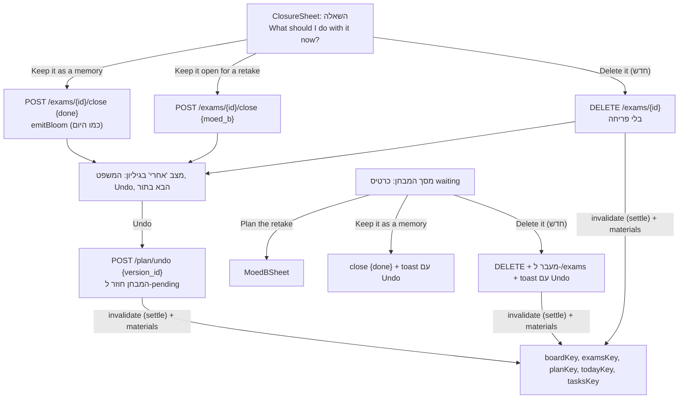

# S45b — "retake" במקום "Moed B", ומחיקה של מבחן שעבר: תוכנית עבודה

> **For agentic workers:** REQUIRED SUB-SKILL: Use superpowers:subagent-driven-development to implement this plan task-by-task. Steps use checkbox (`- [ ]`) syntax for tracking. המנהל (השיחה הראשית) מריץ מפתח אחד לכל Task, לפי הסדר, ואחריו סוקר. git רץ רק בשיחה הראשית.

**מטרה:** המשך קטן ל-S45 (הממשק של סגירת מבחן), לפי שתי החלטות של בעל המוצר מ-25.11.2026:
1. אין "Moed A" ו-"Moed B" במוצר. המונח באנגלית הוא **retake**, ובמקום שבו התכוונו למועד א' כותבים "the first sitting" / "You first sat it". משתנה רק מה שהסטודנט רואה ושומע; שמות בקוד, מפתחות, שמות קבצים, שדות API ו-docstrings בשרת נשארים (`moed_b`, ‏`moedB`, ‏`MoedBSheet`).
2. מבחן שהתאריך שלו עבר כבר לא רלוונטי כיעד ללמידה, ולכן גיליון הסגירה שואל מה לעשות איתו, עם שלוש אפשרויות: לשמור כזיכרון (מה שהיה "Nailed it": הארכיון והפריחה), למחוק, או להשאיר פתוח ל-retake. זה חל על כל מבחן שעבר, גם על מבחנים שעברו לפני S45 (בשרת כולם `pending` היום, והגיליון ייפתח להם). הכרטיס במסך המבחן מציע את אותן אפשרויות.

**גישה:** בלי שינוי בקוד של `api/app` ובלי מיגרציה. המחיקה היא ה-`DELETE /exams/{id}` הקיים (מחיקה רכה עם `version_id`, ו-Undo דרך `POST /plan/undo`). בשרת נוספות רק שתי בדיקות שמאשרות את ההנחה הזו (Task 2). בצד הדפדפן: הטקסטים ב-`i18n/enClosure.ts`, פעולה רביעית ב-`closure/closureActions.ts`, כפתור שלישי בגיליון ובכרטיס, ו-`ExamPage` שלא מאבד את הגיליון כשהמבחן נמחק מתחתיו.

**כלים:** כמו S45: ‏React 19, ‏TypeScript strict, ‏TanStack Query 5, ‏React Aria Components, ‏Vitest; ‏pytest בשרת. בלי תלויות חדשות.

**מקורות, לפי סדר הכוח:** ‏`CLAUDE.md`; מסמך הביקורת `docs/design/2026-11-21-archi-ux-audit.md`; ‏`docs/design/archi-voice.md`; מסמך התכנון הראשי 7.13; ‏`docs/design/design-language.md` 6א; התוכנית של S45 (`docs/archive/plans/2026-11-25-s45-closure-ui.md`), שההחלטות שלה נשארות בתוקף חוץ ממה שכתוב כאן.

## איך החלקים מתחברים



- **למה המחיקה היא פעולה של `closureActions` ולא `useDeleteExam` של האונבורדינג:** ל-`useClosureActions` יש כבר את התבנית שהגיליון צריך: ה-callbacks על ה-mutation, ה-handlers שאומרים "הצגתי את זה", ו-toast עם Undo כשאף אחד לא הציג. ‏`useDeleteExam` מרענן רק את המבחנים והתוכנית, לא את `GET /closures` ואת הארכיון.
- **למה בלי דיאלוג אישור:** כך נמחקים היום מבחן (`onboarding/ExamsStep.tsx`: מחיקה מיד, toast "Deleted <exam>" עם Undo) וזמן תפוס (`calendar/BusySheet.tsx`: כפתור `danger`, בלי אישור). ה-Undo הוא התשובה של הפרויקט, והשרת מבטל את המחיקה במלואה.
- **למה "Keep it as a memory" נשאר הכפתור הראשי:** זו ההחלטה הנפוצה, והיא זו שהגן של S33 חוגג. המחיקה היא האפשרות האחרונה ובצבע של `danger`, כמו כל כפתור מחיקה באפליקציה.

## מה מצאתי בקוד (25.11.2026)

1. **`DELETE /exams/{id}` מקבל כל מבחן שלא נמחק, בכל מצב** (`services/exams.py` ‏`delete_exam` → `_live_exam`, שבודק רק `deleted_at IS NULL`): ‏`pending`, ‏`waiting_moed_b` וגם `done`. הוא מסרב רק ב-404 ‏`not_found` (מבחן שנמחק או של משתמש אחר). הוא תמיד כותב גרסה (`always_version=True`), ולכן `version_id` אף פעם לא `null` בפועל, אף שהסכמה (`ExamDeleteResponse`) והטיפוס בדפדפן מתירים `null`. ה-Undo (`EXAM_DELETED` ב-`plan_writes.py`) מחזיר `deleted_at = NULL`, ולכן `closure`, ‏`closed_at` ו-`sitting` חוזרים כמו שהיו: מבחן `pending` חוזר ל-`pending`, ‏`waiting_moed_b` ל-`waiting_moed_b`. ‏`GET /closures` כבר מדלג על מבחן שנמחק (`test_closures_skip_deleted_exams_and_other_users`). אין בדיקה שמוחקת מבחן `pending` או `waiting` ומבטלת: Task 2 מוסיף שתיים.
2. **אין היום מחיקת מבחן במסך המבחן.** המחיקה היחידה של מבחן בממשק היא באונבורדינג (`ExamsStep.tsx`), בלי אישור ועם toast ו-Undo. זו התבנית שהתוכנית ממשיכה.
3. **`ExamPage` מוריד את הגיליונות כשהמבחן נעלם:** כש-`exams.data` כבר בלי המבחן, הוא מחזיר `Frame` עם `EmptyState` ‏(`notFound`), וה-`ClosureSheets` לא נמצאים בעץ הזה. מחיקה מהגיליון במסך המבחן הייתה מעלימה את מצב "אחרי" ואת ה-Undo שלו ברגע הרענון. Task 3 מתקן את זה.
4. **הטקסטים של "Moed" נמצאים רק ב-`web/src/i18n/enClosure.ts`.** ב-`en.ts` רק הערה (שורה 57). בשרת אין טקסט למשתמש עם "Moed": ה-Push של 19:00 (`app/domain/closure_text.py`) הוא `You made it through <exam>.` ו-`How did it feel? Tell me, and I'll sort out what comes next.`, ו-`PROBLEMS` ב-`errors.py` לא מזכיר מועד. "Moed" בשרת מופיע רק ב-docstrings ובהערות, שנשארים.
5. **הבדיקות של הדפדפן כמעט תמיד קוראות את הטקסט דרך `en.closure.*`**, לא כמחרוזת. לכן שינוי טקסט שובר רק את `i18n/enClosure.test.ts` (הטבלה של המשפטים המחייבים). שמות של `describe` / `it` כמו `'Nailed it closes done…'` הם תיאורים, ומותר לעדכן אותם.
6. **ה-Push שואל "How did it feel?", והגיליון כבר לא ישאל את זה.** ראו "החלטות לבעל המוצר" 1 ו-Task 4 המותנה.
7. **סביבת הצילום של S45** (`~/studyflow-manager/screens/s45-shots-harness`) לוחצת על כפתורים לפי הטקסט (`'Nailed it'`, ‏`'Keep open for Moed B'`, ‏`'Plan Moed B'`, ‏`'Tell me'`), ו-`WEB_DIR` שלה מצביע על ה-worktree של S45. אין בה handler ל-`DELETE /exams/:id`.

## ההחלטות שלי

1. **השאלה בגיליון משתנה מ"How did it feel?" ל-"What should I do with it now?"** *למה:* שלוש האפשרויות הן תשובה למה לעשות עם המבחן, לא לאיך הוא הרגיש; "Nailed it" היה תשובה לרגש, "Delete it" לא. "You made it through <exam>." נשאר, כי זה הטקס של הערב.
2. **הכפתור שפותח את השאלה (השורה בפס, הכרטיס של `pending`) עובר מ-"Tell me" ל-"Choose".** *למה:* מול "What should I do with it now?" הכפתור "Tell me" נקרא כאילו הסטודנט מבקש מ-Archi לספר לו. "Choose" הוא הפועל של ההחלטה, וכבר קיים כ-`en.common.choose`. ‏"Tell me about <next>" במצב "אחרי" נשאר: שם הוא עדיין נכון ("ספר לי על המבחן הבא").
3. **שלושת הכפתורים, זה מתחת לזה ברוחב מלא:** ראשי `Keep it as a memory`, משני `Keep it open for a retake` (רק כש-`moed_b` ב-`options`, כלומר במועד א'), ו-`danger` ‏`Delete it`. ב-retake עצמו (`sitting === 2`, ‏`options: ['done']`) רק שניים: זיכרון ומחיקה. *למה:* מבנה מקביל ("Keep it…", "Keep it…", "Delete it") קל לסריקה; כפתור ראשי אחד (10. כן / לא); ‏`danger` כמו המחיקה ב-`BusySheet`.
4. **מחיקה בלי אישור, עם Undo:** בגיליון, מצב "אחרי" של מחיקה: Archi `rest`, הכותרת `I’ve deleted <exam>.`, הכפתור הראשי של הבא בתור (או `Close`), ו-`Undo` (`quiet`). בלי `I have the date` ובלי `data-slot="bloom"`. Undo מוצלח מחזיר לשאלה של אותו מבחן עם `I put <exam> back as it was.`, בדיוק כמו Undo של סגירה. *למה:* "מה מצאתי" 2; והשרת מחזיר את המבחן במצב שלו.
5. **מחיקה לא פורחת:** הפעולה של המחיקה לא קוראת ל-`emitBloom`, ו-`bloomEvents.ts` לא משתנה. *למה:* החוזה מול S33 (שמתוכנן במקביל) הוא "פריחה רק בהצלחה של `done`".
6. **המחיקה במסך המבחן (הכרטיס של `waiting_moed_b`):** אחרי התשובה המסך עובר ל-`/exams` (`replace: true`), וה-toast `I’ve deleted <exam>.` עם Undo ל-`UNDO_TIMEOUT_MS`. *למה:* המסך של מבחן שנמחק הוא "not found"; ‏`replace` כדי ש-Back לא יחזיר אליו; וה-toast על ה-mutation נשאר גם אחרי שהמסך ירד (התבנית של "I'm done with it").
7. **הגיליון במסך המבחן שורד את המחיקה:** ‏`ExamPage` מצייר את `ClosureSheets` באותו מקום בעץ גם כשהמבחן נעלם, וכשהגיליון נסגר והמבחן עדיין לא קיים, המסך עובר ל-`/exams` (`replace: true`). *למה:* ממצא 3; ה-Undo שבגיליון חייב להישאר עד שהסטודנט סוגר אותו.
8. **הכרטיס של `pending` במסך המבחן נשאר כרטיס עם כפתור אחד שפותח את הגיליון** (עכשיו "Choose"), ושלוש האפשרויות בגיליון. הכרטיס של `waiting_moed_b` מציג שלושה כפתורים: ראשי `Plan the retake`, משני `Keep it as a memory` (מה שהיה "I'm done with it"), ו-`danger` ‏`Delete it`. *למה:* לגיליון יש מצב "אחרי", Undo ו"הבא בתור", וכרטיס לא יכול להחזיק אותם; ב-`waiting` שלוש הפעולות כבר היו בכרטיס (שתיים), ונוספת רק המחיקה. ראו "החלטות לבעל המוצר" 3.
9. **מבחן `done` (בארכיון) לא מקבל מחיקה ב-scope הזה.** *למה:* בעל המוצר דיבר על מבחן שעבר וממתין להחלטה; ההחלטה "לשמור כזיכרון" כבר התקבלה. נרשם ל"החלטות לבעל המוצר" 2.
10. **אין שינוי בשרת.** השרת כבר מקבל מחיקה של מבחן בכל מצב ומבטל אותה נכון (ממצא 1). Task 2 מוסיף שתי בדיקות שמאשרות את זה, בלי קוד. אם בדיקה נכשלת, המפתח עוצר ומדווח, ולא מתקן את השרת.

## Global Constraints

- **בלי שינוי ב-`api/app/` ובלי מיגרציה.** ב-`api/` משתנה רק `api/tests/api/test_closures.py` (Task 2), ו-`api/app/domain/closure_text.py` עם הבדיקה שלו רק ב-Task 4, ורק אם בעל המוצר אישר.
- **שמות בקוד נשארים:** ‏`moed_b`, ‏`moedB`, ‏`MoedBSheet`, ‏`MoedBForm`, ‏`moedBForm.ts`, ‏`moedALine`, ‏`Outcome = 'done' | 'moed_b'`, המפתחות של `en.closure` ושמות הקבצים. משתנים רק הערכים של הטקסטים ומפתחות חדשים שנוספים.
- **אין `Moed` (בכל רישיות) באף טקסט שהסטודנט רואה או שומע:** אף ערך של `en` (כולל פלט של כל פונקציה), ‏`aria-label`, ‏toast או כותרת. הערות ושמות מזהים מותרים.
- **הטקסטים המחייבים, מילה במילה** (גרש מסולסל `’`; שם דרך `isolate()`; כפתור בלי נקודה, משפט עם נקודה):
  - `sheet.title(name)` ו-`row.say(name)`: ‏`You made it through <exam>. What should I do with it now?`
  - `row.sayMany(n)`: ‏`You made it through 2 exams. What should I do with them now?` (‏n === 1: ‏`…1 exam. What should I do with it now?`)
  - `row.open`, ‏`card.open`: ‏`Choose`
  - `sheet.nailed`, ‏`waiting.done`: ‏`Keep it as a memory`
  - `sheet.keepOpen`: ‏`Keep it open for a retake`
  - `sheet.delete` (חדש), ‏`waiting.delete` (חדש): ‏`Delete it`
  - `sheet.deleted(name)` (חדש): ‏`I’ve deleted <exam>.`
  - `sheet.kept(name)`: ‏`I’ll keep everything for <exam> safe and quiet. When you know the retake date, tell me and I’ll plan a focused round.`
  - `waiting.say(name)`: ‏`<exam> is waiting for its retake.`
  - `waiting.kept(files, tasks)`: ‏`I’m keeping its 3 files and 17 tasks for the retake.` / ‏`…its 17 tasks for the retake.` / ‏`…its 3 files for the retake.` / שניהם 0: ‏`I’ll keep this exam ready for the retake.`
  - `waiting.plan`: ‏`Plan the retake`
  - `moedB.title`: ‏`When is the retake?`; ‏`moedB.date`: ‏`Retake date`; ‏`moedB.grade`: ‏`How did the first sitting go? (optional)`; ‏`moedB.submit`: ‏`Plan my retake`
  - `moedB.short`: ‏`Not everything fits before the retake. Your calendar shows what didn’t fit.`
  - `moedB.undone(name)`: ‏`I put <exam> back to waiting for its retake.`
  - `moedB.cantUndo`: ‏`The retake is already under way, so I can’t undo this.`
  - `list.pending`: ‏`What next?`; ‏`list.waiting`: ‏`Waiting for a retake`; ‏`list.moedB(detail)`: ‏`Retake. <detail>`
  - `exam.moedALine(date, grade)`: ‏`You first sat it on 16 November 2026 and got 55.` / בלי ציון: ‏`You first sat it on 16 November 2026.`
  - כל שאר הערכים של `en.closure` לא משתנים (`sheet.bloomed`, ‏`sheet.haveDate`, ‏`sheet.next`, ‏`sheet.undone`, ‏`sheet.stale`, ‏`sheet.stats*`, ‏`archived.*`, ‏`moedB.gradeHint`, ‏`gradeError`, ‏`hard`, ‏`hardHint`, ‏`notes`, ‏`notesHint`, ‏`notesTooLong`, ‏`submitting`, ‏`done`, ‏`list.done`, ‏`closedOn`, ‏`archive`, ‏`noneComing`, ‏`progress.*`).
- **`closure/bloomEvents.ts` לא משתנה** (`git diff` ריק עליו), ומחיקה לא קוראת ל-`emitBloom`.
- **אנגלית בלבד ב-`web/src`** בקול של Archi (`archi-voice.md`); כל טקסט דרך `en`; אין טקסט ישיר ב-JSX (lint). אות עברית רק בבדיקות, כנתוני דמה.
- **רכיבים רק מ-`web/src/ui/`, ולא משנים רכיב שם.** כפתור מחיקה: `Button variant="danger"`. צבע רק דרך tokens; ‏`colorGuards.test.ts`, ‏`theme.test.ts`, ‏`sourceGuards.test.ts` ירוקים.
- **נגישות:** כל פקד 44px; כל שינוי מצב נאמר במילים (הכותרת ו-`<p role="status">` של הגיליון, או toast); במעבר מצב הפוקוס עובר לכפתור הראשי של המצב החדש; בלי `animate` / ‏`transition` חדשים.
- **ההתנהגות הקיימת של הסגירה, מועד ב', ה-Undo, הפתיחה האוטומטית והשורה בפס לא משתנה** מעבר למה שכתוב כאן. בדיקה קיימת משתנה רק בגלל טקסט או מבנה שהשתנו, והמפתח מדווח עליה.
- **פקודות**, מתוך `web/`: ‏`npm test -- <pattern>`, ‏`npm run typecheck`, ‏`npm run lint`, ‏`npm run build`. מתוך `api/`: ‏`uv run pytest tests/api/test_closures.py`, ‏`uv run ruff check .`, ‏`uv run ruff format --check .`, ‏`uv run mypy`. לא מריצים `npm run dev`.
- מסמכים ו-commits בעברית, מונחים טכניים באנגלית.

## Review Focus

1. **אין "Moed" במה שהסטודנט רואה:** חיפוש ב-`web/src` (מחוץ לבדיקות) של `/moed/i` מחזיר רק מזהים, שמות קבצים והערות; הבדיקה של Task 1 עוברת על כל `en`. → Task 1.
2. **כל משפט נכון:** "Keep it as a memory" באמת מעביר לארכיון; "I’ve deleted" נאמר רק אחרי 200; "I put <exam> back as it was." רק אחרי Undo מוצלח; "When you know the retake date, tell me" — יש לזה כפתור (`I have the date`, ‏`Plan the retake`). → Tasks 1, 3.
3. **המחיקה:** ‏`DELETE /exams/{id}` אחד גם בשתי לחיצות; בזמן ההמתנה שני הכפתורים האחרים מנוטרלים והגיליון לא נסגר (גם לא כשרענון של `GET /closures` מגיע בלי המבחן); 404 → ‏toast `codeText('not_found')` והגיליון נסגר; שגיאה אחרת → ‏`Note` והשאלה נשארת. → Task 3.
4. **Undo של מחיקה:** ‏`POST /plan/undo` אחד; המבחן חוזר ל-`pending` (בגיליון: חזרה לשאלה) או ל-`waiting_moed_b` (במסך המבחן: toast); החומרים שלו נטענים שוב. → Tasks 2, 3.
5. **אין פריחה במחיקה**, ו-`bloomEvents.ts` לא נגע. → Task 3.
6. **מסך המבחן:** מחיקה מהכרטיס עוברת ל-`/exams` עם toast ו-Undo; מחיקה מהגיליון במסך המבחן משאירה את מצב "אחרי" ואת ה-Undo עד הסגירה, ואז `/exams`; Undo בגיליון מחזיר את מסך המבחן עם השאלה. → Task 3.
7. **מבחנים ישנים:** מבחן שעבר לפני S45 (`pending`, ‏`sitting: 1`) מקבל את שלושת הכפתורים; ‏`sitting: 2` מקבל שניים. → Task 3.

## סדר ותלויות

המשימות רצות אחת אחרי השנייה, לפי המספר.

| Task | מה | נשען על | מודל |
| --- | --- | --- | --- |
| 1 | הטקסטים (`enClosure.ts`) | — | opus (fable when available) |
| 2 | השרת: שתי בדיקות שמאשרות מחיקה ו-Undo של מבחן שעבר | — | sonnet |
| 3 | המחיקה: הפעולה, הגיליון ומסך המבחן | 1, 2 | opus |
| 4 | טקסט ה-Push (**רק אם בעל המוצר אישר**) | — | haiku |
| 5–8 | צילומים, סקירה סופית, מסמכים, בדיקות ומיזוג | 1–4 | המנהל |

**קבצים משותפים:** ‏`web/src/i18n/enClosure.ts` ו-`enClosure.test.ts` רק ב-Task 1 (אם ל-Task 3 חסר מפתח, הוא מוסיף אותו באותו קול ומדווח). ‏`web/src/closure/closureActions.ts`, ‏`ClosureSheet.tsx`, ‏`exam/ClosureCard.tsx`, ‏`exam/ExamPage.tsx` רק ב-Task 3. ‏`api/` רק ב-Tasks 2 ו-4.

---

### Task 1: הטקסטים: "retake" ושלוש האפשרויות (`opus`, ‏fable when available: הניסוחים בקול של Archi, וכל משפט צריך להיות נכון)

**Files:**
- Modify: `web/src/i18n/enClosure.ts`, `web/src/i18n/enClosure.test.ts`

**מה משתנה.** הערכים של `en.closure` לפי הרשימה המחייבת ב-Global Constraints, ושלושה מפתחות חדשים: `sheet.delete`, ‏`sheet.deleted(name)`, ‏`waiting.delete`. המפתחות הקיימים לא משנים שם (`nailed`, ‏`keepOpen`, ‏`waiting.done`, ‏`moedB.*`, ‏`list.moedB`, ‏`exam.moedALine`), גם כשהשם כבר לא מתאר את הטקסט; ליד `nailed` ו-`waiting.done` הערה קצרה: "Keep as a memory: closes the exam done, into the archive". ‏`madeIt` (הפונקציה המשותפת לכותרת ולשורה) מחזירה את השאלה החדשה. ‏`row.sayMany` שומר על יחיד / רבים (`it` / ‏`them`).

`exam.moedALine(date, grade)`: ‏`grade === null` → ‏`You first sat it on ${date}.`; אחרת `You first sat it on ${date} and got ${String(grade)}.` (גם `0`).

ההערות בראש הקובץ ובתוכו יכולות להמשיך לומר Moed B (הן לא מוצגות), אבל ההערה בראש הקובץ מוסיפה שורה: בטקסט למשתמש המונח הוא retake (S45b), והמזהים נשארו.

**בדיקות (נכתבות קודם, נכשלות), ב-`enClosure.test.ts`:**
- [ ] הטבלה `the binding sentences of the plan` מתעדכנת לכל הערכים של Global Constraints, ונוספות שורות ל-`sheet.delete`, ‏`sheet.deleted(EXAM)` (עם תווי הבידוד), ‏`waiting.delete`, ‏`row.sayMany(1)`, ושלוש הצורות של `waiting.kept` (‏`(3, 17)`, ‏`(0, 17)`, ‏`(3, 0)`, ‏`(0, 0)`).
- [ ] `exam.moedALine` ל-`55`, ‏`null` ו-`0`.
- [ ] **אין Moed בשום מקום:** כל טקסט בטבלה לא מתאים ל-`/moed/i`; ובדיקה נוספת שעוברת ברקורסיה על כל `en` (מ-`./en`): כל ערך מחרוזת לא מתאים ל-`/moed/i`, וכל פונקציה תחת `en.closure` נקראת עם ארגומנטים לדוגמה לפי המפתח (רשימה מפורשת בבדיקה: שם `'X'`, מספרים, ‏`moedB.done(2, ['A', 'B'])`), והפלט לא מתאים ל-`/moed/i`.
- [ ] הבדיקות הקיימות של הקול (בלי `!`, ‏`·`, אימוג׳י, ‏`Archi` כנושא; כפתורים בלי נקודה בסוף) מכסות גם את `delete` (שני המקומות) ואת `card.open` / ‏`row.open`.
- [ ] `row.say(EXAM)` עדיין שווה ל-`sheet.title(EXAM)`.

**צעדים:**
- [ ] בדיקות נכשלות: `npm test -- enClosure`.
- [ ] מימוש; `npm test` (כל הבדיקות: אם בדיקה אחרת נשענת על מחרוזת ישירה, לעדכן ולדווח), ‏`npm run typecheck`, ‏`npm run lint`.
- [ ] commit: `feat(web): S45b הטקסטים: retake במקום Moed B, ושלוש האפשרויות של מבחן שעבר`.

**קריטריוני קבלה:** הטקסטים מילה במילה כמו ב-Global Constraints; אף טקסט למשתמש לא אומר Moed; שום מפתח לא שינה שם. ניסוח שנשמע לא טבעי מותר לשפר בתוך כללי `archi-voice.md` רק באישור המנהל (הוא מציג אותם לבעל המוצר).

### Task 2: השרת: מחיקה ו-Undo של מבחן שעבר, בבדיקות בלבד (`sonnet`: שתי בדיקות בקובץ קיים עם עוזרים מוכנים)

**Files:**
- Modify: `api/tests/api/test_closures.py` (בלבד)

**למה:** הממשק של Task 3 נשען על כך ש-`DELETE /exams/{id}` מקבל מבחן `pending` ו-`waiting_moed_b`, מחזיר `version_id`, מוציא אותו מ-`GET /closures`, ו-Undo מחזיר אותו לאותו מצב. הקוד עושה את זה היום (`services/exams.py` ‏`delete_exam` → `_live_exam`; ‏`EXAM_DELETED` ב-`plan_writes.py`), ואין בדיקה שמחזיקה את זה.

**בדיקות** (בעזרת העוזרים שבקובץ: `_closures`, ‏`_close`, ‏`_undo`, ‏`_exam`, ‏`_ids`, והפיקסצ'ר `user`; מבחן שעבר נבנה כמו ב-`test_a_past_exam_is_pending_with_its_stats_and_topics`):
- [ ] `test_deleting_a_pending_exam_takes_it_off_closures_and_undo_brings_it_back`: מבחן שעבר (`pending`, ‏`sitting` 1). ‏`DELETE /exams/{id}` → 200, ‏`version_id` לא `None`; ‏`GET /closures` בלי המבחן ב-`pending`; ‏`_undo(version_id)` → 200; ‏`GET /closures` שוב עם המבחן ב-`pending`, עם אותם `options` (`["done", "moed_b"]`) ואותם `tasks_total` ו-`studied_minutes` כמו לפני המחיקה.
- [ ] `test_deleting_a_waiting_exam_and_undo_returns_it_to_waiting`: מבחן שעבר, ‏`_close(..., "moed_b")`; ‏`DELETE` → 200 עם `version_id`; המבחן לא ב-`waiting` ולא ב-`GET /exams`; ‏Undo → המבחן שוב ב-`waiting`, וב-`GET /exams` עם `state == "waiting_moed_b"`.

הבדיקות האלה אמורות לעבור בלי שום שינוי בקוד (הן מאשרות התנהגות קיימת). **אם אחת נכשלת: עוצרים, לא נוגעים ב-`api/app/`, ומדווחים למנהל מה השרת עשה.**

**צעדים:**
- [ ] כתיבת שתי הבדיקות; `uv run pytest tests/api/test_closures.py` (מתוך `api/`; צריך `brew services start postgresql@17`).
- [ ] `uv run ruff check .`, ‏`uv run ruff format --check .`, ‏`uv run mypy`.
- [ ] commit: `test(api): S45b מחיקה ו-Undo של מבחן שעבר (pending ו-waiting)`.

**קריטריוני קבלה:** ‏`git diff --stat -- api/app` ריק; שתי הבדיקות ירוקות.

### Task 3: המחיקה: הפעולה, הגיליון ומסך המבחן (`opus`: mutation שחי אחרי המסך, מירוץ מול הרענון, ועץ שלא מאבד את הגיליון)

**Files:**
- Modify: `web/src/closure/closureActions.ts`, `web/src/closure/closureActions.test.tsx`, `web/src/closure/ClosureSheet.tsx`, `web/src/closure/ClosureSheet.test.tsx`, `web/src/exam/ClosureCard.tsx`, `web/src/exam/ExamPage.tsx`, `web/src/exam/closureScreens.test.tsx`
- אם צריך: `web/src/test/closureFixtures.ts` (תשובה של מחיקה: `{ version_id: 'v-del', plan_affected: true }`)

**תלוי ב:** Tasks 1, 2.

**1. `closureActions.ts`: פעולה רביעית, `remove`.**

```ts
export interface DeleteHandlers {
  // versionId: null only if the server wrote no version (it always does today); then there is no Undo.
  onSuccess?(versionId: string | null): boolean
  onError?(failure: CloseFailure): boolean
}
export interface ClosureActions {
  // …the existing ones
  // "Delete it": DELETE /exams/{id}. No bloom.
  remove(item: ExamRef, handlers?: DeleteHandlers): void
  // True while the delete of this exam is on its way.
  deleting(examId: string): boolean
  undo(versionId: string, reason: 'close' | 'moed_b' | 'delete', name: string, handlers?: UndoHandlers): void
}
```

- מפתח: `deleteKey(userId) = [...closureActionKey(userId), 'delete']`; ‏`mutationFn`: ‏`api.delete<ExamDeleteResponse>(`/exams/${item.exam_id}`)` (הטיפוס מ-`onboarding/types.ts`).
- `onSuccess`: ‏`queryClient.removeQueries({ queryKey: materialsKey(userId, item.exam_id) })` (כמו `useDeleteExam`: אין polling לרשימה שנעלמה); ‏`shown = callHandler(() => handlers?.onSuccess?.(answer.version_id))`; כש-`!shown`: ‏`version_id !== null` → ‏`undoToast(s.deleted(name), version_id, 'delete', name)`; אחרת `toast.show({ text: s.deleted(name), tone: 'success' })`. **בלי `emitBloom`.**
- `onError`: בדיוק כמו של `closeMutation` (בלי `finish`): ‏`staleText` → ‏toast מידע ו-`onError({ kind: 'stale' })`; אחרת `errorMessage`, וה-toast רק כשה-handler לא הציג.
- `onSettled: settle`.
- **Undo:** ‏`reason === 'delete'` → טקסט ההצלחה `s.undone(name)` (כמו `'close'`), והשגיאה `errorMessage` (כמו `'close'`). אחרי Undo של `'delete'` גם `invalidateQueries({ queryKey: materialsKey(userId) })`.
- **החלטה אחת בכל פעם לכל מבחן:** `close`, ‏`finish` ו-`remove` לא שולחים כשיש סגירה **או** מחיקה של אותו מבחן בדרך (`queryClient.isMutating` על שני המפתחות, עם ה-predicate של `exam_id`, כמו `closeRunning` היום).
- `materialsKey` ו-`examsKey` של `onboarding/api.ts` מקבלים את אותו `userId` ש-`useBoardUserId()` מחזיר (כך זה כבר עובד ל-`examsKey`); לבדוק ולהשאיר הערה אם יש הבדל.
- ההערה בראש הקובץ: ארבע פעולות, והמחיקה לא פורחת.

**2. `ClosureSheet.tsx`: הכפתור השלישי ומצב "אחרי" של מחיקה.**
- `type Choice = Outcome | 'delete'` (מקומי לקובץ). ‏`chosen: Choice | null`; במצב `after`: ‏`outcome: Choice` ו-`versionId: string | null`.
- `inFlight` ו-`busy` כוללים גם `actions.deleting(item.exam_id)`. *למה:* רענון שמגיע בזמן המחיקה בלי המבחן לא סוגר את הגיליון עם `stale` (החלטה 7 של S45).
- **השאלה:** שלושה כפתורים ב-`flex flex-col gap-2`, ברוחב מלא: ראשי `s.nailed` → `decide('done')`; משני `s.keepOpen` (רק כש-`options` כולל `moed_b`) → `decide('moed_b')`; ‏`variant="danger"` ‏`s.delete` → `decide('delete')`. הכפתור שנבחר `isPending` בזמן ההמתנה, השניים האחרים `isDisabled`.
- `decide('delete')` קורא ל-`actions.remove(item, { onSuccess: (versionId) => …, onError: … })` עם אותם handlers של `actions.close` היום (בדיקת `mounted`, ‏`setDecided`, מעבר ל-`after`; ‏`stale` → ‏`close()`; אחרת `setError`).
- **אחרי מחיקה:** ‏`title = s.deleted(name)`, ‏`figure = <SheetFigure mood="rest" />` (בלי `bloom`), הכפתור הראשי של הבא בתור או `en.common.close` (כמו היום), בלי `s.haveDate`, ו-`Undo` רק כש-`versionId !== null`, דרך `actions.undo(versionId, 'delete', item.exam_name, …)` עם אותם handlers של ה-Undo של סגירה (חזרה ל-`question` עם `held: true` ו-`s.undone(name)`).
- ההערה בראש הקובץ: שלוש האפשרויות.

**3. `exam/ClosureCard.tsx`: הכרטיס של `waiting_moed_b`.**
- שלושה כפתורים ב-`flex flex-wrap gap-2`: ראשי `c.waiting.plan` (מנוטרל כש-`closing` או `deleting` של המבחן); משני `c.waiting.done` → ‏`actions.finish(item)` (`isPending={closing}`, מנוטרל כש-`deleting`); ‏`variant="danger"` ‏`c.waiting.delete` (`isPending={deleting}`, מנוטרל כש-`closing`).
- המחיקה: `actions.remove(item, { onSuccess: () => { if (mounted.current) void navigate('/exams', { replace: true }); return false } })` (`useMounted` מ-`closure/sheetParts`, ‏`useNavigate` של `react-router`). ‏`return false` בכוונה: ה-toast עם ה-Undo הוא של הפעולה, והוא נשאר אחרי שהמסך ירד.
- `PendingCard` לא משתנה בקוד (הטקסט של `card.open` השתנה ב-Task 1).

**4. `exam/ExamPage.tsx`: הגיליון שורד את המחיקה.**
- אחרי שהמבחנים נטענו, כל ענף מחזיר `<>{content}{sheets}</>`: ‏`content` הוא `Frame` עם `EmptyState` כשהמבחן לא נמצא, או העץ של היום (בלי ה-`sheets` בתוכו). כך `ClosureSheets` באותו מקום בעץ (האינדקס השני של ה-fragment) בכל מצב, ו-React לא מרכיב אותו מחדש.
- `onClose` של `ClosureSheets`: ‏`setSheet(null)`, ואם `exam === undefined` (נמחק בזמן שהגיליון היה פתוח) → `navigate('/exams', { replace: true })`.
- ההערה ליד `sheets`: למה הם מחוץ לענף.

**בדיקות (נכתבות קודם, נכשלות):**

ב-`closureActions.test.tsx`:
- [ ] `remove` → ‏`DELETE /exams/exam-1` אחד גם בשתי קריאות באותו tick; ‏`remove` בזמן `close` של אותו מבחן לא נשלח, וגם להפך.
- [ ] בלי handler (או handler שמחזיר `false`): ‏toast `sheet.deleted('הסתברות')` עם `Undo`; לחיצה → ‏`POST /plan/undo { version_id: 'v-del' }` ו-toast `sheet.undone`.
- [ ] handler שמחזיר `true`: אין toast.
- [ ] `emitBloom` לא נקרא במחיקה (מאזין של `onBloom` לא מקבל אירוע).
- [ ] 404 → ‏toast `codeText('not_found')` ו-`onError({ kind: 'stale' })`; ‏500 עם handler שמציג → אין toast.
- [ ] `deleting('exam-1')` אמת בזמן הבקשה ושקר אחריה.

ב-`ClosureSheet.test.tsx`:
- [ ] השאלה במועד א': שלושה כפתורים, ‏`Keep it as a memory`, ‏`Keep it open for a retake`, ‏`Delete it`, בסדר הזה; ב-`options: ['done']`: שניים (זיכרון ומחיקה). שם הדיאלוג `sheet.title(name)`.
- [ ] `Delete it` → ‏`DELETE`; בזמן ההמתנה Escape לא סוגר והשניים האחרים מנוטרלים; רענון של `GET /closures` שמגיע בלי המבחן לא סוגר את הגיליון ולא מציג `stale`; אחרי 200: הכותרת `sheet.deleted(name)`, ‏`role="status"` מכיל אותה, הפוקוס על `Close`, אין `[data-slot="bloom"]`, אין `I have the date`.
- [ ] Undo אחרי מחיקה → ‏`POST /plan/undo` אחד; חזרה לשאלה עם `sheet.undone`.
- [ ] שני פריטים: מחיקה של הראשון → `Tell me about <second>`.
- [ ] 404 במחיקה → ‏`onClose` ו-toast `codeText('not_found')`; ‏500 → ‏`Note`, והשאלה נשארת.
- [ ] הבדיקות הקיימות (`Nailed it…`, ‏`Keep open…`) ממשיכות לעבור דרך `en.closure.*`; שמות התיאור מתעדכנים ל"Keep it as a memory" ו-"Keep it open for a retake".

ב-`closureScreens.test.tsx`:
- [ ] `waiting_moed_b`: שלושה כפתורים `Plan the retake`, ‏`Keep it as a memory`, ‏`Delete it`; ‏`Delete it` → ‏`DELETE`, המסך עובר ל-`/exams` (ה-h1 של רשימת המבחנים), ו-toast `sheet.deleted` עם Undo; Undo → ‏`POST /plan/undo` ו-toast `sheet.undone`.
- [ ] `pending`: ‏`Choose` → הגיליון; ‏`Delete it` → מצב "אחרי" עם Undo נשאר גם אחרי ש-`GET /exams` חוזר בלי המבחן; ‏`Close` → ‏`/exams`. ובמקרה נפרד: ‏Undo בגיליון → המבחן חוזר ל-`GET /exams`, ומסך המבחן מציג אותו עם הגיליון בשאלה.
- [ ] מבחן ישן (`sitting: 1`, ‏`exam_date` שבוע לפני היום, `pending`): הכרטיס והגיליון כמו כל `pending`.
- [ ] הבדיקות הקיימות של מסך המבחן ושל הרשימה ירוקות (הטקסטים דרך `en`).

**צעדים:**
- [ ] בדיקות נכשלות: `npm test -- closureActions ClosureSheet closureScreens`.
- [ ] מימוש; `npm test`, ‏`npm run typecheck`, ‏`npm run lint`, ‏`npm run build`.
- [ ] commit: `feat(web): S45b מחיקה של מבחן שעבר: בגיליון ובמסך המבחן, עם Undo`.

**קריטריוני קבלה:** כפתור ראשי אחד בכל מצב; בלי דיאלוג אישור; ‏`bloomEvents.ts` לא נגע; אין טקסט ישיר ב-JSX; 44px לכל פקד; ההתנהגות של "Keep it as a memory" ו-"Keep it open for a retake" זהה לזו של S45.

### Task 4: טקסט ה-Push של 19:00 (`haiku`: קבוע אחד ובדיקה אחת) — **רק אם בעל המוצר אישר** (החלטה 1 למטה)

**Files:**
- Modify: `api/app/domain/closure_text.py`, `api/tests/test_closure_text.py`

- [ ] בבדיקה, קודם: ‏`CLOSURE_BODY == "Tell me what to do with it, and I'll sort out what comes next."` (הכותרת `You made it through <exam>.` לא משתנה). נכשלת.
- [ ] הקבוע; ה-docstring של המודול: "The push that asks what to do with an exam that is over".
- [ ] `uv run pytest tests/test_closure_text.py tests/api/test_closures.py`, ‏`uv run ruff check .`, ‏`uv run ruff format --check .`, ‏`uv run mypy`.
- [ ] commit: `feat(api): S45b ה-Push של הערב שואל מה לעשות עם המבחן`.

**קריטריוני קבלה:** רק הקבוע והבדיקה השתנו. בלי אישור, המשימה לא רצה, וה-Global Constraint "בלי שינוי ב-`api/app/`" חל במלואו.

---

## משימות המנהל (השיחה הראשית; לא נשלחות כמשימת מימוש)

### Task 5: צילומים ביום ובערב — **מנהל** (subagent של `sonnet` לצילום; המנהל משווה)

- [ ] הסביבה הקיימת `~/studyflow-manager/screens/s45-shots-harness` (פורטים **4245** ו-**4345**), עם `WEB_DIR=/Users/eyalatar/studyflow-manager/worktrees/s45b/web` ו-`OUT_DIR=~/studyflow-manager/screens/s45b-screens`. לעדכן ב-`shoot.mjs` את הטקסטים שהוא לוחץ עליהם (`'Nailed it'` → ‏`'Keep it as a memory'`, ‏`'Keep open for Moed B'` → ‏`'Keep it open for a retake'`, ‏`'Plan Moed B'` → ‏`'Plan the retake'`, ‏`'Tell me'` → ‏`'Choose'`; ‏`'Tell me about'` נשאר), ולהוסיף לנתוני הדמה handler ל-`DELETE /exams/:id` (מחזיר `{ version_id, plan_affected: true }` ומוציא את המבחן מ-`closures` ומ-`exams`) ול-Undo שלו.
- [ ] לצלם מחדש רק מה שהשתנה, ב-390×844 וב-1280×800, ביום וב-Dusk: הגיליון בשאלה (מועד א' עם שלושה כפתורים, retake עם שניים, שם ארוך בעברית); הכפתור `Delete it` ממתין; "אחרי" של מחיקה; Undo של מחיקה; "אחרי" של זיכרון ושל retake (המשפט החדש של `kept`); ‏`Tell me about <second>` אחרי מחיקה; הטופס (`When is the retake?`, ריק ועם שגיאות); "אחרי" של הטופס עם `short`; השורה בפס (אחד ושניים, `Choose`); רשימת המבחנים (`What next?`, ‏`Waiting for a retake`, ‏`Retake. …`); מסך המבחן `pending`, ‏`waiting` (שלושה כפתורים), ו-retake פעיל (`You first sat it on …`); המעבר ל-`/exams` עם ה-toast אחרי מחיקה מהכרטיס; 200% טקסט לשאלה ולכרטיס של `waiting`.
- [ ] לבדוק במיוחד: הגיליון בטלפון נכנס בלי גלילה עם שלושה כפתורים; ‏`danger` קריא ב-Dusk (סריקת הניגודיות של הסביבה); שלושת הכפתורים בכרטיס של `waiting` נשברים לשורות בטלפון בלי חיתוך.
- [ ] כל פער: תיקון דרך מפתח (במודל של Task 3), או רישום כסטייה מודעת ב-6א.

### Task 6: סקירה סופית — **מנהל** (הסוקר: `opus`, ‏fable when available)

- [ ] `superpowers:requesting-code-review` על כל הענף מול התוכנית הזו, ה-Global Constraints וה-Review Focus, ו-`archi-voice.md`. הסוקר קורא את `en.closure` כטקסט רציף (כל משפט נכון למה שהמוצר עושה), מחפש `/moed/i` ב-`web/src` מחוץ לבדיקות ומוודא שכל מופע הוא מזהה, שם קובץ או הערה, ובודק ש-`git diff origin/main -- web/src/closure/bloomEvents.ts api/app` ריק (חוץ מ-Task 4 אם רץ).
- [ ] תיקונים דרך מפתח, ובדיקה חוזרת של מה שתוקן.

### Task 7: מסמכים — **מנהל**

- [ ] `docs/design/archi-voice.md`, המילון הקבוע: שורה `Retake` ‏(מועד ב': סיבוב שני של מבחן שעבר) | לא לכתוב: Moed B, Moed A, second sitting (בטקסט למשתמש; "the first sitting" / "first sat it" מותרים כשמדברים על מועד א').
- [ ] `docs/design/design-language.md`: בפסקת `ClosureSheet` ב-6א השאלה החדשה, שלושת הכפתורים (`danger` למחיקה), מצב "אחרי" של מחיקה (`rest`, ‏`I’ve deleted <exam>.`, ‏Undo, בלי פריחה) והטקסטים של retake; בשורה של S33 בטבלת נקודות החיבור: "מחיקה לא פורחת"; בפסקאות של רשימת המבחנים ומסך המבחן (הצ'יפים, ‏`Retake. `, ‏`You first sat it on …`, שלושת הכפתורים של `waiting`, והמעבר ל-`/exams` אחרי מחיקה). סטיות שהתקבלו ב-Task 5.
- [ ] `docs/spec/2026-10-19-studyflow-v2-design.md`: ב-7.13, ברשימה "מה הגיליון מציג" ובפסקת "הממשק", פסקה "S45b (25.11.2026)" עם ההחלטות 1–8 של התוכנית הזו והטקסטים החדשים; הטקסטים הישנים שם מסומנים כמוחלפים (לא נמחקים מההיסטוריה של "ניסוחים שהשתנו"); ב-7.9 (שורה ~590) הצ'יפים והשורה של retake. אם Task 4 רץ: גם משפט ה-Push ב"התזכורת".
- [ ] מפת הדרכים (artifact, עם כלי ה-Docs): ‏S45b, וכל באג שהמפתחים דיווחו עליו.

### Task 8: כל הפקודות, מיזוג ומפת הדרכים — **מנהל**

- [ ] כל הפקודות של `web/` (`npm test`, ‏`lint`, ‏`typecheck`, ‏`build`); ב-`api/`: ‏`uv run pytest`, ‏`ruff check`, ‏`ruff format --check`, ‏`mypy`; ‏`git diff --stat origin/main -- api/app` ריק (או רק `closure_text.py` אם Task 4 רץ). ‏gitleaks נקי.
- [ ] `git fetch`, ‏`git rebase origin/main` (S33 רץ במקביל: אם הוא כבר במיין, לבדוק שאין התנגשות ב-`closure/` וב-`enClosure.ts`), וכל הבדיקות שוב.
- [ ] `git push origin s45b-retake-delete:main` (רק fast-forward); בדיקה שה-push הצליח, ורק אחר כך מחיקת הענף. התוכנית עוברת ל-`docs/archive/plans/`.
- [ ] מפת הדרכים: ‏S45b "הושלם" עם ה-commit של `main`. הודעה לאייל: מה השתנה, רשימת הטקסטים, מה נבדק, וההחלטות הפתוחות.

## מה נרשם ל-scopes אחרים

- **S33 (הגן):** מחיקה של מבחן לא שולחת `course_bloomed`, ומבחן שנמחק לא מופיע ב-`progress.archive`; אין צורך בקוד בגן. אם S33 משנה את `ClosureSheet` (איור הפריחה ב-`data-slot="bloom"`), המיזוג השני מבין השניים עושה rebase ובודק את מצב "אחרי" של מחיקה.
- **אם יוחלט:** מחיקה של מבחן מהארכיון (`done`) במסך המבחן (החלטות לבעל המוצר 2). השרת כבר מקבל אותה.

## החלטות לבעל המוצר

1. **ה-Push של 19:00 אומר "How did it feel? Tell me, and I'll sort out what comes next."**, והגיליון כבר לא שואל איך זה הרגיש.
   - **א:** להשאיר. ה-Push הוא הזמנה, והלחיצה עדיין מובילה להחלטה.
   - **ב (Task 4):** ‏`Tell me what to do with it, and I'll sort out what comes next.` קבוע אחד ובדיקה בשרת, בלי שינוי התנהגות.
   - **ההמלצה:** ב. כל משפט של Archi צריך להיות נכון, וזה שינוי של שורה.
2. **מחיקה של מבחן שכבר בארכיון (`done`).** היום אין לו שום פקד.
   - **א (בתוכנית):** לא ב-S45b.
   - **ב:** כפתור `Delete it` גם בכרטיס של הארכיון במסך המבחן (אותה פעולה, ו-toast עם Undo).
   - **ההמלצה:** א עכשיו, וב כשמישהו ירצה לנקות את הארכיון; זה מקרה אחר מ"מבחן שעבר ומחכה להחלטה".
3. **הכרטיס של `pending` במסך המבחן:** כפתור אחד (`Choose`) שפותח את הגיליון עם שלוש האפשרויות.
   - **א (בתוכנית):** כך. לגיליון יש מצב "אחרי", Undo והבא בתור.
   - **ב:** שלושת הכפתורים ישר בכרטיס, עם toast במקום מצב "אחרי".
   - **ההמלצה:** א.
