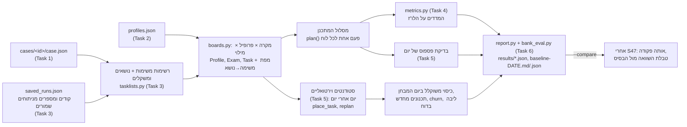

# S46 חלק א' — מאגר מקרים, מסלול המתכנן, סטודנטים וירטואליים ודוח בסיס למתכנן: תוכנית עבודה

> **For agentic workers:** REQUIRED SUB-SKILL: Use superpowers:subagent-driven-development to implement this plan task-by-task. Steps use checkbox (`- [ ]`) syntax for tracking. המנהל (השיחה הראשית) מריץ מפתח אחד לכל Task, לפי הסדר, ואחריו סוקר. git רץ רק בשיחה הראשית.

**מטרה:** מספרים שמראים איך **המתכנן של היום** מתפקד בכל סוג קורס ובכל סוג סטודנט, כדי ש-S47 (השלבים והשכבות) יימדד מולם. הכלל של אייל: אין שינוי במתכנן לפני שיש מדידה של המתכנן. חלק א' כולו חינם: בלי רשת, בלי קריאה למודל, בלי מסד.

**מה נכנס (חלק א'):** מבנה של מקרה וטוען שבודק אותו; ספריית פרופילים; מסלול המתכנן על רשימות משימות × פרופילים; המדדים "על הלו"ז"; סטודנטים וירטואליים עם המדד הראשי, הכיסוי המשוקלל ביום המבחן; דוח בסיס; פקודה אחת שרצה שוב אחרי S47 ומפיקה השוואה.

**מה לא נכנס (חלק ב', בלי לסגור לו דלתות):** `synth.py` עם Opus, המסלול המלא (חומרים → ניתוח → לו"ז), השופט לפי תחום, מקרי המלכודת, העברת `analysis_cases.json` למבנה החדש, המקרים האמיתיים, תוכניות המצטיינים, ודוח הבסיס של הניתוח.

**מקורות, לפי סדר הכוח:** `CLAUDE.md`; ‏`docs/spec/2026-11-26-plan-quality-implementation.md` (סעיפים 1–3, ‏4.3, ‏5 פריט 11); ‏`docs/spec/2026-11-26-plan-quality-mapping.md` (המיפוי, "תוצר טוב", הנספח, סעיף 3); מסמך התכנון הראשי 7.6.

## איך החלקים מתחברים



- **הקוד של המוצר לא משתנה.** כל הקוד החדש יושב ב-`api/eval/bank/` ומשתמש בפונקציות הציבוריות של `app.domain.planner` ‏(`plan`, ‏`replan`, ‏`place_task`, ‏`study_days`, ‏`study_date`, ‏`exam_budgets`, ‏`last_study_day`, ‏`is_complete`) וב-`app.domain.moed_b.build_moed_b_tasks`. *למה:* המדידה צריכה לראות בדיוק את מה שהסטודנט יקבל, ולא העתק של המתכנן.
- **הנושא של כל משימה חי בצד ה-eval.** ל-`Task` של הדומיין אין היום `topic_id` ואין `optional`. לכן כל לוח מחזיק שתי מפות: `topics` (מזהה נושא → מפתח ומשקל) ו-`task_topic` (מזהה משימה → מזהה נושא). שכבת המדידה שואלת את הנושא דרך פונקציה אחת, `topic_of`, שמסתכלת קודם במפה ואחר כך ב-`task.topic_id` אם הוא קיים; ו-`is_core` קורא `task.optional` אם הוא קיים. *למה:* אחרי S47 משימות שהקוד יוצר (`study_rounds`) יגיעו עם `topic_id` משלהן, והמדידה תמשיך לעבוד בלי כתיבה מחדש.
- **נקודת חיבור אחת ל-S47:** `boards.planner_tasks(board)` מחזירה היום את המשימות כמו שהן. ב-S47 נכנסת שם הקריאה ל-`study_rounds`, כמו שהשירות של הניתוח יעשה במוצר. *למה:* כך "אותה פקודה" מודדת את המתכנן החדש עם הסבבים שלו, בלי לגעת בשאר הקוד של ה-eval.
- **המדידה מבוססת דקות ולא כותרות.** מהניתוחים השמורים נקראים רק `kind`, `minutes`, `focus`, `depends_on`, `topic_key` והמשקל של הנושא. כותרות, נימוקים ושמות נושאים לא נקראים בכלל. *למה:* זה הכלל של `plan_eval.py`, וכך אי אפשר להדפיס תוכן גם בטעות.
- **חלק ב' מתחבר בלי שינוי מבנה:** הסכמה של `case.json` כבר כוללת `materials`, ‏`expect.kinds_min`, ‏`expect.must_not` ו-`kind: "real" | "trap"`. ה-CLI נקרא `bank_eval.py planner`, וחלק ב' יוסיף `bank_eval.py full` לידו.

## מה מצאתי בקוד (27.11.2026)

1. **`uv run mypy` לא בודק את `api/eval/`.** ב-`api/pyproject.toml`: ‏`files = ["app", "tests", "migrations"]`. בנוסף, הסקריפטים הקיימים לא עוברים mypy strict: ‏`plan_eval.py` (3 שגיאות), ‏`generate_eval.py` ו-`analysis_eval.py`. לכן: הקוד החדש יושב בחבילה `eval.bank`, הבדיקות שלו ב-`tests/eval_bank/` מייבאות אותו, ו-mypy (שעוקב אחרי imports) בודק אותו דרך `uv run mypy` הרגיל. בנוסף כל משימה מריצה `uv run mypy eval/bank eval/bank_eval.py` במפורש. אסור לייבא מ-`plan_eval.py` או מ-`generate_eval.py`, כי אז השגיאות שלהם ייכנסו ל-`uv run mypy`; מה שצריך מהם מועתק.
2. **התוצאות השמורות של הניתוח לא נמצאות ב-worktree.** הן ב-`~/studyflow/api/eval/results/` (מוגן ב-`.gitignore`). ב-worktree של S46 התיקייה ריקה, ו-`plan_eval.py` שם מסיים ב-`no valid runs`. בתיקייה יש 18 ריצות תקינות של `claude-*` (אחרי השמטת כפילויות), ועוד קובץ של `gemma3:12b` שלא שייך לבדיקה.
3. **בניתוחים השמורים יש מה שצריך לנושאים:** לכל משימה `topic_key` (או `null` לסקירה, סימולציה ותחקיר), ולכל נושא `key` ו-`weight`. אין צורך בשום מודל כדי לחבר משימה לנושא.
4. **כל הניתוחים השמורים הם של שני קורסים מאותו סוג** (חדו"א ומבחן "מה ידפיס"), שניהם פתרון בעיות. לכן הרוחב בין סוגי הבחינות מגיע רק מהרשימות הסינתטיות.
5. **אין במוצר "בוצע חלקית".** בלוק הוא `done` או `missed` (ו-`skipped`). המשימה נהיית `done` רק כשאין לה בלוק חי ו-`is_complete` מתקיים (`services/blocks.py`, ‏`complete_block`).
6. **סקירת הבוקר היא פעולה של המשתמש** ("העבר להיום", "דלג", "בוצע"), לא תהליך אוטומטי. היא מסמנת `missed` וקוראת ל-`place_task` בלי `release` (`services/review.py`).
7. **אין שדה לבלוקים קצרים ולתוספת זמן** (`Profile` ב-`model.py`). שני המקרים נכנסים כ"פער מתועד" שנמדד במספר.
8. **המתכנן מהיר:** בלוח של שני מבחנים ו-40 משימות, ‏`plan()` לוקח כ-3ms, ‏`replan()` כ-3ms, ‏`place_task` כ-1ms (נמדד ב-27.11 על ה-main). 1,000 תקופות של 35–56 ימים יסתיימו בדקות ספורות בתהליך אחד.

## ההחלטות שלי

1. **הכיסוי המשוקלל מחושב בדקות, עם תקרה לכל נושא** (ראו "החלטות לבעל המוצר" 1). לכל מבחן: `coverage = Σ_t (w_t / W) × min(1, actual_t / target_t)`. ‏`target_t` הוא סכום הדקות של משימות הליבה של הנושא ברשימה שהמתכנן קיבל בהתחלה; ‏`actual_t` הוא סכום הדקות שבוצעו בפועל בכל משימה של הנושא עד יום המבחן. *למה:* זה המדד הכי קרוב ל"כמה מהנקודות מכוסות" שאפשר בלי אטלס (S50), והתקרה מונעת מסבבים נוספים של S47 לנפח אותו מעבר ל-100%.
2. **נושא בלי אף משימה לא נכנס ל-`W`,** והחלק שלו מדווח בנפרד (`uncovered_by_list_share`). *למה:* זה פער של הניתוח (הנושא בלי חומר), לא של המתכנן; אם הוא ייכנס, הוא יוריד את כל המספרים באותו קבוע ויסתיר שינויים של S47.
3. **בלוק "חלקי" (`slowdown`) מסומן בלוח כ-`done`,** אבל לכיסוי נזקפות רק `PARTIAL_FRACTION` מהדקות שלו. *למה:* כך מתנהג סטודנט אמיתי במוצר של היום (ממצא 5): הלוח חושב שהמשימה נגמרה, והלמידה בפועל חסרה. זה בדיוק הפער ש-S48 (קצב אישי) בא לסגור, ולכן הוא חייב להיות במדידה.
4. **סקירת הבוקר המדומה תמיד בוחרת "העבר להיום" (move).** *למה:* זו הפעולה שמשאירה את המשימה בתוכנית; "דלג" מוחק עבודה ולא מתאים לסטודנט שרוצה לעבור את המבחן.
5. **התאריך של `now` קבוע: יום ראשון 6.12.2026, ‏08:30, ‏`Asia/Jerusalem`.** *למה:* הדוח חייב לצאת זהה בכל יום הרצה, ובדצמבר–ינואר אין מעבר שעון בישראל.
6. **הרשימות הסינתטיות בנויות במתכון של הניתוח של היום** (סקירה, למידה ותרגול לכל נושא, סימולציה ותחקיר לכל מבחן עבר, 30–90 דקות, קיצוץ לפי `trim_to_budget`), בשני מצבי מילוי: 50% ו-100% מהתקציב. *למה:* המדידה היא של המתכנן מול מה שהניתוח של היום באמת מחזיר (ב-S12, ‏Sonnet מילא 48% במבחן רחוק ו-81% בקרוב); מתכון "טוב יותר" היה מודד ניתוח שעוד לא קיים.
7. **הניתוחים השמורים מוקפאים לקובץ קודים ומספרים, `api/eval/saved_runs.json`,** עם מפתחות אנונימיים (`t01`, ‏`k001`). ראו "החלטות לבעל המוצר" 2. *למה:* בלי הקפאה, הבסיס תלוי בקבצים מקומיים שלא נמצאים בכל worktree (ממצא 2), וההשוואה אחרי S47 לא תהיה על אותו קלט.
8. **פרופיל של "תקופה" (4 ימים, 8 שבועות, מרתון, מועד ב') הוא פרופיל עם `timeline`,** שגובר על `course.days_to_exam` של המקרה. *למה:* כך כל ערך בכל ציר מופיע מול כל סוג קורס, בלי להכפיל את מספר המקרים.
9. **הדוח בשני קבצים: `.json` (מספרים, למכונה) ו-`.md` (אותם מספרים, לאדם).** ההשוואה קוראת את ה-JSON. *למה:* השוואה מתוך Markdown שבירה; ה-MD נוצר מה-JSON, ולכן הם לא יכולים לסתור זה את זה.

## החלטות לבעל המוצר

1. **ההגדרה של המדד הראשי (הכיסוי המשוקלל).** אפשרויות: (א) דקות שבוצעו מול דקות הליבה של הנושא, עם תקרה של 100% לנושא (החלטה 1); (ב) בינארי: נושא נחשב מכוסה רק כשכל משימות ה-`learn` שלו בוצעו; (ג) נקודות לפי שלבים: למידה 50%, תרגול 50%. **המלצה: (א) כמדד הראשי, ו-(ב) מדווח לידו כמדד משני** (`coverage_learned`). (א) רגיש לכל דקה שבוצעה ולכן מראה שיפור של S47/S48 מוקדם; (ב) קשוח וקל להסביר. התוכנית בנויה על (א) + (ב).
2. **להכניס ל-git את `api/eval/saved_runs.json`?** בקובץ רק סוגי משימות, דקות, מיקוד, תלויות ומשקלים, עם מפתחות אנונימיים, שנגזרו מהניתוחים של החומרים האמיתיים. אפשרויות: (א) כן, הקובץ נכנס ל-git; (ב) לא, הקובץ נכתב ל-`api/eval/results/saved_runs.json` (מוגן), וכל worktree צריך להפיק אותו מחדש מ-`~/studyflow/api/eval/results`. **המלצה: (א).** אין בו טקסט, ובלעדיו ההשוואה אחרי S47 תלויה במחשב אחד. התוכנית כתובה ל-(א); אם אייל בוחר (ב), משתנה רק הקבוע `SAVED_RUNS_FILE` ב-Task 3, והמנהל לא מוסיף את הקובץ ל-commit.

## Global Constraints

- **אין שינוי בקוד המוצר:** לא ב-`api/app/`, לא ב-`web/`, לא במיגרציות, לא ב-`api/pyproject.toml` ולא ב-`api/uv.lock`. קבצים שמותר לגעת בהם: `api/eval/__init__.py` (חדש וריק), ‏`api/eval/bank/**`, ‏`api/eval/bank_eval.py`, ‏`api/eval/profiles.json`, ‏`api/eval/cases/**`, ‏`api/eval/saved_runs.json`, ‏`api/eval/baseline-<YYYY-MM-DD>.md` ו-`.json`, ‏`api/eval/README.md`, ‏`api/tests/eval_bank/**`, ‏`CLAUDE.md` (שורה אחת בטבלת `api/`). אם משהו ב-`api/app` חוסם מדידה, המפתח עוצר ומדווח, ולא משנה אותו.
- **הבדיקות הקיימות לא משתנות,** ו-`api/eval/plan_eval.py` לא משתנה וממשיך לעבוד (הסף p95 עד 2 שניות). אסור לייבא מ-`plan_eval.py`, ‏`generate_eval.py`, ‏`analysis_eval.py` או `timetable_eval.py`.
- **פרטיות:** אף פלט (מסך, `results/`, הדוח שב-git) לא מכיל כותרת, נימוק, שם נושא, שם קורס או טקסט מחומר. רק מזהים, קודים ומספרים. כל מחרוזת בקובץ JSON שהדוח כותב חייבת להתאים ל-`^[a-z0-9][a-z0-9_:.\-]{0,79}$` (חוץ מהמפתח `generated_at`, בפורמט `YYYY-MM-DDTHH:MM:SSZ`). הטוען של הניתוחים השמורים קורא רק `kind`, ‏`minutes`, ‏`focus`, ‏`depends_on`, ‏`topic_key`, ‏`key`, ‏`weight`, ‏`case`, ‏`ok`.
- **חינם:** בלי רשת, בלי `ANTHROPIC_API_KEY`, בלי מסד. הבדיקות ב-`tests/eval_bank/` לא צריכות Postgres.
- **דטרמיניזם:** כל מזהה הוא `uuid.uuid5(NAMESPACE, "/".join(parts))` עם `NAMESPACE = uuid.UUID("2b7e4f0a-9c3d-4e61-8a5f-46d1c0b9e731")`. כל אקראיות היא `random.Random(seed_string)` (מחרוזת, כי Python מגבב אותה דטרמיניסטית), עם `# noqa: S311`. אותה פקודה עם אותו `--seed` מפיקה JSON זהה, חוץ משדות הזמן (`generated_at`, ‏`*_seconds`).
- **הזמן:** `TZ = ZoneInfo("Asia/Jerusalem")`, ‏`NOW = dt.datetime(2026, 12, 6, 8, 30, tzinfo=TZ)` (יום ראשון). תאריך המבחן: `NOW.date() + dt.timedelta(days=days_to_exam)`.
- **ביצועים:** מסלול המתכנן (כל הלוחות, כולל בדיקות הפספוס) מתחת ל-60 שניות. 1,000 תקופות של סטודנטים וירטואליים מתחת ל-600 שניות. שני המספרים מודפסים בכל הרצה עם פסק דין.
- **איכות קוד:** מתוך `api/`: ‏`uv run ruff check .`, ‏`uv run ruff format --check .`, ‏`uv run mypy`, ‏`uv run mypy eval/bank eval/bank_eval.py` (strict, לפי ההגדרות של `pyproject.toml`), ‏`uv run pytest tests/eval_bank -q`. ב-worktree אין `.venv`: בפעם הראשונה `uv sync`.
- **שפה:** ה-docstrings וההערות בקוד באנגלית, כמו שאר `api/`. ה-README וה-CLAUDE.md בעברית עם מונחים באנגלית. אין אימוג'י.
- **הקבועים של המתכון הסינתטי (Task 3):** `MIN_FOCUSED = 30`, ‏`MAX_FOCUSED = 90`, ‏`MAX_SIMULATION = 300`, ‏`REVIEW_MINUTES = 60`, ‏`SIM_REVIEW_MINUTES = 60`, ‏`LEARN_SHARE = 0.4` (ותרגול 0.6), מיקוד: ‏review 4, ‏learn 7, ‏practice 8, ‏simulation 9, ‏simulation_review 6. ‏`FILLS = (0.5, 1.0)`. ‏`WEIGHT_PATTERN = (5, 4, 3, 3, 2, 4, 1, 2, 5, 3, 2, 1)`.
- **ההתנהגויות של הסטודנטים הווירטואליים (Task 5), בדיוק:**

  | `id` | `miss_rate` | `slowdown` | `weekend_skip` | `late_start` | `drift` |
  | --- | --- | --- | --- | --- | --- |
  | `ideal` | 0.0 | 0.0 | false | 0 | 0.0 |
  | `typical` | 0.2 | 0.1 | false | 0 | 0.0 |
  | `struggling` | 0.3 | 0.2 | false | 0 | 0.2 |
  | `weekend_off` | 0.1 | 0.0 | true | 0 | 0.0 |
  | `late` | 0.1 | 0.0 | false | 3 | 0.0 |
  | `fading` | 0.05 | 0.0 | false | 0 | 0.4 |

  ‏`PARTIAL_FRACTION = 0.5`, ‏`MAX_MISS = 0.95`, סוף שבוע = `sunday_weekday(day) in (5, 6)` (שישי ושבת), ‏`REPLAN_EVERY_DAYS = 7`, ‏`REVIEW_DAYS = 7`.
- **מזהי המדדים** (המפתחות ב-JSON; "↑" גבוה יותר טוב, "↓" נמוך יותר טוב, "·" מידע בלבד). אותם שמות בכל הקבצים ובכל המשימות:

  | מזהה | כיוון | מה הוא |
  | --- | --- | --- |
  | `unscheduled_minutes` | ↓ | דקות בדוח "לא נכנס" |
  | `unscheduled_core_minutes` | ↓ | מהן, של משימות ליבה |
  | `active_days` | · | ימי לימוד עם חלונות (קיבולת ≥ 30) בתוך חלון של מבחן כלשהו |
  | `empty_days` | ↓ | מהם, ימים בלי אף בלוק |
  | `empty_day_share` | ↓ | `empty_days / active_days` |
  | `longest_empty_run` | ↓ | הרצף הארוך של ימים פעילים ריקים כשעוד יש עבודה |
  | `day_util_mean` | ↑ | ממוצע הניצול היומי |
  | `day_util_p10` | ↑ | העשירון התחתון של הניצול היומי |
  | `days_util_ge90_share` | ↑ | חלק הימים הפעילים עם ניצול ≥ 0.9 |
  | `last20_core_share` | ↑ | חלק דקות הליבה ב-20% האחרונים של חלון המבחן |
  | `between_util` | ↑ | ניצול הימים שבין שני מבחנים |
  | `between_next_share` | ↑ | מהדקות בימים האלה, החלק של המבחן הבא |
  | `topics_met_twice_share` | ↑ | חלק הנושאים שנפגשו בשני ימים לפחות |
  | `topic_gap_median_days` | · | החציון של המרווח בין מפגשים של נושא |
  | `max_new_minutes_day` | ↓ | המקסימום של דקות חומר חדש ביום |
  | `new_over60_day_share` | ↓ | חלק הימים שבהם חומר חדש עובר 60% מדקות היום |
  | `planned_coverage` | ↑ | הכיסוי המשוקלל אם כל מה ששובץ יבוצע |
  | `dropped_weight_mean` | ↓ | המשקל הממוצע של דקות שנפלו לדוח |
  | `all_weight_mean` | · | המשקל הממוצע של כל דקות הנושאים |
  | `uncovered_by_list_share` | · | החלק של נושאים בלי משימות מתוך המשקל |
  | `miss_first_core_reported` | ↓ | דקות ליבה בדוח אחרי פספוס של היום הראשון |
  | `miss_mid_core_reported` | ↓ | דקות ליבה בדוח אחרי פספוס של יום באמצע |
  | `miss_first_churn`, ‏`miss_mid_churn` | ↓ | כמה בלוקים זזו בתכנון מחדש שאחרי הפספוס |
  | `gap_blocks_over_25_share`, ‏`gap_blocks_over_45_share` | ↓ | פער מתועד, `adhd` |
  | `gap_sims_short_share` | ↓ | פער מתועד, `extra_time` |
  | `coverage` | ↑ | (סטודנטים) הכיסוי המשוקלל ביום המבחן |
  | `coverage_learned` | ↑ | (סטודנטים) חלק המשקל שכל ה-`learn` שלו בוצע |
  | `replans` | · | (סטודנטים) כמה תכנונים מחדש |
  | `churn` | ↓ | (סטודנטים) סך הבלוקים שזזו (`removed`) |
  | `churn_per_replan` | ↓ | (סטודנטים) |
  | `core_left_minutes` | ↓ | (סטודנטים) דקות ליבה שלא בוצעו עד המבחן |
  | `core_reported_minutes` | ↓ | (סטודנטים) דקות ליבה בדוח של התכנון האחרון לפני המבחן |
  | `review_failures` | ↓ | (סטודנטים) הנחות בסקירת הבוקר שנכשלו |

- **המטרות שהדוח מציג במפורש** (S47, סעיף 4.3; ‏S48, סעיף 5 פריט 11), עם הערך של היום:
  - `empty_days` = 0 (חוץ מימי מנוחה וימים בלי חלונות, שלא נספרים כ-`active_days` מלכתחילה).
  - `days_util_ge90_share` = 1.0 כשיש מספיק שכבות; בבסיס מדווח לצד `day_util_mean`.
  - `last20_core_share` ≥ 0.15.
  - `between_next_share` גבוה, ו-`between_util` גבוה.
  - `miss_first_core_reported` ו-`miss_mid_core_reported` נמוכים מהבסיס.
  - `longest_empty_run` ≤ 3 (סעיף 5.2 במיפוי).
  - S48: ‏`coverage` של `typical` ו-`struggling` עולה, ו-`churn_per_replan` לא עולה.

## קבצים

| קובץ | Task | מה יש בו |
| --- | --- | --- |
| `api/eval/__init__.py` | 1 | ריק, כדי ש-`eval.bank` יהיה חבילה ש-mypy ו-pytest מכירים |
| `api/eval/bank/__init__.py` | 1 | docstring קצר |
| `api/eval/bank/paths.py` | 1 | נתיבים קבועים |
| `api/eval/bank/cases.py` | 1 | הסכמה של מקרה, הטוען והבדיקה |
| `api/eval/cases/s01_…/case.json` … `s12_…/case.json` | 1 | 12 המקרים הסינתטיים |
| `api/eval/bank/clock.py` | 2 | ‏`TZ`, ‏`NOW`, ‏`NAMESPACE`, ‏`stable_id` |
| `api/eval/bank/profiles.py`, ‏`api/eval/profiles.json` | 2 | ספריית הפרופילים |
| `api/eval/bank/tasklists.py`, ‏`api/eval/saved_runs.json` | 3 | הרשימות: סינתטיות, שמורות, מועד ב' |
| `api/eval/bank/boards.py` | 3 | מקרה × פרופיל × מילוי → לוח |
| `api/eval/bank/metrics.py` | 4 | המדדים על הלו"ז |
| `api/eval/bank/students.py` | 5 | הסטודנטים הווירטואליים ובדיקת הפספוס |
| `api/eval/bank/report.py`, ‏`api/eval/bank_eval.py` | 6 | ההרצה, הסיכום, הדוח, ההשוואה, ה-CLI |
| `api/eval/baseline-<תאריך>.md/.json`, ‏`api/eval/README.md`, ‏`CLAUDE.md` | 7 | הבסיס והתיעוד |
| `api/tests/eval_bank/__init__.py` ועוד קובץ בדיקות לכל Task | 1–6 | |

## סדר ותלויות

Task 1 → 2 → 3 → 4 → 5 → 6 → 7, זה אחרי זה באותו worktree. כל משימה תלויה בממשקים של הקודמות לה (כתובים בה מחדש), ואין שתי משימות שנוגעות באותו קובץ חוץ מ-`tests/eval_bank/__init__.py` (נוצר ב-Task 1 ולא משתנה). Task 4 ו-Task 5 לא תלויות זו בזו בקוד, אבל שתיהן תלויות ב-Task 3, והן רצות לפי הסדר כדי שהמנהל יריץ מפתח אחד בכל פעם.

---

### Task 1: מבנה של מקרה, טוען עם בדיקה, ו-12 המקרים הסינתטיים

**מודל:** `sonnet` — סכמה וטוען עם כללי בדיקה מפורשים, בלי לוגיקה עדינה.

**הקשר:** כל מקרה במאגר הוא תיקייה `api/eval/cases/<id>/` עם `case.json`. בחלק א' משתמשים רק ב-`course` וב-`expect.topics`/`missing_topic` (כדי לבנות רשימה סינתטית), אבל הסכמה מלאה כבר עכשיו, כדי שחלק ב' (`synth.py`, השופט, מקרים אמיתיים ומלכודות) ימלא אותה בלי לשנות מבנה. אין עדיין קבצי חומר: `materials` מתאר את הקבצים ש-`synth.py` ייצור בחלק ב'.

**קבצים:**
- ליצור: `api/eval/__init__.py` (ריק), ‏`api/eval/bank/__init__.py` (docstring: `"""The case bank: cases, profiles, planner track and virtual students (S46)."""`), ‏`api/eval/bank/paths.py`, ‏`api/eval/bank/cases.py`, ‏`api/eval/cases/<id>/case.json` × 12, ‏`api/tests/eval_bank/__init__.py` (ריק), ‏`api/tests/eval_bank/test_cases.py`.

**`paths.py`:**
```python
EVAL_DIR: Final = Path(__file__).resolve().parent.parent      # api/eval
API_DIR: Final = EVAL_DIR.parent
CASES_DIR: Final = EVAL_DIR / "cases"
MATERIALS_DIR: Final = EVAL_DIR / "materials"
RESULTS_DIR: Final = EVAL_DIR / "results"
PROFILES_FILE: Final = EVAL_DIR / "profiles.json"
SAVED_RUNS_FILE: Final = EVAL_DIR / "saved_runs.json"
```

**הסכמה (`cases.py`), dataclasses קפואות עם `slots=True, kw_only=True`:**
- `CaseError(ValueError)`: כל הפרה. ההודעה מכילה את מזהה המקרה והשדה, ולא ערך טקסטואלי מהקובץ.
- `CaseTopic(key: str, name: str, weight: int)`.
- `CaseMaterial(path: str, kind: str, origin: Literal["synthetic", "real"])`.
- `CourseInfo(name: str, type: str, format: str, language: str, exam_minutes: int, days_to_exam: int, difficulty: int)`.
- `MustNot(code: str, ratio: float)`.
- `Expect(topics: tuple[CaseTopic, ...], missing_topic: str | None, format: str | None, language: str | None, exam_minutes: int | None, kinds_min: Mapping[str, int], must_not: tuple[MustNot, ...])`.
- `Case(id: str, kind: Literal["synthetic", "real", "trap"], course: CourseInfo, materials: tuple[CaseMaterial, ...], profile: str, expect: Expect, notes_code: str | None, dir: Path)`.
- `load_case(path: Path) -> Case` ו-`load_cases(root: Path = CASES_DIR, *, kinds: Collection[str] | None = None) -> tuple[Case, ...]` (ממוין לפי `id`; קורא כל תת-תיקייה שיש בה `case.json`, ומדלג על קבצים שבשורש). אופציה `check_files: bool = False` ל-`load_case`: כשהיא `True`, כל חומר חייב להתקיים בדיסק (חלק ב' ישתמש בזה).

**כללי הבדיקה (כל אחד נבדק בבדיקה):**
- `schema` = 1. מפתחות לא מוכרים בכל רמה הם שגיאה (כדי שטעות כתיב לא תיבלע).
- `id`: ‏`^[a-z][a-z0-9_]{2,59}$`, ושווה לשם התיקייה.
- `course.type` אחד מ-`COURSE_TYPES = ("problem_solving", "programming", "mcq_memorization", "essay", "open_book", "language", "quantitative_social", "oral", "take_home")`.
- `course.format` ו-`expect.format` אחד מ-`FORMATS = ("problems", "programming", "mcq", "open", "essay", "open_book", "oral", "take_home", "mixed")` (הרשימה של S49, 6.2 פריט 1).
- `language` אחד מ-`("he", "ar", "en")`. ‏`exam_minutes` 10–4320. ‏`days_to_exam` 1–120. ‏`difficulty` 1–5.
- `materials[].kind` אחד מ-`("syllabus", "summary", "past_exam", "solution", "notes", "other", "exercises")` (‏`exercises` מ-S49 מותר כבר ב-eval). ‏`path`: יחסי, בלי `..` ובלי `/` בהתחלה; `synthetic` יחסי לתיקיית המקרה, `real` יחסי ל-`MATERIALS_DIR`.
- `expect.topics`: ‏1–20 נושאים; `key` ב-`^t\d{2}$` וייחודי; `weight` 1–5 (int ולא bool); `name` 1–120 תווים.
- `expect.missing_topic`: ‏`None` או מפתח של אחד הנושאים.
- `expect.kinds_min`: מפתחות מתוך `KNOWN_KINDS = ("learn", "practice", "review", "simulation", "simulation_review", "custom", "recall", "final_review", "read", "write", "summary")`, ערכים int ≥ 1.
- `expect.must_not[].code` אחד מ-`("simulation_shorter_than_ratio",)`, ‏`ratio` בין 0 ל-1.
- `notes_code`: ‏`None` או slug (‏`^[a-z][a-z0-9_]{0,59}$`).

**12 המקרים** (כולם `kind: "synthetic"`, `profile: "full_time"`, ‏`difficulty: 3`). שמות הנושאים ריאליים, בשפת הקורס (הם ישמשו את `synth.py` בחלק ב'; הדוח לא מדפיס אותם). המשקלים הם `WEIGHT_PATTERN = (5, 4, 3, 3, 2, 4, 1, 2, 5, 3, 2, 1)` לפי הסדר, חתוך למספר הנושאים, ו-`missing_topic` הוא הנושא האחרון. ‏`expect.format`/`language`/`exam_minutes` שווים לערכים של `course`. ‏`materials`: ‏`syllabus.pdf` (syllabus), ‏`summary.pdf` (summary) כשכתוב, ו-`past_<n>.pdf` (past_exam) לפי מספר מבחני העבר, כולם `origin: "synthetic"`.

| `id` | `type` | `format` | שפה | `exam_minutes` | `days_to_exam` | נושאים | מבחני עבר | סיכום | `kinds_min` | `must_not` |
| --- | --- | --- | --- | --- | --- | --- | --- | --- | --- | --- |
| `s01_problems_calculus_he` | problem_solving | problems | he | 180 | 35 | 10 | 2 | כן | `{}` | sim < 0.5 |
| `s02_programming_c_he` | programming | programming | he | 180 | 28 | 9 | 2 | לא | `{}` | sim < 0.5 |
| `s03_mcq_psychology_he` | mcq_memorization | mcq | he | 120 | 28 | 12 | 2 | כן | `{"recall": 4}` | sim < 0.5 |
| `s04_essay_history_he` | essay | essay | he | 180 | 35 | 8 | 2 | לא | `{"read": 2, "write": 3}` | sim < 0.5 |
| `s05_open_book_law_he` | open_book | open_book | he | 180 | 35 | 8 | 2 | לא | `{"summary": 1}` | sim < 0.5 |
| `s06_language_french_he` | language | mixed | he | 120 | 28 | 6 | 1 | לא | `{"recall": 3}` | sim < 0.5 |
| `s07_quant_statistics_he` | quantitative_social | problems | he | 180 | 28 | 9 | 2 | כן | `{}` | sim < 0.5 |
| `s08_oral_nursing_he` | oral | oral | he | 30 | 21 | 7 | 0 | כן | `{"recall": 3}` | — |
| `s09_take_home_philosophy_he` | take_home | take_home | he | 1440 | 21 | 6 | 1 | לא | `{"summary": 1}` | — |
| `s10_mcq_biology_ar` | mcq_memorization | mcq | ar | 120 | 28 | 10 | 2 | כן | `{"recall": 4}` | sim < 0.5 |
| `s11_econ_en` | quantitative_social | problems | en | 180 | 35 | 9 | 2 | לא | `{}` | sim < 0.5 |
| `s12_ten_past_exams_5d_he` | problem_solving | problems | he | 180 | 5 | 8 | 10 | לא | `{}` | sim < 0.5 |

"sim < 0.5" = `[{"code": "simulation_shorter_than_ratio", "ratio": 0.5}]`. לכל המקרים `syllabus.pdf` אחד. ‏`notes_code` של `s12`: ‏`many_past_exams_short_window` (ההשערה של 4.6 במיפוי); לשאר `null`.

**דוגמה מלאה, `api/eval/cases/s03_mcq_psychology_he/case.json`:**
```json
{
  "schema": 1,
  "id": "s03_mcq_psychology_he",
  "kind": "synthetic",
  "course": {"name": "מבוא לפסיכולוגיה", "type": "mcq_memorization", "format": "mcq",
             "language": "he", "exam_minutes": 120, "days_to_exam": 28, "difficulty": 3},
  "materials": [
    {"path": "syllabus.pdf", "kind": "syllabus", "origin": "synthetic"},
    {"path": "summary.pdf", "kind": "summary", "origin": "synthetic"},
    {"path": "past_1.pdf", "kind": "past_exam", "origin": "synthetic"},
    {"path": "past_2.pdf", "kind": "past_exam", "origin": "synthetic"}
  ],
  "profile": "full_time",
  "expect": {
    "topics": [{"key": "t01", "name": "התניה קלאסית", "weight": 5}, "... עד t12"],
    "missing_topic": "t12",
    "format": "mcq", "language": "he", "exam_minutes": 120,
    "kinds_min": {"recall": 4},
    "must_not": [{"code": "simulation_shorter_than_ratio", "ratio": 0.5}]
  },
  "notes_code": null
}
```

**בדיקות קודם (`tests/eval_bank/test_cases.py`), כל אחת כותבת `case.json` זמני ב-`tmp_path`:**
1. `test_loads_all_repo_cases`: ‏`load_cases()` מחזיר 12 מקרים, ממוינים, וכל `type` מ-`COURSE_TYPES` מופיע לפחות פעם אחת; יש מקרה `ar` ומקרה `en`.
2. `test_rejects_unknown_key` (ברמה העליונה ובתוך `course`).
3. `test_rejects_id_not_matching_dir`.
4. `test_rejects_bad_enum` (‏`type`, ‏`format`, ‏`language`, ‏`kind` של חומר) — בפרמטרים.
5. `test_rejects_bool_weight` ו-`test_rejects_duplicate_topic_key`.
6. `test_rejects_missing_topic_not_in_topics`.
7. `test_rejects_path_escape` (‏`../x.pdf` ו-`/abs.pdf`).
8. `test_check_files_requires_existing_material`: עם `check_files=True` חומר חסר הוא `CaseError`; בלי, הוא עובר.
9. `test_error_message_has_no_case_text`: מקרה עם `name` שגוי באורך 500 נכשל, וההודעה לא מכילה את המחרוזת.

**פקודות (מתוך `api/`):** `uv sync` (פעם ראשונה), ‏`uv run pytest tests/eval_bank -q`, ‏`uv run ruff check . && uv run ruff format --check . && uv run mypy && uv run mypy eval/bank`.

**קבלה:** הבדיקות עוברות; 12 התיקיות קיימות עם `case.json` בלבד; ‏`uv run mypy` עובר (כולל `eval.bank.cases` דרך הבדיקות); לא נגעו בשום קובץ מחוץ לרשימה של המשימה.

---

### Task 2: ספריית הפרופילים

**מודל:** `sonnet` — המרה של JSON לטיפוס `Profile` הקיים, עם ערכים מדויקים מהתוכנית.

**הקשר:** פרופיל מתאר סטודנט (שעות, חלונות, זמן תפוס) ולפעמים גם "תקופה" (`timeline`: כמה ימים עד המבחן, כמה מבחנים, מועד ב'). הלוח (Task 3) משלב מקרה × פרופיל. שני פרופילים הם "פער מתועד": אין להם שדה במוצר, והם רצים כמו `full_time` עם קוד פער שהמדדים (Task 4) מודדים.

**קבצים:** ליצור `api/eval/profiles.json`, ‏`api/eval/bank/clock.py`, ‏`api/eval/bank/profiles.py`, ‏`api/tests/eval_bank/test_profiles.py`.

**מה כבר קיים ונצרך:** `eval.bank.paths.PROFILES_FILE` ו-`eval.bank.cases.load_cases` (Task 1). מהדומיין: `Profile`, ‏`Commitment`, ‏`StudyWindow`, ‏`Interval`, ‏`study_days`, ‏`Exam`.

**הממשק (`profiles.py`):**
```python
@dataclass(frozen=True, slots=True, kw_only=True)
class Timeline:
    days_to_exam: int | None = None          # overrides course.days_to_exam
    exam_offsets_days: tuple[int, ...] = ()   # several exams (marathon); overrides days_to_exam
    sitting: Literal["a", "moed_b"] = "a"

@dataclass(frozen=True, slots=True, kw_only=True)
class EvalProfile:
    id: str
    group: Literal["student", "timeline", "gap"]
    profile: Profile                  # app.domain.planner.Profile, built for NOW
    timeline: Timeline
    gap: str | None                   # "max_block_minutes" | "exam_extra_time_percent" | None
    gap_value: int | None

def load_profiles(path: Path = PROFILES_FILE, *, now: dt.datetime = NOW) -> tuple[EvalProfile, ...]
def profile_by_id(profiles: Sequence[EvalProfile], profile_id: str) -> EvalProfile   # KeyError-free: raises ProfileError
```
**`eval/bank/clock.py` (חדש במשימה הזו):** `TZ = ZoneInfo("Asia/Jerusalem")`, ‏`NOW = dt.datetime(2026, 12, 6, 8, 30, tzinfo=TZ)`, ‏`NAMESPACE = uuid.UUID("2b7e4f0a-9c3d-4e61-8a5f-46d1c0b9e731")`, ו-`def stable_id(*parts: object) -> uuid.UUID: return uuid.uuid5(NAMESPACE, "/".join(str(p) for p in parts))`. כל המשימות הבאות מייבאות את הזמן ואת המזהים משם, כדי שיהיה להם מקור אחד.

**מבנה ב-JSON:** `{"schema": 1, "profiles": [ ... ]}`. לכל פרופיל: `id`, ‏`group`, ‏`wake` ו-`sleep` (‏`"HH:MM"`), ‏`daily_study_minutes`, ‏`study_windows` (רשימה של `morning|afternoon|evening|night`), ‏`rest_days_before_exam`, ‏`study_start_delay_minutes`, ‏`commitments` (רשימה של `{"weekdays": [0..6], "start": "HH:MM", "end": "HH:MM"}`, ‏0 = ראשון; כל יום ברשימה הופך ל-`Commitment(weekday=…, start=…, end=…, valid_from=NOW.date())`), ‏`busy` (רשימה של `{"from_day": n, "days": m}`: אירוע אחד מחצות המקומית של `NOW.date() + n` עד חצות של `NOW.date() + n + m`, ‏`Interval` ב-UTC), ‏`timeline` (אופציונלי), ‏`gap` ו-`gap_value` (אופציונליים). מפתח לא מוכר הוא שגיאה (`ProfileError(ValueError)`).

**הפרופילים, בדיוק** (‏`study_start_delay_minutes` = 60 ו-`rest_days_before_exam` = 1 בכולם, אלא אם כתוב אחרת):

| `id` | `group` | קימה–שינה | דקות ביום | חלונות | זמן תפוס | `timeline` / `gap` |
| --- | --- | --- | --- | --- | --- | --- |
| `full_time` | student | 08:00–00:00 | 300 | morning, afternoon, evening | — | — |
| `worker` | student | 07:30–00:00 | 240 | morning, afternoon, evening | commitments: ראשון, שלישי, חמישי 16:00–22:00 | — |
| `reservist` | student | 08:00–00:00 | 300 | morning, afternoon, evening | busy: ‏`from_day` 7, ‏`days` 14 | — |
| `parent` | student | 06:30–23:30 | 120 | evening, night | commitments: כל יום (0–6) 17:00–20:00 | — |
| `night_owl` | student | 11:00–03:00 | 240 | evening, night | — | — |
| `late_starter_4d` | timeline | כמו `full_time` | | | | `days_to_exam: 4` |
| `early_8w` | timeline | כמו `full_time` | | | | `days_to_exam: 56` |
| `marathon` | timeline | כמו `full_time` | | | | `exam_offsets_days: [7, 13, 19, 24, 30, 35]` |
| `moed_b` | timeline | כמו `full_time` | | | | `days_to_exam: 21`, ‏`sitting: "moed_b"` |
| `adhd` | gap | כמו `full_time` | | | | `gap: "max_block_minutes"`, ‏`gap_value: 25` |
| `extra_time` | gap | כמו `full_time` | | | | `gap: "exam_extra_time_percent"`, ‏`gap_value: 25` |

"כמו `full_time`" נכתב ב-JSON במלואו (בלי ירושה), כדי שהקובץ יהיה קריא לבד.

**בדיקות קודם (`tests/eval_bank/test_profiles.py`):**
1. `test_loads_eleven_profiles_in_file_order` עם המזהים בדיוק לפי הטבלה.
2. `test_profiles_build_valid_planner_profiles`: כל `profile` הוא `Profile` של הדומיין (הבנאי שלו כבר בודק טווחים).
3. `test_worker_commitments`: שלוש התחייבויות, ימים 0, 2, 4, ‏16:00–22:00.
4. `test_reservist_busy_is_fourteen_local_days`: אירוע אחד; ההתחלה היא חצות מקומית של 13.12.2026 וה-`end − start` הוא 14 ימים.
5. `test_parent_has_daily_commitments` (7 התחייבויות).
6. `test_marathon_timeline` (שישה offsets) ו-`test_moed_b_timeline`.
7. `test_gap_profiles` (שני הפרופילים, ‏`gap` ו-`gap_value`).
8. `test_rejects_unknown_key`, ‏`test_rejects_bad_time`.
9. `test_every_case_profile_exists`: לכל מקרה מ-`load_cases()`, ‏`profile_by_id` מצליח.
10. `test_study_days_exist`: לכל פרופיל, ‏`study_days(profile, [Exam(id=stable_id("x"), exam_date=NOW.date() + dt.timedelta(days=28), difficulty=3)], NOW)` מחזיר לפחות יום אחד עם חלון (כדי שלא נמדוד פרופיל שאין לו זמן לימוד בכלל).

**פקודות:** כמו Task 1.

**קבלה:** הבדיקות עוברות; ‏`profiles.json` הוא המקור היחיד לערכים; ‏ruff, ‏format ו-mypy עוברים.

---

### Task 3: רשימות המשימות והלוחות

**מודל:** `sonnet` — המתכון מפורט עד הספרה; הקושי הוא דיוק, לא אלגוריתם.

**הקשר:** מסלול המתכנן מריץ את `plan()` על "לוחות". לוח = פרופיל (Task 2) + מבחנים + משימות של הדומיין + מפת משימה→נושא. הרשימות מגיעות משלושה מקורות: (א) סינתטיות, נבנות בקוד מ-`case.json` (Task 1); (ב) שמורות, מהניתוחים האמיתיים של S11, מוקפאות לקובץ קודים; (ג) מועד ב', שנבנות מ-(א) או (ב) עם `build_moed_b_tasks` של המוצר.

**קבצים:** ליצור `api/eval/bank/tasklists.py`, ‏`api/eval/bank/boards.py`, ‏`api/eval/saved_runs.json` (נוצר בהרצה, ראו למטה), ‏`api/tests/eval_bank/test_tasklists.py`, ‏`api/tests/eval_bank/test_boards.py`.

**מה כבר קיים ונצרך:** `eval.bank.cases.load_cases` (‏`Case.course`, ‏`Case.expect.topics`, ‏`missing_topic`, ‏`materials`), ‏`eval.bank.profiles.load_profiles` (‏`EvalProfile.profile`, ‏`timeline`, ‏`gap`), ‏`eval.bank.clock` (‏`NOW`, ‏`TZ`, ‏`stable_id`).

**החלטת בעל מוצר פתוחה:** אם אייל אישר שהקובץ נכנס ל-git, ‏`SAVED_RUNS_FILE = EVAL_DIR / "saved_runs.json"` (ברירת המחדל); אם לא, ‏`RESULTS_DIR / "saved_runs.json"`. המנהל מעביר את התשובה לפני המשימה.

**`tasklists.py`, הטיפוסים:**
```python
@dataclass(frozen=True, slots=True, kw_only=True)
class ListTopic:  key: str; weight: int                       # no name: names never leave case.json
@dataclass(frozen=True, slots=True, kw_only=True)
class ListTask:   key: str; kind: TaskKind; minutes: int; focus: int; depends_on: str | None; topic: str | None
@dataclass(frozen=True, slots=True, kw_only=True)
class TaskList:
    id: str; source: Literal["synthetic", "saved"]; course_type: str
    topics: tuple[ListTopic, ...]; tasks: tuple[ListTask, ...]
    exam_minutes: int | None          # synthetic only
    budget: int                       # the budget the list was made for (saved: the case's budget_minutes)
```

**(א) `synthetic_list(case: Case, budget: int, fill: float) -> TaskList`.** ‏`id = f"{case.id}:f{round(fill * 100)}"`, ‏`course_type = case.course.type`. המתכון (הקבועים ב-Global Constraints):
1. `topics` = כל `expect.topics` חוץ מ-`missing_topic`, בלי `name`. הנושא החסר לא מקבל משימות ולא נכנס ל-`TaskList.topics`; ‏`boards.py` מוסיף אותו למפת הנושאים של הלוח עם `has_tasks=False`, כדי ש-`uncovered_by_list_share` יימדד.
2. `review` אחד (60, מיקוד 4, בלי נושא) אם יש חומר `syllabus` או `summary`.
3. `P` = מספר החומרים `past_exam`. ‏`sims = max(1, P)` (בלי מבחני עבר: סימולציה כללית אחת, כמו שהניתוח של היום מתיר). כל סימולציה: `round5(clamp(exam_minutes, 30, 300))`, מיקוד 9; אחריה `simulation_review` של 60, מיקוד 6, ‏`depends_on` = הסימולציה.
4. `target = round5(fill × budget)`, ‏`R = target − Σ(review + sims + reviews)`, ‏`W = Σ weights`.
5. לכל נושא t לפי הסדר: ‏`s = max(60, R × w_t / W)` (לפחות 30 למידה ו-30 תרגול); ‏`learn = s × 0.4`, ‏`practice = s × 0.6`. ‏`n_l = ceil(learn / 90)` משימות `learn` שוות (כל אחת `round5(learn / n_l)` בתוך 30–90), השנייה ואילך `depends_on` הקודמת; ‏`n_p = ceil(practice / 90)` משימות `practice` שוות, כל אחת `depends_on` ה-`learn` האחרונה של הנושא. מיקוד: learn 7, practice 8.
6. הסדר ברשימה: `review`, אחריו הנושאים לפי הסדר (ה-`learn` ואחריהן ה-`practice`), ובסוף הזוגות של סימולציה ותחקיר. המפתחות: `k001`, ‏`k002`, … לפי הסדר.
7. קיצוץ כמו `trim_to_budget` (‏`app/domain/analysis.py`): כל עוד הסכום עובר `ceil(budget × 1.1)` (‏`-(-budget * 11 // 10)`), מוציאים `practice` שאף משימה לא תלויה בה, עם המשקל הנמוך ביותר, והאחרונה מבין השוות (הכלל `weight <= best_weight`). כשאין כזו, עוצרים ומשאירים את הרשימה מעל התקציב (כמו `s12`, שבו הסימולציות לבדן עוברות אותו).

‏`round5(x) = 5 * round(x / 5)`.

**(ב) הניתוחים השמורים.**
- `export_saved_runs(results_dir: Path, cases_file: Path, out: Path) -> int`: קורא את `results_dir/*.json` לפי סדר שם הקובץ; לוקח רק קבצים ש-`model` שלהם מתחיל ב-`claude-`; מכל קובץ את ה-`results` עם `ok` אמת ו-`tasks` לא ריק; כפילות (אותו `model` ואותו `case`) → הקובץ המאוחר גובר. ‏`budget` הוא `budget_minutes` של המקרה ב-`analysis_cases.json`. מפתחות הנושאים הופכים ל-`t01`… לפי הסדר ב-`topics`, מפתחות המשימות ל-`k001`… לפי הסדר ב-`tasks`, ו-`depends_on`/`topic` ממופים בהתאם (`topic_key` שלא קיים ב-`topics` → `null`). ‏`id = f"saved:{case}:{model_slug}"`, ‏`model_slug = re.sub(r"[^a-z0-9]+", "_", model)`. כותב `{"schema": 1, "runs": [...]}` ממוין לפי `id`, ומחזיר את מספר הריצות. אסור לקרוא את השדות `title`, ‏`reason`, ‏`name`, ‏`evidence`, ‏`material_key`.
- `load_saved_runs(path: Path = SAVED_RUNS_FILE) -> tuple[TaskList, ...]`: ‏`course_type = "problem_solving"`, ‏`exam_minutes = None`. קובץ חסר → טאפל ריק (והדוח של Task 6 מדווח `saved_runs: 0`).
- `scale_saved(run: TaskList, budget: int) -> TaskList`: אותו כלל של `plan_eval.exam_tasks` (מועתק, לא מיובא): `scale = budget / run.budget`; ‏`copies = max(1, ceil(scale / 2.0))`, ולכל היותר `max(1, 150 // len(run.tasks))`; ‏`factor = scale / copies`; סימולציה `round5` בתוך 30–300 בלי מתיחה, השאר `round5(minutes × factor)` בתוך 30–90; תלויות בתוך העותק; בכל עותק `c` המפתח הוא `f"{key}c{c}"` והנושא נשאר אותו נושא. מעל `ceil(budget × 1.1)`: מוציאים מהסוף `practice` שאף משימה לא תלויה בה, ואחר כך `learn`/`review`/`custom`, כמו שם.
- **הפקה פעם אחת ב-worktree:** `uv run python -c "from pathlib import Path; from eval.bank.tasklists import export_saved_runs; print(export_saved_runs(Path('/Users/eyalatar/studyflow/api/eval/results'), Path('eval/analysis_cases.json'), Path('eval/saved_runs.json')))"`. מצופה: 18. המפתח מוודא שאין בקובץ אף אות עברית (`grep -P '[\x{0590}-\x{05FF}]' eval/saved_runs.json` מחזיר כלום).

**(ג) `moed_b_list(base: TaskList, budget: int, daily_minutes: int) -> TaskList`:** ממיר את `base` ל-`SourceTopic(id=stable_id(base.id, "topic", key), name=key, weight=w, position=i)` ול-`SourceTask(id=stable_id(base.id, "task", key), title=key, kind, minutes, topic_id, status=TaskStatus.TODO, position=i, depends_on=…)`; קורא `build_moed_b_tasks(topics, tasks, weak_topic_ids=<שני הנושאים עם המשקל הגבוה, בשוויון הראשון>, notes=None, budget_minutes=budget, max_simulation_minutes=daily_minutes)`; וממיר את `NewTask` חזרה ל-`ListTask` (‏`key = f"b{nt.key:03d}"`, ‏`topic` לפי `topic_id`, ‏`depends_on` לפי `depends_on_key`). ‏`id = base.id + ":moed_b"`. הכותרות (`title`) של `NewTask` נזרקות.

**`boards.py`:**
```python
@dataclass(frozen=True, slots=True, kw_only=True)
class TopicRef: id: UUID; key: str; weight: int; exam_id: UUID; has_tasks: bool

@dataclass(frozen=True, slots=True, kw_only=True)
class Board:
    id: str                              # f"{list_id}:{profile_id}", privacy-regex safe
    list_id: str; profile_id: str; course_type: str; source: str; fill: float | None
    profile: Profile; exams: tuple[Exam, ...]; tasks: tuple[Task, ...]; now: dt.datetime
    topics: Mapping[UUID, TopicRef]      # topic id -> ref (all exams)
    task_topic: Mapping[UUID, UUID]      # task id -> topic id (eval-side map)
    exam_minutes: int | None
    gap: str | None; gap_value: int | None

def build_board(base: Case | TaskList, profile: EvalProfile, *, fill: float | None) -> Board
def build_boards(cases: Sequence[Case], saved: Sequence[TaskList],
                 profiles: Sequence[EvalProfile], *, fills: Sequence[float] = FILLS) -> tuple[Board, ...]
def planner_tasks(board: Board) -> tuple[Task, ...]
```
- **מבחנים:** בלי `timeline`, מבחן אחד ב-`course.days_to_exam` (לשמורים: 35). עם `days_to_exam`, הוא גובר. עם `exam_offsets_days`, מבחן לכל offset. ‏`Exam(id=stable_id(board_id, "exam", i), exam_date=NOW.date() + days, difficulty=3)`.
- **תקציב:** `exam_budgets(profile, exams, NOW)`. לכל מבחן עם תקציב > 0: סינתטי → `synthetic_list(case, budget, fill)`; שמור → `scale_saved(run, budget)`; ואם `sitting == "moed_b"`, הרשימה עוברת דרך `moed_b_list(..., budget, profile.daily_study_minutes)`. מבחן עם תקציב 0 לא מקבל משימות.
- **משימות:** `Task(id=stable_id(board_id, exam_index, key), exam_id, kind, estimated_minutes=minutes, focus, depends_on=<id של המפתח>)`. ‏`task_topic[task.id] = stable_id(board_id, exam_index, "topic", topic_key)`. ‏`topics` כולל לכל מבחן את כל נושאי הרשימה, ובסינתטי גם את `missing_topic` עם `has_tasks=False`.
- **`build_boards`:** קודם כל המקרים × כל הפרופילים × `FILLS` (מקרה, אחריו פרופיל לפי סדר הקובץ, אחריו מילוי), אחר כך כל השמורים × כל הפרופילים (`fill=None`). ‏`board.id` לסינתטי: `f"{case.id}:f{pct}:{profile.id}"`; לשמור: `f"{run.id}:{profile.id}"`. מזהים כפולים הם `RuntimeError`.
- **`planner_tasks(board)`:** מחזירה `board.tasks`. ה-docstring אומר במפורש: "S47: call the domain's study_rounds here, as the analysis service does, so the bank measures the code-made rounds too."

**בדיקות קודם:**
- `test_tasklists.py`:
  1. `test_synthetic_recipe_counts`: ל-`s03` עם budget 3000 ו-fill 1.0: סקירה אחת, 2 סימולציות של 120, 2 תחקירים, ול-11 הנושאים (בלי `t12`) לפחות `learn` ו-`practice` אחד; כל משימה שאינה סימולציה בתוך 30–90; כל `practice` תלויה ב-`learn` של אותו נושא.
  2. `test_synthetic_fill_half_is_about_half`: הסכום ל-fill 0.5 בתוך ±15% מ-`0.5 × budget` כשאין קיצוץ (מקרה `s01`, ‏budget 6000).
  3. `test_trim_matches_trim_to_budget`: רשימה סינתטית מעל התקציב, ובניית `AnalysisOutput` שקולה ומעבר ב-`trim_to_budget`, מוציאים בדיוק את אותן משימות. בבדיקה בלבד: המפתחות מומרים לדפוס של `app/ai/schema.py` (‏`k007` → ‏`K7`, ‏`t03` → ‏`T3`), כותרת `"משימה"` לכל משימה, ‏`reason=""`, ‏`evidence=""`, ‏`material_key=None`, ‏`gaps=[]`.
  4. `test_take_home_simulation_capped_at_300` (‏`s09`), ‏`test_oral_without_past_exams_has_one_simulation` (‏`s08`).
  5. `test_s12_stays_over_budget` עם budget 1200: עשר סימולציות ועשרה תחקירים נשארים.
  6. `test_export_saved_runs_anonymises` על תיקייה זמנית עם שני קבצי תוצאות בדויים (אחד `claude-…`, אחד `gemma…`, כולל `title` ו-`reason` עם עברית): הפלט מכיל רק את הריצה של `claude-`, מפתחות `t01`/`k001`, ואף מחרוזת מהשדות האסורים.
  7. `test_export_dedupes_latest`.
  8. `test_scale_saved_matches_plan_eval_rule`: רשימה של 4 משימות עם budget כפול ופי 5: מספר העותקים, האורכים והתלויות.
  9. `test_moed_b_list_uses_product_builder`: הסוגים והדקות שווים ל-`build_moed_b_tasks` על אותו קלט, והנושאים נשמרים.
- `test_boards.py`:
  1. `test_board_counts`: עם 12 המקרים, 11 הפרופילים ו-`FILLS`, ושמורים בדויים (2), ‏`build_boards` מחזיר 12 × 11 × 2 + 2 × 11 = 286 לוחות, עם מזהים ייחודיים שמתאימים ל-`^[a-z0-9][a-z0-9_:.\-]{0,79}$`.
  2. `test_marathon_has_six_exams_with_own_topics`.
  3. `test_timeline_overrides_days`: ‏`late_starter_4d` → מבחן ב-10.12.2026.
  4. `test_every_topic_task_is_mapped`: לכל משימה `learn`/`practice` יש `task_topic`, וה-`exam_id` של הנושא שווה לזה של המשימה.
  5. `test_missing_topic_in_map_without_tasks`.
  6. `test_boards_are_deterministic`: שתי קריאות → אותם מזהים ואותם `Task`.
  7. `test_plan_runs_on_every_board`: ‏`plan(b.profile, b.exams, planner_tasks(b), (), b.now)` לא זורק על אף לוח (רץ על כל 286, צריך לקחת שניות ספורות).

**פקודות:** כמו Task 1, ועוד ההפקה של `saved_runs.json` למעלה.

**קבלה:** הבדיקות עוברות; ‏`eval/saved_runs.json` נוצר עם 18 ריצות ובלי עברית ובלי השדות האסורים; ‏mypy ו-ruff עוברים.

---

### Task 4: המדדים על הלו"ז

**מודל:** `opus` — הגדרות עדינות של ימים, חלונות ושיוך לנושא, שחייבות להישאר נכונות גם אחרי ש-S47 ישנה את `Task`.

**הקשר:** מסלול המתכנן מריץ `plan()` על כל לוח (Task 3), והמשימה הזו הופכת `PlanResult` למילון של מספרים. השיוך לנושא עובר רק דרך `topic_of`, ו"ליבה" רק דרך `is_core`, כדי שאחרי S47 (‏`Task.topic_id`, ‏`Task.optional`, ומשימות שהקוד יוצר) לא יהיה צורך לכתוב מחדש.

**קבצים:** ליצור `api/eval/bank/metrics.py`, ‏`api/tests/eval_bank/test_metrics.py`.

**מה כבר קיים ונצרך:** `eval.bank.boards.Board` (‏`profile`, ‏`exams`, ‏`tasks`, ‏`now`, ‏`topics: Mapping[UUID, TopicRef]`, ‏`task_topic: Mapping[UUID, UUID]`, ‏`exam_minutes`, ‏`gap`, ‏`gap_value`), ‏`TopicRef(id, key, weight, exam_id, has_tasks)`, ‏`planner_tasks(board)`. מהדומיין: `study_days`, ‏`study_date`, ‏`last_study_day`, ‏`PlanResult`, ‏`TaskKind`.

**הממשק:**
```python
Value = float | int | None
NEW_KINDS: Final = frozenset({"learn", "review", "read"})       # by .value, so S49's read counts

def topic_of(board: Board, task: Task) -> TopicRef | None:
    """The eval map first, then task.topic_id when the domain has it (S47)."""
def is_core(task: Task) -> bool:
    """Not optional; Task.optional arrives in S47 (getattr with default False)."""
def day_capacity(board: Board) -> dict[dt.date, int]:
    """min(daily_study_minutes, Σ windows) per study day of study_days(profile, exams, now),
    only days with capacity >= 30 and on or before the latest last_study_day."""
def schedule_metrics(board: Board, result: PlanResult) -> dict[str, Value]
def exam_coverage(board: Board, exam_id: UUID, minutes_by_task: Mapping[UUID, int]) -> float | None
def planned_coverage(board: Board, minutes_by_task: Mapping[UUID, int]) -> float | None
```
‏`topic_of` משתמש ב-`board.task_topic.get(task.id)`, ואם אין, ב-`getattr(task, "topic_id", None)`; מזהה שלא נמצא ב-`board.topics` → `None`. ‏`exam_coverage` היא הנוסחה של "ההחלטות שלי" 1 למבחן אחד, ו-`planned_coverage` היא הממוצע שלה על המבחנים. שתיהן מקבלות `minutes_by_task` (דקות לכל משימה), ולכן אותה נוסחה משמשת גם לתוכנית (דקות משובצות) וגם ל-Task 5 (דקות שבוצעו ביום המבחן).

**ההגדרות, בדיוק (כל הימים הם `study_date(profile, block.interval.start)`; "בלוק" הוא כל `PlannedBlock` ב-`result.blocks`; דקות בלוק = `interval.minutes`):**
- `unscheduled_minutes` = Σ `result.unscheduled[].minutes`; ‏`unscheduled_core_minutes` = אותו דבר רק למשימות `is_core`.
- **ימים פעילים:** המפתחות של `day_capacity`. ‏`planned[d]` = Σ דקות הבלוקים ביום d. ‏`active_days` = מספרם; ‏`empty_days` = ימים פעילים עם `planned[d] == 0`; ‏`empty_day_share` = יחס (‏`None` כש-`active_days == 0`).
- `longest_empty_run`: עוברים על הימים הפעילים לפי התאריך (ימים שאינם פעילים, למשל ימי מילואים, לא שוברים ולא מאריכים רצף); הרצף הארוך של ימים ריקים שאחריו יש לפחות בלוק אחד ביום מאוחר יותר, או שיש ללוח `unscheduled_minutes > 0`. ‏0 כשאין.
- `day_util_mean`, ‏`day_util_p10`, ‏`days_util_ge90_share`: ‏`util[d] = min(1.0, planned[d] / capacity[d])` על הימים הפעילים; ‏p10 = הערך במקום `ceil(0.1 × n) − 1` אחרי מיון.
- `last20_core_share`: לכל מבחן עם דקות ליבה משובצות: ‏`window` = התאריכים מ-`study_date(profile, now)` עד `last_study_day(exam, profile)`; ‏`tail` = ה-`ceil(0.2 × len(window))` התאריכים האחרונים; היחס בין דקות הליבה של משימות המבחן ב-`tail` לכל דקות הליבה המשובצות שלו. ערך הלוח: הממוצע על המבחנים (‏`None` כשאין).
- `between_util`, ‏`between_next_share`: המבחנים לפי תאריך; לכל זוג עוקב (A, B) שבו `last_study_day(B) > A.exam_date`: ‏`span` = הימים הפעילים d עם `A.exam_date < d ≤ last_study_day(B)`. ‏`util` = Σ `planned[d]` / Σ `capacity[d]` על `span`; ‏`next` = דקות של משימות B ב-`span` / Σ `planned` ב-`span` (‏`None` כשהמכנה 0). ערך הלוח: ממוצע על הזוגות (‏`None` כשאין זוג).
- `topics_met_twice_share`, ‏`topic_gap_median_days`: לנושאים עם `has_tasks`; ‏`met[t]` = הימים השונים שבהם יש בלוק של משימה ש-`topic_of` שלה הוא t. החלק עם `len(met) ≥ 2`; והחציון (‏`statistics.median`) של החציונים של המרווחים בימים בין מפגשים עוקבים, על הנושאים עם 2 מפגשים לפחות (‏`None` כשאין).
- `max_new_minutes_day` = המקסימום על הימים של Σ דקות בלוקים של משימות ש-`kind.value in NEW_KINDS`; ‏`new_over60_day_share` = חלק הימים עם בלוקים שבהם היחס הזה עובר 0.6 מדקות היום.
- `planned_coverage` = `planned_coverage(board, דקות משובצות לכל משימה)`.
- `dropped_weight_mean` = ממוצע משוקלל בדקות של המשקל של הנושא, על הפריטים ב-`result.unscheduled` שיש להם נושא (‏`None` כשאין); ‏`all_weight_mean` = אותו דבר על כל המשימות עם נושא, לפי `estimated_minutes`.
- `uncovered_by_list_share` = Σ משקלי הנושאים בלי `has_tasks` / Σ כל המשקלים (ממוצע על המבחנים).
- **הנוסחה של `exam_coverage`:** למבחן אחד: ‏`target_t` = Σ `estimated_minutes` של משימות ליבה ב-`planner_tasks(board)` עם נושא t; רק נושאים עם `target_t > 0` נכנסים; ‏`W = Σ w_t`; ‏`cov = Σ (w_t / W) × min(1, m_t / target_t)`, ‏`m_t` = Σ `minutes_by_task` של כל משימה (ליבה או רשות) עם נושא t. ‏`None` כש-`W == 0`. ‏`planned_coverage` = ממוצע על המבחנים שאינם `None` (‏`None` כשאין).
- **פערים מתועדים:** רק כש-`board.gap == "max_block_minutes"`: ‏`gap_blocks_over_25_share` ו-`gap_blocks_over_45_share` = חלק הבלוקים שאורכם עובר 25 / 45 דקות. רק כש-`board.gap == "exam_extra_time_percent"` ו-`board.exam_minutes` קיים: ‏`gap_sims_short_share` = חלק משימות הסימולציה עם `estimated_minutes < exam_minutes × (100 + gap_value) / 100` (בלוחות אחרים: `None`).

**בדיקות קודם (`tests/eval_bank/test_metrics.py`).** כל בדיקה בונה `Board` קטן ביד (פונקציית עזר `_board(...)` בקובץ הבדיקה), עם `Profile` של 240 דקות, חלונות morning+afternoon+evening, ‏`NOW` של Task 2, ו-`PlanResult` שנבנה ביד או מ-`plan()`:
1. `test_empty_days_and_run`: חמישה ימים פעילים, בלוקים בימים 1 ו-5 → ‏`empty_days == 3`, ‏`longest_empty_run == 3`; בלי היום ה-5 ובלי `unscheduled` → ‏`longest_empty_run == 0`.
2. `test_inactive_day_does_not_break_run`: יום באמצע עם `busy` של כל היום לא נספר ולא שובר.
3. `test_util_uses_window_cap`: פרופיל עם חלון של 120 דקות ו-240 ביום → ‏`capacity == 120`, ובלוק של 120 → ‏`util == 1.0`.
4. `test_last20_share`: חלון של 10 ימים, 100 דקות ליבה ביום 10 ו-300 בימים 1–3 → 0.25.
5. `test_between_exams`: שני מבחנים, A ב-+5 ימים ו-B ב-+12; בלוקים של B בלבד, 120 דקות בכל יום שבין המבחנים → ‏`between_next_share == 1.0`, ו-`between_util` = ‏120 חלקי הקיבולת. לוח עם מבחן אחד → ‏שניהם `None`.
6. `test_topic_meetings`: נושא ב-3 ימים עם מרווחים 2 ו-4 → נפגש פעמיים, חציון 3.
7. `test_new_material_cap`: יום עם 180 learn ו-60 practice → ‏`max_new_minutes_day == 180`, ‏`new_over60_day_share == 1.0`.
8. `test_planned_coverage_caps_topic`: שני נושאים במשקל 4 ו-1, הראשון משובץ פי 2 (תקרה) והשני חצי → ‏`0.8 × 1 + 0.2 × 0.5 = 0.9`.
9. `test_topic_of_falls_back_to_task_attribute`: ‏`Task` מדומה (dataclass של הבדיקה עם אותם שדות ועוד `topic_id`) שלא נמצא במפה → ‏`topic_of` מחזיר את ה-`TopicRef` לפי `topic_id`.
10. `test_is_core_reads_optional_when_present` (אותו טריק, ‏`optional=True` → ‏`False`).
11. `test_missing_topic_excluded_from_coverage_and_reported`.
12. `test_gap_metrics_only_on_gap_boards`.
13. `test_metrics_on_real_board`: ‏`build_boards` על `s01` ו-`full_time` בלבד, ‏`plan()`, ו-`schedule_metrics` מחזיר את כל המפתחות של טבלת המדדים (חוץ מאלה של הסטודנטים ושל הפספוס), כל ערך `int`, ‏`float` או `None`.

**פקודות:** כמו Task 1.

**קבלה:** הבדיקות עוברות; כל המזהים בדיוק כמו בטבלה של Global Constraints; אין גישה לשדה של `Task` שלא קיים היום אלא דרך `getattr` עם ברירת מחדל; ‏mypy ו-ruff עוברים.

---

### Task 5: הסטודנטים הווירטואליים ובדיקת הפספוס

**מודל:** `opus` — סימולציה של מצב לוח לאורך זמן מול `replan` ו-`place_task` האמיתיים, עם כללי סטטוס של המוצר; טעות קטנה כאן מעוותת את המדד הראשי של כל הפרויקט.

**הקשר:** "התוכנית נכונה ביום שנבנתה" לא מספיק: צריך לדעת אם היא שורדת סטודנט אמיתי. המשימה הזו מריצה תקופה שלמה, יום אחרי יום, על פונקציות הדומיין האמיתיות: הסטודנט המדומה מבצע או מפספס בלוקים, בבוקר רצה סקירת הבוקר (`place_task`), ופעם בשבוע או אחרי שינוי רץ `replan`. בנוסף, בדיקת פספוס של יום אחד, שמסלול המתכנן (Task 6) מריץ על כל לוח.

**קבצים:** ליצור `api/eval/bank/students.py`, ‏`api/tests/eval_bank/test_students.py`.

**מה כבר קיים ונצרך:** `Board` ו-`planner_tasks` (Task 3); ‏`topic_of`, ‏`is_core`, ‏`exam_coverage`, ‏`planned_coverage` (Task 4); מהדומיין: `plan`, ‏`replan`, ‏`place_task`, ‏`study_date`, ‏`sunday_weekday`, ‏`is_complete`, ‏`ExistingBlock`, ‏`BlockStatus`, ‏`TaskStatus`, ‏`PlanResult`; ‏`stable_id` (Task 2).

**הממשק:**
```python
@dataclass(frozen=True, slots=True, kw_only=True)
class Behavior: id: str; miss_rate: float; slowdown: float; weekend_skip: bool; late_start: int; drift: float
BEHAVIORS: Final[tuple[Behavior, ...]]       # the six of Global Constraints, in that order

@dataclass(frozen=True, slots=True, kw_only=True)
class PeriodResult:
    board_id: str; behavior_id: str; rep: int
    coverage: float | None; coverage_learned: float | None   # mean over the board's exams
    coverage_by_exam: tuple[float | None, ...]               # in board.exams order
    replans: int; churn: int; churn_per_replan: float | None
    core_left_minutes: int; core_reported_minutes: int
    review_moves: int; review_failures: int; seconds: float

@dataclass(frozen=True, slots=True, kw_only=True)
class ProbeResult: core_reported: int; churn: int

def morning(profile: Profile, day: dt.date) -> dt.datetime        # local wake_time + study_start_delay
def simulate_period(board: Board, behavior: Behavior, *, seed: str, rep: int = 0) -> PeriodResult
def missed_day_probe(board: Board, result: PlanResult, which: Literal["first", "mid"]) -> ProbeResult | None
```

**מצב הלוח (פנימי, `_State`):** `tasks: dict[UUID, Task]` (לפי סדר `planner_tasks`), ‏`blocks: dict[UUID, ExistingBlock]`, ‏`actual: dict[UUID, int]` (דקות שבוצעו בפועל לכל בלוק `done`), ‏`last: PlanResult`. עזרים:
- `_apply(state, result, salt)`: מוציאים את `result.removed`; כל `PlannedBlock` עם `block_id is None` נכנס כ-`ExistingBlock(id=stable_id(board.id, salt, counter), task_id, interval, status=PLANNED, pinned=block.pinned)`, ‏`counter` עולה; בלוקים קיימים נשארים כמו שהם (הם כבר ב-`blocks`). בלוקי היסטוריה נשארים תמיד.
- `_settle(state, now)`: כמו `complete_block`: משימה `TODO` שאין לה בלוק `PLANNED` שנגמר אחרי `now`, ו-`is_complete(task, Σ דקות הבלוקים ה-done שלה, has_live_block=<יש לה בלוק done>)` → ‏`replace(task, status=TaskStatus.DONE)`.

**`simulate_period`, בדיוק:**
1. `rng = random.Random(seed)`; ‏`result = plan(profile, exams, planner_tasks(board), (), board.now)`; ‏`_apply(state, result, "p0")`; ‏`state.last = result`.
2. `first = study_date(profile, board.now)`, ‏`last_exam = max(exam_date)`, ‏`n = (last_exam − first).days`. לכל יום `d` מ-`first + 1` עד `last_exam` (כולל), ‏`m = morning(profile, d)`, ‏`i = (d − 1 − first).days` (האינדקס של היום הקודם):
   1. **ביצוע של אתמול:** הבלוקים `PLANNED` עם `study_date == d − 1` ו-`interval.end <= m`, לפי `(interval.start, id)`. לכל בלוק מושכים **תמיד שני** מספרים, `r1 = rng.random()` ואחריו `r2 = rng.random()` (כדי ששינוי בפרמטר אחד לא יזיז את הרצף לאחרים). ‏`p = min(MAX_MISS, miss_rate + drift × i / max(1, n − 1))`. הבלוק מפוספס (נשאר `PLANNED`, ‏ולכן סקירת הבוקר תראה אותו) אם `i < late_start`, או `weekend_skip` ו-`sunday_weekday(d − 1) in (5, 6)`, או `r1 < p`. אחרת הוא `DONE`; ‏`actual = round(PARTIAL_FRACTION × minutes)` אם המשימה אינה סימולציה ו-`r2 < slowdown`, אחרת `minutes`. ואז `_settle(state, m)`.
   2. **יום מבחן:** לכל מבחן עם `exam_date == d`: ‏`coverage_by_exam[e] = exam_coverage(board, exam.id, actual_by_task)`, כש-`actual_by_task[task_id]` = Σ `actual` של הבלוקים ה-`done` של המשימה. ‏`coverage_learned[e]` = Σ `w_t / W` (אותו `W` של `exam_coverage`) על הנושאים "שנלמדו": לנושא עם משימות `learn`, כל משימות ה-`learn` שלו עם Σ `actual` ≥ ‏`estimated_minutes`; לנושא בלי `learn` (למשל במועד ב'), אותו תנאי על כל משימות הליבה שלו. ‏`core_reported[e]` = דקות הליבה של משימות המבחן ב-`state.last.unscheduled`; ‏`core_left[e]` = Σ על משימות הליבה שלו של `max(0, estimated_minutes − Σ actual)`.
   3. **סקירת הבוקר:** הבלוקים `PLANNED` עם `interval.end <= m`, ‏`study_date` בתוך `[study_date(m) − 6, study_date(m)]`, משימה `TODO`, ומבחן עם `exam_date >= d`, לפי `(interval.start, id)`. לכל אחד: מסמנים `MISSED` (‏`replace(block, status=BlockStatus.MISSED)`), ואז `place_task(profile, exams, tasks, blocks, task_id, m)`. הצלחה (`not r.unscheduled`) → ‏`_apply(state, r, f"r{d}")` ו-`review_moves += 1`; כישלון → ‏`review_failures += 1` ו-`changed = True`. ‏`PlannerInputError` לא נבלע.
   4. **תכנון מחדש:** אם `changed` או עברו `REPLAN_EVERY_DAYS` ימים מהתכנון האחרון: ‏`r = replan(profile, exams, tasks, blocks, m)`, ‏`churn += len(r.removed)`, ‏`replans += 1`, ‏`_apply(state, r, f"w{d}")`, ‏`state.last = r`.
3. בסוף: הממוצעים על המבחנים (`None` כשאין), ‏`core_*` הם סכומים על המבחנים, ‏`churn_per_replan = churn / replans` (‏`None` כש-0), ‏`seconds` = זמן הריצה.

**`missed_day_probe(board, result, which)`:** ‏`days` = התאריכים הממוינים של בלוקי `result`; אין → ‏`None`. ‏`D = days[0]` ל-`first`, ‏`days[len(days) // 2]` ל-`mid`. כל בלוק הופך ל-`ExistingBlock(id=stable_id(board.id, "probe", which, k), …, pinned=False)` עם סטטוס `DONE` כש-`study_date < D`, ‏`MISSED` כש-`== D`, ‏`PLANNED` אחרת. ‏`now' = morning(profile, D + 1)`; ‏`_settle`; ‏`r = replan(profile, exams, tasks', blocks, now')`. מחזיר `ProbeResult(core_reported=<דקות ליבה ב-r.unscheduled>, churn=len(r.removed))`.

**בדיקות קודם (`tests/eval_bank/test_students.py`).** לוח קטן: `s01` × `full_time` × fill 1.0 מ-`build_boards` (בלי שמורים), ועוד לוח `marathon` לבדיקה 7.
1. `test_ideal_student_covers_planned`: ‏`ideal` → ‏`coverage` שווה ל-`planned_coverage` של התוכנית הראשונה (±0.01), ו-`review_moves == 0`.
2. `test_same_seed_same_result` ו-`test_other_seed_differs` (‏`typical`).
3. `test_missing_everything_covers_nothing`: ‏`Behavior("all_miss", 1.0, 0, False, 0, 0)` (עם `MAX_MISS` → 0.95 לכל בלוק; בודקים ש-`coverage < 0.2`) ושיש `review_moves > 0`.
4. `test_slowdown_credits_half`: ‏`Behavior("slow", 0, 1.0, …)` → ‏`coverage` של לוח שכולו `learn`/`practice` נמוך מ-`ideal` ושווה בערך למחצית בנושאים שלא הגיעו לתקרה; וה-`DONE` בלוח לא נוגע ב-`actual`.
5. `test_weekend_skip_misses_friday_saturday`: אין בלוק `DONE` שה-`study_date` שלו ביום שישי או שבת.
6. `test_late_start_misses_first_days`.
7. `test_marathon_records_each_exam`: ‏`len(coverage_by_exam) == 6`.
8. `test_task_done_rule_matches_product`: משימה עם שני בלוקים, הראשון `DONE` והשני עתידי, נשארת `TODO`; כשהשני `DONE` היא `DONE`.
9. `test_probe_first_and_mid`: על הלוח הקטן, שני הפרובים מחזירים `ProbeResult`, ו-`core_reported >= 0`; לוח בלי בלוקים → ‏`None`.
10. `test_hundred_periods_are_fast`: 100 תקופות (`typical`, ‏`rep` 0–99) על הלוח הקטן לוקחות פחות מ-60 שניות (סימן ש-1,000 בכל הלוחות יעמדו ב-10 דקות).

**פקודות:** כמו Task 1.

**קבלה:** הבדיקות עוברות; ההתנהגויות והקבועים בדיוק כמו ב-Global Constraints; אין שימוש ב-`datetime.now()` או ב-`random` בלי seed; ‏mypy ו-ruff עוברים.

---

### Task 6: ההרצה, הדוח, ההשוואה והפקודה

**מודל:** `sonnet` — חיבור של רכיבים קיימים, אגרגציה וכתיבת קבצים לפי מבנה מפורט.

**הקשר:** פקודה אחת מריצה את מסלול המתכנן על כל הלוחות (Task 3) עם המדדים (Task 4) ובדיקות הפספוס (Task 5), ואת הסטודנטים הווירטואליים (Task 5), ומפיקה JSON ו-Markdown של מספרים בלבד. אותה פקודה עם `--compare` מוסיפה את הבסיס ליד כל מספר. אחרי S47 מריצים אותה שוב.

**קבצים:** ליצור `api/eval/bank/report.py`, ‏`api/eval/bank_eval.py`, ‏`api/tests/eval_bank/test_report.py`.

**מה כבר קיים ונצרך:** `load_cases`, ‏`load_profiles`, ‏`load_saved_runs`, ‏`build_boards`, ‏`planner_tasks`, ‏`schedule_metrics`, ‏`simulate_period`, ‏`missed_day_probe`, ‏`BEHAVIORS`, ‏`PeriodResult`; ‏`RESULTS_DIR`, ‏`SAVED_RUNS_FILE`, ‏`EVAL_DIR`.

**`bank_eval.py` (CLI):** בראש הקובץ, כמו `plan_eval.py`: ‏`sys.path.insert(0, str(API_DIR))`, ואחריו imports עם `# noqa: E402`. תת-פקודות:
- `planner [--seed 1] [--reps 1] [--periods N] [--saved PATH] [--write-baseline] [--compare PATH] [--quick]`.
  - `--quick`: רק `s01`, ‏`s03` ו-`s12` × `full_time`, ‏`worker`, ‏`marathon` × fill 1.0, ‏3 התנהגויות (`ideal`, ‏`typical`, ‏`struggling`), בלי שמורים. לבדיקות ולעבודה מקומית.
  - **התקופות:** הלוחות של המקרים הסינתטיים עם fill 1.0 (132) ועוד לוחות השמורים של `claude-sonnet-5-5` בלבד (‏6 × 11 = 66), × ‏`BEHAVIORS` (6) × ‏`--reps`: ‏1,188 תקופות כברירת מחדל. הסדר: לפי `(board.id, behavior.id, rep)`. ‏`seed = f"{args.seed}/{board.id}/{behavior.id}/{rep}"`. ‏`--periods N` לוקח N תקופות בפיזור שווה מהרשימה (האינדקסים `floor(k × total / N)`), להרצה מהירה.
  - **פלט:** `RESULTS_DIR / f"bank-{UTC:%Y%m%dT%H%M%SZ}.json"` ו-`.md`, תמיד. עם `--write-baseline` גם `EVAL_DIR / f"baseline-{date.today():%Y-%m-%d}.json"` ו-`.md` (‏`date.today()` הוא יום ההרצה בפועל; זה השם הסופי של הבסיס). קובץ בסיס קיים לא נדרס: שגיאה.
  - על המסך: טבלה קצרה (המדדים של "המטרות" ב-Global Constraints, כולל לכל סוג קורס), שני שורות ביצועים, והנתיבים שנכתבו.
- `check`: טוען מקרים, פרופילים ושמורים, בונה לוחות, ומדפיס ספירות. בלי `plan()`.

**`report.py`:**
```python
def run_planner_track(boards: Sequence[Board]) -> list[dict[str, Value | str]]   # one row per board
def run_students(boards: Sequence[Board], behaviors: Sequence[Behavior], *, seed: int, reps: int,
                 periods: int | None) -> list[PeriodResult]
def summarize(rows, periods, *, seed: int, timings: Mapping[str, float], counts: Mapping[str, int]) -> dict[str, Any]
def render_markdown(summary: Mapping[str, Any], baseline: Mapping[str, Any] | None = None) -> str
def check_codes_only(obj: object) -> None      # raises ValueError on any string outside the regex
def planner_fingerprint() -> str               # sha256 over app/domain/planner/*.py (sorted names, bytes)
```
- שורת לוח: `board_id`, ‏`list_id`, ‏`profile_id`, ‏`course_type`, ‏`source`, ‏`fill`, כל המדדים של `schedule_metrics`, ‏`miss_first_core_reported`, ‏`miss_first_churn`, ‏`miss_mid_core_reported`, ‏`miss_mid_churn` (‏`None` כשהפרוב מחזיר `None`), ו-`plan_seconds`.
- **`summarize`** מחזיר:
  ```
  {"schema": 1, "generated_at": "...Z", "seed": 1, "planner_fingerprint": "<64 hex>",
   "counts": {"cases": 12, "profiles": 11, "saved_runs": 18, "boards": 462, "periods": 1188},
   "timing": {"planner_track_seconds": .., "students_seconds": .., "plan_p95_seconds": ..},
   "planner": {"overall": {metric: mean}, "by_course_type": {type: {metric: mean}},
               "by_profile": {profile: {...}}, "by_case": {list_id: {...}}},
   "students": {"by_behavior": {behavior: {metric: mean, "coverage_p10": ..}},
                "by_course_type": {type: {behavior: {"coverage": .., ...}}}},
   "targets": [{"id": "s47_empty_days", "metric": "empty_days", "scope": "overall", "value": ..,
                "target": "eq_0"}, ...]}
  ```
  ממוצע = `statistics.fmean` על הערכים שאינם `None`; אין ערכים → `None`. מספרי float מעוגלים ל-4 ספרות אחרי הנקודה. ‏`targets`: אחד לכל שורה ברשימת "המטרות" של Global Constraints, עם `target` כקוד: `eq_0`, ‏`eq_1`, ‏`ge_0.15`, ‏`le_3`, ‏`lower_than_baseline`, ‏`higher_than_baseline`, ‏`not_higher_than_baseline`.
- **`check_codes_only`** רץ על ה-summary לפני כל כתיבה (גם ל-`results/`). מחרוזת שלא מתאימה ל-`^[a-z0-9][a-z0-9_:.\-]{0,79}$` (חוץ מהערך של `generated_at` ומ-`planner_fingerprint`, שהוא hex) → ‏`ValueError` עם הנתיב במבנה בלבד.
- **`render_markdown`:** כותרת `# Case bank baseline: planner track (S46a)` (או `# Case bank: planner track` כשזו לא הרצת בסיס), שורת מטא (תאריך, seed, ‏fingerprint, הספירות), ואז טבלאות: (1) המטרות של S47 ו-S48, עם הערך של היום והיעד; (2) לפי סוג קורס, עמודה לכל מדד; (3) לפי פרופיל; (4) לפי רשימה (`by_case`); (5) הסטודנטים, לפי התנהגות, ולפי סוג קורס × ‏`typical`/`struggling`; (6) ביצועים. עם `baseline`: כל תא הוא `now (base, Δ)`, ובסוף סעיף "Regressions": כל צירוף של סוג קורס × מדד עם כיוון ↑/↓ שבו הערך הורע ביותר מ-0.01 (מדד יחסי) או מ-5 דקות (מדד בדקות), כי מדד שמשתפר בחדו"א ומתדרדר בתחום אחר הוא כישלון (סעיף 1 של מסמך המימוש). הטבלאות כתובות באנגלית (קובץ מספרים), בלי שמות נושאים או קורסים.
- **פסקי דין לביצועים:** `planner track: passes threshold (X s; limit 60 s)` ו-`students: passes threshold (N periods in X s; limit 600 s for 1000)` כש-`X × 1000 / N ≤ 600`.

**בדיקות קודם (`tests/eval_bank/test_report.py`):**
1. `test_quick_run_end_to_end`: ‏`main(["planner", "--quick", "--seed", "3"])` עם `RESULTS_DIR` ו-`EVAL_DIR` מוחלפים ל-`tmp_path` (‏monkeypatch על המודול) → נכתבים JSON ו-MD, ‏`check_codes_only` עובר, וב-JSON יש את כל המפתחות של `summarize`.
2. `test_deterministic_except_timing`: שתי הרצות `--quick` עם אותו seed → JSON זהה אחרי הסרת `generated_at` ו-`timing` ו-`plan_seconds`.
3. `test_check_codes_only_rejects_text`: מבנה עם `"name": "Classical conditioning"` → ‏`ValueError`; עם `"x": "s01_problems_calculus_he:f100:full_time"` → עובר.
4. `test_no_topic_or_course_name_in_outputs`: אחרי הרצה מהירה, אף `name` של נושא או קורס מ-12 המקרים לא מופיע ב-JSON או ב-MD.
5. `test_compare_marks_regressions`: summary בסיס ו-summary "עכשיו" בדויים, שבהם `last20_core_share` עלה ב-`problem_solving` וירד ב-`essay` → ה-MD מכיל את השורה של `essay` בסעיף "Regressions" ולא של `problem_solving`.
6. `test_write_baseline_refuses_overwrite`.
7. `test_periods_sampling_is_even`: ‏`--periods 10` מתוך 100 → האינדקסים 0, 10, …, 90.

**פקודות:** כמו Task 1, ועוד `uv run python eval/bank_eval.py planner --quick` ו-`uv run python eval/bank_eval.py check`.

**קבלה:** הבדיקות עוברות; הרצה מהירה מסתיימת בפחות מ-30 שניות; אין טקסט חופשי בפלט; ‏`plan_eval.py` לא השתנה; ‏mypy (כולל `uv run mypy eval/bank eval/bank_eval.py`) ו-ruff עוברים.

---

### Task 7: הרצת הבסיס ותיעוד

**מודל:** `sonnet` — הרצה, בדיקה שהמספרים הגיוניים, ותיעוד בעברית שמסביר אותם; צריך שיקול דעת כדי לזהות מספר חשוד, לא רק להעתיק.

**הקשר:** כל הקוד קיים (Tasks 1–6). המשימה מפיקה את דוח הבסיס של המתכנן, שנכנס ל-git ומשמש את S47 ו-S48, ומתעדת את הפקודה.

**קבצים:** ליצור `api/eval/baseline-<YYYY-MM-DD>.md` ו-`.json` (בהרצה); לשנות `api/eval/README.md` (סעיף חדש בסוף) ו-`CLAUDE.md` (שורה אחת בטבלת `api/`).

**צעדים:**
- [ ] מתוך `api/`: ‏`uv run python eval/bank_eval.py planner --write-baseline`. מצופה: ‏`boards: 462` (‏12 × 11 × 2 סינתטיים ועוד 18 × 11 שמורים), ‏`periods: 1188`, ‏`saved_runs: 18`, ושני פסקי הביצועים `passes threshold`. אם אחד מהם לא עובר, עוצרים ומדווחים למנהל (לא משנים ספים).
- [ ] בדיקת שפיות, ומדווחים למנהל כל סטייה: ‏`unscheduled_minutes` של `full_time` עם fill 0.5 קרוב ל-0; ‏`empty_day_share` של `early_8w` גבוה (זה הממצא של 4.1 במיפוי); ‏`coverage` של `ideal` קרוב ל-`planned_coverage`; ‏`coverage` יורד לפי הסדר `ideal` > ‏`typical` > ‏`struggling`; ‏`s12` עם דקות בדוח.
- [ ] ‏`uv run python eval/bank_eval.py planner --compare eval/baseline-<תאריך>.json`: כל ה-Δ הם 0 (חוץ מזמנים), ואין שורות ב-"Regressions". זו ההוכחה שהפקודה חוזרת על עצמה.
- [ ] `plan_eval.py` לא השתנה: ‏`git diff --stat main -- api/eval/plan_eval.py` ריק (פקודת קריאה בלבד). אין צורך להריץ אותו ב-worktree, כי בלי `results/` הוא מסיים ב-`no valid runs` כמו לפני S46 (ממצא 2).
- [ ] **README** (`api/eval/README.md`), סעיף `## bank_eval.py: מאגר המקרים, מסלול המתכנן וסטודנטים וירטואליים (S46א)`: מה המאגר (`cases/<id>/case.json`, ‏`profiles.json`, ‏`saved_runs.json`), איך מריצים (שלוש הפקודות: `planner`, ‏`planner --compare`, ‏`check`), מה כל מדד אומר (טבלה קצרה בעברית של המזהים), ההגדרה של הכיסוי המשוקלל ולמה, מה עדיין לא נכנס (חלק ב'), ושורה עם המספרים העיקריים של הבסיס (ממוצעים כלליים ולפי שלושה סוגי קורס). ההסבר בעברית, המזהים באנגלית.
- [ ] **`CLAUDE.md`**, בטבלת "פקודות `api/`", שורה אחרי `eval מחומר ועד לוח`: ‏`| eval מאגר המקרים: מתכנן וסטודנטים וירטואליים | \`uv run python eval/bank_eval.py planner\` (חינם, בלי רשת, כמה דקות); \`--compare eval/baseline-<תאריך>.json\` להשוואה מול הבסיס; \`--quick\` להרצה קצרה |`.
- [ ] הבדיקות המלאות מתוך `api/`: ‏`brew services start postgresql@17` (אם לא רץ), ‏`uv run pytest`, ‏`uv run ruff check .`, ‏`uv run ruff format --check .`, ‏`uv run mypy`, ‏`uv run mypy eval/bank eval/bank_eval.py`.

**קבלה:** הבסיס (`.md` ו-`.json`) קיים ב-`api/eval/`, עם כל המטרות של S47 ו-S48 בטבלה הראשונה; ההשוואה של הבסיס מול עצמו נקייה; ה-README וה-CLAUDE.md מעודכנים; כל הבדיקות של `api/` עוברות, והבדיקות הקיימות לא השתנו (`git diff --stat api/tests` מראה רק את `api/tests/eval_bank/`).
