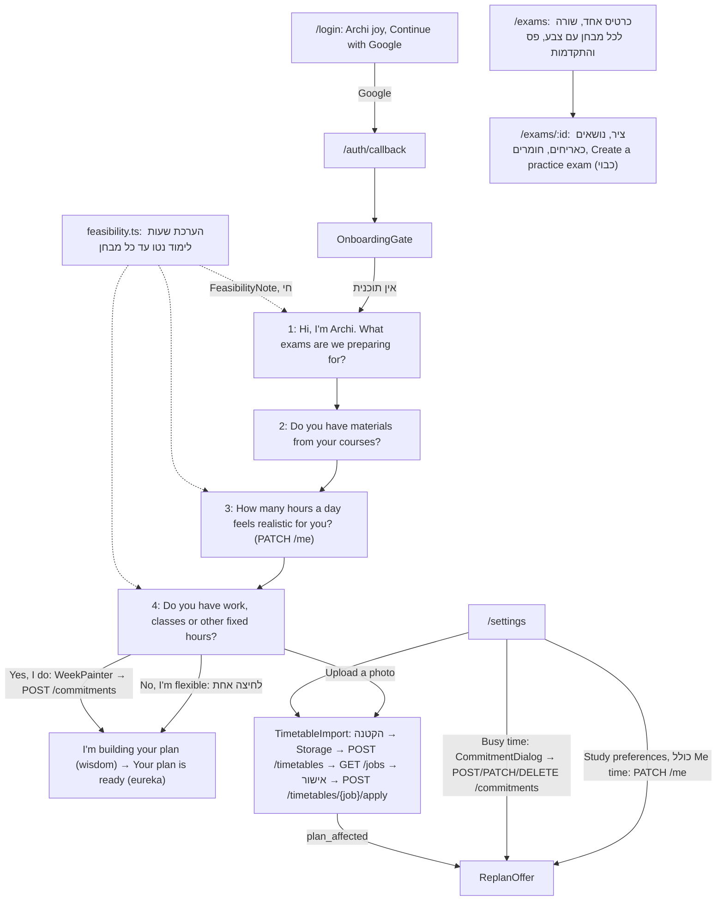

# S34 — עיצוב מחדש ד': כניסה, אונבורדינג, מבחנים והגדרות: תוכנית עבודה (גרסה 2, 21.11.2026)

> **For agentic workers:** REQUIRED SUB-SKILL: Use superpowers:subagent-driven-development (recommended) or superpowers:executing-plans to implement this plan task-by-task. Steps use checkbox (`- [ ]`) syntax for tracking.

**מטרה:** כל המסכים שמחוץ ליומן (כניסה, callback, שגיאת תצורה, 404, פרידה, תנאי שימוש ופרטיות, האונבורדינג, המבחנים, מסך המבחן, ההגדרות ומחיקת החשבון) נראים כמו ההדמיה המחייבת באנגלית (`docs/design/prototype/all-screens.html`, סעיפים s1, s4, s6 ו-s7), מדברים בקול של Archi (`docs/design/archi-voice.md`), והאונבורדינג הוא **שיחה ש-Archi מוביל** (הנחיות 7 ו-8 במסמך הביקורת) עם **משוב חי על היתכנות** (הנחיה 9). באונבורדינג נוסף שלב 4 "Do you have work, classes or other fixed hours?" (שבוע קטן לסימון בגרירה וייבוא צילום של מערכת השעות), ובהגדרות קטע "Busy time" לעריכת ההתחייבויות. עמודות התחביב הישנות יוצאות מהמסד (מיגרציה 0017). התוכנית הראשונה אחרי האונבורדינג מזכה ב-50 XP אמיתיים, פעם אחת למשתמש, ו-"Your plan is ready" מציג את הצ'יפ הזהוב "+50 XP" רק כשהשרת באמת נתן אותם (מיגרציה 0018, החלטה 8).

**השער במפת הדרכים:** "כל המסכים בשפה החדשה, והאונבורדינג עדיין מסתיים תוך 5 דקות".

**מה השתנה מאז הגרסה הראשונה (18.11):** המוצר עבר לאנגלית בלבד, LTR, בשם Archi (S39); `he.ts` הוחלף ב-`en.ts`; אייקונים רק מ-`web/src/ui/icons/`; אפס אימוג׳י; Archi בגוף ראשון ומוביל כל זרימה. נכנסו ל-`main` גם S35 (זמינות), השרת של S44 (מיגרציה 0015) והשרת של S45 (מיגרציה 0016). המיגרציה של ה-scope הפכה ל-0017. ב-21.11 אייל החליט שהתוכנית הראשונה מזכה ב-XP אמיתי (החלטה 8 התהפכה), ולכן נוספו Task 15b בשרת ומיגרציה 0018. ההדמיה החדשה שינתה כמה החלטות (רשימת המבחנים על משטח אחד, "Me time" נשאר שורה בהעדפות, החומרים פתוחים ולא מקופלים). כל אלה מעודכנים כאן.

**כלים:** ‏React 19, ‏TypeScript strict, ‏React Router, ‏TanStack Query 5, ‏Tailwind 4, ‏React Aria Components, ‏Vitest; ב-API ‏Python 3.14, ‏psycopg 3, ‏Alembic עם SQL מפורש. בלי תלויות חדשות.

**מקורות (לפי סדר עדיפות):** `docs/design/2026-11-21-archi-ux-audit.md` (גובר על כל מסמך עיצוב ישן), ‏`docs/design/archi-voice.md`, ההדמיה `docs/design/prototype/all-screens.html`, ‏`docs/spec/2026-11-18-availability-design.md` (סעיפים 5, 7, 10, 11), ‏`docs/design/design-language.md`, וסעיף 7.9 במסמך התכנון הראשי.

## איך החלקים מתחברים



- **השיחה של Archi** בנויה משלושה רכיבים: ‏`ui/ArchiLead` (Archi והשאלה שלו, שהיא ה-`h1` של השלב), ‏`ui/RecapLine` (תשובה קודמת כשורה שקטה אחת) ו-`OnboardingLayout` המעודכן (חץ חזרה, פס שלבים, "Step n of 4", והכפתור הראשי בתחתית). כל שלב הוא "Archi שואל, ומתחתיו רק הפקדים שעונים". כך ההיררכיה של הנחיה 8 נקבעת פעם אחת ברכיב, ולא בכל מסך מחדש.
- **המשוב החי** הוא פונקציה טהורה בדפדפן (`onboarding/feasibility.ts`) שמחקה את חישוב החלונות של המתכנן (`api/app/domain/planner/availability.py`) בגרסה פשוטה, ורכיב `FeasibilityNote` שמציג את המשפט של Archi ב-`aria-live="polite"`. אין קריאה לשרת: המספר משתנה בכל לחיצה על ה-Stepper או סימון בשבוע, ובקשה לשרת על כל לחיצה הייתה איטית ומיותרת. המחיר: זו הערכה ("about 88 hours"), לא המספר של המתכנן, והניסוח אומר את זה.
- **`web/src/commitments/`** הוא מודול משותף לאונבורדינג ולהגדרות: המודל (קיבוץ התחייבויות זהות לשורה אחת "Sun, Tue, 14:00–17:00", וזיהוי קבוצת ה-Me time), הדיאלוג שמוסיף ועורך קבוצה, השבוע הקטן (`WeekPainter`) וייבוא הצילום (`TimetableImport`). הוא קורא רק ל-`web/src/availability/api.ts` של S35, כך שהשרת לא משתנה בשבילו.
- **התחייבות היא "שינוי גלובלי"** (מסמך הזמינות, סעיף 5): כל כתיבה מחזירה `plan_affected`, וההגדרות מציעות `ReplanOffer` (`web/src/plan/ReplanOffer.tsx`) כמו שינוי העדפה. באונבורדינג אין עוד תוכנית ולכן אין הצעה: ההתחייבויות נשמרות לפני מסך הבנייה, וה-`generate_plan` כבר רואה אותן.
- **Me time** נשאר בשרת כמו שהוא: `GET/PATCH /me` עם `hobby_start` ו-`hobby_minutes`, שקוראים וכותבים את שבע ההתחייבויות של `app/services/hobby.py` (S35, עם הכותרת "Me time" של S39 והזיהוי של הכותרת העברית הישנה). רק העמודות המתות ב-`app.profiles` נמחקות (החלטה 1).
- **ה-XP של התוכנית הראשונה** עובר בשלוש תחנות: ה-job ‏`generate_plan` (`api/app/jobs/plan_jobs.py`) מסיים את האונבורדינג באותה טרנזקציה שבה הוא שומר את התוכנית (`complete_onboarding`, שכותב רק כשהעמודה עוד `NULL`); כשהכתיבה הזאת באמת קרתה, הוא קורא ל-`award_first_plan` (`api/app/services/gamification.py`), שמכניס ל-`app.xp_events` שורה מסוג `first_plan` עם 50 XP; והתוצאה של ה-job מחזירה `first_plan_xp` (50 או 0), ש-`BuildingStep` קורא כדי להחליט אם להציג את הצ'יפ. כך "פעם אחת" נקבע במסד (אינדקס ייחודי חלקי) ובתנאי של האונבורדינג, והצ'יפ לא יכול להופיע בלי שורה אמיתית בספר ה-XP.
- **מחרוזות:** כל מחרוזת חדשה נכתבת בקובץ חלק משלה (`i18n/enEntry.ts`, ‏`enOnboardingFlow.ts`, ‏`enCommitments.ts`, ‏`enExams.ts`, ‏`enSettingsScreen.ts`, ‏`enControls.ts`) ומחוברת ל-`en.ts` בשורת import אחת ובשורת מאפיין אחת. כך S32, שעושה את אותו דבר עם `enCalendar*.ts`, לא מתנגש איתנו ב-`en.ts`.

## מה מצאתי אחרי ה-rebase (21.11.2026, HEAD ‏`c73bb53`)

**השרת (`api/`):** ‏`uv run ruff check .` נקי; ‏`uv run ruff format --check .` נקי; ‏`uv run mypy` נקי (286 קבצים). ‏pytest לא הורץ (מסד מקומי משותף). ה-WIP של השרת (`b1cac4c`) מחק את `app/services/hobby.py` ואת `hobby_start`/`hobby_minutes` מ-`GET/PATCH /me` ומהייצוא, ושינה את הבדיקות בהתאם; המיגרציה `0017_drop_hobby_columns.py` (`down_revision = "0016"`) והבדיקה `tests/db/test_drop_hobby_columns.py` כבר ממוספרות נכון. **הבעיה:** ההדמיה החדשה מציגה "Me time every day: 20:00, 1 hour" בתוך Study preferences, והאתר עדיין שולח `hobby_start`/`hobby_minutes` ב-`PATCH /me` (`web/src/settings/PreferencesForm.tsx`, ‏`web/src/api/me.ts`). אחרי ה-WIP השרת היה עונה 422 על כל שמירה של ההגדרות. לכן Task 1 מחזיר את שכבת ה-Me time (החלטה 1).

**האתר (`web/`):** ‏`npm ci` עבר.
- `npm run typecheck`: ‏19 שגיאות, כולן בקבצי ה-WIP: ‏`../i18n/he` לא קיים (`ui/Stepper.tsx`, ‏`ui/s34.test.tsx`, ‏`pages/LegalPage.tsx`, ‏`pages/LegalPage.test.tsx`, ‏`commitments/TimetableImport.test.tsx`); ‏`commitments/model.ts` ו-`commitments/TimetableImport.tsx` **לא נכתבו בכלל** (רק הבדיקות שלהם); ‏`dev/s34Sections.tsx` משתמש ב-`devText.s34` שלא קיים ובמזהי קטעים (`tile-list`, ‏`stepper`, ‏`icon-choice-cards`, ‏`exam-mark`, ‏`ink-button`) שאינם בטיפוס של מזהי הקטעים; ‏`commitments/downscale.test.ts` שורות 31–32: ‏parameter properties בבנאי, שאסורות תחת `erasableSyntaxOnly`.
- `npm run lint`: ‏311 שגיאות בתשעה קבצים: `commitments/TimetableImport.test.tsx`, ‏`commitments/model.test.ts`, ‏`dev/s34Sections.tsx`, ‏`pages/LegalPage.tsx`, ‏`pages/LegalPage.test.tsx`, ‏`ui/IconChoiceCards.tsx`, ‏`ui/InkButton.tsx`, ‏`ui/Stepper.tsx`, ‏`ui/s34.test.tsx`. רובן נגזרות מה-import החסר (`no-unsafe-*`); מעבר לזה: 5 × `no-restricted-imports` (‏`lucide-react` ישירות), ו-2 × `archi/no-emoji` (התו ✓ ב-`ui/IconChoiceCards.tsx` שורה 27 וב-`ui/s34.test.tsx` שורה 205).
- **עברית בקוד שאינו בדיקה** (נכשל ב-`test/sourceGuards.test.ts`): ‏`ui/TileList.tsx`, ‏`ui/ExamMark.tsx`, ‏`ui/Stepper.tsx`, ‏`ui/InkButton.tsx` (הערות ומחרוזות). בבדיקות יש עברית ב-`commitments/model.test.ts`, ‏`TimetableImport.test.tsx`, ‏`timetableUpload.test.ts`, ‏`ui/s34.test.tsx`, ‏`onboarding/upload.test.ts`: מותר רק כתוכן משתמש לדוגמה (שם מבחן, כותרת התחייבות), לא כטקסט מוצר שמצפים לו.
- **גליפים חסרים ב-`ui/icons/glyphs.ts`:** ‏`Minus` (ה-Stepper), ‏`Camera` (ייבוא הצילום), ‏`ChevronUp` (קיפול נושא). החזרה היא `ChevronLeft`, שכבר קיים. אייקוני הסוגים קיימים: `WorkIcon`, ‏`ClassIcon`; ל"אחר" משתמשים ב-`CalendarClock`.
- **שומר הקול** (`test/sourceGuards.test.ts`, הבדיקה "en.ts speaks in the first person") בודק רק את `en.ts`, ‏`enCrash.ts` ו-`enPwa.ts` לפי regex קבוע, ומשווה לרשימה מדויקת. קבצי חלק חדשים לא ייבדקו בלי שינוי (Task 2).
- **`en.test.ts`** סופר קריאות `${isolate(` רק ב-`en.ts`. קובץ חלק עם `isolate()` צריך בדיקה משלו שסופרת אותו.
- **`en.codes` חסרים** קודים של S35 שמופיעים במסכים שלנו: `too_many_commitments`, ‏`already_applied`, ‏`job_not_ready`, ‏`timetable_unreadable`, ‏`timetable_invalid`, ‏`too_many_pages` (Task 8). הקודים של היומן (`slot_busy`, ‏`event_in_past`, ‏`too_many_events`, ‏`no_free_time`, ‏`no_split_offer`) שייכים ל-S32.
- **מה שכן עובד ב-WIP:** ‏`commitments/downscale.ts`, ‏`commitments/timetableUpload.ts`, ‏`onboarding/upload.ts` (‏`storeObject` שהוצא מ-`uploadMaterial` בלי לשנות התנהגות), ‏`ui/TileList.tsx`, ‏`ui/ExamMark.tsx`, ‏`ui/IconChoiceCards.tsx`, ‏`ui/InkButton.tsx`, ‏`ui/Stepper.tsx` (מבנה), ‏`pages/LegalPage.tsx`, שני הנתיבים `/terms` ו-`/privacy` ב-`app/routes.tsx`, ושורת `LARGE_TEXT_PAIRS` ב-`theme.test.ts`.

## מה מצאתי לפני התכנון (18.11, ומה עדיין נכון)

- `api/eval/materials/timetables/` לא קיימת: אייל עוד לא סיפק צילומים. ה-eval על צילומים אמיתיים נשאר פתוח ונרשם מחדש (Task 23).
- XP ניתן היום רק על השלמת בלוק (`api/app/services/gamification.py`, ‏`record_completion`): ב-`app.xp_events` (0011) אין עמודת סוג, אין CHECK או enum על סוג אירוע, ו"פעם אחת" נאכף רק ב-`UNIQUE (block_id)` עם `ON CONFLICT (block_id) DO NOTHING`. הקוד מניח ששורה = בלוק: `_totals` סופר `count(*)` כ-`blocks_done` (שקובע את תגי `first_task` ו-`blocks_*`), ‏`_study_days` בונה מהשורות את הרצף, ו-`progress` את 14 הימים. שורה בלי בלוק הייתה מדליקה רצף ותג "first task" בלי לימוד, ולכן Task 15b מוסיף עמודת `kind` ומסנן לפיה. ‏`friction.py` ו-`plan_writes.py` עושים JOIN ל-`app.blocks`, ולכן שורה בלי בלוק לא משפיעה עליהם. ה-+50 XP של ההדמיה נעשה אמיתי ב-Task 15b (החלטה 8).
- למבחן אין שדה התקדמות ב-`GET /exams`. ל-S45 יש `services/exam_stats.py` עם `completion_percent`, אבל הוא לא חשוף בנקודת קצה. ההתקדמות ברשימה מחושבת מ-`GET /exams/{id}/tasks`, כמו בסרגל הצד של S32, כדי ששני המקומות יציגו אותו אחוז (החלטה 11).
- ל-`ExamOut` יש עכשיו `state` (`active`, ‏`pending`, ‏`waiting_moed_b`, ‏`done`), ‏`sitting`, ‏`closed_at` (S45). הממשק של הסגירה ייבנה אחרי S32 ו-S33 (התוכנית של S45). כאן רק דואגים שמבחן במצב אחר לא נשבר ברשימה (החלטה 12).
- `BuildingStep` נמצא היום בשלב 4 של `OnboardingLayout`. עכשיו שלב 4 הוא "fixed hours", ומסך הבנייה יוצא מפס השלבים, כמו בהדמיה.
- `NotificationSettings` (S16) מצייר שני כרטיסים משלו. כרטיס בתוך כרטיס אסור, ולכן הוא מקבל `variant="bare"` בלי כרטיסים (Task 20), בתוך `notifications/`, שאף scope אחר לא נוגע בו עכשיו.
- יעד הניווט בסוף הבנייה שייך ל-S32 (`navigate(CALENDAR_PATH)`). השורה הזאת ב-`BuildingStep.tsx` לא נוגעים בה.

## ההחלטות

1. **Me time נשאר שכבה של השרת מעל ההתחייבויות; רק העמודות נמחקות.** ההדמיה מציגה "Me time every day" כהעדפה, עם `ReplanOffer` אחד כמו כל העדפה. השכבה של S35 (`services/hobby.py`) כבר עושה את זה נכון: כתיבה אטומית תחת נעילת המשתמש, ‏`too_many_commitments`, הכותרת "Me time" והזיהוי של `LEGACY_HOBBY_TITLES` ש-S39 השאיר. לבנות את זה מחדש בדפדפן מעל `/commitments` היה מפצל פעולה אחת לשבע בקשות בלי טרנזקציה. לכן Task 1 מחזיר את הקוד והבדיקות של `main` (‏`7a21e5e`) ל-`me.py`, ‏`schemas/me.py`, ‏`account.py`, ‏`services/hobby.py` ולבדיקות שלהם, ומשאיר מה-WIP רק את 0017, את הבדיקה שלה ואת הסרת בדיקות ה-CHECK של העמודות.
2. **קבוצת ה-Me time לא מופיעה ב-Busy time.** בהגדרות היא שורה ב-Study preferences, ולכן `groupCommitments` מסמן אותה (`isMeTime`) ו-`CommitmentsSection` מסנן אותה. הכלל זהה ל-`_SETS_SQL` של `hobby.py`: סוג `other`, כותרת `"Me time"` או הכותרת הישנה (בקוד: `'זמן לעצמי'`, כי אות עברית בקוד שאינו בדיקה נכשלת), שבעה ימים, בלי `valid_until`, ‏15–240 דקות; כשיש כמה, הישנה ביותר (`created_at`). כך אותה שורה לא מוצגת פעמיים.
3. **השיחה:** בכל שלב `ArchiLead` מציג את Archi (‏`size="card"`, ישר על המשטח, בלי מסגרת) ואת השאלה שלו כ-`h1`; מתחתיו משפט הקשר אחד, ואז רק הפקדים. תשובות של שלבים קודמים מופיעות כ-`RecapLine` אחת ("3 exams: …"). המצבים של Archi לפי ההדמיה: שלב 1 `joy`, שלב 2 `wisdom`, שלב 3 `intentions`, שלב 4 `flow`, בנייה `wisdom`, מוכן `eureka`, כניסה ופרידה `joy`, ‏404 `flow`, מבחנים ריקים `intentions`.
4. **שלב "fixed hours" הוא שלב 4 מתוך 4, בנתיב `/onboarding/fixed-hours`.** הבנייה ו"מוכן" אינם שלב ממוספר. `STEP_COUNT` נשאר 4; `en.onboarding.steps` הופך ל-`['Exams', 'Materials', 'Questions', 'Busy time']`.
5. **"No, I'm flexible" ממשיך מיד לבנייה** בלחיצה אחת, ו-"Yes, I do" פותח את השבוע. כשכבר יש התחייבויות (חזרה לשלב), "Yes" נבחר מראש. היעד של 5 דקות: אין שדה חובה חדש.
6. **השבוע הקטן:** רשת של שעות שלמות, משעת הקימה עד שעת השינה של הפרופיל (ברירת המחדל 08:00–23:00, ‏15 שורות), ראשון ראשון. ריצה רציפה של תאים ביום אחד = התחייבות אחת, בשם `"Busy"` (`en.commitments.defaultTitle`) ומסוג `other`; שם וסוג אפשר לשנות בהגדרות. שעות מדויקות (10:15) נכנסות דרך "Add exact hours" (הדיאלוג). מה שכבר נשמר מוצג בשבוע כתא "שמור" ולא משתנה בגרירה, כדי שמשתמש לא ימחק הרצאה בטעות, ונמחק רק מהרשימה שמתחת. נגישות: `role="grid"` עם roving tabindex וחצים, כל תא toggle בשם ("Sunday 10:00"), הקשה היא החלופה הגלויה לגרירה, Space ו-Enter מסמנים.
7. **משוב ההיתכנות (הנחיה 9):** `estimateStudyMinutes` סופר, לכל יום ממחר ועד יום הלימוד האחרון של כל מבחן (`exam_date - (rest_days_before_exam + 1)`), את המינימום בין `daily_study_minutes` לבין דקות חלונות הלימוד שנבחרו, בתוך שעות הערות (מ-`wake_time + study_start_delay_minutes` עד `sleep_time`), פחות ההתחייבויות של אותו יום (שמורות וגם מסומנות שעוד לא נשמרו), כשרק קטעים של 30 דקות ומעלה נספרים. אין שעון קיץ ואין אירועים חד-פעמיים: זו הערכה, והמשפט אומר "about". הרמות: `none` (למבחן כלשהו 0 דקות), ‏`tight` (פחות מ-`TIGHT_HOURS_PER_EXAM = 10` שעות לכל מבחן עד המבחן המוקדם שבו זה קורה), ‏`roomy` (כל השאר). הקבוע ניתן לכוונון; 10 שעות נבחרו כי הן בערך תקציב של מבחן קל עם מעט חומר. ההחלטה נרשמת לבדיקה מול נתונים ב-S29.
8. **התוכנית הראשונה מזכה ב-50 XP אמיתיים, והצ'יפ "+50 XP" מוצג רק כשהם ניתנו** (אייל, 21.11.2026; מחליף את ההחלטה הקודמת "בלי XP מזויף"). השרת כותב ל-`app.xp_events` שורה מסוג `kind = 'first_plan'`, ‏`xp = 50`, ‏`block_id = NULL`, באותה טרנזקציה של ה-job ‏`generate_plan` שבה `complete_onboarding` עובר מ-`NULL` לזמן התכנון, ורק אז (Task 15b). "פעם אחת למשתמש" נאכף פעמיים: בתנאי של האונבורדינג, ובאינדקס ייחודי חלקי `(user_id) WHERE kind = 'first_plan'` עם `ON CONFLICT DO NOTHING`, כי ה-job יכול לרוץ שוב (retry) ושני jobs יכולים לרוץ יחד. תוכנית שנייה, מבחן חדש מאוחר יותר, replan (`apply_replan`) ומשתמש ותיק שכבר סיים אונבורדינג לפני 0018: לא מקבלים כלום, ולא נכתב להם רטרואקטיבית. ה-XP הזה נספר ב-`total_xp`, ברמה ובתגי ה-XP, אבל לא ב-`blocks_done`, לא ברצף ולא ב-14 הימים, כי שם נספר רק לימוד. ‏`BuildingStep` מציג את הצ'יפ הזהוב (`XpSparkIcon`, ‏`bg-gold-soft text-gold-ink`) לפי `first_plan_xp > 0` בתוצאת ה-job, ליד הצ'יפ הירוק "The first seed in your garden" (`SproutIcon`), שמוצג תמיד (Task 16).
9. **`OnboardingLayout`:** כפתור חזרה (`ChevronLeft`, שם נגיש "Back") בראש, ליד פס השלבים, כמו `obTop` בהדמיה. ה-"Back" שבתחתית יוצא, כדי שבתחתית יישאר רק הכפתור הראשי.
10. **רשימת המבחנים על משטח אחד:** ההדמיה החדשה שמה את כל המבחנים בכרטיס אחד (`Card`) עם שורות (`ListRow` של `ui/List.tsx`, ‏`to` לכל שורה). ‏`TileList` (מה-WIP) משמש לנושאים במסך המבחן, שבהדמיה הם כרטיסים נפרדים. ההחלטה הישנה "TileList לרשימת המבחנים" מבוטלת.
11. **ההתקדמות של מבחן** = דקות של משימות `done` מתוך דקות כל המשימות שלא דולגו, מ-`GET /exams/{id}/tasks` לכל מבחן (`useQueries`), באותה נוסחה של S32 בסרגל הצד. מבחן בלי משימות: "No tasks yet" ופס ריק. הפס בצבע המבחן: הירוק שמור ל-"Done" של בלוק.
12. **מבחן שהתאריך שלו עבר** (גם במצב `done` או `waiting_moed_b` של S45) מוצג ברשימה בלי "in N days" שלילי: הצ'יפ אומר "Exam day passed". גיליון הסגירה ותצוגת הארכיון הם של הממשק של S45.
13. **האות של המבחן** (`ExamInitial`) היא `exam-N` על `exam-N-soft`, ב-20px ו-700: טקסט גדול לפי WCAG, ולכן 3:1 מספיק, ו-`theme.test.ts` בודק את הזוג (`LARGE_TEXT_PAIRS`). במסמך העיצוב כלל: רק מ-20px ו-700.
14. **`InkButton`** (כפתור כהה, `bg-inverse text-on-inverse`) ל-"Continue with Google" בלבד, כמו בהדמיה. במסך יש לכל היותר כפתור ירוק ראשי אחד.
15. **סדר ההגדרות:** Study preferences, ואז Save, ואז Busy time, ‏Reminders, וכרטיס החשבון (Export your data, ‏Delete my account). בהדמיה Save בא אחרי Reminders, אבל Busy time ו-Reminders נשמרים מיד, וכפתור אחריהם היה מרמז שהוא שומר גם אותם. זו סטייה מכוונת מההדמיה, ונרשמת ככזו בצילומים. הייצוא שומר על `id="export"` שמסך המחיקה מקשר אליו.
16. **Study preferences** הן שורות, כמו בהדמיה ("Hours a day: 4 hours", ‏"When you study: Morning, Evening", ‏"Me time every day: 20:00, 1 hour", ‏"Rest days before an exam: 1 day"), ונוספות "Your day: 08:00–23:00" ו-"Time before you start studying: 1 hour", כי ההתנהגות של S15 נשמרת. כל שורה היא `CollapsibleSection` שנפתח לפקד שלו בתוך הכרטיס; Save שומר את כל מה שהשתנה ב-`PATCH /me` אחד.
17. **קבוצה של התחייבויות** = אותו `title`, ‏`kind`, ‏`start_time`, ‏`end_time`, ‏`valid_from`, ‏`valid_until`, בכמה ימים. בהגדרות היא שורה אחת, והדיאלוג עורך אותה: ימים שנוספו → `POST`, ימים שהוסרו → `DELETE`, שדות ששונו → `PATCH` לכל השאר, והצעת תכנון מחדש אחת בסוף. מחיקה: toast עם "Undo" ל-10 שניות (`UNDO_TIMEOUT_MS`) שיוצר אותן מחדש, במקום "Are you sure?".
18. **אייקונים לסוגים:** `work` ‏`WorkIcon`, ‏`class` ‏`ClassIcon`, ‏`other` ‏`CalendarClock` (מ-`ui/icons`). בצבע `text-busy`, כמו בהדמיה.
19. **הצילום:** תמונה מוקטנת בדפדפן לצד ארוך של 2000 פיקסלים ולכל היותר 3.75 MiB (JPEG, האיכות יורדת עד שזה נכנס); PDF עולה כמו שהוא. אחרי הפענוח Archi שואל "I found 3 busy times in your photo. Should I add them?", עם תיבת סימון לכל הצעה (כולן מסומנות), עריכה של כל אחת בדיאלוג, ו-"Valid until" אופציונלי. כשל: `Note tone="warning"` לפי הקוד, ו-"You can mark them yourself".
20. **מסך הכניסה במחשב:** שתי עמודות מ-`lg`: Archi בצד אחד, השם, המשפט והכפתור בצד השני. בטלפון כמו בהדמיה: Archi במרכז עם קו `line` מתחתיו, "Archi" ב-`font-display` גדול, המשפט, והכפתור בתחתית.
21. **תנאי שימוש ופרטיות** הם `/terms` ו-`/privacy`, מחוץ ל-`RequireAuth`, עם "I'm still writing this page." וקישור חזרה. המסמכים עצמם ב-S21.
22. **המיגרציה 0017** מוחקת את `profiles.hobby_start`, ‏`hobby_minutes` ושלושת ה-CHECK שלהן (`profiles_hobby_together`, ‏`profiles_hobby_minutes_range`, ‏`profiles_hobby_start_whole_minute`). ה-downgrade מחזיר אותן ריקות עם אותם CHECK; את התוכן מחזיר ה-downgrade של 0014. לפני ההחלה על dev בודקים ש-`alembic_version` הוא `0016` ושאין שורה עם `hobby_start IS NOT NULL`.
23. **תנועה:** כל מעבר בין שלבים, בחירה ב-Stepper וסימון בשבוע מקבלים תגובה מונפשת קצרה (150–200ms, ‏`motion-safe:` של Tailwind), ועם `prefers-reduced-motion: reduce` אין תנועה בכלל, רק שינוי מצב.

## Global Constraints

כל implementer קורא את הסעיף הזה לפני המשימה שלו.

- **אנגלית בלבד ב-`web/src`.** אין אות עברית בקובץ שאינו בדיקה, גם לא בהערה (`test/sourceGuards.test.ts` נכשל). עברית מותרת רק בבדיקות ובנתוני דמה של **תוכן משתמש** (שם מבחן, כותרת התחייבות, שם קובץ). כותרת עברית שהקוד צריך לזהות נכתבת ב-escapes (`'זמן לעצמי'`).
- **מחרוזות חדשות** נכתבות בקובץ החלק של המסך, לא ישירות ב-`en.ts`: ‏`web/src/i18n/enEntry.ts` (כניסה, callback, תצורה, 404, פרידה, משפטי), ‏`enOnboardingFlow.ts` (האונבורדינג וההיתכנות), ‏`enCommitments.ts` (המודל, הדיאלוג, השבוע, הצילום), ‏`enExams.ts` (רשימת המבחנים ומסך המבחן), ‏`enSettingsScreen.ts` (ההגדרות ומחיקת החשבון), ‏`enControls.ts` (רכיבי `ui/` החדשים). כל קובץ מייצא `export const enX = { … } as const`, ומחובר ל-`en.ts` בשורת `import { enX } from './enX'` אחת ובשורת מאפיין אחת (למשל `commitments: enCommitments,`), באותו דפוס שבו `crash: enCrash` מחובר. מפתח קיים ב-`en.ts` שהניסוח שלו משתנה נערך במקומו, בעריכה קטנה.
- **הקול של Archi** (`docs/design/archi-voice.md`): גוף ראשון (`I`, ‏`me`, ‏`my`), פונה ב-`you`; אף פעם "Archi will…" ואף פעם "we couldn't". שאלה נשאלת כשאלה. sentence case, איות בריטי, קיצורים (`I'll`, ‏`couldn't`) עם הגרש המעוגל `’` כמו בשאר `en.ts`. בלי סימני קריאה, בלי `·`, בלי נקודה בכפתור ובכותרת. שעות `16:05`, טווח `09:00–10:30` (מקף ארוך), תאריך מלא `16 December 2026`, קצר `Sun, 22 Nov`. ימים בשורת התחייבות: `Sun, Mon, Tue, Wed, Thu, Fri, Sat`. יחיד ורבים נכונים תמיד (`plural()` של `en.ts`).
- **Archi מוביל כל זרימה:** קודם Archi והשאלה או ההקשר שלו (`ArchiLead`), ומתחתיו רק הפקדים שעונים לו. Archi רק דרך `<Archie mood size>` (`web/src/archie/Archie.tsx`): לא מציירים אותו, לא חותכים, לא שמים מאחוריו רקע או מסגרת.
- **תוכן משתמש** (שם מבחן, משימה, קובץ, כותרת התחייבות) מוצג ב-JSX דרך `ui/UserText` (`<UserText>`, ‏`<UserText truncate>` לכותרת שנחתכת, ‏`<UserText prose>` לפסקה), ובתוך מחרוזת דרך `isolate()` (`i18n/bidi.ts`). קובץ חלק שיש בו `${isolate(` מקבל קובץ בדיקה משלו (`enX.test.ts`) שבודק כל פונקציה כזאת וסופר את הקריאות, כמו "the function table above covers every isolate() call of en.ts" ב-`en.test.ts`.
- **אייקונים רק מ-`web/src/ui/icons/`** (גם הגליפים של lucide, דרך `glyphs.ts`). ‏`import … from 'lucide-react'` נכשל ב-lint. מקום של אייקון ברכיב מוגדר כ-`IconType`. גליף חסר נוסף ל-`glyphs.ts` בשורה אחת.
- **אפס אימוג׳י** בכל מקום, כולל `✓`, ‏`©`, ‏`™`, ‏`▶` ובבדיקות; נתון בדיקה כזה נכתב עם `String.fromCodePoint`. סימן "נבחר" הוא `CheckMarkIcon`.
- **תנועה:** לכל אינטראקציה תגובה מונפשת קצרה (`motion-safe:`), ושקט מלא עם `prefers-reduced-motion`. לכל רכיב מונפש בדיקה שעם reduced motion אין אנימציה פעילה (לפי הדפוס של `archie/motionLayer.tsx`).
- רק רכיבי `web/src/ui/` וה-tokens. אין hex, אין צבע מהלוח של Tailwind, אין `text-brand` על טקסט (רק `text-brand-strong`/`text-brand-ink`), אין שקיפות על טקסט (מסמך העיצוב 2.7).
- **לא משנים רכיב קיים ב-`ui/`** (S32 רץ במקביל). רכיב חסר = קובץ חדש עם בדיקה, קטע ב-`dev/s34Sections.tsx`, ושורה במסמך העיצוב (סעיף 5.8, נכתבת ב-Task 23). חריג אחד: שורות export חדשות ב-`ui/icons/glyphs.ts`.
- 44px לכל מה שלוחצים (`min-h-touch`), שם נגיש לכל כפתור שחוזר ("Delete: משמרת עבודה", נבנה מפונקציה ב-`en` עם `isolate`), ‏`h1` אחד שמופיע מיד, ‏`tabular-nums` למספרים, רק logical properties. אין `dir="ltr"` על שעות ואין `rtl:` (המוצר LTR).
- ההתנהגות, הבדיקות של ההתנהגות וה-API של S13–S19, ‏S35, ‏S44 ו-S45 נשמרים. בדיקה משתנה רק כשהיא נשענת על מבנה או טקסט שהשתנה, והציפייה נבנית מ-`en.<key>` ולא מטקסט מועתק.
- **כל טבלה חדשה בסכמה `app` צריכה RLS** (`tests/db/test_schema.py` נכשל בלעדיו). ב-scope הזה אין טבלה חדשה.
- **מיגרציות ה-scope:** `0017` (`down_revision = "0016"`, Task 1) ו-`0018` (`down_revision = "0017"`, Task 15b), SQL מפורש ב-`op.execute`, ה-RLS וה-policies של `app.xp_events` לא משתנים, ו-`uv run alembic heads` מחזיר שורה אחת: `0018 (head)`. ההחלה על dev היא של ה-controller (Task 25), לא של ה-implementer.
- **ה-XP של התוכנית הראשונה (החלטה 8):** ‏`kind = 'first_plan'`, ‏`FIRST_PLAN_XP = 50`, פעם אחת לכל משתמש, רק כש-`complete_onboarding` באמת כתב בתוך `generate_plan`. השדה בתוצאת ה-job: `"first_plan_xp"` (מספר שלם, ‏50 או 0). הצ'יפ באתר מוצג רק כש-`first_plan_xp > 0`, והמספר שבו בא מהשדה, לא מקבוע באתר.
- **השרת:** הפקודות רצות מתוך `api/`. ‏pytest רץ עם `STUDYFLOW_TEST_DB=studyflow_test_s34`. את `tests/db` לא מריצים במקביל לסשן אחר (התפקידים במסד המקומי משותפים); ה-implementer שואל את ה-controller לפני ריצה של `tests/db`. נפילה על `permission denied to set role` = לחכות דקה ולהריץ שוב.
- **git:** ה-implementer לא מריץ פקודות git שכותבות. ה-controller עושה commit לפי שמות קבצים אחרי כל משימה, בעברית עם מונחים באנגלית.
- הבדיקות של כל משימה: `npm test -- <הקבצים>`, ואז `npm run typecheck` ו-`npm run lint` (מתוך `web/`) נקיים לגמרי, כי המשימות רצות ברצף ולא במקביל.
- `legacy/` לא נוגעים. `npm run dev` לא מריצים (פורט 5173 משותף עם S32); בדיקה בדפדפן היא של ה-controller.

## Review Focus

1. **גרירה בשבוע שיוצאת מהרשת** (pointerup מחוץ לרשת, pointercancel במגע): הסימון נעצר ולא נשאר "צובע". בדיקה ב-Task 5.
2. **"Build my plan" אחרי שחלק מה-POST נכשלו** (`too_many_commitments`, רשת): מה שנשמר מופיע כשמור, השאר נשאר מסומן, הודעה, ואפשר לנסות שוב בלי כפילות. בדיקה ב-Task 15.
3. **צילום שגדול מדי גם אחרי הקטנה, PDF גדול, או סוג קובץ אחר:** הודעה ברורה לפני העלאה, בלי בקשה לשרת. בדיקה ב-Task 7.
4. **עריכת קבוצה שבה רק חלק מהבקשות הצליחו:** הרשימה מתרעננת מהשרת, הודעת שגיאה, והצעת תכנון מחדש אם משהו השתנה. בדיקה ב-Task 19.
5. **משתמש ותיק עם Me time** (שבע התחייבויות "Me time" או הכותרת העברית): בהגדרות הוא שורה אחת "Me time every day: 18:00, 1 hour" ב-Study preferences, ולא מופיע ב-Busy time. בדיקה ב-Task 4 (המודל), Task 19 ו-Task 20.
6. **המשוב החי לא משקר:** מבחן מחר עם יום מנוחה = `none`; שבועות עם 4 שעות ביום = `roomy`; התחייבות שמכסה את כל החלונות = 0. בדיקה ב-Task 10.
7. **ה-XP של התוכנית הראשונה ניתן פעם אחת בדיוק, והצ'יפ לא משקר:** ‏retry של ה-job, שני jobs של אותו משתמש, תוכנית שנייה ו-replan לא מוסיפים שורה; השורה לא מדליקה רצף ולא את התג `first_task`; ‏`uncomplete` של בלוק לא מוחק אותה; תוצאה בלי `first_plan_xp` (job ישן) או עם 0 לא מציגה צ'יפ. בדיקות ב-Task 15b וב-Task 16.

## הסדר והתלויות

המשימות רצות **אחת אחרי השנייה**, בסדר המספרים. אין שתי משימות במקביל, כי רובן נוגעות ב-`en.ts` (שורת חיבור), ב-`dev/s34Sections.tsx` או במודול `commitments/`.

| Task | תלוי ב- | מודל |
| --- | --- | --- |
| 1 שרת: Me time נשאר, 0017 | — | opus |
| 2 בסיס ירוק באנגלית | — | sonnet |
| 3 `ArchiLead`, ‏`RecapLine`, ‏`FeasibilityNote` | 2 | fable |
| 4 מודל ההתחייבויות | 2 | sonnet |
| 5 `WeekPainter` | 4 | opus |
| 6 `CommitmentDialog` | 4 | sonnet |
| 7 `TimetableImport` | 4, 6 | opus |
| 8 `en.codes` של S35 | 2 | sonnet |
| 9 המסכים העצמאיים | 2 | sonnet |
| 10 הערכת ההיתכנות | 3, 4 | opus |
| 11 מסגרת האונבורדינג ושלב 1 | 3, 10 | fable |
| 12 שלב 2 (חומרים) | 11 | sonnet |
| 13 שלב 3 (שתי שאלות) | 11 | sonnet |
| 14 ניסוחי המשוב החי | 10, 11 | fable |
| 15 שלב 4 (fixed hours) | 5, 7, 13, 14 | opus |
| 15b שרת: 50 XP על התוכנית הראשונה, 0018 | 1 | opus |
| 16 בנייה ו"מוכן" | 15, 15b | sonnet |
| 17 רשימת המבחנים ומסך ריק | 2 | sonnet |
| 18 מסך המבחן | 17 | sonnet |
| 19 Busy time בהגדרות | 6, 7 | opus |
| 20 Study preferences, תזכורות ומחיקה | 1, 19 | sonnet |
| 21–25 | המשימות של ה-controller | — |

Task 1 (שרת) ו-Task 2 (אתר) נוגעים בתיקיות נפרדות, וסדר ביניהם לא משנה. Task 20 צריך את Task 1 כי שמירת Me time עוברת דרך `PATCH /me`.

Task 15b רץ אחרי Task 15 ולפני Task 16, בסדר המספרים. הוא תלוי ב-Task 1 בשלושה מקומות: 0018 בא אחרי 0017 (`down_revision = "0017"`); הבדיקה `test_one_head` ש-Task 1 הוסיף ל-`tests/db/test_drop_hobby_columns.py` (שמצפה ל-`["0017"]`) עוברת לקובץ הבדיקה של 0018 ומצפה ל-`["0018"]`; ו-`api/app/services/account.py` (הייצוא), ש-Task 1 שחזר, מקבל את העמודה `kind`. Task 16 צריך את Task 15b כי הצ'יפ נשען על השדה `first_plan_xp` בתוצאת ה-job.

## קבצים משותפים עם S32

S32 (היומן) רץ במקביל ב-worktree משלו, ושייכים לו `web/src/calendar/`, ‏`web/src/board/` ו-`web/src/i18n/enCalendar*.ts`. **לא נוגעים בהם.** הקבצים ששני ה-scopes עורכים, ומה מותר לנו בכל אחד:

| קובץ | מה אנחנו עושים |
| --- | --- |
| `web/src/i18n/en.ts` | שורות import ושורות חיבור של קבצי החלק שלנו; עריכה של מפתחות קיימים בסעיפים `login`, ‏`callback`, ‏`notFound`, ‏`config`, ‏`onboarding*`, ‏`building`, ‏`exam`, ‏`settings`, ‏`notifications`; מפתחות חדשים ב-`codes` (Task 8) בסוף הסעיף. לא בסעיפים `calendar`, ‏`board`, ‏`today`, ‏`review`, ‏`move`, ‏`week`, ‏`replan`. |
| `web/src/test/sourceGuards.test.ts` | ה-regex של קבצי הטקסט נעשה כללי (Task 2). S32 צריך את אותו שינוי ל-`enCalendar*.ts`; מי שממזג שני פותר לשורה אחת. |
| `web/src/ui/icons/glyphs.ts` | שורות export חדשות בלבד (`Minus`, ‏`Camera`, ‏`ChevronUp`). |
| `web/src/dev/ComponentsPage.tsx`, ‏`dev/devText.ts`, טיפוס מזהי הקטעים | שורת import ושורת render אחת; קטע `s34` ב-`devText`; המזהים שלנו בלבד. |
| `web/src/theme.test.ts` | הקטע `LARGE_TEXT_PAIRS` בסוף הקובץ. |
| `web/src/app/routes.tsx` | הנתיבים `/terms`, ‏`/privacy` (כבר ב-WIP). את `CALENDAR_PATH` מעביר S32. |
| `web/src/onboarding/BuildingStep.tsx` | הכל חוץ משורת הניווט בסוף הבנייה, ששייכת ל-S32. |
| `docs/design/design-language.md`, סעיף 7.9 במסמך התכנון | הסעיפים שלנו בלבד. |

**רכיבים חדשים שלנו ש-S32 יכול להשתמש בהם אחרי המיזוג:** `ui/ArchiLead`, ‏`ui/Stepper`, ‏`ui/ExamMark` (‏`ExamInitial`, ‏`ExamProgressBar`, ‏`ExamChip`). זה נרשם בהודעת הסיום.

**ל-S33 (הגיימיפיקציה במרכז):** אחרי המיזוג יש ב-`app.xp_events` עמודת `kind` (`'block'` או `'first_plan'`, ‏CHECK ב-0018), ו-`award_first_plan` ב-`api/app/services/gamification.py` מחזיר `ProgressChange` כמו השלמת בלוק. האנימציה של ה-XP ב-S33 (ניצוץ שמרחף אל טבעת הרמה) יכולה להשתמש באירוע הזה ובשדה `first_plan_xp` של תוצאת `generate_plan` בלי שינוי בשרת. סוג אירוע נוסף ב-S33 = מיגרציה שמרחיבה את ה-CHECK `xp_events_kind_check`, וכל שאילתה שסופרת לימוד (`blocks_done`, רצף, ימים) ממשיכה לסנן `kind = 'block'`. זה נרשם בהודעת הסיום ובמפת הדרכים (Task 25).

---

### Task 1: השרת: Me time נשאר, ומיגרציה 0017 מוחקת רק את העמודות

**מודל:** `opus`. מיגרציה ושחזור חלקי של commit עם בדיקות מסד, שבהם טעות קטנה (head כפול, downgrade שבור) מתגלה רק על dev.

**הרקע:** ה-commit ‏`b1cac4c` מחק את שכבת ה-Me time מהשרת. ההדמיה המחייבת מציגה "Me time every day" כהעדפה בהגדרות, ולכן השכבה חוזרת (החלטה 1). העמודות `hobby_start`/`hobby_minutes` ב-`app.profiles` ריקות מאז 0014 ואינן נקראות, ולכן נמחקות.

**Files:**
- Restore מ-`7a21e5e` (קוראים עם `git show 7a21e5e:<path>` ומעתיקים את התוכן לקובץ; לא מריצים git שכותב): `api/app/services/hobby.py`, ‏`api/app/routers/me.py`, ‏`api/app/schemas/me.py`, ‏`api/app/routers/account.py`, ‏`api/app/services/account.py`, ‏`api/tests/api/test_me.py`, ‏`api/tests/api/test_me_preferences.py`, ‏`api/tests/api/test_account.py`.
- Modify: `api/app/services/hobby.py` (רק ה-docstring: במקום "until S34 replaces the settings screen" ו-"S34 deletes this module (decision 7)", לכתוב שזה ה-Me time של ההגדרות, שהעמודות הישנות נמחקו ב-0017, ושהשכבה נשארת כי Me time הוא העדפה עם replan אחד, S34 החלטה 1); ‏`api/app/services/profiles.py` (ההערה ליד `study_start_delay_minutes`: "The hobby columns of 0009 were dropped by 0017 (S34); Me time lives in app.commitments, see app.services.hobby"); ‏`api/migrations/versions/0017_drop_hobby_columns.py` (רק ה-docstring: במקום "S34's settings screen edits the commitments directly, so the layer is gone", לכתוב ש-`app.services.hobby` קורא וכותב את ההתחייבויות ולא את העמודות, ולכן הן ריקות ומיותרות).
- Keep מה-WIP: `api/migrations/versions/0017_drop_hobby_columns.py` (`revision = "0017"`, ‏`down_revision = "0016"`), ‏`api/tests/db/test_drop_hobby_columns.py`, והשינויים ב-`api/tests/db/test_settings_and_account.py` (בדיקות ה-CHECK של עמודות התחביב יצאו, כי אין עמודות).

- [ ] **Step 1: בדיקות.** אחרי השחזור, להוסיף ל-`api/tests/api/test_me_preferences.py` בדיקה `test_me_time_survives_without_the_profile_columns`: ‏`PATCH /me` עם `{"hobby_start": "20:00", "hobby_minutes": 60}` → ‏200; ‏`GET /me` מחזיר `"hobby_start": "20:00"`, ‏`"hobby_minutes": 60`; במסד יש 7 שורות חיות ב-`app.commitments` עם `title = 'Me time'`. ב-`test_drop_hobby_columns.py` לוודא שיש בדיקה ש-Alembic מחזיר head אחד (`0017`); אם אין, להוסיף `test_one_head` עם `ScriptDirectory.from_config(...).get_heads() == ["0017"]`.
- [ ] **Step 2:** `STUDYFLOW_TEST_DB=studyflow_test_s34 uv run pytest tests/api -q` → עובר. לשאול את ה-controller אם `tests/db` פנוי, ואז `STUDYFLOW_TEST_DB=studyflow_test_s34 uv run pytest tests/db/test_drop_hobby_columns.py tests/db/test_availability_schema.py tests/db/test_settings_and_account.py -q`: אחרי `upgrade head` אין עמודות `hobby_*`; downgrade ל-`0016` מחזיר אותן ריקות עם שלושת ה-CHECK; ה-downgrade של 0014 (שעובר דרך 0017) עדיין מחזיר תחביב לעמודות.
- [ ] **Step 3:** `uv run alembic heads` → שורה אחת, `0017 (head)`. ‏`down_revision` של 0016 הוא `"0015"` ושל 0017 הוא `"0016"`.
- [ ] **Step 4:** `STUDYFLOW_TEST_DB=studyflow_test_s34 uv run pytest -q` (כל הבדיקות, כולל `tests/db`, רק אחרי אישור ה-controller), ‏`uv run ruff check .`, ‏`uv run ruff format --check .`, ‏`uv run mypy` → נקי. הבדיקות של S44 (split, friction) ו-S45 (closure, moed_b) עוברות.

**קבלה:** ‏`GET/PATCH /me` זהים ל-`main` (כולל `hobby_start`, ‏`hobby_minutes`, ‏`missing_hobby_field`, ‏`hobby_half_off`); הייצוא כולל את ה-hobby כמו ב-`main`; העמודות לא קיימות אחרי `upgrade head`; head אחד; כל הפקודות נקיות. **החלת 0017 על dev אינה חלק מהמשימה** (Task 25).

### Task 2: בסיס ירוק באנגלית לקוד ה-WIP באתר

**מודל:** `sonnet`. העברת מחרוזות ותיקוני lint וטיפוסים לפי רשימה מדויקת.

**הרקע:** ה-commit ‏`0bdd420` נכתב כשהמוצר היה בעברית. אחרי ה-rebase: 19 שגיאות typecheck ו-311 שגיאות lint, כולן בקבצי ה-WIP: ייבוא של `../i18n/he` שלא קיים ב-`ui/Stepper.tsx`, ‏`ui/s34.test.tsx`, ‏`pages/LegalPage.tsx`, ‏`pages/LegalPage.test.tsx`, ‏`commitments/TimetableImport.test.tsx`; ‏`commitments/model.ts` ו-`commitments/TimetableImport.tsx` לא קיימים; ‏`dev/s34Sections.tsx` משתמש ב-`devText.s34` ובמזהי קטעים לא מוכרים (`tile-list`, ‏`stepper`, ‏`icon-choice-cards`, ‏`exam-mark`, ‏`ink-button`); parameter properties ב-`commitments/downscale.test.ts` שורות 31–32 (`erasableSyntaxOnly`); ‏`lucide-react` ישירות ב-`ui/Stepper.tsx`, ‏`ui/InkButton.tsx`, ‏`ui/IconChoiceCards.tsx`, ‏`ui/s34.test.tsx`; התו ✓ ב-`ui/IconChoiceCards.tsx:27` וב-`ui/s34.test.tsx:205`; עברית בקוד שאינו בדיקה ב-`ui/TileList.tsx`, ‏`ui/ExamMark.tsx`, ‏`ui/Stepper.tsx`, ‏`ui/InkButton.tsx`.

**Files:**
- Create: `web/src/i18n/enControls.ts` (`export const enControls = { stepper: { more: 'More', less: 'Less' }, choiceSelected: 'Selected' } as const`, ועוד מפתח לכל טקסט שרכיבי `ui/` של ה-WIP צריכים; בלי `isolate`), ‏`web/src/i18n/enEntry.ts` (לעכשיו רק `legal`, ראו למטה).
- Modify: `web/src/i18n/en.ts` (שתי שורות import ושתי שורות חיבור: `controls: enControls,`, ‏`entry: enEntry,`), ‏`web/src/ui/icons/glyphs.ts` (export של `Minus`, ‏`Camera`, ‏`ChevronUp`, באותו דפוס כמו השאר), ‏`web/src/ui/Stepper.tsx`, ‏`ui/InkButton.tsx` (‏`LoaderCircle` מ-`./icons`), ‏`ui/IconChoiceCards.tsx` (‏`Check` → `CheckMarkIcon`, ‏`LucideIcon` → `IconType`), ‏`ui/TileList.tsx`, ‏`ui/ExamMark.tsx` (הערות באנגלית), ‏`ui/s34.test.tsx`, ‏`pages/LegalPage.tsx`, ‏`pages/LegalPage.test.tsx`, ‏`dev/s34Sections.tsx`, ‏`dev/devText.ts` (קטע `s34` עם כותרות הקטעים: "Tile list", "Stepper", "Icon choice cards", "Exam mark", "Ink button"), טיפוס מזהי הקטעים (האיחוד `'error' | 'button' | …` שמוגדר ב-`web/src/dev/`, כנראה `Section.tsx`; להוסיף את חמשת המזהים), ‏`commitments/downscale.test.ts` (שדות רגילים במקום parameter properties), ‏`web/src/test/sourceGuards.test.ts`.
- Move: `web/src/commitments/model.test.ts` → ‏`web/pending-s34/model.test.ts`, ו-`web/src/commitments/TimetableImport.test.tsx` → ‏`web/pending-s34/TimetableImport.test.tsx` (מחוץ ל-`src`, ולכן מחוץ ל-typecheck, ל-lint ול-Vitest). Task 4 ו-Task 7 מחזירים אותם. לוודא ש-`web/pending-s34/` לא בתוך `include` של `tsconfig*.json`, ה-glob של eslint וה-`include` של Vitest; אם כן, להוסיף ל-`ignores`.

**הטקסטים של `enEntry.legal`:** ‏`terms: 'Terms of use'`, ‏`privacy: 'Privacy policy'`, ‏`soon: 'I’m still writing this page.'`, ‏`back: 'Back to sign-in'`.

**שינוי השומר:** ב-`sourceGuards.test.ts`, בבדיקה "en.ts speaks in the first person", ה-regex `/^i18n\/en(Crash|Pwa)?\.ts$/` הופך ל-`/^i18n\/en[A-Za-z]*\.ts$/` (שלא תופס `.test.ts`), וה-`toEqual([...])` הופך ל-`expect.arrayContaining(['i18n/en.ts', 'i18n/enCrash.ts', 'i18n/enPwa.ts', 'i18n/enControls.ts', 'i18n/enEntry.ts'])`. כך כל קובץ חלק עתידי נבדק בלי לערוך את השורה שוב.

- [ ] **Step 1:** להריץ `npm run typecheck` ו-`npm run lint` ולשמור את הרשימה (19 ו-311).
- [ ] **Step 2:** בבדיקות (`ui/s34.test.tsx`, ‏`LegalPage.test.tsx`) כל ציפייה לטקסט מוצר נבנית מ-`en.<key>` (‏`en.controls.stepper.more`, ‏`en.entry.legal.soon`). ✓ בבדיקה → בדיקה של `CheckMarkIcon` (svg עם `aria-hidden`), או `String.fromCodePoint(0x2713)` אם הבדיקה צריכה את התו עצמו. עברית נשארת רק כתוכן משתמש לדוגמה (שם מבחן כמו `'הסתברות'`).
- [ ] **Step 3:** לתקן את הקבצים לפי הרשימה. ב-`Stepper` (LTR, כמו בהדמיה): `Less` (‏`Minus`), הערך, ‏`More` (‏`Plus`).
- [ ] **Step 4:** `npm test -- src/ui/s34.test.tsx src/pages/LegalPage.test.tsx src/commitments src/onboarding/upload.test.ts src/theme.test.ts src/test/sourceGuards.test.ts src/i18n src/dev` → עובר. ‏`npm run typecheck` → ‏0 שגיאות. ‏`npm run lint` → ‏0 שגיאות.

**קבלה:** typecheck ו-lint נקיים לגמרי; אין `he` ואין `lucide-react` ב-`web/src` חוץ מ-`ui/icons/`; אין עברית בקוד שאינו בדיקה; שני קבצי הבדיקה היתומים ב-`web/pending-s34/`; השומר בודק את קבצי החלק.

### Task 3: ‏`ArchiLead`, ‏`RecapLine` ו-`FeasibilityNote` (הרכיבים של השיחה)

**מודל:** `fable`. זה הרכיב שקובע איך Archi "מוביל" בכל שלב: איכות חזותית וקול.

**Files:** Create: `web/src/ui/ArchiLead.tsx`, ‏`web/src/ui/RecapLine.tsx`, ‏`web/src/onboarding/FeasibilityNote.tsx`, ‏`web/src/ui/s34lead.test.tsx`, ‏`web/src/onboarding/FeasibilityNote.test.tsx`, ‏`web/src/i18n/enOnboardingFlow.ts`; Modify: `en.ts` (שורת import ושורת `onboardingFlow: enOnboardingFlow,`), ‏`dev/s34Sections.tsx` (קטע לכל רכיב בכל מצב), ‏`dev/devText.ts`, טיפוס מזהי הקטעים (`'archi-lead' | 'recap-line'`).

**Interfaces (Produces):**
- `ArchiLead({ mood: ArchieMood, question: string, context?: string, below?: string, headingLevel?: 1 | 2 })`: שורה (`flex items-end gap-3`), ‏`<Archie mood={mood} size="card" />` משמאל (ישר על המשטח, בלי רקע ובלי מסגרת), ולצידו כותרת (`h1` כברירת מחדל) עם `question` ב-`font-display` (Amatic SC, "his handwriting" בהדמיה) ו-`font-bold leading-none` בגודל של `.q` בהדמיה, ומתחתיה `context` ב-`text-body text-ink-muted`. ‏`below` הוא פסקה אחת מתחת לשורה, לכל הרוחב (`.leadp` בהדמיה). השאלה מופיעה מיד, ו-Archi נכנס עם fade של 200ms רק ב-`motion-safe`.
- `RecapLine({ children })`: שורה שקטה אחת, `CheckMarkIcon` בגודל 14 ב-`text-brand-ink`, טקסט `text-small text-ink-muted`, נחתכת בסוף. תוכן משתמש בתוכה דרך `UserText` או מחרוזת עם `isolate`.
- `FeasibilityNote({ estimate: FeasibilityEstimate | null })`: הטיפוס מוגדר כאן זמנית (`{ level: 'none' | 'tight' | 'roomy'; firstExamName: string; firstExamMinutes: number; tightExamName?: string; tightExamMinutes?: number }`), ו-Task 10 מעביר אותו ל-`feasibility.ts`. ‏`null` → לא מציג כלום. אחרת `Note` (`ui/Note.tsx`): ‏`tone="neutral"` ל-`roomy`, ‏`tone="warning"` ל-`tight` ול-`none`, בתוך עוטף `role="status" aria-live="polite"` שקיים תמיד (גם כש-`null`, ריק), עם `XpSparkIcon` ל-`roomy` ו-`CircleAlert` לשאר. הטקסט מ-`en.onboardingFlow.feasibility.{roomy,tight,none}`; כאן ניסוח ראשוני לפי Task 14, ו-Task 14 מלטש.

- [ ] **Step 1: בדיקות.** ‏`ArchiLead`: ה-`h1` הוא השאלה; Archi הוא `img` עם השם `en.archie.alt[mood]` ובא לפני הכותרת ב-DOM; ‏`headingLevel={2}` → ‏`h2`; עם `matchMedia('(prefers-reduced-motion: reduce)')` אין אנימציה פעילה. ‏`RecapLine`: מציג את הטקסט ואייקון `aria-hidden`. ‏`FeasibilityNote`: ‏`null` → אזור חי ריק; ‏`roomy` → טקסט ב-`role="status"`; ‏`tight` → ‏tone אזהרה; שינוי ב-`estimate` מעדכן את אותו אזור (לא יוצר חדש).
- [ ] **Step 2:** `npm test -- src/ui/s34lead.test.tsx src/onboarding/FeasibilityNote.test.tsx` → נכשל. **Step 3:** מימוש, וקטעים ב-`s34Sections.tsx` (`ArchiLead` בששת המצבים, ‏`FeasibilityNote` בשלוש הרמות). **Step 4:** הבדיקות, ‏`npm run typecheck`, ‏`npm run lint` → נקי.

**קבלה:** הרכיבים נראים כמו `.lead`, ‏`.recap` ו-`.note` בהדמיה (סעיף s1).

### Task 4: ‏`commitments/model.ts`: הקיבוץ, הטקסטים וזיהוי ה-Me time

**מודל:** `sonnet`. פונקציות טהורות עם בדיקה שכבר כתובה ברובה.

**Files:** Move back: `web/pending-s34/model.test.ts` → ‏`web/src/commitments/model.test.ts` (ולהעביר לאנגלית: ציפיות מ-`en.commitments.*`, עברית רק בכותרות לדוגמה); Create: `web/src/commitments/model.ts`, ‏`web/src/commitments/kindIcon.ts`, ‏`web/src/i18n/enCommitments.ts` (+ `enCommitments.test.ts` אם יש בו `isolate`); Modify: `en.ts` (שורת import ושורת `commitments: enCommitments,`).

**Interfaces (Produces):** (הטיפוסים `Commitment`, ‏`CommitmentInput`, ‏`CommitmentPatch`, ‏`CommitmentKind`, ‏`Weekday` מ-`web/src/availability/types.ts`)
- `ME_TIME_TITLES: readonly string[] = ['Me time', 'זמן לעצמי']` (כמו `HOBBY_TITLE` ו-`LEGACY_HOBBY_TITLES` ב-`api/app/services/hobby.py`).
- `interface CommitmentGroup { key: string; title: string; kind: CommitmentKind; weekdays: Weekday[]; start_time: string; end_time: string; valid_from: string; valid_until: string | null; ids: string[]; isMeTime: boolean }` (`ids` לפי סדר ה-weekdays).
- `groupCommitments(list: Commitment[]): CommitmentGroup[]`: לפי החלטה 17; ממוין לפי היום הראשון ואז שעת ההתחלה. ‏`isMeTime` = הכלל של החלטה 2, ורק לקבוצה הישנה ביותר שעונה עליו (`min(created_at)`).
- `weekdaysText(days: Weekday[]): string`: ‏`'Every day'` לשבעה; ‏`'Sun to Thu'` לרצף של 5 ומעלה; אחרת `'Sun, Tue'`. ‏`en.commitments.weekdayShort = ['Sun','Mon','Tue','Wed','Thu','Fri','Sat']`, ‏`en.commitments.weekdayLong = ['Sunday','Monday','Tuesday','Wednesday','Thursday','Friday','Saturday']`.
- `groupSubtitle(g: CommitmentGroup): string`: ‏`'Sun, Tue, 14:00–17:00'`; עם `valid_until`: ‏`'Sun, Tue, 14:00–17:00, until 10 January'`.
- `meTimeText(start: string, minutes: number): string`: ‏`'20:00, 1 hour'` (משמש בהגדרות, Task 20; המשך דרך הפונקציה הקיימת של `en` לאורכי זמן).
- `paintedRanges(cells: ReadonlySet<string>, firstHour: number): { weekday: Weekday; start_time: string; end_time: string }[]`: תא = `` `${weekday}-${hour}` ``; ריצה רציפה = טווח; שעה 23 נגמרת ב-`'00:00'`.
- `cellsOf(list: Commitment[], firstHour: number, lastHour: number): Set<string>`: התאים שהתחייבות קיימת מכסה, גם חלקית.
- `groupWrites(before: CommitmentGroup | null, after: CommitmentInput & { weekdays: Weekday[] }): { create: CommitmentInput[]; update: { id: string; patch: CommitmentPatch }[]; remove: string[] }`.
- `kindIcon(kind: CommitmentKind): IconType`: ‏`work` → ‏`WorkIcon`, ‏`class` → ‏`ClassIcon`, ‏`other` → ‏`CalendarClock` (החלטה 18).
- ב-`enCommitments`: ‏`defaultTitle: 'Busy'`, ‏`kinds: { work: 'Work', class: 'Class', other: 'Other' }`, ‏`weekdayShort`, ‏`weekdayLong`, ‏`everyDay: 'Every day'`, ‏`until: (date: string) => \`until ${date}\``.

- [ ] **Step 1:** להחזיר ולתרגם את `model.test.ts`, ולהוסיף: שבע שורות "Me time" (וגם שבע עם הכותרת העברית) → קבוצה אחת, ‏`isMeTime: true`, ‏`weekdaysText` → ‏`'Every day'`; שתי קבוצות Me time → רק הישנה `isMeTime`; Me time עם `valid_until` → ‏`isMeTime: false`; ‏`paintedRanges` של 10,11 ביום 0 → ‏`10:00–12:00`; של 22,23 → ‏`22:00–00:00`; ‏`groupWrites` שמוסיף יום, מוריד יום ומשנה שעה.
- [ ] **Step 2:** `npm test -- src/commitments/model.test.ts` → נכשל. **Step 3:** מימוש. **Step 4:** הבדיקה, typecheck, lint → נקי.

### Task 5: ‏`WeekPainter` (השבוע הקטן לסימון בגרירה)

**מודל:** `opus`. גרירה ומחוות מצביע, עם מקרי קצה של יציאה מהרשת ומגע.

**Files:** Create: `web/src/commitments/WeekPainter.tsx`, ‏`WeekPainter.test.tsx`; Modify: `web/src/i18n/enCommitments.ts` (קטע `painter`), ‏`dev/s34Sections.tsx`, ‏`dev/devText.ts`, טיפוס מזהי הקטעים (`'week-painter'`).

**Interface:** `WeekPainter({ firstHour: number, lastHour: number, painted: ReadonlySet<string>, saved: ReadonlySet<string>, onChange: (next: Set<string>) => void })`, לפי החלטה 6 (מפתחות התאים כמו `paintedRanges` ב-`commitments/model.ts`):
- pointerdown קובע "צובע" או "מוחק" לפי התא הראשון; pointermove עם `document.elementFromPoint`; ‏`touch-action: none` על הרשת בלבד; pointerup ו-pointercancel על `document` עוצרים. תא שמור לא משתנה.
- `role="grid"` עם `aria-label` ‏`'Your week. Mark the hours you’re busy.'`; שורה לכל שעה (`role="row"`), תא `role="gridcell"` עם כפתור toggle (`aria-pressed`) בשם `en.commitments.painter.cell(weekdayLong, 'HH:00')` → ‏`'Sunday 10:00'`, ולתא שמור `'Sunday 10:00, saved'`. ‏roving tabindex, חצים בין תאים, Space ו-Enter מסמנים.
- מראה כמו ההדמיה (שלב 4): עמודת שעה של 34px, כותרות `Sun…Sat` על `surface-muted`, גובה שורה בתצוגה 15px לפחות; אזור היעד בטלפון ≥ 24px (WCAG 2.5.8), כי הקשה על תא היא החלופה לגרירה. תא מסומן בקווים אלכסוניים (`busy-line` על `busy-soft`), שמור בגוון מלא יותר עם גבול `busy`. המעבר לסימון 120ms ב-`motion-safe`.

- [ ] **Step 1: בדיקות:** הקשה מסמנת; גרירה על שלושה תאים מסמנת שלושה; גרירה שמתחילה על תא מסומן מוחקת; pointerup מחוץ לרשת עוצר (pointermove אחריו לא משנה); pointercancel עוצר; תא שמור לא משתנה בגרירה ובמקלדת; חצים מזיזים את הפוקוס; Space מסמן; reduced motion בלי transition.
- [ ] **Step 2–4:** נכשל → מימוש → ‏`npm test -- src/commitments/WeekPainter.test.tsx`, typecheck, lint נקיים.

### Task 6: ‏`CommitmentDialog` (הוספה ועריכה של קבוצה)

**מודל:** `sonnet`. טופס בדיאלוג עם בדיקות לפי ממשק מפורט.

**Files:** Create: `web/src/commitments/CommitmentDialog.tsx`, ‏`CommitmentDialog.test.tsx`; Modify: `enCommitments.ts` (קטע `dialog`), ‏`dev/s34Sections.tsx`.

**Interface:** `CommitmentDialog({ isOpen, onOpenChange, group: CommitmentGroup | null, onSaved: (planAffected: boolean) => void, onDeleted?: (group: CommitmentGroup) => void, mode?: 'save' | 'draft', onDraft?: (draft: CommitmentInput & { weekdays: Weekday[] }) => void })` (`CommitmentGroup` ו-`groupWrites` מ-`commitments/model.ts`):
- `Dialog` של `ui/` (גיליון בטלפון). הכותרת היא שאלה של Archi: הוספה `'What should I keep free every week?'`, עריכה `'Edit this busy time'`.
- שדות: `'What is it?'` (`TextField`, חובה, עד 120 תווים, ‏`dir="auto"`), ‏`'What kind?'` (`RadioCards` עם 3 אפשרויות ו-`icon` מ-`kindIcon`), ‏`'Which days?'` (`CheckboxCards`, ‏7, התווית `Sun…Sat` והשם הנגיש המלא), ‏`'From'`/`'To'` (`TimeField`), ‏`'Valid until (optional)'` (`DatePicker`).
- כפתורים: `'Save'` (ראשי), ‏`'Cancel'`, ובעריכה `'Delete'` (`variant="danger"`).
- `mode="draft"` לא קורא לשרת, ומחזיר את הטיוטה דרך `onDraft` (לעריכת הצעה של צילום, Task 7).
- שגיאות שדה של השרת (`errors[].type` ב-422): ‏`too_short` → ליד השעות `'A busy time needs at least 15 minutes.'`; ‏`same_as_start_time` → ‏`'The end needs to be different from the start.'`; ‏`before_valid_from` → ליד התאריך `'This date is before the busy time starts.'`. קוד ברמת הבקשה (`too_many_commitments`) → ‏`Note` דרך `describeCode` (`i18n/codes.ts`; Task 8 מוסיף את המפתח, ועד אז מוצגת הכותרת של השרת).
- שמירה עם `groupWrites`: כל ה-`create`/`update`/`remove` ברצף (`useCreateCommitment`, ‏`useUpdateCommitment`, ‏`useDeleteCommitment`), ואז `onSaved(planAffected)` עם OR של כל התשובות. כשל באמצע → ‏`invalidateQueries({ queryKey: commitmentsKey(userId) })`, הודעה, והדיאלוג נשאר פתוח.

- [ ] **Step 1: בדיקות:** הוספה עם שני ימים שולחת שני `POST`; עריכה שמורידה יום שולחת `DELETE` אחד; שינוי שעה שולח `PATCH` לכל השאר; 422 עם `too_short` מציג את ההודעה ליד השעות; ‏`mode="draft"` לא שולח בקשה וקורא ל-`onDraft`; כשל בבקשה השנייה מרענן את הרשימה ומציג הודעה.
- [ ] **Step 2–4:** נכשל → מימוש → ‏`npm test -- src/commitments/CommitmentDialog.test.tsx`, typecheck, lint.

### Task 7: ‏`TimetableImport` (ייבוא צילום של מערכת השעות)

**מודל:** `opus`. זרימה אסינכרונית עם העלאה, job ומצבי כשל רבים.

**Files:** Move back: `web/pending-s34/TimetableImport.test.tsx` → ‏`web/src/commitments/TimetableImport.test.tsx` (ולהעביר ל-`en`); Create: `web/src/commitments/TimetableImport.tsx`; Modify: `enCommitments.ts` (קטע `timetable`), ‏`dev/s34Sections.tsx`. קיימים ונשארים: `commitments/downscale.ts`, ‏`commitments/timetableUpload.ts`, ‏`onboarding/upload.ts` (`storeObject`).

**Interfaces:**
- Consumes: `useRegisterTimetable`, ‏`useApplyTimetable` (`availability/api.ts`), ‏`useJob<TimetableResult>` (`onboarding/api.ts`), ‏`CommitmentDialog` עם `mode="draft"`, ‏`downscaleImage`, ‏`timetableFileProblem` (`commitments/downscale.ts`), ההעלאה ב-`commitments/timetableUpload.ts`, ‏`groupSubtitle`, ‏`kindIcon`, ‏`useUserId`.
- Produces: `TimetableImport({ onApplied: (r: TimetableApplyResponse) => void, buttonVariant?: 'onboarding' | 'row' })`. המצבים:
  1. כפתור: `'Upload a photo of my timetable'` (`Camera`, ‏`variant="secondary"`, לכל הרוחב); ב-`row` זו שורה בצבע `text-brand-ink`: `'Update from a photo of my timetable'`.
  2. מכין ומעלה: `'Preparing your photo…'`.
  3. קורא: `'I’m reading your timetable…'` (`role="status"`).
  4. הצעות: כרטיס `bg-brand-soft` עם השאלה `en.commitments.timetable.found(n)`: ‏`'I found 3 busy times in your photo. Should I add them?'`, וביחיד `'I found 1 busy time in your photo. Should I add it?'`; שורה לכל הצעה (`kindIcon` ב-`text-busy`, כותרת ב-`UserText`, ‏`groupSubtitle`, תיבת סימון), ‏`'Edit'` לכל אחת, ‏`'Valid until (optional)'`, ‏`'Add them'` (ראשי; ‏`'Add it'` ביחיד) ו-`'Not now'`.
  5. כשל: `Note tone="warning"` עם `describeCode(code)` ומתחתיו `'You can mark them yourself.'`.

- [ ] **Step 1: בדיקות** (חלקן כבר בקובץ שחוזר): PDF לא מוקטן; קובץ `.heic` → ‏`unsupported_file` בלי בקשה; זרימה מלאה עם API מזויף (העלאה, `POST /timetables`, ‏job ‏`done` עם 3 הצעות, ביטול סימון של אחת, "Add them" שולח 2 פריטים, ‏`onApplied` נקרא); ‏job ‏`failed` עם `timetable_unreadable` מציג את `describeCode('timetable_unreadable', …)` (עובר גם לפני וגם אחרי Task 8); ‏429 ‏`ai_quota_exceeded` מציג את המכסה; ‏409 ‏`already_applied` מציג הודעה ולא שולח שוב.
- [ ] **Step 2–4:** נכשל → מימוש → ‏`npm test -- src/commitments`, typecheck, lint.

### Task 8: מפתחות `en.codes` לקודים של S35 במסכים האלה

**מודל:** `sonnet`. מפתחות עם ניסוחים שכתובים כאן במלואם.

**Files:** Modify: `web/src/i18n/en.ts` (בסוף הסעיף `codes`), ‏`web/src/i18n/codes.ts` (רק לקוד עם פרמטר), ‏`web/src/i18n/codes.test.ts`.

**הערכים (מדויקים):**
- `too_many_commitments: (limit: number | null) => limit === null ? 'I can’t keep more busy times. Remove one you no longer need, and try again.' : \`I can keep up to ${String(limit)} busy times. Remove one you no longer need, and try again.\`` — וב-`codes.ts`: ‏`case 'too_many_commitments': return en.codes.too_many_commitments(numberParam(params, 'limit'))`, כמו `too_many_materials`.
- `already_applied: 'I’ve already added the busy times from this photo.'`
- `job_not_ready: 'I’m still reading your timetable. Give me a moment.'`
- `timetable_unreadable: 'I couldn’t read this timetable. Try a sharper photo, or mark your busy hours yourself.'`
- `timetable_invalid: 'I couldn’t make sense of this timetable. You can mark your busy hours yourself.'`
- `too_many_pages: 'This PDF has too many pages for a timetable. Share the page with your weekly timetable.'`

- [ ] **Step 1:** ב-`codes.test.ts`: כל אחד מששת הקודים מחזיר את המחרוזת שלו מ-`describeCode`; ‏`too_many_commitments` עם `{limit: 100}` כולל "100", ובלי פרמטר את הנוסח בלי מספר. **Step 2:** נכשל. **Step 3:** מימוש. **Step 4:** ‏`npm test -- src/i18n src/test/sourceGuards.test.ts`, typecheck, lint.

**לא כאן:** `slot_busy`, ‏`event_in_past`, ‏`too_many_events`, ‏`no_free_time`, ‏`no_split_offer` (של S32).

### Task 9: המסכים העצמאיים (כניסה, callback, תצורה, 404, פרידה, משפטי)

**מודל:** `sonnet`. מסכים קטנים לפי ההדמיה, עם טקסטים שכמעט כולם קיימים.

**Files:** Modify: `web/src/pages/LoginPage.tsx`, ‏`AuthCallbackPage.tsx`, ‏`ConfigErrorScreen.tsx`, ‏`NotFoundPage.tsx`, ‏`web/src/settings/GoodbyePage.tsx`, ‏`web/src/pages/LegalPage.tsx`, והבדיקות שלהם; ‏`web/index.html` (רק `theme-color` ורקע לפי `canvas`, אם עוד לא); ‏`web/src/i18n/enEntry.ts`; מפתחות קיימים ב-`en.login`, ‏`en.callback`, ‏`en.notFound`, ‏`en.config` נערכים במקומם.

**הטקסטים:** כניסה: השם `PRODUCT_NAME` ("Archi"), המשפט `'Tell me your exams and share your materials. I’ll build your study plan, day by day.'`, הכפתור `'Continue with Google'`, והשורה `'By continuing you agree to the terms of use and the privacy policy.'` שבה "terms of use" ו-"privacy policy" הם `TextLink` ל-`/terms` ול-`/privacy` (שלושה חלקים ב-`enEntry.login`). 404: הכותרת והגוף של `en.notFound`, עם Archi `flow`. פרידה: Archi `joy` והטקסט של `en.settings.goodbye` (לבדוק שהוא בגוף ראשון; אם לא, לנסח לפי `archi-voice.md`).

- [ ] **Step 1: בדיקות:** בכניסה `h1` "Archi", המשפט, Archi עם השם `en.archie.alt.joy`, כפתור Google, שני הקישורים; ‏`/terms` ו-`/privacy` מוצגים בלי התחברות עם `en.entry.legal.soon`; פרידה עם Archi; 404 עם קישור הביתה. הבדיקות הקיימות (כשל בכניסה, callback שנכשל, הפניה כשמחובר) נשארות.
- [ ] **Step 2–3:** מימוש לפי ההדמיה (s1, "Sign-in") והחלטות 14, 20, 21: ‏`Archie mood="joy" size="scene"`, ‏`InkButton` עם עיגול `bg-surface text-ink` ובו האות G, ‏`font-display` לשם.
- [ ] **Step 4:** ‏`npm test -- src/pages src/settings/GoodbyePage.test.tsx`, typecheck, lint.

### Task 10: הערכת ההיתכנות (`onboarding/feasibility.ts`)

**מודל:** `opus`. לוגיקה עדינה שמחקה את חישוב החלונות של המתכנן, וטעות בה היא הבטחה שקרית לסטודנט.

**Files:** Create: `web/src/onboarding/feasibility.ts`, ‏`feasibility.test.ts`; Modify: `web/src/onboarding/FeasibilityNote.tsx` (מייבא את `FeasibilityEstimate` מכאן במקום הטיפוס הזמני).

**לקרוא קודם:** `api/app/domain/planner/availability.py` (`day_windows`, ‏`last_study_day`, ‏`_long_enough`), ו-`STUDY_WINDOW_HOURS` ב-`api/app/domain/planner/`.

**Interface:**
```ts
export const TIGHT_HOURS_PER_EXAM = 10
export interface FeasibilityInput {
  today: string                       // 'YYYY-MM-DD', the profile's local date
  exams: { name: string; exam_date: string }[]
  profile: Pick<Me, 'wake_time' | 'sleep_time' | 'study_start_delay_minutes' | 'daily_study_minutes' | 'study_windows' | 'rest_days_before_exam'>
  busy: { weekday: Weekday; start_time: string; end_time: string; valid_until?: string | null }[]
}
export interface FeasibilityEstimate {
  level: 'none' | 'tight' | 'roomy'
  firstExamName: string
  firstExamMinutes: number
  tightExamName?: string
  tightExamMinutes?: number
}
// exam_date -> the study minutes from tomorrow to that exam's last study day (cumulative)
export function estimateStudyMinutes(input: FeasibilityInput): Map<string, number>
// null without exams
export function feasibility(input: FeasibilityInput): FeasibilityEstimate | null
```
הכלל הוא החלטה 7: ימים ממחר; חלונות הלימוד לפי `STUDY_WINDOW_HOURS` (morning 06–12, afternoon 12–17, evening 17–21, night 21–02); חיתוך לשעות הערות (מ-`wake_time + study_start_delay_minutes` עד `sleep_time`); פחות ה-`busy` של אותו יום בשבוע (כולל טווח שחוצה חצות, וחוץ ממה ש-`valid_until` שלו לפני היום); רק קטעים ≥ 30 דקות; ‏`min(daily_study_minutes, sum)` ליום. ‏`none` כשלמבחן כלשהו 0; ‏`tight` כשעבור מבחן כלשהו (לפי סדר התאריכים) הדקות המצטברות חלקי מספר המבחנים עד אליו (כולל) < ‏`TIGHT_HOURS_PER_EXAM * 60`; אחרת `roomy`.

- [ ] **Step 1: בדיקות:** מבחן מחר עם `rest_days_before_exam = 1` → ‏`none`; מבחן בעוד 22 יום, 4 שעות ביום, בוקר וערב, בלי busy → ‏`roomy` ו-`firstExamMinutes` = מספר הימים × 240; busy שמכסה את כל החלונות בכל הימים → ‏`none`; שלושה מבחנים בתוך שבוע עם שעה ביום → ‏`tight` עם שם המבחן; busy של 22:00–00:00 חותך את הלילה; קטע של 20 דקות לא נספר; ‏`valid_until` לפני היום לא חותך.
- [ ] **Step 2–4:** נכשל → מימוש → ‏`npm test -- src/onboarding/feasibility.test.ts src/onboarding/FeasibilityNote.test.tsx`, typecheck, lint.

### Task 11: מסגרת האונבורדינג השיחתית ושלב 1 (מבחנים)

**מודל:** `fable`. המסך שקובע את התחושה של "שיחה עם Archi, לא טופס" (הנחיות 7 ו-8).

**Files:** Modify: `web/src/onboarding/OnboardingLayout.tsx`, ‏`OnboardingLayout.test.tsx`, ‏`ExamsStep.tsx`, ‏`ExamsStep.test.tsx`, ‏`steps.ts` (‏`fixedHours: '/onboarding/fixed-hours'`, בין `schedule` ל-`building`), ‏`web/src/onboarding/routes.tsx` (נתיב ל-`FixedHoursStep`); Create: `web/src/onboarding/FixedHoursStep.tsx` כ-placeholder (המסגרת עם שלב 4 וכפתור "Build my plan" שמנווט לבנייה; Task 15 מחליף); Modify: `en.ts` (‏`en.onboarding.steps` → `['Exams', 'Materials', 'Questions', 'Busy time']`), ‏`enOnboardingFlow.ts`.

**מה משתנה:**
- `OnboardingLayout({ step, mood, question, context?, below?, recap?, children, primary, secondary? })`: למעלה שורה אחת: כפתור חזרה (`IconButton` עם `ChevronLeft`, השם `'Back'`, מנווט לשלב הקודם; בשלב 1 לא מוצג), פס ארבעת השלבים (כמו היום) ו-`'Step 1 of 4'`. מתחת: ‏`ArchiLead` (`ui/ArchiLead.tsx`) עם `mood` ו-`question` כ-`h1`, ‏`RecapLine` אם יש, ואז הפקדים (`children`) על כרטיס אחד ש-Archi "עומד מאחוריו" (`.answer` בהדמיה: `Card` צמוד מתחת ל-`ArchiLead`). בתחתית רק `primary` (ו-`secondary`). מעבר בין שלבים: fade ו-slide של 8px, ‏180ms, רק ב-`motion-safe`.
- שלב 1: ‏`mood="joy"`, השאלה `en.onboardingExams.title` (`'Hi, I’m Archi. What exams are we preparing for?'`), ‏context `en.onboardingExams.intro`. רשימת המבחנים שנוספו עם `ExamInitial` (`ui/ExamMark.tsx`), השם ב-`UserText`, ‏`'16 December 2026. Difficulty: hard'`, ומחיקה (`Trash`, ‏`'Delete: <name>'`). מתחת הטופס הקיים: "Exam name", "Exam date", "How hard does this exam feel to you?" (חמש אפשרויות: Very easy … Very hard), ו-"Add exam" (`variant="secondary"`, ‏`Plus`). הכפתור הראשי "Continue".
- מתחת לרשימה `FeasibilityNote` עם `feasibility()` (`onboarding/feasibility.ts`), מהמבחנים שנוספו ומהפרופיל (`useMe`), בלי busy; מתעדכן מיד כשמבחן נוסף או נמחק.

- [ ] **Step 1: בדיקות:** ה-`h1` הוא השאלה של Archi, ו-Archi לפניה ב-DOM; בשלב 1 אין כפתור חזרה, בשלב 2 יש ומנווט ל-`/onboarding/exams`; אין "Back" בתחתית; הוספת מבחן מעדכנת את `FeasibilityNote`; reduced motion בלי מעבר. הבדיקות הקיימות של ההתנהגות (הוספה, מחיקה, ולידציה) נשארות, עם ציפיות מ-`en`.
- [ ] **Step 2–3:** מימוש לפי ההדמיה (s1, "Onboarding 1, exams").
- [ ] **Step 4:** ‏`npm test -- src/onboarding`, typecheck, lint.

### Task 12: שלב 2 (חומרים) בשיחה

**מודל:** `sonnet`. החלפת המסגרת והמראה במסך קיים, בלי לוגיקה חדשה.

**Files:** Modify: `web/src/onboarding/MaterialsStep.tsx`, ‏`ExamMaterials.tsx`, ‏`MaterialItem.tsx`, והבדיקות שלהם; ‏`enOnboardingFlow.ts`, ‏`enOnboardingFlow.test.ts` (נוצר אם לא קיים).

**מה משתנה:** ‏`OnboardingLayout` (`web/src/onboarding/OnboardingLayout.tsx`) עם `step={2}`, ‏`mood="wisdom"`, ‏`question` `'Do you have materials from your courses?'`, ‏`below` `'They’re optional, but with them I can fit the plan to your course. Past exams with solutions help me the most.'`, ו-`recap` מ-`en.onboardingFlow.examsRecap(names)` → ‏`'3 exams: הסתברות, אלגוריתמים, שפת C'` (כל שם ב-`isolate()`; ‏`'1 exam: …'` ביחיד). לכל מבחן: ריבוע צבע 10px, השם, ‏`'Add files'` (`variant="quiet"`, ‏`Plus`), ושורת קובץ (`FileText`, השם ב-`UserText truncate`, ‏`'Past exam, PDF. Ready, 12 pages'`, מחיקה). מבחן בלי קבצים: `'No files for this exam yet.'`. ‏`Note` עם `Lock`: ‏`'Your files are sent to Anthropic for processing, so I can build tasks from them.'`. הכפתור "Continue", ובלי קבצים כלל `'Continue without materials'`.

- [ ] **Step 1: בדיקות:** ה-`h1`, ה-recap עם שמות המבחנים, התווית של הכפתור כשאין קבצים, ‏`Lock` בהודעה; ב-`enOnboardingFlow.test.ts` ה-isolate של `examsRecap` וספירת הקריאות. הבדיקות של ההעלאה, המחיקה והסטטוס נשארות.
- [ ] **Step 2–4:** מימוש → ‏`npm test -- src/onboarding src/i18n`, typecheck, lint.

### Task 13: שלב 3 (שתי שאלות) בשיחה

**מודל:** `sonnet`. מסך קיים עם `Stepper` ו-`IconChoiceCards` שכבר קיימים.

**Files:** Modify: `web/src/onboarding/ScheduleStep.tsx`, ‏`ScheduleStep.test.tsx`, ‏`enOnboardingFlow.ts`. מפתחות `en.onboardingSchedule` נשארים.

**מה משתנה:** ‏`OnboardingLayout` עם `step={3}`, ‏`mood="intentions"`, ‏`question={en.onboardingSchedule.hoursQuestion}` (`'How many hours a day feels realistic for you?'`), ‏context `en.onboardingSchedule.intro`. ‏`Stepper` (`ui/Stepper.tsx`) עם השעות השלמות הקיימות, הערך `'4 hours'`. מתחתיו `h2` ‏`en.onboardingSchedule.windowsQuestion` עם `windowsHint`, ו-`IconChoiceCards` (`ui/IconChoiceCards.tsx`) בשתי עמודות עם `DAYPART_ICON` (`ui/icons`) והטווחים. ‏`FeasibilityNote` מתחת ל-Stepper, מתעדכן בכל לחיצה (המבחנים מ-`useExams`, הערכים הנוכחיים בטופס, והשאר מהפרופיל), דרך `feasibility()` של `onboarding/feasibility.ts`. "Continue" שומר (`PATCH /me` אחד) ומנווט ל-`STEP_PATHS.fixedHours`. ‏`flushDeletes()` **לא** כאן יותר: הוא עובר לשלב 4 (Task 15), כי הבנייה מתחילה משם.

- [ ] **Step 1: בדיקות:** "More" מעלה ל-5 שעות ו-`FeasibilityNote` משתנה; "Continue" שולח `PATCH /me` אחד עם `daily_study_minutes` ו-`study_windows` ומנווט ל-`/onboarding/fixed-hours`; בלי חלון נבחר → `windowsRequired`.
- [ ] **Step 2–4:** מימוש → ‏`npm test -- src/onboarding`, typecheck, lint.

### Task 14: הניסוחים של המשוב החי

**מודל:** `fable`. הקול של Archi ברגע רגיש (עומס), שבו ניסוח לא נכון לוחץ או מבטיח.

**Files:** Modify: `web/src/i18n/enOnboardingFlow.ts` (קטע `feasibility`), ‏`enOnboardingFlow.test.ts`, ‏`web/src/onboarding/FeasibilityNote.tsx` (רק חיבור המפתחות).

**הכיוון (הניסוח הסופי של ה-implementer, לפי `archi-voice.md`):**
- `roomy(minutes, examName)`: ‏`'That gives us about 88 study hours before הסתברות. Plenty of room to pace ourselves.'`
- `tight(minutes, examName)`: ‏`'That’s about 6 study hours for each exam before שפת C. It’s tight. If you can, one more hour a day would help.'`
- `none(examName)`: ‏`'I can’t find study time before הסתברות. Check its date, or your rest days before an exam.'`
- שעות בעיגול לשלם (`Math.round(minutes / 60)`), תמיד "about", יחיד ורבים נכונים ("about 1 study hour"). כל שם מבחן ב-`isolate()`. בלי סימני קריאה, בלי אשמה (עיקרון 4).

- [ ] **Step 1:** בדיקות ב-`enOnboardingFlow.test.ts`: כל פונקציה עוטפת את השם ב-isolate, יחיד ורבים, עיגול; ספירת הקריאות ל-`${isolate(` בקובץ שווה למספר השורות שנבדקות. **Step 2–4:** נכשל → ניסוח → ‏`npm test -- src/i18n src/onboarding src/test/sourceGuards.test.ts`, typecheck, lint.

### Task 15: שלב 4, "Do you have work, classes or other fixed hours?"

**מודל:** `opus`. זרימה עם כתיבות חלקיות לשרת, ניסיון חוזר בלי כפילות, ושלושה רכיבים מורכבים יחד.

**Files:** Modify: `web/src/onboarding/FixedHoursStep.tsx` (מחליף את ה-placeholder של Task 11); Create: `web/src/onboarding/FixedHoursStep.test.tsx`; Modify: `web/src/onboarding/flow.test.tsx`, ‏`enOnboardingFlow.ts`, ‏`web/src/onboarding/BuildingStep.tsx` (רק השורה שמחזירה לשלב הקודם בכשל: `STEP_PATHS.schedule` → `STEP_PATHS.fixedHours`; לא שורת הניווט של S32 בסוף).

**Interfaces:** Consumes `WeekPainter`, ‏`CommitmentDialog`, ‏`TimetableImport`, ‏`groupCommitments`, ‏`groupSubtitle`, ‏`paintedRanges`, ‏`cellsOf` (כולם ב-`web/src/commitments/`), ‏`feasibility` (`onboarding/feasibility.ts`), ‏`useCommitments`, ‏`useCreateCommitment`, ‏`useDeleteCommitment` (`availability/api.ts`), ‏`flushDeletes` (`onboarding/pendingDeletes.ts`), ‏`useMe`, ‏`useExams`.

**מה בונים (החלטות 4–6):** ‏`OnboardingLayout` עם `step={4}`, ‏`mood="flow"`, ‏`question` `'Do you have work, classes or other fixed hours?'`, ‏`below` `'Mark your busy hours, and I’ll schedule around them.'`. שני כפתורים בשורה (`aria-pressed`, הנבחר `border-2 border-brand bg-brand-soft text-brand-ink`): `'No, I’m flexible'` ו-`'Yes, I do'`. ב-"Yes": ‏`WeekPainter` (`firstHour` = שעת הקימה, `lastHour` = שעת השינה פחות 1), ‏`'Add exact hours'` (`variant="quiet"`, פותח את `CommitmentDialog`), ‏`TimetableImport buttonVariant="onboarding"`, ורשימה קצרה של מה שנשמר (`groupSubtitle`, מחיקה). ‏`FeasibilityNote` מתעדכן עם התאים המסומנים והשמורים. הכפתור הראשי `en.onboardingSchedule.build` (`'Build my plan'`).
- "No, I’m flexible": ‏`await flushDeletes()` ואז ניווט ל-`STEP_PATHS.building`, בלי בקשה אחרת.
- "Build my plan" עם סימונים: `POST /commitments` לכל טווח מ-`paintedRanges` (`{title: en.commitments.defaultTitle, kind: 'other', weekday, start_time, end_time, valid_from: today}`), ברצף; כל הצלחה מעבירה את התאים מ"מסומן" ל"שמור"; כשל → התאים שנכשלו נשארים מסומנים, ‏`Note` עם `describeCode`, ולחיצה חוזרת שולחת רק מה שנשאר. אחרי הכל `flushDeletes()` וניווט.

- [ ] **Step 1: בדיקות:** "No, I’m flexible" מנווט לבנייה בלחיצה אחת ולא שולח כלום; "Yes" מציג את השבוע; סימון 10–12 בראשון ו-"Build my plan" שולח `POST` אחד עם `{title: 'Busy', kind: 'other', weekday: 0, start_time: '10:00', end_time: '12:00'}` ואז מנווט; כשל ב-POST השני משאיר אותו מסומן, מציג הודעה, ולחיצה חוזרת שולחת רק אותו (Review Focus 2); התחייבות קיימת מוצגת כשמורה, "Yes" נבחר מראש, ונמחקת מהרשימה; כשל בבנייה חוזר ל-`/onboarding/fixed-hours`; ‏`flow.test.tsx`: הזרימה עוברת דרך השלב החדש.
- [ ] **Step 2–4:** מימוש → ‏`npm test -- src/onboarding src/commitments`, typecheck, lint.

### Task 15b: השרת: 50 XP על התוכנית הראשונה, פעם אחת, ומיגרציה 0018

**מודל:** `opus`. שינוי בספר ה-XP שכל חישובי ההתקדמות נשענים עליו, עם אכיפה של "פעם אחת" תחת retry ומקביליות, שבו טעות קטנה (שורה שנספרת כבלוק, רצף שנדלק בלי לימוד) לא נראית בבדיקה שטחית.

**הרקע (החלטה 8):** אייל החליט שהתלמיד מקבל XP אמיתי על התוכנית הראשונה, והמסך "Your plan is ready" מציג "+50 XP" רק כשהשרת באמת נתן אותם. היום `app.xp_events` (מיגרציה 0011) היא ספר של בלוקים בלבד: אין עמודת סוג, "פעם אחת" נאכף ב-`UNIQUE (block_id)`, ו-`api/app/services/gamification.py` מניח ששורה = בלוק (`_totals` סופר `count(*)` כ-`blocks_done`, ‏`_study_days` בונה מכל השורות את הרצף, ‏`progress` בונה מהן את 14 הימים). התוכנית הראשונה נוצרת ב-job ‏`generate_plan` (`api/app/jobs/plan_jobs.py`), בטרנזקציה אחת שטוענת את הלוח עם נעילה (`load_board(..., lock=True)`), כותבת גרסה (`apply_result`) ומסיימת את האונבורדינג (`complete_onboarding` ב-`api/app/services/profiles.py`, ‏`UPDATE ... WHERE onboarding_completed_at IS NULL`). המעבר הזה מ-`NULL` הוא בדיוק "התוכנית הראשונה", ולכן ה-XP ניתן רק כשהוא קרה, באותה טרנזקציה: אם היא נופלת, גם ה-XP לא נכתב, ו-retry מתחיל נקי.

**Files:**
- Create: `api/migrations/versions/0018_first_plan_xp.py`, ‏`api/tests/db/test_first_plan_xp.py`.
- Modify: `api/app/domain/gamification/xp.py` (`FIRST_PLAN_XP: Final = 50`, עם הערה: ה-XP של התוכנית הראשונה, S34 החלטה 8), ‏`api/app/domain/gamification/__init__.py` (ייבוא ו-`"FIRST_PLAN_XP"` ב-`__all__`), ‏`api/app/services/gamification.py`, ‏`api/app/services/profiles.py` (`complete_onboarding`), ‏`api/app/jobs/plan_jobs.py` (`generate_plan` וה-docstring של המודול), ‏`api/app/services/account.py` (הייצוא של `xp_events`), ‏`api/migrations/versions/0011_xp_and_badges.py` **לא** משתנה.
- Modify (בדיקות): `api/tests/jobs/test_plan_jobs.py`, ‏`api/tests/api/test_gamification.py`, ‏`api/tests/api/test_account.py` (המפתחות של שורת `xp_events` בייצוא), ‏`api/tests/db/test_xp_and_badges.py` (רשימת העמודות והרשאות העמודות, שנבדקות ב-head), ‏`api/tests/db/test_drop_hobby_columns.py` (רק להוציא ממנו את `test_one_head`, שעובר לקובץ החדש).
- לא נוגעים: `api/app/services/replans.py` (‏`apply_replan` ממשיך לקרוא ל-`complete_onboarding` ולהתעלם מהתוצאה: replan לא נותן XP), ‏`friction.py` ו-`plan_writes.py` (עושים JOIN ל-`app.blocks`, ולכן שורה בלי בלוק לא נכנסת אליהם), ו-RLS/policies של `app.xp_events`.

**המיגרציה 0018** (`revision = "0018"`, ‏`down_revision = "0017"`, ‏docstring בסגנון של 0011 ו-0017 שמסביר למה), כל פקודה ב-`op.execute` נפרד:

```sql
-- upgrade
ALTER TABLE app.xp_events ADD COLUMN kind text NOT NULL DEFAULT 'block';
ALTER TABLE app.xp_events ADD CONSTRAINT xp_events_kind_check CHECK (kind IN ('block', 'first_plan'));
ALTER TABLE app.xp_events ADD CONSTRAINT xp_events_kind_block CHECK (kind = 'block' OR block_id IS NULL);
CREATE UNIQUE INDEX xp_events_first_plan_key ON app.xp_events (user_id) WHERE kind = 'first_plan';
GRANT INSERT (kind) ON app.xp_events TO authenticated;

-- downgrade
DELETE FROM app.xp_events WHERE kind <> 'block';
REVOKE INSERT (kind) ON app.xp_events FROM authenticated;
DROP INDEX app.xp_events_first_plan_key;
ALTER TABLE app.xp_events DROP CONSTRAINT xp_events_kind_block;
ALTER TABLE app.xp_events DROP CONSTRAINT xp_events_kind_check;
ALTER TABLE app.xp_events DROP COLUMN kind;
```

למה כך, במשפט לכל אחד: ברירת המחדל `'block'` ממלאת את כל השורות הקיימות בלי UPDATE (עמודה עם ברירת מחדל קבועה היא שינוי מטא-דאטה בלבד ב-Postgres); ה-CHECK הראשון הוא רשימה סגורה, כדי שסוג חדש יעבור דרך מיגרציה ולא יופיע בשקט; השני מונע שורת `first_plan` שמצביעה על בלוק (ובלוק שנמחק משאיר `block_id = NULL` עם `'block'`, ולכן הכיוון ההפוך לא נאכף); האינדקס הייחודי החלקי הוא שומר ה"פעם אחת" של המסד; ה-GRANT נדרש כי ה-worker כותב כ-`authenticated` (RLS), ו-INSERT מוענק לפי עמודות (0011). ה-downgrade מוחק את שורות `first_plan` קודם, כי בלי העמודה הן היו נספרות כבלוקים (`blocks_done`). אין `DEFAULT` שמוסר ואין policy שמשתנה.

**השירות (`api/app/services/gamification.py`):**
- `_totals`: ‏`count(*) FILTER (WHERE kind = 'block')::int AS blocks` במקום `count(*)`; ה-`sum(xp)` נשאר על כל השורות (ה-50 נספרים ב-`total_xp`, ברמה ובתגי ה-XP).
- `_study_days` ושאילתת `by_day` ב-`progress`: להוסיף `AND kind = 'block'` (ה-XP של התוכנית לא מדליק יום לימוד, לא את `studied_today` ולא עמודה ב-14 הימים).
- `record_completion`: מוסיף במפורש `kind` ל-INSERT עם `'block'` (‏`INSERT INTO app.xp_events (user_id, block_id, xp, study_date, kind) VALUES (%s, %s, %s, %s, 'block') ON CONFLICT (block_id) DO NOTHING RETURNING xp`), כדי שהכוונה תהיה כתובה ולא תלויה בברירת המחדל. ‏`revoke_completion` ו-`_split_xp` לא משתנים (הם לפי `block_id`, ושורת `first_plan` בלי בלוק לא נמחקת ולא נספרת בהם).
- פונקציה חדשה, אחרי `revoke_completion`:

```python
def award_first_plan(conn: Conn, user_id: UUID, profile: Profile, now: dt.datetime) -> ProgressChange:
    """The first plan's XP (S34 decision 8): once per user, in the transaction that ends the onboarding.

    The partial unique index xp_events_first_plan_key is the database's guard: a second call
    writes nothing and returns xp_change 0.
    """
    before = _totals(conn, user_id)
    row = conn.execute(
        "INSERT INTO app.xp_events (user_id, block_id, xp, study_date, kind) "
        "VALUES (%s, NULL, %s, %s, 'first_plan') "
        "ON CONFLICT (user_id) WHERE kind = 'first_plan' DO NOTHING RETURNING xp",
        (user_id, FIRST_PLAN_XP, study_date(profile, now)),
    ).fetchone()
    return _change(conn, user_id, before, 0 if row is None else row["xp"], sync=True)
```

  (`sync=True`, כדי ש-`app.badges` יישאר בדיוק מה שהספר מזכה בו, כמו אחרי כל שינוי; עם 50 XP אף תג XP או רמה לא נפתח היום, אבל הכלל לא תלוי בזה.) לעדכן גם את ה-docstring של המודול: הספר מחזיק שורה לכל בלוק שהושלם (`kind = 'block'`) ושורה אחת לכל היותר של התוכנית הראשונה (`kind = 'first_plan'`), ו-`blocks_done` והרצף נספרים רק מבלוקים.

**`complete_onboarding`** (`api/app/services/profiles.py`) מחזיר `bool`: ‏`True` רק כשה-`UPDATE` כתב שורה (`cursor.rowcount == 1`). ה-docstring: "True when this call ended the onboarding (the first plan); False when it had already ended." ‏`replans.py` לא משתנה.

**`generate_plan`** (`api/app/jobs/plan_jobs.py`), בתוך אותה טרנזקציה של התכנון:

```python
        first_plan_xp = 0
        if board.tasks and complete_onboarding(conn, user_id, now):
            first_plan_xp = award_first_plan(conn, user_id, board.profile, now).xp_change
    return fit_result(
        {"exams": exams, "plan": _plan_result(version_id, result), "first_plan_xp": first_plan_xp}
    )
```

(‏`board.profile` הוא ה-`Profile` של המתכנן, ש-`study_date` צריך.) ‏`fit_result` ו-`_shrink` כבר שומרים מפתחות אחרים של התוצאה (`dict(result, ...)`), ולכן `first_plan_xp` לא נחתך. ב-docstring של המודול, אחרי המשפט על `onboarding_completed_at`: "When that write ends the onboarding, the same transaction writes the first plan's 50 XP (`award_first_plan`), and the result says so in `first_plan_xp` (50, or 0 for any later plan)." ‏`reanalyze_exam` לא משתנה (אין בו תוכנית).

**איך האתר יודע:** ‏`GET /jobs/{id}` מחזיר את `result` של ה-job כמו שהוא, ולכן `result.first_plan_xp` הוא 50 רק ב-job שבאמת כתב את השורה, ו-0 בכל job אחר של `generate_plan` (מבחן חדש מאוחר יותר, משתמש ותיק). job שהסתיים לפני הפריסה לא מכיל את השדה, והאתר מתייחס לזה כ-0 (Task 16). מקרה קצה: אם הטרנזקציה של התכנון נכנסה ל-commit וה-worker נפל לפני ששמר את התוצאה, ה-retry רואה שהאונבורדינג כבר הסתיים ומחזיר 0. ה-XP נשאר בספר והצ'יפ לא מוצג: חסר, אבל אף פעם לא מזויף. אין נקודת קצה חדשה ואין שינוי ב-`GET /progress` חוץ מהסינון.

**הייצוא (`api/app/services/account.py`):** בשורת `"xp_events"` העמודות הן `("id", "block_id", "xp", "study_date", "kind", "created_at")`.

- [ ] **Step 1: בדיקות, לפני הקוד.**
  - `api/tests/db/test_first_plan_xp.py` (חדש, לפי הדפוס של `tests/db/test_xp_and_badges.py` ו-`test_drop_hobby_columns.py`): אחרי `upgrade head` יש עמודה `kind` מסוג `text`, ‏`NOT NULL`, ברירת מחדל `'block'::text`; שורה קיימת מלפני 0018 (נכתבת אחרי `downgrade` ל-`0017`, ואז `upgrade`) מקבלת `kind = 'block'`; ‏`kind = 'bonus'` נדחה (`CheckViolation`, ‏`xp_events_kind_check`); שורת `first_plan` עם `block_id` נדחית (`xp_events_kind_block`); שורת `first_plan` שנייה לאותו משתמש נדחית (`UniqueViolation`), ולמשתמש אחר מתקבלת; כ-`authenticated` אפשר להכניס `kind` לשורה של עצמו ואי אפשר למשתמש אחר (RLS, כמו היום); downgrade ל-`0017` מוחק את שורות `first_plan`, משאיר את שורות הבלוקים ומסיר את העמודה, האינדקס ושני ה-CHECK; ‏`upgrade` חוזר עובר; ‏`test_one_head`: ‏`ScriptDirectory.from_config(...).get_heads() == ["0018"]` (ולמחוק את `test_one_head` מ-`test_drop_hobby_columns.py`).
  - `api/tests/db/test_xp_and_badges.py`: ברשימת העמודות להוסיף `("xp_events", "kind", "text", "NO", "'block'::text")` במקומה לפי הסדר של השאילתה, וב-`test_column_grants` להוסיף `("xp_events", "kind", "INSERT")` לפי הסדר.
  - `api/tests/jobs/test_plan_jobs.py`: (א) משתמש חדש, ‏`generate_plan` מצליח → ‏`result["first_plan_xp"] == 50`, ושורה אחת ב-`app.xp_events` עם `kind = 'first_plan'`, ‏`xp = 50`, ‏`block_id IS NULL`, ‏`study_date` = יום הלימוד של `now`; (ב) job שני של אותו משתמש (מבחן נוסף) → ‏`0`, ועדיין שורה אחת; (ג) משתמש שה-`onboarding_completed_at` שלו כבר מלא (הדפוס של הבדיקה הקיימת בשורה ~1103) → ‏`0` ואין שורה; (ד) retry: להריץ את `generate_plan` פעמיים על אותו job (או לדמות attempt שני) → שורה אחת, והשני מחזיר `0`; (ה) job שכל המבחנים שלו דולגו (`board.tasks` ריק) → ‏`0`, אין שורה, והאונבורדינג לא הסתיים; (ו) כשל בכתיבת התוכנית (חריגה בתוך הטרנזקציה, באותו דפוס של בדיקות הכשל הקיימות) → אין שורת `first_plan`.
  - מקביליות, ב-`test_plan_jobs.py` או בבדיקת שירות: שתי טרנזקציות נפרדות של אותו משתמש קוראות `complete_onboarding` + `award_first_plan` (השנייה נחסמת על השורה של `profiles` עד שהראשונה עושה commit) → אחת מחזירה 50, השנייה `False` מ-`complete_onboarding`; וקריאה ישירה ל-`award_first_plan` פעמיים → ‏`xp_change` ‏50 ואז 0 (שומר האינדקס, גם בלי התנאי של האונבורדינג).
  - `api/tests/api/test_gamification.py`: אחרי שורת `first_plan` (נכתבת ישירות במסד או דרך `award_first_plan`): ‏`GET /progress` מחזיר `total_xp == 50`, ‏`blocks_done == 0`, ‏`streak.current == 0`, ‏`studied_today is False`, כל 14 הימים עם `xp == 0`, והתג `first_task` לא `earned`; אחרי `complete` של בלוק: ‏`total_xp == 50 + block_xp(...)`, ‏`blocks_done == 1`; אחרי `uncomplete`: ‏`total_xp == 50`, השורה של `first_plan` קיימת.
  - `api/tests/api/test_account.py`: בייצוא, שורת `xp_events` של בלוק כוללת `"kind": "block"`.
- [ ] **Step 2:** `STUDYFLOW_TEST_DB=studyflow_test_s34 uv run pytest tests/api/test_gamification.py tests/api/test_account.py tests/jobs/test_plan_jobs.py -q` → נכשל על הבדיקות החדשות. לשאול את ה-controller אם `tests/db` פנוי, ואז `STUDYFLOW_TEST_DB=studyflow_test_s34 uv run pytest tests/db/test_first_plan_xp.py tests/db/test_xp_and_badges.py -q` → נכשל.
- [ ] **Step 3:** מימוש: המיגרציה, `FIRST_PLAN_XP`, השירות, `complete_onboarding`, ‏`generate_plan`, הייצוא.
- [ ] **Step 4:** הבדיקות של Step 2 → עוברות. ‏`uv run alembic heads` → שורה אחת, `0018 (head)`. אחרי אישור ה-controller: `STUDYFLOW_TEST_DB=studyflow_test_s34 uv run pytest -q` (כל הבדיקות, כולל `tests/db`; ‏`tests/db/test_schema.py` עובר בלי שינוי, כי ההרשאות ברמת הטבלה וה-RLS לא השתנו), ואז `uv run ruff check .`, ‏`uv run ruff format --check .`, ‏`uv run mypy` → נקי. הבדיקות של S19 (gamification), ‏S44 (split, friction) ו-S45 (closure) עוברות בלי שינוי בציפיות שלהן.

**קבלה:** התוכנית הראשונה של משתמש חדש כותבת שורת `first_plan` אחת של 50 XP ומחזירה `first_plan_xp: 50`; כל `generate_plan` אחר, replan, retry ו-job מקביל מחזירים 0 ולא כותבים; ה-50 נספרים ב-`total_xp` ולא ב-`blocks_done`, ברצף או בימים; אין שינוי ב-RLS; head אחד `0018`; כל הפקודות נקיות. **החלת 0018 על dev אינה חלק מהמשימה** (Task 25).

### Task 16: "I'm building your plan" ו-"Your plan is ready"

**מודל:** `sonnet`. מסך קיים, שינוי מראה ומצבי Archi לפי ההדמיה.

**תלוי ב-:** Task 15 (המסך הקודם וחזרה אליו בכשל) ו-Task 15b (השדה `first_plan_xp` בתוצאת ה-job).

**Files:** Modify: `web/src/onboarding/BuildingStep.tsx` (**חוץ משורת `navigate(...)` בסוף הבנייה, של S32**), ‏`BuildingStep.test.tsx`, ‏`enOnboardingFlow.ts`, ‏`web/src/onboarding/types.ts` (ב-`GenerateResult` שדה אופציונלי `first_plan_xp?: number`, עם הערה: "50 only in the job that gave the first plan's XP; absent in jobs from before S34, read as 0"; אופציונלי כי גם `exam/AnalysisSection.tsx` קורא את הטיפוס, ו-job ישן לא מכיל אותו).

**מה משתנה:** מחוץ ל-`OnboardingLayout` (אין פס שלבים). בנייה: `Archie mood="wisdom" size="scene"`, קו `line` מתחת, ‏`h1` ‏`en.building.title` ב-`font-display`, ‏`en.building.intro`, ‏`ProgressBar` של 8px, וחמשת השלבים הקיימים עם עיגול 22px (הושלם: `bg-brand` ו-`CheckMarkIcon`; נוכחי: גבול `brand` ונקודה; הבא: גבול `line-strong`, טקסט `ink-muted`). מוכן: `Archie mood="eureka" size="scene"`, כרטיס עם `h1` ‏`'Your plan is ready'`, המשפט `'I placed 46 study blocks on your calendar. Your first exam is in 22 days.'` (המספרים מתוצאת ה-job ומהמבחן הקרוב, יחיד ורבים נכונים), שורה לכל מבחן (ריבוע צבע, השם ב-`UserText`, ‏`'16 tasks'`), שורת צ'יפים (`flex flex-wrap gap-2`, כמו בהדמיה s1 "The plan is ready", שורה 498), והכפתור `'Go to my calendar'`. ה-eureka נכנס עם קפיצה קטנה, רק ב-`motion-safe`.

**הצ'יפים (החלטה 8):**
- **הזהוב, רק כש-`(result.first_plan_xp ?? 0) > 0`:** ראשון בשורה, `inline-flex items-center gap-1.5 rounded-full px-3 py-1 bg-gold-soft text-gold-ink text-small font-semibold tabular-nums` (הזוג `gold-ink` על `gold-soft` שכבר מוגדר ב-`index.css` לצ'יפ ה-XP), ‏`XpSparkIcon` בגודל 15 עם `aria-hidden`, והטקסט הגלוי `en.onboardingFlow.ready.xpChip(n)` → ‏`'+50 XP'` (המספר מהשדה, לא קבוע באתר). לקורא מסך: הטקסט הגלוי ב-`aria-hidden`, ולצידו `<span className="sr-only">` עם `en.onboardingFlow.ready.xpChipLabel(n)` → ‏`'I gave you 50 XP for your first plan'` (גוף ראשון של Archi, בלי סימן קריאה). כשהצ'יפ מוצג, ‏`queryClient.invalidateQueries({ queryKey: progressKey(userId) })` (`web/src/progress/api.ts`), באותו `useEffect` שכבר מרענן את `meKey` כשה-job `done`, כדי שהצ'יפ של הרמה בכותרת יראה את ה-50.
- **הירוק, תמיד:** ‏`SproutIcon` ו-`'The first seed in your garden'` (`bg-brand-soft text-brand-ink`, באותו מבנה).
- **משתמש שהתוכנית הראשונה שלו כבר קיימת** (חזר למסך הבנייה עם job חדש, או job שנגמר לפני S34): ‏`first_plan_xp` הוא 0 או חסר, ולכן אין צ'יפ זהוב ואין "XP" בשום מקום במסך; הירוק נשאר.
- ב-`enOnboardingFlow.ts`, בקטע `ready`: ‏`xpChip: (xp: number) => \`+${xp} XP\``, ‏`xpChipLabel: (xp: number) => \`I gave you ${xp} XP for your first plan\``, ‏`seedChip: 'The first seed in your garden'`. "XP" נשאר "XP" (המונח של `archi-voice.md`, לא "points").

- [ ] **Step 1: בדיקות:** Archi `wisdom` בזמן הבנייה ו-`eureka` במוכן (לפי `en.archie.alt`); המספרים מהתוצאה; תוצאה עם `first_plan_xp: 50` → הטקסט `en.onboardingFlow.ready.xpChip(50)` גלוי, והשם הנגיש `en.onboardingFlow.ready.xpChipLabel(50)` נמצא (`getByText` על ה-sr-only), והצ'יפ בא לפני הירוק; תוצאה עם `first_plan_xp: 0` ותוצאה בלי השדה → אין "XP" בטקסט של המסך (`queryByText(/XP/)` ריק), והירוק מוצג; עם `first_plan_xp: 50` ה-query של `progressKey` מסומן כ-invalidated (spy על `invalidateQueries`, או `getQueryState(...).isInvalidated`), ועם 0 לא; הבדיקות של הכשל והניסיון החוזר נשארות.
- [ ] **Step 2–4:** מימוש → ‏`npm test -- src/onboarding`, typecheck, lint.

### Task 17: רשימת המבחנים והמסך הריק

**מודל:** `sonnet`. רשימה לפי ההדמיה עם רכיבים קיימים ושל ה-WIP.

**Files:** Modify: `web/src/exam/ExamsPage.tsx`, ‏`ExamsPage.test.tsx`; Create: `web/src/exam/examProgress.ts`, ‏`examProgress.test.ts`, ‏`web/src/i18n/enExams.ts` (+ `enExams.test.ts` אם יש `isolate`); Modify: `en.ts` (שורת import ושורת `exams: enExams,`).

**Interface:** `examProgress(tasks: ExamTask[]): { done: number; total: number; percent: number }` (החלטה 11; `ExamTask` מ-`web/src/exam/types.ts`).

**מה בונים (החלטות 10–12):** ‏`PageHeader` "Exams" עם `'5 exams'` ו-"New exam" (ראשי, `Plus`). ‏`Card` אחד, ובו `ListRow` (`ui/List.tsx`) לכל מבחן עם `to`: ‏`ExamInitial` (`ui/ExamMark.tsx`), השם ב-`UserText`, ‏`ExamChip` ‏`'in 22 days'` (ו-`'Today'`, ‏`'Tomorrow'`, ואחרי התאריך `'Exam day passed'`), ‏`'16 December 2026. 42% of the plan done'` או `'16 December 2026. No tasks yet'`, ו-`ExamProgressBar` עם `aria-valuetext` ‏`'42% of the plan done'`. האחוז מ-`useQueries` על `GET /exams/{id}/tasks` (ה-hook הקיים ב-`exam/api.ts`). מסך ריק: `Archie mood="intentions" size="scene"` עם קו `line` מתחת, ‏`h1` ‏`'No exams yet'`, ‏`'Add your nearest exam, and I’ll build a plan for it.'`, ו-"New exam". טעינה: `LoadingState shape="card"`.

- [ ] **Step 1: בדיקות:** שורה לכל מבחן עם האות, השם, האחוז והפס, והשורה היא קישור אחד בשם המבחן; מבחן עם `exam_date` שעבר → "Exam day passed"; מסך ריק עם Archi והכפתור; ‏`examProgress` עם משימות `done`, ‏`skipped` ו-`planned`, ו-0 משימות.
- [ ] **Step 2–4:** מימוש → ‏`npm test -- src/exam`, typecheck, lint.

### Task 18: מסך המבחן

**מודל:** `sonnet`. מסך קיים, מראה חדש לפי ההדמיה, וההתנהגות נשמרת.

**Files:** Modify: `web/src/exam/ExamPage.tsx`, ‏`ExamHeader.tsx`, ‏`Timeline.tsx`, ‏`TopicList.tsx`, ‏`TaskList.tsx`, ‏`TaskRow.tsx`, ‏`MaterialsSection.tsx`, ‏`AnalysisSection.tsx` (מראה בלבד), והבדיקות שלהם; Create: `web/src/exam/PracticeExamButton.tsx`; Modify: `web/src/i18n/enExams.ts`.

**מה בונים (ההדמיה s4, "Exam screen" ו-"Exam screen, further down"):** "All exams" (`quiet`, ‏`ChevronLeft`); ‏`ExamInitial size="lg"`, השם `h1` ב-`UserText`, ‏`'16 December 2026, in 22 days. Difficulty: hard'`, ועריכה (`Pencil`, ‏`'Edit exam details'`). כרטיס "Until the exam" עם `'42% done'`, ציר עמודות (עבר: `bg-brand-ink`; מתוכנן: `exam-N-soft` עם גבול `exam-N-line`, דרך `examColor()`; יום מנוחה: `TeaCupIcon`; סוף: `Flag` בצבע המבחן) ומקרא Done, Planned, Rest, Exam. "Topics and tasks": כל נושא אריח (`TileList`/`TileRow` של `ui/TileList.tsx`) עם השם ב-`UserText`, חמש נקודות חשיבות (שם נגיש `'Importance 4 of 5'`), ‏`'1 of 3 tasks done'`, וקיפול (`ChevronUp`/`ChevronDown`); משימה עם `KIND_ICON[kind]` בצבע המבחן, ‏`'Practice, 60 min. Focus 6/10'`, ותיבת סימון. "Materials" פתוחים (לא מקופלים) עם `'3 files'`, סוג לכל קובץ, ו-"Add files". "Materials analysis" כמו היום. ‏`PracticeExamButton`: ‏`PracticeExamIcon`, ‏`'Create a practice exam'`, כבוי, עם `'Coming soon'` (של S30).

- [ ] **Step 1: בדיקות:** האות בצבע המבחן, ה-`h1` הוא השם; "Create a practice exam" כבוי; החומרים פתוחים עם מספר הקבצים; נקודות החשיבות עם שם נגיש. הבדיקות של עריכה, ציר, משימות וניתוח נשארות.
- [ ] **Step 2–4:** מימוש → ‏`npm test -- src/exam`, typecheck, lint.

### Task 19: ‏Busy time בהגדרות (`CommitmentsSection`)

**מודל:** `opus`. עריכת קבוצות עם כתיבות חלקיות, undo שיוצר מחדש, והסינון של Me time.

**Files:** Create: `web/src/settings/CommitmentsSection.tsx`, ‏`CommitmentsSection.test.tsx`, ‏`web/src/i18n/enSettingsScreen.ts`; Modify: `en.ts` (שורת import ושורת `settingsScreen: enSettingsScreen,`), ‏`web/src/settings/SettingsPage.tsx` (רק הכנסת הקטע במקומו לפי החלטה 15).

**מה בונים:** כרטיס עם `h2` ‏`'Busy time'` ו-"Add" (`quiet`, ‏`Plus`); שורה לכל `CommitmentGroup` (`commitments/model.ts`) שאינה `isMeTime`: ‏`kindIcon` ב-`text-busy`, הכותרת ב-`UserText`, ‏`groupSubtitle`, ‏`ChevronRight`; לחיצה פותחת `CommitmentDialog` לעריכה. בלי קבוצות: `'Nothing here yet. Add your work, classes or other fixed hours, and I’ll schedule around them.'`. בסוף `TimetableImport buttonVariant="row"`. כל שמירה עם `planAffected` → ‏`ReplanOffer` (`web/src/plan/ReplanOffer.tsx`). מחיקה → toast `'Busy time removed'` עם "Undo" ל-`UNDO_TIMEOUT_MS` (`ui/useToast.ts`), שיוצר מחדש את כל הימים.

- [ ] **Step 1: בדיקות:** שבע שורות "Me time" לא מופיעות (Review Focus 5); קבוצה של שני ימים היא שורה אחת `'Sun, Tue, 14:00–17:00'`; "Add" פותח את הדיאלוג, ושמירה עם `plan_affected: true` מציגה `ReplanOffer`; מחיקה ו-"Undo" יוצרים מחדש; עריכה שבה בקשה אחת נכשלה מרעננת את הרשימה ומציגה הודעה (Review Focus 4); "Update from a photo of my timetable" פותח את הייבוא.
- [ ] **Step 2–4:** מימוש → ‏`npm test -- src/settings src/commitments`, typecheck, lint.

### Task 20: ‏Study preferences (עם Me time), תזכורות, חשבון ומחיקה

**מודל:** `sonnet`. סידור מחדש של טופס קיים, עם `variant` חדש ל-`NotificationSettings`.

**Files:** Modify: `web/src/settings/SettingsPage.tsx`, ‏`PreferencesForm.tsx`, ‏`ExportSection.tsx`, ‏`DeleteAccountPage.tsx`, ‏`web/src/notifications/NotificationSettings.tsx` (`variant?: 'cards' | 'bare'`, ברירת מחדל `cards`), והבדיקות; ‏`enSettingsScreen.ts`. ‏`web/src/api/me.ts` **לא משתנה** (Me time נשאר, החלטה 1).

**מה בונים (החלטות 15, 16):** ‏`PageHeader` "Settings". כרטיס `'Study preferences'` עם שורות (`CollapsibleSection`): ‏`'Hours a day'` (`Stepper`), ‏`'When you study'` (`IconChoiceCards`), ‏`'Me time every day'` (המתג ושני השדות הקיימים, והסיכום `meTimeText` מ-`commitments/model.ts` → ‏`'20:00, 1 hour'`, או `'Off'`), ‏`'Rest days before an exam'`, ‏`'Your day'` (`'08:00–23:00'`), ‏`'Time before you start studying'`. מתחת "Save" (ראשי, ‏`PATCH /me` אחד, ו-`ReplanOffer` כמו היום). אחריו Busy time (`CommitmentsSection`, Task 19), כרטיס `'Reminders'` עם `NotificationSettings variant="bare"`, וכרטיס החשבון: `'Export your data'` (`Download`, ‏`id="export"`) ו-`'Delete my account'` (`Trash`, ‏`text-danger`, קישור למסך המחיקה). מסך המחיקה: אותו מראה, טקסט בגוף ראשון.

- [ ] **Step 1: בדיקות:** הכרטיסים בסדר של החלטה 15; שורת Me time מציגה את הסיכום מ-`GET /me`, ושינוי ושמירה שולחים `hobby_start`/`hobby_minutes` ומציעים replan; אין כרטיס בתוך כרטיס בתזכורות; הייצוא עם `id="export"`. הבדיקות הקיימות של ההעדפות, התזכורות והמחיקה נשארות.
- [ ] **Step 2–4:** מימוש → ‏`npm test -- src/settings src/notifications`, typecheck, lint.

---

## המשימות של ה-controller (לא ל-implementer)

### Task 21: סביבת הצילום, צילומי "לפני" ו"אחרי", ומעבר מול ההדמיה (controller)

- [ ] להעתיק את `~/studyflow-manager/s31-shots-harness/` ל-`~/studyflow-manager/screens/s34-shots-harness/` (פורט 4234, לא 5173), ‏`SHOTS_OUT=~/studyflow-manager/screens/s34-screens`, עם נתוני דמה ל-`/me`, ‏`/exams`, ‏`/commitments`, ‏`/timetables`, ‏`/jobs` ולכל שלב של האונבורדינג.
- [ ] צילומי "לפני" על `7a21e5e` (`before/`), צילומי ההדמיה של אותם מסכים (`prototype/`), וצילומי "אחרי" ב-390px וב-1280px (`after/`) של: כניסה, ארבעת השלבים (כולל המשוב החי בשלוש הרמות והצעות הצילום), בנייה, מוכן (פעמיים: עם `first_plan_xp: 50` ועם 0), רשימת המבחנים, מבחנים ריק, מסך המבחן בשני הגבהים, ההגדרות, הדיאלוג, מחיקת חשבון, 404, ‏`/terms`.
- [ ] מעבר על כל צילום מול ההדמיה, רשימת פערים, תיקון (סוכן `sonnet` למראה, `fable` לניסוח או לפער חזותי עדין), וצילום חוזר. סטיות מכוונות (החלטה 15; ובמסך "מוכן" עם 0, היעדר הצ'יפ הזהוב לפי החלטה 8) נרשמות.

### Task 22: סקירה סופית (controller)

- [ ] סקירה של כל הענף (`requesting-code-review`, סוקר `fable`) מול התוכנית, ה-Global Constraints וה-Review Focus; תיקונים בסוכן לפי סוג הממצא.

### Task 23: מסמכים (controller)

- [ ] `docs/design/design-language.md`: סעיף 5.8 (‏`ArchiLead`, ‏`RecapLine`, ‏`TileList`, ‏`Stepper`, ‏`IconChoiceCards`, ‏`ExamMark`, ‏`InkButton`, ‏`WeekPainter`), הכלל של האות הגדולה, וסעיף 11. מסמך התכנון הראשי 7.9 (האונבורדינג בארבעה שלבים, המשוב החי). מסמך הזמינות סעיף 12 (מה נבנה ב-S34). ‏`docs/spec/2026-11-18-archie-look-and-gamification.md` סעיף 4: ה-XP של התוכנית הראשונה (50, פעם אחת, `kind = 'first_plan'`, לא נספר ברצף ובבלוקים), כדי ש-S33 יתחיל ממנו. ‏`docs/design/archi-voice.md` רק אם נוסף מונח.
- [ ] ה-eval של הצילומים: `api/eval/materials/timetables/` ריקה → נרשם כפתוח בטבלה (S29), עם הפקודה.

### Task 24: בדיקה מלאה ומיזוג (controller)

- [ ] כל הפקודות של `api/` (‏`pytest` מלא, לבד; ‏`ruff`; ‏`mypy`; ‏`alembic heads` → ‏`0018` בלבד) ושל `web/` (‏`npm test`, ‏lint, ‏typecheck, ‏build).
- [ ] `git fetch`, ‏`git rebase origin/main` (אם S32 מוזג קודם: לפתור את `en.ts`, ‏`sourceGuards.test.ts`, ‏`glyphs.ts`, ‏`ComponentsPage.tsx`, ‏`devText.ts`, ‏`BuildingStep.tsx` לפי טבלת הקבצים המשותפים), בדיקות שוב, gitleaks נקי, ‏`git push origin s34-other-screens:main` (רק fast-forward), ורק אחרי שה-push הצליח מחיקת הענף ב-`origin`.

### Task 25: מיגרציה על dev ומפת הדרכים (controller)

- [ ] 0017 ו-0018 על פרויקט ה-dev לפי הנוהל (`supabase-dev-migrations-via-sql-editor.md`), אחת אחרי השנייה: בדיקה ש-`alembic_version` = ‏`0016` (אם `0015`, לעצור ולדווח, ולא להחיל את 0016 בלי לבדוק שהיא זהה ל-`origin/main`), ושאין שורה עם `hobby_start IS NOT NULL`; ‏render offline של 0017 בלבד, החלה, ובדיקה ש-`alembic_version` = ‏`0017`; ואז render offline של 0018 בלבד (`0017:0018`), החלה, ובדיקה ש-`alembic_version` = ‏`0018`, ש-`SELECT count(*) FROM app.xp_events WHERE kind <> 'block'` הוא 0 (אין הענקה רטרואקטיבית), ושהאינדקס `xp_events_first_plan_key` קיים.
- [ ] מפת הדרכים: S34 "הושלם"; השורות המתויגות S34 נסגרות; נרשמים: ל-S33, שסוג האירוע `first_plan` ו-`award_first_plan` קיימים ואנימציית ה-XP יכולה להשתמש בהם (וסוג אירוע נוסף = הרחבת `xp_events_kind_check`), חשיפת `exam_stats` ב-`GET /exams` במקום N בקשות (S29), ה-eval של הצילומים (S29), כוונון `TIGHT_HOURS_PER_EXAM` מול נתונים (S29).
