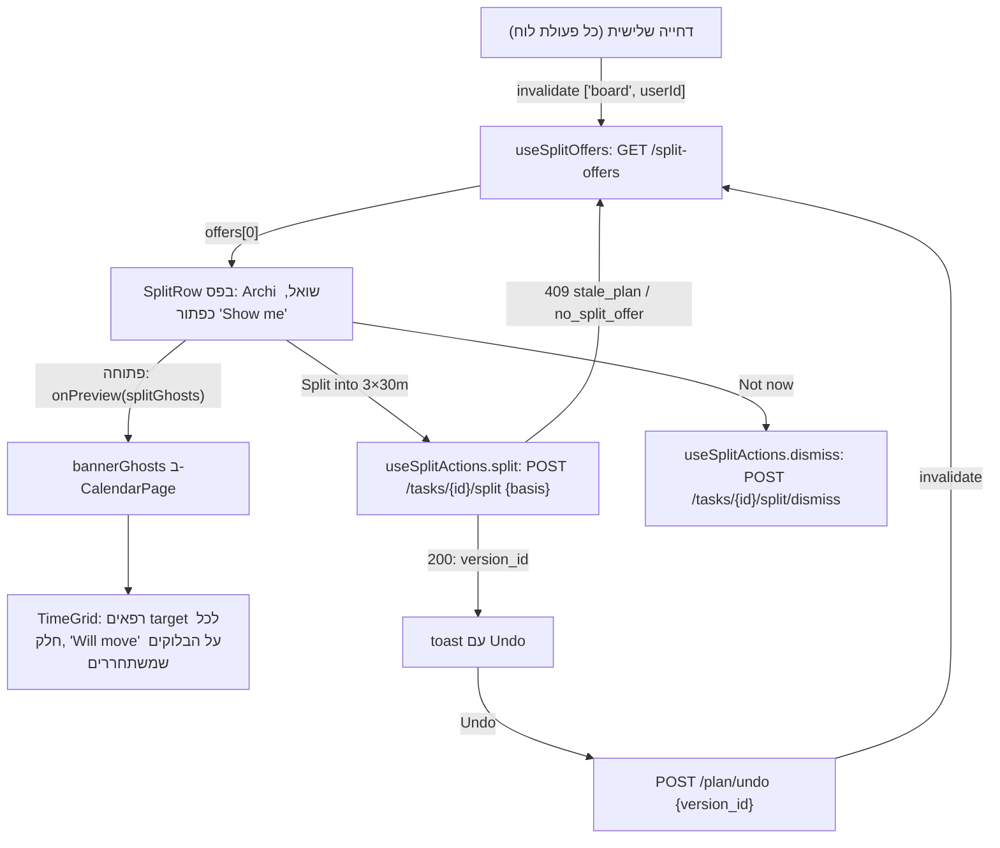

# S44 — זיהוי דחיינות ופיצול בלחיצה, חלק ב' (הממשק): תוכנית עבודה

> **For agentic workers:** REQUIRED SUB-SKILL: Use superpowers:subagent-driven-development to implement this plan task-by-task. Steps use checkbox (`- [ ]`) syntax for tracking. המנהל (השיחה הראשית) מריץ מפתח אחד לכל Task, לפי הסדר, ואחריו סוקר. git רץ רק בשיחה הראשית.

**מטרה:** אחרי דחייה שלישית של אותה משימה, Archi מציע פעם אחת ביומן לפצל אותה לביסים, מראה לאן החלקים ייכנסו (במילים וכרפאים על הרשת), ולחיצה אחת מפצלת בלי עריכה, עם "Undo". "Not now" מעלים את ההצעה.

**השער במפת הדרכים:** "אחרי דחייה שלישית ההצעה מופיעה פעם אחת, והפיצול משבץ את החלקים בלי עריכה ידנית ועם 'בטל'". אחרי המיזוג של התוכנית הזו השורה של S44 עוברת ל"הושלם".

**גישה:** בלי שינוי ב-`api/` ובלי מיגרציה. השרת של S44 (חלק א', `docs/plans/2026-11-21-s44-friction-split.md`) כבר נותן הכול: `GET /split-offers`, ‏`POST /tasks/{id}/split`, ‏`POST /tasks/{id}/split/dismiss`, ו-`POST /plan/undo`. הממשק הוא שורה אחת בפס שמעל היומן (`CalendarBanner`), שנבנית כמו שתי השורות הקיימות (`review`, ‏`report`).

**כלים:** ‏React 19, ‏TypeScript strict, ‏TanStack Query 5, ‏Tailwind 4, ‏React Aria Components, ‏Vitest. בלי תלויות חדשות.

**מקורות, לפי סדר הכוח:** ‏`CLAUDE.md`; מסמך הביקורת `docs/design/2026-11-21-archi-ux-audit.md` (הנחיות 15, 10, 8, 6); ‏`docs/design/archi-voice.md`; מסמך התכנון הראשי, 7.7, "החלטות של מי שבונה, S44" (החוזה, ומה הממשק מציג); ‏`docs/design/design-language.md` סעיף 6א (היומן ונקודות החיבור); ההדמיה `docs/design/prototype/all-screens.html`.

## איך החלקים מתחברים



- **למה ההצעות יושבות מתחת ל-`['board', userId]`:** כל פעולת לוח (דחייה, סקירת בוקר, Undo) כבר מרעננת את כל מה שמתחת למפתח הזה. ההצעה נולדת מדחייה ונעלמת מ-Undo של דחייה, אז היא מתרעננת בדיוק ברגעים הנכונים בלי שורת קוד נוספת בפעולות הקיימות.
- **למה הפיצול לא אופטימי:** רק השרת כותב את הבלוקים החדשים (עם ה-id שלהם) ורק הוא יודע אם ה-`basis` עדיין בתוקף. כמו בדחייה: הכפתור במצב "ממתין" עד התשובה, ואז toast. ה-"Not now" כן אופטימי: התוצאה שלו ידועה מראש (ההצעה נעלמת).
- **למה הרפאים של הפס ברשימה משלהם:** ב-`CalendarPage` יש היום רשימת `ghosts` אחת, שכל סגירה של גיליון וכל ניווט מנקים. החלקים של פיצול נפרשים על כמה ימים, לפעמים לשבוע הבא, והסטודנט צריך לדפדף כדי לראות אותם. לכן לפס יש `bannerGhosts` משלו, שחי כל עוד השורה פתוחה.

## מה מצאתי בקוד (22.11.2026)

1. **בהדמיה אין מסך של הצעת פיצול.** חיפוש של `split`, ‏`bite`, ‏"keep pushing" ב-`all-screens.html` מחזיר רק את "Not now" של המצב "A task did not fit". לכן המודל הוויזואלי הוא המצב הזה (Archi מוביל, כרטיס פנימי עם הפריט, ומתחתיו כפתור ראשי ו-"Not now" ביחס `1.5fr 1fr`), והטקסט מחייב הוא של מסמך הביקורת (סעיף 15) ושל 7.7.
2. **אין איור `archi-thinking`.** ב-`archie/moods.ts` יש שישה מצבים: `intentions`, ‏`eureka`, ‏`wisdom`, ‏`flow`, ‏`rest`, ‏`joy`. ראו החלטה 4.
3. **ב-`parts` של ההצעה אין `study_date` ואין צבע מבחן.** הרפאים צריך עמודה (`date`) וצבע (`colorIndex`). שניהם נגזרים בדפדפן: יום הלימוד מ-`wakingSpan` (אותו כלל של השרת), והצבע מבלוק של המשימה שעל המסך או מרשימת המבחנים. לא נדרש שינוי בשרת. ראו החלטות 6 ו-7.
4. **נקודת החיבור ב-6א מדברת על "שני רפאים של 30 דקות".** השרת מחזיר כמה חלקים שהוא רוצה (90 → 3×30). הממשק מצייר את `parts` כמו שהם, בלי מספר קבוע.
5. **`actionKey(userId)` לא מתאים לפיצול.** `useBlockActions.pending` קורא `variables.block.id` מכל mutation שהמפתח שלו מתחיל ב-`['blockAction', userId]`. ‏mutation של פיצול עם משתנים אחרים היה מפיל אותו. לפיצול מפתח משלו.
6. **בלוק `leaving` מצויר מעל הרפאים** (`z-30` מול `z-20`), כי בזמן תפוס הרפאים הוא מה שדוחף אותו. בפיצול החלק הראשון נוחת בדרך כלל על תחילת הבלוק המקורי, והיה מוסתר מתחתיו. ראו החלטה 8.
7. **`enCalendar.test.ts` קובע שיש בדיוק שישה קובצי `enCalendar*.ts`, ושכל `isolate()` בהם מכוסה בטבלה.** הטקסטים החדשים נכנסים לקבצים הקיימים.
8. קריאה בלי handler ב-`createFakeApi` נדחית ב-404, ולכן בדיקות קיימות של היומן ימשיכו לעבור רק אם השורה שותקת כשהשאילתה נכשלת (וכך היא נבנית).

## ההחלטות שלי

1. **הממשק מצייר את מה שהשרת מחזיר.** מספר החלקים, האורך שלהם והטקסט של הכפתור נבנים מ-`offer.parts` ומ-`offer.bite_minutes`. אין `2`, ‏`3` או `30` בקוד של `web/`. *למה:* ההחלטה 3×30 מול 2×30 פתוחה אצל אייל, וכך היא נסגרת בשרת בלבד.
2. **שורה סגורה כברירת מחדל, עם "Show me".** השורה הסגורה: Archi, המשפט שלו, וכפתור שקט "Show me". הפתוחה: רשימת החלקים במילים, הכפתור הראשי ו-"Not now"; הרפאים על הרשת כל עוד היא פתוחה. *למה:* כך בנויות `review` ו-`report`; הנחיה 10 דורשת לראות את היעד לפני האישור, ורפאים שמופיעים על הרשת בלי שהסטודנט ביקש היו נראים כמו שינוי שכבר קרה.
3. **הצעה אחת בכל רגע:** `offers[0]` (השרת ממיין לפי זמן בלוק החיכוך). אחרי פיצול או "Not now" הבאה בתור מופיעה, סגורה. *למה:* 7.7, ו-Archi לא ממלא יותר ממקום אחד.
4. **המצב של Archi בשורה: `wisdom`.** *למה:* `intentions` ו-`flow` כבר שייכים ל-`review` ול-`report`, ו-`wisdom` הוא המצב השקט והחושב מבין השישה. כשיגיע `archi-thinking` (צ׳ק-ליסט הנכסים של הביקורת) מחליפים שורה אחת.
5. **הרפאים של הפס נפרדים מהרפאים של הגיליונות.** ‏`CalendarPage` מחזיק `bannerGhosts` לצד `ghosts`, והרשת מקבלת `sheet === null ? bannerGhosts : ghosts`. ניווט לא מנקה את `bannerGhosts`. *למה:* ראו "איך החלקים מתחברים"; וגיליון פתוח מקבל את הרשת לעצמו, כדי ששתי תצוגות מקדימות לא יתערבבו.
6. **יום הלימוד של חלק מחושב בדפדפן** (`studyDateOf`): אם הרגע נופל בשעות הערות (`wakingSpan`) של היום המקומי הקודם, זה היום הקודם; אחרת היום המקומי. *למה:* זה הכלל של `study_date` בשרת (`availability.py`), והמתכנן משבץ רק בשעות ערות, אז הענף של "ישן" לא נדרש.
7. **צבע הרפאים:** `exam_color_index` של בלוק של המשימה שעל המסך; אם אין, `color_index` של המבחן מ-`GET /exams`; אם אין, 7. *למה:* 7 הוא צבע ברירת המחדל שכבר נקבע ליומן (S32, ‏Review Focus 5).
8. **רפאים של חלק מצויר מעל הבלוק שמשתחרר.** שדה חדש ואופציונלי `front?: true` ב-`Ghost`, ו-`GhostBlock` מצייר אותו מעל בלוק `leaving`. הבלוקים שמשתחררים (כל הבלוקים המתוכננים של המשימה שעוד לא התחילו) מסומנים `leaving` כרגיל ("Will move"). *למה:* בלי זה החלק הראשון, שנוחת על תחילת הבלוק המקורי, לא נראה; שאר המקומות שמשתמשים ברפאים לא משתנים.
9. **בלי רענון כל דקה.** ‏`useSplitOffers` בלי `refetchInterval` (מתרענן בפעולות לוח ובחזרה לחלון). *למה:* כל קריאה מריצה את המתכנן לכל משימה בהצעה; הצעה שהתיישנה נתפסת ב-`stale_plan`, ואז טוענים מחדש.
10. **שגיאות:** `stale_plan` → טוענים מחדש את ההצעות ו-toast במילים של Archi (לא "Refresh and try again", כי הרענון כבר קרה). `no_split_offer` בפיצול → טוענים מחדש ו-toast עם הטקסט של הקוד. `no_split_offer` ב-"Not now" → בלי toast (ההצעה כבר לא קיימת, וזה מה שהסטודנט ביקש). כל שגיאה אחרת → `errorMessage`, וב-"Not now" ההצעה חוזרת למסך.
11. **Undo שנדחה** (409 ‏`invalid_state` אחרי שביס בוצע) מציג את הטקסט הקיים של הקוד. *למה:* ה-toast חי 10 שניות; מקרה קצה שלא מצדיק טקסט משלו.
12. **הפוקוס אחרי שהשורה נעלמת** עובר לכותרת הנסתרת "Your plan" (`h2`, עם `tabIndex={-1}`), ורק אם הוא נפל ל-`<body>`. *למה:* כמו ב-`ReviewCard` ("אחרת לכותרת"); ה-toast אומר מה קרה.
13. **הטקסטים בקובץ `enCalendarSide.ts`, תחת `banner.split`,** והקוד `no_split_offer` ב-`enCalendarCodes.ts`. *למה:* שם יושבים הטקסטים של הפס והקודים של היומן, והבדיקה מחייבת שישה קבצים בדיוק.
14. **הרגע של Archi בסרגל הצד לא משתנה.** *למה:* ההצעה היא שורה בפס, ו-Archi מוביל אותה שם; רגע תשיעי ב-`archi.ts` מרחיב את ה-scope בלי שהביקורת מבקשת אותו.

## Global Constraints

- **לא נוגעים ב-`api/`.** אם מפתח מגלה שהחוזה לא מספיק, הוא עוצר ומדווח למנהל מה חסר.
- **אין מספר חלקים או אורך ביס קבוע ב-`web/src`** (חוץ מבדיקות ונתוני דמה). הכול מ-`offer.parts`, ‏`offer.bite_minutes`, ‏`offer.block.minutes`, ‏`offer.split_minutes`.
- **החוזה (7.7), מילה במילה:**
  - `GET /split-offers` → `{"offers": [{"task_id", "exam_id", "task_title", "task_kind", "deferrals", "block": {"id", "starts_at", "ends_at", "minutes"}, "bite_minutes", "split_minutes", "parts": [{"starts_at", "ends_at", "minutes"}], "basis"}]}`
  - `POST /tasks/{task_id}/split` עם `{"basis": "<מההצעה>"}` → 200 ‏`{"task_id", "bite_minutes", "blocks": [Block…], "version_id"}`. שגיאות: 404 ‏`not_found`, ‏409 ‏`stale_plan`, ‏409 ‏`no_split_offer`, ‏409 ‏`placement_failed`.
  - `POST /tasks/{task_id}/split/dismiss` בלי גוף → 204. בלי הצעה → 409 ‏`no_split_offer`.
  - Undo: ‏`POST /plan/undo` עם `{"version_id"}`, דרך `undoOnce`.
- **הטקסטים, מילה במילה** (גרש מסולסל `’`, כמו בשאר `enCalendar*.ts`):
  - המשפט של Archi: `I noticed we keep pushing <title> back. Want me to split this <L>-minute block into <B>-minute bites instead?`
  - כפתור ראשי, כשכל החלקים באורך הביס: `Split into <N>×<B>m` (התו `×`, ‏U+00D7). אחרת: `Split into <B>m bites`
  - `Not now`, ‏`Show me`
  - הקוד: `no_split_offer: 'I don’t have a split to offer for this task right now.'`
- **אנגלית בלבד ב-`web/src`**, בקול של Archi בגוף ראשון (`archi-voice.md`): משפט של Archi נגמר בנקודה, כפתור לא; בלי סימן קריאה; שעות 24 שעות וטווח במקף ארוך; תאריך קצר `Sun, 22 Nov`. כל טקסט דרך `en`; אין טקסט ישיר ב-JSX (lint). אות עברית רק בבדיקות, כנתוני דמה של תוכן משתמש.
- **תוכן משתמש** (שם המשימה): ב-JSX דרך `ui/UserText`, בתוך מחרוזת דרך `isolate()`. בלי מירכאות.
- **אפס אימוג׳י.** אייקונים רק מ-`web/src/ui/icons/`. הדמות רק דרך `ArchiSays` / `Archie`.
- **רכיבים רק מ-`web/src/ui/`**, ולא משנים רכיב קיים שם. צבע רק דרך tokens ו-`examColor()`. בלי שקיפות על טקסט או על בלוק.
- **נגישות:** כל פקד 44px; ‏`aria-expanded` על כפתור השורה ו-`aria-controls` רק כשהיא פתוחה (כמו בשורות הקיימות); הרפאים `aria-hidden`, ומה שהם מראים נאמר במילים ברשימה שבשורה.
- **ההתנהגות של `review`, ‏`report`, הגיליונות והרפאים הקיימים לא משתנה.** בדיקה קיימת משתנה רק כשהיא נשענת על מבנה שהשתנה (למשל `BANNER_ROWS`).
- **פקודות**, מתוך `web/`: ‏`npm test -- <pattern>`, ‏`npm run typecheck`, ‏`npm run lint`. לא מריצים `npm run dev`.
- מסמכים ו-commits בעברית, מונחים טכניים באנגלית.

## Review Focus

1. **`stale_plan` באמצע:** ההצעה שעל המסך התיישנה (הבלוק התחיל, או דחייה נוספת מלשונית אחרת). צפוי: ההצעות נטענות מחדש, toast אחד, והשורה מציגה את ההצעה החדשה או נעלמת. שום בלוק לא נכתב. → Task 3.
2. **Undo אחרי ניווט:** toast של פיצול שנלחץ אחרי מעבר לשבוע אחר או למסך אחר. צפוי: עובד (הקריאות חיות על ה-mutation ולא על השורה), וההצעה חוזרת. → Task 3.
3. **רפאים שנשאר:** השורה נסגרת, נעלמת (פיצול, "Not now", רענון שהעלים את ההצעה) או שהמסך מתחלף. צפוי: `bannerGhosts` ריק. וגם: גיליון שנפתח מעל שורה פתוחה מציג רק את הרפאים שלו, ובסגירתו הרפאים של השורה חוזרים. → Task 4.
4. **חלק אחרי חצות:** חלק ב-00:30 מצויר בעמודה של יום הלימוד הקודם. → Task 2.
5. **אין מספר קבוע:** הצעה של 2 חלקים, של 3, ושל חלקים לא שווים (30+45) מציגות טקסט, רשימה ורפאים נכונים. → Tasks 1, 2, 4.
6. **לחיצה כפולה:** שתי לחיצות על "Split into…" שולחות `POST` אחד; שתי לחיצות על Undo שולחות `POST /plan/undo` אחד. → Task 3.
7. **שם משימה בעברית** בתוך המשפט של Archi נשאר בסדר הנכון (`isolate`), ובכרטיס הרפאים נחתך בסופו. → Tasks 1, 4.

## סדר ותלויות

המשימות רצות אחת אחרי השנייה, לפי המספר.

| Task | נשען על | מודל |
| --- | --- | --- |
| 1 הטקסטים והקוד `no_split_offer` | — | fable |
| 2 הנתונים והרפאים (קוד טהור) | 1 | sonnet |
| 3 הפעולות: פיצול, "Not now", Undo | 1, 2 | opus |
| 4 השורה בפס והחיבור למסך | 1, 2, 3 | fable |
| 5–8 | 4 | המנהל |

**קבצים משותפים:** `web/src/i18n/enCalendarSide.ts`, ‏`enCalendarCodes.ts`, ‏`enCalendar.test.ts`, ‏`codes.test.ts` (רק Task 1; משימה מאוחרת שחסר לה מפתח מוסיפה אותו תחת `banner.split` באותו קול ומדווחת). `web/src/calendar/ghost.ts`, ‏`GhostBlock.tsx` (רק Task 2). `web/src/calendar/testFixtures.ts` (‏Task 2 מוסיף `makeSplitOffer`; ‏Task 4 מוסיף את ה-handler ל-`openCalendar`). `web/src/calendar/CalendarBanner.tsx`, ‏`CalendarPage.tsx` (רק Task 4).

---

### Task 1: הטקסטים של הצעת הפיצול והקוד `no_split_offer` (`fable`: ניסוחים בקול של Archi)

**Files:**
- Modify: `web/src/i18n/enCalendarSide.ts` (קבוצה חדשה `banner.split`), `web/src/i18n/enCalendarCodes.ts`, `web/src/i18n/locale.ts` ו-`web/src/i18n/en.ts` (רק העברת `inSentence`, ראו למטה)
- Test: `web/src/i18n/enCalendar.test.ts`, `web/src/i18n/codes.test.ts`

**מה נבנה.** כל מה ש-Archi אומר על הפיצול, כפונקציות שמקבלות את המספרים מההצעה. אין בהן מספר קבוע.

`en.calendar.side.banner.split`:

| מפתח | חתימה | הפלט |
| --- | --- | --- |
| `say` | `(title: string, blockMinutes: number, biteMinutes: number) => string` | `I noticed we keep pushing ${isolate(title)} back. Want me to split this 90-minute block into 30-minute bites instead?` |
| `show` | `string` | `Show me` |
| `action` | `(count: number, biteMinutes: number, even: boolean) => string` | `even`: ‏`Split into 3×30m`; אחרת `Split into 30m bites` |
| `notNow` | `string` | `Not now` |
| `where` | `(count: number) => string` | `Here’s where the 3 bites would go:` (ב-1: ‏`Here’s where the bite would go:`) |
| `part` | `(day: string, range: string, duration: string) => string` | `Tue, 24 Nov, 18:00–18:30, 30 min` (מחובר ב-`joiner` של הקובץ) |
| `whole` | `(duration: string) => string` | `That’s every block of this task that’s still ahead, 3 hours in all.` |
| `done` | `(count: number, day: string, time: string) => string` | `I split it into 3 bites. The first is tomorrow at 09:00.` |
| `undone` | `string` | `I put the block back as it was.` |
| `dismissed` | `string` | `I’ll leave it as it is.` |
| `stale` | `string` | `Your plan changed, so I looked again.` |

- `day` ב-`done` מגיע כ-"Today" / "Tomorrow" / "Sun, 22 Nov" (מ-`dayLabel`) ונכתב באות קטנה באמצע משפט, כמו ב-`en.board.deferred`. הפונקציה `inSentence` קיימת היום ב-`en.ts` ולא מיוצאת; `enCalendarSide.ts` לא יכול לייבא מ-`en.ts` (מעגל). מעבירים אותה כמו שהיא ל-`i18n/locale.ts`, מייצאים, ומייבאים משם גם ב-`en.ts`. בלי שינוי התנהגות.
- המפתח `where` ו-`done`: יחיד ורבים נכונים לכל `count`.
- ב-`enCalendarCodes.ts`: ‏`no_split_offer: 'I don’t have a split to offer for this task right now.'`, ועדכון הערת הכותרת של הקובץ (הוא כבר לא רק "הקודים של S35": גם הקוד של S44).
- הניסוחים בטבלה מחייבים במשמעות ובמספרים. אם ניסוח נשמע לא טבעי באנגלית, מותר לשפר אותו בתוך כללי `archi-voice.md` ולדווח למנהל; שלושת הטקסטים שב-Global Constraints (המשפט של Archi, הכפתור הראשי, `Not now`) לא משתנים.

**בדיקות (נכתבות קודם, נכשלות):**
- [ ] ב-`enCalendar.test.ts`, בטבלת הספירות: `split.action(3, 30, true)` = `Split into 3×30m`; ‏`split.action(2, 30, true)` = `Split into 2×30m`; ‏`split.action(2, 30, false)` = `Split into 30m bites`; ‏`split.where(1)` ו-`split.where(3)`; ‏`split.done(2, 'Tomorrow', '09:00')` = `I split it into 2 bites. The first is tomorrow at 09:00.`; ‏`split.done(3, 'Sun, 22 Nov', '18:00')` שומר על `Sun`.
- [ ] `split.say('תרגול: malloc ו-free', 90, 30)`: מכיל `90-minute` ו-`30-minute`, השם עטוף בתווי הבידוד, ונוסף לטבלה שמכסה כל `isolate()` בקובצי החלקים (הבדיקה "the table above covers every isolate() call" נכשלת בלי זה).
- [ ] ב-`codes.test.ts`: `'no_split_offer'` ברשימה `CODES`.
- [ ] הבדיקה "are exactly the six" נשארת ירוקה (אין קובץ חדש).

**צעדים:**
- [ ] לכתוב את הבדיקות ולראות שהן נכשלות: `npm test -- enCalendar codes`.
- [ ] לממש; `npm test -- enCalendar codes en.test sourceGuards`, ‏`npm run typecheck`, ‏`npm run lint`.
- [ ] commit: `feat(web): S44 הטקסטים של הצעת הפיצול והקוד no_split_offer`.

**קריטריוני קבלה:** כל הטקסטים בגוף ראשון, בלי "Archi" כנושא, בלי אימוג׳י ובלי סימן קריאה; אין ספרה קבועה של חלקים או דקות במחרוזות; `codeText('no_split_offer')` מחזיר את הטקסט ולא את הכללי.

### Task 2: הנתונים של ההצעה והרפאים שלה (`sonnet`: קוד טהור עם ערכים מדויקים)

**Files:**
- Create: `web/src/calendar/splitOffers.ts`, `web/src/calendar/splitOffers.test.ts`
- Modify: `web/src/calendar/ghost.ts` (שדה `front`), `web/src/calendar/GhostBlock.tsx`, `web/src/calendar/testFixtures.ts` (‏`makeSplitOffer`)
- Test: גם `web/src/calendar/TimeGrid.test.tsx` (מקרה אחד)

**מה נבנה.** הטיפוסים של החוזה, השאילתה, והפונקציות הטהורות שהופכות הצעה לרפאים ולשורות טקסט. השורה (Task 4) והפעולות (Task 3) רק משתמשות בהן.

**Interfaces — Produces** (ב-`splitOffers.ts`):

```ts
export interface SplitPart { starts_at: string; ends_at: string; minutes: number }
export interface SplitOffer {
  task_id: string; exam_id: string; task_title: string; task_kind: TaskKind; deferrals: number
  block: { id: string; starts_at: string; ends_at: string; minutes: number }
  bite_minutes: number; split_minutes: number; parts: SplitPart[]; basis: string
}
export interface SplitOffers { offers: SplitOffer[] }
export interface SplitResult { task_id: string; bite_minutes: number; blocks: Block[]; version_id: string }

export function splitOffersKey(userId: string | null)   // [...boardKey(userId), 'splitOffers']
export function useSplitOffers(): UseQueryResult<SplitOffers, ApiError>
export function studyDateOf(iso: string, me: Me | undefined, tz: string): string
export function evenParts(offer: SplitOffer): boolean
export function releasedBlocks(offer: SplitOffer, blocks: Block[], now: number): Block[]
export function splitColorIndex(offer: SplitOffer, blocks: Block[], exams: Exam[]): number
export function splitGhosts(input: { offer: SplitOffer; blocks: Block[]; colorIndex: number; me: Me | undefined; tz: string; now: number }): Ghost[]
```

הכללים:
- `useSplitOffers`: ‏`api.get<SplitOffers>('/split-offers', { signal })`, ‏`enabled: userId !== null`, **בלי** `refetchInterval` (החלטה 9). המפתח מתחת ל-`boardKey`, כמו `reviewKey` ב-`board/api.ts`.
- `studyDateOf`: ‏`local = dateIn(tz, new Date(iso))`; ‏`prev = addDays(local, -1)`; אם `wakingSpan(prev, me, tz)` מחזיר `dayStart` ו-`dayEnd` שאינם `null` ו-`dayStart <= Date.parse(iso) < dayEnd`, מחזירים `prev`; אחרת `local`. בלי `me`: ‏`local`.
- `evenParts`: כל `part.minutes === offer.bite_minutes`.
- `releasedBlocks`: הבלוקים ב-`blocks` עם `task_id === offer.task_id`, ‏`status === 'planned'` ו-`Date.parse(starts_at) > now` (מה שהשרת משחרר: מתוכננים שעוד לא התחילו).
- `splitColorIndex`: ‏`exam_color_index` של הבלוק הראשון ב-`blocks` עם `task_id` של ההצעה; אחרת `color_index` של המבחן עם `id === offer.exam_id`; אחרת `7`.
- `splitGhosts`: לכל חלק לפי הסדר, רפאים `{ id: 'split-<task_id>-<index>', date: studyDateOf(part.starts_at, me, tz), startMin: localMinutes(part.starts_at, date, tz), endMin: localMinutes(part.ends_at, date, tz), colorIndex, title: offer.task_title, kind: offer.task_kind, tone: 'target', label: formatRange(part, tz), front: true }`; ואחריהם, לכל בלוק של `releasedBlocks`, ‏`ghostOf(block, block.starts_at, block.ends_at, block.study_date, tz, 'leaving')`.
- ב-`ghost.ts`: שדה אופציונלי `front?: true` ב-`Ghost`, עם הערה: רפאים שמצויר מעל בלוק `leaving` (הפיצול: החלק נוחת על הבלוק שהוא מחליף). ב-`GhostBlock.tsx`: כש-`ghost.front === true` ה-`z-index` גבוה מ-`z-30` של בלוק `leaving` (ב-`CalendarBlock.tsx`) ונמוך מכל מה שדבוק מעל הרשת; לבדוק ב-`TimeGrid.tsx` מה ה-`z` של כותרת העמודות ולבחור ערך ביניהם. בלי `front` שום דבר לא משתנה.
- `makeSplitOffer(overrides)` ב-`testFixtures.ts`: ברירת המחדל היא הדוגמה של 7.7 על השבוע של הבדיקות: משימה `'תרגול: malloc ו-free'`, ‏`task_kind: 'practice'`, ‏`deferrals: 3`, בלוק `2026-11-24T14:00:00Z`–`15:30:00Z` (90 דקות), ‏`bite_minutes: 30`, ‏`split_minutes: 90`, שלושה חלקים של 30 דקות: `2026-11-24T14:00:00Z`, ‏`2026-11-25T07:00:00Z`, ‏`2026-11-26T07:00:00Z`, ‏`basis: 'basis-1'`.

**בדיקות (נכתבות קודם, נכשלות), ב-`splitOffers.test.ts`:**
- [ ] `studyDateOf`, עם `makeMe` של `calendar/testFixtures.ts` ב-`wake_time: '08:00'`, ‏`sleep_time: '02:00'`, ‏`Asia/Jerusalem`: רגע של 00:30 מקומי ב-25.11 (`2026-11-24T22:30:00Z`) → `'2026-11-24'`; ‏09:00 מקומי ב-25.11 → `'2026-11-25'`; בלי `me` → התאריך המקומי.
- [ ] `evenParts`: שלושה של 30 עם ביס 30 → `true`; ‏30 ו-45 עם ביס 30 → `false`.
- [ ] `releasedBlocks`: בלוק מתוכנן עתידי של המשימה נכלל; בלוק `done` שלה, בלוק שכבר התחיל, ובלוק של משימה אחרת לא.
- [ ] `splitColorIndex`: מהבלוק; בלי בלוק, מהמבחן; בלי שניהם, 7.
- [ ] `splitGhosts` על `makeSplitOffer()`: שלושה רפאים `target` עם `front: true`, בתאריכים `2026-11-24`, ‏`2026-11-25`, ‏`2026-11-26`, ‏`startMin`/`endMin` של 16:00–16:30 ושל 09:00–09:30, ‏`label` שווה ל-`formatRange`, ו-id שונה לכל אחד; ורפאים `leaving` אחד עם ה-id של הבלוק המקורי. הצעה של שני חלקים נותנת שני רפאים `target` (אין מספר קבוע).
- [ ] חלק ב-`2026-11-24T22:30:00Z` עם ה-`me` שלמעלה: ‏`date === '2026-11-24'` ו-`startMin === 1470` (Review Focus 4).
- [ ] ב-`TimeGrid.test.tsx`: רפאים `target` עם `front: true` מעל בלוק `leaving` באותה עמודה מצויר (`[data-ghost]` קיים), וה-class שלו נושא את ה-`z` הגבוה; רפאים בלי `front` נשאר ב-`z-20`.
- [ ] `useSplitOffers`: המפתח מתחיל ב-`boardKey(USER_ID)` (כמו הבדיקה "keys today by user, under the board" ב-`calendarFlow.test.tsx`).

**צעדים:**
- [ ] בדיקות נכשלות: `npm test -- splitOffers TimeGrid`.
- [ ] מימוש; `npm test -- calendar`, ‏`npm run typecheck`, ‏`npm run lint`.
- [ ] commit: `feat(web): S44 הנתונים של הצעת הפיצול והרפאים שלה`.

**קריטריוני קבלה:** אין ב-`splitOffers.ts` מספר חלקים או אורך ביס; כל הפונקציות חוץ מ-`useSplitOffers` טהורות; בדיקות היומן הקיימות ירוקות בלי שינוי.

### Task 3: הפעולות: פיצול, "Not now" ו-Undo (`opus`: mutation שחי אחרי המסך, מצבי שגיאה ומירוץ)

**Files:**
- Create: `web/src/calendar/splitActions.ts`, `web/src/calendar/splitActions.test.tsx`

**תלוי ב:** Task 1 (הטקסטים), Task 2 (`SplitOffer`, ‏`SplitResult`, ‏`splitOffersKey`).

**מה נבנה.** hook אחד, באותה תבנית של `calendar/freeTimeActions.ts` ושל `deferMutation` ב-`board/actions.ts`: הקריאות החוזרות יושבות על ה-`useMutation` עצמו (לא על `mutate()`), כדי שה-toast וה-Undo יעבדו גם אחרי שהשורה או המסך נעלמו.

**Interfaces — Produces:**

```ts
export interface SplitActions {
  split(offer: SplitOffer): void
  dismiss(offer: SplitOffer): void
  // True while the split of this task is on its way.
  splitting(taskId: string): boolean
}
export function useSplitActions(): SplitActions
```

הכללים:
- **מפתח ה-mutation:** `['splitAction', userId]`. **לא** `actionKey(userId)`: ‏`useBlockActions.pending` קורא `variables.block.id` מכל mutation שמתחיל במפתח ההוא.
- **`split(offer)`:** ‏`api.post<SplitResult>(`/tasks/${offer.task_id}/split`, { basis: offer.basis })`. בזמן שפיצול של אותה משימה ממתין, קריאה נוספת לא שולחת דבר (Review Focus 6).
  - הצלחה: מוציאים את ההצעה מה-cache (`setQueryData(splitOffersKey(userId), …)` בלי ה-`task_id` הזה), ו-toast של הצלחה עם Undo ל-`UNDO_TIMEOUT_MS`: הטקסט `en.calendar.side.banner.split.done(offer.parts.length, dayLabel(first.study_date, today), formatTime(first.starts_at, tz))`, כש-`first` הוא הבלוק המתוכנן המוקדם ביותר ב-`result.blocks`, ו-`today` הוא `queryClient.getQueryData<Today>(todayKey(userId))?.date ?? dateIn(tz)` (כמו בדחייה).
  - Undo: ‏`undoOnce(queryClient, result.version_id, () => api.post('/plan/undo', { version_id }))`; הצלחה → toast ‏`split.undone`; כישלון → toast שגיאה עם `errorMessage`; בסוף תמיד `settle`.
  - `stale_plan`: ‏toast מידע עם `split.stale`. ‏`no_split_offer`: ‏toast שגיאה עם `codeText('no_split_offer')`. כל שגיאה אחרת: toast שגיאה עם `errorMessage(error)`.
  - `onSettled`: ‏`settle` = ‏invalidate של `boardKey(userId)` (כולל ההצעות) ושל `tasksKey(userId)` מ-`exam/api`.
- **`dismiss(offer)`:** ‏`api.post(`/tasks/${offer.task_id}/split/dismiss`)` (204 → `undefined`). אופטימי: ב-`onMutate` מבטלים שאילתות של `splitOffersKey`, שומרים את התשובה הקודמת ומוציאים את ההצעה מה-cache.
  - הצלחה: toast מידע `split.dismissed`.
  - `no_split_offer`: בלי toast (החלטה 10).
  - שגיאה אחרת: מחזירים את התשובה הקודמת ו-toast שגיאה.
  - `onSettled`: ‏invalidate של `splitOffersKey(userId)` בלבד (הלוח לא השתנה).
- `splitting(taskId)`: דרך `useMutationState` עם המפתח של הפיצול ו-`status: 'pending'`.

**בדיקות (נכתבות קודם, נכשלות), עם `createFakeApi` ו-`renderBoard` / `QueryClient` כמו ב-`busyActions.test.tsx`:**
- [ ] `split` שולח `POST /tasks/<id>/split` עם `{ basis: 'basis-1' }` בדיוק; אחרי 200 מופיע toast עם `split.done(3, …)` ועם כפתור `en.common.undo`, וההצעה יצאה מה-cache.
- [ ] המספר ב-toast הוא `offer.parts.length`: הצעה של שני חלקים → `split.done(2, …)`.
- [ ] לחיצה על Undo שולחת `POST /plan/undo` עם `{ version_id }` פעם אחת גם בשתי לחיצות, ואחריה toast ‏`split.undone` ו-`GET /split-offers` נשלח שוב.
- [ ] Undo עובד אחרי שהרכיב שקרא ל-`split` הוסר מהעץ (Review Focus 2).
- [ ] 409 ‏`stale_plan` → toast ‏`split.stale`, ו-`GET /split-offers` נשלח שוב; ‏409 ‏`no_split_offer` → toast עם `codeText('no_split_offer')`.
- [ ] שתי קריאות `split` רצופות לאותה הצעה → `POST` אחד.
- [ ] `dismiss`: ההצעה נעלמת מה-cache לפני שהשרת עונה; 204 → toast ‏`split.dismissed`; 500 → ההצעה חוזרת ו-toast שגיאה; 409 ‏`no_split_offer` → בלי toast.
- [ ] `splitting(taskId)` הוא `true` רק בזמן ש-`POST` הפיצול ממתין.
- [ ] mutation של פיצול ממתין לא מפיל את `useBlockActions().pending('b1')` (שניהם באותו עץ).

**צעדים:**
- [ ] בדיקות נכשלות: `npm test -- splitActions`.
- [ ] מימוש; `npm test -- calendar board`, ‏`npm run typecheck`, ‏`npm run lint`.
- [ ] commit: `feat(web): S44 פעולות הפיצול: split, Not now ו-Undo`.

**קריטריוני קבלה:** אין קריאה חוזרת שתלויה ברכיב חי; אין שינוי ב-`board/actions.ts`; כל toast מ-`en`.

### Task 4: השורה `split` בפס והחיבור למסך (`fable`: עיצוב, Archi מוביל, פוקוס ורפאים)

**Files:**
- Create: `web/src/calendar/BannerRow.tsx` (הרכיב `Row` עובר לכאן כמו שהוא), `web/src/calendar/SplitRow.tsx`, `web/src/calendar/splitFlow.test.tsx`
- Modify: `web/src/calendar/CalendarBanner.tsx`, `web/src/calendar/CalendarPage.tsx`, `web/src/calendar/testFixtures.ts` (‏`openCalendar`), `web/src/calendar/CalendarBanner.test.tsx`

**תלוי ב:** Tasks 1–3.

**מה נבנה.** השורה השלישית של הפס, אחרי `review` ו-`report`.

1. **`BannerRow.tsx`:** הרכיב `Row` והטיפוס `RowProps` עוברים מ-`CalendarBanner.tsx` בלי שינוי בהתנהגות (כדי ש-`SplitRow` יוכל לייבא אותם בלי ייבוא מעגלי). `BANNER_ROWS` נשאר ב-`CalendarBanner.tsx` והופך ל-`['review', 'report', 'split']`.
2. **`SplitRow`**, ‏props: ‏`RowProps` ועוד `{ offer: SplitOffer; ghosts: Ghost[]; parts: { key: string; text: string }[] }` (או חישוב שלהם בפנים מ-`blocks`, ‏`exams`, ‏`me`, ‏`tz`, ‏`now`, ‏`today`; העיקר שהחישוב עצמו הוא הפונקציות של Task 2).
   - סגורה: ‏`<Row name="split" mood="wisdom" label={expanded ? banner.close : split.show}>` והתוכן `split.say(offer.task_title, offer.block.minutes, offer.bite_minutes)`.
   - הפאנל, לפי המודל של "A task did not fit" בהדמיה:
     - שורת מבוא `split.where(offer.parts.length)`.
     - `<ul>` עם שורה לכל חלק: אייקון הסוג `KIND_ICON[offer.task_kind]` בצבע המבחן (`examColor(colorIndex).text`), והטקסט `split.part(dayLabel(studyDateOf(...), today), formatRange(part, tz), durationText(part.minutes))`, ב-`tabular-nums`.
     - כש-`offer.split_minutes !== offer.block.minutes`: שורה `split.whole(durationText(offer.split_minutes))` (הפיצול תופס גם בלוקים נוספים של המשימה, וצריך לומר את זה).
     - שני כפתורים ב-`grid grid-cols-[1.5fr_1fr] gap-2`: ראשי `split.action(offer.parts.length, offer.bite_minutes, evenParts(offer))` עם `isPending={actions.splitting(offer.task_id)}` שקורא ל-`actions.split(offer)`, ו-`variant="secondary"` ‏`split.notNow` שקורא ל-`actions.dismiss(offer)` ומנוטרל בזמן שפיצול ממתין.
   - **רפאים:** כשהשורה פתוחה קוראים ל-`onPreview(ghosts)`, וכשהיא נסגרת או יורדת מהעץ ל-`onPreview([])`. לפי התבנית של `BusySheet.tsx`: ‏ref לרשימה, ו-effect שתלוי ב-`expanded` וב-`JSON.stringify(ghosts)`, כדי שרענון שלא שינה דבר לא יצייר מחדש.
3. **`CalendarBanner`:** ‏props חדשים: ‏`blocks: Block[]`, ‏`exams: Exam[]`, ‏`me: Me | undefined`, ‏`tz: string`, ‏`now: number`, ‏`today: string`, ‏`focusAfter: RefObject<HTMLElement | null>`.
   - `const offer = useSplitOffers().data?.offers[0]`; ‏`showSplit = offer !== undefined`. שאילתה שנכשלה או בטעינה: אין שורה, בלי הודעה (ההצעה היא תוספת, לא מצב של המסך).
   - התנאי להחזרת `null`: אף אחת משלוש השורות.
   - כש-`offer?.task_id` משתנה (הצעה נעלמה או התחלפה) ו-`open === 'split'`: ‏`open` חוזר ל-`null` (ההצעה הבאה מופיעה סגורה, החלטה 3). ואם באותו רגע הפוקוס על `<body>` (הכפתור שנלחץ ירד מהעץ): ‏`focusAfter.current?.focus()` (החלטה 12).
   - `key={offer.task_id}` על `SplitRow`.
4. **`CalendarPage`:**
   - `const [bannerGhosts, setBannerGhosts] = useState<Ghost[]>([])`; ה-`onPreview` של הפס הוא `setBannerGhosts` (לא `setGhosts`). ‏`TimeGrid` מקבל `ghosts={sheet === null ? bannerGhosts : ghosts}` (החלטה 5). הניקוי בניווט נשאר רק על `ghosts`.
   - הפס מקבל `blocks`, ‏`exams={data.exams.data ?? []}`, ‏`me`, ‏`tz`, ‏`now`, ‏`today`.
   - ל-`<h2 className="sr-only">` של `planHeading` (בשני המבנים, מחשב וטלפון): ‏`tabIndex={-1}` ו-ref אחד שעובר לפס כ-`focusAfter`.
   - לעדכן את ההערה בראש הקובץ ואת ההערה של נקודת החיבור ב-`CalendarBanner.tsx`: השורה נבנתה, ולפס רשימת רפאים משלו.
   - `empty` (היומן הריק) לא משתנה: הצעה קיימת רק כשיש בלוק מתוכנן.
5. **`testFixtures.ts`:** ל-`CalendarServer` שדה `splitOffers: SplitOffer[]` (ברירת מחדל `[]`), ול-`openCalendar` ‏handler: ‏`.on('GET /split-offers', () => ({ offers: state.splitOffers }))`.

**בדיקות (נכתבות קודם, נכשלות):**

ב-`CalendarBanner.test.tsx` (ה-`setup` מקבל גם `offers` ורושם `GET /split-offers`):
- [ ] `BANNER_ROWS` שווה ל-`['review', 'report', 'split']`.
- [ ] בלי הצעות ובלי שאר השורות: שום `[data-banner-row]`. `GET /split-offers` שנכשל (בלי handler): אותו דבר, בלי `alert`.
- [ ] עם הצעה: השורה `split` אחרונה אחרי `review` ו-`report`; המשפט שווה ל-`split.say(title, 90, 30)`; הכפתור `split.show` עם `aria-expanded="false"`; ‏`onPreview` לא נקרא עם רפאים.
- [ ] פתיחה: רשימה של שלוש שורות ששוות ל-`split.part(...)`; הכפתור `Split into 3×30m`; ‏"Not now"; ‏`onPreview` נקרא עם שלושה רפאים `target` ועם `leaving` לבלוק המקורי. סגירה: ‏`onPreview([])`.
- [ ] הצעה של שני חלקים: `Split into 2×30m` ושתי שורות. הצעה של 30+45: ‏`Split into 30m bites`. הצעה ש-`split_minutes` שלה 180 מול בלוק של 90: מופיעה השורה `split.whole`.
- [ ] שתי הצעות: מוצגת רק הראשונה; אחרי "Not now" (204) מופיעה השנייה, סגורה.
- [ ] רק שורה אחת פתוחה: פתיחת `review` סוגרת את `split`, ו-`onPreview([])` נקרא.

ב-`splitFlow.test.tsx` (דרך `openCalendar('/calendar', { blocks, splitOffers: [makeSplitOffer()] })`, מחשב, עם השעון של `CAL_NOW`):
- [ ] "Show me" מצייר על הרשת `[data-ghost]` עם `data-tone="target"` בעמודות של 24, 25 ו-26 בנובמבר, והבלוק המקורי מסומן "Will move".
- [ ] לחיצה על הכפתור הראשי שולחת `POST /tasks/<id>/split` עם ה-`basis`; אחרי התשובה: toast עם Undo, השורה נעלמת, אין `[data-ghost]` על הרשת, והפוקוס על הכותרת "Your plan".
- [ ] Undo שולח `POST /plan/undo`, ואחרי ש-`state.splitOffers` חוזר השורה מופיעה שוב.
- [ ] מעבר ל"Next week" כשהשורה פתוחה: השורה נשארת פתוחה, והרפאים של השבוע הבא מצוירים אם יש חלק בו (הצעה עם חלק ב-`2026-11-29T07:00:00Z`).
- [ ] גיליון שנפתח מעל שורה פתוחה (לחיצה על בלוק): הרפאים של הפיצול לא מצוירים; אחרי Escape הם חוזרים (Review Focus 3).
- [ ] 409 ‏`stale_plan`: ‏toast ‏`split.stale`, שום בלוק לא השתנה, ו-`GET /split-offers` נשלח שוב.
- [ ] טלפון (`stubMedia({ desktop: false })`): השורה מופיעה מתחת לכותרת ולפס הימים, והרשימה במילים מציגה את שלושת הימים גם כשהרשת מציגה יום אחד.
- [ ] בדיקות היומן הקיימות (`calendarFlow`, ‏`phone`, ‏`CalendarPage`, ‏`sheets*`) ירוקות בלי שינוי בציפיות.

**צעדים:**
- [ ] בדיקות נכשלות: `npm test -- CalendarBanner splitFlow`.
- [ ] מימוש; `npm test`, ‏`npm run typecheck`, ‏`npm run lint`, ‏`npm run build`.
- [ ] commit: `feat(web): S44 הצעת הפיצול ביומן: שורה בפס, רפאים, פיצול ו-Not now`.

**קריטריוני קבלה:** השורה נראית ומתנהגת כמו `review` ו-`report` (אותו `Row`); אין מספר חלקים קבוע; אין טקסט ישיר ב-JSX; שם המשימה עובר דרך `isolate()` במשפט; 44px לכל כפתור; עם `prefers-reduced-motion` אין תנועה חדשה (השורה לא מוסיפה `animate`).

---

## משימות המנהל (השיחה הראשית; לא נשלחות כמשימת מימוש)

### Task 5: צילומים מול ההדמיה — **מנהל** (subagent של `sonnet` לצילום; המנהל משווה)

- [ ] סביבת צילום ב-`~/studyflow-manager/screens/s44-shots-harness/` (העתק של `~/studyflow-manager/screens/s32-shots-harness`), בפורט **4244** לאפליקציה ו-**4344** להדמיה (לא 5173, ‏4232, ‏4234), עם `WEB_DIR` של ה-worktree הזה ו-`OUT_DIR` ‏`~/studyflow-manager/screens/s44-screens/`. נתוני הדמה של S32 (השבוע 22–28.11.2026, היום שלישי 24, ‏11:25), ועוד `GET /split-offers` עם ההצעה של 7.7 (`תרגול: malloc ו-free`, ‏90 דקות, שלושה חלקים).
- [ ] מצבים, ב-390×844 וב-1280×800: השורה סגורה; פתוחה עם הרפאים (שבוע ויום במחשב, יום בטלפון); יחד עם `review` ו-`report`; הכפתור במצב ממתין; ה-toast עם Undo; אחרי פיצול (שלושת הביסים על הרשת); הצעה של שני חלקים והצעה של 30+45; שם משימה ארוך בעברית; reduced motion.
- [ ] להשוות למצב "A task did not fit" בהדמיה (אין בה מסך פיצול) ולהנחיות 15 ו-10. לבדוק במיוחד: החלק הראשון נראה מעל הבלוק שמשתחרר (החלטה 8) ולא מסתיר את "Will move" באופן שמבלבל; השורה הפתוחה בטלפון לא דוחקת את הרשת מהמסך.
- [ ] כל פער: תיקון דרך מפתח (במודל של המשימה המקורית), או רישום כסטייה מודעת ב-6א.

### Task 6: סקירה סופית — **מנהל** (הסוקר: `fable`)

- [ ] `superpowers:requesting-code-review` על כל הענף מול התוכנית הזו, ה-Global Constraints, ה-Review Focus, מסמך הביקורת (15, 10) ומסמך הקול. הסוקר קורא את `banner.split` כטקסט, ומחפש ב-`web/src` (מחוץ לבדיקות) מספר חלקים או דקות קבוע.
- [ ] תיקונים דרך מפתח, ובדיקה חוזרת של מה שתוקן.

### Task 7: מסמכים — **מנהל**

- [ ] `docs/design/design-language.md`, 6א: בפסקת "הפס" השורה `split` (סגורה, פתוחה, המצב `wisdom`, הצעה אחת בכל רגע); בפסקת הרפאים מקום חמישי (הפיצול: `bannerGhosts`, ‏`front`); בטבלת "נקודות החיבור" שתי השורות של S44 יוצאות (נבנו), והניסוח "שני רפאים של 30 דקות" נמחק; סטיות שהתקבלו ב-Task 5.
- [ ] מסמך התכנון הראשי, 7.7: בפסקה "מה הממשק מציג" לעדכן מ"במסך היום" ל"בפס של היומן", את המצב `wisdom` במקום `archi-thinking`, ואת ההחלטות 2, 5, 9 ו-10 של התוכנית הזו. בטבלת ה-API: ‏S44 בלי "(שרת; הממשק אחרי S32)".
- [ ] מפת הדרכים (artifact, עם כלי ה-Docs): הפריט הפתוח "S44: הממשק של הצעת הפיצול, אחרי S32" נסגר; הפריטים שב"מה נרשם ל-scopes אחרים" נרשמים; וכל באג שהמפתחים דיווחו עליו.

### Task 8: כל הפקודות, מיזוג ומפת הדרכים — **מנהל**

- [ ] כל הפקודות של `web/` (‏`npm test`, ‏`lint`, ‏`typecheck`, ‏`build`); ב-`api/` רק בדיקה שלא השתנה דבר (`git diff --stat origin/main -- api/` ריק). ‏gitleaks נקי.
- [ ] `git fetch`, ‏`git rebase origin/main`, וכל הבדיקות שוב.
- [ ] `git push origin s44-split-ui:main` (רק fast-forward); בדיקה שה-push הצליח, ורק אחר כך מחיקת הענף. שתי התוכניות של S44 עוברות ל-`docs/archive/plans/`.
- [ ] מפת הדרכים: S44 "הושלם", עם ה-commit של `main`. הודעה לאייל: מה נבנה, ההחלטות, מה נבדק, וההחלטה הפתוחה על 3×30 מול 2×30.

## מה נרשם ל-scopes אחרים

- **נכסים (צ׳ק-ליסט הביקורת):** איור `archi-thinking`. כשיגיע, המצב של השורה `split` מתחלף מ-`wisdom`.
- **מסך המבחן (S34 או אחריו):** סימון משימה מפוצלת ברשימת המשימות לפי `TaskOut.bite_minutes` (7.7 מאפשר, לא נבנה כאן).
- **`calendar/archi.ts`:** רגע `split` בסרגל הצד (החלטה 14), אם ירצו ש-Archi יפתח איתו את היום.
- **שרת, רק אם יוחלט:** `study_date` לכל חלק ב-`parts` של `GET /split-offers`, כדי שהדפדפן לא יחשב אותו בעצמו (החלטה 6). לא חוסם.

## החלטות לבעל המוצר

1. **בלוק של 90 דקות: 3×30 או 2×30.** השרת בנה 3×30 (שומר על כל 90 הדקות של המשימה); מסמך הביקורת כתב "two 30-minute bites" ו-`Split into 2×30m`.
   - **א (מה שבנוי):** 3×30. אף דקת לימוד לא נעלמת.
   - **ב:** 2×30. קל יותר להתחיל, אבל 30 דקות יורדות מהתוכנית בלי שהסטודנט ביקש.
   - **ההמלצה:** א. הממשק מציג בכל מקרה את מה שהשרת מחזיר, כך ששינוי ל-ב הוא שינוי בשרת בלבד (`bite_for` והתאמת ההערכה), בלי לגעת ב-`web/`.
2. **שתי לחיצות עד הפיצול.** "Show me" פותח את התצוגה המקדימה, ורק אז מופיעים "Split into…" ו-"Not now" (החלטה 2). האפשרות האחרת: שני הכפתורים כבר בשורה הסגורה, והרפאים מופיעים מיד. **ההמלצה:** כמו בתוכנית, ולהחליט סופית מול הצילומים של Task 5.
