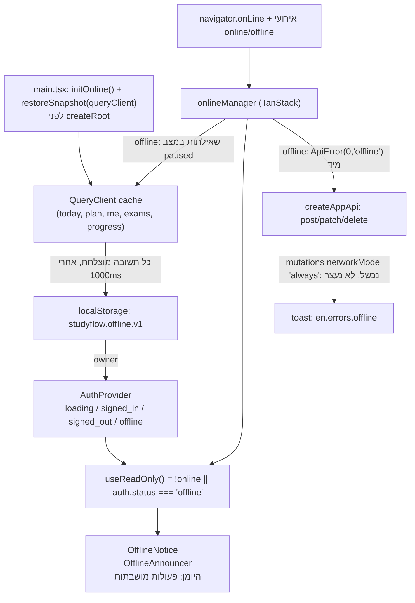

# S38 — בלי אינטרנט: ראייה בלבד של היומן האחרון: תוכנית עבודה

> **For agentic workers:** REQUIRED SUB-SKILL: Use superpowers:subagent-driven-development to implement this plan task-by-task. Steps use checkbox (`- [ ]`) syntax for tracking. המנהל (השיחה הראשית) מריץ מפתח אחד לכל Task, לפי הסדר, ואחריו סוקר. git רץ רק בשיחה הראשית.

**מטרה (השער של מפת הדרכים):** פתיחה במצב טיסה מציגה את היומן האחרון עם הסימון "ללא חיבור", והפעולות מושבתות עם הסבר (`docs/spec/2026-11-18-production-polish-design.md`, שורות 22 ו-44).

**גישה:** web בלבד. בלי שינוי ב-`api/`, בלי מיגרציה ובלי תלות חדשה. ארבעה חלקים קטנים:
1. **מצב הרשת** מגיע ממקור אחד, ה-`onlineManager` של TanStack Query, שמאותחל מ-`navigator.onLine`.
2. **תמונת מצב (snapshot)** של כמה שאילתות נשמרת ב-`localStorage` אחרי כל תשובה מוצלחת, ונטענת לתוך ה-cache לפני הרינדור הראשון.
3. **AuthProvider** מקבל מצב רביעי, `offline`, כדי שפתיחה בלי רשת עם token שפג לא תגיע למסך הכניסה.
4. **הממשק** מציג את ההודעה של ההדמיה ומשבית את הפעולות. כל כתיבה שבכל זאת יוצאת נכשלת מיד עם הסבר, ואף פעם לא נכנסת לתור.

**כלים:** ‏React 19, ‏TypeScript strict, ‏TanStack Query 5.107 (`dehydrate`, ‏`hydrate`, ‏`onlineManager` כבר בחבילה), ‏React Aria Components, ‏Vitest עם jsdom ו-testing-library, ‏vite-plugin-pwa (injectManifest).

**מקורות, לפי סדר הכוח:** ‏`CLAUDE.md`; מסמך הביקורת `docs/design/2026-11-21-archi-ux-audit.md`; ‏`docs/design/archi-voice.md`; ההדמיה `docs/design/prototype/all-screens.html` (המסך "Offline" בקבוצה s7, שורות 275–276 ו-629–630); ‏`docs/design/design-language.md`; ההחלטה מ-18.11.2026: ראייה בלבד, בלי תור כתיבות, בלי סנכרון ברקע ובלי פתרון התנגשויות.

## איך החלקים מתחברים



- **למה `onlineManager` ולא hook משלנו על `navigator.onLine`:** TanStack כבר עוצר שאילתות כשהוא חושב שאין רשת ומרענן אותן כשהיא חוזרת. אם יש לנו מקור משלנו, יהיו שני מקורות שיכולים לא להסכים. אבל ברירת המחדל שלו היא "מחובר" עד שמגיע אירוע `offline`, ולכן `initOnline()` קורא את `navigator.onLine` בהתחלה.
- **למה `dehydrate`/`hydrate` ולא `@tanstack/react-query-persist-client`:** שתי הפונקציות כבר ב-`@tanstack/react-query`. תלות חדשה הייתה מחייבת גם המתנה של `min-release-age=7` וגם שתי חבילות שצריך לנעול לאותה גרסה. מה שצריך כאן הוא 40 שורות.
- **למה `localStorage` ולא IndexedDB:** הקריאה סינכרונית, ולכן ה-cache מלא לפני הרינדור הראשון ואין הבהוב של טעינה. גם ה-session של Supabase יושב שם, כך ששניהם נמחקים יחד באותו מקום. הגודל הצפוי קטן (עשרות KB), הרבה מתחת למגבלה של כ-5MB.
- **למה mutations עוברות ל-`networkMode: 'always'`:** בברירת המחדל (`'online'`) mutation שמתחילה בלי רשת נעצרת ורצה לבד כשהרשת חוזרת. זה בדיוק תור כתיבות נסתר, וההחלטה מ-18.11 אוסרת אותו. עם `'always'` הכתיבה מגיעה לשומר ב-`createAppApi`, נכשלת מיד, וה-`onError` הקיים של כל פעולה מחזיר את המצב האופטימי ומציג toast.
- **למה מצב `offline` ב-AuthProvider:** ראו "מה מצאתי", ממצא 2. בלי המצב הזה, פתיחה במצב טיסה שעה אחרי הרענון האחרון של ה-token מסתיימת במסך הכניסה, אחרי המתנה של כ-30 שניות.

## מה מצאתי בקוד (28.11.2026, ‏main ‏abb2aec)

1. **ה-PWA (S16):** ‏`web/src/sw.ts` עושה precache ל-build ומחזיר `index.html` לכל ניווט, ולכן האפליקציה עצמה נפתחת בלי רשת. ה-API נמצא ב-origin אחר, וה-worker לא נוגע בבקשות שלו. **אבל** ה-`globPatterns` של injectManifest נשארו בברירת המחדל (`**/*.{js,css,html}` ועוד ה-`includeAssets` של האייקונים). ב-precache של ה-build האחרון (`dist/sw.js`) אין את ארבעת קובצי ה-`woff2` ואת שנים-עשר ציורי ה-`webp` של Archi (372KB יחד). בלי רשת, הגופנים נופלים לגופן המערכת והציור של Archi שבור. Task 6 מוסיף אותם.
2. **פתיחה בלי רשת עם token שפג נגמרת היום במסך הכניסה, אחרי כ-30 שניות.** כש-`expires_at` עבר, `_recoverAndRefresh` ו-`__loadSession` של auth-js מנסים לרענן. בלי רשת הרענון נכשל ב-`AuthRetryableFetchError`, ו-`_refreshAccessToken` מנסה שוב עם backoff של `200·2^n` מילישניות עד `AUTO_REFRESH_TICK_DURATION_MS` (30 שניות). אחר כך `INITIAL_SESSION` מגיע עם `null`, וה-session **נשאר** ב-storage (שגיאה זמנית לא מוחקת אותו). ‏`AuthProvider` הופך את ה-`null` הזה ל-`signed_out`, קורא ל-`queryClient.clear()`, ו-`RequireAuth` מעביר ל-`/login`. כש-token עדיין בתוקף (פחות משעה מהרענון), ה-session מגיע מיד והמשתמש נשאר מחובר. בצד ה-API זה כבר בסדר: `createAppApi.getAccessToken` זורק על השגיאה, ולכן לא יוצאת התנתקות.
3. **אין שום persistence היום.** ה-`QueryClient` (`app/queryClient.ts`) נוצר עם `retry: shouldRetry` בלבד. היומן קורא ב-`calendar/useCalendarData.ts` את `useToday` ‏(`['board', uid, 'today']`), ‏`usePlan(from,to)` ‏(`['board', uid, 'plan', from, to]`, עם `keepPreviousData`), ‏`usePlan()` ‏(`['board', uid, 'plan', null, null]`), ‏`useMe` ‏(`['me', uid]`), ‏`useProgress` ‏(`['board', uid, 'progress']`) ו-`useExams` ‏(`['exams', uid]`). ‏`CalendarPage` קורא גם את `useReview`, ‏`useClosures` ו-(דרך הבאנר) את ההצעות לפיצול ואת `useReport`, שהוא POST. ‏`OnboardingGate` מחכה ל-`useMe`. כל מפתח מכיל את ה-userId, ולכן תשובה של משתמש אחד לא מתאימה לשאילתה של משתמש אחר.
4. **ה-`onlineManager` של TanStack 5.107 מתחיל ב-`#online = true`** ומקשיב רק לאירועי `online`/`offline` (`query-core/build/modern/onlineManager.js`). כשהאפליקציה נפתחת במצב טיסה, השאילתות יוצאות ונכשלות (status 0, עם שני ניסיונות חוזרים), והמסך מציג `ErrorState`.
5. **המקרה של S42 (Done בלי רשת):** ‏`design-language.md` שורה 769 ו-`2026-10-19-studyflow-v2-design.md` שורה 560 אומרים: "בלי רשת (`networkMode: 'online'`) ה-mutation נעצר ולא נכשל, ולכן המפגש נשאר מחוק עד שהרשת חוזרת". ‏`session/FocusPage.tsx` ‏`onCompleteSettled` מחזיר את המפגש רק כש-mutation מגיע ל-`error`. התוכנית הזו מתקנת את זה משני הכיוונים: Done מושבת בלי רשת (Task 5), ואם בכל זאת יצא, הוא נכשל מיד (Task 1), ולכן `onCompleteSettled` מחזיר את המפגש, כמו ש-S42 כבר מתכנן ל-Done שנכשל. Task 6 מעדכן את שני המסמכים.
6. **כתיבות שיוצאות לבד בפתיחה:** ‏`app/TimezoneSync.tsx` שולח `PATCH /me {timezone}` כשאזור הזמן בדפדפן שונה מזה שבפרופיל (נסיעה עם הטלפון), ו-`notifications/PushSync.tsx` שולח את המנוי מחדש (בולע שגיאות). בלי רשת, TimezoneSync היה מקפיץ toast בלי שהמשתמש עשה משהו. Task 5 משהה אותו בזמן ראייה בלבד.
7. **ההדמיה מגדירה את ההודעה:** רקע `--inverse`, טקסט `--on-inverse`, אייקון `offline` בצבע `#f0a98e` (בקוד: `text-inverse-danger`, שמתהפך נכון ב-dusk), פינות 14px, ריפוד `10px 14px`, גופן 13.5px. ההודעה יושבת בראש המסך, מעל הכותרת של הטלפון, והטקסט בהדמיה הוא: "You're offline. I'm showing your calendar as of 11:20. You can act again once the connection is back." ‏`OfflineIcon` כבר קיים ב-`web/src/ui/icons/actions.tsx`, ואף מסך לא משתמש בו.
8. **פורט ה-preview:** ‏`npm run preview` הוא `vite preview --port 5173 --strictPort`. Google, ‏Supabase ו-`CORS_ORIGINS` של ה-API מקבלים רק `http://localhost:5173` (הערה ב-`vite.config.ts`). ב-preview על פורט אחר אפשר לבדוק את ה-service worker ואת ה-precache, אבל אי אפשר להיכנס או לקבל נתונים. Task 7 מפרט.

## קבצים משותפים עם S33 (מתמזג היום מ-`s33-gamification`)

ההשוואה `git diff main...s33-gamification` מראה ש-S33 נוגע בקבצים האלה ש-S38 משנה גם הוא:

| קובץ | מה S33 עושה בו | מה S38 עושה בו | Task |
| --- | --- | --- | --- |
| `web/src/auth/AuthProvider.tsx` (+test) | `clearInbox()` בענף של החלפת משתמש | מצב `offline`, ‏`clearSnapshot()` באותו ענף | 3 |
| `web/src/app/AppShell.tsx` | ‏`useCelebrationInbox()`, ‏`useBloomListener()` | ‏`OfflineAnnouncer`, ‏`OfflineNotice` במקום של InstallHint | 4 |
| `web/src/i18n/en.ts` | ‏`garden: enGarden` | ‏`offline: enOffline`, ‏`errors.offline` | 4 (ו-1) |
| `web/src/calendar/CalendarPage.tsx` | effect של חגיגה, `closureOpening`, ‏`sheet.kind === 'celebration'` | ‏`readOnly`, ההודעה, השבתות | 5 |

**סדר המיזוג המומלץ:** S33 נכנס ל-`main` קודם, והמנהל עושה rebase ל-`s38-offline-readonly` על `main` **לפני Task 3**. ‏Tasks 1–2 לא נוגעים בקבצים של S33 ויכולים לרוץ לפני ה-rebase. S38 לא משנה קבצים של S33 מעבר לטבלה. בפרט אין שינוי ב-`CalendarSheets.tsx`, ב-`board/actions.ts`, ב-`ProgressChip.tsx`, ב-`index.css` ובשום קובץ תחת `garden/` או `celebrate/`.

## Global Constraints

- **בלי שינוי ב-`api/`** (סשן אחר עובד שם), בלי מיגרציה ובלי תלות חדשה ב-`web/package.json`.
- **ראייה בלבד:** אין תור כתיבות, אין סנכרון ברקע ואין פתרון התנגשויות. כתיבה בלי רשת נכשלת מיד ולא מנסה שוב לבד.
- **מקור אחד למצב הרשת:** `onlineManager` מ-`@tanstack/react-query`. אף קובץ חוץ מ-`web/src/offline/online.ts` לא קורא את `navigator.onLine`.
- **`useReadOnly()`** = `!online || auth.status === 'offline'`. זה התנאי היחיד שהממשק בודק.
- **אחסון:** המפתח `studyflow.offline.v1` ב-`localStorage`. הערך: `{ "version": 1, "userId": string, "state": DehydratedState }`. כל קריאה וכתיבה עטופה ב-`try/catch` (מצב פרטי, מכסה מלאה); כשל הוא no-op.
- **מה נשמר (רשימה סגורה):** רק שאילתות במצב `success`, שה-`queryKey[1]` שלהן הוא ה-userId של הבעלים, ושהמפתח שלהן אחד מאלה:
  - `['me', uid]`
  - `['exams', uid]`
  - `['board', uid, 'today']`
  - `['board', uid, 'progress']`
  - `['board', uid, 'exams']`
  - `['board', uid, 'plan', from, to]`, בלי מפתח שמסתיים ב-`'waiting'`, ורק `MAX_PLAN_RANGES = 4` הטווחים עם ה-`dataUpdatedAt` החדש ביותר.
- **קבועים:** `WRITE_DELAY_MS = 1000` (כתיבה אחת לכל צרור תשובות), `MAX_SNAPSHOT_CHARS = 2_000_000` (snapshot גדול מזה לא נכתב, והקודם נשאר), `MAX_AGE_MS = 7 * 24 * 60 * 60 * 1000` (snapshot ישן מזה לא נטען, ונמחק), `ANNOUNCE_CLEAR_MS = 5000`.
- **פרטיות:** שום דבר של משתמש אחד לא מוצג לאחר. ה-snapshot נמחק ביציאה (`SIGNED_OUT` ו-`signOut()`), בכל החלפת משתמש (session של userId שונה מהבעלים), וכש-`INITIAL_SESSION` מגיע עם `null` כשיש רשת.
- **הסימון של הזמן:** "as of" לוקח את ה-`dataUpdatedAt` של `['board', uid, 'today']`, באזור הזמן של הפרופיל (`useProfileTimezone`). באותו יום: `formatTime` בלבד (`11:20`). ביום אחר: `` `${shortDate(date)}, ${time}` `` (`Sun, 22 Nov, 09:00`), לפי archi-voice.
- **טקסטים** (בדיוק כך, עם הגרש המעוקל `’` כמו בשאר `en.ts`), בקובץ חדש `web/src/i18n/enOffline.ts`, שנחשף כ-`en.offline`:
  - `notice: (when: string) => \`You’re offline. I’m showing your calendar as of ${when}. You can act again once the connection is back.\``
  - `noticeNoTime: 'You’re offline. You can act again once the connection is back.'`
  - `announce: 'You’re offline. Your calendar is read only until the connection is back.'`
  - `blockOnly: 'You’re offline, so I can only show this block for now.'`
  - `notSaved: 'I don’t have this saved on your device. I’ll load it once the connection is back.'`
  - `focusDone: 'You’re offline, so I can’t mark this Done yet. Your session stays here until the connection is back.'`
  - וב-`en.errors` (ב-`en.ts`): `offline: 'You’re offline, so I couldn’t save that. Try again once the connection is back.'`
- **מראה ההודעה:** `bg-inverse text-on-inverse`, אייקון `OfflineIcon` בגודל 18 ב-`text-inverse-danger`, ‏`rounded-[14px] px-3.5 py-2.5 text-[13.5px]`, ‏`flex items-start gap-2.5`. בלי `role`: זה תוכן רגיל, וההכרזה לקורא מסך היא של `OfflineAnnouncer`.
- **כללי הפרויקט:** כל טקסט ב-`web/src/i18n/`; אפס אימוג׳י; אייקונים רק מ-`web/src/ui/icons/`; תוכן משתמש דרך `ui/UserText` / `isolate()`; עובד ב-day וב-dusk (טוקנים בלבד, בלי hex בקוד).
- **בדיקות:** לפני קוד. סימולציית offline ב-jsdom: `onlineManager.setOnline(false)` בתוך הבדיקה, ו-`afterEach(() => { onlineManager.setOnline(true) })`. ב-`online.test.ts` בלבד: `vi.spyOn(navigator, 'onLine', 'get').mockReturnValue(false)` ו-`window.dispatchEvent(new Event('offline'))`. ‏`localStorage.clear()` ב-`beforeEach` בכל קובץ בדיקה שנוגע ב-snapshot.
- **בסוף כל Task**, מתוך `web/`: `npm test`, ‏`npm run lint`, ‏`npm run typecheck`, ‏`npm run build`. כולם עוברים.
- **אסור `npm run dev` ו-`npm run preview`** על 5173 בזמן העבודה: סשן אחר מחזיק את הפורט (ראו Task 7).

---

### Task 1: מצב הרשת, ושומר שמכשיל כתיבה בלי רשת מיד

**מודל: `sonnet`.** מימוש רגיל של שלושה קבצים קטנים עם בדיקות ברורות.

**תלוי ב:** כלום. לא נוגע בקבצים של S33 (חוץ משורה אחת ב-`en.ts` ‏`errors`, שאינה הקטע ש-S33 משנה).

**למה:** כל השאר נשען על תשובה אחת לשאלה "יש רשת?", ועל כך שכתיבה בלי רשת אף פעם לא נעצרת וממתינה.

**קבצים:**
- חדש: `web/src/offline/online.ts`, `web/src/offline/online.test.ts`
- שינוי: `web/src/app/queryClient.ts`, `web/src/app/queryClient.test.ts`
- שינוי: `web/src/app/createAppApi.ts`, `web/src/app/createAppApi.test.ts`
- שינוי: `web/src/api/client.ts` (רק `errorMessage`), ‏`web/src/api/client.test.ts`
- שינוי: `web/src/i18n/en.ts` (רק `errors.offline`)
- שינוי: `web/src/main.tsx` (קריאה אחת ל-`initOnline()`)

**הבדיקות, לפני הקוד:**
- [ ] `online.test.ts`:
  - `initOnline()` כש-`navigator.onLine` הוא `false` משאיר את `onlineManager.isOnline()` על `false`.
  - אירוע `online` מחזיר אותו ל-`true`, ואירוע `offline` מחזיר ל-`false`.
  - `useOnline()` (עם `renderHook`) מחזיר את הערך הנוכחי ומתעדכן אחרי `onlineManager.setOnline(false)`.
- [ ] `queryClient.test.ts`: `createQueryClient().getDefaultOptions().mutations?.networkMode` הוא `'always'`, וה-retry של השאילתות לא השתנה.
- [ ] `createAppApi.test.ts`:
  - עם `onlineManager.setOnline(false)`: ‏`post`, ‏`patch` ו-`delete` נדחים ב-`ApiError` עם `status === 0` ו-`code === 'offline'`, בלי לקרוא ל-`fetch` ובלי לקרוא ל-`auth.getSession`.
  - `get` לא נחסם (שאילתות נעצרות דרך `networkMode` של TanStack, לא דרך השומר).
  - עם רשת, ההתנהגות הקיימת לא השתנתה (הבדיקות הקיימות עוברות).
- [ ] `client.test.ts`: ‏`errorMessage(new ApiError(0, 'offline', null))` הוא `en.errors.offline`.

**מימוש:**
- [ ] `online.ts`:
  ```ts
  import { onlineManager } from '@tanstack/react-query'
  // initOnline(): onlineManager.setEventListener((setOnline) => { setOnline(navigator.onLine); ...listeners for 'online'/'offline'...; return cleanup })
  // useOnline(): useSyncExternalStore(onlineManager.subscribe, () => onlineManager.isOnline())
  ```
  הערה בקוד: למה ה-setup קורא את `navigator.onLine` מיד (ממצא 4).
- [ ] `queryClient.ts`: `defaultOptions: { queries: { retry: shouldRetry }, mutations: { networkMode: 'always' } }`, עם הערה של משפט אחד: mutation שנעצרת בלי רשת ממשיכה לבד כשהרשת חוזרת, וזה תור כתיבות שאסור (ההחלטה מ-18.11).
- [ ] `createAppApi.ts`: לעטוף את הלקוח. `post`, ‏`patch` ו-`delete` בודקים קודם `onlineManager.isOnline()`, ואם אין רשת זורקים `new ApiError(0, 'offline', null)`. ‏`get` עובר כמו שהוא.
- [ ] `client.ts` ‏`errorMessage`: בתוך הענף של `ApiError`, לפני `isKnownCode`: `if (error.code === 'offline') return en.errors.offline`.
- [ ] `en.ts` ‏`errors`: להוסיף את `offline` מה-Global Constraints, בדיוק.
- [ ] `main.tsx`: `initOnline()` בתחילת `createApp()`, לפני `createQueryClient()`.

**קבלה:** כל הבדיקות עוברות. אין קריאה ל-`navigator.onLine` מחוץ ל-`online.ts` (`grep -rn "navigator.onLine" web/src --include=*.ts --include=*.tsx` מוצא רק את `online.ts` ואת הבדיקה שלו).

---

### Task 2: תמונת המצב במכשיר: כתיבה, טעינה ומחיקה

**מודל: `sonnet`.** לוגיקה מוגדרת היטב (סינון, throttle, גיל) עם בדיקות יחידה, בלי ממשק.

**תלוי ב:** Task 1 (`createQueryClient`). לא נוגע בקבצים של S33.

**למה:** זה החלק שמחזיק את "היומן האחרון". המודול לא יודע כלום על auth: ‏AuthProvider (Task 3) רק אומר לו מי הבעלים ומתי למחוק.

**קבצים:**
- חדש: `web/src/offline/snapshot.ts`, `web/src/offline/snapshot.test.ts`
- שינוי: `web/src/main.tsx` (קריאה ל-`restoreSnapshot`)

**ה-API של המודול** (שמות מחייבים, כי Tasks 3–5 משתמשים בהם):
```ts
export const SNAPSHOT_KEY = 'studyflow.offline.v1'
export function restoreSnapshot(client: QueryClient, now?: number): string | null // hydrate; מחזיר את ה-userId של הבעלים או null
export function readSnapshotOwner(): string | null
export function startSnapshot(client: QueryClient, getOwner: () => string | null): () => void // מנוי ל-queryCache; מחזיר unsubscribe
export function clearSnapshot(): void
```

**הבדיקות, לפני הקוד** (עם `vi.useFakeTimers()` ו-`localStorage.clear()`):
- [ ] אחרי `setQueryData` ל-`['board','u1','today']` ול-`['me','u1']`, ‏`startSnapshot(client, () => 'u1')` כותב אחרי `WRITE_DELAY_MS` (לא לפני) ערך אחד עם `version: 1`, ‏`userId: 'u1'`, ושתי השאילתות.
- [ ] שאילתות שלא ברשימה לא נשמרות: `['board','u1','closures']`, ‏`['board','u1','report']`, ‏`['board','u1','review']`, ‏`['board','u1','plan',null,null,'waiting']`, ושאילתה של `'u2'` כשהבעלים הוא `'u1'`.
- [ ] שישה טווחי plan: נשמרים רק ארבעת ה-`dataUpdatedAt` החדשים.
- [ ] `getOwner()` שמחזיר `null` לא כותב כלום.
- [ ] snapshot שה-JSON שלו ארוך מ-`MAX_SNAPSHOT_CHARS` לא נכתב, והערך הקודם נשאר.
- [ ] `restoreSnapshot` טוען את השאילתות ל-client חדש עם אותו `dataUpdatedAt` ששמור, ומחזיר `'u1'`.
- [ ] `restoreSnapshot` עם snapshot שה-`dataUpdatedAt` המאוחר בו ישן מ-`MAX_AGE_MS`, עם `version !== 1`, או עם JSON שבור: לא טוען, מוחק את המפתח ומחזיר `null`.
- [ ] `localStorage.setItem` שזורק (`vi.spyOn(Storage.prototype, 'setItem').mockImplementation(() => { throw new Error('quota') })`) לא מפיל כלום.
- [ ] `clearSnapshot()` מוחק את המפתח, ו-`readSnapshotOwner()` מחזיר אחר כך `null`.

**מימוש:**
- [ ] `dehydrate(client, { shouldDehydrateQuery })` עם סינון שמשלב את `defaultShouldDehydrateQuery` (רק `success`) והרשימה מה-Global Constraints. אחר כך חיתוך ל-`MAX_PLAN_RANGES` לפי `state.dataUpdatedAt`.
- [ ] `startSnapshot`: `client.getQueryCache().subscribe(event => …)`. רק אירועי `updated` שה-`action.type` שלהם `'success'` מתזמנים כתיבה (timer אחד, `WRITE_DELAY_MS`). אירועי `removed` של `queryClient.clear()` לא כותבים: המחיקה היא רק דרך `clearSnapshot()`.
- [ ] `restoreSnapshot`: `hydrate(client, state)`. הגיל נמדד מה-`dataUpdatedAt` המאוחר ב-snapshot.
- [ ] `main.tsx`: ‏`restoreSnapshot(queryClient)` מיד אחרי `createQueryClient()`, לפני `createBrowserRouter`. הערה: סינכרוני, כדי שהרינדור הראשון כבר יראה את היומן.
- [ ] `startSnapshot` **לא** מופעל כאן. Task 3 מפעיל אותו עם הבעלים מ-AuthProvider.

**קבלה:** כל הבדיקות עוברות. אין `import` מ-`auth/` בתוך `offline/snapshot.ts`.

---

### Task 3: AuthProvider עם מצב `offline`, והבעלים של ה-snapshot

**מודל: `opus`.** לוגיקה עדינה של auth עם מרוצים (INITIAL_SESSION שמגיע אחרי 30 שניות, חזרת הרשת באמצע) ועם כלל פרטיות שאסור לשבור.

**תלוי ב:** Tasks 1–2. **לפני ה-Task הזה המנהל עושה rebase על `main` אחרי ש-S33 מוזג** (S33 משנה את `AuthProvider.tsx` ואת הבדיקה שלו).

**למה:** בלי זה, פתיחה במצב טיסה עם token שפג מגיעה למסך הכניסה (ממצא 2), וה-`queryClient.clear()` הראשון מוחק את ה-snapshot שנטען (המשתנה `userId` מתחיל היום ב-`null`).

**קבצים:**
- שינוי: `web/src/auth/AuthContext.ts`, ‏`web/src/auth/AuthProvider.tsx`, ‏`web/src/auth/AuthProvider.test.tsx`
- שינוי: `web/src/auth/RequireAuth.tsx`, ‏`web/src/auth/RequireAuth.test.tsx`
- שינוי: `web/src/api/me.ts` (`useUserId`), ‏`web/src/board/api.ts` (`useBoardUserId`)
- חדש: `web/src/offline/useReadOnly.ts`, `web/src/offline/useReadOnly.test.tsx`

**הטיפוס:**
```ts
export type AuthState =
  | { status: 'loading' }
  | { status: 'signed_out' }
  | { status: 'signed_in'; session: Session }
  // No network, and the session could not be read (an expired token that cannot be refreshed offline):
  // the snapshot's owner, read only. Never a Session: nothing here can call the API.
  | { status: 'offline'; userId: string }
```

**הבדיקות, לפני הקוד** (ב-`AuthProvider.test.tsx`, עם `createFakeAuth`; ל-INITIAL_SESSION מאוחר יוצרים fake שלא שולח אותו עד שהבדיקה קוראת ל-`emit`):
- [ ] בלי רשת ועם snapshot של `'u1'`: הרינדור הראשון כבר במצב `{ status: 'offline', userId: 'u1' }` ולא `loading`.
- [ ] בלי רשת, snapshot של `'u1'`, ‏`INITIAL_SESSION` עם `null`: המצב נשאר `offline`, ה-cache לא נמחק, וה-snapshot לא נמחק.
- [ ] בלי רשת, snapshot של `'u1'`, ‏`INITIAL_SESSION` עם session של `'u1'`: המצב `signed_in`, וה-cache שנטען נשאר (`getQueryData(['board','u1','today'])` עדיין שם).
- [ ] עם רשת, snapshot של `'u1'`, ‏`INITIAL_SESSION` עם session של `'u2'`: ‏`queryClient.clear()`, ה-snapshot נמחק, והמצב `signed_in` של `'u2'`. אין תשובה של `'u1'` ב-cache.
- [ ] עם רשת, snapshot של `'u1'`, ‏`INITIAL_SESSION` עם `null`: המצב `signed_out`, וה-snapshot נמחק.
- [ ] במצב `offline` הרשת חוזרת ומגיע `INITIAL_SESSION` עם `null`: קריאה אחת ל-`auth.getSession()`. ‏session של `'u1'` הופך ל-`signed_in` בלי `clear()`; ‏`null` הופך ל-`signed_out`, עם `clear()` ו-`clearSnapshot()`.
- [ ] במצב `offline` מגיע `TOKEN_REFRESHED` עם session של `'u1'` (הרשת חזרה ו-auth-js רענן לבד): ‏`signed_in`, בלי `clear()`.
- [ ] `signOut()` במצב `offline`: ה-snapshot נמחק והמצב `signed_out`, גם אם ה-fake לא שולח `SIGNED_OUT`.
- [ ] `SIGNED_OUT` במצב `signed_in`: ה-snapshot נמחק (`readSnapshotOwner() === null`).
- [ ] `startSnapshot` כותב רק בזמן `signed_in`: אחרי `SIGNED_OUT`, ‏`setQueryData` של המשתמש הקודם לא יוצר מפתח חדש.
- [ ] `RequireAuth.test.tsx`: במצב `offline` ה-`Outlet` מוצג ואין `Navigate` ל-`/login`.
- [ ] `useReadOnly.test.tsx`: ‏`true` כשאין רשת; ‏`true` במצב `offline` גם כש-`onlineManager` אומר שיש רשת (ה-token עוד לא רוענן); ‏`false` ב-`signed_in` עם רשת.
- [ ] `useUserId()` ו-`useBoardUserId()` מחזירים `'u1'` במצב `offline`.

**מימוש:**
- [ ] ב-`AuthProvider`:
  - `useState` מאותחל ב-`onlineManager.isOnline() || readSnapshotOwner() === null ? { status: 'loading' } : { status: 'offline', userId: owner }`.
  - המשתנה המקומי `userId` (המשתמש שה-cache עשוי להחזיק) מתחיל ב-`readSnapshotOwner()` ולא ב-`null`, עם הערה: ה-cache כבר מחזיק את ה-snapshot שלו מ-`main.tsx`.
  - לפני הענף הקיים: `session === null && onlineManager.isOnline() === false && owner !== null` הופך ל-`setState({ status: 'offline', userId: owner })` ו-`return`.
  - במצב `offline` עם `null` כשיש רשת: `auth.getSession()`. לא לקרוא לה בתוך ה-callback (ההערה הקיימת: deadlock של supabase-js). להריץ אותה ב-`queueMicrotask` או ב-effect.
  - בענף של החלפת משתמש, ליד `queryClient.clear()` (ובאותו מקום שבו S33 הוסיף `clearInbox()`): `clearSnapshot()`.
  - effect: כש-`state.status === 'signed_in'`, ‏`startSnapshot(queryClient, () => state.session.user.id)`; ה-cleanup עושה unsubscribe.
  - `signOut`: `clearSnapshot()` לפני `auth.signOut`, ואם המצב `offline`, גם `setState({ status: 'signed_out' })`.
- [ ] `RequireAuth`: `offline` מתנהג כמו `signed_in`.
- [ ] `useUserId` / `useBoardUserId`: `auth.status === 'signed_in' ? auth.session.user.id : auth.status === 'offline' ? auth.userId : null`.
- [ ] `useReadOnly.ts`: `const online = useOnline(); const auth = useAuth(); return !online || auth.status === 'offline'`.
- [ ] `ProfileMenu` לא משתנה: במצב `offline` אין `session.user`, והוא מציג את אייקון המשתמש הכללי. יציאה עובדת.

**קבלה:** כל הבדיקות עוברות, כולל הבדיקות הקיימות של AuthProvider ושל S33 (`clearInbox`). אף ענף לא מציג נתונים של userId אחד כשה-session הוא של userId אחר.

---

### Task 4: ההודעה "ללא חיבור", ההכרזה לקורא מסך, ומסך בלי נתונים שמורים

**מודל: `fable`.** עיצוב לפי ההדמיה, בשני ערכות הצבע, עם נגישות. הטקסטים כבר נתונים, וצריך רק להכניס אותם בדיוק.

**תלוי ב:** Tasks 1 ו-3. אחרי ה-rebase על S33 (`AppShell.tsx`, ‏`en.ts`).

**למה:** הודעה אחת שאומרת מה מוצג, מאיזו שעה, ומתי הפעולות חוזרות. ההכרזה לקורא מסך נפרדת מההודעה, כדי שתישמע פעם אחת לכל מעבר ל-offline ולא בכל רינדור או מעבר מסך.

**קבצים:**
- חדש: `web/src/i18n/enOffline.ts`, `web/src/i18n/enOffline.test.ts`
- שינוי: `web/src/i18n/en.ts` (`offline: enOffline`, שורה אחת ו-import)
- חדש: `web/src/offline/OfflineNotice.tsx`, `web/src/offline/OfflineNotice.test.tsx`
- חדש: `web/src/offline/OfflineAnnouncer.tsx`, `web/src/offline/OfflineAnnouncer.test.tsx`
- חדש: `web/src/offline/asOf.ts`, `web/src/offline/asOf.test.ts`
- שינוי: `web/src/app/AppShell.tsx`, ‏`web/src/app/AppShell.test.tsx`
- שינוי: `web/src/ui/states.tsx` (`LoadingState`), ‏`web/src/ui/states.test.tsx`

**הבדיקות, לפני הקוד:**
- [ ] `enOffline.test.ts`: כל מחרוזת שווה בדיוק לטקסט ב-Global Constraints. ‏`notice('11:20')` שווה למשפט של ההדמיה (עם `’`). אין `Archi` כנושא, ואין `!`.
- [ ] `asOf.test.ts` (אזור זמן `'Asia/Jerusalem'`, ‏`now` = ‏`Date.parse('2026-11-22T12:00:00+02:00')`): `dataUpdatedAt` מהיום הופך ל-`'11:20'`; מאתמול ל-`'Sat, 21 Nov, 09:00'`; ‏`0` או `undefined` הופכים ל-`null`.
- [ ] `OfflineNotice.test.tsx`:
  - כשיש רשת, לא מוצג כלום.
  - בלי רשת, ועם `['board', uid, 'today']` ב-cache, מוצג `en.offline.notice(<time>)`.
  - בלי `today` ב-cache מוצג `en.offline.noticeNoTime`.
  - יש בו `svg` של `OfflineIcon` עם `aria-hidden`, ואין לו `role`.
- [ ] `OfflineAnnouncer.test.tsx`:
  - יש תמיד אלמנט אחד עם `role="status"`.
  - הוא ריק כשיש רשת.
  - אחרי `setOnline(false)` הוא מכיל `en.offline.announce`.
  - rerender נוסף לא משנה את התוכן.
  - אחרי `ANNOUNCE_CLEAR_MS` הוא ריק שוב.
  - `setOnline(true)` ואחר כך `setOnline(false)` מכריזים שוב.
- [ ] `AppShell.test.tsx`: בלי רשת, במסך רגיל (`/exams`) ההודעה מוצגת בתוך `<main>` לפני התוכן. ב-frame של `fullBleed` (היומן) AppShell לא מציג אותה (היומן מציג משלו ב-Task 5). במסך bare (Focus) היא לא מוצגת. ה-announcer קיים בכל המסכים.
- [ ] `states.test.tsx`: בלי רשת, ‏`LoadingState` מציג את `en.offline.notSaved` בתוך `role="status"` במקום השלד. כשיש רשת, ההתנהגות הקיימת לא השתנתה.

**מימוש:**
- [ ] `asOf(dataUpdatedAt: number | undefined, tz: string, now = Date.now()): string | null` משתמש ב-`formatTime` וב-`dateIn` מ-`board/time.ts` וב-`shortDate` מ-`calendar/days.ts`.
- [ ] `OfflineNotice({ className? })`: מתוך `useReadOnly()`, ‏`useBoardUserId()`, ‏`useQueryClient().getQueryState(todayKey(userId))?.dataUpdatedAt` ו-`useProfileTimezone()`. המראה בדיוק לפי Global Constraints. ‏`className` מאפשר ל-Task 5 לתת שוליים.
- [ ] `OfflineAnnouncer`: `<div role="status" className="sr-only">`. ‏effect על `useReadOnly()`: מעבר ל-`true` מכניס את הטקסט ומתזמן ניקוי אחרי `ANNOUNCE_CLEAR_MS`; מעבר ל-`false` מנקה. ה-Global Constraints מסבירים למה ההכרזה נפרדת מההודעה.
- [ ] `AppShell`: ‏`<OfflineAnnouncer />` פעם אחת, ליד `<ToastRegion />`. ‏`<OfflineNotice />` בתוך ה-wrapper של `InstallHint` (אותו מקום בעץ), רק כש-`!frame.fullBleed`. בלי לגעת בשורות ש-S33 הוסיף.
- [ ] `LoadingState`: `const online = useOnline()`. בלי רשת, מחזיר `<div role="status"><p className="text-small text-ink-muted">{en.offline.notSaved}</p></div>`. הערה: בלי רשת שאילתה בלי נתונים נעצרת (`paused`) ולא נגמרת, ושלד שמהבהב לנצח משקר.
- [ ] בדיקה בעין ב-`/dev/components` (אם יש זמן): ההודעה ב-day וב-dusk. אסור `npm run dev` על 5173 (Global Constraints), ולכן הבדיקה בעין עוברת ל-Task 7.

**קבלה:** כל הבדיקות עוברות. ‏`sourceGuards.test.ts` עובר (אין עברית, אין אימוג׳י, אין `Archi will`). אין hex חדש בקוד.

---

### Task 5: היומן במצב ראייה בלבד

**מודל: `opus`.** הרבה נקודות כניסה לפעולות בכמה קבצים, ושתי מלכודות: `keepPreviousData` מציג שבוע אחר בכותרת של השבוע החדש, וה-effect של הסגירה ושל החגיגה של S33 חולקים את `setSheet`.

**תלוי ב:** Tasks 1, 3, 4. אחרי ה-rebase על S33 (`CalendarPage.tsx`).

**למה:** היומן הוא המסך שהשער בודק. כל פעולה בו מושבתת או לא נפתחת, ויש הסבר אחד גלוי. מסכים אחרים מוגנים בשומר של Task 1 (toast על ניסיון כתיבה) ובהודעה של Task 4 (ראו ההחלטה של בעל המוצר בדוח של המתכנן).

**הכלל:** `const readOnly = useReadOnly()` ב-`CalendarPage`, ומשם props ל-`readOnly` בילדים. לא קוראים ל-`useReadOnly` בכל רכיב: prop אחד קל יותר לבדוק.

**קבצים:**
- שינוי: `web/src/calendar/CalendarPage.tsx`, ‏`TimeGrid.tsx`, ‏`CalendarBlock.tsx`, ‏`BlockActionsSheet.tsx`, ‏`NextCard.tsx`, ‏`TodayTasks.tsx`, ‏`Sidebar.tsx`, ‏`TasksSheet.tsx`
- שינוי: `web/src/app/TimezoneSync.tsx`, ‏`web/src/app/TimezoneSync.test.tsx`
- שינוי: `web/src/session/FocusPage.tsx`, ‏`web/src/session/FocusPage.test.tsx`
- חדש: `web/src/calendar/offline.test.tsx` (הבדיקה המרכזית)

**מה קורה לכל פעולה בלי רשת (רשימה מלאה):**

| איפה | פעולה | בלי רשת |
| --- | --- | --- |
| הבאנר (`CalendarBanner`) | Morning review, ‏Unplaced/report (POST preview), ‏Split, ‏Closure | לא מוצג. במקומו `OfflineNotice` |
| `CalendarPage` effect | פתיחה עצמית של גיליון הסגירה | לא רץ (`if (readOnly) return`) |
| `setSheet` | `defer`, ‏`freeTime`, ‏`busyNew`, ‏`busyEdit`, ‏`closure` | לא נפתח. מותר רק `block`, ‏`commitment`, ‏`celebration` (שלא קורית בלי Done מוצלח) |
| הגריד (`TimeGrid`) | גרירה (עכבר ומקלדת), החלקה (Defer/Skip), לחיצה על מקום ריק (busy חדש) | ה-handlers של `drag`/`swipe` לא נפרסים על הבלוק, ו-`blocked` של `useEmptyPress` מחזיר `true`. לחיצה על בלוק עדיין פותחת את הגיליון שלו |
| `CalendarBlock` | `BlockCheck` (Done/Not done) | `isDisabled` |
| `BlockActionsSheet` | Start, ‏Just 5 minutes, ‏Done, ‏Not done, ‏Defer, ‏Move, ‏Lock/Unlock, ‏Skip | כולם `isDisabled`. ‏Resume (מפגש שכבר רץ) נשאר פעיל. מעל הכפתורים: `<p className="text-small text-ink-muted">{en.offline.blockOnly}</p>` |
| `NextCard` | Done, ‏Defer | `isDisabled` |
| `TodayTasks` | `CheckButton` | `isDisabled` |
| `Sidebar` / `TasksSheet` | I have free time now, ‏Mark busy time | `isDisabled` |
| `CommitmentSheet` | Edit (קישור להגדרות) | נשאר: ניווט, וההגדרות מוגנות בשומר |
| סרגל, `DayStrip`, `PhoneHeader` | Today, הקודם/הבא, Week/Day | נשארים פעילים |
| גוף היומן | שבוע שאין לו נתונים שמורים | `LoadingState` (שמציג את `notSaved`). גם כש-`data.plan.isPlaceholderData` הוא `true`, כדי לא להציג את השבוע הקודם בכותרת של החדש |
| `BreakNotice` | Close | נשאר (מקומי) |
| `TimezoneSync` | `PATCH /me {timezone}` | לא נשלח, ו-`sent.current` לא מתעדכן, כדי שיישלח כשהרשת חוזרת |
| `FocusPage` | Done | `isDisabled`, ומתחתיו `en.offline.focusDone`. ‏Stop נשאר (מקומי) |

**ההודעה ביומן:** בטלפון, `<OfflineNotice className="mx-3.5 mt-1 mb-1.5" />` לפני ה-div ה-sticky של `PhoneHeader` (כמו בהדמיה: מעל הכותרת, לא דביקה). במחשב, בראש העמודה הימנית, במקום של `{banner}`, באותם שוליים כמו `staleNote` (`px-4 py-2`). ‏`staleNote` לא מוצג בזמן `readOnly` (ההודעה כבר אומרת שהנתונים מ-"as of").

**הבדיקות, לפני הקוד** (`calendar/offline.test.tsx`; ‏`renderRoute` עם `/calendar`, ‏fake API ו-`onlineManager.setOnline(false)`; ה-cache ממולא ב-`setQueryData` של today, ‏plan של השבוע, ‏plan בלי טווח, ‏me, ‏progress ו-exams, כמו snapshot שנטען):
- [ ] היומן מוצג עם הבלוקים, ו-`en.offline.notice(...)` גלוי. ‏`en.calendar.page.stale` ושורות הבאנר לא מוצגים.
- [ ] `BlockCheck` של בלוק בגריד, ה-`CheckButton` ב-TodayTasks, ‏Done ו-Defer ב-NextCard, ו-free time / mark busy: ‏`toBeDisabled()`.
- [ ] לחיצה על בלוק פותחת את גיליון הבלוק עם `en.offline.blockOnly`, וכל כפתורי הפעולה בו `toBeDisabled()`. אם יש מפגש שרץ, Resume פעיל.
- [ ] גרירה במקלדת (המקש שבדיקות `gestures.test.tsx` משתמשות בו) לא מזיזה ולא קוראת ל-API. ‏`pointerdown` ו-`pointerup` על מקום ריק לא פותחים את גיליון ה-busy.
- [ ] closure ‏`pending` ב-cache לא פותח גיליון.
- [ ] מעבר לשבוע הבא (שלא שמור) מציג `en.offline.notSaved` ולא את הבלוקים של השבוע הנוכחי.
- [ ] אף קריאה ל-`api.post`, ‏`api.patch` או `api.delete` בכל הבדיקות בקובץ.
- [ ] `setOnline(true)`: ההודעה נעלמת, הבאנר חוזר, והכפתורים פעילים.
- [ ] `TimezoneSync.test.tsx`: בלי רשת, ואזור זמן שונה: אין `PATCH`. אחרי `setOnline(true)` יוצא `PATCH` אחד.
- [ ] `FocusPage.test.tsx`: בלי רשת, Done `toBeDisabled()` ו-`en.offline.focusDone` גלוי; המפגש השמור לא נמחק.
- [ ] כל הבדיקות הקיימות של `calendar/`, ‏`session/` ו-S33 (`celebrate/`) עוברות בלי שינוי.

**מימוש:** לפי הטבלה. ‏`readOnly` הוא prop אופציונלי (`readOnly?: boolean`, ברירת מחדל `false`) בכל רכיב, כדי שהבדיקות הקיימות לא ישתנו. ב-`FocusPage` וב-`TimezoneSync`, שאינם ילדים של `CalendarPage`, קוראים ל-`useReadOnly()` ישירות.

**קבלה:** כל הבדיקות עוברות. ‏`grep -n "readOnly" web/src/calendar/CalendarPage.tsx` מראה את ההעברה לכל הרכיבים בטבלה. אין שינוי ב-`CalendarSheets.tsx`.

---

### Task 6: precache לגופנים ולציורים, ועדכון המסמכים על Done בלי רשת

**מודל: `haiku`.** שינוי מכני: שורה אחת בקונפיג ושני משפטים במסמכים.

**תלוי ב:** Task 5 (המסמכים מתארים את ההתנהגות שלו). לא נוגע בקבצים של S33.

**למה:** בלי רשת, היומן בלי הגופנים ובלי Archi נראה שבור (ממצא 1). המסמכים של S42 מתארים היום התנהגות שה-scope הזה משנה (ממצא 5).

**קבצים:**
- שינוי: `web/vite.config.ts`
- חדש: `web/src/pwa/precache.test.ts`
- שינוי: `docs/design/design-language.md` (שורה 769), ‏`docs/spec/2026-10-19-studyflow-v2-design.md` (שורה 560)

**הבדיקה, לפני הקוד:**
- [ ] `precache.test.ts` (`// @vitest-environment node`): קורא את `vite.config.ts` כטקסט ובודק שה-`globPatterns` של `injectManifest` כוללים `woff2` ו-`webp`. בדיקה שנייה, שמדלגת (`it.skipIf(!existsSync('dist/sw.js'))`) כשאין build: ב-`dist/sw.js` יש לפחות כתובת אחת שמסתיימת ב-`.woff2` ואחת ב-`.webp`.

**מימוש:**
- [ ] ב-`VitePWA({ injectManifest: { … } })`: ‏`globPatterns: ['**/*.{js,css,html,woff2,webp,png,webmanifest}']`, עם הערה: הגופנים והציורים של Archi (כ-372KB) נדרשים כדי שהיומן ייראה נכון בלי רשת (S38).
- [ ] `npm run build`, ואחריו `grep -o '"url":"[^"]*"' dist/sw.js`: מופיעים ארבעה `woff2` ושנים-עשר `webp`.
- [ ] `design-language.md` שורה 769: להחליף את המשפט "**בלי רשת** (`networkMode: 'online'`) ה-mutation נעצר ולא נכשל, ולכן המפגש נשאר מחוק עד שהרשת חוזרת; בדיקה במכשיר עדיין חסרה." במשפט: "**בלי רשת** (S38) Done מושבת במסך עם הסבר, ו-mutation שבכל זאת יוצא נכשל מיד (`networkMode: 'always'` והשומר ב-`createAppApi`), ולכן המפגש חוזר ולא נמחק. אין תור כתיבות."
- [ ] `2026-10-19-studyflow-v2-design.md` שורה 560: אותו תיקון למשפט "בלי רשת ה-mutation נעצר ולא נכשל, ולכן המפגש נשאר מחוק עד שהרשת חוזרת (בדיקה במכשיר חסרה)".

**קבלה:** הבדיקה עוברת, ו-`npm run build` מייצר `dist/sw.js` עם הגופנים והציורים.

---

### Task 7: בדיקה של ה-build האמיתי, ידנית ובדפדפן

**מודל: `sonnet`.** הרצה ובדיקה לפי רשימה, עם הכלים של חלונית הדפדפן, בלי לוגיקה חדשה.

**תלוי ב:** Tasks 1–6.

**למה:** jsdom לא מריץ service worker, לא auth-js אמיתי ולא מצב טיסה. השער של מפת הדרכים נבדק רק ב-build.

**הבעיה של הפורט (להעביר למנהל):** ‏`npm run preview` קבוע ל-`5173 --strictPort`. ‏Google, ‏Supabase (Redirect URLs) ו-`CORS_ORIGINS` מקבלים רק `http://localhost:5173`, ולכן הבדיקה המלאה (כניסה, נתונים, snapshot) אפשרית **רק על 5173**. בזמן העבודה הפורט תפוס על ידי ה-dev server של סשן אחר. לא משנים את `package.json` ולא את הקונפיג של Supabase בשביל זה.

**חלק א' (אפשר עכשיו, על פורט אחר):**
- [ ] מתוך `web/`: `npm run build && npx vite preview --port 4173 --strictPort`.
- [ ] בדפדפן: `http://localhost:4173/login`. ב-DevTools ‏Application ‏Service Workers: ‏`sw.js` פעיל. ב-Cache Storage: ‏`woff2` ו-`webp` נמצאים ב-precache.
- [ ] Network ‏Offline, ואז reload: מסך הכניסה נטען מה-precache עם הגופנים (אין 404 ב-Network). זה בודק רק את ה-PWA: על 4173 אין session ואין נתונים.
- [ ] לעצור את ה-preview.

**חלק ב' (הבדיקה המלאה, רק כש-5173 פנוי; המנהל מתזמן אותה, או שאייל מריץ):**
- [ ] `npm run build && npm run preview`. להיכנס עם Google, לפתוח את `/calendar`, ולוודא ב-Application ‏Local Storage שהמפתח `studyflow.offline.v1` קיים.
- [ ] Network ‏Offline, reload: היומן מוצג מיד (לא מסך כניסה ולא שלד), עם ההודעה "You’re offline. I’m showing your calendar as of HH:MM. …". כל הפעולות בטבלה של Task 5 מושבתות. לחיצה על בלוק מציגה את `blockOnly`.
- [ ] token שפג: עדיין Offline, לשנות ב-Local Storage את `expires_at` במפתח `sb-<project-ref>-auth-token` למספר קטן (למשל `1`) ולעשות reload: היומן מוצג מיד ולא אחרי 30 שניות, ולא מסך הכניסה.
- [ ] לחזור ל-Online: ההודעה נעלמת, היומן מתרענן, הבאנר חוזר, והמשתמש נשאר מחובר.
- [ ] dusk: ‏Settings ‏Appearance ‏Dusk, ושוב Offline: ההודעה קריאה (רקע בהיר ב-dusk, לפי הטוקנים).
- [ ] VoiceOver (Cmd+F5): מעבר ל-Offline מכריז את `announce` פעם אחת. מעבר בין מסכים לא מכריז שוב.
- [ ] Sign out (עם רשת): המפתח `studyflow.offline.v1` נמחק.
- [ ] במכשיר (אייל, אם רוצה): אייפון עם האפליקציה מותקנת, מצב טיסה, פתיחה מהמסך הראשי.

**קבלה:** חלק א' עבר ונרשם בדוח. חלק ב' עבר, או שנרשם בדוח כ"ממתין לפורט 5173", עם הרשימה כמו שהיא, כדי שהמנהל יריץ אותה לפני המיזוג.
