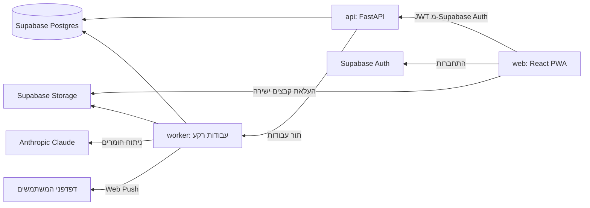

# StudyFlow v2 — מסמך תכנון ליסודות החדשים

**תאריך:** 2026-10-19 · **סטטוס:** מאושר · **מקור:** [מסמך המיפוי והתוכנית](https://claude.ai/code/artifact/29a3c52e-d399-425e-90b6-7c05e9146bfa)

המסמך מתאר איך בונים מחדש את היסודות של StudyFlow, כך שמי שבונה יוכל לתכנן ולעבוד בלי לחזור לשאול. ההחלטות שקיבל בעל המוצר מסומנות ככאלה; החלטות שלי מסומנות **(החלטה שלי)**, ומה שנשאר פתוח למי שבונה מרוכז בסעיף 12.

---

## 1. מה ולמה

StudyFlow היא אפליקציית PWA לסטודנטים באוניברסיטאות בישראל, בתקופת מבחנים — חודשיים עד שבועיים לפני המבחן. הסטודנט מעלה סילבוס, סיכומים ובעיקר מבחני עבר עם פתרונות, ומקבל תוכנית לימודים יומית ושבועית חיה. המטרה: שהסטודנט לא יצטרך להחליט "מה עושים מחר בבוקר".

**הכיוון לטווח ארוך (לא בגרסה הזו):** סימולציות הן הלב של המוצר. בעתיד, הסטודנט יפתור מבחן ניסיון, יעלה את הפתרון, יקבל ניתוח של איפה איבד נקודות, והתוכנית תתעדכן לפי הביצועים. v2 לא בונה את זה, אבל מודל הנתונים צריך להשאיר לזה מקום (ראו 7.4).

**למה עכשיו:** הקוד הקיים הוא אב-טיפוס עובד, אבל יש בו באגים שאומתו בהרצה: משימות נעלמות מהלוח, מחיקה שנועלת את המסד, מיפוי שגוי בין משימות לימים, שני פורמטים של זמן במסד ו-XSS דרך פלט ה-AI. אין משתמשים אמיתיים ואין נתונים להעביר, ולכן בנייה מחדש של היסודות זולה עכשיו יותר מאי-פעם.

## 2. מטרות

| # | מטרה | איך יודעים שהושגה |
|---|---|---|
| G1 | סטודנט חדש מקבל תוכנית ראשונה מהר | אונבורדינג של עד 5 מסכים; תוכנית ראשונה תוך 5 דקות מהכניסה |
| G2 | אף משימה לא נעלמת בשקט | כל משימה משובצת, או מופיעה בדוח "לא נכנס" עם סיבה |
| G3 | הזמנים נכונים תמיד | אחסון ב-UTC ואזור זמן IANA; בדיקות למעבר שעון קיץ/חורף |
| G4 | חוויה נוחה לסטודנט בישראל, מובייל קודם | ממשק באנגלית (LTR) שמציג נכון תוכן בעברית (**מ-21.11.2026**; עד אז: ממשק RTL מלא), PWA שאפשר להתקין, תזכורות Push |
| G5 | בטוח להכניס זרים | ריפו פרטי, Supabase Auth, RLS, מכסות AI, ניטור שגיאות, גיבויים |
| G6 | הליבה מכוסה בבדיקות | בדיקות יחידה למתכנן, בדיקות API, כמה בדיקות E2E |
| G7 | התוספות מהגרסה הקודמת חוזרות, אחרי הליבה | סקירת בוקר, גרירה, גיימיפיקציה, שינוי לו"ז בשפה חופשית |

## 3. לא בגרסה הזו

- בדיקת פתרונות של סימולציות ומשוב על ביצועים (הגרסה הבאה).
- תשלומים. המודל העסקי נסגר לפני הבטא; המימוש מגיע עם ההשקה.
- אפליקציה נייטיב. PWA בלבד.
- שפות נוספות. עברית בלבד, אבל כל הטקסטים בקובץ אחד כדי שתרגום יהיה אפשרי.
- סנכרון עם Google Calendar, שיתוף בין סטודנטים, ממשק ניהול מלא.

## 4. מה יהפוך את זה לכישלון גם אם זה "עובד"

- התוכנית זזה לסטודנט מתחת לרגליים: כל שינוי קטן בונה מחדש את כל הלוח.
- כשלים שקטים: ה-AI נכשל והמשתמש רואה "הצלחה" עם לוח ריק.
- אובדן נתונים: תוכנית חדשה, אונבורדינג או מחיקה שמוחקים היסטוריה והתקדמות.
- פסי התקדמות מזויפים, וחלונות קופצים בכל פתיחה.
- עלות AI שגדלה בלי גבול עם כל משתמש.
- "שעות מילוי" גנריות שמוצגות כלימוד אמיתי.

## 5. אילוצים

- **מפתח יחיד, פחות מ-15 שעות בשבוע.** כמה שפחות רכיבים לתחזק; שירותים מנוהלים עדיפים.
- **יעד:** ~~בטא בתקופת המבחנים של סמסטר ב' (בערך יוני–יולי 2027).~~ **(של אייל, 18.11.2026):** אין תאריך יעד. המוצר יוצא כשהוא מושלם, גם אם זה ייקח שנתיים. לא חותכים scopes כדי לעמוד בזמן.
- **קהל:** סטודנטים בישראל. **מ-21.11.2026 (החלטה של אייל, מסמך הביקורת של Archi):** הממשק באנגלית ו-LTR, והשם Archi; תוכן המשתמש ותוכן ה-AI נשארים בשפת המשתמש (עברית, עם מונחים מקצועיים בשפת המקור) ומוצגים עם `dir="auto"`. (עד אז: ממשק בעברית ו-RTL.)
- **פרטיות:** חומרי הלימוד ונתוני התכנון הם מידע אישי. חובה לגלות שהחומרים נשלחים לעיבוד אצל Anthropic.
- **תקציב:** 30–100 דולר בחודש לתשתית ול-AI, בפיתוח ובבטא. בפיתוח מסתפקים במסלולים חינמיים; לקראת הבטא עוברים ל-Supabase בתשלום, עם גיבויים יומיים ובלי השהיה. בחירת המודלים ב-eval נעשית בתוך התקציב הזה.

## 6. החלטות שבעל המוצר קיבל

| נושא | החלטה |
|---|---|
| קהל ושפה | סטודנטים בישראל. ~~עברית ו-RTL~~ **הוחלף ב-21.11.2026:** ממשק באנגלית בלבד, LTR, בשם Archi; רק תוכן המשתמש (שמות מבחנים, משימות, אירועים, תוכן שנוצר מהחומרים) נשאר בשפה שלו, עם `dir="auto"`. הנימוק (מסמך הביקורת, סעיף 1): שם וממשק בעברית פוגעים בזהות הגלובלית של המוצר ובמראה הטיפוגרפי שלו, והתוכן עצמו ממילא נשאר בשפת הסטודנט |
| גישה | שלד חדש, והעברת הלוגיקה הטובה מהקוד הקיים |
| ממשק | React + TypeScript |
| תשתית | Supabase (Postgres, Auth, Storage); FastAPI ל-AI, לשיבוץ ול-worker |
| AI | Anthropic Claude |
| היקף | הליבה, ואחריה: סקירת בוקר, גרירה בלוח, גיימיפיקציה (XP ותגים), שינוי לו"ז בשפה חופשית |
| מודל עסקי | נסגר לפני הבטא |
| זמן | פחות מ-15 שעות בשבוע; בטא בסמסטר ב' |
| ריפו | אותו ריפו, פרטי, במבנה חדש; הקוד הנוכחי עובר ל-`legacy/` לעיון בלבד |
| תקציב | 30–100 דולר בחודש לתשתית ול-AI, בפיתוח ובבטא |
| שם | שם חדש ייבחר עד שלב 4; עד אז עובדים בשם StudyFlow, וכל שם המוצר בממשק מגיע ממקום אחד בקוד |

## 7. ארכיטקטורה

### 7.1 מבנה הריפו

```
studyflow/
├── web/                  React + TypeScript + Vite (PWA, אנגלית LTR מ-S39)
├── api/                  FastAPI + worker (Python, מנוהל עם uv)
│   ├── app/
│   │   ├── main.py
│   │   ├── config.py         הגדרות מ-env (pydantic-settings)
│   │   ├── auth.py           אימות JWT של Supabase
│   │   ├── db/               חיבור וטרנזקציה בשם המשתמש (RLS)
│   │   ├── domain/           לוגיקה טהורה: זמן, מתכנן, גיימיפיקציה
│   │   ├── services/         תרחישי שימוש: מבחנים, חומרים, תוכנית, התקדמות
│   │   ├── ai/               לקוח Claude, פרומפטים, סכמות
│   │   ├── jobs/             משימות רקע ו-worker
│   │   └── routers/          endpoints דקים
│   ├── migrations/           Alembic, עם SQL מפורש
│   ├── tests/
│   └── eval/                 golden cases לבדיקת הפרומפטים
├── docs/                 מסמכי תכנון, עיצוב ותוכניות עבודה (המפה ב-docs/README.md)
└── legacy/               הקוד הישן, לעיון בלבד; נמחק אחרי ההעברה
```

אין תיקיית `supabase/`. ה-CLI של Supabase צריך Docker כדי להריץ סביבה מקומית, ואין Docker במק. הבדיקות רצות מול Postgres מ-Homebrew (סעיף 7.12).

### 7.2 רכיבים ותקשורת



- **web** מדבר עם Supabase רק לשני דברים: התחברות, והעלאת קבצים ישירות ל-Storage. כל שאר הנתונים עוברים דרך ה-API. **(החלטה שלי)** — כך כל הלוגיקה העסקית יושבת במקום אחד ונבדקת ב-pytest.
- **api** קצר ומהיר: אין בו קריאות ל-Claude ואין עבודה ארוכה בתוך בקשת HTTP.
- **worker** הוא אותו קוד Python בתהליך נפרד: ניתוח חומרים, יצירת תוכנית, שליחת התראות וניקוי.
- **התור** יושב ב-Postgres (למשל ספריית procrastinate, או טבלת עבודות עם `FOR UPDATE SKIP LOCKED`), בלי Redis. **(החלטה שלי)**

### 7.3 מודל הזמן

זה התיקון הכי חשוב, כי רוב הבאגים בקוד הישן נבעו ממנו.

- כל רגע בזמן נשמר כ-`timestamptz` (UTC). אין יותר מחרוזות זמן.
- לכל משתמש יש `timezone` בפורמט IANA (למשל `Asia/Jerusalem`). הדפדפן שולח אותו (`Intl.DateTimeFormat().resolvedOptions().timeZone`) בכל פתיחה, וה-API מעדכן אם השתנה.
- כל חישוב של "יום מקומי" (היום, חלונות לימוד, ימי מנוחה) נעשה עם `zoneinfo`, אף פעם לא עם הפרש קבוע בדקות.
- תאריך מבחן נשמר כ-`date` (תאריך מקומי). שעות קימה ושינה נשמרות כ-`time`.
- ה-API מחזיר ISO 8601 עם offset; הממשק מציג לפי אזור הזמן של המשתמש.
- **שעה שלא קיימת או שחוזרת:** שעה שנופלת בפער של המעבר לשעון קיץ זזה קדימה באורך הפער (02:30 הופכת ל-03:30). שעה שחוזרת פעמיים במעבר לשעון חורף מתפרשת כמופע הראשון. חלון שמתחיל בפער ונגמר לפני ההתחלה המוזזת הוא חלון ריק. שם של אזור זמן נבדק מול רשימת IANA, כולל אותיות גדולות וקטנות. העזרים ב-`api/app/domain/time.py`.
- **בדיקות חובה:** הלילה של המעבר לשעון חורף ולשעון קיץ ב-`Asia/Jerusalem`, בלוק שחוצה חצות, ומשתמש שפותח את האפליקציה מאזור זמן אחר.
- **איך ה-timezone מגיע לשרת (החלטה של מי שבונה, S09):** `GET /me` מחזיר את ה-`timezone` של הפרופיל, וה-web שולח `PATCH /me {"timezone": …}` כשהדפדפן מדווח אזור אחר. הפרופיל נוצר בבקשה הראשונה עם `Asia/Jerusalem`. שינוי אזור הוא שינוי גלובלי: הוא נשמר, והתשובה אומרת `plan_affected: true`. ה-API מחזיר זמנים ב-UTC (`…Z`). "היום" ב-`GET /today`, והימים של `GET /plan`, נקבעים לפי `study_date` של תחילת הבלוק (7.6 שלב 1), לפי האזור של הפרופיל. השעון של השרת מוזרק (`app.state.clock`), כדי שאפשר יהיה לבדוק אותו.

### 7.4 מודל הנתונים

כל טבלאות האפליקציה יושבות בסכמה `app`, שלא נחשפת דרך ה-REST האוטומטי של Supabase, ועל כולן מופעל RLS לפי `user_id = auth.uid()`. **(החלטה שלי)** — ב-Supabase, טבלה בסכמת `public` בלי RLS קריאה לכל מי שמחזיק את מפתח ה-anon.

**איך RLS נאכף מול ה-API:** ה-API מתחבר עם תפקיד ייעודי, `studyflow_api`, שאין לו הרשאות משלו ואין לו `BYPASSRLS`. כל בקשה רצה בטרנזקציה שעוברת לתפקיד `authenticated` וכותבת את ה-claims המאומתים ל-`request.jwt.claims`, ולכן `auth.uid()` מחזיר את המשתמש ו-RLS חל, כמו ב-PostgREST של Supabase. קוד ששוכח את הטרנזקציה מקבל שגיאת הרשאה, ולא נתונים. המיגרציות ועבודות המערכת רצות בתור `postgres`, שעוקף RLS.

מפתחות זרים בין טבלאות האפליקציה כוללים את `user_id`, ולכן אי אפשר לקשר שורה לשורה של משתמש אחר.

כל טבלה נוצרת במיגרציה של ה-scope שצריך אותה. S05 יוצר את `profiles`, `exams`, `tasks` ו-`blocks`, בלי `exams.status`, `tasks.topic_id`, `tasks.material_id`, `blocks.plan_version_id` ו-`blocks.notified_at`. אחר כך: `plan_versions`, ‏`blocks.plan_version_id` וההגנה מפני חפיפת בלוקים ב-S08, `materials` ו-`jobs` ב-S10, `topics` ב-S11, `ai_usage` ו-`analyses` ב-S12, `push_subscriptions` ב-S16, `xp_events` ו-`badges` ב-S19, `plan_versions.block_id` ב-S18, ו-`commitments`, ‏`busy_events` ו-`plan_versions.busy_event_id` ב-S35.

| טבלה | שדות עיקריים | הערות |
|---|---|---|
| `profiles` | `id` (= `auth.users.id`), `display_name`, `timezone`, `wake_time`, `sleep_time`, `daily_study_minutes`, `study_windows` (בוקר/צהריים/ערב/לילה), `rest_days_before_exam`, `notify_lead_minutes`, `onboarding_completed_at` | העדפות שנאספו באונבורדינג ובהגדרות. **(החלטות של מי שבונה, S15, מיגרציה 0009):** גם `study_start_delay_minutes` (0–360, ברירת מחדל 60: השעה שאחרי הקימה), ‏`hobby_start` (‏`time`) ו-`hobby_minutes` (15–240): זמן לעצמי כל יום, ששניהם NULL כשהוא כבוי (ברירת המחדל, 11.13) ושניהם מלאים כשהוא דלוק. ‏`ProfileRow` ב-API לוקח מ-`SELECT *` רק את השדות שהוא מכיר, כדי שעמודה חדשה לא תשבור קוד ישן שרץ מול אותו מסד |
| `exams` | `id`, `user_id`, `name`, `exam_date` (date), `difficulty` (1–5), `status`, `deleted_at` | הקושי משמש לחלוקת השעות בין מבחנים במקביל |
| `materials` | `id`, `exam_id`, `user_id`, `storage_path`, `filename`, `kind` (syllabus / summary / past_exam / solution / notes / other), `mime`, `size_bytes`, `page_count`, `scanned_pages`, `ingest_status` (queued / processing / ready / failed), `ingest_error`, `warnings`, `text_by_page`, `ingested_at` | `solution` נשמר כבר עכשיו, למערכת הפידבק העתידית. **(החלטות של מי שבונה, S10):** ‏`storage_path` הוא תמיד `{user_id}/{exam_id}/{id}` ונבדק ב-`CHECK`, כך שאי אפשר לרשום קובץ בתיקייה של משתמש אחר; ‏`text_by_page` הוא מערך JSON של `{"page", "text", "scanned"}`; ‏`ingest_error` ו-`warnings` (למשל `pages_truncated`, ‏`text_truncated`) הם קודים, והטקסט בעברית ב-web. ל-`authenticated` יש SELECT ו-DELETE, ‏INSERT רק לעמודות הרישום (`id`, ‏`user_id`, ‏`exam_id`, ‏`storage_path`, ‏`filename`, ‏`kind`, ‏`mime`, ‏`size_bytes`) ו-UPDATE רק לעמודות התוצאה, כי ה-worker כותב את התוצאה בשם המשתמש (7.8). מחיקת חומר היא מחיקה **קשה** של השורה, ועבודת `delete_material_file` מוחקת את הקובץ מ-Storage |
| `topics` | `id`, `user_id`, `exam_id`, `name`, `weight`, `evidence` | נושאים שה-AI מצא, עם הפניה לשאלות במבחני העבר. בעתיד: ביצועים לפי נושא. **(החלטות של מי שבונה, S11):** גם `position` (הסדר של המודל) ו-`created_at`; ‏`weight` הוא 1–5, ‏`name` עד 120 תווים, ‏`evidence` עד 500. ‏RLS כמו שאר הטבלאות, ול-`authenticated` יש SELECT, ‏INSERT, ‏UPDATE ו-DELETE (מסך המבחן יערוך נושאים). ‏`UNIQUE (id, exam_id, user_id)` על `topics` ועל `materials`, כדי ש-`tasks` יפנו אליהם עם FK משולש |
| `tasks` | `id`, `user_id`, `exam_id`, `topic_id`, `title`, `kind` (learn / practice / review / simulation / simulation_review / custom), `estimated_minutes`, `focus` (1–10), `depends_on_task_id`, `material_id`, `status` (todo / done / skipped), `source` (ai / user), `deleted_at` | `material_id` מקשר סימולציה למבחן העבר שלה. **(החלטות של מי שבונה, S11):** ‏`topic_id` ו-`material_id` הם FK משולש, `(topic_id, exam_id, user_id)` ו-`(material_id, exam_id, user_id)`, עם `ON DELETE SET NULL` של העמודה בלבד: אי אפשר להפנות לנושא או לחומר של מבחן אחר, ומחיקת חומר לא מוחקת את הסימולציה שלו. ‏`position` (1–10000, או NULL למשימה שהמשתמש הוסיף) הוא הסדר של המודל, וה-API והמתכנן טוענים משימות ב-`ORDER BY position NULLS LAST, created_at, id`, כי סדר הקלט שובר שוויון במתכנן ומשימות של ניתוח אחד נכתבות עם אותו `created_at` |
| `blocks` | `id`, `user_id`, `task_id` (FK עם `ON DELETE CASCADE`), `starts_at`, `ends_at`, `part_index`, `part_count`, `pinned`, `status` (planned / done / missed / skipped), `notified_at`, `plan_version_id` | `pinned` מחליף את `is_manually_edited`: בלוק שהמשתמש קבע לא זז בתכנון מחדש. `plan_version_id` הוא הגרסה שכתבה את הבלוק לאחרונה. שני בלוקים של אותו משתמש בסטטוס `planned` או `done` לא חופפים בזמן: exclusion constraint עם `btree_gist`, שנבדק בסוף הטרנזקציה, כי תכנון מחדש מוחק ומכניס באותה טרנזקציה. `missed` ו-`skipped` לא תופסים זמן **(החלטה של מי שבונה, S08)** |
| `plan_versions` | `id`, `user_id`, `reason`, `created_at`, `undone_at`, `snapshot` (JSONB של הבלוקים העתידיים) | בסיס ל"ביטול" של כל שינוי בתוכנית. ה-snapshot הוא `{"v": 1, "blocks": [...]}`: הבלוקים שהם `planned` ונגמרים אחרי רגע השינוי, כפי שהיו **לפני** השינוי. `reason` הוא slug (אותיות קטנות וקו תחתון, עד 40 תווים), וה-enum שלו נכתב עם ה-endpoints (S09). גרסה שבוטלה מסומנת ב-`undone_at` ולא נמחקת; ל-`authenticated` יש רק SELECT, ‏INSERT ו-UPDATE של `undone_at` **(החלטות של מי שבונה, S08)**. מ-S09: `exam_id` ו-`task_id` (הישות שנמחקה, נוספה או נערכה, כדי שהביטול יחזיר אותה), ו-`task_before` (השדות של משימה שנערכה, כפי שהיו לפני העריכה); INSERT רק לעמודות `user_id`, ‏`reason`, ‏`snapshot`, ‏`exam_id`, ‏`task_id`, ‏`task_before`; טריגר שקובע את `undone_at` ל-`now()` ומאפשר אותו פעם אחת; `created_at` עם `clock_timestamp()`, כך שהסדר בין גרסאות הוא סדר הכתיבה תחת הנעילה של המשתמש ולא סדר תחילת הטרנזקציות. ה-enum של `reason`: ‏`replan`, ‏`defer`, ‏`task_added`, ‏`task_changed`, ‏`task_deleted`, ‏`exam_deleted` **(החלטות של מי שבונה, S09)** **(S18, מיגרציה 0012):** ‏`block_id` (‏FK ‏`(block_id, user_id)` → ‏`blocks (id, user_id)` עם `ON DELETE SET NULL (block_id)`, ו-INSERT ל-`authenticated`): הבלוק שעבר זמנו שסקירת הבוקר סימנה `missed` או `skipped`, כי ה-snapshot שומר רק בלוקים עתידיים, וביטול מחזיר אותו ל-`planned`. סיבות חדשות: ‏`review_moved`, ‏`review_skipped` |
| `jobs` | `id`, `user_id`, `kind`, `payload`, `status` (queued / running / done / failed), `run_at`, `attempts`, `max_attempts`, `locked_at`, `stage`, `percent`, `error`, `result`, `created_at`, `started_at`, `finished_at` | סטטוס אמיתי למסך "בונים לך תוכנית", וגם התור עצמו (7.8). **(החלטות של מי שבונה, S10):** ‏`kind` הוא slug, ‏`payload` אובייקט JSON אטום (עד 64KB), ‏`error` קוד ולא הודעה. ל-`authenticated` יש SELECT, ו-INSERT רק ל-`user_id`, ‏`kind`, ‏`payload`; את כל השאר כותב ה-worker בתור בעל הסכמה. ‏`run_at` ו-`created_at` עם `clock_timestamp()`, כדי שסדר התפיסה יהיה סדר הכתיבה |
| `push_subscriptions` | `id`, `user_id`, `endpoint` (unique), `p256dh`, `auth`, `user_agent`, `last_success_at`, `failure_count` | **(החלטות של מי שבונה, S16, מיגרציה 0010):** מנוי אחד לכל דפדפן; ‏`endpoint` ייחודי בכל הטבלה ומתחיל ב-`https://` (עד 2048), ‏`created_at`. ‏RLS כמו שאר הטבלאות; ל-`authenticated` יש SELECT, ‏DELETE, ‏INSERT ל-`user_id`, ‏`endpoint`, ‏`p256dh`, ‏`auth`, ‏`user_agent`, ו-UPDATE ל-`p256dh`, ‏`auth`, ‏`user_agent`, ‏`failure_count`. הפונקציה `app.take_push_endpoint(endpoint)` (‏`SECURITY DEFINER`) מוחקת שורה של משתמש אחר עם אותו endpoint, למכשיר משותף: מי שמציג את ה-endpoint (כתובת סודית של הדפדפן) מחזיק במנוי. ‏`app.delete_account_data()` מוחקת גם אותם. ‏`blocks.notified_at` עם אינדקס חלקי `blocks_due_reminder_idx` וטריגר שמאפס אותו כש-`starts_at` משתנה. ‏`profiles.notify_lead_minutes` הוא 0, ‏5, ‏10 או 15, וברירת המחדל 0 (בתחילת הבלוק; החלטה של בעל המוצר, 16.11) |
| `xp_events` | `id`, `user_id`, `block_id` (unique), `xp`, `created_at` | יומן XP; הרמה והסכום מחושבים ממנו. ה-unique מונע XP כפול. **(החלטות של מי שבונה, S19, מיגרציה 0011):** גם `study_date` (יום הלימוד שהבלוק נספר בו, נשמר ברגע הסימון); ‏`xp` ‏0–100000; ‏`block_id` יכול להיות NULL, עם FK ‏`(block_id, user_id)` → ‏`blocks (id, user_id)` ו-`ON DELETE SET NULL (block_id)`, כך ש-XP נשאר גם אם בלוק נמחק (לשם כך `blocks` קיבל `UNIQUE (id, user_id)`). ‏`user_id` מפנה ל-`profiles (id)` עם `ON DELETE CASCADE`, ולכן `app.delete_account_data()` מוחקת גם אותה בלי שינוי בפונקציה. ל-`authenticated`: ‏SELECT, ‏DELETE, ו-INSERT רק ל-`user_id`, ‏`block_id`, ‏`xp`, ‏`study_date` |
| `badges` | `user_id`, `badge_key`, `earned_at` | **(S19):** ‏PK ‏`(user_id, badge_key)`, ‏`badge_key` הוא slug, ‏`user_id` מפנה ל-`profiles` כמו ב-`xp_events`. טבלה נגזרת: אחרי כל `complete` ו-`uncomplete` היא נעשית בדיוק קבוצת התגים שהיומן מקיים (נוספים חדשים, נמחקים כאלה שכבר לא). ל-`authenticated`: ‏SELECT, ‏DELETE, ו-INSERT רק ל-`user_id` ו-`badge_key` |
| `exams` (S45, 0016) | `sitting`, `closure`, `closed_at`, `closure_notified_at`, `first_exam_date`, `first_grade`, `moed_b_notes`, `moed_b_topic_ids`; ‏`tasks.sitting`; ‏`plan_versions.exam_before` | **(S45):** מצב הסגירה ומועד ב' כעמודות על המבחן (נימוק ופירוט ב-7.13). ‏CHECK-ים: ‏`closure` עם `closed_at`; ‏`moed_b` רק במועד א'; שדות מועד א' רק במועד ב'. סיבות גרסה חדשות: ‏`exam_closed`, ‏`exam_moed_b`, ‏`moed_b_opened` |
| `ai_usage` | `id`, `user_id`, `job_id`, `model`, `input_tokens`, `output_tokens`, `created_at` | מכסות ומעקב עלויות. **(החלטות של מי שבונה, S12):** גם `exam_id` (בלי FK, כדי שמחיקה קשה של מבחן לא תמחק את הרישום) ו-`cache_creation_input_tokens`, ‏`cache_read_input_tokens`. שורה לכל קריאה ל-Claude, גם כשהניתוח נכשל. ה-worker כותב אותה בתור בעל הסכמה, על החיבור שלו ומחוץ לטרנזקציה של המשתמש, כך ש-rollback של כתיבה שנכשלה לא מוחק כסף שהוצא; ל-`authenticated` יש רק SELECT. בלי עמודת דולרים: המחיר מחושב מהמודל והטוקנים |
| `commitments` | `id`, `user_id`, `title`, `kind` (work / class / other), `weekday` (0–6, ‏0 = ראשון), `start_time`, `end_time`, `valid_from`, `valid_until`, `source_job_id`, `created_at`, `deleted_at` | **(החלטות של מי שבונה, S35, מיגרציה 0014):** לו"ז קבוע שבועי: זמן שהמתכנן לא משבץ בו לעולם. השעות בדקה שלמה ושונות זו מזו; ‏`end_time < start_time` חוצה חצות; לפחות 15 דקות לפי שעון הקיר. ‏`valid_from`/`valid_until` (כולל, או NULL) חלים על התאריך המקומי שבו המופע **מתחיל**. ‏`source_job_id` הוא עבודת `parse_timetable` שממנה אושרה (FK ‏`(source_job_id, user_id)` → ‏`jobs`, ‏`ON DELETE SET NULL (source_job_id)`). מחיקה רכה. ל-`authenticated`: ‏SELECT, ‏INSERT לעמודות הקלט, ‏UPDATE לעמודות הקלט ול-`deleted_at`, בלי DELETE. עד 100 חיות למשתמש (ב-API). **התחביב של S15 עבר לכאן:** שבע שורות `other` בשם "זמן לעצמי" (אחת לכל יום), והעמודות `profiles.hobby_*` התאפסו ונשארו (11.13) |
| `busy_events` | `id`, `user_id`, `title` (אופציונלי), `starts_at`, `ends_at`, `created_at`, `deleted_at` | **(S35):** אירוע חד-פעמי מהיומן ("תפוס"). בדקה שלמה, ‏`starts_at < ends_at`, עד 14 ימים. מחיקה רכה; הרשאות כמו ב-`commitments`. ‏`plan_versions.busy_event_id` (FK עם `user_id`, ‏`ON DELETE SET NULL (busy_event_id)`) ו-`busy_event_before` (JSONB של הכותרת והזמנים לפני עריכה) מאפשרים לבטל הוספה או הזזה של אירוע. ‏`app.delete_account_data()` מוחקת גם את שתי הטבלאות |
| `analyses` | `id`, `user_id`, `exam_id`, `job_id`, `status` (draft / applied / failed / superseded / undone), `error`, `output`, `material_keys`, `warnings`, `dropped`, `total_minutes`, `budget_minutes`, `replaced_task_ids`, `created_at`, `applied_at`, `undone_at` | **(החלטה של מי שבונה, S12):** כל ניתוח של מבחן הוא שורה. ‏`output` הוא הפלט שעבר ולידציה וקיצוץ (כולל `reason` לכל משימה ו-`gaps`), ו-`material_keys` ממפה `M1` למזהה החומר. ניתוח ראשון נכתב `applied` עם המשימות שלו; ניתוח חוזר נשמר `draft` עד אישור, וטיוטה חדשה של אותו מבחן מסמנת את הקודמת `superseded`; כשל קבוע נכתב `failed` עם קוד, כדי שניסיון חוזר של העבודה לא ישלם עליו שוב. ‏`tasks.analysis_id`, ‏`topics.analysis_id` ו-`plan_versions.analysis_id` מצביעים על הניתוח (FK עם `user_id`, ‏`ON DELETE SET NULL`). ל-`authenticated`: ‏SELECT, ‏INSERT, ו-UPDATE רק ל-`status`, ‏`applied_at`, ‏`undone_at`, ‏`replaced_task_ids` |

- מחיקה של מבחן או משימה היא מחיקה רכה (`deleted_at`) עם אפשרות ביטול; מחיקה סופית רצה בעבודת ניקוי. מחיקת חשבון מוחקת הכל, כולל הקבצים ב-Storage.
  - **מחיקת חשבון (S15):** מיידית, בלי תקופת חסד (החלטה של בעל המוצר, 16.11.2026). ‏`app.delete_account_data()` (מיגרציה 0009, ‏`SECURITY DEFINER`, בלי ארגומנטים, מוחקת רק את `auth.uid()`, ‏EXECUTE רק ל-`authenticated`) מוחקת בטרנזקציה של `DELETE /me` את כל השורות של המשתמש בכל עשר הטבלאות של `app`, כי ל-`authenticated` אין DELETE על `profiles`, ‏`plan_versions`, ‏`analyses`, ‏`ai_usage` ו-`jobs`, בכוונה. אחר כך עבודת `delete_account` מוחקת את הקבצים ואת המשתמש ב-Auth (7.8). ל-`authenticated` יש גם UPDATE על `materials.kind` (שינוי סוג של חומר).
  - **מה מחיקה רכה עושה בפועל (S09):** הבלוקים `planned` של המשימות שמתחילים מ"עכשיו" והלאה (גם נעולים) נמחקים, ובלוק שכבר התחיל נשאר. כל מחיקה יוצרת גרסה, גם בלי בלוקים, וביטול שלה מחזיר את `deleted_at` ל-NULL ואת הבלוקים. מבחן מחוק, מבחן שתאריכו עבר ומשימה מחוקה לא נכנסים למתכנן; בלוק `done` של משימה מחוקה עדיין תופס את הזמן שלו.
- **בלוקים בדקה שלמה (S09):** `blocks_whole_minutes` דורש ש-`starts_at` ו-`ends_at` יהיו על דקה שלמה, כמו `Interval` של המתכנן.
- **הרצף (streak) נספר לפי ימי לימוד** — יום מקומי עם לפחות בלוק לימוד אחד שהושלם — ולא לפי כניסות לאפליקציה. **(החלטה שלי)**
  - **(החלטות של מי שבונה, S19):** היום של בלוק הוא `study_date(profile, min(starts_at, now))` באזור הזמן של הפרופיל ברגע הסימון: היום שבו "היום" הציג את הבלוק (בלוק אחרי חצות של מי שהולך לישון מאוחר שייך לערב שלפניו); בלוק שסומן באיחור נספר ביום שלו, ובלוק עתידי שסומן מוקדם נספר היום. התאריך נשמר ב-`xp_events.study_date`, כך ששינוי אזור זמן או שעת שינה לא משנה ימים שכבר נספרו. ביטול סימון מוחק את השורה, ולכן סימון מחדש נספר לפי הרגע החדש (בלוק עתידי שסומן מוקדם, בוטל וסומן ביום אחר עובר ליום האחר): ביטול אומר "לא עשיתי". הרצף הנוכחי נגמר היום, או אתמול אם היום עוד לא נלמד; יום בלי לימוד מאפס אותו. תגי רצף לפי הרצף הארוך ביותר, כדי שלא ייעלמו מעצמם.

### 7.5 צינור ה-AI (Claude)

**שלב א — קליטת חומרים (worker):**
1. הממשק מעלה את הקובץ ישירות ל-bucket פרטי `materials`, בנתיב `{user_id}/{exam_id}/{material_id}`, ורושם אותו ב-API.
2. ה-worker מוריד את הקובץ. ב-PDF: מחלץ טקסט לכל עמוד עם PyMuPDF. עמוד עם מעט מאוד טקסט מסומן "סרוק".
3. עמודים סרוקים ותמונות נשלחים ל-Claude כמסמך או כתמונה, בלי OCR נפרד.
4. מגבלות: גודל קובץ, מספר עמודים ומספר קבצים למבחן, כולן בקונפיג. קובץ שנחתך מקבל אזהרה גלויה.

**(החלטות של מי שבונה, S10):**
- **ספריית ה-PDF היא pypdfium2** (‏PDFium של Chrome; ‏BSD-3 / Apache-2.0) ולא PyMuPDF, שהרישיון שלו הוא AGPL או רישיון מסחרי בתשלום של Artifex, ולכן לא מתאים למוצר סגור בלי לקנות רישיון. החילוץ מאחורי `api/app/jobs/pdf_text.py` בלבד. אושר על ידי בעל המוצר ב-15.11.2026.
- **"סרוק":** עמוד עם 40 תווים נראים (לא רווחים) או פחות (`SCANNED_PAGE_MAX_CHARS`). תמונה (JPEG או PNG) היא חומר עם עמוד סרוק אחד, בלי חילוץ, כדי ש-S11 יטפל בכל "עמוד סרוק" אותו דבר. הסוג נקבע לפי ה-magic bytes של הקובץ ולא לפי מה שהדפדפן אמר.
- **המגבלות:** `MAX_MATERIAL_BYTES` = 20 MiB (וגם `file_size_limit` של ה-bucket, במיגרציה 0006; צריכים לזוז יחד), ‏`MAX_MATERIAL_PAGES` = 80, ‏`MAX_MATERIALS_PER_EXAM` = 15, ‏`MAX_CHARS_PER_PAGE` = 20000. קובץ ארוך נקלט עד המגבלה: ‏`page_count` הוא המספר האמיתי, ‏`warnings` מקבל `pages_truncated` (או `text_truncated` לעמוד ארוך), והאזהרות מוחזרות ב-`GET /exams/{id}/materials`.
- **כשלים גלויים:** קודים ב-`materials.ingest_error` וב-`jobs.error`: ‏`file_missing` (נרשם אבל לא הועלה), ‏`file_too_large` (הגודל האמיתי בהורדה, לא מה שהדפדפן דיווח), ‏`unsupported_file`, ‏`pdf_unreadable`, ‏`storage_unavailable` (ניסיון חוזר), ‏`material_missing`, ‏`internal_error`, ‏`worker_crashed` (ה-worker מת בניסיון האחרון). ‏Storage לא זמין מחזיר את החומר ל-`queued` עד הניסיון האחרון, ואז `failed`. תמונה חייבת להתאים בדיוק לסוג שנרשם (JPEG שנרשם כ-PNG נדחה), ו-PDF עם יותר מ-10,000 עמודים נדחה כ-`unsupported_file`.
- **הטקסט מנורמל** לפני השמירה (בלי `\u0000` ובלי surrogates בודדים), כי jsonb דוחה אותם.

**שלב ב — ניתוח קורס (worker, קריאה אחת לכל מבחן):**
- **קלט:** תוכן החומרים, פרטי המבחן והקושי, ותקציב הדקות למבחן. את התקציב מחשב הקוד — ימים זמינים × דקות ביום, מחולק בין המבחנים לפי קושי — ולא ה-AI.
- **פלט:** JSON לפי סכמה קבועה, דרך tool use, ונבדק עם Pydantic:
  - `topics[]`: `key` (למשל `T3`), `name`, `weight`, `evidence`
  - `tasks[]`: `key` (למשל `K12`), `title`, `kind`, `topic_key`, `minutes`, `focus`, `depends_on` (key), `material_id`, `reason`
  - `gaps[]`: נושאים בסילבוס בלי חומר
- **מזהים יציבים** (`K12`) במקום אינדקסים. השרת ממפה אותם למזהים במסד. זה סוגר את משפחת הבאגים של ה-Strategist.
- **כללי התוכן** מהפרומפט הקיים: משימת סקירה ראשונית לסילבוס או לסיכום; לכל מבחן עבר סימולציה מלאה ותחקיר שתלוי בה; משימות ממוקדות של 30–90 דקות; כותרות בעברית.
- סכום הדקות צריך להיות בטווח של ±10% מהתקציב. אם יש חריגה, הקוד מוריד קודם משימות תרגול במשקל נמוך. אם חסר, הזמן נשאר פנוי — אין "מילוי".
- **כשל:** אם התשובה לא עוברת את הסכמה, ניסיון חוזר אחד עם הודעת השגיאה. אם גם הוא נכשל, העבודה מסומנת כנכשלת והמשתמש רואה הודעה עם "נסה שוב". שום כשל לא נבלע.
- **מודלים:** שמות המודלים ב-env (`AI_MODEL_ANALYSIS`, `AI_MODEL_LIGHT`), ונבחרים לפי בדיקות ה-eval (סעיף 10). אין שמות מודלים בקוד.
- כל קריאה נרשמת ב-`ai_usage`. מכסה יומית לכל משתמש בקונפיג.
- טקסט מהחומרים הוא נתונים ולא הוראות; פלט ה-AI לא מוצג אף פעם כ-HTML.

**(החלטות של מי שבונה, S11):**
- **השירות:** `analyze_exam` ב-`api/app/services/analysis.py`, פונקציה בלי endpoint ובלי handler. ‏`generate_plan` (S12) קורא לה לכל מבחן עם `transaction` (‏`ctx.user_transaction`), ‏`storage`, ‏`client`, ‏`settings`, ‏`user_id`, ‏`exam_id`, ‏`budget_minutes` ו-`today`, ו-`progress` אופציונלי. היא מחזירה `AnalysisOutcome` (מזהים לכל מפתח, פערים, אזהרות, משימות שקוצצו, סכום הדקות, התקציב בפועל ו-`usage` לכל קריאה), או זורקת `AnalysisFailed(code, retry, usage)`. הקריאה ל-Claude ול-Storage מחוץ לכל טרנזקציה; הקריאה של המבחן והכתיבה הן שתי טרנזקציות קצרות.
- **structured outputs במקום tool use:** ב-Opus 5.5 וב-Sonnet 5.5 אי אפשר לחייב קריאה לכלי (`tool_choice` מסוג `any`/`tool` מחזיר 400), ו-`auto` משאיר מצב שבו המודל עונה בטקסט. ‏`output_config.format` עם JSON schema נותן את אותה הבטחה. הסכמה נגזרת מ-`AnalysisOutput` ב-Pydantic (`output_schema()`), בלי אילוצי טווח שה-API לא מקבל; את הטווחים בודק Pydantic אחרי התשובה.
- **הסכמה:** `topics[]` (‏`key` כמו `T3`, ‏`name`, ‏`weight` 1–5, ‏`evidence`), ‏`tasks[]` (‏`key` כמו `K12`, ‏`title`, ‏`kind` בלי `custom`, ‏`topic_key`, ‏`minutes`, ‏`focus`, ‏`depends_on`, ‏`material_key`, ‏`reason`), ‏`gaps[]` (‏`topic`, ‏`note`). עד 40 נושאים, 150 משימות ו-20 פערים. ‏`material_key` (‏`M2`) במקום `material_id`: גם החומרים מקבלים מזהה יציב קצר, כי מודל שמעתיק UUID טועה בו לפעמים. המפתחות `M1`… לפי סוג החומר (סילבוס, סיכום, מבחן עבר, פתרון, הערות, אחר) ואז לפי זמן ההעלאה. רק חומרים `ready` נכנסים, ואחרים מקבלים אזהרה `materials_not_ready`.
- **עמודים סרוקים:** עמוד עם טקסט נשלח כטקסט. העמודים הסרוקים של כל PDF נשלחים כ-PDF חדש שבנוי רק מהם (`pdf_subset`, ‏pypdfium2, בלי רינדור), ותמונה כבלוק `image`. כך משלמים מחיר של תמונה רק על עמודים שאין להם טקסט. החסמים לבקשה: ‏`MAX_ANALYSIS_SCANNED_PAGES` = 100, ‏`MAX_ANALYSIS_SCAN_BYTES` = 20 MiB (ב-base64 כ-26.7 MiB, ועם הטקסט הבקשה נשארת מתחת למגבלה של 32MB), תמונה מעל 5 MB (המגבלה של ה-API לתמונה) מדולגת עם `scanned_pages_skipped`, ‏`MAX_ANALYSIS_TEXT_CHARS` = 300,000. מה שמעבר נחתך מהחומר האחרון אחורה, עם `scanned_pages_skipped` או `text_truncated`.
- **כללי התוכן נבדקים בקוד**, לא רק בפרומפט: כל כותרת עם אות עברית; משימת `review` כשיש סילבוס או סיכום; סימולציה לכל `past_exam` (מותר גם על קובץ `solution`, שמכיל בדרך כלל את השאלות; ב-eval כל המודלים עשו כך) ותחקיר שתלוי בכל סימולציה; ‏`learn`, ‏`practice`, ‏`review` ו-`simulation_review` של 30–90 דקות, ו-`simulation` של 30–300; ‏`topic_key` חובה ל-`learn` ול-`practice`; סימולציה כללית אחת (`material_key = null`) רק כשאין מבחן עבר; מפתחות כפולים, הפניות לא מוכרות ומעגלי תלות. כל כשל הוא קוד עם מפתחות (`unknown_topic:K3->T9`), בלי טקסט מהמודל.
- **התקציב:** `exam_budgets(profile, exams, now)` ב-`app/domain/planner/budget.py`: לכל יום לימוד, `min(daily_study_minutes, Σ החלונות)` מתחלק בין המבחנים שהיום בתוך החלון שלהם, ביחס לקושי (שארית גדולה). התקציב לניתוח חסום ב-`MAX_ANALYSIS_MINUTES` = 6,000, ותקציב 0 נכשל ב-`no_study_time` בלי קריאה. מעל 110%: הקוד מוריד `practice` שאף משימה לא תלויה בה, מהמשקל הנמוך, עם `trimmed_to_budget`; אם עדיין מעל, זו שגיאת ולידציה. מתחת ל-90%: נשמר עם `under_budget`.
- **רצפת התקציב:** `minimum_budget(materials)` ב-`app/domain/analysis.py` היא הזמן הקצר ביותר של המשימות החובה: 30 דקות לסקירה ראשונית כשיש סילבוס או סיכום, ועוד 60 (סימולציה 30 ותחקור 30) לכל מבחן עבר, או זוג כללי אחד (60) כשאין. תקציב מתחת לרצפה (אחרי החסם של 6,000 ובדיקת ה-0) מועלה אליה, עם האזהרה `budget_raised_to_minimum`, ו-`budget_minutes` ב-`AnalysisOutcome` הוא התקציב שבו השתמשו. אחרת המודל לא יכול לעמוד גם בכללי התוכן וגם בתקציב, ושתי קריאות בתשלום נכשלות.
- **ניסיון חוזר:** עד שתי קריאות. הניסיון השני שולח את הבקשה, את התשובה הקודמת כמו שהיא (כולל thinking) ואת רשימת השגיאות. תשובה שנחתכה (`max_tokens`) נספרת ככשל `response_truncated`.
- **קודי כשל:** `exam_missing`, ‏`already_analyzed` (כבר יש למבחן משימות `ai` חיות; נבדק לפני הקריאה וגם בכתיבה תחת הנעילה), ‏`no_study_time`, ‏`analysis_invalid`, ‏`ai_unavailable` (ניסיון חוזר בתור; כולל עומס שמגיע באמצע ה-stream), ‏`ai_rejected`, ‏`ai_refused`, ‏`ai_not_configured`, ‏`storage_unavailable` (ניסיון חוזר), ‏`file_missing`, ‏`pdf_unreadable`, ‏`internal_error` (כשל לא צפוי בכתיבה; בלי ניסיון חוזר, כי הוא היה משלם על ניתוח חדש). כשל לא כותב כלום.
- **כתיבה:** טרנזקציה אחת עם `lock_user`, נושאים ואז משימות בסדר טופולוגי (כדי שה-FK של התלות יתקיים), עם `position` לפי הסדר של המודל ו-`source = 'ai'`. ‏`reason` ו-`gaps` לא נשמרים, וחוזרים ב-`AnalysisOutcome`.
- **הגנה מהוראות בחומרים:** כל `&` ו-`<` בטקסט ובשמות החומרים מוברחים (`&amp;`, ‏`&lt;`), כך שקובץ לא יכול לסגור את התג `<material>` שלו; ה-system prompt אומר שהתוכן הוא נתונים; והפלט עובר את כל הוולידציה, שהיא מה שבאמת מגביל נזק.
- **הגדרות:** `ANTHROPIC_API_KEY` (רק ב-worker וב-eval), ‏`AI_MODEL_ANALYSIS`, ‏`AI_MODEL_LIGHT` (בלי ברירת מחדל בקוד; ‏Sonnet 5.5 לניתוח, לפי ה-eval, ו-Haiku 5.5 ל-`AI_MODEL_LIGHT`), ‏`AI_ANALYSIS_EFFORT` (‏`medium`), ‏`AI_ANALYSIS_MAX_TOKENS` (‏64000, ב-streaming, כולל thinking), ‏`AI_TIMEOUT_SECONDS` (‏600). בלי `thinking`, ‏`temperature` ו-prompt caching (קריאה אחת למבחן; המטמון משתלם רק בניסיון החוזר). ‏refusal fallbacks לא מופעלים, כי Haiku לא תומך בהם; ‏refusal הוא `ai_refused`.

**(החלטות של מי שבונה, S12):**
- **רישום:** כל קריאה ל-Claude נרשמת ב-`ai_usage` מיד כשהיא חוזרת, ב-wrapper של הלקוח בתוך העבודה, גם כשהניתוח נכשל וגם כשהעבודה איבדה את ה-claim בזמן הקריאה. פער ידוע: קריאה שה-worker מת באמצעה, או שה-claim אבד באמצע ה-stream, לא נרשמת.
- **מכסה:** `AI_DAILY_GENERATION_LIMIT` = 3 בקשות AI למשתמש ביום. בקשה = `POST /plans/generate` או `POST /exams/{id}/reanalyze` שיצרו עבודה. נספרות העבודות מהסוגים `generate_plan` ו-`reanalyze_exam` שנוצרו מחצות של היום, חוץ מעבודה `failed` שאין לה שורה ב-`ai_usage` (כשל שלא עלה כסף לא אוכל ניסיון). עבודה שנכשלה ב-`worker_crashed` נספרת גם בלי שורה, כי worker שמת באמצע קריאה אולי כבר שילם. עבודה בתור או רצה נספרת. ניסיון חוזר של התור הוא אותה עבודה. "יום" הוא יום מקומי ב-`AI_QUOTA_TIMEZONE` = `Asia/Jerusalem`, ולא אזור הזמן של הפרופיל, כדי ששינוי אזור ב-`PATCH /me` לא יזיז את החצות. הספירה רצה תחת `lock_user`, באותה טרנזקציה של ה-INSERT.
- **חשבון בלי קרדיט:** `ai_no_credit` (‏402 ‏`billing_error`, ‏400 עם "credit balance", ‏`EnforcedSpendLimitReachedError`, ‏`OrganizationOnHoldError`), בלי ניסיון חוזר, ונכתב ללוג ב-ERROR. ‏`ai_not_configured` ו-`ai_no_credit` הם כשלים של החשבון: העבודה נכשלת מיד.
- **קריאה ארוכה:** ה-SDK לא מעביר אירועי `ping`, ולכן בזמן thinking ארוך אין אירועים. הקריאה עטופה ב-`JobContext.keeping_alive()`, ‏thread שמחדש את הנעילה כל 30 שניות כל עוד הקריאה רצה (ולא נוגע בחיבור כשטרנזקציה פתוחה), ובנוסף כל אירוע של ה-stream קורא ל-`keepalive`. ‏`AI_TIMEOUT_SECONDS` = 180 ו-`AI_MAX_RETRIES` = 2, ו-`Settings` מחייב `timeout × (retries + 1) < JOB_LOCK_TIMEOUT_SECONDS`, כך שגם קריאה תקועה נגמרת לפני שהנעילה פגה.
- **ניתוח חוזר:** מחליף משימות `ai` שהן `todo`, לא מחוקות ובלי אף בלוק `done`. משימות `done` ו-`skipped`, משימות `ai` שהתחילו ללמוד, ומשימות של המשתמש נשארות. נושאים ישנים לא נמחקים. ראו 7.7.

**שלב ג — שיבוץ:** בקוד דטרמיניסטי, בלי LLM (סעיף 7.6).

**שינוי לו"ז בשפה חופשית (תוספת, אחרונה):** Claude ממיר את הבקשה לרשימת פעולות מתוך סט סגור:
- `move_exam(exam_id, new_date)`
- `day_off(date)`
- `block_time(date, start, end)`
- `set_daily_minutes(from, to, minutes)`
- `add_task(exam_id, title, minutes)`
- `remove_task(task_id)`

המתכנן מריץ את הפעולות במצב תצוגה מקדימה ומציג מה ישתנה, והמשתמש מאשר. פלט ה-AI לא נוגע בבלוקים ישירות. **(החלטה שלי)** — זה מחליף את `regenerate-delta`, שזיהה ימים לפי שם בשבוע ולכן התבלבל בין שני ימי שני.

### 7.6 המתכנן (domain/planner)

פונקציה טהורה: `plan(profile, exams, tasks, existing_blocks, now, *, keep_valid=False) -> PlanResult(blocks, removed, unscheduled, warnings, shortfalls)`. בלי `datetime.now()` בפנים ובלי גישה למסד, כדי שאפשר יהיה לבדוק אותה. הקלט הוא טיפוסים של הדומיין (`Profile`, `Exam`, `Task`), ולא שורות מהמסד. ה-API ממפה אליהם, והם בודקים את אותם טווחים כמו ה-`CHECK` במסד. שלבים 1–3 הם `assign_days(profile, exams, tasks, now, busy, *, used, simulation_days, after) -> DayAssignment(days, unscheduled, warnings)`, ו-`plan()` צורך אותה. **(החלטה של מי שבונה, S06)** ב-S06 וב-S07, מ-`existing_blocks` רק בלוק שהושלם או ננעל (`pinned`) נכנס כזמן תפוס. S07 לא הקטין משימה לפי הבלוקים האלה. מ-S08, `plan()` הוא התכנון הנקי, ולצידו `replan()` (יציב) ו-`place_task()` (משימה בודדת); שלושתם מחזירים `PlanResult(blocks, removed, unscheduled, warnings, shortfalls)`, והפירוט בשלבים 6–8. **(החלטות של מי שבונה, S07 ו-S08)**

1. **זמינות לכל יום מקומי:** חלונות הלימוד שהמשתמש בחר, בין שעת הקימה (פלוס שעה, כמו בקוד הישן; ניתן לשינוי) לשעת השינה. מעבירים את `_get_windows_for_day` ו-`_subtract_range` מהקוד הישן, עם התאמה ל-`zoneinfo`. הפירוט, **(החלטות של מי שבונה, S06)**:
   - החלונות: בוקר 06:00–12:00, צהריים 12:00–17:00, ערב 17:00–21:00, לילה 21:00–02:00. חלונות סמוכים מתאחדים לחלון רציף אחד.
   - יום לימוד הוא שעות הערות שמתחילות בתאריך המקומי, גם כשהשינה אחרי חצות. החלונות נלקחים מהיום שלפני, מהיום עצמו ומהיום שאחרי, ונחתכים לשעות הערות. כך גם מי שקם מאוחר או עובד בלילה מקבל את החלונות שבחר.
   - השעה שאחרי הקימה היא ברירת מחדל בטיפוס של הדומיין. עמודה בפרופיל תתווסף רק אם מסך ההגדרות יחשוף אותה. **(S15):** מסך ההגדרות חושף אותה, והיא `profiles.study_start_delay_minutes`.
   - **התחביב (החלטה של מי שבונה, S15):** `Profile.hobby = (שעת התחלה, דקות)` או `None`. ‏`day_windows` מחסירה אותו מהחלונות לפי השעון המקומי, בתאריכים של היום שלפני, היום עצמו והיום שאחרי (כך גם תחביב שחוצה חצות), לפני כלל 30 הדקות. לכן התקציב, `day_fits`, האריזה ותקפות של בלוק קיים רואים אותו בלי שינוי נוסף. בלוק קבוע לא זז בגללו. בלילה של מעבר שעון הוא עשוי להתארך או להתקצר בשעה, כמו החלונות.
   - **זמן תפוס קבוע (החלטות של מי שבונה, S35):** התחביב הוחלף בשני שדות כלליים: `Profile.commitments` (התחייבויות שבועיות, `Commitment(weekday, start, end, valid_from, valid_until)`, ‏0 = ראשון) ו-`Profile.busy` (אירועים חד-פעמיים, `Interval` ב-UTC). ‏`day_windows` מחסירה את המופעים של ההתחייבויות שמתחילים ביום שלפני, ביום ובמחרת (`commitment_occurrences`, עם `local_span` ואותם כללי מעבר שעון), ואת כל האירועים, באותו מקום שבו ירד התחביב ולפני כלל 30 הדקות. לכן התקציב (`exam_budgets`: יום עבודה ארוך מקבל פחות לימוד), `day_fits`, האריזה, תקפות של מועמד ו-`place_task` רואים אותם בלי שינוי. אין ריפוד סביבם. חלונות הלימוד הם העדפה; התחייבות היא איסור. בלוק קבוע לא זז בגללם בתכנון מחדש. ‏`busy_intervals(profile, start, end)` נותן את כל הזמן התפוס בטווח, והשירותים (`app/services/availability.py`, ‏`planner_profile`) הם המקום היחיד שבונה `Profile` לחישוב זמן פנוי.
   - אין fallback: כשהחלונות לא חופפים לשעות הערות, אין זמן לימוד, והתוצאה כוללת warning בשם `no_study_time`.
   - מקטע קצר מ-30 דקות לא נספר.
   - "היום" מתחיל ב-`now`, מעוגל קדימה לדקה שלמה. מי שעדיין ער אחרי חצות עדיין ביום של אתמול.
   - **יום הלימוד של רגע בזמן** (`study_date`) הוא היום המוקדם שבשעות הערות שלו (קימה עד שינה) הרגע נופל, ובזמן שינה היום שהסתיים. כל יום נחתך משעת השינה של קודמו, ולכן כל חלון שייך ליום אחד בלבד, גם בלילה של מעבר שעון. לפי זה נספר התקציב היומי. **(החלטה של מי שבונה, S08)**
   - זמן תפוס (`busy`), למשל בלוקים שהושלמו או ננעלו, יורד מהזמינות. הפסקות קבועות לא קיימות ב-v2. מ-S35 גם התחייבויות ואירועים (למעלה).
2. **חלון לכל מבחן:** מהיום עד `exam_date − rest_days − 1`. ביום המבחן אין משימות לאותו מבחן. הלילה שלפני יום מנוחה או מבחן נגמר בחצות, לכל המבחנים. **(החלטה של מי שבונה, S06)** **שונה ב-S15:** כשיש ימי מנוחה (`rest_days_before_exam ≥ 1`), יום הלימוד האחרון נגמר בשעת השינה של המשתמש ולא בחצות, כי יום המנוחה עצמו שומר על המנוחה; כך מי שעובד במשמרת לילה לא מאבד את יום הלימוד האחרון. בלי ימי מנוחה החיתוך בחצות נשאר, כי שעת המבחן לא ידועה.
3. **שיבוץ לימים:** Earliest-deadline-first עם משקל לפי קושי. סדר לפי תלויות. סקירות ולמידה מוקדם; סימולציות מפוזרות לאורך התקופה, לא יותר מאחת ביום, והאחרונה לפני ימי המנוחה; תחקיר ביום הלימוד שאחרי הסימולציה. העדפה רכה למבחן אחד ביום. הפירוט, **(החלטות של מי שבונה, S06)**:
   - בין מבחנים: EDF לפי תאריך המבחן, וקושי גבוה יותר שובר שוויון. EDF נותן עדיפות למועד הקרוב, ומשקל שמקדים מבחן קשה על פני מבחן מוקדם יותר יכול להפיל את המוקדם. הקושי מחלק את השעות בין המבחנים דרך תקציב הדקות לכל מבחן (7.5).
   - מבחן אחד ביום יוצא מה-EDF: יום מתמלא במבחן הדחוף, ומבחן אחר נכנס כשאין לראשון משימה מוכנה שנכנסת, או ביום של סימולציה.
   - בתוך מבחן: `review` ו-`learn` קודם, אחריהם `practice` ו-`custom`. סדר הקלט שובר שוויון. כשהמשימה הבאה לא נכנסת, נכנסת משימה מוכנה קטנה יותר.
   - משימה נכנסת שלמה ליום אחד. רק משימה שלא נכנסת לאף יום מתפרסת על הימים הבאים, בחלקים של 30 דקות לפחות, והיא נכנסת כולה או נכנסת לדוח כולה. כשמשימה כזו לא נגמרת, השיבוץ רץ מחדש בלעדיה (בכל פעם רק משימה אחת: של המבחן הדחוף ביותר, וממנו זו שהתחילה ראשונה), כדי שהימים שתפסה יחזרו למשימות אחרות.
   - תלות במשימה שהושלמה, דולגה או נמחקה לא מעכבת. משימות על מעגל תלויות נכנסות לדוח. משימה שתלויה בסימולציה נכנסת ביום לימוד שאחריה, וסימולציה שתלויה במשימה נכנסת ביום שאחרי שהמשימה נגמרה, כי ביום שלה הסימולציה ראשונה.
   - כל סימולציה מקבלת יום לפני השיבוץ: פיזור שווה על ימי הלימוד של המבחן, והאחרונה ביום שלפני האחרון כשמשימה כלשהי תלויה בה. אם היום תפוס או קצר, נבחר יום קרוב, קודם קדימה. ביום שלה הסימולציה נכנסת ראשונה, ודורשת חלון רציף ותקציב יומי שמחזיקים אותה.
   - אחרי הסימולציה של היום, כל השאר נבחר לפי סדר המבחנים. בכל מבחן קודם התחקירים שלו, אחריהם ההמשך של משימה ארוכה שלו, ואחריהם שאר המשימות. לכן תחקיר נכנס ביום הלימוד שאחרי הסימולציה, אלא אם מבחן דחוף יותר צריך את היום: המועד קודם להעדפה. תחקיר של סימולציה שהושלמה נכנס כבר היום, באותם תנאים.
   - כל יום עומד בתקציב היומי ובכלל הקיבולת של שלב 4.
4. **שיבוץ לשעות:** אריזה לחלונות עם הפסקות של 10 דקות והפסקה ארוכה אחרי חצי מהמכסה; משימות במיקוד גבוה בחלון הראשון של היום. משימה ארוכה מתפצלת לחלקים של 30 דקות לפחות. **סימולציה לעולם לא מתפצלת**: היא מקבלת חלון רציף, ואם אין כזה היא נכנסת לדוח.
   - **החוזה עם שלב 3 (החלטה של מי שבונה, S06):** ההפסקה הארוכה היא 30 דקות, אחרי הבלוק שבו עוברים חצי מהדקות של היום. הפסקה, גם הארוכה, באה רק בין שני בלוקים באותו חלון, והמעבר בין חלונות מחליף אותה. הסימולציה יושבת בתחילת החלון הקטן ביותר שמחזיק אותה (בשוויון, המוקדם), ואם אחריה ואחרי ההפסקה נשארות בו פחות מ-30 דקות, החלון יוצא מהחשבון. האריזה עוברת על החלונות לפי הסדר, ומפצלת בסוף חלון. שלב 3 שם ביום רק מה ש-`day_fits` מאשר: `Σדקות + 10·(n−1) + 20 + 70·(k−1) ≤ Σחלונות`, כש-20 נוספות רק כשיש ביום לפחות שני בלוקים (כולל הסימולציה), ואחרי שהסימולציה ועוד 10 דקות ירדו מהחלון שלה. 70 דקות הן הרזרבה לכל חלון: הכי הרבה שחלון מבזבז לפני שהאריזה עוברת לחלון הבא הוא 68 דקות, ועוד מרווח קטן. לכן כל יום שעבר את הכלל נארז במלואו.
   - **האריזה (החלטות של מי שבונה, S07):** `pack_day` אורזת יום אחד, ו-`plan()` קוראת לה לכל יום עם משימות.
     - הסדר בתוך היום הוא טופולוגי לפי התלויות שבתוך היום. מבין המשימות המוכנות, `focus` גבוה קודם, ובשוויון הסדר של שלב 3. החסם לא תלוי בסדר, אז כל סדר כזה נארז.
     - הבלוק של ההפסקה הארוכה הוא היחיד שבו `before·2 < total ≤ after·2`, לפי הדקות המצטברות בסדר הזמן, כולל הסימולציה.
     - פריט שלא נכנס: אם נשארו בחלון 30 דקות לפחות, נכנס חלק של `min(free, m − 30)` דקות, אם הוא 30 לפחות, והשאר עובר לחלון הבא בלי הפסקה. אחרת הפריט כולו עובר. לא מפצלים כדי לשמור משימה שלמה כשהחלון הבא מחזיק אותה, כי הרזרבה של 70 דקות לחלון (68 במקרה הגרוע) מניחה את הפיצול הזה.
     - לזנב של חלון הסימולציה אין מקרה מיוחד: מה שנכנס בו נכנס. החסם לא סופר אותו, ולכן הוא רק מקטין את מה שצריך בחלונות האחרים.
     - יום שלא נארז זורק `RuntimeError`: זה באג בחוזה בין השלבים, ולא נכנס לדוח. בדיקות ה-property מחפשות בדיוק את זה, ובסקירה של S07 נבדקו מעל 4 מיליון ימים בלי כשל.
     - הבלוקים של כל משימה ממוספרים לפי סדר הזמן: `part_index` מ-1 עד `part_count`.
5. **פלט:** בלוקים, ודוח של מה שלא נכנס ולמה (למשל "חסרות 4 שעות לפני המבחן בפיזיקה"), עם הצעות: להעלות את הדקות היומיות או לוותר על משימות במשקל נמוך. הסיבות הן קודים, והדוח מתרגם אותם לעברית: `no_study_days`, ‏`not_enough_time`, ‏`no_contiguous_window`, ‏`dependency_cycle`, ‏`dependency_not_scheduled`, ‏`dependency_too_late`, ‏`longer_than_daily_minutes`, ‏`dependent_too_early` (רק מ-`place_task`, שלב 7). **(החלטה של מי שבונה, S06; האחרון S08)**
   - **הדוח (החלטות של מי שבונה, S07):** `longer_than_daily_minutes` היא סימולציה ארוכה מ-`daily_study_minutes`, ובאה אחרי סיבות התלות ולפני `no_contiguous_window`. `ExamShortfall(exam_id, minutes, daily_minutes)` ניתן לכל מבחן שנשארו לו דקות בדוח. `minutes` לא כולל משימות על מעגל תלויות, ולא משימות שמחכות למעגל דרך שרשרת התלויות, כי זמן נוסף לא מתקן אותן. `daily_minutes` הוא הכפולה הקטנה ביותר של 30 שמעל התקציב הנוכחי, עד 960, שבה שלב 3 לא משאיר למבחן דקות כאלה (תקציב של 100 מתחיל ב-120), או `None` אם אין כזו. מבחן בלי ימי לימוד מקבל `None` בלי הרצות, כי התקציב לא יוצר ימי לימוד. החיפוש לינארי, כי לשיבוץ greedy אין מונוטוניות, ולכן הערך שנמצא באמת מספיק. "לוותר על משימות" תמיד אפשרי, ומשקל למשימות יגיע עם הנושאים (S11). הדומיין מחזיר קודים ומספרים, והטקסט בעברית נכתב ב-`he.ts` (סעיף 7.9), כי שם המבחן לא נמצא בדומיין.
6. **תכנון מחדש:** רק מ"עכשיו" והלאה. בלוקים שהושלמו ובלוקים `pinned` נשארים במקומם. בלוק עתידי שעדיין תקף נשאר איפה שהוא, ורק מה שחייב זז. כל תכנון מחדש יוצר `plan_version` עם snapshot, כדי שאפשר לבטל. הפירוט, **(החלטות של מי שבונה, S08)**:
   - **תפקיד של בלוק קיים**, עם `N` = `now` מעוגל לדקה. *קבוע:* `done`; או `planned` שנגמר אחרי `N` והוא `pinned` או כבר התחיל (מה שהמשתמש לומד עכשיו לא נמחק מתחתיו). *מועמד:* `planned`, לא `pinned`, מתחיל ב-`N` או אחריו. *היסטוריה:* `planned` שנגמר עד `N`, ‏`missed`, ‏`skipped`; היא לא תופסת זמן, והדקות שלה חוזרות למשימה.
   - **בלוק קבוע לא זז לעולם**, גם כשהוא שובר סדר של תלות. הוא מוריד מהמנוע ארבעה דברים: זמן (הבלוק ועוד 10 דקות מכל צד, כדי שבלוק חדש לא ייצמד אליו); תקציב (הדקות שלו יורדות מ-`daily_study_minutes` של יום הלימוד שבו התחיל, גם אם זה לפני `now`); סימולציה (יום שיש בו סימולציה קבועה לא מקבל עוד אחת); ודקות של המשימה.
   - **דקות שנשארו:** `r = estimated_minutes − Σ דקות הבלוקים הקבועים`. ‏`r ≤ 0`: המשימה מכוסה. ‏`1–4`: מתוכננות 5 דקות (המינימום של משימה). סימולציה עם בלוק קבוע כלשהו מכוסה, כי היא לא מתפצלת.
   - **תלות מול בלוק קבוע:** מי שתלוי במשימה שיש לה בלוק קבוע שנגמר אחרי `N` נכנס רק ביום לימוד שאחרי היום של הבלוק הקבוע האחרון שלה. כשאחת מהשתיים סימולציה, נספרים גם בלוקים קבועים שכבר נגמרו: תחקיר של סימולציה שהושלמה הבוקר נכנס מחר, כמו בשלב 3. אם אין יום כזה: `dependency_too_late`.
   - **מועמד תקף** נשאר במקומו. הוא תקף כשהמשימה שלו עדיין `todo` ולא על מעגל; הוא כולו בתוך חלון פתוח של יום הלימוד שלו, עד היום האחרון של המבחן; הוא לא חופף בלוק קבוע או מועמד מוקדם ממנו שנשאר; הדקות שלו בתוך `estimated_minutes` של המשימה (או בתוך הקבועים ועוד 5, כשהמתכנן עצמו השלים שארית ל-5) ובתוך התקציב של היום; אין סימולציה אחרת ביום; הדרישה המוקדמת שלו שלמה ונגמרת לפניו (ולסימולציה: ביום מוקדם יותר); ולא נשארת למשימה שארית של פחות מ-30 דקות (אז המועמד המאוחר שלה משתחרר). מעגל תלויות נקבע לפי המשימות שנשארו אחרי הבלוקים הקבועים, כמו בתכנון עצמו: משימה מכוסה היא דרישה מוקדמת שהתקיימה. כך תכנון מחדש של תוכנית שלא השתנתה לא מזיז אף בלוק. התקפות היא חוקיות, בלי הריפוד של 10 הדקות: בלוק שהמשתמש גרר ליד בלוק אחר לא דוחף אותו.
   - **`replan()`** מריץ קודם את התכנון היציב (הקבועים והמועמדים התקפים נשארים). אם נשארו בו דקות בדוח, הוא מריץ גם תכנון נקי (רק הקבועים נשארים), והיציב נבחר כל עוד הדקות שלו בדוח אינן יותר משל הנקי. כך יציבות אף פעם לא עולה במשימה.
   - **הפלט:** `blocks` הוא כל הבלוקים החיים של משימות `todo` (קבועים, מועמדים שנשארו וחדשים), ממוספרים לפי זמן מ-1 עד n; בלוק קיים חוזר עם ה-`block_id` שלו ועם הזמן המקורי, ובלוק חדש בלי. ‏`removed` הוא המועמדים שיוצאים מהלוח. היסטוריה לא מופיעה באף אחד מהם.
   - **snapshot וביטול:** לפני כל שינוי נשמרים הבלוקים שהם `planned` ונגמרים אחרי `N`. ביטול מחזיר מה-snapshot רק בלוקים שמתחילים ב-`N` או אחריו ולא מתנגשים במה שקרה מאז (בלוק שהושלם או התחיל), ומוחק את הבלוקים הפתוחים האחרים. העבר לא נכתב מחדש. בלוק שהמשתמש נעל אחרי השינוי (נעול, ולא באותו מקום, סטטוס ומשימה כמו בלוק שמור; המספור לא נבדק, כי הוא נגזר מהלוח) נשאר כמו שהוא, ובלוק שמור שחופף אותו או שיש לו אותו `id` לא חוזר. מה שלא חזר מדווח לקורא (`dropped`), וה-API מניח מחדש את המשימות שלו דרך הנחת משימה בודדת, שמניחה רק את הדקות שחסרות. ה-snapshot נקרא בקפדנות: כל מבנה אחר, או שני בלוקים עם אותו `id`, הם שגיאה. הכתיבה למסד היא של ה-API ‏(S09).
7. **הנחת משימה בודדת** ("למקום הפנוי הבא") היא פונקציה נפרדת, `place_task(profile, exams, tasks, existing_blocks, task_id, now, release=…, not_before=…)`. סקירת הבוקר ודחייה משתמשות בה, בלי לבנות את כל הלוח. **(החלטות של מי שבונה, S08)**:
   - כל הבלוקים החיים (קבועים ומועמדים) נשארים במקומם, חוץ מאלה שהקורא משחרר ב-`release` (הבלוק שנדחה). דחייה היא הדרך המפורשת היחידה שבה בלוק קבוע (נעול או שכבר התחיל) זז. בלוק שכבר עבר לא משתחרר: הוא נשאר לסקירת הבוקר. רק הדקות שנשארו למשימה מונחות, מ-`now` או מ-`not_before`.
   - הכל או כלום: אם המשימה לא נכנסת כולה, שום דבר לא משתנה, והתוצאה היא הסיבה. `dependency_not_scheduled` כשהדרישה המוקדמת שלה לא שלמה על הלוח, ו-`dependent_too_early` כשמשימה שתלויה בה כבר משובצת לפני המקום החדש. ה-API מחליט אם להציע תכנון מחדש.
   - **מרווח של 30 דקות מהבלוקים הקיימים (החלטה של מי שבונה, S12):** `place_task` משאיר 30 דקות (ההפסקה הארוכה, לא 10) בין בלוק חדש לכל בלוק חי שכבר על הלוח, כדי שהנחות ברצף לא יאריכו רצף קיים וההפסקה הארוכה של שלב 4 לא תיעלם; ב-`eval/plan_eval.py` (600 לוחות, 2,755 הנחות) הימים בלי הפסקה ארוכה ירדו מ-62.8% ל-3.6% (2.8–4.6% בשלושה seeds), והנחות שנכשלות עלו מ-25 ל-43.
   - **סקירת הבוקר (החלטות של מי שבונה, S18):** בלוק `planned` שנגמר, של משימה `todo` חיה ומבחן שתאריכו לא עבר, משבעת ימי הלימוד האחרונים (כולל היום). "העבר להיום" מסמן אותו `missed` וקורא ל-`place_task` של המשימה בלי `release`, כי הבלוק כבר היסטוריה והדקות שלו חוזרות למשימה; בלוק חדש שלא ביום הלימוד של היום מחזיר `no_time_today`, ו-`today_only: false` מניח למקום הפנוי הבא. "דלג" מדלג על **המשימה** (הבלוק `skipped`, המשימה `skipped`, הבלוקים הפתוחים שלה נמחקים), כי דילוג על הבלוק בלבד לא היה מוריד דקות: בלוק `skipped` הוא היסטוריה והדקות שלו חוזרות. שתיהן כותבות גרסה תמיד, עם `block_id`.
8. **מה מפעיל תכנון מחדש:**
   - שינוי קטן (דחייה, סקירת בוקר, משימה שנוספה או נמחקה): הנחת משימה בודדת, בלי תצוגה מקדימה, עם "בטל".
   - שינוי גלובלי (מבחן שנוסף, נמחק או שתאריכו זז; שינוי בשעות ביום או בחלונות): תכנון מחדש מ"עכשיו" עם תצוגה מקדימה ואישור.
   - מבחן שנוסף אחרי האונבורדינג מנותח לבד; שאר המבחנים לא מנותחים שוב.
   - **מה כל פעולה ב-API מפעילה (S09):**
     - **`place_task`:** ‏`POST /tasks`; ‏`PATCH /tasks/{id}` כשמשתנים משך, סוג, מיקוד, תלות או סטטוס ל-`todo` (עם `release` של הבלוקים המועמדים של המשימה); ‏`defer`. בלי `not_before`, הדחייה מתחילה מסוף הבלוק שנדחה, אחרת המתכנן מחזיר אותו לאותו מקום. בלוק שהתחיל משתחרר כולו, וכל הדקות שלו מונחות מחדש, כי מי שדוחה באמצע כנראה לא לומד עכשיו.
     - **מחיקת בלוקים פתוחים:** מחיקת משימה או מבחן, ומשימה שעוברת ל-`done` או `skipped`.
     - **שמירה בלבד, עם `plan_affected: true`:** ‏`PATCH /me` בשדות של התוכנית, מבחן חדש, ושינוי תאריך או קושי של מבחן. ה-web מציע `POST /plan/replan` עם תצוגה מקדימה.
     - **הנחה שנכשלה:** ב-`POST`/`PATCH /tasks` השדות נשמרים, הלוח לא משתנה, והתשובה כוללת `placement.placed = false` עם הסיבה. ב-`defer`: ‏409 ‏`placement_failed`, ושום דבר לא משתנה.
     - **בלי גרסה:** `complete`, ‏`uncomplete` ונעילה (`PATCH /blocks/{id}`), כי הביטול שלהם הוא הפעולה ההפוכה.

9. **זמינות: אירוע, "יש לי זמן עכשיו" ודחייה עם בחירה (החלטות של מי שבונה, S35):**
   - **`clear_interval`** (הוספה או הזזה של אירוע): כל בלוק `planned` שנגמר אחרי `N` וחופף לאירוע משתחרר, גם נעול וגם שהתחיל (פעולה מפורשת של המשתמש, כמו דחייה); בלוק `done` לא. המשימות שנפגעו מונחות מחדש אחת אחרי השנייה (`place_task` עם `release`), לפי הבלוק הראשון שלהן, על לוח שמתעדכן. משימה שאין לה מקום: הבלוקים החופפים שלה נמחקים בכל זאת, והיא בדוח עם הסיבה. כשההנחה נכשלת רק כי מועמד של משימה שתלויה בה בא מוקדם מדי (`dependent_too_early`), גם הבלוקים המועמדים של התלויה משתחררים, והיא מונחת מיד אחרי הדרישה המוקדמת; תלויה נעולה או שהתחילה נשארת, והדרישה המוקדמת בדוח.
   - **`free_time(minutes)`** (‏30–480): החלון `[N, N+minutes)` פחות זמן תפוס ופחות בלוקים חיים שבו (עם 10 דקות סביבם). התור הוא סדר הלוח: משימות לפי ההתחלה של המועמד הבא שלהן, ואחריהן משימות עם דקות שלא נכנסו. כל משימה בודקת שהמבחן לא נגמר, שהתלות שלה גמורה או נגמרת לפני (ובסימולציה ובתחקיר: ביום לימוד קודם), ושסימולציה לא מתפצלת ולא נכנסת ליום שיש בו סימולציה. משימה שנכנסת כולה עוברת כולה; ארוכה מקבלת חלק של 30 לפחות שמשאיר 30 לפחות, והשארית מונחת אחרי החלון ב-`place_task` (נכשל → המשימה מדולגת). חלונות הלימוד והמכסה היומית לא חלים (המשתמש אמר שהוא פנוי); זמן תפוס חל. הבלוקים בחלון ננעלים, כדי שתכנון מחדש לא יזיז אותם. כשל: `no_free_time` או `nothing_to_place`.
   - **ביטול של בלוקים שהגרסה יצרה נעולים** (`free_time`, ‏`defer_at`): `undo(..., created=)` מחשיב אותם פתוחים ומוחק אותם, גם אם המשתמש הזיז אותם אחר כך. בלוק מה-snapshot שחופף עכשיו לזמן תפוס לא חוזר: הוא ב-`dropped` והמשימה שלו מונחת מחדש.

**אינווריאנטים לבדיקה (גם בבדיקות property-based):** אין חפיפות; הכל בתוך חלונות; אין לימוד למבחן ביום המבחן או בימי המנוחה שלו; כל משימה משובצת או בדוח; תלויות נשמרות; סימולציות לא מפוצלות; תכנון מחדש לא מזיז בלוקים שהושלמו, שננעלו או שכבר התחילו; תכנון מחדש של תוכנית שלא השתנתה לא מזיז אף בלוק; `replan` לא משאיר בדוח יותר דקות מתכנון נקי; הנחת משימה בודדת לא נוגעת בבלוקים של משימות אחרות; וביטול מחזיר את הבלוקים העתידיים שהיו לפני השינוי; **(S35)** ואין בלוק שהמתכנן הניח או השאיר שחופף להתחייבות או לאירוע (נבדק ב-plan, ‏replan, ‏place_task, ‏`clear_interval` ו-`free_time`). האינווריאנטים של החלונות, ההפסקות וסדר התלויות חלים על בלוקים שהמתכנן הניח או השאיר; בלוק קבוע נמצא איפה שהמשתמש שם אותו. **(S08)**

### 7.7 API

- **אימות:** כל בקשה נושאת JWT של Supabase, שנבדק מול ה-JWKS של הפרויקט. מזהה המשתמש הוא `sub`.
- **מבנה:** routers דקים, services עם הלוגיקה, וטרנזקציה אחת לכל פעולה.
- **שגיאות:** פורמט אחיד (`application/problem+json`) עם הודעה בעברית למשתמש, בלי פרטים פנימיים.
- **Endpoints לליבה:**

| פעולה | Endpoint | נבנה ב- |
|---|---|---|
| פרופיל והעדפות | `GET /me`, `PATCH /me` | S09 |
| מבחנים | `GET/POST /exams`, `PATCH/DELETE /exams/{id}` | S09 |
| חומרים | `GET /exams/{id}/materials`, `POST /exams/{id}/materials` (רישום קובץ שהועלה), `DELETE /materials/{id}` | S10 |
| יצירת תוכנית | `POST /plans/generate` → מזהה עבודה (S12); `GET /jobs/{id}` (S10); ‏`POST /exams/{id}/reanalyze`, ‏`POST /analyses/{id}/apply` (S12) | S10/S12 |
| קריאת התוכנית | `GET /plan?from=&to=`, `GET /today` | S09 |
| בלוקים | `POST /blocks/{id}/complete`, `POST /blocks/{id}/uncomplete`, `POST /blocks/{id}/defer`, `PATCH /blocks/{id}` | S09 (ב-`PATCH` רק `pinned`; הזזה, `GET /blocks/{id}/slots`, ‏`reschedule` ו-`skip` ב-S18) |
| משימות | `GET /exams/{id}/tasks`, `POST /tasks`, `PATCH /tasks/{id}`, `DELETE /tasks/{id}` | S09 |
| תכנון מחדש וביטול | `POST /plan/replan` (עם `preview=true`), `POST /plan/undo` | S09 |
| התראות | `POST /push/subscriptions`, `DELETE /push/subscriptions/{id}` | S16 |
| חשבון | `GET /me/export`, `DELETE /me` | S15 |
| נושאים וחומרים | `GET /exams/{id}/topics`, `PATCH /topics/{id}`, `PATCH /materials/{id}` | S15 |
| סקירת בוקר | `GET /review` | S18 |
| תוספות | `GET /progress`, `POST /plan/change-requests` | S19, S20 |
| זמינות | `GET/POST /commitments`, `PATCH/DELETE /commitments/{id}`, `GET/POST /busy-events`, `PATCH/DELETE /busy-events/{id}`, `POST /plan/free-time`, `POST /timetables`, `POST /timetables/{job_id}/apply`; ‏`busy` ב-`GET /plan` וב-`GET /today`; ‏`POST /blocks/{id}/defer {to}` ו-`GET /blocks/{id}/slots?date=` | S35 |
| הצעת פיצול (דחיינות) | `GET /split-offers`, `POST /tasks/{id}/split`, `POST /tasks/{id}/split/dismiss` | S44 (שרת; הממשק אחרי S32) |
| סגירת מבחן ומועד ב' | `GET /closures`, `POST /exams/{id}/close`, `POST /exams/{id}/moed-b`; ‏`archive` ב-`GET /progress` (ראו 7.13) | S45 |

- `complete` רץ בטרנזקציה אחת: סטטוס הבלוק, סטטוס המשימה, רשומת XP, רצף ותגים. לא שתי קריאות נפרדות כמו היום. ב-S09: בלוק `planned`, ‏`missed` או `skipped` עובר ל-`done` (ו-`done` נשאר בלי שינוי), והמשימה עוברת ל-`done` כשאין לה בלוק `planned` עתידי והדקות שהושלמו מכסות אותה. XP, רצף ותגים מצטרפים לאותה טרנזקציה ב-S19.
- **החלטות של מי שבונה, S18 (סקירת בוקר וגרירה):**
  - **`GET /review`** → ‏`{blocks}` (7.6 שלב 7). ‏`POST /blocks/{id}/reschedule {today_only=true}` → ‏`{blocks, version_id}` כמו `defer`; כשל → ‏409 ‏`placement_failed` עם `reason` (גם `no_time_today`), ושום דבר לא נכתב. ‏`POST /blocks/{id}/skip` → ‏`{task_status, version_id}`. בלוק מחוץ לסקירה (גם מחוץ לשבעת הימים) → ‏409 ‏`invalid_state`. הביטול הוא `POST /plan/undo`.
  - **הזזה:** `PATCH /blocks/{id} {starts_at, pinned?}`: בלוק `planned` שלא התחיל; אותו משך; התחלה בדקה שלמה, לא לפני "עכשיו"; כל הבלוק בתוך שעות הערות (‏`wake_time` עד `sleep_time`, בלי השעה שאחרי הקימה ובלי חלונות הלימוד, כי בלוק נעול נמצא איפה שהמשתמש שם אותו) של אותו יום לימוד, אחרת 422 ‏`outside_day`; חפיפה עם בלוק `planned` או `done` → ‏409 ‏`slot_taken` עם `blocked_by`. צמוד לשכן מותר: הגרירה לא מחייבת הפסקה (המשתמש בחר; המתכנן ממשיך לרפד סביב בלוק נעול). ‏`pinned` נעשה `true` אלא אם נשלח, וזה מה שה"בטל" שולח עם השעה הקודמת. בלי גרסה, כמו נעילה. ‏`GET /blocks/{id}/slots` → כל ההתחלות על רשת של 15 דקות בשעון המקומי שבהן ההזזה תצליח; רשת 15 הדקות נאכפת רק ב-web, כדי ש"בטל" יוכל להחזיר בלוק לשעה שהמתכנן קבע. ‏`GET /today` מחזיר גם `day_starts_at` ו-`day_ends_at`.
- **החלטות של מי שבונה, S19 (גיימיפיקציה):**
  - **XP:** ‏`round(focus × דקות / 6)` (‏focus × שעות × 10, הנוסחה הישנה), עם רצפה של 15 דקות; רמה = ‏`min(50, xp // 1000 + 1)`. ‏`complete` שמעביר בלוק ל-`done` כותב שורה ב-`xp_events` (`ON CONFLICT (block_id) DO NOTHING`), ‏`complete` על בלוק `done` לא כותב כלום, ו-`uncomplete` מוחק את השורה, כך ש-`complete` נוסף נותן XP פעם אחת שוב. ‏`lock_user` מסדר קריאות במקביל, וה-unique הוא רשת ביטחון במסד.
  - **תגים (18):** ‏`first_task`; ‏`task_master_10/20/50/100` (בלוקים); ‏`iron_will_7/10/14/30/100` (רצף ארוך ביותר); ‏`knowledge_seeker_5/10/20/25/50` (רמה); ‏`xp_1000/5000/10000`. מהרשימה הישנה יצאו `streak_broken_once` (11.11), ‏`first_login` (נספר לפי כניסות) ו-`week_streak` (זהה ל-`iron_will_7`).
  - **בלי XP רטרואקטיבי:** בלוקים שהיו `done` לפני S19 לא קיבלו XP, כי אין עדיין משתמשים אמיתיים, ומילוי לאחור היה מכפיל את כלל יום הלימוד ב-SQL. ביטול סימון וסימון מחדש נותנים XP.
  - **התשובה של `complete` ו-`uncomplete`** כוללת `progress`: ‏`{xp_change, total_xp, level, level_up, badges_earned, badges_lost}`, בשביל ה-toast (S17/S18).
  - **`GET /progress`:** ‏`total_xp`, ‏`level`, ‏`level_start_xp`, ‏`next_level_xp` (null ברמה 50), ‏`max_level`, ‏`blocks_done`, ‏`streak` (`current`, ‏`longest`, ‏`studied_today`, ‏`today`), ‏`days` (14 ימי הלימוד האחרונים עם ה-XP שלהם) ו-`badges` (כל 18, עם `group`, ‏`threshold`, ‏`earned`, ‏`earned_at`). קריאה בלבד.
- **החלטות של מי שבונה, S09:**
  - **טרנזקציה:** ה-service פותח `with db.transaction(user)`, וה-COMMIT קורה לפני שהתשובה יוצאת. לכן חפיפה שנבדקת ב-COMMIT (`blocks_no_overlap`) חוזרת באותה בקשה כ-409. endpoints סינכרוניים, ‏`psycopg_pool.ConnectionPool` (עד 10 חיבורים, 5 שניות המתנה, בלי prepared statements), ו-`statement_timeout` של 5 שניות בתוך אותה פקודת `set_config` שעוברת ל-`authenticated`.
  - **נעילה:** כל פעולה שמשנה את הלוח מתחילה ב-`SELECT … FOR UPDATE` על הפרופיל, ולכן שתי בקשות של אותו משתמש רצות בזו אחר זו.
  - **שגיאות:** חפיפה (23P01) → 409 ‏`plan_conflict`; מסד לא זמין, timeout או pool מלא → 503 ‏`database_unavailable`; גרסה או `basis` שהתיישנו → 409 ‏`stale_plan`; פעולה שהמצב לא מאפשר → 409 ‏`invalid_state`; הנחה שנכשלה בדחייה → 409 ‏`placement_failed` עם `reason` ו-`blocked_by`; מעגל תלויות → 422 ‏`dependency_cycle`; תאריך מבחן שעבר → 422 ‏`exam_in_past`. תשובת 500 עוברת דרך middleware פנימי ל-CORS, כך שיש לה כותרות CORS.
  - **גבולות קלט:** תאריך מבחן מהיום המקומי עד 730 ימים קדימה; טווח של `GET /plan` עד 62 ימים, בתוך חמש שנים מהיום; טקסט בלי תו NUL; ‏`timezone` נשמר בשם הקנוני של IANA. ערך שהמתכנן או המסד לא יכולים לעבד מחזיר 422 ולא 500.
  - **עריכה בלי שינוי:** `PATCH /tasks` מניח מחדש רק כשערך של שדה תכנון השתנה בפועל.
  - **בעלות:** כל שאילתה מסננת `user_id` במפורש גם מעל RLS. הפניה למשאב של משתמש אחר, גם בגוף הבקשה, היא 404.
  - **תצוגה מקדימה:** `POST /plan/replan {"preview": true}` מחזיר את השינוי ו-`basis`, ‏SHA-256 של קלט המתכנן בלי `now`. ‏`{"preview": false, "basis"}` מחשב שוב עם `now` עדכני וכותב, או מחזיר `stale_plan` אם הלוח השתנה.
  - **ביטול:** `POST /plan/undo {"version_id"}` מבטל רק את הגרסה האחרונה שלא בוטלה, ולא יוצר גרסה. ביטול נוסף הולך לגרסה שלפניה. ביטול של מחיקה מחזיר את הישות, של משימה שנוספה מוחק אותה, ושל עריכת משימה (כולל `done` או `skipped`) מחזיר את השדות שלה מ-`task_before`. **(S14):** ‏`task_before` שומר רק את השדות שהעריכה שינתה, והביטול מחזיר רק אותם, כדי לא לדרוס עריכות מאוחרות שלא יצרו גרסה (כותרת חדשה, או משימה שהושלמה דרך הבלוקים שלה). גרסה ישנה עם כל ששת השדות עדיין מתבטלת כמו קודם.
  - **קריאה:** `GET /plan` לפי תאריכים מקומיים (ברירת מחדל שבוע, עד 62 ימים), עם `state` נגזר לכל בלוק (`upcoming`, ‏`in_progress`, ‏`overdue`, ‏`done`, ‏`missed`, ‏`skipped`), ‏`unplaced` (הדקות שחסרות למשימות) ו-`undo` (הגרסה שאפשר לבטל). הסיבות של "לא נכנס" באות מהתצוגה המקדימה, כי GET לא מריץ מתכנן.
  - **המיפוי למתכנן:** מבחנים בלי `deleted_at` ושתאריכם לא עבר; משימות שלהם לפי `(created_at, id)`, ותלות במשימה שלא נכנסה מתבטלת; בלוקים `planned` ו-`done` מ-48 השעות האחרונות והלאה, ובנוסף כל בלוקי ה-`done` של המשימות שנכנסו, כדי שהדקות שכבר נלמדו יירדו מהמשימה.
- **החלטות של מי שבונה, S12 (יצירת תוכנית):**
  - **`POST /plans/generate`** (בלי גוף) → 202 ‏`{"job_id", "created"}`. העבודה מנתחת כל מבחן חי שתאריכו לא עבר ושאין לו משימות `ai` חיות (הרשימה נקבעת בבקשה, ב-`payload.exam_ids`), ואז משבצת את כל הלוח. אין מבחן כזה → 409 ‏`nothing_to_analyze` (ה-web מציע `POST /plan/replan`). עבודה `generate_plan` פעילה → 202 עם המזהה שלה ו-`created: false`, בלי לספור במכסה. מכסה מלאה → 429 ‏`ai_quota_exceeded` עם `limit` ו-`resets_at`.
  - **`POST /exams/{id}/reanalyze`** → 202 אותו דבר. מבחן של אחר או מחוק → 404; תאריך עבר → 422 ‏`exam_in_past`. העבודה `reanalyze_exam` שומרת טיוטה בלבד, ו-`jobs.result.analysis_id` מפנה אליה.
  - **`POST /analyses/{id}/apply`** עם `{"preview": true}` (ברירת המחדל) או `{"preview": false, "basis"}`, כמו `POST /plan/replan`. התשובה: `replaced` (מזהה וכותרת), `kept`, `added` (`task_id`, כותרת, סוג, דקות; בתצוגה המקדימה המזהה קיים רק בתוך התשובה), ‏`added_blocks`, ‏`removed_blocks`, ‏`unscheduled`, ‏`shortfalls`, ‏`version_id` (null בתצוגה) ו-`basis`. התצוגה המקדימה מריצה את אותה כתיבה בתוך `force_rollback`, כך שמה שמוצג הוא מה שהאישור כותב. טיוטה שכבר הוחלה, הוחלפה או בוטלה → 409 ‏`invalid_state`; לוח שהשתנה → 409 ‏`stale_plan`. הסדר: נעילה, בעלות (404), מצב הטיוטה, `basis`.
  - **האישור** כותב גרסה אחת, `exam_reanalyzed`, עם snapshot של הלוח לפני הכל ו-`analysis_id`: מוחק את הבלוקים הפתוחים של המשימות המוחלפות (כמו מחיקת משימה), מוחק אותן רך, כותב את המשימות והנושאים של הטיוטה, ומריץ `replan` יציב על כל הלוח.
  - **ביטול של `exam_reanalyzed`** מוחק רך את המשימות של הניתוח, מחזיר את `replaced_task_ids`, מסמן את הניתוח `undone`, וה-snapshot מחזיר את הבלוקים. הנושאים של הניתוח נמחקים (נושאים ישנים יותר נשארים). אם למשימה של הניתוח יש בלוק `done`, בלוק `planned` שכבר התחיל (`starts_at < now < ends_at`) או סטטוס שאינו `todo`, הביטול נדחה (409 ‏`invalid_state`) ושום דבר לא משתנה, כי `complete` לא יוצר גרסה וביטול היה מוחק התקדמות.
  - **ביטול של `plan_generated`** מחזיר את הבלוקים בלבד; המשימות נשארות.
- **החלטות של מי שבונה, S15 (מסך מבחן והגדרות):**
  - **משימות:** `TaskOut` כולל `topic_id`, ‏`material_id` ו-`position`. ‏`GET /exams/{id}/tasks` מחזיר גם `reason`: הנימוק של הניתוח, שנשלף ב-SQL מ-`analyses.output->'tasks'->(position-1)->>'reason'` (‏`position` הוא המקום של המשימה במערך של המודל), ו-null למשימה של המשתמש. ‏`POST`/`PATCH /tasks` מקבלים `topic_id` של נושא של אותו מבחן (אחרת 404), ושינוי שלו (או של הכותרת) לא מניח מחדש. ‏`added` בתצוגה המקדימה של `apply` כולל `reason`.
  - **נושאים:** `GET /exams/{id}/topics` → ‏`{analysis_id, draft_analysis_id, topics, gaps}`: הנושאים של הניתוח האחרון שהוחל ועוד כל נושא שמשימה חיה מצביעה עליו, ה-`gaps` של אותו ניתוח, וטיוטה שמחכה לאישור. ‏`PATCH /topics/{id}` משנה `name` ו-`weight`, בלי השפעה על הלוח.
  - **סוג חומר:** `PATCH /materials/{id} {kind}`, בלי ניתוח חוזר; מסך המבחן מציע אותו.
  - **תאריך מבחן ממחר:** `POST /exams`, ו-`PATCH /exams` ששינה את התאריך, דוחים את היום המקומי ומה שלפניו (‏422 ‏`exam_in_past`), כי ביום המבחן אין לימוד. ‏`reanalyze` ו-`POST /tasks` לא השתנו, ומבחן קיים שתאריכו היום ממשיך לעבוד.
  - **העדפות:** `GET`/`PATCH /me` עם `study_start_delay_minutes`, ‏`hobby_start` (‏`HH:MM` או null) ו-`hobby_minutes`. שני שדות התחביב נשלחים יחד (שניהם null = כבוי); שלושתם שדות תוכנית (`plan_affected`).
  - **ייצוא:** `GET /me/export` → קובץ JSON אחד (`Content-Disposition: attachment`, ‏`studyflow-export-YYYY-MM-DD.json`): ‏`format`, ‏`version: 1`, ‏`exported_at`, ‏`profile` (עם האימייל), ‏`exams` ו-`tasks` (גם מחוקים), ‏`blocks`, ‏`topics`, ‏`materials` (מטא-דאטה, בלי `text_by_page` ובלי `storage_path`), ‏`analyses` ו-`ai_usage`, ומ-S19 גם `xp_events` ו-`badges`. בלי `plan_versions` ובלי `jobs`, שהם עותקים פנימיים ותפעול. רשימת עמודות מפורשת לכל טבלה, כך שעמודה חדשה לא נכנסת לייצוא בלי החלטה.
  - **מחיקה:** `DELETE /me` → ‏202 ‏`{job_id}`: ‏`lock_user`, ‏`app.delete_account_data()`, ואז INSERT של עבודת `delete_account`, באותה טרנזקציה. בקשה שמגיעה בשניות שעד ה-worker יוצרת מחדש פרופיל ריק (`ensure_profile`), וה-cascade של המחיקה ב-Auth מוחק גם אותו. ה-basis של התצוגה המקדימה (`fingerprint`) כולל גם את התחביב. בלי "בטל" של 10 שניות: מסך האישור, שבו מקלידים "מחיקה", מחליף אותו (7.9). בקשה עם JWT של משתמש שכבר נמחק מ-Auth נכשלת ב-`ensure_profile` על ה-FK ומקבלת 401.
- **החלטות של מי שבונה, S35 (זמינות):** הפירוט המלא של הנתיבים והשדות במסמך הזמינות (`2026-11-18-availability-design.md`, סעיף 10).
  - **התחייבויות:** בלי גרסה, `plan_affected: true` (שינוי גלובלי, כמו `PATCH /me`); ‏PATCH מחזיר `plan_affected` רק כשיום, שעות או תוקף השתנו. ‏`valid_from` ברירת מחדל: היום המקומי.
  - **אירועים:** ‏`POST` כותב תמיד גרסה `busy_added` (עם `busy_event_id`) ומריץ `clear_interval`; התשובה כוללת את הבלוקים של המשימות שזזו ו-`unplaced`. ‏`PATCH` שמשנה זמן: גרסה `busy_changed` עם `busy_event_before`, ו-`clear_interval` על הזמן החדש; כותרת בלבד: בלי גרסה. ‏`DELETE`: מחיקה רכה, בלי גרסה, שום דבר לא זז. אירוע שנגמר → ‏422 ‏`event_in_past`; יותר מ-500 עתידיים → ‏422 ‏`too_many_events`. ביטול `busy_added` מוחק את האירוע; ביטול `busy_changed` מחזיר את הזמן הקודם.
  - **"יש לי זמן עכשיו":** ‏`POST /plan/free-time {minutes}` → גרסה `free_time`, או 409 ‏`nothing_to_place`/‏`no_free_time` בלי כתיבה.
  - **דחייה:** ‏`{"to": "next"}` (ברירת המחדל, כמו קודם, גם בלי גוף), ‏`"tomorrow"` (‏`place_task` מתחילת יום הלימוד הבא: קימה + ההשהיה), ‏`"at"` עם `starts_at` (אותו אורך, נעול, גרסה `defer_at`). ‏`GET /blocks/{id}/slots?date=` נותן את השעות של כל יום לימוד מהיום ועד היום האחרון של המבחן.
  - **בדיקה אחת להזזה, לסלוטים ולדחייה לשעה:** דקה שלמה, לא לפני עכשיו, בתוך שעות הערות של יום הלימוד, לא אחרי היום האחרון של המבחן ולא אחרי `exam_cutoff` (‏422 ‏`outside_day`); חפיפה עם בלוק → ‏409 ‏`slot_taken`; חפיפה עם התחייבות או אירוע → ‏409 ‏`slot_busy`. גם הזזה ידנית לא יכולה לשים בלוק על זמן תפוס.
  - **מערכת שעות:** הדפדפן מעלה ל-`materials/{user_id}/timetables/{id}` (המדיניות של S10 כבר מאפשרת שתי תיקיות), ואז `POST /timetables {id, mime, size_bytes}` → ‏202 ‏`{job_id}`. תמונה עד 3.75 MiB (המגבלה של 5 MB ב-API נמדדת על ה-base64), ‏PDF עד 20 MiB; ‏`id` שכבר נרשם → ‏409 ‏`already_exists`; מכסה `AI_DAILY_TIMETABLE_LIMIT` = 5 ביום, נפרדת מזו של התוכנית ובאותם כללים. ‏`POST /timetables/{job_id}/apply {items, valid_from?, valid_until?}` כותב את מה שאושר (גם ערוך), עם `source_job_id`: עבודה של אחר → 404; לא גמורה → ‏409 ‏`job_not_ready`; נכשלה → ‏409 ‏`invalid_state`; כבר אושרה → ‏409 ‏`already_applied`.
  - **ייצוא:** ‏`commitments` ו-`busy_events`, גם מחוקים.
  - **התחביב ב-`GET`/`PATCH /me`:** שכבת תאימות זמנית (`app/services/hobby.py`) שקוראת ומחליפה את "קבוצת התחביב" בהתחייבויות, עד ש-S34 מחליף את מסך ההגדרות ומוחק אותה ואת העמודות.
- **החלטות של מי שבונה, S44 (זיהוי דחיינות ופיצול בלחיצה, מסמך הביקורת סעיף 15):** התוכנית: `docs/plans/2026-11-21-s44-friction-split.md`.
  - **הספירה נגזרת, לא נשמרת:** דחיות רצופות של משימה = גרסאות `defer`, ‏`defer_at` ו-`review_moved` שלה (לפי `task_id`) ש-`undone_at` שלהן ריק ושנוצרו אחרי נקודת האיפוס: המאוחרת מבין הביצוע האחרון של בלוק שלה (`xp_events.created_at`), הפיצול האחרון שלא בוטל (גרסה `task_split`) ו-`tasks.split_dismissed_at` ("Not now"). ‏undo של דחייה מוריד אותה מהספירה, ‏uncomplete מבטל את האיפוס, ותכנון מחדש שלא התבקש (replan, אירוע תפוס, עריכה, זמן פנוי) לא נספר. הספירה היא למשימה, גם כשהיא מתפרסת על כמה ימים. כל הזמנים משעון המסד.
  - **הסף:** 3. **הביס:** בלוק החיכוך הוא הבלוק המתוכנן הבא של המשימה שלא התחיל (L דקות); ביס = `max(30, 5 × floor(L / 15))`: 60 → 2×30, ‏75 → 30+45, ‏90 → 3×30, ‏120 → 3×40. בלוק קצר מ-60 לא מקבל הצעה. הפיצול שומר על כל דקות המשימה (90 → 3×30 ולא 2×30), על המשימה עצמה (אותו id, אותן תלויות) ועל ההערכה.
  - **המתכנן:** ‏`tasks.bite_minutes` (מיגרציה 0015, ‏30–300 או NULL) הוא שדה של המשימה, ו-`assign_days` נותן למשימה כזו ביס אחד ביום (השארית האחרונה, קצרה מביס + 30, בחתיכה אחת). כל תכנון מחדש אחר כך שומר על הביסים, וגם הנחה חוזרת של ביס (דחייה, סקירת בוקר, אירוע תפוס, replan) מדלגת על ימים שכבר יש בהם בלוק של המשימה (`held`). ביום השימושי האחרון של המשימה השארית נכנסת בלי מגבלת ביס. פיצול אף פעם לא עולה למשימה במקום: אם הכלל של `held` משאיר משהו בחוץ, המתכנן מנסה שוב בלעדיו, ואם משימה מפוצלת עדיין לא נכנסת, הוא משבץ אותה בלי הביס (ההצעה עצמה נדחית אז, כי זה לא פיצול). לוח בלי משימה מפוצלת לא משתנה בכלל (נבדק מול הקוד הקודם על 1500 לוחות אקראיים). ‏"יש לי זמן עכשיו" לא מוגבל בביס.
  - **הפיצול** משחרר את כל הבלוקים המתוכננים של המשימה שלא התחילו (גם נעולים), ומשבץ אותה ב-`place_task` בלי להזיז שום בלוק אחר; תלויות וזמינות נבדקות כרגיל. אם המתכנן לא מצליח (אין מספיק ימים עד המבחן, משימה תלויה שהביסים היו עוברים אותה) אין הצעה. גרסה `task_split` עם `task_before = {"bite_minutes": <הקודם>}`; ‏undo מחזיר את הבלוקים ואת `bite_minutes`, וההצעה חוזרת. אחרי שביס בוצע (או שבלוק שהפיצול כתב רץ עכשיו) ה-undo נדחה ב-409 ‏`invalid_state`, כמו ביטול ניתוח עם התקדמות: אחרת הבלוק הארוך היה חוזר מעל הביסים שבוצעו. ‏uncomplete מאפשר אותו שוב.
  - **נדחה במודע:** דחייה לשעה (`defer_at`) מוקדמת מהבלוק נספרת גם היא כדחייה; ה-XP של ביס יכול לצאת 0 אם ה-focus של המשימה הורד אחרי ביס קודם (התקרה מחושבת עם ה-focus הנוכחי).
  - **XP:** לבלוק של משימה מפוצלת, ה-XP = ‏`block_xp(focus, כל הדקות שבוצעו במשימה) − מה שבלוקים אחרים שלה כבר קיבלו` (לא פחות מ-0), כך שהביסים לא מקבלים יותר מבלוק אחד באותו אורך. התגים סופרים בלוקים כמו ב-S19.
  - **`GET /split-offers`** → ‏`{"offers": [...]}`, לפי זמן בלוק החיכוך:
    ```json
    {"offers": [{
      "task_id": "6f1c…", "exam_id": "a2d4…",
      "task_title": "תרגול: malloc ו-free", "task_kind": "practice",
      "deferrals": 3,
      "block": {"id": "9b0e…", "starts_at": "2026-11-23T16:00:00Z", "ends_at": "2026-11-23T17:30:00Z", "minutes": 90},
      "bite_minutes": 30,
      "split_minutes": 90,
      "parts": [
        {"starts_at": "2026-11-23T16:00:00Z", "ends_at": "2026-11-23T16:30:00Z", "minutes": 30},
        {"starts_at": "2026-11-24T07:00:00Z", "ends_at": "2026-11-24T07:30:00Z", "minutes": 30},
        {"starts_at": "2026-11-25T07:00:00Z", "ends_at": "2026-11-25T07:30:00Z", "minutes": 30}
      ],
      "basis": "3c9a…(SHA-256 של הלוח ושל מה שההצעה מראה)"
    }]}
    ```
    ‏`parts` הם הבלוקים החדשים בדיוק כפי שהפיצול יכתוב אותם (תצוגה מקדימה אמיתית מהמתכנן). הפיצול משבץ מחדש את כל הבלוקים המתוכננים של המשימה שלא התחילו, ולכן `split_minutes` (סכום `parts`) יכול להיות גדול מ-`block.minutes`, והחלק האחרון יכול להיות ארוך מביס (עד ביס + 29). ה-`basis` קושר את ההצעה ללוח, לבלוק, לביס ולחלקים: אם הזמן עבר והבלוק התחיל, או שהמתכנן היה כותב משהו אחר, הפיצול נדחה ולא כותב משהו שלא הוצג.
  - **`POST /tasks/{id}/split`** עם `{"basis": "<מההצעה>"}` → ‏200 ‏`{"task_id", "bite_minutes", "blocks": [BlockOut…], "version_id"}` (‏`blocks` = הבלוקים החיים של המשימה, כמו בתשובת defer). שגיאות: ‏404 ‏`not_found`; ‏409 ‏`stale_plan` (הלוח השתנה: לטעון מחדש את ההצעות); ‏409 ‏`no_split_offer` ("I don't have a split to offer for this task right now.").
  - **`POST /tasks/{id}/split/dismiss`** (בלי גוף) → ‏204. בלי הצעה פעילה → ‏409 ‏`no_split_offer`. ההצעה חוזרת אחרי 3 דחיות נוספות.
  - **מה הממשק מציג (S44 חלק ב', אחרי S32):** במסך היום, כשיש הצעה, Archi מוביל עם `archi-thinking` (אמפתיה), ומתחתיו רק הפקדים שעונים לו. ההודעה, מהנתונים: *"I noticed we keep pushing `<task_title>` back. Want me to split this `<block.minutes>`-minute block into `<bite_minutes>`-minute bites instead?"* (שם המשימה ב-`dir="auto"`). מתחת: תצוגת רפאים של `parts` ביומן (סעיף 10), הכפתור הראשי `Split into <N>×<B>m` כשכל החלקים באורך הביס (למשל `Split into 3×30m`; ב-60 דקות `Split into 2×30m`), ואחרת `Split into <B>m bites` שקורא ל-split עם ה-basis, ו-"Not now" שקורא ל-dismiss. אחרי פיצול: toast עם "Undo" (‏`POST /plan/undo` עם `version_id`). ‏`stale_plan` → טוענים מחדש את `GET /split-offers`. כשיש כמה הצעות, מציגים אחת בכל פעם (הראשונה). ‏`TaskOut.bite_minutes` מאפשר לסמן משימה מפוצלת ברשימת המשימות.
- **החלטות של מי שבונה, S10 (חומרים ועבודות):**
  - **מי קובע את `material_id`:** הדפדפן מייצר UUID v4, מעלה ישירות ל-`materials/{user_id}/{exam_id}/{material_id}`, ואז שולח `POST /exams/{id}/materials` עם `id`, ‏`filename`, ‏`kind`, ‏`mime` (PDF, JPEG או PNG) ו-`size_bytes`. ה-API בונה את `storage_path` בעצמו; הדפדפן לא שולח נתיב. ‏`id` תפוס → 409 ‏`already_exists`.
  - **מה הרישום בודק:** המבחן של המשתמש ולא מחוק (אחרת 404); ‏`size_bytes` עד המגבלה (אחרת 422 ‏`file_too_large` עם `limit_bytes`); מספר החומרים במבחן (אחרת 422 ‏`too_many_materials` עם `limit`). הרישום והעבודה `ingest_material` נכתבים באותה טרנזקציה, והתשובה (201) כוללת את החומר ואת `job_id`.
  - **`GET /exams/{id}/materials`** מחזיר את החומרים עם `ingest_status`, ‏`page_count`, ‏`scanned_pages`, ‏`warnings` ו-`ingest_error`, בלי `text_by_page` ובלי `storage_path`. **`GET /jobs/{id}`** מחזיר `status`, ‏`stage`, ‏`percent`, ‏`error`, ‏`result` וזמנים, בלי `payload` ובלי פרטי התפיסה.
  - **`DELETE /materials/{id}`** מוחק את השורה (204) ומכניס עבודת `delete_material_file`; ה-API לא מחזיק את המפתח הסודי של Storage ולכן לא מוחק קבצים בעצמו.

### 7.8 עבודות רקע

| עבודה | מתי | הערות |
|---|---|---|
| `ingest_material` | אחרי רישום קובץ | חילוץ טקסט וסימון עמודים סרוקים (S10) |
| `delete_material_file` | אחרי `DELETE /materials/{id}` | מוחק את הקובץ מ-Storage; מסרב לנתיב שלא מתחיל ב-`user_id` של העבודה (S10) |
| `generate_plan` | אחרי אונבורדינג, או לפי בקשה | ניתוח לכל מבחן ואז שיבוץ; מעדכן `jobs.stage` ו-`percent` בכל שלב. **(S12):** פירוט בהמשך |
| `reanalyze_exam` | אחרי `POST /exams/{id}/reanalyze` | ניתוח של מבחן אחד לטיוטה, בלי לגעת במשימות (S12) |
| `delete_account` | אחרי `DELETE /me` | **(S15):** מוצא את הקבצים לפי `storage.objects` (תיקייה ראשונה = המשתמש, כבעל הסכמה), מדלג על נתיב מחוץ לתיקייה או עם `..` או מקטע ריק (לעולם לא מוחק אותו; ERROR בלוג עם המספר בלבד, והמחיקה ממשיכה), מוחק אותם ב-Storage API (עד 100 בבקשה), ואז את המשתמש ב-Auth Admin API (‏`DELETE /auth/v1/admin/users/{id}`, ‏404 = כבר נמחק). ה-cascade מ-`auth.users` מוחק גם את שורת העבודה. ‏`storage_unavailable` ו-`auth_unavailable` חוזרים לתור, עד 10 ניסיונות (ה-worker מעלה את `max_attempts` של העבודה הזו, כי ל-`authenticated` אין הרשאה לכתוב אותו); כשל סופי נכתב ללוג ב-ERROR (`delete_account failed for good`) כדי שאפשר יהיה להתריע עליו. נבדק מול פרויקט הפיתוח על משתמש בדיקה זמני |
| `send_due_notifications` | כל דקה | "תופס" כל בלוק עם `UPDATE … WHERE notified_at IS NULL RETURNING`, כך שאין שליחה כפולה גם עם כמה workers. **(S16):** פירוט בהמשך |
| `parse_timetable` | אחרי `POST /timetables` | **(S35):** קורא צילום (JPEG/PNG עד 3.75 MiB) או PDF (עד 4 עמודים) של מערכת שעות ושולח ל-Claude עם structured outputs (`AI_MODEL_TIMETABLE`, ‏Sonnet 5.5 לפי ה-eval, ‏effort ‏`low`). הנתיב חייב להיות `{user_id}/timetables/{uuid}`, אחרת `internal_error` בלי הורדה. עד שתי קריאות (השנייה עם התשובה ורשימת השגיאות), כל אחת ב-`ai_usage`. התוצאה ב-`jobs.result`: ‏`{"commitments": [{title, kind, weekday, start, end}], "model"}`, ממוינת ובלי כפילויות, עד 60; לא נכתבות התחייבויות. כשלים: ‏`timetable_unreadable` (לא מערכת שעות, או ריקה), ‏`timetable_invalid`, ‏`unsupported_file`, ‏`file_too_large`, ‏`too_many_pages`, ‏`pdf_unreadable`, ‏`file_missing` וקודי ה-AI של הניתוח. הקובץ נמחק אחרי הניסיון האחרון (הצלחה או כשל), ו-`on_crashed` מוחק אותו כשה-worker מת |
| `cleanup` | פעם ביום | קבצים יתומים, מחיקות רכות ישנות, מנויי Push שנכשלו |

**התור (החלטות של מי שבונה, S10):** טבלה משלנו, ‏`app.jobs`, בלי procrastinate: טבלה אחת היא גם התור וגם הסטטוס ש-`GET /jobs/{id}` מראה דרך RLS. ה-worker (‏`uv run python -m app.jobs`, תהליך נפרד) מתחבר עם `WORKER_DATABASE_URL` בתור בעל הסכמה, תופס עבודה ב-`UPDATE … WHERE id = (SELECT … FOR UPDATE SKIP LOCKED LIMIT 1)`, ואת העבודה על נתוני המשתמש עושה **בתוך `user_transaction` של המשתמש של העבודה**, כך ש-RLS חל גם עליו, ובנוסף כל שאילתה מסננת `user_id`. בתור בעל הסכמה הוא נוגע רק ב-`app.jobs`. ניסיונות: ‏`max_attempts` = 3; כישלון זמני חוזר ל-`queued` עם `run_at = now + 30s · 2^(attempts−1)`; כישלון קבוע → `failed` מיד. עבודה `running` שה-`locked_at` שלה ישן מ-10 דקות נתפסת מחדש (ואם כבר אין לה ניסיונות: `failed` עם `worker_crashed`, ולפני כן רץ callback של `on_crashed` לפי סוג העבודה, שמסמן חומר `queued` או `processing` כ-`failed` עם אותו קוד, כדי שלא יישאר תקוע בלי הסבר). ‏`jobs.error` יכול להיות גם `unknown_kind` (סוג עבודה בלי handler); ‏`progress(stage, percent)` מרענן את `locked_at`, ולכן עבודה ארוכה (‏`generate_plan`) חייבת לדווח התקדמות. handler חדש נרשם במילון `HANDLERS` ב-`app/jobs/ingest.py`, בלי מיגרציה. פולינג כל 2 שניות, בלי `LISTEN/NOTIFY`. הזמן מגיע משעון מוזרק, כמו ב-API.

**(החלטות של מי שבונה, S12):**
- **גדר על ה-claim:** `heartbeat`, ‏`finish`, ‏`requeue` ו-`fail` מסננים `id`, ‏`attempts` ו-`status = 'running'`, ומחזירים אם עדכנו. ‏heartbeat שנכשל זורק `JobLost` (‏`BaseException`, כדי ש-`except Exception` לא יבלע אותו), וה-worker עוזב את העבודה בלי לכתוב. ‏`progress` בודק slug ו-`0–100` לפני ה-SQL, ומסרב לרוץ כשטרנזקציה של המשתמש פתוחה (אחרת ה-UPDATE היה רץ בתור `authenticated`). ‏`statement_timeout` של ה-worker נשאר 5 שניות: הוא לכל פקודה, והכתיבה הגדולה היא INSERT-ים נפרדים.
- **`generate_plan`:** תקציב לכל מבחן מ-`exam_budgets` על **כל** המבחנים החיים, גם אלה שכבר נותחו, כי מבחן חדש מתחרה על אותם ימים. מבחן שנותח, נמחק, עבר, או שיש לו שורת `failed` של העבודה הזו, מדולג (כך ניסיון חוזר לא משלם פעמיים). כשלים: של החשבון → העבודה נכשלת מיד; זמניים (`ai_unavailable`, ‏`storage_unavailable`) → ניסיון חוזר כל עוד יש; אחרים → המבחן נרשם `failed` והעבודה ממשיכה. לפני הקריאה הראשונה למבחן שיש לו חומר `queued` או `processing`: ‏`materials_processing` עם ניסיון חוזר, בלי קריאה ובלי עלות; בניסיון האחרון הוא מנותח בלי החומר הזה (עם האזהרה `materials_not_ready`). כך גם ב-`reanalyze_exam`. אם אף מבחן לא הצליח, העבודה `failed` עם הקוד הראשון (אסור "הצלחה" עם לוח ריק). השיבוץ: `load_board(lock=True)` → `replan` → `apply_result(plan_generated)` בטרנזקציה אחת, עם שעון עדכני (`JobContext.clock()`) ולא עם זמן התפיסה. לקוח Claude נבנה רק כשיש מבחן שצריך קריאה.
- **`jobs.result` של `generate_plan`:** `{"exams": [{"exam_id", "status": analyzed/failed/skipped, "error"?, "analysis_id"?, "topics", "tasks", "gaps", "warnings", "dropped", "total_minutes", "budget_minutes"}], "plan": {"version_id", "blocks", "unscheduled" (עד 200), "unscheduled_count", "shortfalls", "warnings"}}`, מקוצץ אם הוא מתקרב ל-64KB. ה-`reason` של כל משימה נשאר ב-`analyses.output`.
- **השלבים:** `reading_materials` (2), ולכל מבחן `reading_materials`/`analyzing`/`validating`/`saving` בתוך החלק שלו בטווח 5–85, ואז `planning` (88).

**תזכורות (החלטות של מי שבונה, S16):**
- **לא עבודה בתור:** thread בשם `reminders` בתוך תהליך ה-worker (`NotificationTicker` ב-`app/jobs/notifications.py`), עם **חיבור משלו**, שמתעורר 0.2 שניות אחרי כל דקה עגולה. עבודה בתור הייתה מחכה מאחורי `generate_plan` של דקה. הוא רץ רק כש-VAPID מוגדר (`VAPID_PRIVATE_KEY`, ‏`VAPID_PUBLIC_KEY`, ‏`VAPID_SUBJECT`: שלושתם או אף אחד, והזוג נבדק), ואחרת שורת אזהרה אחת. כמה workers מריצים כמה tickers בלי כפילות.
- **ה-claim:** ‏`WITH due AS (SELECT … FOR UPDATE OF b SKIP LOCKED LIMIT 200) UPDATE app.blocks SET notified_at = now … WHERE notified_at IS NULL RETURNING …`, על חיבור autocommit, לפני השליחה: אין כפילות, ו-worker שמת בין ה-claim לשליחה מפספס תזכורת אחת (at-most-once). בלוק נתפס כש: ‏`planned`, המשימה `todo` ולא מחוקה, המבחן לא מחוק, יש למשתמש מנוי, ‏`starts_at − notify_lead_minutes ≤ now`, ‏`starts_at > now − PUSH_GRACE_MINUTES` (10), ו-`ends_at > now`. בלוק שנדחה נמחק ונכתב מחדש, ולכן מקבל תזכורת בזמן החדש.
- **חריגה מהכלל של בעל הסכמה:** ה-ticker סורק את כל המשתמשים, ולכן עובד בתור בעל הסכמה גם על `blocks.notified_at` ועל `push_subscriptions` (‏`last_success_at`, ‏`failure_count`, מחיקה), ולא רק על `app.jobs` ו-`app.ai_usage`. כל כתיבה מסננת `id` ו-`user_id`.
- **השליחה:** שולח משלנו (`app/jobs/webpush.py`) על `http-ece` (‏aes128gcm, ‏RFC 8291), ‏PyJWT (‏VAPID ‏ES256, ‏`aud` לכל endpoint, ‏12 שעות) ו-httpx2, בלי pywebpush (שמביא requests ו-aiohttp). ‏`TTL` עד סוף הבלוק (לפחות 60), ‏`Urgency: high`, בלי redirects. ‏2xx → ‏`last_success_at`, ‏`failure_count = 0`; ‏404/410 → מחיקת המנוי; כל השאר (כולל 403) → ‏`failure_count + 1`. ביומן רק מארח וסטטוס, אף פעם לא ה-endpoint, המפתחות או הכותרות.
- **רשימת שירותים סגורה (SSRF):** ‏`https` בפורט 443, ומארח `fcm.googleapis.com` או שנגמר ב-`.push.services.mozilla.com`, ‏`.push.apple.com`, ‏`.notify.windows.com`. נבדק ב-API (‏422 ‏`push_endpoint_invalid`) ושוב ב-worker לפני כל שליחה.

### 7.9 Frontend

- Vite, React ו-TypeScript במצב strict. ניתוב עם React Router; נתוני שרת עם TanStack Query.
- Tailwind מקומפל, עם logical properties. הרכיבים מ-React Aria Components, ומה-locale שלהם מגיעים הכיוון, הנגישות ורכיבי התאריך. **(החלטה של מי שבונה, S04)** עד S39 השורש היה `dir="rtl"` עם locale עברי; **מ-S39** השורש `lang="en" dir="ltr"` וה-locale הוא `en-IL` (`web/src/i18n/locale.ts`).
- מנהל החבילות הוא npm. גרסה צעירה מ-7 ימים לא מותקנת (`min-release-age`), ותלויות לא מריצות סקריפטים (`ignore-scripts`). **(החלטה של מי שבונה, S04)**
- כל הטקסטים בקובץ אחד, בלי טקסט קשיח בתוך רכיבים: `en.ts` **מ-S39** (עד אז `he.ts`; בסעיפים הישנים שבהמשך `he.ts` ו-`he.<key>` הם `en.ts` ו-`en.<key>` של היום).
- PWA דרך vite-plugin-pwa, עם service worker שמטפל גם ב-Push. ה-build מייצר קבצים עם hash, כך שאין צורך יותר בטריק `?v=AUTO`. **(החלטות של מי שבונה, S16):** ‏`injectManifest` עם `web/src/sw.ts`: precache של ה-build, ‏`NavigationRoute` ל-`index.html`, ‏`skipWaiting` ו-`clientsClaim` (אין chunks עצלים, ולכן ניקוי ה-precache הישן לא שובר לשונית פתוחה), ‏push מוצג עם `lang: 'he'` ו-`dir: 'rtl'`, ולחיצה פותחת `/today` (רק נתיב יחסי). המעקף של `/debug` ו-`debug_action`/`debug_payload` מהקוד הישן לא עברו. ה-SW נרשם רק ב-production; Push נבדק מקומית עם `npm run build && npm run preview` (פורט 5173). ה-manifest: שם מ-`PRODUCT_NAME`, ‏`lang: 'he'`, ‏`dir: 'rtl'`, ‏`start_url: '/today'`, ‏`standalone`; אייקונים זמניים עד S17. ‏supabase-js הוחלף ב-`@supabase/auth-js` וב-`@supabase/storage-js` ישירות (אותו storage key ואותן אפשרויות): ה-chunk ירד מ-55.7 ל-29.9 kB אחרי gzip. היעד של 55 kB לא אפשרי עם שתי הספריות, כי auth-js לבדו הוא כ-23 kB.
- **מסכי ליבה:**
  - כניסה
  - אונבורדינג: מבחנים (שם, תאריך, קושי) → חומרים (לא חובה) → שתי שאלות (שעות ביום, ומתי נוח ללמוד) → "בונים לך תוכנית" עם התקדמות אמיתית → מסך "היום". **מ-S34:** ארבעה שלבים, עם שלב רביעי של שעות קבועות אחרי השאלות, ומשוב חי על היתכנות (ראו S34 בהמשך הסעיף)
  - היום: המשימה הבאה, הבלוקים של היום, סימון ביצוע, דחייה
  - שבוע
  - מבחן: ציר עד המבחן, נושאים ומשימות עם עריכה במקום
  - הגדרות: העדפות, התראות, ייצוא ומחיקת חשבון
- אשף הסקירה בשלושה שלבים (נושאים, פערים, משימות) לא חוזר. התוכנית נוצרת מיד, והעריכה נעשית במסך המבחן. **(החלטה שלי)**
- **התוספות:**
  - סקירת בוקר: כרטיס בתוך מסך "היום", לא חלון קופץ
  - גרירה: רק לשטח פנוי באותו יום, בקפיצות של 15 דקות. הבלוק שנגרר ננעל (`pinned`), ושכנים לא נדחפים **(החלטה שלי)**
  - **(החלטות של מי שבונה, S18):** כרטיס "סקירת בוקר" מעל המשימה הבאה, עם "בוצע", "העבר להיום" ו"דלג" לכל בלוק שעבר זמנו, כל אחת עם "בטל"; ‏`no_time_today` → ‏toast עם "למקום הפנוי הבא", סיבה אחרת → ‏`ReplanOffer`. הרשימה של היום לא מציגה בלוק שעבר זמנו. מתג "רשימה / ציר" (ב-`localStorage`, ברירת מחדל רשימה); בציר אנכי של שעות הערות בלוק `upcoming` נגרר רק מידית (`touch-action: none` רק עליה, כך שהדף נגלל במגע), עם צללית ירוקה או אדומה; מקלדת: Enter מתחיל, חצים 15 דקות, PageUp/PageDown שעה, Enter מאשר, Escape מבטל, ו-live region מכריז. החלופה בלי גרירה: "הזז" בכל בלוק `upcoming` (גם ב"שבוע") פותח רשימת שעות מ-`GET /blocks/{id}/slots`. הזזה אופטימית, ו"בטל" מחזיר שעה ונעילה. תיקוני S14: הפוקוס עובר לכרטיס של אותו בלוק אחרי פעולה, ה-meter מתעדכן אופטימית, ושמות נגישים כוללים "חלק i מתוך n". ה-toast של "בוצע" מוסיף מ-S19 את ה-XP, רמה חדשה ותגים חדשים.
  - לוח התקדמות: XP, רמה, רצף ותגים, בטון שקט. **(S19):** ‏`/progress` (קישור "התקדמות" אחרי "מבחנים"): רמה עם פס עד הרמה הבאה, סך XP, רצף נוכחי וארוך ביותר, 14 הימים האחרונים כשורת תאים (עם משפט לקוראי מסך), ותגים לפי קבוצה (שהושגו עם התאריך, הבאים בגבול מקווקו עם "עוד לא הושג" וכמה נשאר). בלי אנימציות ובלי אדום; רצף 0 הוא הזמנה. המפתח `['board', userId, 'progress']` הוא ילד של מפתח הלוח, ולכן כל פעולה על בלוק מרעננת אותו בלי שינוי ב-`board/`
  - שינוי בשפה חופשית: עם תצוגה מקדימה לפני אישור
- **אין `alert` ו-`confirm`.** הודעות מוצגות כ-toast, ופעולה הרסנית מקבלת "בטל" ל-10 שניות.
- **(החלטות של מי שבונה, S13):**
  - **תשתית משותפת:** לקוח ה-API (`web/src/api/client.ts`) עם `get`, ‏`post`, ‏`patch`, ‏`delete`; השדות הנוספים של problem+json נשמרים ב-`ApiError.details`; על 401 נשלח `refreshSession` אחד והבקשה נשלחת שוב פעם אחת, ורק 401 שני (או session לא תקף) מנתק. ‏supabase-js מקבל timeout דרך `global.fetch` (15 שניות, העלאה ל-Storage 120), ואחרי timeout של Auth בקשות Auth נכשלות מיד במשך 30 שניות. ‏auth-js עדיין ישן בין ניסיונות, ולכן לקוח ה-API חוסם גם את חיפוש הטוקן ואת הרענון ב-timeout שלו (15 שניות), ורענון אחד משותף לכל בקשות ה-401 שבמקביל.
  - **טקסטים:** `he.ts` מחולק לקטע לכל מסך; ‏`he.codes` מחזיק טקסט לכל קוד של S07–S12, ו-`codeText`, ‏`unscheduledText` ו-`shortfallText` ב-`web/src/i18n/codes.ts` הם המקום היחיד שממיר קוד לטקסט. השעה שבה המכסה מתאפסת מוצגת לפי `Asia/Jerusalem`.
  - **toast:** ה-toast של React Aria Components (עדיין `UNSTABLE_` ב-1.22), עטוף ב-`web/src/ui/toast.tsx` וב-`useToast()` ‏(`web/src/ui/useToast.ts`). מחיקה קשה (חומר) נשלחת רק כשה-toast של "בטל" פג; מחיקה רכה (מבחן) נשלחת מיד, ו"בטל" שולח `POST /plan/undo`.
  - **צבעים:** משתני theme של Tailwind ב-`web/src/index.css` (`surface`, ‏`ink`, ‏`line`, ‏`brand`, ‏`danger`, ‏`success`, ‏`warning` ועוד), ובדיקה שמוודאת ניגודיות AA לכל זוג טקסט ורקע. העיצוב (S25) מחליף רק אותם. **(S25):** הוחלפו, ונוסף `canvas`; ראו "עיצוב ו-UX".
  - **סוף האונבורדינג:** `profiles.onboarding_completed_at` נכתב בשרת, באותה טרנזקציה שבה נכתבת התוכנית הראשונה (`generate_plan`, או `POST /plan/replan` שאושר), ורק אם הוא עדיין NULL ויש בלוח לפחות משימה אחת של מבחן חי (לוח ריק אינו "הצלחה", 7.8). ה-web מפנה לפיו: בלי ערך ל-`/onboarding/exams`, ועם ערך ל-`/today`. כך מי שסוגר את הדפדפן באמצע הבנייה מגיע ל"היום" כשהוא חוזר.
  - **השלב ב-URL:** `/onboarding/exams`, ‏`/materials`, ‏`/schedule`, ‏`/building?job=…`; הנתונים רק בשרת. ‏`POST /plans/generate` מחזיר את העבודה הפעילה, ולכן רענון לא יוצר עבודה שנייה.
  - **חזרה באמצע בנייה:** מזהה העבודה נשמר ב-`sessionStorage` לכל משתמש, ומי שלא סיים וחוזר מגיע למסך הבנייה של אותה עבודה. ‏`?job=` שכבר לא קיים (404) מתחיל `generate` חדש.
  - **העלאה ומחיקה של חומרים:** ה-UUID נבחר פעם אחת לכל קובץ; ניסיון חוזר אחרי שהקובץ הגיע ל-Storage שולח רק את הרישום, עם אותו מזהה, ו-`already_exists` בניסיון חוזר נחשב הצלחה. המגבלה של 15 נבדקת גם בדפדפן. מחיקות שמחכות ל"בטל" נשלחות מיד כשעוזבים את שלב החומרים ולפני הבנייה, כדי שקובץ שנמחק לא ייכנס לניתוח. סוג החומר נקבע לפי שם הקובץ, ושינוי שלו נשאר ל-S15.
  - **גבולות של שדות:** ‏`line-strong` (‏3:1 לפי WCAG 1.4.11) לגבולות של שדות וכרטיסי בחירה; ‏`line` לקווי הפרדה.
  - **שתי השאלות:** שעות ביום מתוך 1–6 או 8 (ברירת מחדל 4), וחלונות הלימוד כתיבות סימון (לפחות אחד). שעות קימה ושינה, `study_start_delay` והתחביב לא נשאלים, ועוברים ל-S15.
  - **לפני `generate`** ה-web מחכה שכל החומרים יהיו `ready` או `failed` (polling של 2 שניות), כי ההמתנה של ה-worker היא backoff של 30–60 שניות.
  - **`ReplanOffer`** (`web/src/plan/ReplanOffer.tsx`) הוא הרכיב המשותף להצעת תכנון מחדש עם תצוגה מקדימה: אחרי שינוי timezone, אחרי `nothing_to_analyze`, ואחרי כשל של החשבון באמצע עבודה. ‏`useReplanOffer().offer()` משמש את S14/S15 ל-`plan_affected` ולהנחה שנכשלה.
  - **timezone:** אחרי `GET /me`, אם הדפדפן מדווח אזור אחר, נשלח `PATCH /me {timezone}` פעם אחת לכל טעינה; עם `plan_affected` ומשתמש שסיים אונבורדינג מוצג toast שפותח את `ReplanOffer`.
  - **החיבור של ה-API:** `studyflow_api` מתחבר דרך ה-session pooler של Supavisor (משתמש `studyflow_api.<project-ref>`), עם סיסמה אקראית שנקבעה כ-SCRAM verifier, ו-`user_transaction` עוברת ל-`authenticated` כמתוכנן. אין צורך ב-fallback ל-`postgres`.
- **(החלטות של מי שבונה, S15):**
  - **ניווט:** היום, שבוע, מבחנים, הגדרות. בטלפון הקישורים בשורה משלהם מתחת לשם ול"יציאה".
  - **מסך מבחן** (`/exams`, ‏`/exams/:id`): כותרת עם עריכה במקום של שם, תאריך וקושי (`plan_affected` → ‏`ReplanOffer`); ציר עד המבחן מ-`GET /plan` (היום עד היום שלפני המבחן, עד 62 ימים) עם דקות מתוכננות ומבוצעות, ימי מנוחה ויום המבחן; נושאים עם עריכה של שם ומשקל, ו"נושאים בלי חומר"; משימות לפי נושא, עם הנימוק, הבלוק הבא ועריכה במקום. שמירה שולחת רק את מה שהשתנה. הנחה שהצליחה → toast עם "בטל" (`POST /plan/undo`); הנחה שנכשלה → ‏`ReplanOffer` עם הסיבה. מחיקה רכה נשלחת מיד, ו"בטל" מחזיר אותה. חומרים: הרכיבים של S13 עם בחירת סוג. ניתוח: מבחן בלי משימות `ai` מקבל "בניית תוכנית למבחן" (`POST /plans/generate`), ומבחן שנותח מקבל "ניתוח חוזר" עם תצוגה מקדימה (מוחלפות, נשארות, נוספות עם הנימוק, בלוקים, דוח), ‏`stale_plan` → תצוגה חדשה, ‏`invalid_state` → הודעה ורענון. עבודה פעילה נשמרת ב-`sessionStorage` לכל משתמש ומבחן.
  - **הגדרות** (`/settings`): שעות ביום, חלונות, קימה ושינה (עם הערה על שינה אחרי חצות ועל משמרת לילה), השעה שאחרי הקימה, זמן לעצמי, ימי מנוחה; "שמירה" שולחת רק את מה שהשתנה, ו-`plan_affected` פותח את `ReplanOffer`. התראות: placeholder, ‏S16 מחבר את הרכיב שלו. ייצוא: הורדה של הקובץ מ-`GET /me/export`.
  - **מחיקת חשבון** (`/settings/delete-account`): מה נמחק, שאין ביטול, הצעה לייצא קודם, ושדה שבו מקלידים "מחיקה"; הכפתור נדלק רק אז. אחרי 202: ניווט ל-`/goodbye` (מחוץ ל-`RequireAuth`) ורק אז `signOut` מקומי, כדי ש-`RequireAuth` לא יקפוץ ל-`/login`.
- **נגישות:** לכל פעולה יש כפתור גלוי, לא רק מחווה; תוויות לקוראי מסך; ניגודיות AA.
- **ארצ׳י (18.11.2026, של אייל):** האפליקציה והסוכן נקראים **ארצ׳י** (קריצה לארכימדס ול"אאורקה"). הדמות היא **יוגי תלת-ממדי** שמשדר סדר ושלווה פנימית; אייל יביא את עיצוב הדמות בעצמו. הקול של כל ההודעות, התזכורות וסקירת הבוקר הוא של ארצ׳י, ברוח זן: רגוע, קצר ומעודד. נגיעות זן בעיצוב (לא שפה עיצובית חדשה). בגיימיפיקציה: XP, רמות, רצף ותגים נשארים, ונוסף גן זן שצומח מהם (בונסאי שגדל עם הרמה, אבן על כל תג, פרחים ברצף). **מנויים:** בגרסה הבסיסית ובתקופה הקרובה ארצ׳י הוא דמות וקול עם הודעות כתובות מראש; הסוכן החכם (שיחה חופשית ושינויים בשפה חופשית, S20) יהיה חלק ממנוי Pro. השם מחליף את StudyFlow ואת החלטת השם של S22.
- **ליטוש ומוכנות ל-production (18.11.2026, ‏S36–S38 ו-S21 מעודכן):** הניסיון עם החברים (S17) רק אחרי ליטוש מלא. אירוח אמיתי על סב-דומיין חינמי, פרסום ציבורי של הכניסה עם Google, מדיניות פרטיות ותנאי שימוש בנוסח שלנו, Sentry, תקרת הוצאה ל-AI, כל פריטי הקשיחות, שיפור איכות התוכנית ב-eval, וראייה בלבד בלי אינטרנט. בלי גיבויים בינתיים. התכנון: `docs/spec/2026-11-18-production-polish-design.md`.
- **זמינות (18.11.2026, ‏S35):** לו"ז קבוע שבועי (עבודה, הרצאות), אירועים חד-פעמיים מהיומן, "יש לי זמן עכשיו", דחייה עם בחירה (הבא, מחר, שעה) ודילוג מפורש; באונבורדינג שלב עם דילוג ואפשרות לצילום של מערכת השעות. מחליף את התחביב של S15. התכנון: `docs/archive/specs/2026-11-18-availability-design.md`.
- **עיצוב מחדש סביב יומן (18.11.2026, ‏S31–S34):** אייל פסל את הכיוון "נייר" של S25–S28 אחרי שראה אותו באפליקציה. הכיוון החדש: בהיר, מסך הבית הוא יומן (שבוע במחשב, יום בטלפון) עם קו "עכשיו" וגרירה, צבע לכל מבחן, סימון בתוך הבלוק, החלקה לפעולות, רשימת משימות צדדית, וגיימיפיקציה במרכז העיצוב (מבטל את "בטון שקט, בלי אנימציות" של S19). התכנון: `docs/spec/2026-11-18-calendar-redesign-design.md`, והמראה המחייב: `docs/archive/design/calendar-prototype.html`. מה שכתוב למטה על S25–S28 הוא היסטוריה.
- **עיצוב ו-UX (נוסף ב-17.11.2026, ‏S25–S29):** חמישה scopes אחרי S16 ו-S18 ולפני S17, כדי שהבדיקה עם הסטודנטים תהיה על העיצוב הסופי: S25 כיוון ושפה עיצובית, S26 שלד, ניווט ורכיבי בסיס, S27 היום, שבוע והתקדמות, S28 כניסה, אונבורדינג, מבחנים והגדרות (S27 ו-S28 במקביל), S29 נגישות, ניסוחים, אייקון PWA וליטוש. ה-scopes משנים מראה, מבנה וניסוח, לא לוגיקה.
  - **של בעל המוצר:** מינימליזם וצבעים בהירים. אייל בוחר כיוון אחד מתוך שלוש הדמיות ב-S25.
  - **(החלטות שלי):** בהיר בלבד, בלי מצב כהה; רקע לבן חם, משטחים באפור רך וצבע מותג אחד, וצבעי מצב רק למצב; פונט עברי אחד בשני משקלים, מאוחסן אצלנו; מובייל קודם, עם ניווט תחתון בטלפון (היום, שבוע, מבחנים, התקדמות) ותפריט פרופיל להגדרות וליציאה; נשארים עם React Aria ו-Tailwind ומוסיפים רק ספריית אייקונים אחת; תנועה עדינה שמכבדת `prefers-reduced-motion`; ‏WCAG 2.2 AA, יעדי מגע של 44px, ובדיקת axe לכל מסך; השם StudyFlow נשאר עד S22.
  - **(S25, הושלם ב-17.11.2026):** אייל בחר בכיוון **"נייר"** מתוך שלוש הדמיות (`docs/archive/design/mockups/`; האחרות: "ענן" בסגול עם Rubik וכרטיסים עגולים בצל, ו"סרגל" בכחול־ירקרק עם IBM Plex Sans Hebrew ומשטחים אפורים צפופים). השפה כתובה ב-`docs/design/design-language.md`, שהוא מקור האמת של S26–S29, וב-`web/src/index.css`.
  - **(החלטות של מי שבונה, S25):**
    - **צבעים:** שמות הצבעים של S13 נשארו וקיבלו ערכים חדשים (מותג כחול `#2f5aa8`, טקסט `#1c2024`). נוסף `canvas` (`#faf9f6`), הרקע של העמוד: עד עכשיו `body` השתמש ב-`surface-muted`, שהוא גם המילוי של תגים והערות בתוך כרטיס, ולכן אי אפשר היה לתת לעמוד לבן חם בלי להעלים אותם.
    - **פונט:** Assistant (OFL), שני קובצי variable ב-`web/src/assets/fonts/` (עברית 6KB, לטינית 20KB) עם `unicode-range` ו-`font-display: swap`. הקבצים נחתכו מהקובץ הרשמי עם `pyftsubset`. שני משקלים, 400 ו-600; ‏`font-medium` ו-`font-bold` של הרכיבים הקיימים ממופים ל-600, כך שאין משקל שלישי גם לפני ש-S26 מחליף אותם.
    - **tokens חדשים:** חמישה גדלי טקסט עם גובה שורה (`text-display`, ‏`title`, ‏`body`, ‏`small`, ‏`caption`), ריווח (`touch` 44px, ‏`gutter`, ‏`card`, ‏`section`), פינות (`badge` 4px, ‏`control` 8px, ‏`card` 12px), צל אחד (`shadow-overlay`, רק למה שצף), ותנועה (120, 160 ו-240ms, עקומה אחת, וברירת מחדל לכל `transition-*`). כלל גלובלי מבטל מעברים ואנימציות ב-`prefers-reduced-motion`.
    - **כרטיס:** קו דק ובלי צל; פריטים מאותו סוג הם שורות עם קו הפרדה ולא כרטיסים; כפתור ראשי אחד לכל היותר במסך או בכרטיס.
    - **אייקונים:** `lucide-react` (ISC, ‏`sideEffects: false`), בעובי קו 1.75. אייקון אחד עולה כ-1.5KB ב-gzip. ב-S25 יש אייקון אחד, ליד "היום" בניווט, כהוכחה; הניווט עצמו של S26.
    - **בדיקה:** `theme.test.ts` בודק כל זוג טקסט ורקע שהמסמך מתיר (4.5:1), חלקי פקדים (3:1), שכל token קיים, ושהפונט מאוחסן אצלנו, עם `swap`, וקטן מ-60KB לקובץ.
    - **הרכיבים והמסכים לא שונו.** המעבר שלהם ל-tokens החדשים הוא של S26–S28.
  - **(S26, הושלם ב-17.11.2026):** השלד, הניווט ורכיבי הבסיס. הפירוט, כולל מתי משתמשים בכל רכיב ודוגמת קוד, ב-`docs/design/design-language.md` (5.8, 6, 10).
  - **(החלטות של מי שבונה, S26):**
    - **ניווט:** `nav` אחד ב-DOM לשני הרוחבים: קבוע בתחתית מתחת ל-`md` (היום, שבוע, מבחנים, התקדמות, עם אייקון ותווית ו-`safe-area`), ובשורה העליונה מ-`md`. "הגדרות" ו"יציאה" עברו לתפריט פרופיל (האות הראשונה של השם מ-Google). באונבורדינג אין ניווט ואין תפריט.
    - **נגישות של השלד:** "דלג לתוכן" הוא ה-Tab הראשון; אחרי ניווט שהמשתמש יזם הפוקוס עובר ל-`h1` של המסך החדש (`useRouteFocus`), לא בטעינה ראשונה, לא בהפניה ולא בשינוי של `?query` בלבד; `PageHeader` קובע את שם הלשונית.
    - **רכיבים (`web/src/ui/`, על React Aria):** `Button` (עם `isPending`), ‏`IconButton`, ‏`ButtonLink`, ‏`Menu`, ‏`TextField`, ‏`Select`, ‏`DatePicker`, ‏`TimeField`, ‏`RadioCards`, ‏`CheckboxCards`, ‏`Card`, ‏`List` ו-`ListRow`, ‏`CheckButton`, ‏`Badge`, ‏`ProgressBar`, ‏`TextLink`, ‏`Disclosure`, ‏`SectionHeading`, ‏`Dialog` (sheet תחתון בטלפון), ‏toast, ‏`PageHeader`, ‏`StandalonePage`, ושלושת המצבים `LoadingState` (שלד בצורת התוכן), ‏`EmptyState` ו-`ErrorState`. לכל שדה אותם `label`, ‏`description` ו-`errorMessage`.
    - **כבוי** הוא `surface-muted` עם `ink-muted`, בלי שקיפות (במקום `opacity-50`, שהיה חלש מדי על רקעים רכים).
    - **`Select` של React Aria** החליף את ה-`select` של הדפדפן שהיה ב-`exam/`, כדי שכל השדות ייראו ויתנהגו אותו דבר.
    - **דף הרכיבים** ב-`/dev/components`, מחוץ ל-`RequireAuth`, רק ב-dev build: ה-route מותנה ב-`import.meta.env.DEV` עם `import()`, והטקסטים שלו ב-`web/src/dev/devText.ts` ולא ב-`he.ts`. ב-build של production אין לו זכר (נמדד).
    - **`viewport-fit=cover`** ב-`index.html`, ו-`px-page` / `px-safe` ב-`index.css` לשוליים שמכבדים את ה-safe-area גם בצדדים.
    - **המסכים לא עוצבו מחדש.** `OnboardingGate` עבר ל-`LoadingState` ול-`ErrorState`, ו-404 ל-`TextLink`; כל השאר של S27 ו-S28, לפי הרשימה בסעיף 10 של מסמך העיצוב.
  - **(S27, הושלם ב-18.11.2026):** "היום", "שבוע" ו"התקדמות" בשפה החדשה, בלי שינוי ב-API, ב-hooks או במפתחות ה-query. הפירוט ב-`docs/design/design-language.md` (5.8 וסעיף 10).
  - **(החלטות של מי שבונה, S27):**
    - **בלוק הוא שורה אחת** (`board/BlockRow`) בשני המסכים: שעה, שם, שורת משנה, ובקצה תפריט "⋯" ועיגול סימון. "פעולה יומית בלחיצה אחת" פירושו "בוצע" בכל שורה (ב"שבוע" זה ירד משתי לחיצות לאחת) ו"דחייה" במשימה הבאה; דחייה, הזזה ונעילה של שורה ברשימה בתפריט, כפי שמסמך העיצוב קובע (5.2). `BlockCard` נמחק.
    - **המשימה הבאה** (`today/NextBlock`) היא כרטיס אחד עם הכפתור הראשי היחיד במסך: "בוצע", "דחייה", ופעולה נוספת אחת ככפתור (בלוק שהתחיל: נעילה) או שתיים בתפריט (בלוק שעוד לא התחיל: הזזה ונעילה).
    - **סדר "היום" השתנה מ-S18:** סקירת הבוקר מתחת למשימה הבאה ולא מעליה, ובלי כפתור ראשי, כדי שהמשימה הבאה תהיה הדבר הראשון שהעין רואה. בטלפון הסקירה עדיין במסך הראשון.
    - **מסכים ריקים:** "היום" בלי משימות מציג קישור "למבחנים"; כשהכול בוצע, משפט בלי פעולה; שבוע בלי בלוקים מציג הודעה אחת במקום שבע שורות "יום פנוי".
    - **"שבוע":** כל יום הוא כותרת קטע עם סך הזמן ורשימה; היום מסומן בתג "היום" וב-`aria-current`; המעבר בין שבועות בכותרת המסך (שני חצים ו"השבוע").
    - **"התקדמות":** הרמה היא המספר הגדול היחיד; הפס ירוק (5.6) עם "240 מתוך 1,000 XP", והמשפט "עוד 760 XP לרמה 3" ירד; 14 הימים בירוק (בוצע) ולא בכחול; 18 התגים הם שורות לפי קבוצה, עם אייקון שונה לתג שהושג ולתג שעוד לא.
    - **ציר היום:** קו "עכשיו" בכחול המותג ולא באדום; בלי מילוי אפור על מה שעבר; הצללית של מקום תפוס נשארה אדומה (סירוב) וקיבלה את המילה "תפוס".
    - **toast של פעולה:** ניסוח אחד (סביל, רבים, בלי נקודה בסוף), והחלקים של "בוצע" (XP, רמה, תג) מחוברים בנקודה ורווח ולא בנקודה אמצעית.
    - **שלושה רכיבים חדשים ב-`web/src/ui/`:** `SegmentedControl` (המתג "רשימה / ציר"), ‏`Note` (הערה שקטה בתוך מסך או דיאלוג), ‏`OptionGrid` (השעות הפנויות ב"הזזה"). רכיב קיים לא שונה, כי S28 רץ במקביל; מה שנעקף רשום בסעיף 10 של מסמך העיצוב ל-S29.
    - **`ReplanOffer` ו-`MoveDialog`** עברו ל-`ui/Dialog`. ה-state שלהם עלה מעל הדיאלוג כי ה-`footer` תלוי בו; כל פתיחה עדיין שואלת את השרת מחדש. בלוח מעודכן הכפתור התחתון של `ReplanOffer` הוא "הבנתי", כדי שלא יהיו שני כפתורים בשם "סגירה".
    - **נבדק על build עם נתוני דמה** (פורט 4227) ב-390px וב-1280px, בכל המצבים; הצילומים ב-`~/studyflow-manager/s27-screens/` (`before/`, ‏`after/`). לא נבדק מול ה-API האמיתי ולא במגע אמיתי.
  - **(S28, הושלם ב-18.11.2026):** כניסה, אונבורדינג, מבחנים, הגדרות ומחיקת חשבון בשפה החדשה. מראה, מבנה וניסוח בלבד: ה-hooks, מפתחות ה-query, הקריאות ל-API וה-routes לא השתנו. הפירוט ב-`docs/design/design-language.md` (5.8, 10).
  - **(החלטות של מי שבונה, S28):**
    - **מסך המבחן:** משימה היא שורה אחת עם עיגול סימון ("בוצעה", ולחיצה נוספת מחזירה לביצוע) ותפריט "פעולות" (עריכה, "למה המשימה הזו?", דילוג או החזרה לביצוע, מחיקה), במקום כרטיס עם ארבעה כפתורים; משימה שדולגה מקבלת תג "דולגה". המסך בטלפון התקצר מ-7,640px ל-4,150px. "חומרים" ו"ניתוח החומרים" הם קטעים מתקפלים, סגורים למבחן שכבר נותח ופתוחים למבחן שעוד לא; הניתוח נפתח לבד כשהוא רץ, נכשל או כשטיוטה מחכה לאישור, והרמז "החומרים השתנו" מוצג מחוץ לקטע.
    - **הציר עד המבחן:** "מתוכנן" הוא מסגרת, "בוצע" מילוי ירוק, ויום מנוחה ויום המבחן הם אייקונים עם מקרא; שבוע נכנס בטלפון בלי גלילה.
    - **שם קובץ** מוצג בלי הסיומת, והסוג בשורת המשנה. ספרות בלבד אחרי הנקודה אינן סיומת ("סיכום פרק 3.5").
    - **אונבורדינג:** כפתור המשך אחד, ראשון ומתרחב; בשלב החומרים הוא "המשך בלי חומרים" כשאין קבצים, במקום כפתור "דלג" נפרד. בשלב המבחנים "הוספת מבחן" הוא הכפתור הראשי עד שיש מבחן אחד. אין שלב או שדה חדש.
    - **הגדרות:** טופס אחד בארבע קבוצות ("כמה ומתי", "שגרת היום", "זמן לעצמי", "לפני מבחן") עם "שמירה" אחת; אחריו "תזכורות" (הרכיב של S16) ו"ייצוא הנתונים", ובסוף אזור מסוכן אחד. שעות ב-`TimeField`, והמתג ב-`ui/Switch`.
    - **כניסה:** השם, משפט אחד וכפתור אחד, מיושרים להתחלה כמו כל מסך. כל המסכים שמחוץ לשלד ב-`StandalonePage`.
    - **רכיבים חדשים ב-`web/src/ui/`:** `Switch`, ‏`CompactSelect`, ‏`CollapsibleSection`. גם S28 כתב `Note`, ואחרי ה-rebase על S27 נשאר רק ה-`Note` של S27 (אותו תפקיד, ועם `title` ו-`action`). `CollapsibleSection` אינו כפילות של `Disclosure`: זה קטע של מסך עם `h2`, וזה הערה קטנה בתוך שורה. רכיבים קיימים לא שונו; מה שצריך שינוי בהם רשום ל-S29 בסעיף 10 של מסמך העיצוב.
    - **כפתור ששולח בקשה** משתמש ב-`isPending` ושומר על הטקסט שלו, במקום להתחלף ל"שומרים…".
  - **(S31, הושלם ב-18.11.2026):** השפה העיצובית של היומן ושל ארצ׳י, צבע לכל מבחן, השלד החדש, המראה של רכיבי `ui/` ורכיב `Archie`. המסכים עצמם קיבלו מראה חדש רק דרך ה-tokens והרכיבים; ההתנהגות, ה-hooks וה-cache לא השתנו. הפירוט ב-`docs/design/design-language.md` ובתוכנית `docs/archive/plans/2026-11-18-s31-redesign-foundation.md`.
  - **(החלטות של מי שבונה, S31):**
    - **צבע למבחן (6.2 במסמך העיצוב מחדש):** ‏`exams.color_index smallint NOT NULL CHECK 0–7` (מיגרציה 0013, שבאה אחרי 0014 של S35: `down_revision = "0014"`). trigger מסוג `BEFORE INSERT` בהרשאות של מי שמכניס, עם נעילת advisory לכל משתמש, נותן את הצבע הראשון שלא בשימוש בין המבחנים החיים, וכשכל השמונה בשימוש `(מספר החיים) % 8`. המילוי למבחנים קיימים: החיים קודם, לפי `created_at`. מחיקה לא משנה צבע, ומבחן ששוחזר ב"בטל" שומר את שלו. ‏`color_index` ב-`ExamOut` ובייצוא; ‏`exam_color_index` בכל בלוק (`BlockOut`, כלומר `plan`, ‏`today`, ‏`complete`, ‏`defer`, ‏`review`) וב-`unplaced` של `GET /plan`.
    - **tokens:** השמות של S25 נשארו וקיבלו את הערכים של הפלטה של ארצ׳י (`canvas` ‏`#eef0e4`, ‏`surface` ‏`#f8f7f0`, ‏`ink` ‏`#3b2a1e`, ‏`brand` ‏`#4f7a3a`), ונוספו `brand-strong` כירוק של טקסט (‏`brand` כטקסט 4.4 בלבד, ובדיקה אוסרת `text-brand`), ‏`sprout`, ‏`clay`, ‏`sand`, ‏`gold` (+ ‏`gold-soft`, ‏`gold-ink`, ‏`gold-track`), ‏`sky-from`/`sky-to`/`sky`, ‏`now`/`now-text`, ‏`inverse-*` ל-toast הכהה, ‏`field` (לבן לשדות, עם גבול `line-strong` בגלל WCAG 1.4.11), ו-`busy*` לזמן תפוס. פלטה של 8 צבעי מבחן אדמתיים (ארבעת הראשונים מההדמיה המלאה), ולכל אחד חזק, soft ו-line; ‏`theme.test.ts` בודק `ink` על soft ועל line, לבן על החזק (לכרטיס "המשימה הבאה"), והחזק על soft ועל הרקעים ב-3:1. ‏`examColor(index)` ב-`web/src/ui/examColor.ts` הוא המקום היחיד שממפה צבע למחלקות.
    - **פונטים:** Rubik (variable 400–700) לממשק, ו-Amatic SC Bold לתצוגה (הלוגו, ובהמשך כותרות גדולות של ארצ׳י בלבד), שניהם מאוחסנים אצלנו עם `unicode-range`. Assistant נמחק.
    - **השלד:** נקודת שבירה `lg`. במחשב סרגל עליון של 60px (הלוגו: הפנים של ארצ׳י והשם; לשוניות יומן / מבחנים / התקדמות; `ShellToolbar`, מקום ש-S32 ממלא בפקדי התאריך; הצ'יפ; הפרופיל); בטלפון כותרת וסרגל תחתון. ‏`nav` אחד לשני הרוחבים. הצ'יפ הוא קישור ל-`/progress`: גלולת עלה עם הרצף וטבעת רמה בזהב, מ-`GET /progress` הקיים.
    - **הנתיבים:** `/calendar` הוא הבית. עד S32 הוא מציג את "היום", או את "שבוע" לפי `?view=week`, עם מתג "יום / שבוע". ‏`/`, ‏`/today` ו-`/week` מפנים אליו (replace, עם ה-query). ‏`manifest.start_url` ולחיצה על התראה נשארו `/today`: האפליקציה המותקנת וההתראות שכבר נשלחו ממשיכות לעבוד דרך ההפניה, ושינוי `start_url` בלי `id` היה יוצר אפליקציה אחרת.
    - **שם האפליקציה בממשק הוא "ארצ׳י"** (`PRODUCT_NAME`), לפי ההחלטה של אייל ולפי ההדמיה המלאה. שם ה-API, הריפו והמסמכים הטכניים לא השתנו.
    - **רכיבים:** הפינות, הצללים בגוון קליפת העץ, ה-toast הכהה (`variant="inverse"` ל-`Button` ול-`IconButton`), ה-sheet בטלפון עם ידית, תיבת סימון שסומנה בירוק `brand`. ההתנהגות וה-props לא השתנו.
    - **ארצ׳י:** `web/src/archie/Archie.tsx`, ‏`mood` (שישה מצבים) ו-`size` (`avatar`, ‏`card`, ‏`scene`); האיורים כ-webp בשני רוחבים, בטעינה עצלה; שכבת התנועה של כל מצב רצה רק כשהרכיב במסך, ולא רצה עם `prefers-reduced-motion`. מופיע בלוגו ובדף הרכיבים; S32–S34 משבצים אותו במסכים.
    - **נבדק** על build עם נתוני דמה (פורט 4231) ב-390, ‏1024 ו-1280px; הצילומים ב-`~/studyflow-manager/s31-screens/`. לא נבדק מול ה-API האמיתי, ולא במגע אמיתי.
- **"היום" ו"שבוע" (החלטות של מי שבונה, S14):**
  - **שכבה משותפת** ב-`web/src/board/`: כל ה-queries של הלוח (`GET /today`, ‏`GET /plan`, ‏`GET /exams`, והתצוגה המקדימה של הדוח) תחת המפתח `['board', userId]`, כך שפעולה אחת מעדכנת ומרעננת את שני המסכים. ‏refetch כל דקה וכשחוזרים לחלון, כי `state` של בלוק נגזר בשרת לפי `now`.
  - **הפעולות:** ‏complete, ‏uncomplete ונעילה אופטימיות בכל ה-cache של הלוח, עם rollback ו-toast בשגיאה; ה-"בטל" שלהן הוא הפעולה ההפוכה (הן לא יוצרות גרסה). דחייה לא אופטימית, כי המתכנן בשרת בוחר את המקום; ה-toast אומר לאן היא זזה, וה-"בטל" שולח `POST /plan/undo` עם ה-`version_id`. ‏409 ‏`placement_failed` → ‏toast עם הסיבה והצעה לתכנן מחדש, והלוח לא משתנה. אחרי כל פעולה הלוח כולו מתרענן.
  - **הכפתורים לפי מצב:** ‏`upcoming`/`in_progress`: בוצע, דחייה, נעילה או שחרור; ‏`overdue`/`missed`/`skipped`: בוצע (בלוק שנגמר לא נדחה, הוא נשאר לסקירת הבוקר); ‏`done`: ביטול הסימון. ב"שבוע" כל בלוק הוא שורה עם כפתור "פעולות" שפותח תפריט.
  - **המשימה הבאה:** הבלוק של היום ב-`in_progress`, אחרת הראשון ב-`upcoming`, אחרת הראשון `upcoming` בימים הבאים (מ-`GET /plan`), עם היום שלו. בלוק שעבר זמנו לא נבחר.
  - **זמנים:** לפי אזור הזמן של הפרופיל (מ-`GET /me`), הקיבוץ לימים לפי `study_date` של השרת, ומשך בין שני רגעים (בלוק 00:30–01:30 בלילה של המעבר לשעון חורף מוצג "שעתיים"). השבוע מתחיל ביום ראשון, ו-`/week?from=` עובר בין שבועות.
  - **הדוח "לא נכנס":** כרטיס במסך "היום" (`#report`), רק כש-`GET /plan` מחזיר `unplaced`. הסיבות וה-`shortfalls` מגיעים מ-`POST /plan/replan {preview: true}`, שלא כותב כלום. כשיש `daily_minutes`, כפתור "להעלות ל-X ביום" שולח `PATCH /me` ומציע תכנון מחדש.

- **S39, יסוד השפה (הושלם ב-21.11.2026; מסמך הביקורת `docs/design/2026-11-21-archi-ux-audit.md`, סעיפים 1, 2, 3, 6, 13 ו-14).** התוכנית: `docs/archive/plans/2026-11-21-s39-language-foundation.md`.
  - **שפה וכיוון:** הממשק באנגלית ו-LTR, והשם **Archi** (`PRODUCT_NAME`). ‏`web/src/i18n/en.ts` מחליף את `he.ts` באותו מבנה מפתחות, ו-`he.ts` נמחק. ‏locale אחד, `en-IL` (`i18n/locale.ts`): שעון 24 שעות, יום לפני חודש, שבוע מיום ראשון; אזור הזמן לא השתנה. כל מה שהניח RTL תוקן (חיצים, מתג, שדה שעה, מקשי חיצים), והמחלקות הלוגיות של Tailwind נשארו.
  - **תוכן המשתמש נשאר בשפה שלו.** ב-JSX הוא מוצג רק דרך `ui/UserText` (`dir="auto"`; שלושה מצבים: בתוך שורה, כותרת שנחתכת, פסקה), ובתוך מחרוזת דרך `isolate()` (`i18n/bidi.ts`), שכל פונקציה ב-`en.ts` שמקבלת שם כבר קוראת לה. **(החלטה של מי שבונה)** כותרת של שורה אחת נשארת על הקצה השמאלי של הממשק גם כשהיא בעברית, ופסקה מיושרת לפי השפה שלה; ההחלטה יושבת ב-`UserText` בלבד.
  - **קול:** Archi מדבר בגוף ראשון ופונה ב-`you`; המסמך המחייב הוא `docs/design/archi-voice.md` (עקרונות, 20 דוגמאות, מילון). **(החלטות של מי שבונה)** גם הודעות שגיאה בגוף ראשון יחיד ("I couldn't…"), בלי ה-"we" של חברה; מילת האישור למחיקת חשבון היא `delete`, בלי תלות ברישיות.
  - **אפס אימוג׳י, וסט אייקונים:** `web/src/ui/icons/` הוא המקור היחיד לאייקונים: 24 אייקונים של Archi שצוירו ביד (רצף, XP, ספל תה, זמני היום, סוגי המשימות, פעולות), והגליפים הכלליים של lucide שמיוצאים משם מחדש. **(החלטה של מי שבונה)** הגליפים הכלליים לא צוירו מחדש.
  - **הדמות בלי רקע:** הרקע הוסר מששת האיורים הקיימים, והרכיב `Archie` מציג אותם בלי שמיים, עיגול או מסגרת, עם שכבות התנועה מעוגנות מחדש. הרכיב נשאר נקודת ההחלפה היחידה לנכסים הסופיים של אייל.
  - **שלושה שומרים:** `web/src/test/sourceGuards.test.ts` נכשל על אות עברית מחוץ לבדיקות ולנתוני דמה (`dev/sampleContent.ts`), על אימוג׳י בכל `web/src` ובהדמיה, ועל "Archi" כנושא של פועל ב-`en.ts`; כללי ESLint ‏`archi/no-emoji` ואיסור ייבוא `lucide-react` מחוץ ל-`ui/icons`.
  - **השרת:** הכותרות של `PROBLEMS` וטקסטי התזכורות באנגלית ("In 10 min. 09:00–10:30, ‹שם המבחן›"). ‏`HOBBY_TITLE` הוא "Me time", והשרת מזהה גם את הכותרת העברית של שורות ישנות (`LEGACY_HOBBY_TITLES`), כי אין מיגרציה. פרומפטים ל-Claude ותוכן שנוצר מהחומרים לא השתנו.
  - **ההדמיה המחייבת:** `docs/design/prototype/all-screens.html` נכתבה מחדש לפי מסמך הביקורת (אנגלית, Archi מוביל בגוף ראשון, האונבורדינג כשיחה, אייקון סוג על כל בלוק, תוכן לדוגמה בעברית); הגרסה העברית נשמרה כ-`all-screens-he-2026-11-18.html`. ‏S32, ‏S34 ו-S33 בונים לפיה.

- **S34, שאר המסכים (הושלם ב-22.11.2026; מסמך הביקורת, הנחיות 7–9).** התוכנית, עם 23 ההחלטות: `docs/plans/2026-11-18-s34-other-screens.md`. המראה והרכיבים: `docs/design/design-language.md` (2.8, 5.8, 11).
  - **האונבורדינג בארבעה שלבים, כשיחה ש-Archi מוביל:** `/onboarding/exams` ("Hi, I'm Archi. What exams are we preparing for?"), ‏`/materials`, ‏`/schedule` (שעות ביום ב-`Stepper` וזמני היום ב-`IconChoiceCards`, ‏`PATCH /me`), ו-`/onboarding/fixed-hours` ("Do you have work, classes or other fixed hours?"). ‏`STEP_COUNT` נשאר 4; הבנייה ו-"Your plan is ready" אינם שלב ממוספר. בכל שלב Archi והשאלה שלו כ-`h1`, תשובות קודמות כשורה אחת, חץ "Back" בראש וכפתור ראשי אחד בתחתית. כל מעבר מונפש ב-180ms, ובלי תנועה עם `prefers-reduced-motion`. שעות קימה ושינה, ימי מנוחה ו-Me time עדיין לא נשאלים, כדי שהאונבורדינג יישאר תחת 5 דקות.
  - **שלב 4, שעות קבועות:** "No, I'm flexible" ממשיך לבנייה בלחיצה אחת ולא שומר כלום, גם אם סומנו שעות קודם. "Yes, I do" פותח שבוע קטן (`WeekPainter`): שעות שלמות משעת הקימה עד השינה של הפרופיל (ברירת מחדל 08:00–23:00), ראשון ראשון, סימון בגרירה, בהקשה ובמקלדת. ריצה רציפה ביום אחד היא התחייבות אחת בשם "Busy" מסוג `other`. שעות מדויקות נכנסות דרך "Add exact hours" (`CommitmentDialog`), ואפשר לייבא צילום של מערכת השעות (`TimetableImport`). מה שכבר נשמר מוצג בשבוע ולא משתנה בגרירה, ונמחק רק מהרשימה שמתחת, מיד ובלי "Undo". ה-Me time השמור לא מוצג כתא שמור, אבל נספר בהערכה. כשכבר יש התחייבויות, "Yes" נבחר מראש.
  - **רק "Build my plan" שומר:** הוא שולח `POST /commitments` לכל ריצה מסומנת, ואחרי כשל חלקי (`too_many_commitments`, רשת) מה שנשמר מוצג כשמור, השאר נשאר מסומן עם הודעה, ולחיצה נוספת שולחת רק אותו. "Back" משלב 4 לא שומר כלום: השעות המסומנות יושבות ב-store ברמת המודול (`onboarding/markedHours.ts`), ששלבים 1, 3 ו-4 קוראים, ולכן הן שם כשחוזרים. ההתחייבויות נשמרות לפני מסך הבנייה, ולכן `generate_plan` כבר רואה אותן ואין הצעת תכנון מחדש באונבורדינג.
  - **המשוב החי על היתכנות (הנחיה 9):** `onboarding/feasibility.ts` מחשב בדפדפן, בלי קריאה לשרת, הערכה של שעות לימוד נטו עד כל מבחן: לכל יום ממחר עד יום הלימוד האחרון (`exam_date - (rest_days_before_exam + 1)`), המינימום בין השעות ביום לבין חלונות הלימוד בתוך שעות הערות, פחות הזמן התפוס, כשרק קטעים של 30 דקות ומעלה נספרים. הזמן התפוס הוא ההתחייבויות השמורות (`GET /commitments`, כולל Me time) וגם השעות המסומנות שעוד לא נשמרו, בכל שלושת השלבים 1, 3 ו-4, כך שאותם נתונים נותנים אותו מספר בכל שלב. אין שעון קיץ ואין אירועים חד-פעמיים, ולכן Archi אומר "about". שלוש רמות: `none` (למבחן כלשהו אין זמן: Archi שואל אם התאריך נכון ומפנה ל-Settings), ‏`tight` (פחות מ-`TIGHT_HOURS_PER_EXAM = 10` שעות לכל מבחן עד המבחן המוקדם שבו זה קורה: Archi מציע עוד שעות ביום או זמן אחר ביום, בלי מספר), ו-`roomy`. ‏`FeasibilityNote` מציג את המשפט ב-`aria-live="polite"`. הקבוע מחכה לכוונון מול נתונים ב-S29.
  - **ה-XP של התוכנית הראשונה (אייל, 21.11.2026):** 50 XP אמיתיים, פעם אחת למשתמש, כשהאונבורדינג מסתיים (`award_first_plan`, מיגרציה 0018). "Your plan is ready" מציג את הצ'יפ הזהוב "+50 XP" רק כש-`first_plan_xp > 0` בתוצאת ה-job, והמספר בא מהשרת. המשפט שם ("Your first exam is in N days") סופר ימים מהיום באזור הזמן של הפרופיל. הפירוט: `docs/spec/2026-11-18-archie-look-and-gamification.md`, ‏4.8.
  - **מבחנים:** הרשימה היא כרטיס אחד, שורה לכל מבחן עם האות בצבע המבחן, "in N days" (או "Exam day passed" למבחן שהתאריך שלו עבר, בכל `state` של S45), ופס התקדמות בצבע המבחן: דקות של משימות `done` מתוך כל המשימות שלא דולגו, מ-`GET /exams/{id}/tasks` לכל מבחן, באותה נוסחה של סרגל הצד של S32. מסך המבחן: כרטיס התקדמות וציר בצבע המבחן, נושאים כאריחים עם נקודות חשיבות (רק הראשון פתוח), חומרים פתוחים, ו-"Create a practice exam" כבוי עד S30.
  - **הגדרות:** Study preferences כשורות שנפתחות (Hours a day, ‏When you study, ‏Your day, ‏Time before you start studying, ‏Me time every day, ‏Rest days before an exam) עם Save אחד ו-`PATCH /me` אחד; אחריהן Busy time, ‏Reminders וכרטיס החשבון (Export your data, ‏Delete my account). ‏Busy time: שורה לכל קבוצת התחייבויות זהות ("Sun, Tue, 14:00–17:00"), בלי קבוצת ה-Me time; עריכה בדיאלוג (ימים שנוספו `POST`, שהוסרו `DELETE`, השאר `PATCH`) והצעת תכנון מחדש אחת בסוף; מחיקה עם "Undo" ל-10 שניות שיוצר מחדש את כל הימים, ו-Undo שנכשל באמצע עדיין מציע תכנון מחדש. ייבוא הצילום זמין גם כאן.
  - **Me time נשאר שכבה של השרת** (`GET`/`PATCH /me` עם `hobby_start`/`hobby_minutes` מעל שבע ההתחייבויות של `services/hobby.py`). מיגרציה 0017 מוחקת רק את העמודות המתות ב-`app.profiles` ואת שלושת ה-CHECK שלהן. זה מחליף את מה שנכתב בסעיף 11 של מסמך הזמינות על מחיקת `hobby.py`.
  - **כניסה ושאר המסכים שמחוץ לשלד:** Archi `joy` ו-"Continue with Google" בכפתור כהה (`InkButton`), במחשב שתי עמודות; 404 ופרידה עם Archi; ‏`/terms` ו-`/privacy` מחוץ ל-`RequireAuth`, עם "I'm still writing this page." עד S21.
  - **(החלטה של מי שבונה)** ה-stores של האונבורדינג (`markedHours`, ‏`pendingDeletes`) לא מתאפסים ביציאה מהחשבון; זה נרשם ל-S36.

### 7.10 התראות

- Web Push עם מפתחות VAPID חדשים, שמורים ב-env.
- הטקסט מגיע מתבניות קבועות בעברית, בלי קריאת LLM לכל התראה.
- לקחים מהקוד הישן שעוברים כמו שהם: עותק של ה-claims בכל שליחה; מחיקת מנוי רק על 404 או 410, לא על 403.
- ב-iOS, Push עובד רק באפליקציה מותקנת. הסבר ההתקנה מוצג פעם אחת, ונשמר שהוצג.
- **(החלטות של מי שבונה, S16):**
  - **הטקסט:** הכותרת היא שם המשימה (עד 80 תווים), והגוף `בעוד 10 דקות · 09:00–10:30 · <מבחן>`, ‏`בעוד דקה`, ‏`מתחיל עכשיו` (פחות מחצי דקה), או `התחיל לפני N דקות` לתזכורת שאיחרה. הדקות מחושבות מהזמן האמיתי שנשאר, מעוגלות לדקה. השעות לפי אזור הזמן של הפרופיל (גם בלילה של מעבר שעון). ‏`tag` הוא `block:<id>`, כך שתזכורת של אותו בלוק מחליפה את הקודמת.
  - **מנוי לכל מכשיר:** ‏`POST /push/subscriptions` הוא upsert (‏201 חדש, ‏200 קיים, עם ה-`id`), ‏`DELETE /push/subscriptions/{id}` מוחק. ‏"כיבוי" מוחק את המנוי של המכשיר ומבטל אותו בדפדפן; זמן התזכורת הוא העדפה בפרופיל (`PATCH /me`), לכל המכשירים. ‏`PushSync` שולח את המנוי הקיים בכל טעינה, כי השרת מוחק מנוי על 410, וה-SW לא יכול לקרוא ל-API. יציאה מהחשבון מבטלת את המנוי בדפדפן, ובשליחה הבאה השירות עונה 410 והשורה נמחקת.
  - **ההגדרה:** `NotificationSettings` (‏`web/src/notifications/`) בתוך מסך ההגדרות של S15. ההרשאה מתבקשת בתוך הלחיצה (iOS דורש), וההמתנה ל-`serviceWorker.ready` חסומה ב-3 שניות.
  - **הסבר ההתקנה:** כרטיס `InstallHint` ב-AppShell, רק בספארי של iOS כשהאפליקציה לא מותקנת, פעם אחת לכל מכשיר (`localStorage`). מסך ההגדרות מציג את ההסבר תמיד במצב הזה.

### 7.11 אבטחה ופרטיות

- ריפו פרטי, בלי סודות בקוד, ו-Dependabot פעיל. כל push נסרק עם gitleaks על כל ההיסטוריה, כי בריפו פרטי אין סריקת סודות חינמית של GitHub.
- RLS על כל הטבלאות, וסכמת `app` לא חשופה.
- bucket פרטי עם מדיניות לפי `user_id`. **(S10):** ה-bucket `materials` פרטי, עם `file_size_limit` ו-`allowed_mime_types`; ל-`authenticated` יש INSERT ו-SELECT רק על אובייקטים ב-`materials` שהתיקייה הראשונה שלהם היא `auth.uid()` (ולהעלאה: בדיוק שתי תיקיות). אין UPDATE (אין דריסה) ואין DELETE (מחיקה רק דרך ה-API). המדיניות נבדקת גם מקומית, מול חיקוי של סכמת `storage` ב-shim של הבדיקות. המפתח הסודי של Supabase (`SUPABASE_SECRET_KEY`) קיים רק בתהליך ה-worker, אף פעם לא ב-API.
- מכסות: ניתוחי AI ביום, בקשות לשינוי בשפה חופשית ביום, ומגבלות העלאה.
- כל פלט מוצג דרך React (escaping אוטומטי); `dangerouslySetInnerHTML` אסור.
- ייצוא ומחיקה של חשבון; מדיניות פרטיות שמגלה עיבוד אצל Anthropic.
- **מה נשאר אחרי מחיקת חשבון (S15):** לוגים של ה-API וה-worker (מזהה משתמש, בלי תוכן), יומן הביקורת של Supabase Auth, הגיבויים של Supabase עד שהם מתחלפים, ועותק אצל Anthropic של מה שנשלח לניתוח, לפי מדיניות השמירה שלה. קובץ שהדפדפן מעלה בדיוק בזמן המחיקה עלול להישאר ב-Storage עד הניקוי של קבצים יתומים (S21). אם עבודת `delete_account` נכשלת סופית (‏Storage או Auth לא זמינים בכל עשרת הניסיונות), המשתמש ב-Auth נשאר עם חשבון ריק, ואין עדיין מנגנון שאוסף את זה (S21).

### 7.12 תפעול

- **סביבות:** מקומית: `uvicorn` ו-`vite` מול פרויקט ה-dev ב-Supabase, ו-Postgres 17 מ-Homebrew לבדיקות. אין Docker במק, ולכן אין `supabase start`. אחר כך staging ו-production. ה-worker רץ בנפרד: `uv run python -m app.jobs` מתוך `api/`, עם `WORKER_DATABASE_URL` ו-`SUPABASE_SECRET_KEY` **(S10)**. קובצי PDF אמיתיים לבדיקות מקומיות יושבים ב-`api/eval/materials/`, שמוגנת ב-`.gitignore`.
- **אירוח:** ה-API וה-worker כקונטיינר על PaaS; ה-web על אירוח סטטי. הספקים הם החלטה של מי שבונה, באזור קרוב לישראל.
- **CI ב-GitHub Actions:**
  - api: ruff, type-check, pytest
  - web: eslint, tsc, vitest, build
  - בדיקת מיגרציות: pytest מריץ את כל המיגרציות על Postgres 17 נקי, הלוך וחזור, ובודק שלכל טבלה ב-`app` יש RLS
  - Playwright על main
- **ניטור:** Sentry ב-web, ב-API וב-worker; אנליטיקת מוצר לאירועי הליבה (הרשמה, אונבורדינג שהושלם, תוכנית שנוצרה, בלוק שהושלם, יום פעיל).
- **גיבויים:** הגיבויים של Supabase, ועוד dump שבועי.

### 7.13 סגירת מבחן ומועד ב' (S45, חלק א': שרת)

מבחן שהתאריך שלו הגיע נסגר באחד משני מסלולים (סעיף 16 בביקורת של Archi). התוכנית המלאה עם הנימוקים: `docs/plans/2026-11-21-s45-exam-closure.md`. הממשק (גיליון הסגירה, הפריחה בגן) ייבנה אחרי S32 ו-S33, לפי החוזה הזה.

**המודל (מיגרציה 0016).** עמודות ב-`exams`, בלי טבלה חדשה: ‏`sitting` ‏(1 או 2), ‏`closure` ‏(NULL, ‏`done`, ‏`moed_b`), ‏`closed_at`, ‏`closure_notified_at`, ‏`first_exam_date`, ‏`first_grade` ‏(0–100), ‏`moed_b_notes` ‏(עד 1,000 תווים), ‏`moed_b_topic_ids` ‏(עד 50). ‏`tasks.sitting` נקבע בטריגר `tasks_set_sitting` לפי המבחן. ‏`plan_versions.exam_before` שומר את שדות המבחן לפני השינוי, לביטול. המתכנן לוקח רק מבחנים עם `closure IS NULL`, ורק משימות מהמועד הנוכחי.

**המצב (נגזר, לא נשמר):** ‏`done` ו-`waiting_moed_b` לפי `closure`; אחרת `pending` מ-19:00 בשעון המקומי של יום המבחן (`CLOSURE_HOUR`, ‏`app/domain/closure.py`); אחרת `active`. האפשרויות: ‏pending במועד א' → `done`, ‏`moed_b`; ‏pending במועד ב' → `done`; ‏waiting → `done` (או פתיחת מועד ב').

**נקודות קצה:**

| פעולה | Endpoint | תשובה |
|---|---|---|
| מה ממתין להחלטה | `GET /closures` | `{"pending": [...], "waiting": [...]}` |
| סגירה | `POST /exams/{id}/close {"outcome": "done" \| "moed_b"}` | `exam`, ‏`version_id`, ‏`event`, ‏`replan` |
| פתיחת מועד ב' | `POST /exams/{id}/moed-b {"exam_date", "grade"?, "hard_topic_ids"?, "hard_notes"?}` | `exam`, ‏`version_id`, ‏`tasks_created`, ‏`weak_topics`, ‏`trimmed`, ‏`unscheduled`, ‏`shortfalls` |
| ביטול | `POST /plan/undo {"version_id"}` | כמו כל ביטול; הסיבות `exam_closed`, ‏`exam_moed_b`, ‏`moed_b_opened` |

שגיאות: 404 ‏`not_found` (מבחן של משתמש אחר או שנמחק), 409 ‏`invalid_state` (מצב שלא מאפשר את ההחלטה, וביטול מועד ב' אחרי שלמדו בו), 422 ‏`exam_in_past` / ‏`validation_error` (תאריך, ציון, נושא שלא שייך למבחן). ‏`GET /exams` מחזיר לכל מבחן גם `sitting`, ‏`state`, ‏`closed_at`, ‏`first_exam_date`, ‏`first_grade`; ‏`PATCH` של תאריך או קושי במבחן `done` או `waiting_moed_b` → 409. ‏`GET /progress` מחזיר `archive`: המבחנים שנסגרו `done`, מהאחרון. ‏`GET /exams/{id}/tasks` מחזיר את משימות המועד הנוכחי.

**דוגמאות:**

```json
GET /closures
{"pending": [{"exam_id": "…", "exam_name": "הסתברות", "exam_date": "2026-11-16", "color_index": 2,
  "sitting": 1, "state": "pending", "options": ["done", "moed_b"], "opens_at": "2026-11-16T17:00:00Z",
  "studied_minutes": 1260, "tasks_done": 14, "tasks_total": 17, "completion_percent": 86,
  "topics": [{"id": "…", "name": "התפלגות בינומית"}, {"id": "…", "name": "תוחלת ושונות"}]}],
 "waiting": []}

POST /exams/{id}/close {"outcome": "done"}
{"exam": {"id": "…", "name": "הסתברות", "exam_date": "2026-11-16", "difficulty": 4, "color_index": 2,
          "sitting": 1, "state": "done", "closed_at": "2026-11-16T17:05:00Z"},
 "version_id": "…",
 "event": {"kind": "course_bloomed", "exam_id": "…", "exam_name": "הסתברות", "color_index": 2},
 "replan": {"added": [...], "removed": [...], "unscheduled": [], "shortfalls": []}}

POST /exams/{id}/moed-b {"exam_date": "2027-02-03", "grade": 55, "hard_topic_ids": ["…"], "hard_notes": "the proofs"}
{"exam": {"id": "…", "name": "הסתברות", "exam_date": "2027-02-03", "first_exam_date": "2026-11-16",
          "first_grade": 55, "sitting": 2, "state": "active", "color_index": 2},
 "version_id": "…", "tasks_created": 9, "weak_topics": [{"id": "…", "name": "תוחלת ושונות"}],
 "trimmed": 0, "unscheduled": [], "shortfalls": []}
```

`added`, ‏`removed`, ‏`unscheduled` ו-`shortfalls` הם הסכמות של `POST /plan/replan`, ומכסים את כל הלוח (גם מבחנים אחרים שקיבלו את הזמן). ‏`event` הוא `null` ב-`moed_b`. הסגירה לא נותנת XP ולא תגים (S19 סופר רק בלוקים), ולא מוחקת אותם.

**התוכנית של מועד ב' (בלי Claude):** עד שתי סימולציות ממועד א' עם סקירה לכל אחת (או `Full practice exam`, עד 150 דקות ולא יותר משעות היום, ו-`Practice exam review`); אחריהן לכל נושא חלש (שנבחר, או ששמו המלא מופיע ב-`hard_notes`) ‏review בשם הנושא והעתק של התרגול שלו; ואחריהן review לכל נושא אחר, שתלוי בנושא החלש האחרון. מעל התקציב (`exam_budgets`) יורדת חזרה כללית מהסוף (`trimmed`).

**מה הגיליון מציג (טקסטים לממשק, באנגלית, בקול של Archi):** Archi מוביל, ומתחתיו רק הפקדים.
- גיליון הסגירה (`pending`): ‏`You made it through <exam>. How did it feel?`, ומתחת `You studied <h> hours and finished <completion_percent>% of the plan.` שני כפתורים: ‏`Nailed it` (`done`) ו-`Keep open for Moed B` (`moed_b`, רק כשהוא ב-`options`).
- אחרי `done`: ‏`<exam> is in full bloom. I've freed up its time for what's next.` עם "Undo", והגן מציג את `event` (S33).
- אחרי `moed_b`: ‏`I'll keep everything for <exam> safe and quiet. When the Moed B date is out, tell me and I'll plan a focused round.` עם "Undo".
- כרטיס `waiting`: ‏`<exam> is waiting for Moed B.` עם `Plan Moed B` ו-`I'm done with it` (`done`).
- טופס מועד ב': ‏`When is Moed B?` (תאריך), ‏`How did Moed A go? (optional)` (ציון), ‏`What felt hard?` (בחירת נושאים מ-`topics`, וטקסט חופשי), וכפתור `Plan my Moed B`. אחרי: ‏`I've put the practice exams first, then <weak topics>, then a general review.`
- שמות מבחנים ונושאים הם תוכן המשתמש, ומוצגים עם `dir="auto"`.

**התזכורת:** Push אחד ביום המבחן, מ-19:00 מקומי עד חצות, למי שיש מנוי (S16) ורק אם המבחן לא נסגר. כותרת `You made it through <exam>.` (השם עד 80 תווים), גוף `How did it feel? Tell me, and I'll sort out what comes next.`, ‏`url` ‏`/today`, ‏`tag` ‏`exam-closure:<id>`. ‏`closure_notified_at` נקבע לפני השליחה (לכל היותר פעם אחת), ופתיחת מועד ב' מאפסת אותו.

**ייצוא ומחיקה:** הייצוא כולל את כל העמודות החדשות (`EXPORT_VERSION` נשאר 1, כי השינוי רק מוסיף). ‏`app.delete_account_data()` לא השתנה, כי הוא כבר מוחק `exams`, ‏`tasks` ו-`plan_versions`.

## 8. מה עובר מהקוד הישן

| מקור ב-`legacy/` | יעד | איך |
|---|---|---|
| `backend/brain/scheduler.py` (`_get_windows_for_day`, `_subtract_range`) | `api/app/domain/planner` | מועבר עם התאמה ל-`zoneinfo`; לולאת המילוי נכתבת מחדש. ה-fallback לכל שעות הערות, `fixed_breaks` ושעת התחביב לא עוברים (7.6) |
| פרומפט ה-Auditor ב-`backend/brain/exam_brain.py` | `api/app/ai/prompts` | כללי העיגון והכותרות בעברית נשמרים; הפורמט עובר ל-tool use עם סכמה |
| `backend/notifications/utils.py`, `frontend/sw.js` | `api/app/jobs`, `web/` | כולל הלקחים מסעיף 7.10 |
| `backend/gamification/utils.py` | `api/app/domain/gamification` | נוסחת ה-XP והרמות נשמרות; הרצף לפי ימי לימוד; תג "שבירת רצף" יוצא |
| `backend/eval/golden_cases.json`, `judge_logic.py` | `api/eval/` | 2 תרחישים בלבד היום; צריך להרחיב (סעיף 10) |
| `backend/uploads/` (מקומי, לא ב-git) | fixtures מקומיים לבדיקות | מבחנים אמיתיים לבדיקת קריאת PDF |

כל השאר — ממשק ה-JS, `database.py`, `auth/` וה-routes — נכתב מחדש ולא מועבר. `legacy/` נמחק בסוף שלב 4.

## 9. סדר הבנייה

סדר הבנייה מנוהל במפת הדרכים שב-[artifact](https://claude.ai/code/artifact/29a3c52e-d399-425e-90b6-7c05e9146bfa): משימות S01–S38, כל אחת scope אחד עם תוכנית עבודה משלה. השלבים והשערים:

| שלב | תוכן | שער |
|---|---|---|
| 0 — ייצוב וביטחון | ריפו פרטי, Pages כבוי, מפתחות חדשים, ניקוי, `legacy/` | ריפו פרטי ונקי |
| 1 — שלד | `web/`, `api/`, אימות, CI | כניסה עם Google למסך ריק בעברית, CI ירוק |
| 2 — נתונים, זמן ושיבוץ | סכמה, מודל זמן, המתכנן עם בדיקות, גרסאות תוכנית | בדיקות ירוקות, כולל מעבר שעון ו-3 מבחנים |
| 3 — AI עם Claude | קליטת חומרים, ניתוח קורס, תור עבודות, eval, מכסות | מבחן אמיתי הופך לתוכנית, וכשל מוצג למשתמש |
| 4 — מסכי הליבה | אונבורדינג, היום, שבוע, מבחן, Push, עיצוב ו-UX ‏(S25–S29) | 5 סטודנטים מסיימים אונבורדינג לבד תוך 5 דקות |
| 5 — התוספות | סקירת בוקר, גרירה, גיימיפיקציה, שינוי בשפה חופשית | כל תוספת עובדת, והבדיקות ירוקות |
| 6 — מוכנות לייצור | production, Sentry, אנליטיקה, מסמכים משפטיים, דף נחיתה, מודל עסקי | רשימת ייצור מלאה ושחזור מגיבוי שנבדק |
| 7 — בטא | 30–50 סטודנטים בסמסטר ב' | יעד שימור שנקבע מראש |

~~אם משהו מתעכב, חותכים מהסוף: שינוי בשפה חופשית יוצא ראשון.~~ **(18.11.2026):** אין תאריך יעד, ולכן לא חותכים. **S30, מבחן תרגול שנוצר מהחומרים, כ-PDF עם פתרון בקובץ נפרד**, נוסף אחרי S29 ולפני S17. התכנון שלו: `docs/spec/2026-11-18-practice-exam-design.md`.

## 10. בדיקות וקריטריוני קבלה

- **מתכנן:** בדיקות יחידה ו-property-based (עם hypothesis) לכל האינווריאנטים בסעיף 7.6, כולל `Asia/Jerusalem` במעברי שעון.
- **API:** pytest מול Postgres מקומי; כל endpoint בודק בעלות (משתמש ב' מקבל 404 על משאבים של משתמש א').
- **AI:**
  - eval עם לפחות 10 סטים של חומרים אמיתיים, כולל PDF סרוק ותמונה: מה שיש ב-`uploads`, ועוד חומרים שבעל המוצר יאסוף מחברים.
  - בדיקות אוטומטיות: הפלט עובר את הסכמה; סכום הדקות בתוך התקציב; יש סימולציה לכל מבחן עבר; כל תחקיר תלוי בסימולציה.
  - בדיקה ידנית של איכות הכותרות.
  - **(S11):** ‏`api/eval/analysis_eval.py` מריץ את אותה ליבה של השירות (`load_scans`, ‏`limit_text`, ‏`build_request`, ‏`run_analysis`) על קבצים מ-`api/eval/materials/`. בלי `--run` הוא מעריך טוקנים ועלות בלי רשת; עם `--run --max-usd N` הוא עוצר לפני קריאה שהעלות הצפויה שלה (×2.2) תעבור את התקרה, וכותב תוצאות מלאות ל-`api/eval/results/` (מוגן ב-`.gitignore`). שישה מקרים ב-`api/eval/analysis_cases.json`: חדו"א עם מועדים סרוקים, שלושה מועדים של אותו מבחן, פתרון סרוק בלי מבחן, תמונה של עמוד סרוק, ניסיון הזרקת הוראות ומבחן בלי חומרים. ההערכה לפני הרצה: ‏Haiku 5.5 כ-0.03$, ‏Sonnet 5.5 כ-0.65$, ‏Opus 5.5 כ-1.29$. יש בריפו רק כ-8 קבצים שונים, אז שאר הסטים יגיעו מחומרים שבעל המוצר יאסוף.
  - **תוצאות ההרצה הראשונה (S11, ‏2026-11-15):** כל 18 ההרצות (6 מקרים × Haiku 5.5, ‏Sonnet 5.5, ‏Opus 5.5) עברו את הוולידציה, ואף מודל לא ציית להוראת ההזרקה. עלות בפועל: Haiku ‏0.029$, ‏Sonnet ‏0.388$, ‏Opus ‏0.969$ לששת המקרים, ובסך הכול 1.46$ כולל אבחון. ניסיון חוזר אחד בכל מודל, תמיד בסימולציה מקובץ פתרון; הכלל תוקן (סעיף 7.5). ‏Sonnet ו-Opus מעוגנים בסוגי השאלות, ו-Haiku כללי. **המודל לניתוח: `claude-sonnet-5-5`** — איכות קרובה ל-Opus בכ-40% מהעלות (כ-0.065$ לניתוח). הטבלה המלאה ב-`api/eval/README.md`.
- **(S12):** `api/eval/generate_eval.py` מריץ את כל הדרך על Postgres מקומי: חומרים אמיתיים → `ingest_material` → `request_generation` → ה-worker עם Claude → לוח, ואופציונלית ניתוח חוזר עם תצוגה מקדימה; עם תקרת דולרים לפני כל קריאה. `api/eval/plan_eval.py` מודד את המתכנן על המשימות האמיתיות מה-eval של S11, בלי עלות. בדיקה אוטומטית (`tests/jobs/test_onboarding_flow.py`) מריצה אונבורדינג מלא דרך ה-API עם לקוח מזויף: מכסה, `ai_no_credit`, ‏`analysis_invalid` עם `ai_usage`, ניתוח חוזר עם תצוגה מקדימה, וביטול.
- **תוצאות ההרצה מקצה לקצה (S12, ‏2026-11-15):** שני מבחנים אמיתיים (חדו"א עם מועדים סרוקים, ושלושה מועדים של `exam2025a`), ‏`claude-sonnet-5-5`, ‏240 דקות ביום: העבודה הסתיימה בניסיון אחד ב-59 שניות; 22 ו-35 משימות; לוח של 57 בלוקים, כל 4,555 הדקות משובצות, 0 בדוח; ‏`replan` של 13ms; ניתוח חוזר עם תצוגה מקדימה (22 מוחלפות, 23 נוספות). **העלות: 0.266$** לשלוש קריאות. ‏Sonnet מילא 81% ו-48% מהתקציב (`under_budget`). הפירוט ב-`api/eval/README.md`.
- **מדידת המתכנן (S12):** על 600 לוחות מהמשימות האמיתיות: ‏p95 של `plan()` ‏0.05–0.10 שניות ושל `replan()` ‏0.10–0.13 (מקסימום 0.75); כלל ה-rerun לא רץ אף פעם על משימות אמיתיות; הרזרבה של 70 דקות ויום הסימולציה השמור בתוך הסף; ‏`place_task` ברצף השאיר 63% מהימים בלי הפסקה ארוכה, ותוקן (7.6 שלב 7) ל-3.6%. בפרופיל של 120 דקות ביום כרבע מהדקות לא נכנסות, כי סימולציות של 150–180 דקות ארוכות מהיום (`longer_than_daily_minutes`).
- **אונבורדינג אמיתי בדפדפן (S13, ‏2026-11-16):** מול פרויקט הפיתוח, עם `npm run dev`, ה-API (בתור `studyflow_api` דרך ה-pooler) וה-worker מקומיים. כניסה עם Google → מבחן אחד (‏`exam2025a`, ‏10.12.2026, קושי 3) → שני מבחני עבר אמיתיים (8 ו-10 עמודים) → 4 שעות ביום, בוקר, צהריים וערב → בנייה → "היום". **מהלחיצה על "התחברות עם Google" ועד מסך "היום": 142 שניות** (היעד: 5 דקות). העבודה `generate_plan` רצה 32 שניות בניסיון אחד: ‏22 משימות, ‏22 בלוקים (1,770 דקות) עד 8.12, ו-`under_budget`. **העלות: 0.059$** (קריאה אחת ל-`claude-sonnet-5-5`, ‏13,017 טוקנים בקלט ו-3,325 בפלט).
- **Push אמיתי ב-Chrome במק (S16, ‏2026-11-16):** ה-build ב-`vite preview`, ‏Google Chrome של המערכת (Playwright עם הרשאת התראות לכתובת `localhost`), מנוי אמיתי ל-`fcm.googleapis.com`, וה-worker מול פרויקט הפיתוח. בלוק שהתחיל ב-09:00 (שעון ישראל) נתפס בסבב של 09:01:00, וההתראה הוצגה ב-service worker אחרי שנייה: "מתחיל עכשיו · 09:00–10:15 · <מבחן>", ‏`lang: he`, ‏`dir: rtl`, ‏`tag: block:<id>`; במסד `last_success_at` ו-`notified_at` נכתבו. אנדרואיד לא נבדק על מכשיר (אין מכשיר; נשאר ל-S17).
- **E2E (Playwright):** אונבורדינג → תוכנית → סימון ביצוע → ביטול → דחייה.
- **כל הבאגים מהמיפוי מקבלים בדיקת רגרסיה:**
  - מחיקת חלק ממשימה מפוצלת
  - שינוי משך במשימה מפוצלת
  - מיפוי משימות אחרי הסרה
  - משימות שנעלמות
  - XSS בכותרת
  - כניסה ממכשיר שני
  - דליפה בין משתמשים

## 11. החלטות שקיבלתי בעצמי (כדאי לעבור עליהן)

1. web מדבר עם Supabase רק להתחברות ולהעלאת קבצים; כל השאר דרך ה-API.
2. טבלאות בסכמה `app` עם RLS על כולן.
3. תור עבודות ב-Postgres, בלי Redis.
4. התחברות עם Google ועם קישור במייל (magic link), בלי סיסמאות; SMTP מותאם בייצור.
5. מזהים יציבים (`K12`) בפלט ה-AI, ושיבוץ ימים בקוד במקום ה-Strategist.
6. בלי "שעות מילוי": זמן פנוי מוצג כפנוי.
7. סימולציה לא מתפצלת לעולם.
8. גרסאות תוכנית עם snapshot, בשביל ביטול. ה-snapshot הוא של הבלוקים העתידיים כפי שהיו לפני השינוי (סעיפים 7.4 ו-7.6).
9. אשף הסקירה בשלושה שלבים לא חוזר; עורכים במסך המבחן.
10. גרירה רק לשטח פנוי באותו יום; בלי דחיפת שכנים.
11. רצף לפי ימי לימוד, לא לפי כניסות; תג "שבירת רצף" יוצא.
12. שינוי בשפה חופשית דרך סט פעולות סגור עם תצוגה מקדימה.
13. בלוק "זמן לעצמי" (התחביב) כבוי כברירת מחדל, ואפשר להדליק בהגדרות. **(S35):** התחביב הוא עכשיו התחייבות קבועה בכל ימות השבוע, מסוג `other` ובשם "זמן לעצמי". המיגרציה 0014 העבירה אותו, וכך יש מנגנון אחד לזמן תפוס. עד S34, ‏`GET`/`PATCH /me` עדיין מציגים ומשנים אותו דרך שכבת תאימות.
14. התראות מתבניות, בלי LLM.
15. ימי מנוחה לפני מבחן: ברירת מחדל יום אחד, ניתן לשינוי בהגדרות ולא נשאל באונבורדינג.
16. שינוי קטן מסודר במקום עם "בטל"; שינוי גלובלי מקבל תצוגה מקדימה ואישור (סעיף 7.6).
17. חומרים שהועלו נשמרים עד שהמשתמש מוחק אותם או את החשבון, כי מערכת הפידבק העתידית תשתמש בהם.

## 12. מה נשאר להחלטת מי שבונה

- הספריות בתוך הסטאק: רכיבי ה-UI ומנהל החבילות נקבעו ב-S04 (סעיף 7.9). ספריית התור נקבעה ב-S10: טבלה משלנו עם `FOR UPDATE SKIP LOCKED`, בלי procrastinate (סעיף 7.8). ספריית ה-PDF נקבעה ב-S10: pypdfium2 (סעיף 7.5). המיגרציות, הגישה למסד ומודל הזמן נקבעו ב-S05: Alembic עם SQL מפורש, psycopg 3, ו-`zoneinfo` עם החבילה `tzdata` במקום ספריית תאריכים. ספריית הבדיקות ה-property-based נקבעה ב-S06: hypothesis.
- ספקי האירוח של ה-API ושל ה-web, בתנאי שהם מנוהלים, זולים וקרובים לישראל.
- המודלים של Claude לכל שלב, לפי תוצאות ה-eval. לניתוח הקורס נבחר `claude-sonnet-5-5` (S11, סעיף 10). ה-SDK נקבע ב-S11: `anthropic` (Apache-2.0), עם structured outputs (סעיף 7.5).
- ספריית Web Push נקבעה ב-S16: שולח משלנו על `http-ece` (MIT), בלי pywebpush (סעיף 7.8).
- המספרים המדויקים של המכסות והמגבלות. **(S12):** 3 יצירות תוכנית או ניתוחים חוזרים ביום למשתמש (`AI_DAILY_GENERATION_LIMIT`), לפי יום בירושלים (7.5).
- העיצוב הוויזואלי, בתוך הכללים שבסעיף 7.9. **(17.11.2026):** הכיוון נקבע בסעיף 7.9 ("עיצוב ו-UX"), והפרטים נסגרים ב-S25. **(S25):** נסגר: כיוון "נייר", ו-`docs/design/design-language.md`.

## 13. שאלות פתוחות

אין. שתי השאלות שנשארו אחרי הקריאה כבונה נסגרו: התקציב (סעיף 5) והשם (סעיף 6). המודל העסקי נסגר בשלב 6, לפי השיחות עם הסטודנטים.
