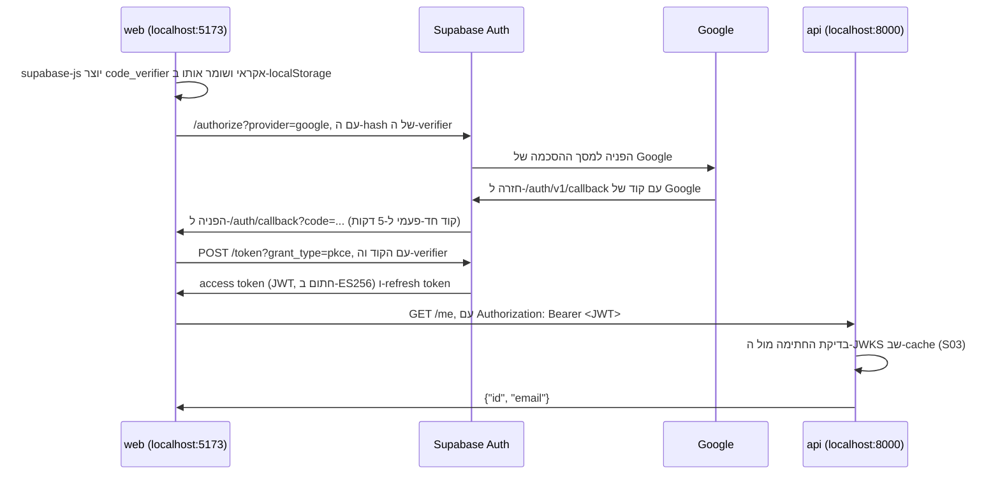

# S04 — שלד ה-web: תוכנית עבודה

> **For agentic workers:** REQUIRED SUB-SKILL: Use superpowers:subagent-driven-development (recommended) or superpowers:executing-plans to implement this plan task-by-task. Steps use checkbox (`- [ ]`) syntax for tracking.

**מטרה:** ב-`web/` יש אפליקציית React בעברית וב-RTL. נכנסים אליה עם Google דרך Supabase Auth, והמסך הריק מציג את המשתמש כפי ש-`GET /me` של ה-API מחזיר אותו. ה-API מתיר CORS ל-origin של Vite, וב-GitHub רץ CI ל-web.

**גישה:** העבודה נעשית בענף `s04-web-skeleton`. קודם ממזגים את ה-PR של Dependabot, ו-`web/.gitignore` נכנס לפני כל קובץ אחר של `web/`. אחר כך בונים בארבע שכבות: CORS ב-API, שלד ה-web עם הכלים והכללים, ההתחברות, והקריאה ל-`/me`. כל שכבה נבדקת ב-vitest או ב-pytest, עם לקוח Supabase מזויף. את הזרימה כולה בודקים פעם אחת ידנית, מול `studyflow-dev` ועם חשבון Google אמיתי. בסוף מוסיפים CI ו-Dependabot, וממזגים.

**כלים:** Node 24, npm 11, Vite 8, React 19, TypeScript 6.0 במצב strict, React Router 8, TanStack Query 5, Tailwind 4, React Aria Components, supabase-js 2, ESLint 10, Vitest 5 ו-Testing Library. ב-api נוסף `CORSMiddleware` של Starlette. מחוץ לקוד: Google Cloud Console והדשבורד של Supabase.

**מסמך תכנון:** `docs/superpowers/specs/2026-10-19-studyflow-v2-design.md`, סעיפים 7.1, 7.2, 7.9, 7.11, 7.12 ו-12. במפת הדרכים שב-[artifact](https://claude.ai/code/artifact/29a3c52e-d399-425e-90b6-7c05e9146bfa) זו משימה S04, והיא מוכנה כשאפשר להיכנס עם Google למסך ריק בעברית, וה-CI ירוק.

## איך החלקים מתחברים

S03 בנה את הצד של השרת: ה-API מקבל JWT ובודק את החתימה שלו מול המפתחות הציבוריים של Supabase. S04 בונה את הצד שמשיג את ה-JWT ושולח אותו, כלומר את הדפדפן.



- **Supabase Auth** הוא שרת ההתחברות של הפרויקט, בכתובת `https://<ref>.supabase.co/auth/v1`. הוא מדבר עם Google, שומר את המשתמשים בטבלה `auth.users` שבמסד של הפרויקט, ומנפיק לנו JWT שתקף לשעה, ו-refresh token. האפליקציה שלנו לא רואה את הטוקנים של Google.
- **Google** רק מאשר ל-Supabase מי המשתמש. בזמן הפיתוח האפליקציה ב-Google במצב Testing, ולכן רק חשבונות שהוספת לרשימת המשתמשים לבדיקה יכולים להיכנס.
- **ה-publishable key** (`sb_publishable_…`) מזהה את הפרויקט מול Supabase, והוא בטוח לדפדפן: הוא לא נותן יותר ממה שההתחברות ו-RLS מתירים. ה-secret key עוקף RLS, ולכן הוא לא נכנס ל-web בשום מצב. ב-S04 אנחנו לא צריכים אותו גם בשרת.
- **PKCE** שומר על ההתחברות גם אם מישהו ראה את הכתובת שחזרה מ-Supabase. הקוד שבכתובת לא שווה כלום בלי ה-verifier, שלא יצא מהדפדפן. בזרימת implicit, שהיא ברירת המחדל של supabase-js, הטוקן עצמו היה מגיע בכתובת.
- **supabase-js** מנהל את ה-session בדפדפן: מחליף את הקוד ב-session, שומר אותה ב-localStorage, ומחדש את ה-JWT לפני שהוא פג. מעבר להתחברות ה-web לא פונה ל-Supabase (סעיף 7.2), וכל השאר עובר דרך ה-API.
- **CORS:** ה-web וה-API יושבים על origins שונים, והדפדפן לא נותן ל-JavaScript לקרוא תשובה מ-origin אחר, אלא אם השרת אומר שה-origin מותר. בגלל הכותרת `Authorization` הדפדפן שולח קודם בקשת `OPTIONS` ושואל. CORS לא מאבטח את ה-API: מה שמאבטח אותו הוא ה-JWT. CORS רק מחליט איזה אתר רשאי לקרוא את התשובות.

## מה מצאתי לפני התכנון (2026-10-25)

| נושא | מצב |
|---|---|
| Dependabot | ‏PR ‏#1 מעדכן את `astral-sh/setup-uv` מ-v9.0.0 ל-v10.3.0, והענף שלו יושב על `b62346c`. השינוי השובר היחיד ב-v10 הוא שה-cache כבוי כברירת מחדל באירועים `pull_request_target`, `workflow_run` ו-`release`. ‏`api.yml` רץ רק על `push` ועל `workflow_dispatch`, ולכן השינוי לא משפיע עלינו |
| Node | במק מותקן v24.14.0, עם npm 11.9.0. ‏Node 24 נמצא ב-LTS (בתחזוקה מ-2026-10-20) עד 2028-04-30, והגרסה האחרונה שלו, 24.22.1, מגיעה עם npm 11.19.1. ‏Node 26 יהיה LTS מ-2026-10-28 |
| npm | `min-release-age` (בימים) קיים מ-npm 11.10. יש גם `allow-git` ו-`ignore-scripts`. את `devEngines` שב-`package.json` בודקים לפני `install`, `ci` ו-`run`, וברירת המחדל של `onFail` היא `error` |
| pnpm | הגרסה האחרונה היא 12.15.0, שנכתבה מחדש ב-Rust ויצאה באוגוסט. ‏Dependabot תומך רשמית ב-pnpm רק עד גרסה 10 |
| TypeScript | הגרסה האחרונה היא 7.0.2, עם הקומפיילר החדש ב-Go. ‏typescript-eslint 8.72 תומך ב-`typescript >=4.8.4 <6.1.0`, ובתבנית של create-vite 9.3.1 כתוב `typescript ~6.0.3`, עם oxlint במקום ESLint |
| גרסות | Vite 8.3, React 19.3, React Router 8.5 (`react-router-dom` הוסר, ו-`RouterProvider` מגיע מ-`react-router/dom`), TanStack Query 5.104, Tailwind 4.3 עם `@tailwindcss/vite`, supabase-js 2.118, ESLint 10.13, Vitest 5.0, React Aria Components 1.22 |
| supabase-js | ברירת המחדל היא `flowType: 'implicit'` ו-`detectSessionInUrl: true`. כשהעמוד נטען עם `?code=` וה-verifier נמצא ב-storage, הספרייה מחליפה את הקוד ב-session ומוחקת אותו מהכתובת. כשבכתובת יש `error`, ה-session לא נוצרת, והפרמטרים נשארים בכתובת. הקוד תקף ל-5 דקות, פעם אחת, ורק באותו דפדפן |
| Supabase redirect | כש-`redirectTo` לא ברשימת ה-Redirect URLs, ‏Supabase מחזיר ל-Site URL. בייצור מומלץ לכתוב נתיבים מדויקים |
| Google | צריך OAuth client מסוג Web application. ב-Authorized JavaScript origins כותבים `http://localhost:5173`, וב-Authorized redirect URIs את `https://<ref>.supabase.co/auth/v1/callback`. ה-scopes הם `openid`, ‏email ו-profile |
| GitHub Actions | ב-S03 התרנו את "Allow actions created by GitHub" ואת `astral-sh/setup-uv@*`, ולכן `actions/setup-node` מותר בלי שינוי. ‏`setup-node` v7.1.0 יצא ב-2026-10-08, ומ-v6.3 הוא קורא את `devEngines.runtime` מתוך `package.json` |
| Starlette | ה-handler של `Exception` רץ ב-`ServerErrorMiddleware`, שעוטף את `CORSMiddleware` מבחוץ. לכן לתשובת 500 אין כותרות CORS, וה-web רואה אותה כשגיאת רשת |

## ההחלטות שלי (סעיף 12)

| נושא | החלטה | למה | על מה ויתרנו |
|---|---|---|---|
| מנהל חבילות | npm 11.10 ומעלה. ב-`web/.npmrc`: `min-release-age=7`, `ignore-scripts=true`, `allow-git=none`. ב-`package.json`: ‏`devEngines` שעוצר גרסה אחרת של Node או של npm | Dependabot תומך בו במלואו. הוא מגיע עם Node, אז אין מה להתקין במק או ב-CI. ההשהיה של 7 ימים זהה ל-`exclude-newer` של uv, ו-`setup-node` כבר מותר ב-Actions | ב-pnpm יש בנוסף `node_modules` קפדני, `trustPolicy` שמזהה ירידה ב-provenance, ורשימה מפורשת של חבילות שמותר להן להריץ סקריפטים. אבל Dependabot לא תומך ב-pnpm 12, ו-pnpm 10 נמצא שתי גרסאות ראשיות מאחור |
| ספריית רכיבים | React Aria Components, של Adobe, עם `I18nProvider locale="he-IL"` | ה-RTL נגזר מה-locale, כולל הכיוון של מקשי החצים. הנגישות מובנית, ובסעיף 7.9 היא חובה. יש בה רכיבי תאריך ולוח שנה עם locale ואזור זמן, שנצטרך למבחנים ולשבוע. הרכיבים בלי עיצוב, ולכן מתאימים ל-Tailwind | רכיבים מעוצבים מראש, כמו ב-shadcn/ui. את העיצוב נכתוב בעצמנו |
| TypeScript | `~6.0.3` | typescript-eslint, שנותן את חוקי ה-lint שמבינים טיפוסים, עוד לא תומך ב-7. גם create-vite נשאר על 6.0 | המהירות של TypeScript 7. ב-Dependabot נוסיף כלל שמתעלם מגרסה ראשית חדשה של `typescript`, עם הערה |
| lint | ESLint, עם `strictTypeChecked` של typescript-eslint וכללים משלנו (Task 3) | ESLint כתוב בסעיף 7.12. הכללים שלנו אוכפים את 7.9: טקסט רק מ-`he.ts`, logical properties, ובלי `alert` ובלי `dangerouslySetInnerHTML` | oxlint, שמהיר יותר וש-create-vite עבר אליו |
| ניתוב | React Router 8 במצב data (`createBrowserRouter`), בלי framework mode | ה-web הוא קבצים סטטיים בלי שרת (7.12), ולכן לא צריך SSR | loaders ו-SSR של framework mode |
| שמירת ה-session | ‏localStorage, ברירת המחדל של supabase-js | אין לנו שרת web. cookies מאובטחים דורשים שרת ביניים, וזה רכיב נוסף לתחזק | אם יהיה XSS, אפשר לגנוב את הטוקן. ההגנות: React עושה escaping, אין `dangerouslySetInnerHTML`, ו-CSP באירוח (S21) |
| CORS | origins מפורשים מ-`CORS_ORIGINS`, ריק כברירת מחדל. השיטות `GET`, `POST`, `PATCH` ו-`DELETE`, הכותרות `Authorization` ו-`Content-Type`, ובלי credentials | ככה הפיתוח מתנהג כמו production, עם שני origins. בלי cookies אין credentials, ולכן אין גם CSRF | proxy של Vite, שהיה חוסך את CORS בפיתוח ומסתיר בעיה שתופיע בייצור |
| טקסט של שגיאות | אם תשובת השגיאה מה-API כוללת `title`, מציגים אותו. אחרת מציגים טקסט מ-`he.ts` | ה-API כבר כותב את ה-`title` בעברית, למשתמש (S03) | — |
| בדיקות | Vitest, Testing Library ו-jsdom. ‏`fetch` ולקוח Supabase מוזרקים כתלות, ובבדיקות מחליפים אותם בזיופים | בלי שרת אמיתי ובלי ספרייה נוספת | MSW. אם יהיו הרבה endpoints, נשקול אותו ב-S09 |
| גופן ותאריכים | גופני המערכת. ספריית תאריכים תיבחר כשנציג תאריך ראשון (S13 או S14), ו-`@internationalized/date` של React Aria היא מועמדת | אין עדיין תאריכים או מיתוג (S17) | — |

## מה לא נכלל ולמה

- **קישור במייל (magic link), מסעיף 11.4.** ה-SMTP המובנה של Supabase שולח רק לכתובות של חברי הצוות בפרויקט, ובמכסה נמוכה לשעה. לכן magic link דורש SMTP משלנו, יחד עם דומיין ורשומות DNS. ההצעה: S21, ושורה חדשה ב"פריטים פתוחים להמשך".
- **PWA ו-service worker:** ב-S16. ‏**Sentry ו-CSP באירוח:** ב-S21. ‏**מיתוג, גופן ועיצוב:** ב-S17.
- **שליחת אזור הזמן ו-`PATCH /me` (סעיף 7.3):** אין טבלת פרופילים עד S05, וה-endpoint נכנס ב-S09.
- **Playwright:** בדיקת ה-E2E הראשונה מגיעה עם האונבורדינג. כאן בודקים את הזרימה ידנית, ב-Task 6.
- **תשובת 500 בלי כותרות CORS:** משפיעה רק על הטקסט שה-web מציג. ‏`he.errors.unreachable` מנוסח כך שהוא נכון בשני המקרים, והתיקון עובר ל-S09, כשיהיו endpoints שיכולים להיכשל.
- **טיפוסים שנוצרים מה-OpenAPI של ה-API:** יש כרגע endpoint אחד. נשקול ב-S09.

## אילוצים גלובליים

- Node `>=24.10.0 <25` ו-npm `>=11.10.0 <12`, דרך `devEngines` ב-`web/package.json`. הפקודות של ה-web רצות מתוך `web/`: `npm ci`, `npm run lint`, `npm run typecheck`, `npm test` ו-`npm run build`.
- TypeScript `~6.0.3` עם `"strict": true` ו-`"noUncheckedIndexedAccess": true`, ב-`tsconfig.app.json` וב-`tsconfig.node.json`.
- כל הטקסט בממשק נמצא ב-`web/src/i18n/he.ts`. שם המוצר כתוב רק ב-`web/src/product.ts`, בתור `PRODUCT_NAME`, ומשם הוא מגיע ל-`he.ts` ול-`<title>`. טקסט בתוך JSX הוא שגיאת lint.
- `<html lang="he" dir="rtl">`. ב-Tailwind משתמשים רק במחלקות לוגיות: `ms-*`, `me-*`, `ps-*`, `pe-*`, `start-*`, `end-*`, `text-start`, `text-end`, `border-s`, `border-e`, `rounded-s` ו-`rounded-e`. מחלקה עם left או right היא שגיאת lint.
- אין `alert`, `confirm` ו-`prompt`, ואין `dangerouslySetInnerHTML`. שניהם שגיאת lint.
- ה-web פונה ל-Supabase רק דרך `supabase.auth`. אין `supabase.from(...)`, ואין Storage ב-S04.
- ב-web יש רק publishable key. ‏`readEnv` דוחה כל מפתח שלא מתחיל ב-`sb_publishable_`, ו-`vite.config.ts` עוצר את ה-dev וה-build אם ערך של משתנה `VITE_*` כלשהו מתחיל ב-`sb_secret_`. ‏`web/.env` מוחרג מ-git, ורק `web/.env.example` נכנס לריפו.
- ה-origin בפיתוח הוא בדיוק `http://localhost:5173`, עם `strictPort`. אותו ערך כתוב ב-Google, ב-Supabase וב-`CORS_ORIGINS`.
- ב-`api/` ממשיכים כללי S03: ‏`create_app()` בלבד, הודעות למשתמש רק מ-`PROBLEMS`, והפקודות שב-`CLAUDE.md`.
- ב-workflows כל Action מקובע ל-SHA מלא, עם הגרסה בהערה. ההרשאות הן `contents: read`, ו-`persist-credentials: false`.
- תלויות: רק אלה שבתוכנית. אם subagent צריך תלות נוספת, הוא כותב בדוח למה.
- התגובות, ההודעות והטקסטים בממשק בעברית. הקוד, ההערות בקוד והודעות הקומיט באנגלית, כמו ב-api.
- git רץ בשיחה הראשית. מוסיפים קבצים לפי שם, וכל Task נכנס לקומיט אחרי שהסקירה שלו עברה. קומיטים, push, מיזוג ל-`main` (רק `--ff-only`) ומחיקת ענף מאושרים מראש, ואני מדווח מה נעשה. אין force-push.
- לא נוגעים ב-`legacy/`.

## על מה לשים לב בבדיקה

1. **הפורט 5173 תפוס:** Vite עובר בשקט ל-5174, ואז ה-redirect מ-Supabase וה-CORS נשברים בלי הסבר. מה שצריך לקרות: שגיאה ברורה בהפעלה. Task 3 בודק ש-`strictPort` מוגדר, וגם מפעיל שרת שני.
2. **ערך לא מדויק ב-`CORS_ORIGINS`:** לוכסן בסוף, נתיב, `*` או אותיות גדולות. הדפדפן שולח את ה-origin בלי לוכסן, אז כל בקשה נחסמת. מה שצריך לקרות: ה-API לא עולה, ומסביר למה. Task 2 בודק את כל הצורות האלה.
3. **401 מה-API:** בלי כותרות CORS, הדפדפן מסתיר את התשובה, וה-web לא יודע שצריך להתחבר מחדש. מה שצריך לקרות: ה-401 חוזר עם `Access-Control-Allow-Origin`, וה-web מוחק את ה-session ושולח לכניסה. Task 2 בודק את הכותרת, ו-Task 5 את הניתוק.
4. **התחברות שלא הושלמה:** ביטול במסך של Google, קוד שפג אחרי 5 דקות, או קישור callback שנפתח בדפדפן אחר. מה שצריך לקרות: הודעה וקישור חזרה למסך הכניסה, ולא "טוען" בלי סוף. Task 4 בודק את שלושת המקרים.
5. **משתמש אחר נכנס באותו דפדפן:** אחרי יציאה וכניסה של משתמש אחר, לא נשארים במסך נתונים של הקודם. מה שצריך לקרות: ה-cache של TanStack Query מתרוקן ביציאה ובכל החלפת משתמש. Task 4 בודק את זה ב-AuthProvider, ו-Task 5 מוסיף את מזהה המשתמש למפתח של `/me`.

## מי עושה מה

| Task | מה | מי | תלוי ב- |
|---|---|---|---|
| 1 | פתיחה: ה-PR של Dependabot, הסטטוס, הענף, `web/.gitignore` והתוכנית | אני. בדיקת ה-checks של ה-PR אצלך | — |
| 2 | CORS ב-API | subagent | 1 |
| 3 | שלד ה-web: כלים, RTL, `he.ts` וכללי lint | subagent. עדכון Node אצלי | 1 |
| 4 | התחברות: משתני סביבה, Supabase, ‏AuthProvider, מסכי הכניסה וה-callback | subagent | 3 |
| 5 | לקוח API ומסך הבית עם `/me` | subagent | 4 |
| 6 | Google ו-Supabase, ובדיקה מקצה לקצה | ההגדרות והדפדפן אצלך, ההרצה אצלי | 2, 5. את ההגדרות אפשר לעשות כבר עכשיו |
| 7 | CI ל-web, ‏Dependabot ומסמך התכנון, ו-push | subagent. המסמך וה-push אצלי, ובדיקת Actions אצלך | 5 |
| 8 | סקירה סופית, מיזוג וסגירה | אני | 6, 7 |

את Steps 1–2 של Task 6 אפשר לעשות במקביל ל-Tasks 1–5. זה בערך 15 דקות.

## מבנה הקבצים

```
api/app/config.py               + cors_origins
api/app/main.py                 + CORSMiddleware
api/.env.example                + CORS_ORIGINS
api/tests/test_cors.py          חדש; test_config.py מתרחב
web/.gitignore, .npmrc, .env.example, package.json, package-lock.json
web/index.html                  lang="he" dir="rtl", ‏<title> מ-PRODUCT_NAME
web/vite.config.ts              react, tailwind, שם המוצר ב-HTML, פורט 5173 קבוע, חסימת sb_secret_, vitest
web/vite.config.test.ts
web/tsconfig.json, tsconfig.app.json, tsconfig.node.json
web/eslint.config.js
web/eslint/guards.js            הכללים של סעיף 7.9; guards.test.js
web/src/main.tsx                readEnv → שירותים → providers → router
web/src/product.ts              PRODUCT_NAME
web/src/i18n/he.ts              כל הטקסטים
web/src/index.css               Tailwind
web/src/config/env.ts           readEnv, EnvError, findSecretKeys
web/src/auth/supabase.ts        createSupabase, AuthClient
web/src/auth/AuthContext.ts     AuthState, useAuth, AUTH_CALLBACK_PATH
web/src/auth/AuthProvider.tsx
web/src/auth/RequireAuth.tsx
web/src/api/client.ts           ApiError, createApiClient, errorMessage
web/src/api/ApiContext.ts       ApiContext, useApi
web/src/api/me.ts               Me, useMe
web/src/app/AppProviders.tsx    QueryClient, I18nProvider, Auth, Api
web/src/app/queryClient.ts      createQueryClient, shouldRetry
web/src/app/routes.tsx          routes
web/src/pages/                  LoginPage, AuthCallbackPage, HomePage, NotFoundPage, ConfigErrorScreen
web/src/ui/Button.tsx           Button של React Aria עם Tailwind
web/src/test/                   setup.ts, fakeAuth.ts, renderRoute.tsx
.github/workflows/web.yml, .github/dependabot.yml
CLAUDE.md, README.md, מסמך התכנון (7.9 ו-12)
```

הבדיקות של web נמצאות ליד הקוד, בקבצי `*.test.ts(x)`.

---

### Task 1: פתיחת ה-scope

**למה:** ה-PR של Dependabot נוגע ב-CI של ה-api, ועדיף שייכנס ל-`main` לפני שהענף נפתח. ‏`web/.gitignore` נכנס לפני כל קובץ אחר, כדי ש-`node_modules` לא יגיע ל-git אף פעם.

**Files:**
- Create: `web/.gitignore`
- Commit: התוכנית הזו

**צורך:** `main` ב-`b62346c`, ו-`origin/dependabot/github_actions/actions-a055b02c66` ב-`c712260`.
**מייצר:** ‏`main` ב-`c712260`, ואחריו ענף `s04-web-skeleton` עם שני קומיטים.

- [ ] **Step 1 (בצד שלך): ה-checks של PR ‏#1**
  ב-`https://github.com/Eyal-Atar/study/pull/1` הריצות `api` ו-`secret-scan` ירוקות. אם אחת מהן אדומה, לא ממזגים, ואני בודק את הלוג.

- [ ] **Step 2: מיזוג ה-PR**
  ```bash
  git fetch origin && git switch main
  git merge --ff-only origin/dependabot/github_actions/actions-a055b02c66 && git push origin main
  git log --oneline -1 && git ls-remote origin 'refs/heads/dependabot/*'
  ```
  Expected: ‏`Fast-forward` ל-`c712260`. ב-GitHub, ה-PR מסומן Merged. אם הענף של Dependabot עדיין קיים, מוחקים אותו עם `git push origin --delete dependabot/github_actions/actions-a055b02c66`.

- [ ] **Step 3: הסטטוס של S04 ל"בעבודה"**
  בטבלת "מפת הדרכים" שב-artifact, עם כלי ה-Docs. Expected: בשורה של S04 כתוב "בעבודה".

- [ ] **Step 4: פתיחת הענף**
  Run: `git switch -c s04-web-skeleton main && git status --short`
  Expected: `Switched to a new branch 's04-web-skeleton'`, בלי שינויים.

- [ ] **Step 5: `web/.gitignore`**
  ```gitignore
  /node_modules/
  /dist/
  /coverage/
  ```
  את `web/.env` כבר תופסים הכללים `.env` ו-`.env.*` שבשורש, ו-`!.env.example` משאיר את הדוגמה בחוץ.

- [ ] **Step 6: ההחרגות תופסות רק את מה שצריך**
  ```bash
  git check-ignore --no-index web/node_modules/x/index.js web/dist/index.html web/coverage/index.html web/.env web/.env.local | wc -l
  git check-ignore --no-index web/.env.example web/package-lock.json web/src/features/dist/List.tsx web/src/coverage.ts; echo "exit $?"
  ```
  Expected: `5`, ואחריו רק `exit 1`.

- [ ] **Step 7: שני קומיטים**
  ```bash
  git add web/.gitignore && git commit -m "chore(web): ignore node_modules, dist and coverage" -m "Co-Authored-By: Claude Opus 5.5 <noreply@anthropic.com>"
  git add docs/superpowers/plans/2026-10-25-s04-web-skeleton.md && git commit -m "docs: add S04 web skeleton plan" -m "Co-Authored-By: Claude Opus 5.5 <noreply@anthropic.com>"
  ```

### Task 2: CORS ב-API

**למה:** ה-web ב-`localhost:5173` צריך לקרוא תשובות מה-API ב-`localhost:8000`, כולל תשובות 401. רשימת ה-origins שמותרים מגיעה מהסביבה, כך שלכל סביבה (פיתוח, staging, production) יש רשימה משלה. כל ערך ברשימה חייב להיראות בדיוק כמו ה-`Origin` שהדפדפן שולח, אחרת אף בקשה לא תעבור.

**Files:**
- Modify: `api/app/config.py`, `api/app/main.py`, `api/.env.example`, `api/tests/test_config.py`
- Create: `api/tests/test_cors.py`

**צורך:** `Settings`, `create_app()`, ה-fixtures `jwks`, `make_token` ו-`client` שב-`api/tests/conftest.py`, ו-`StaticKeys` ו-`bearer` שב-`api/tests/tokens.py`.
**מייצר:** `Settings.cors_origins: list[str]`, שנקרא מ-`CORS_ORIGINS` כרשימת JSON, וברירת המחדל שלו היא `[]`. ‏`create_app()` מוסיפה `CORSMiddleware` עם הרשימה הזו.

- [ ] **Step 1: הבדיקות שנכשלות**
  ב-`api/tests/test_config.py`:
  ```python
  def test_cors_origins_default_to_none() -> None:
      assert Settings(supabase_url="https://test-ref.supabase.co", _env_file=None).cors_origins == []


  def test_cors_origins_come_from_a_json_list(monkeypatch: pytest.MonkeyPatch) -> None:
      monkeypatch.setenv("SUPABASE_URL", "https://env-ref.supabase.co")
      monkeypatch.setenv("CORS_ORIGINS", '["http://localhost:5173", "https://app.example.com"]')
      assert Settings(_env_file=None).cors_origins == ["http://localhost:5173", "https://app.example.com"]


  @pytest.mark.parametrize(
      "origin",
      [
          "http://localhost:5173/",
          "http://localhost:5173/app",
          "*",
          "localhost:5173",
          "HTTP://localhost:5173",
          "http://LOCALHOST:5173",
          "ftp://localhost:5173",
          "http://localhost:5173?x=1",
          "http://localhost:5173#top",
          "http://user@localhost:5173",
      ],
  )
  def test_cors_origin_must_be_exactly_what_a_browser_sends(origin: str) -> None:
      with pytest.raises(ValidationError, match="CORS_ORIGINS"):
          Settings(supabase_url="https://test-ref.supabase.co", cors_origins=[origin], _env_file=None)
  ```
  ב-`api/tests/test_cors.py`, עם fixture בשם `cors_client`. הוא בונה `create_app(Settings(supabase_url="https://test-ref.supabase.co", cors_origins=[WEB_ORIGIN], _env_file=None), signing_keys=StaticKeys(jwks))`, כש-`WEB_ORIGIN = "http://localhost:5173"`:
  ```python
  def _preflight(client: TestClient, origin: str) -> Response:
      return client.options("/me", headers={"Origin": origin, "Access-Control-Request-Method": "GET",
                                            "Access-Control-Request-Headers": "authorization"})

  def test_preflight_from_the_web_origin_is_allowed(cors_client: TestClient) -> None:
      response = _preflight(cors_client, WEB_ORIGIN)
      assert response.status_code == 200
      assert response.headers["access-control-allow-origin"] == WEB_ORIGIN
      assert "authorization" in response.headers["access-control-allow-headers"].lower()
      assert "access-control-allow-credentials" not in response.headers

  def test_preflight_from_another_origin_is_rejected(cors_client: TestClient) -> None:
      response = _preflight(cors_client, "http://localhost:5174")
      assert response.status_code == 400
      assert "access-control-allow-origin" not in response.headers

  def test_me_from_the_web_origin_carries_cors_headers(cors_client: TestClient, make_token: TokenFactory) -> None:
      response = cors_client.get("/me", headers={**bearer(make_token()), "Origin": WEB_ORIGIN})
      assert response.status_code == 200
      assert response.headers["access-control-allow-origin"] == WEB_ORIGIN
      assert "origin" in response.headers["vary"].lower()

  def test_401_from_the_web_origin_is_readable_by_the_browser(cors_client: TestClient) -> None:
      response = cors_client.get("/me", headers={"Origin": WEB_ORIGIN})
      assert response.status_code == 401
      assert response.headers["content-type"] == "application/problem+json"
      assert response.headers["access-control-allow-origin"] == WEB_ORIGIN

  def test_no_origin_is_allowed_by_default(client: TestClient, make_token: TokenFactory) -> None:
      response = client.get("/me", headers={**bearer(make_token()), "Origin": WEB_ORIGIN})
      assert response.status_code == 200
      assert "access-control-allow-origin" not in response.headers
  ```

- [ ] **Step 2: הבדיקות נכשלות**
  Run: `cd api && uv run pytest tests/test_cors.py tests/test_config.py -q`
  Expected: FAIL. הסיבה היא ש-`cors_origins` לא קיים, ושאין כותרות CORS.

- [ ] **Step 3: המימוש**
  - ב-`api/app/config.py`: השדה `cors_origins: list[str] = []`, ו-`field_validator` שבודק כל ערך. הערך חייב להיות שווה בדיוק ל-`f"{scheme}://{netloc}"` של `urlsplit` שלו. ה-scheme חייב להיות `http` או `https`, ה-netloc לא ריק ובלי `@`, והערך כולו באותיות קטנות. ההודעה מתחילה ב-`CORS_ORIGINS must list browser origins such as http://localhost:5173`.
  - ב-`api/app/main.py`: אחרי `register_error_handlers`, להוסיף `app.add_middleware(CORSMiddleware, allow_origins=settings.cors_origins, allow_methods=["GET", "POST", "PATCH", "DELETE"], allow_headers=["Authorization", "Content-Type"], max_age=600)`. בלי `allow_credentials`.
  - ב-`api/.env.example` מוסיפים:
    ```
    # Browser origins allowed to call the API, as a JSON list. Each one is exactly what the
    # browser sends: scheme, host and port, lowercase, no trailing slash.
    CORS_ORIGINS=["http://localhost:5173"]
    ```

- [ ] **Step 4: הכל ירוק**
  Run: `cd api && uv run ruff check . && uv run ruff format --check . && uv run mypy && uv run pytest -q`
  Expected: הכל עובר. מספר הבדיקות עולה מ-49 ל-66.

- [ ] **Step 5: קומיט (בשיחה הראשית, אחרי הסקירה)**
  ```bash
  git add api/app/config.py api/app/main.py api/.env.example api/tests/test_config.py api/tests/test_cors.py
  git commit -m "feat(api): allow the web origin through CORS" -m "Co-Authored-By: Claude Opus 5.5 <noreply@anthropic.com>"
  ```

### Task 3: שלד ה-web: כלים, RTL וכללים

**למה:** כאן נקבעים הכללים שכל שאר הקוד של ה-web יכתב לפיהם. ‏`index.html` קובע עברית ו-RTL. כללי ה-lint הופכים את סעיף 7.9 משורה במסמך לשגיאה בזמן הכתיבה. ‏`.npmrc` ו-`devEngines` נותנים ל-npm את ההגנה ש-uv נותן ל-api. כדי לדעת שהכללים באמת תופסים משהו, יש להם בדיקות משלהם: selector שגוי ב-ESLint פשוט לא ימצא כלום, בלי שום אזהרה.

**Files:**
- Create: `web/package.json`, `web/package-lock.json`, `web/.npmrc`, `web/index.html`, `web/vite.config.ts`, `web/vite.config.test.ts`, `web/tsconfig.json`, `web/tsconfig.app.json`, `web/tsconfig.node.json`, `web/eslint.config.js`, `web/eslint/guards.js`, `web/eslint/guards.test.js`, `web/src/main.tsx`, `web/src/product.ts`, `web/src/i18n/he.ts`, `web/src/index.css`, `web/src/app/App.tsx`, `web/src/app/App.test.tsx`, `web/src/ui/Button.tsx`, `web/src/test/setup.ts`
- Modify: `CLAUDE.md`, `README.md`

**צורך:** `web/.gitignore` מ-Task 1.
**מייצר:**
- `PRODUCT_NAME: 'StudyFlow'` ב-`src/product.ts`.
- `he` ב-`src/i18n/he.ts`: אובייקט `as const` עם `appName` (= `PRODUCT_NAME`) ו-`tagline`. ה-Tasks הבאים מוסיפים לו מפתחות.
- `Button` ב-`src/ui/Button.tsx`: עוטף את `Button` של `react-aria-components`, עם אותם props ועם `variant?: 'primary' | 'secondary'`.
- הסקריפטים `dev`, `lint`, `typecheck` (`tsc -b`), `test` (`vitest run`) ו-`build` (`vite build`).

- [ ] **Step 1 (בשיחה הראשית): Node 24 עם npm 11.10 ומעלה**
  Run: `source ~/.nvm/nvm.sh && nvm install 24 && nvm alias default 24 && node --version && npm --version`
  Expected: ‏`v24.22.x` ו-`11.19.x`. שאר הגרסאות של Node שמותקנות נשארות.

- [ ] **Step 2: `package.json` ו-`.npmrc`**
  השדות שקובעים משהו ב-`web/package.json`:
  ```json
  {
    "name": "studyflow-web",
    "private": true,
    "type": "module",
    "scripts": {
      "dev": "vite",
      "lint": "eslint .",
      "typecheck": "tsc -b",
      "test": "vitest run",
      "build": "vite build"
    },
    "devEngines": {
      "runtime": { "name": "node", "version": ">=24.10.0 <25", "onFail": "error" },
      "packageManager": { "name": "npm", "version": ">=11.10.0 <12", "onFail": "error" }
    }
  }
  ```
  ‏`web/.npmrc`:
  ```ini
  # Supply-chain protection, like exclude-newer in api/pyproject.toml (see CLAUDE.md).
  # A version younger than 7 days is not installed.
  min-release-age=7
  # Dependencies never run install scripts.
  ignore-scripts=true
  # No dependencies from git repositories.
  allow-git=none
  ```

- [ ] **Step 3: התקנת התלויות**
  ```bash
  cd web
  npm install react react-dom react-aria-components
  npm install -D vite @vitejs/plugin-react typescript@~6.0.3 @types/react @types/react-dom @types/node \
    tailwindcss @tailwindcss/vite eslint @eslint/js typescript-eslint eslint-plugin-react-hooks \
    eslint-plugin-react-refresh globals vitest jsdom @testing-library/react @testing-library/dom \
    @testing-library/jest-dom @testing-library/user-event
  npm ls --depth=0
  ```
  Expected: נוצר `package-lock.json`, וב-`package.json` כתוב `"typescript": "~6.0.3"`. אם npm מתקין משהו עם `ERESOLVE` או עם `--force`, עוצרים ומדווחים.

- [ ] **Step 4: ההשהיה ו-`devEngines` באמת עובדים**
  - בוחרים תלות ישירה שהגרסה האחרונה שלה יצאה לפני פחות מ-7 ימים, לפי `npm view <pkg> time --json`. מריצים `npm install --dry-run --no-save <pkg>@<that-version>`. Expected: ‏`ETARGET`. אם אין תלות כזו, כותבים את זה בדוח.
  - Run: `npx -y -p npm@11.9.0 npm install --dry-run`. Expected: שגיאת `devEngines` על גרסת npm.

- [ ] **Step 5: הבדיקות שנכשלות**
  - `web/eslint/guards.test.js`, ב-`// @vitest-environment node`. הבדיקה מריצה `new ESLint({ cwd, overrideConfigFile: true, overrideConfig: [<parser של typescript-eslint עם jsx ל-**/*.{ts,tsx}>, ...guards] })`, ובודקת את ה-`ruleId`s שחוזרים מ-`lintText(code, { filePath })`:

    | קוד | `filePath` | Expected |
    |---|---|---|
    | `alert('x')`, ‏`confirm('x')`, ‏`window.prompt('x')` | `src/A.tsx` | `no-alert` |
    | `<div dangerouslySetInnerHTML={{ __html: x }} />` | `src/A.tsx` וגם `src/A.test.tsx` | `no-restricted-syntax` |
    | `<p>שלום</p>`, ‏`<p>Hello</p>`, ‏`<input aria-label="שם" />` | `src/A.tsx` | `no-restricted-syntax` |
    | `<p>{he.tagline}</p>`, ‏`<input aria-label={he.tagline} />` | `src/A.tsx` | נקי |
    | `<p>Hello</p>` | `src/A.test.tsx` | נקי |
    | `className="ml-4"`, ‏`"md:pr-2"`, ‏`"-mr-1"`, ‏`"left-0"`, ‏`"text-right"`, ‏`"border-l"`, ‏`"rounded-r-lg"`, וגם `` `ml-${n}` `` | `src/A.tsx` | `no-restricted-syntax` |
    | `className="ms-4 pe-2 text-start start-0 border-s rounded-e-lg"`, ‏`const tag = 'html'` | `src/A.tsx` | נקי |
  - `web/vite.config.test.ts`, ב-`// @vitest-environment node`. אם ה-config הוא פונקציה, הבדיקה קוראת לה עם `{ command: 'serve', mode: 'test' }`, ואז:
    ```ts
    expect(resolved.server).toMatchObject({ port: 5173, strictPort: true })
    ```
  - `web/src/app/App.test.tsx`: ‏`render(<App />)`. הכותרת `getByRole('heading', { level: 1 })` היא `'StudyFlow'`, ו-`he.tagline` מופיע.

  Run: `cd web && npx vitest run`. Expected: FAIL, כי הקבצים שנבדקים עוד לא קיימים.

- [ ] **Step 6: המימוש**
  - `web/eslint/guards.js` מייצא `guards`, מערך של שני config objects:
    1. `files: ['src/**/*.{ts,tsx}']`: `no-alert: 'error'` ו-`no-restricted-syntax: ['error', ...]`, עם ה-selectors האלה. ההודעה של כל אחד מסבירה מה לעשות במקום:
       ```js
       const PHYSICAL = String.raw`/(^|[\s:])-?(m[lr]|p[lr]|left|right|border-[lr]|rounded-[lr]|text-(left|right))(-|\s|$)/`
       'JSXAttribute[name.name="dangerouslySetInnerHTML"]'
       'Property[key.name="dangerouslySetInnerHTML"]'
       String.raw`JSXText[value=/[A-Za-z֐-׿]/]`
       'JSXAttribute[name.name=/^(alt|aria-label|aria-description|placeholder|title)$/] > Literal'
       `Literal[value=${PHYSICAL}]`
       `TemplateElement[value.raw=${PHYSICAL}]`
       ```
    2. `files: ['src/**/*.test.{ts,tsx}', 'src/test/**']`: ‏`no-restricted-syntax` רק עם שני ה-selectors של `dangerouslySetInnerHTML`.
  - `web/eslint.config.js`, דרך `defineConfig` של `eslint/config`. ‏`globalIgnores(['dist', 'coverage'])`. על `**/*.{ts,tsx}`: `js.configs.recommended`, ‏`tseslint.configs.strictTypeChecked` עם `projectService: true`, ה-recommended של `eslint-plugin-react-hooks` וה-config של `eslint-plugin-react-refresh` ל-Vite, לפי ה-README הנוכחי של כל plugin. על `**/*.js`: `js.configs.recommended` עם `globals.node`. בסוף: `...guards`.
  - `web/tsconfig*.json`: כמו בתבנית `react-ts` של create-vite 9.3, ובנוסף `"strict": true` ו-`"noUncheckedIndexedAccess": true` בשני הקבצים. ‏`tsconfig.node.json` כולל את `vite.config.ts` ואת `vite.config.test.ts`.
  - `web/vite.config.ts`: ‏`defineConfig` מ-`vitest/config`, עם `react()` ו-`tailwindcss()`. בנוסף plugin קטן בשם `product-name`, עם `transformIndexHtml` ו-`order: 'pre'`, שמחליף את `%PRODUCT_NAME%` ב-`PRODUCT_NAME` מתוך `./src/product.ts`. ‏`server: { port: 5173, strictPort: true }`, ו-`test: { environment: 'jsdom', setupFiles: ['./src/test/setup.ts'], restoreMocks: true }`.
  - `web/index.html`: ‏`<html lang="he" dir="rtl">`, ‏`<title>%PRODUCT_NAME%</title>`, ו-`<body class="min-h-dvh bg-slate-50 text-slate-900 antialiased">`. בלי favicon: הוא שייך למיתוג, ב-S17.
  - `web/src/product.ts`: ‏`export const PRODUCT_NAME = 'StudyFlow'`, עם הערה שהשם החדש ייבחר עד שלב 4 ושזה המקום היחיד שבו הוא כתוב (סעיף 6).
  - `web/src/i18n/he.ts`:
    ```ts
    import { PRODUCT_NAME } from '../product'

    export const he = {
      appName: PRODUCT_NAME,
      tagline: 'תוכנית לימודים יומית לתקופת המבחנים',
    } as const
    ```
  - `web/src/index.css`: ‏`@import "tailwindcss";`.
  - `web/src/test/setup.ts`: ‏`import '@testing-library/jest-dom/vitest'`.
  - `web/src/ui/Button.tsx`: ‏`Button` של `react-aria-components`, עם מחלקות Tailwind. המצבים מגיעים מה-data attributes של React Aria: `data-[hovered]`, `data-[pressed]`, `data-[focus-visible]` ו-`data-[disabled]`. גם כאן רק מחלקות לוגיות.
  - `web/src/app/App.tsx`: ‏`<main>` עם `<h1>{he.appName}</h1>` ו-`<p>{he.tagline}</p>`. זה מסך זמני, ו-Task 4 מחליף אותו.
  - `web/src/main.tsx`: ‏`createRoot` על `#root`, כשהקוד בודק במפורש שהאלמנט קיים, בלי `!`. ‏`<StrictMode><I18nProvider locale="he-IL"><App /></I18nProvider></StrictMode>`, ו-`import './index.css'`.

- [ ] **Step 7: הכל ירוק**
  ```bash
  cd web && npm run lint && npm run typecheck && npm test && npm run build
  grep -c '<html lang="he" dir="rtl">' dist/index.html; grep -c '<title>StudyFlow</title>' dist/index.html; grep -c '%PRODUCT_NAME%' dist/index.html
  ```
  Expected: ארבע הפקודות עוברות, ואחריהן `1`, ‏`1`, ‏`0`.

- [ ] **Step 8: שרת הפיתוח**
  מפעילים `npm run dev` ברקע, ו-`curl -s http://localhost:5173/ | grep -c 'dir="rtl"'` מחזיר `1`. ‏`npm run dev` שני נכשל עם `Port 5173 is already in use`. בסוף עוצרים את שניהם.

- [ ] **Step 9: `CLAUDE.md` ו-`README.md`**
  - ב-`CLAUDE.md`: את השורה `אין commit, push או מיזוג בלי אישור מפורש לרשימת הפעולות.` מחליפים ב-`commit, push, מיזוג ל-main (רק --ff-only) ומחיקת ענף שמוזג מאושרים מראש. מדווחים מה נעשה. git רץ בשיחה הראשית, ומוסיפים קבצים לפי שם.`, כמו שסיכמנו ב-2026-10-25. מוסיפים סעיף `## פקודות web/` עם טבלה באותו מבנה של `api/`: `npm ci`, `npm run dev` (פורט 5173 בלבד), `npm test`, `npm run lint`, `npm run typecheck` ו-`npm run build`. מתחת לטבלה פסקה אחת: ב-`web/.npmrc` מוגדר `min-release-age=7`. לתיקון דחוף מריצים `npm install <pkg>@<version> --min-release-age=0`, וכותבים בקומיט למה. ‏`devEngines` עוצר Node או npm בגרסה אחרת.
  - ב-`README.md`: בולט `` - `web/`: האפליקציה של v2, ב-React עם TypeScript ו-Vite, בעברית וב-RTL. ``, וסעיף "הרצת ה-web": ‏`cd web`, ‏`npm ci`, ‏`cp .env.example .env` וממלאים, ‏`npm run dev`. ה-API צריך לרוץ, ו-`CORS_ORIGINS` שלו צריך לכלול את `http://localhost:5173`.

- [ ] **Step 10: קומיט (בשיחה הראשית, אחרי הסקירה)**
  ```bash
  git add web/package.json web/package-lock.json web/.npmrc web/index.html web/vite.config.ts web/vite.config.test.ts \
    web/tsconfig.json web/tsconfig.app.json web/tsconfig.node.json web/eslint.config.js web/eslint/guards.js \
    web/eslint/guards.test.js web/src/main.tsx web/src/product.ts web/src/i18n/he.ts web/src/index.css \
    web/src/app/App.tsx web/src/app/App.test.tsx web/src/ui/Button.tsx web/src/test/setup.ts CLAUDE.md README.md
  git status --short web | grep -v '^A ' ; git commit -m "feat(web): add the Vite React TypeScript skeleton in Hebrew RTL" -m "Co-Authored-By: Claude Opus 5.5 <noreply@anthropic.com>"
  ```
  Expected: ה-`grep` לא מחזיר שום קובץ של `web/` שלא נוסף.

### Task 4: התחברות עם Google

**למה:** זה החלק שבו הדפדפן משיג JWT. ‏supabase-js עושה את ה-PKCE, ואנחנו כותבים שלושה דברים מסביב לו. הראשון הוא בדיקה של משתני הסביבה כבר בהפעלה. השני הוא `AuthProvider`, שמחזיק מצב אחד של "מחובר, לא מחובר או טוען" לכל האפליקציה. השלישי הוא שלושת המסכים: כניסה, ‏callback והגנה על המסך הראשי. הלקוח של Supabase מוזרק דרך ממשק צר, `AuthClient`, וכך הבדיקות רצות בלי רשת ובלי Google.

**Files:**
- Create: `web/.env.example`, `web/src/config/env.ts`, `web/src/auth/supabase.ts`, `web/src/auth/AuthContext.ts`, `web/src/auth/AuthProvider.tsx`, `web/src/auth/RequireAuth.tsx`, `web/src/app/AppProviders.tsx`, `web/src/app/queryClient.ts`, `web/src/app/routes.tsx`, `web/src/pages/LoginPage.tsx`, `web/src/pages/AuthCallbackPage.tsx`, `web/src/pages/HomePage.tsx`, `web/src/pages/NotFoundPage.tsx`, `web/src/pages/ConfigErrorScreen.tsx`, `web/src/test/fakeAuth.ts`, `web/src/test/renderRoute.tsx`, ובדיקות: `env.test.ts`, `supabase.test.ts`, `AuthProvider.test.tsx`, `LoginPage.test.tsx`, `AuthCallbackPage.test.tsx`, `routes.test.tsx`, `ConfigErrorScreen.test.tsx`
- Modify: `web/src/main.tsx`, `web/src/i18n/he.ts`, `web/vite.config.ts`, `web/eslint.config.js`, `web/package.json`, `web/package-lock.json`
- Delete: `web/src/app/App.tsx`, `web/src/app/App.test.tsx`

**צורך:** `he`, `Button` ו-`PRODUCT_NAME` מ-Task 3.
**מייצר:**
- `src/config/env.ts`: ‏`interface WebEnv { supabaseUrl: string; supabasePublishableKey: string; apiUrl: string }`, ‏`class EnvError extends Error { readonly problems: readonly string[] }`, ‏`readEnv(source: Readonly<Record<string, unknown>>): WebEnv` ו-`findSecretKeys(source: Readonly<Record<string, unknown>>): string[]`.
- `src/auth/supabase.ts`: ‏`createSupabase(env: WebEnv): SupabaseClient`, וממשק משלנו בשם `AuthClient`. הוא כולל את `getSession()`, ‏`onAuthStateChange(cb)`, ‏`signInWithOAuth({ provider: 'google', options: { redirectTo } })` ו-`signOut({ scope })`, בטיפוסים הצרים שהקוד שלנו צריך. ‏`SupabaseClient['auth']` מתאים לו בלי cast.
- `src/auth/AuthContext.ts`: ‏`AUTH_CALLBACK_PATH = '/auth/callback'`. ‏`type AuthState = { status: 'loading' } | { status: 'signed_out' } | { status: 'signed_in'; session: Session }`. ‏`useAuth(): AuthState & { signInWithGoogle(): Promise<void>; signOut(): Promise<void> }`. ‏`signInWithGoogle` זורק כש-Supabase מחזיר `error`, ו-`signOut` קורא ל-`signOut({ scope: 'local' })`.
- `src/app/routes.tsx`: ‏`routes: RouteObject[]`. הנתיבים: ‏`/login`, ‏`AUTH_CALLBACK_PATH`, נתיב layout עם `RequireAuth` ובתוכו `HomePage` כ-index, ו-`*` ל-`NotFoundPage`. אם `react-refresh/only-export-components` מתלונן על הייצוא של `routes`, מוסיפים את `routes` ל-`allowExportNames` של הכלל.
- `src/app/AppProviders.tsx`: ‏`AppProviders({ auth, queryClient, children })`, שעוטף ב-`QueryClientProvider`, ב-`I18nProvider locale="he-IL"` וב-`AuthProvider`. ‏`src/app/queryClient.ts`: ‏`createQueryClient(): QueryClient`.
- `src/test/fakeAuth.ts`: ‏`createFakeAuth(initial?: Session | null): FakeAuth`, עם `client: AuthClient`, ‏`emit(event, session)` ו-mocks של `signInWithOAuth` ושל `signOut`. ‏`onAuthStateChange` שולח `INITIAL_SESSION` ב-microtask, כמו supabase-js, ו-`signOut` שולח `SIGNED_OUT`. ‏`fakeSession({ id?, email? }): Session`.
- `src/test/renderRoute.tsx`: ‏`renderRoute(path: string, { auth: FakeAuth, queryClient? })`. הפונקציה בונה `createMemoryRouter(routes, { initialEntries: [path] })` בתוך `AppProviders`, עם `QueryClient` שבו `retry: false`, ומחזירה את התוצאה של `render` יחד עם `router`.

- [ ] **Step 1: התלויות**
  Run: `cd web && npm install react-router @supabase/supabase-js @tanstack/react-query && npm install -D @tanstack/eslint-plugin-query`
  ב-`eslint.config.js` מוסיפים את ה-flat recommended של `@tanstack/eslint-plugin-query`.

- [ ] **Step 2: הטקסטים**
  מוסיפים ל-`he`:
  ```ts
  common: { loading: 'טוען…' },
  login: {
    google: 'התחברות עם Google',
    failed: 'לא הצלחנו להתחיל את ההתחברות. נסו שוב.',
  },
  callback: {
    working: 'מסיימים את ההתחברות…',
    failed: 'ההתחברות לא הושלמה. אפשר לנסות שוב.',
    backToLogin: 'חזרה למסך הכניסה',
  },
  home: { signOut: 'יציאה' },
  notFound: { title: 'הדף לא נמצא', backHome: 'לדף הבית' },
  config: {
    title: 'האפליקציה לא מוגדרת',
    body: 'חסרים משתני סביבה ב-web/.env, או שהערכים שלהם לא תקינים:',
  },
  ```

- [ ] **Step 3: הבדיקות שנכשלות**
  - `src/config/env.test.ts`, עם `valid = { VITE_SUPABASE_URL: 'https://test-ref.supabase.co', VITE_SUPABASE_PUBLISHABLE_KEY: 'sb_publishable_abc123', VITE_API_URL: 'http://localhost:8000' }`:
    - `reads and normalizes the three variables`: עם לוכסן בסוף שתי הכתובות, התוצאה היא `{ supabaseUrl: 'https://test-ref.supabase.co', supabasePublishableKey: 'sb_publishable_abc123', apiUrl: 'http://localhost:8000' }`.
    - `names every missing variable`: מ-`readEnv({})` נזרק `EnvError` עם 3 `problems`, ושלושת השמות מופיעים בהם.
    - `refuses a Supabase secret key`: עם `'sb_secret_abc'`, ה-problem כולל `sb_secret_`. ‏`findSecretKeys({ ...valid, VITE_OTHER: 'sb_secret_x' })` מחזיר `['VITE_OTHER']`.
    - `refuses a key that is not a publishable key`: ‏`'eyJhbGciOiJIUzI1NiJ9.e30.x'` ו-`'abc'`.
    - `refuses a Supabase URL that is not the bare project URL`: ‏`'https://test-ref.supabase.co/auth/v1'`, ‏`'test-ref.supabase.co'` ו-`'https://test-ref.supabase.co?x=1'`.
    - `refuses an API URL that is not http(s) without a query`: ‏`'localhost:8000'`, ‏`'ftp://localhost:8000'` ו-`'http://localhost:8000/?x=1'`.
  - `src/auth/supabase.test.ts`: עם `vi.mock('@supabase/supabase-js')`, ‏`createSupabase(env)` קורא ל-`createClient` עם `('https://test-ref.supabase.co', 'sb_publishable_abc123', { auth: { flowType: 'pkce' } })`. ‏`toMatchObject` מספיק כאן.
  - `src/auth/AuthProvider.test.tsx`:
    - `is loading until the initial session arrives, then signed in`: לפני ה-microtask הסטטוס `loading`, ואחריו `signed_in`, עם ה-session.
    - `becomes signed out on SIGNED_OUT`.
    - `unsubscribes on unmount`.
    - `clears the query cache when the user signs out or changes`: ‏`queryClient.setQueryData(['me', 'user-a'], …)`, ואחריו `emit('SIGNED_OUT', null)`. Expected: ‏`queryClient.getQueryCache().getAll()` ריק. אותה בדיקה עם `emit('SIGNED_IN', fakeSession({ id: 'user-b' }))`. רענון טוקן של אותו משתמש (`TOKEN_REFRESHED`) לא מרוקן את ה-cache.
  - `src/pages/LoginPage.test.tsx`:
    - `starts Google sign-in with PKCE redirect to the callback route`: לחיצה על `getByRole('button', { name: he.login.google })` קוראת ל-`signInWithOAuth` עם `{ provider: 'google', options: { redirectTo: `${window.location.origin}/auth/callback` } }`.
    - `shows an error when sign-in cannot start`: כש-`signInWithOAuth` מחזיר `{ error: new Error('x') }`, מופיע `getByRole('alert')` עם `he.login.failed`.
    - `sends a signed-in user home`: עם session, ‏`router.state.location.pathname` הוא `'/'`.
  - `src/pages/AuthCallbackPage.test.tsx`:
    - `shows the failure when Google or Supabase returned an error`: ‏`/auth/callback?error=access_denied&error_description=x` מציג `he.callback.failed`, וקישור `he.callback.backToLogin` ל-`/login`.
    - `shows the failure when no session came out of the callback`: ‏`/auth/callback?code=expired`, עם `INITIAL_SESSION` ריק.
    - `goes home once signed in`: עם session מגיעים ל-`'/'`. לפני ה-session מוצג `he.callback.working`.
  - `src/app/routes.test.tsx`:
    - `the home route sends a signed-out user to login`: ‏`/`, בלי session, מגיע ל-`/login`.
    - `the home route shows loading until the session is known`: ‏`he.common.loading`.
    - `an unknown path shows not found`: ‏`/nope` מציג `he.notFound.title`.
  - `src/pages/ConfigErrorScreen.test.tsx`: ‏`<ConfigErrorScreen problems={['VITE_API_URL is missing']} />` מציג `he.config.title`, ‏`he.config.body` ואת ה-problem.

  Run: `cd web && npm test`. Expected: FAIL.

- [ ] **Step 4: המימוש**
  - `env.ts`: הכללים של הבדיקות. הודעות ה-problems באנגלית, כי הן למפתח. ה-problem של `sb_secret_` אומר למחוק את המפתח מ-`web/.env` ולבטל אותו ב-Supabase. ‏`readEnv` משתמש ב-`findSecretKeys`.
  - `vite.config.ts` עובר לצורה `defineConfig(({ mode }) => …)`. הוא קורא ל-`loadEnv(mode, process.cwd(), 'VITE_')`, וזורק שגיאה עם שמות המשתנים אם `findSecretKeys` מחזיר משהו. כך ה-secret לא נכנס ל-bundle גם ב-build.
  - `supabase.ts`: ‏`createClient(env.supabaseUrl, env.supabasePublishableKey, { auth: { flowType: 'pkce' } })`. שאר ברירות המחדל נשארות: `detectSessionInUrl`, ‏`persistSession` ו-`autoRefreshToken`.
  - `AuthProvider`: נרשם ל-`onAuthStateChange` ב-`useEffect`, ומבטל את הרישום בניקוי. בתוך ה-callback רק מעדכנים state: קריאה עם `await` ל-supabase מתוך ה-callback תוקעת את supabase-js. כשה-`user.id` משתנה, או כשה-session נעלמת, קוראים ל-`queryClient.clear()`. ‏`signInWithGoogle` שולח `redirectTo: `${window.location.origin}${AUTH_CALLBACK_PATH}``.
  - `RequireAuth`: כש-`loading` מוצג `he.common.loading`. כש-`signed_out` מוצג `<Navigate to="/login" replace />`, וכשמחובר `<Outlet />`.
  - `AuthCallbackPage`: אם `useSearchParams()` מחזיר `error` או `error_description`, או שהסטטוס `signed_out`, מוצגים `he.callback.failed` וקישור. אם הסטטוס `signed_in`, מוצג `<Navigate to="/" replace />`, ואחרת `he.callback.working`.
  - `LoginPage`: ‏`he.appName`, ‏`he.tagline` ו-`Button` עם `he.login.google`. כשמחובר: `<Navigate to="/" replace />`. שגיאה מוצגת ב-`role="alert"`.
  - `HomePage` (זמני, Task 5 משלים): ‏`<h1>{he.appName}</h1>`, וכפתור `he.home.signOut`.
  - `NotFoundPage`: ‏`he.notFound.title`, וקישור ל-`/` עם `he.notFound.backHome`.
  - `main.tsx`: ‏`readEnv(import.meta.env)` בתוך `try`. אם נזרק `EnvError`, מציגים `ConfigErrorScreen` עם ה-`problems`. אחרת יוצרים פעם אחת `supabase`, ‏`queryClient` ו-`createBrowserRouter(routes)`, ומציגים `<AppProviders auth={supabase.auth} …><RouterProvider router={router} /></AppProviders>`. ‏`RouterProvider` מגיע מ-`react-router/dom`.
  - `web/.env.example`:
    ```
    # Copy to web/.env and fill in. web/.env is ignored by git.
    # Every VITE_ value ends up in the browser bundle, so only public values go here.
    VITE_SUPABASE_URL=https://your-project-ref.supabase.co
    # Supabase → Project Settings → API Keys → Publishable key. Never the secret key.
    VITE_SUPABASE_PUBLISHABLE_KEY=sb_publishable_your-key
    VITE_API_URL=http://localhost:8000
    ```
  - מוחקים את `src/app/App.tsx` ואת הבדיקה שלו.

- [ ] **Step 5: הכל ירוק, וה-secret נחסם ב-build**
  ```bash
  cd web && npm run lint && npm run typecheck && npm test && npm run build
  VITE_SUPABASE_PUBLISHABLE_KEY=sb_secret_x npm run build; echo "exit $?"
  ```
  Expected: ארבע הפקודות הראשונות עוברות. ה-build האחרון נכשל עם `VITE_SUPABASE_PUBLISHABLE_KEY` בהודעה, ו-`exit 1`.

- [ ] **Step 6: קומיט (בשיחה הראשית, אחרי הסקירה)**
  מוסיפים את הקבצים של Task 4 לפי שם, ואת `git rm` של שני קבצי `App`, ובודקים ב-`git status --short web` שלא נשאר קובץ בחוץ.
  ```bash
  git commit -m "feat(web): sign in with Google through Supabase Auth with PKCE" -m "Co-Authored-By: Claude Opus 5.5 <noreply@anthropic.com>"
  ```

### Task 5: לקוח ה-API ומסך הבית

**למה:** כאן ה-JWT מגיע ל-API. לקוח ה-API הוא המקום היחיד שבו ה-web פונה לשרת שלנו. הוא מוסיף לכל בקשה את הטוקן העדכני (`getSession()` מחדש אותו כשצריך), הופך כל כישלון ל-`ApiError` אחד, ועל 401 מנתק את המשתמש. מסך הבית קורא ל-`/me` דרך TanStack Query. ה-cache, הניסיונות החוזרים ומצבי הטעינה מגיעים ממנו, וכך כל המסכים הבאים יקבלו את אותה התנהגות.

**Files:**
- Create: `web/src/api/client.ts`, `web/src/api/ApiContext.ts`, `web/src/api/me.ts`, ובדיקות: `client.test.ts`, `queryClient.test.ts`, `HomePage.test.tsx`
- Modify: `web/src/app/AppProviders.tsx`, `web/src/app/queryClient.ts`, `web/src/pages/HomePage.tsx`, `web/src/main.tsx`, `web/src/i18n/he.ts`, `web/src/test/renderRoute.tsx`

**צורך:** `AuthClient`, ‏`useAuth`, ‏`AppProviders`, ‏`renderRoute` ו-`createFakeAuth` מ-Task 4. ‏`GET /me` ו-`PROBLEMS` מ-S03.
**מייצר:**
- `src/api/client.ts`: ‏`class ApiError extends Error { constructor(readonly status: number, readonly code: string | null, readonly title: string | null) }`. ‏`status` הוא `0` כשאין תשובה, עם `code` ‏`'network'` או `'timeout'`. ‏`interface ApiClient { get<T>(path: string, init?: { signal?: AbortSignal }): Promise<T> }`. ‏`createApiClient(options: { baseUrl: string; getAccessToken: () => Promise<string | null>; onUnauthenticated: () => void; fetch?: typeof fetch; timeoutMs?: number }): ApiClient`, עם `timeoutMs` של 15000 כברירת מחדל. ‏`errorMessage(error: unknown): string`.
- `src/api/ApiContext.ts`: ‏`ApiContext` ו-`useApi(): ApiClient`.
- `src/api/me.ts`: ‏`interface Me { id: string; email: string | null }` ו-`useMe(): UseQueryResult<Me, ApiError>`, עם `queryKey: ['me', userId]`.
- `src/app/queryClient.ts`: ‏`shouldRetry(failureCount: number, error: unknown): boolean`.
- `AppProviders` ו-`renderRoute` מקבלים גם `api: ApiClient`.

- [ ] **Step 1: הטקסטים**
  מוסיפים ל-`he`:
  ```ts
  common: { loading: 'טוען…', retry: 'לנסות שוב' },
  home: {
    signedInAs: (email: string) => `התחברת בתור ${email}`,
    noEmail: 'התחברת בלי כתובת מייל',
    userId: 'מזהה משתמש',
    signOut: 'יציאה',
  },
  errors: {
    generic: 'משהו השתבש. נסו שוב בעוד רגע.',
    unreachable: 'לא הצלחנו להגיע לשרת. נסו שוב בעוד רגע.',
  },
  ```

- [ ] **Step 2: הבדיקות שנכשלות**
  - `src/api/client.test.ts`, עם `fetch` מזויף ו-`baseUrl: 'http://api.test'`:
    - `sends the bearer token and returns the JSON`: נשלחת קריאה ל-`'http://api.test/me'` עם `Authorization: 'Bearer tok'`, והתוצאה היא `{ id: 'u1', email: 'a@b.c' }`.
    - `without a session it fails as unauthenticated and does not call the API`: ‏`ApiError` עם `status: 401` ו-`code: 'unauthenticated'`. ‏`onUnauthenticated` נקרא, ו-`fetch` לא נקרא.
    - `a 401 problem signs the user out`: ‏`ApiError(401, 'unauthenticated', 'צריך להתחבר מחדש.')`, ו-`onUnauthenticated` נקרא פעם אחת.
    - `a 503 problem keeps the user signed in`: ה-`title` מגיע מהגוף של התשובה, ו-`onUnauthenticated` לא נקרא.
    - `a non-JSON error has no code or title`: ‏502 עם `text/html` מחזיר `ApiError(502, null, null)`.
    - `a network failure is status 0`: כש-`fetch` זורק `TypeError`, חוזר `code: 'network'`.
    - `a hung request times out`: עם `timeoutMs: 10` ו-`fetch` שמחכה ל-abort, חוזר `code: 'timeout'`.
    - `errorMessage`: מחזיר `title` כשיש. כש-`status` הוא 0 מחזיר `he.errors.unreachable`, ואחרת `he.errors.generic`.
  - `src/app/queryClient.test.ts`: ‏`shouldRetry(0, new ApiError(401, …))` ו-`shouldRetry(0, new ApiError(422, …))` מחזירים `false`. ‏`shouldRetry(0, new ApiError(503, …))` ו-`shouldRetry(1, new ApiError(0, 'network', null))` מחזירים `true`, ו-`shouldRetry(2, new ApiError(503, …))` מחזיר `false`.
  - `src/pages/HomePage.test.tsx`, עם `api.get` מזויף:
    - `shows the user from GET /me`: ‏`he.home.signedInAs('a@b.c')`, ‏`he.home.userId` והמזהה. ‏`api.get` נקרא עם `'/me'`.
    - `shows noEmail when the account has no email`.
    - `shows the API error and retries on demand`: אחרי `ApiError(503, 'auth_unavailable', 'שירות ההתחברות לא זמין כרגע. נסו שוב בעוד רגע.')`, ה-title מוצג ב-`role="alert"`, ולחיצה על `he.common.retry` קוראת ל-`api.get` שוב.
    - `sign out returns to login`: לחיצה על `he.home.signOut` קוראת ל-`signOut` עם `{ scope: 'local' }`, והנתיב הופך ל-`/login`.

  Run: `cd web && npm test`. Expected: FAIL.

- [ ] **Step 3: המימוש**
  - `client.ts`: הכתובת היא `baseUrl + path`, עם `AbortSignal.any([init.signal, AbortSignal.timeout(timeoutMs)])`. גוף השגיאה נקרא כ-JSON רק כש-`content-type` כולל `json`. ‏`onUnauthenticated` נקרא כשאין טוקן, או על תשובת 401.
  - `queryClient.ts`: ‏`createQueryClient()` עם `retry: shouldRetry`. לא מנסים שוב על 4xx, ועל 5xx או `status` 0 מנסים עד פעמיים.
  - `me.ts`: ‏`useMe()` לוקח את `userId` מ-`useAuth()`, ומחזיר `useQuery({ queryKey: ['me', userId], queryFn: ({ signal }) => api.get<Me>('/me', { signal }), enabled: userId !== null })`. אם `@tanstack/query/exhaustive-deps` דורש להכניס את `api` למפתח, משביתים את הכלל בשורה הזו עם הערה: ‏`api` הוא אותו אובייקט לאורך כל חיי האפליקציה, ולא נתון שהשאילתה תלויה בו.
  - `HomePage`: מציג `he.appName`, ובזמן הטעינה `he.common.loading`. כשיש נתונים מוצגים המייל או `he.home.noEmail`, ‏`he.home.userId` והמזהה. כשיש שגיאה מוצג `errorMessage(error)` ב-`role="alert"`, עם כפתור `he.common.retry` שקורא ל-`refetch()`. כפתור היציאה קורא ל-`signOut()`.
  - `main.tsx`: ‏`createApiClient({ baseUrl: env.apiUrl, getAccessToken: async () => (await supabase.auth.getSession()).data.session?.access_token ?? null, onUnauthenticated: () => { void supabase.auth.signOut({ scope: 'local' }) } })`, ואותו `api` עובר ל-`AppProviders`.

- [ ] **Step 4: הכל ירוק**
  Run: `cd web && npm run lint && npm run typecheck && npm test && npm run build`
  Expected: הכל עובר.

- [ ] **Step 5: קומיט (בשיחה הראשית, אחרי הסקירה)**
  מוסיפים את הקבצים של Task 5 לפי שם.
  ```bash
  git commit -m "feat(web): show the signed-in user from GET /me" -m "Co-Authored-By: Claude Opus 5.5 <noreply@anthropic.com>"
  ```

### Task 6: ‏Google, ‏Supabase ובדיקה מקצה לקצה

**למה:** הבדיקות של Tasks 4 ו-5 רצות מול זיופים. רק כאן רואים שההגדרות של Google ושל Supabase, ה-CORS והאימות של S03 עובדים יחד. זה החלק הראשון של "מוכן".

**צורך:** Tasks 2 ו-5. את Steps 1–2 אפשר לעשות כבר עכשיו.

- [ ] **Step 1 (בצד שלך): OAuth client ב-Google Cloud**
  1. ב-`https://console.cloud.google.com`, בבורר הפרויקטים: New project. שם: `studyflow-dev`.
  2. Google Auth Platform → Get started. ‏App name: `StudyFlow dev`, ו-User support email: הכתובת שלך. ב-Audience בוחרים External, וב-Contact information שוב את הכתובת שלך. מאשרים, ולוחצים Create.
  3. Audience → Test users → Add users: חשבון ה-Gmail שאיתו תתחבר. כל עוד האפליקציה במצב Testing, רק החשבונות שברשימה הזו יכולים להיכנס.
  4. Data Access → Add or remove scopes: ‏`openid`, ‏`.../auth/userinfo.email` ו-`.../auth/userinfo.profile`. אחר כך Update, ו-Save.
  5. Clients → Create client. ‏Application type: Web application, ו-Name: ‏`studyflow-dev web`.
     - Authorized JavaScript origins: ‏`http://localhost:5173`
     - Authorized redirect URIs: ‏`https://vxcotmpomtgdrmsvvjku.supabase.co/auth/v1/callback`

     Create. מעתיקים את ה-Client ID ואת ה-Client secret. אפשר לראות את ה-secret רק עכשיו, והוא הולך רק לשדה ב-Supabase, לא לריפו ולא לשיחה. אם הוא אבד, מוסיפים secret חדש לאותו client.

- [ ] **Step 2 (בצד שלך): ‏Supabase, בפרויקט `studyflow-dev`**
  1. Authentication → Sign In / Providers → Google. מדליקים את Enable Sign in with Google, ומדביקים את ה-Client ID ב-Client IDs ואת ה-secret ב-Client Secret (for OAuth). את Skip nonce checks ואת Allow users without an email משאירים כבויים. ה-Callback URL שמוצג שם צריך להיות זהה לכתובת מ-Step 1.5. ‏Save.
  2. Authentication → URL Configuration. ‏Site URL: ‏`http://localhost:5173`. ב-Redirect URLs לוחצים Add URL ומוסיפים `http://localhost:5173/auth/callback`, נתיב מדויק בלי wildcard. ‏Save.
  3. Project Settings → API Keys: מעתיקים את ה-Publishable key (`sb_publishable_…`). הוא לא סוד, ואפשר לשלוח לי אותו. באותו עמוד, ברשימת ה-Secret keys, בודקים שהמפתח שהודבק בשיחה הקודמת נמחק. אם לא, מוחקים אותו עכשיו: שום דבר שלנו לא משתמש ב-secret key.

- [ ] **Step 3 (בשיחה הראשית): קבצי הסביבה**
  ב-`api/.env` מוסיפים את השורה `CORS_ORIGINS=["http://localhost:5173"]`. יוצרים את `web/.env` מתוך `.env.example`, עם `VITE_SUPABASE_URL=https://vxcotmpomtgdrmsvvjku.supabase.co`, ‏`VITE_API_URL=http://localhost:8000` וה-publishable key.
  Run: `git status --short --ignored web api | grep '\.env'`
  Expected: ‏`!! api/.env` ו-`!! web/.env`. שני הקבצים מוחרגים.

- [ ] **Step 4 (בשיחה הראשית): שני השרתים ברקע**
  `cd api && uv run uvicorn app.main:create_app --factory --reload` ו-`cd web && npm run dev`.
  Expected: ה-api על `http://127.0.0.1:8000` וה-web על `http://localhost:5173`.

- [ ] **Step 5 (בצד שלך): הזרימה בדפדפן**
  1. פותחים את `http://localhost:5173`, ומגיעים ל-`/login`.
  2. לוחצים "התחברות עם Google" ובוחרים את החשבון. אם Google מציג "Google hasn't verified this app", זה בגלל מצב Testing, וממשיכים.
  3. חוזרים לאפליקציה ורואים "התחברת בתור <המייל שלך>", ומתחת את מזהה המשתמש.
  4. לוחצים "יציאה", מגיעים ל-`/login`, ואחרי רענון נשארים שם.
  5. מתחילים כניסה שוב, ובמסך של Google לוחצים Cancel. אמורים לראות "ההתחברות לא הושלמה" וקישור חזרה.
  6. לא חובה: ב-DevTools, בלשונית Network, רואים בקשה ל-`token?grant_type=pkce`, ואין `access_token` בכתובת אף פעם.

  Expected: בלוג של ה-api רואים `OPTIONS /me` עם 200, ואחריו `GET /me` עם 200. ב-Supabase, ב-Authentication → Users, מופיע המשתמש עם provider ‏Google. אני בודק את הלוג, ואתה כותב לי מה ראית בכל שלב.

- [ ] **Step 6 (בשיחה הראשית): עצירת השרתים**
  עוצרים את שני התהליכים שרצים ברקע.

### Task 7: ‏CI ל-web, ‏Dependabot ומסמך התכנון

**למה:** זה החלק השני של "מוכן". ה-CI של ה-web מריץ את אותן ארבע בדיקות שרצות מקומית, על Node ועל npm באותן גרסאות. ‏Dependabot מצטרף עם השהיה של 7 ימים, כמו `min-release-age`, כך שהוא לא מציע גרסה ש-npm יסרב להתקין.

**Files:**
- Create: `.github/workflows/web.yml`
- Modify: `.github/dependabot.yml`, ובמסמך התכנון סעיפים 7.9 ו-12, וגם בלשונית שלו ב-artifact

**צורך:** `web/` מ-Tasks 3–5, עם `package-lock.json`.

- [ ] **Step 1: ה-SHA של `setup-node`**
  Run: `git ls-remote https://github.com/actions/setup-node refs/tags/v7.1.0 'refs/tags/v7.1.0^{}'`
  Expected: ‏`949feb2413d6458794dcd2491c4babbbce0c15c1`. אם מופיעה שורה עם `^{}`, ה-SHA שבה הוא שנכנס ל-workflow.

- [ ] **Step 2: `.github/workflows/web.yml`**
  ```yaml
  name: web

  on:
    push:
      paths:
        - "web/**"
        - ".github/workflows/web.yml"
    workflow_dispatch:

  permissions:
    contents: read

  concurrency:
    group: web-${{ github.ref }}
    cancel-in-progress: true

  jobs:
    checks:
      runs-on: ubuntu-24.04
      timeout-minutes: 10
      defaults:
        run:
          working-directory: web
      steps:
        - uses: actions/checkout@3d3c42e5aac5ba805825da76410c181273ba90b1 # v7.0.1
          with:
            persist-credentials: false
        - uses: actions/setup-node@949feb2413d6458794dcd2491c4babbbce0c15c1 # v7.1.0
          with:
            node-version-file: web/package.json
            cache: npm
            cache-dependency-path: web/package-lock.json
        - run: npm ci
        - run: npm run lint
        - run: npm run typecheck
        - run: npm test
        - run: npm run build
  ```
  ‏`setup-node` קורא את הגרסה מ-`devEngines.runtime`. אם בריצה הראשונה הוא לא מצליח, מחליפים את `node-version-file` ב-`node-version: 24`.

- [ ] **Step 3: רשומת npm ב-`.github/dependabot.yml`**
  נכנסת אחרי הרשומה של `uv`:
  ```yaml
  - package-ecosystem: npm
    directory: /web
    schedule:
      interval: weekly
    cooldown:
      default-days: 7
    groups:
      web:
        patterns: ["*"]
        update-types: ["minor", "patch"]
    ignore:
      # typescript-eslint supports TypeScript below 6.1 only. Remove this rule
      # once it supports TypeScript 7, then upgrade TypeScript by hand.
      - dependency-name: typescript
        update-types: ["version-update:semver-major"]
  ```
  העדכונים הקטנים מגיעים ב-PR אחד בשבוע. כל גרסה ראשית מגיעה ב-PR משלה, כדי ששבירה אחת לא תעצור את כל השאר.

- [ ] **Step 4: הקבצים תקינים, וה-CI עובר מקומית מאפס**
  ```bash
  cd api && uv run --with pyyaml python -c 'import sys, yaml; [yaml.safe_load(open(p)) for p in sys.argv[1:]]; print("yaml ok")' \
    ../.github/workflows/web.yml ../.github/dependabot.yml && cd ..
  cd web && rm -rf node_modules dist && npm ci && npm run lint && npm run typecheck && npm test && npm run build
  ```
  Expected: ‏`yaml ok`, והכל עובר.

- [ ] **Step 5: קומיט של ה-CI (בשיחה הראשית, אחרי הסקירה)**
  ```bash
  git add .github/workflows/web.yml .github/dependabot.yml
  git commit -m "ci: run web checks and add Dependabot for /web" -m "Co-Authored-By: Claude Opus 5.5 <noreply@anthropic.com>"
  ```

- [ ] **Step 6 (בשיחה הראשית): מסמך התכנון**
  - סעיף 7.9, הבולט השני: את `ספריית רכיבים עם תמיכה ב-RTL היא החלטה של מי שבונה.` מחליפים ב-`הרכיבים מ-React Aria Components, עם locale עברי, ומשם מגיעים ה-RTL, הנגישות ורכיבי התאריך. **(החלטה של מי שבונה, S04)**`. אחריו נכנס בולט חדש: `מנהל החבילות הוא npm. גרסה צעירה מ-7 ימים לא מותקנת (min-release-age), ותלויות לא מריצות סקריפטים (ignore-scripts). **(החלטה של מי שבונה, S04)**`.
  - סעיף 12, הבולט הראשון: `הספריות בתוך הסטאק: ספריית תאריכים, ספריית התור, Alembic מול מיגרציות של Supabase. רכיבי ה-UI ומנהל החבילות נקבעו ב-S04 (סעיף 7.9).`
  - את אותם שינויים עושים בלשונית "מסמך תכנון v2", עם כלי ה-Docs.
  ```bash
  git add docs/superpowers/specs/2026-10-19-studyflow-v2-design.md
  git commit -m "docs(spec): record the web component library and package manager" -m "Co-Authored-By: Claude Opus 5.5 <noreply@anthropic.com>"
  ```

- [ ] **Step 7: push של הענף**
  Run: `git push -u origin s04-web-skeleton`
  Expected: `* [new branch] s04-web-skeleton -> s04-web-skeleton`.

- [ ] **Step 8 (בצד שלך): CI ירוק**
  ב-Actions אמורות להופיע שלוש ריצות על `s04-web-skeleton`: ‏`api`, ‏`web` ו-`secret-scan`, ושלושתן ירוקות. אם ריצה אדומה, להעתיק לי את הלוג של ה-step שנכשל.

### Task 8: סקירה סופית וסגירה

**צורך:** Tasks 6 ו-7.

- [ ] **Step 1: סקירה סופית של כל הענף**
  subagent סוקר את `main..s04-web-skeleton` מול התוכנית ומול סעיפים 7.2, 7.9, 7.11 ו-7.12, ובודק במיוחד את חמשת הסעיפים של "על מה לשים לב בבדיקה". תיקונים נכנסים בקומיט נפרד.

- [ ] **Step 2: אימות מקומי**
  ```bash
  (cd api && uv sync --locked && uv run ruff check . && uv run ruff format --check . && uv run mypy && uv run pytest -q)
  (cd web && npm ci && npm run lint && npm run typecheck && npm test && npm run build)
  git status --short && git grep -n 'sb_secret_' -- ':!docs' ':!web/src/config' ':!web/vite.config.ts'
  ```
  Expected: הכל עובר, ואין שינויים שלא נשמרו. ‏`git grep` לא מדפיס כלום: ‏`sb_secret_` מופיע רק בתוכנית, ב-`web/src/config` (הבדיקה והחסימה) וב-`vite.config.ts`, ושלושתם מוחרגים מהחיפוש.

- [ ] **Step 3: מיזוג ל-`main` ו-push**
  Run: `git switch main && git merge --ff-only s04-web-skeleton && git push origin main`
  Expected: ‏`Fast-forward`.

- [ ] **Step 4 (בצד שלך): CI על `main`**
  הריצות `api`, ‏`web` ו-`secret-scan` על `main` ירוקות. ב-Insights → Dependency graph → Dependabot מופיעה גם הרשומה `npm` ב-`/web`.

- [ ] **Step 5: מחיקת הענף**
  Run: `git branch -d s04-web-skeleton && git push origin --delete s04-web-skeleton; git branch -a --list '*s04*'`
  Expected: אין פלט בפקודה האחרונה.

- [ ] **Step 6: עדכון הניהול**
  - ב-artifact: הסטטוס של S04 עובר ל"הושלם". מטבלת "פריטים פתוחים להמשך" יוצאות שלוש השורות של S04, ונכנסות ארבע שורות חדשות:
    - S09: לתשובת 500 אין כותרות CORS, ולכן ה-web מציג `he.errors.unreachable`.
    - S21: ‏magic link במייל, עם SMTP משלנו.
    - S21: ‏CSP ו-security headers באירוח של ה-web.
    - S21: מעבר ל-TypeScript 7, כש-typescript-eslint יתמוך בו, והסרת ה-ignore ב-Dependabot.
  - ב-memory מעדכנים את `studyflow-commercialization-goal` ואת `v2-followups-from-s02-review`, שפריטי S04 שבו נסגרו.
  Expected: בשורה של S04 כתוב "הושלם".

## קומיטים

כולם בענף `s04-web-skeleton`, חוץ מהמיזוג של Dependabot, ומאושרים מראש. ההודעה של כל קומיט נגמרת בשורה `Co-Authored-By: Claude Opus 5.5 <noreply@anthropic.com>`.

| # | Task | הודעה | קבצים |
|---|---|---|---|
| — | 1 | (fast-forward של PR ‏#1 ל-`main`, בלי קומיט חדש) | `.github/workflows/api.yml` |
| 1 | 1 | `chore(web): ignore node_modules, dist and coverage` | `web/.gitignore` |
| 2 | 1 | `docs: add S04 web skeleton plan` | התוכנית הזו |
| 3 | 2 | `feat(api): allow the web origin through CORS` | 5 קבצים ב-`api/` |
| 4 | 3 | `feat(web): add the Vite React TypeScript skeleton in Hebrew RTL` | 20 קבצים ב-`web/`, ‏`CLAUDE.md` ו-`README.md` |
| 5 | 4 | `feat(web): sign in with Google through Supabase Auth with PKCE` | הקבצים של Task 4 |
| 6 | 5 | `feat(web): show the signed-in user from GET /me` | הקבצים של Task 5 |
| 7 | 7 | `ci: run web checks and add Dependabot for /web` | `.github/workflows/web.yml`, `.github/dependabot.yml` |
| 8 | 7 | `docs(spec): record the web component library and package manager` | מסמך התכנון |

אם בסקירה הסופית יימצא משהו לתקן, הוא ייכנס בקומיט נוסף.
