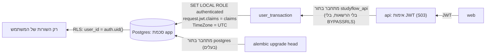

# S05 — סכמה ומודל זמן: תוכנית עבודה

> **For agentic workers:** REQUIRED SUB-SKILL: Use superpowers:subagent-driven-development (recommended) or superpowers:executing-plans to implement this plan task-by-task. Steps use checkbox (`- [ ]`) syntax for tracking.

**מטרה:** במסד של Supabase יש סכמת `app` עם ארבע טבלאות הליבה (`profiles`, `exams`, `tasks`, `blocks`), ועל כולן RLS. ה-API יודע לפתוח טרנזקציה בשם משתמש, שבה RLS חל באמת. יש עזרי `zoneinfo` למודל הזמן, ובדיקות למעבר שעון, לחצות ולאזור זמן אחר.

**גישה:** מיגרציות ב-Alembic, עם SQL מפורש. הבדיקות רצות מול Postgres 17 מקומי מ-Homebrew, וב-CI מול קונטיינר `postgres:17`. במסד הבדיקות יש shim קטן שמחקה את מה ש-Supabase נותנת: התפקידים, `auth.users` ו-`auth.uid()`. ה-API מתחבר עם תפקיד ייעודי, `studyflow_api`, שאין לו שום הרשאה משלו. כל בקשה עוברת בתוך הטרנזקציה לתפקיד `authenticated`, עם ה-claims של המשתמש. בסוף מריצים את המיגרציות על פרויקט ה-dev, ובודקים את התפקיד דרך ה-pooler.

**כלים:** Python 3.14 ו-uv. חדשים: `alembic` (עם SQLAlchemy, רק למיגרציות), `psycopg[binary]` 3 ו-`tzdata`. Postgres 17 מ-Homebrew (`postgresql@17`). מחוץ לקוד: הדשבורד של Supabase.

**מסמך תכנון:** `docs/superpowers/specs/2026-10-19-studyflow-v2-design.md`, סעיפים 7.1, 7.3, 7.4, 7.12, 10 ו-12. במפת הדרכים שב-[artifact](https://claude.ai/code/artifact/29a3c52e-d399-425e-90b6-7c05e9146bfa) זו משימה S05, והיא מוכנה כשהמיגרציות רצות ובדיקות הזמן ירוקות.

## איך החלקים מתחברים

עד עכשיו ה-API רק בדק JWT (S03). מ-S05 יש לו מסד. ‏Supabase נותנת שלושה דברים שנוגעים בשלב הזה:

- **Postgres** אמיתי, גרסה 17.11. הטבלאות שלנו יושבות בסכמה `app`, שה-REST האוטומטי של Supabase לא חושף (סעיף 7.4).
- **Auth** שומר את המשתמשים ב-`auth.users`, באותו מסד. כל טבלה שלנו מצביעה על `auth.users(id)` עם `ON DELETE CASCADE`. כך מחיקת משתמש מוחקת את כל הנתונים שלו.
- **RLS** (Row Level Security) הוא מסנן שורות בתוך Postgres. על כל טבלה כתוב כלל: "רואים ומשנים רק שורות שה-`user_id` שלהן שווה ל-`auth.uid()`". הפונקציה `auth.uid()` קוראת את ה-`sub` מתוך ההגדרה `request.jwt.claims` של הטרנזקציה. כך עובד גם ה-REST של Supabase: השרת שלה, PostgREST, מתחבר בתור `authenticator`, ובכל בקשה עובר ל-`authenticated` וכותב את ה-claims.

הבעיה מה-memory: מי שמחובר בתור `postgres` עוקף RLS, כי לתפקיד הזה יש `BYPASSRLS`. אם ה-API יתחבר בתור `postgres` וישכח לסנן לפי משתמש, הוא יחזיר נתונים של כולם. הפתרון הוא אותו מבנה ש-Supabase משתמשת בו:



- **`studyflow_api`** הוא תפקיד עם `LOGIN` ו-`NOINHERIT`. הוא חבר ב-`authenticated`, אבל לא יורש ממנו הרשאות. אם קוד יפנה למסד מחוץ ל-`user_transaction`, הוא יקבל `permission denied`, ולא נתונים של משתמשים אחרים.
- **`user_transaction`** פותחת טרנזקציה, עוברת ל-`authenticated` וכותבת את ה-claims המאומתים. בסוף הטרנזקציה התפקיד וההגדרות חוזרים לבד, כי `SET LOCAL` חל רק עד סוף הטרנזקציה. לכן זה עובד גם דרך ה-pooler של Supabase.
- **המיגרציות** רצות בתור `postgres`, הבעלים של הטבלאות. כך יהיה גם עם עבודות המערכת של ה-worker (S10).
- **בעלות בין טבלאות:** כל מפתח זר כולל גם את `user_id`. למשל, `tasks(exam_id, user_id)` מצביע על `exams(id, user_id)`. בלי זה, משתמש ב' שמכיר UUID של מבחן של משתמש א' יכול לקשר אליו משימה, כי בדיקת מפתח זר לא עוברת דרך RLS.
- **זמן:** כל רגע נשמר כ-`timestamptz`, ו-Postgres שומר אותו ב-UTC. ‏`date` ו-`time` הם ערכים מקומיים, בלי אזור זמן. החישובים של "יום מקומי" נעשים ב-Python עם `zoneinfo`, בעזרים של Task 1, ולא ב-SQL.

## מה מצאתי לפני התכנון (2026-10-30)

| נושא | מצב |
|---|---|
| Dependabot | שלושה PRs על `a77e184`: ‏uv (fastapi 0.162, ‏httpx2 2.16, ‏pydantic-settings, ‏ruff), ‏setup-uv 10.3.2 ו-5 חבילות web. ה-SHA של setup-uv תואם לתג v10.3.2. כל הבדיקות עברו (api: ‏81, ‏web: ‏133, ‏lint, ‏typecheck ו-build), ו-`main` עבר ל-`fa0edc0` ונדחף |
| Postgres ב-Supabase | 17.11. ‏`TimeZone` של השרת הוא UTC. סכמות: `auth`, ‏`storage`, ‏`public`, ‏`extensions`, ‏`vault`, ‏`realtime`, ‏`graphql`. אין `supabase_migrations`, כלומר אף פעם לא הורצו מיגרציות של ה-CLI |
| תפקידים ב-Supabase | ‏`postgres`: לא superuser, עם `BYPASSRLS` ו-`CREATEROLE`, וחבר ב-`authenticated`, ‏`anon` ו-`service_role` עם ADMIN. ‏`authenticated`: בלי login ובלי `BYPASSRLS`. ‏`authenticator`: עם login ו-`NOINHERIT`, וחבר ב-`authenticated` |
| `auth.uid()` ב-Supabase | `select coalesce(nullif(current_setting('request.jwt.claim.sub', true), ''), (nullif(current_setting('request.jwt.claims', true), '')::jsonb ->> 'sub'))::uuid`, ‏`LANGUAGE sql STABLE` |
| חיבור | חיבור ישיר (`db.<ref>.supabase.co`) הוא IPv6 בלבד במסלול החינמי. ה-session pooler: `aws-0-eu-west-1.pooler.supabase.com:5432`, והמשתמש `<role>.vxcotmpomtgdrmsvvjku`. יש דיווחים פתוחים על כשל אימות של תפקיד מותאם דרך ה-pooler המשותף, ולכן Task 6 בודק את זה |
| Postgres במק | אין Docker. ‏`postgresql@17` (17.11) הותקן מ-Homebrew ורץ כ-service על localhost:5432. ההרשאות ב-`pg_hba.conf` הן trust מ-localhost, ה-superuser הוא משתמש המק, ו-`TimeZone` של השרת הוא `Asia/Jerusalem`. ‏`psql` נמצא ב-`/opt/homebrew/opt/postgresql@17/bin` |
| שעון בישראל | מעבר לשעון חורף: 2026-10-25 ב-02:00, והשעות 01:00–01:59 קורות פעמיים. היום ארוך 25 שעות. מעבר לשעון קיץ: יום שישי 2027-03-26 ב-02:00, והשעות 02:00–02:59 לא קיימות. היום קצר, 23 שעות |
| `zoneinfo` במק | `ZoneInfo("asia/jerusalem")` נטען במק, כי מערכת הקבצים לא מבחינה בין אותיות גדולות לקטנות. ב-Linux, כלומר ב-CI ובשרת, אותו שם נכשל. ב-`available_timezones()` יש 598 שמות, והוא מבחין בין אותיות גדולות לקטנות |
| ברירות מחדל ישנות | ב-`legacy/`: קימה 08:00, שינה 23:00, ‏4 שעות לימוד ביום (טווח 0.5–16), חלונות בוקר וצהריים, יום מנוחה אחד (טווח 0–14) |

## ההחלטות שלי

| נושא | החלטה | למה | על מה ויתרנו |
|---|---|---|---|
| Postgres לבדיקות | `postgresql@17` מ-Homebrew, כ-service. הבדיקות יוצרות מחדש מסד `studyflow_test` בכל ריצה. ב-CI: ‏service container של `postgres:17` עם `trust` | אותה גרסה ראשית כמו ב-Supabase, בלי Docker במק. מסד חדש בכל ריצה, אז אין מצב שנשאר מהריצה הקודמת | `supabase start`, שצריך Docker. ‏pytest-postgresql, שמרים cluster זמני: עוד ספרייה, ושתי דרכים שונות למק ול-CI |
| התיקייה `supabase/` | לא יוצרים אותה. סעיף 7.1 ו-7.12 מתעדכנים | היא נועדה להגדרות של ה-CLI לסביבה מקומית, שצריכה Docker. ה-API בפיתוח עובד מול פרויקט ה-dev, כי גם ה-Auth שם | `supabase db diff` ו-`supabase start`. אם יהיה Docker, אפשר להוסיף אותה |
| מיגרציות (סעיף 12) | Alembic, עם SQL מפורש ב-`op.execute` ובלי autogenerate. ‏`upgrade` ו-`downgrade` לכל מיגרציה. טבלת הגרסה היא `app.alembic_version` | Python, כמו כל ה-api. רץ מתוך pytest על כל Postgres, ומול Supabase דרך ה-pooler. ‏SQL מפורש נותן את כל מה ש-Postgres יודע: policies, ‏grants, ‏`ON DELETE SET NULL (column)` | מיגרציות של ה-CLI של Supabase: הן רק קדימה, צריך להתקין את ה-CLI, ומ-pytest צריך להריץ אותן כתהליך חיצוני. autogenerate מתוך מודלים |
| גישה למסד | psycopg 3, עם SQL מפורש. בלי ORM | הסכמה כתובה ב-SQL במקום אחד. ORM היה מחייב לכתוב אותה פעם נוספת ב-Python, בלי בדיקה שהשתיים זהות | SQLAlchemy ORM ו-SQLModel. ‏SQLAlchemy מותקן, אבל רק בשביל Alembic |
| מנגנון RLS | ה-API מתחבר כ-`studyflow_api` (‏`LOGIN NOINHERIT`, חבר ב-`authenticated`). ‏`user_transaction` עושה `SET LOCAL ROLE authenticated` וכותבת את ה-claims המאומתים ל-`request.jwt.claims` | RLS חל באמת, כשכבה שנייה מתחת לסינון של ה-API (סעיף 10). קוד ששוכח את הטרנזקציה נכשל, ולא מדליף. זה המבנה של `authenticator` ב-Supabase | חיבור כ-`postgres` עם אותו `SET LOCAL ROLE`. זה עובד, אבל שכחה מחזירה את הנתונים של כולם. זו החלופה אם ה-pooler ידחה את `studyflow_api` (Task 6) |
| אילו טבלאות עכשיו | `profiles`, ‏`exams`, ‏`tasks` ו-`blocks`. בלי `exams.status`, ‏`tasks.topic_id`, ‏`tasks.material_id`, ‏`blocks.plan_version_id` ו-`blocks.notified_at` | אלה הטבלאות שהמתכנן וה-API של הליבה (S06–S09) קוראים וכותבים. את הערכים של העמודות שנשארו בחוץ מגדירים ה-scopes שמשתמשים בהן | כל 12 הטבלאות מסעיף 7.4, עם ניחוש של הסטטוסים, המכסות והמשקלים. כל scope מוסיף מיגרציה משלו: ‏S08 ‏`plan_versions`, ‏S10 ‏`materials` ו-`jobs`, ‏S11 ‏`topics`, ‏S12 ‏`ai_usage`, ‏S16 ‏`push_subscriptions`, ‏S19 ‏`xp_events` ו-`badges` |
| ערכים סגורים | `text` עם `CHECK`, ולא `ENUM` של Postgres | קל להוסיף ערך במיגרציה, וגם להוריד | הטיפוס הייעודי |
| אזור זמן לא תקין | `parse_timezone` מקבלת רק שם שמופיע בדיוק ב-`available_timezones()`. במסד: רק אורך | כך "asia/jerusalem" נדחה גם במק, ולא רק בשרת | בדיקה ב-SQL מול `pg_timezone_names`, שדורשת פונקציה |
| שעה שלא קיימת או שחוזרת | שעה בפער של המעבר לשעון קיץ זזה קדימה באורך הפער (02:30 הופכת ל-03:30). שעה שחוזרת פעמיים מתפרשת כמופע הראשון | זה מה ש-`zoneinfo` עושה עם `fold=0`, וזה מה שאדם מצפה לו: "02:30" ביום המעבר הוא חצי שעה אחרי 02:00 | שגיאה. אבל שעת קימה או חלון לימוד לא יכולים להיכשל פעם בשנה |
| `tzdata` | תלות של ה-api | `zoneinfo` משתמש בנתונים של מערכת ההפעלה, ובקונטיינר רזה הם לא תמיד קיימים. החבילה היא גיבוי, מבית Python | ספריית תאריכים כמו pendulum או arrow. ‏`zoneinfo` מספיק |

## מה לא נכלל ולמה

- **חיבור המסד ל-endpoints:** ‏pool של חיבורים, dependency של FastAPI עם commit לפני שהתשובה נשלחת, יצירת `profiles` בכניסה הראשונה, ועדכון `timezone` מהדפדפן (סעיף 7.3). כל אלה עוברים ל-S09, עם `GET`/`PATCH /me`. ב-S05 אין endpoint חדש, וההגדרות של ה-API (`Settings`) לא משתנות.
- **מניעת חפיפה בין בלוקים במסד** (exclusion constraint עם `btree_gist`): ההחלטה ב-S08, יחד עם התכנון מחדש.
- **מדיניות של Storage** על `storage.objects`: ב-S10.
- **הרצת מיגרציות ב-staging וב-production:** ב-S21.

## אילוצים גלובליים

- Python 3.14, ‏uv, ו-`exclude-newer = "7 days"`. תלויות חדשות רק `alembic`, ‏`psycopg[binary]` ו-`tzdata`. אם subagent צריך עוד תלות, הוא כותב בדוח למה.
- `ruff check`, ‏`ruff format --check`, ‏`mypy` (strict, על `app`, ‏`tests` ו-`migrations`) ו-`pytest` עם `filterwarnings = ["error"]`, כמו בטבלה שב-`CLAUDE.md`.
- Postgres 17 בכל מקום: ‏17.11 ב-Supabase, ‏`postgresql@17` במק, ו-`postgres:17` ב-CI.
- כל טבלאות האפליקציה בסכמה `app`. על כל טבלה יש RLS ו-policy אחת `TO authenticated`, עם `(select auth.uid())` (בסוגריים, כדי ש-Postgres יחשב אותה פעם אחת לשאילתה). הרשאות ניתנות רק ל-`authenticated`, ולא ל-`anon`, ל-`PUBLIC` או ל-`studyflow_api`.
- כל מפתח זר בין טבלאות `app` כולל את `user_id`.
- כל רגע נשמר כ-`timestamptz`. ‏`datetime` בלי אזור זמן לא נכנס לעזרים ולא למסד. טרנזקציה של משתמש רצה עם `TimeZone = UTC`.
- הבדיקות פונות רק ל-`TEST_DATABASE_URL`, שברירת המחדל שלו היא `postgresql://localhost:5432/postgres`, ומסרבות לכתובת שאינה מקומית. הן לא קוראות את `api/.env`. ‏Alembic מה-CLI קורא את `MIGRATION_DATABASE_URL` מ-`api/.env`.
- לא נוגעים ב-`legacy/`.
- הקוד, ההערות בקוד והודעות הקומיט באנגלית. התוכנית וההודעות אליך בעברית.
- git רץ בשיחה הראשית, וה-subagents לא מריצים git. מוסיפים קבצים לפי שם, ובודקים `git status --short --untracked-files=all` לפני כל קומיט. לפני כל push מריצים `gitleaks git --redact --no-banner .`. אין force-push.
- **הריפו ב-`/Users/eyalatar/studyflow`.** תיקיית העבודה של הסשן, `~/Desktop/MyProject/studyflow`, היא העתק ישן. כל subagent עובד רק בנתיבים מלאים תחת `~/studyflow`.

## על מה לשים לב בבדיקה

1. **הבדיקות רצות בטעות על מסד אמיתי:** מישהו מגדיר `TEST_DATABASE_URL` לכתובת של Supabase, והבדיקות מוחקות את `auth.users`. מה שצריך לקרות: הבדיקות נעצרות לפני שהן מתחברות, עם הסבר. Task 2 בודק כתובות של Supabase ועוד כתובות לא מקומיות.
2. **שם אזור זמן באותיות אחרות:** ‏"asia/jerusalem" עובד במק ונכשל בשרת. מה שצריך לקרות: נדחה בכל מקום. Task 1 בודק.
3. **חיבור עם טרנזקציה פתוחה מגיע ל-`user_transaction`:** ‏`SET LOCAL` היה חל על הטרנזקציה החיצונית, והתפקיד היה נשאר אחרי הבלוק. מה שצריך לקרות: `user_transaction` מסרבת. Task 4 בודק.
4. **חריגה באמצע טרנזקציה של משתמש:** מה שצריך לקרות: rollback, החיבור חוזר ל-`studyflow_api` בלי claims, ואפשר להמשיך להשתמש בו. Task 4 בודק.
5. **טבלה חדשה בלי RLS בעתיד:** מיגרציה של scope מאוחר מוסיפה טבלה ושוכחת RLS, או נותנת הרשאה ל-`anon`. מה שצריך לקרות: בדיקה נכשלת. Task 3 בודק את זה על כל הטבלאות בסכמה `app`, ולא על רשימה קבועה.

## מה אתה צריך לעשות (אפשר עכשיו, במקביל ל-Tasks 1–4)

שני סודות, שאתה מכניס בעצמך. אני לא רואה אותם.

1. **הסיסמה של `postgres`.** אם היא לא אצלך: בדשבורד של Supabase, Project Settings ← Database ← Reset database password. עדיף סיסמה של אותיות ומספרים בלבד. תו אחר צריך קידוד בכתובת (`%40` במקום `@`, למשל).
2. **ב-`~/studyflow/api/.env`** מוסיפים שורה:
   ```
   MIGRATION_DATABASE_URL=postgresql://postgres.vxcotmpomtgdrmsvvjku:<הסיסמה>@aws-0-eu-west-1.pooler.supabase.com:5432/postgres
   ```
3. **התפקיד של ה-API.** בטרמינל:
   ```bash
   cd ~/studyflow/api
   /opt/homebrew/opt/postgresql@17/bin/psql "$(grep '^MIGRATION_DATABASE_URL=' .env | cut -d= -f2-)"
   ```
   ובתוך psql:
   ```
   create role studyflow_api with login noinherit;
   \password studyflow_api
   \q
   ```
   ‏`\password` מבקש סיסמה חדשה פעמיים, ושולח לשרת רק hash שלה. כך הסיסמה לא נשמרת בהיסטוריית השאילתות. סיסמה טובה מקבלים בטרמינל אחר עם `openssl rand -hex 24`. אם `create role` אומר שהתפקיד כבר קיים, מריצים רק את `\password`.
4. **ב-`api/.env`** מוסיפים שורה נוספת:
   ```
   DATABASE_URL=postgresql://studyflow_api.vxcotmpomtgdrmsvvjku:<הסיסמה מסעיף 3>@aws-0-eu-west-1.pooler.supabase.com:5432/postgres
   ```

## מי עושה מה

| Task | מה | מי | תלוי ב- |
|---|---|---|---|
| 0 | פתיחה: ‏Dependabot, הסטטוס, Postgres מקומי, הענף והתוכנית | אני (נעשה, חוץ מהקומיט) | — |
| 1 | עזרי הזמן | subagent | 0 |
| 2 | תשתית המסד: Alembic, התפקיד של ה-API, בדיקות מול Postgres ו-CI | subagent | 0 |
| 3 | הטבלאות עם RLS | subagent | 2 |
| 4 | `user_transaction`, ‏RLS בין משתמשים ושמירת זמנים | subagent | 3 |
| 5 | `CLAUDE.md`, ‏README, מסמך התכנון והלשונית שלו | אני | 1–4 |
| 6 | המיגרציות בפרויקט ה-dev, ובדיקת התפקיד דרך ה-pooler | הסודות אצלך, ההרצה אצלי | 4, והסעיפים שלך |
| 7 | סקירה סופית, מיזוג וסגירה | אני | 5, 6 |

## מבנה הקבצים

```
api/pyproject.toml                       + alembic, psycopg[binary], tzdata; mypy גם על migrations
api/.env.example                         + MIGRATION_DATABASE_URL, DATABASE_URL
api/alembic.ini
api/migrations/env.py                    כתובת, יצירת הסכמה app, טבלת הגרסה app.alembic_version
api/migrations/script.py.mako
api/migrations/versions/0001_app_schema.py      studyflow_api והרשאות על הסכמה
api/migrations/versions/0002_core_tables.py     profiles, exams, tasks, blocks, ‏RLS והרשאות
api/app/domain/__init__.py
api/app/domain/time.py                   עזרי הזמן
api/app/db/__init__.py
api/app/db/session.py                    user_transaction
api/tests/test_time.py
api/tests/db/__init__.py
api/tests/db/support.py                  require_local_database_url, alembic_config, create/drop database
api/tests/db/supabase_shim.sql           התפקידים, auth.users ו-auth.uid() כמו ב-Supabase
api/tests/db/conftest.py                 migrated_database_url, db, api_db, make_user
api/tests/db/test_migrations.py          תשתית, תפקידים, הלוך וחזור
api/tests/db/test_schema.py              RLS על כל טבלה, constraints, מחיקות
api/tests/db/test_rls.py                 משתמש ב' מול משתמש א'
api/tests/db/test_time_storage.py        timestamptz ו-date מול אזורי זמן
.github/workflows/api.yml                + service של postgres:17
CLAUDE.md, README.md, מסמך התכנון (7.1, 7.3, 7.4, 7.12, 9, 12)
```

---

### Task 0: פתיחה

נעשה לפני כתיבת התוכנית: שלושת ה-PRs של Dependabot נכנסו ל-`main` (`fa0edc0`), הסטטוס של S05 ב-artifact הוא "בעבודה", `postgresql@17` מותקן ורץ, והענף `s05-schema-time` נפתח מ-`main`.

- [ ] **Step 1: קומיט של התוכנית**
  ```bash
  git status --short --untracked-files=all
  git add docs/superpowers/plans/2026-10-30-s05-schema-time.md
  git commit -m "docs(plan): add the S05 schema and time model plan"
  ```
  Expected: רק קובץ התוכנית ב-status, וקומיט אחד על הענף.

---

### Task 1: עזרי הזמן

**למה:** כל חישוב של יום מקומי, חלון לימוד או "היום" עובר דרך העזרים האלה, מ-S06 והלאה. כאן נקבעים הכללים למעבר שעון ולשעה שלא קיימת, פעם אחת.

**Files:**
- Modify: `api/pyproject.toml` (‏`tzdata` ב-dependencies), ‏`api/uv.lock`
- Create: `api/app/domain/__init__.py` (ריק), ‏`api/app/domain/time.py`, ‏`api/tests/test_time.py`

**Interfaces:**
- Consumes: —
- Produces, ב-`app.domain.time`. כל `datetime` שחוזר הוא aware, עם `tzinfo=datetime.UTC`:
  - `DEFAULT_TIMEZONE: Final = "Asia/Jerusalem"`
  - `class InvalidTimezoneError(ValueError)`
  - `parse_timezone(name: str) -> ZoneInfo`: רק שם שנמצא בדיוק ב-`zoneinfo.available_timezones()`, עם cache לרשימה. אחרת `InvalidTimezoneError`.
  - `ensure_utc(instant: datetime) -> datetime`: ‏`ValueError` על datetime בלי אזור זמן. אחרת אותו רגע ב-UTC.
  - `local_date(instant: datetime, tz: ZoneInfo) -> date`
  - `local_day_bounds(day: date, tz: ZoneInfo) -> tuple[datetime, datetime]`: ‏`[start, end)` של היום המקומי. ‏`end` הוא ה-`start` של היום הבא.
  - `at_local_time(day: date, wall: time, tz: ZoneInfo) -> datetime`: ‏`wall` חייב להיות בלי `tzinfo` (אחרת `ValueError`), ו-`fold` שלו לא משנה. שעה בפער זזה קדימה באורך הפער, ושעה שחוזרת היא המופע הראשון (`fold=0`).
  - `local_span(day: date, start: time, end: time, tz: ZoneInfo) -> tuple[datetime, datetime]`: ‏`start` ביום `day`. ‏`end` באותו יום אם `end > start`, ואחרת ביום שאחריו. ‏`start == end` הוא `ValueError`.

- [ ] **Step 1: הוספת `tzdata`**
  Run (מתוך `api/`): `uv add tzdata`
  Expected: ‏`tzdata` ב-`[project.dependencies]` וב-`uv.lock`.

- [ ] **Step 2: הבדיקות, ב-`tests/test_time.py`**

  `JLM = ZoneInfo("Asia/Jerusalem")`, ‏`NY = ZoneInfo("America/New_York")`, ‏`UTC = datetime.UTC`. כל הערכים כאן אומתו מול `zoneinfo`.

  | בדיקה | קלט | מצופה |
  |---|---|---|
  | `test_parse_timezone_accepts_iana_names` | ‏`"Asia/Jerusalem"`, ‏`"America/New_York"`, ‏`"UTC"` | ‏`ZoneInfo` עם אותו `key` |
  | `test_parse_timezone_rejects_invalid_names` (parametrize) | ‏`""`, ‏`"asia/jerusalem"`, ‏`"Asia/Jerusalem "`, ‏`"Mars/Olympus"`, ‏`"../etc/passwd"`, ‏`"+03:00"` | ‏`InvalidTimezoneError` |
  | `test_ensure_utc_rejects_naive` | ‏`datetime(2026, 10, 25, 1, 30)` | ‏`ValueError` |
  | `test_ensure_utc_keeps_the_instant` | ‏`datetime(2026, 10, 25, 1, 30, tzinfo=JLM)` | ‏`datetime(2026, 10, 24, 22, 30, tzinfo=UTC)` |
  | `test_regular_day_is_24_hours` | ‏`local_day_bounds(date(2026, 10, 26), JLM)` | ‏`(2026-10-25 22:00Z, 2026-10-26 22:00Z)` |
  | `test_fall_back_day_is_25_hours` | ‏`local_day_bounds(date(2026, 10, 25), JLM)` | ‏`(2026-10-24 21:00Z, 2026-10-25 22:00Z)` |
  | `test_spring_forward_day_is_23_hours` | ‏`local_day_bounds(date(2027, 3, 26), JLM)` | ‏`(2027-03-25 22:00Z, 2027-03-26 21:00Z)` |
  | `test_day_whose_midnight_does_not_exist` | ‏`local_day_bounds(date(2026, 9, 6), ZoneInfo("America/Santiago"))` | ‏`(2026-09-06 04:00Z, 2026-09-07 03:00Z)` |
  | `test_wall_time_in_the_spring_gap_moves_forward` | ‏`at_local_time(date(2027, 3, 26), time(2, 30), JLM)` | ‏`2027-03-26 00:30Z`, שהוא 03:30 בישראל |
  | `test_repeated_wall_time_is_the_first_occurrence` | ‏`at_local_time(date(2026, 10, 25), time(1, 30), JLM)`, וגם עם `time(1, 30, fold=1)` | ‏`2026-10-24 22:30Z` בשני המקרים |
  | `test_at_local_time_rejects_an_aware_wall_time` | ‏`time(8, 0, tzinfo=UTC)` | ‏`ValueError` |
  | `test_span_crossing_midnight` | ‏`local_span(date(2026, 11, 2), time(22), time(1), JLM)` | ‏`(2026-11-02 20:00Z, 2026-11-02 23:00Z)` |
  | `test_span_across_the_fall_back_night_is_5_hours` | ‏`local_span(date(2026, 10, 24), time(23), time(3), JLM)` | ‏`(2026-10-24 20:00Z, 2026-10-25 01:00Z)` |
  | `test_span_across_the_spring_forward_night_is_4_hours` | ‏`local_span(date(2027, 3, 25), time(23), time(4), JLM)` | ‏`(2027-03-25 21:00Z, 2027-03-26 01:00Z)` |
  | `test_span_rejects_equal_start_and_end` | ‏`local_span(..., time(8), time(8), JLM)` | ‏`ValueError` |
  | `test_local_date_depends_on_the_timezone` | ‏`datetime(2026, 10, 30, 22, 30, tzinfo=UTC)` | ‏JLM: ‏`date(2026, 10, 31)`. ‏NY: ‏`date(2026, 10, 30)` |
  | `test_traveling_user_gets_days_of_the_new_timezone` | אותו רגע. ‏`local_day_bounds(date(2026, 11, 1), NY)` | ‏`local_date` ב-NY הוא 2026-10-30. היום של 2026-11-01 ב-NY הוא `(2026-11-01 04:00Z, 2026-11-02 05:00Z)`, ‏25 שעות |
  | `test_helpers_reject_naive_instants` | ‏`local_date(datetime(2026, 10, 30, 12), JLM)` | ‏`ValueError` |
  | `test_days_tile_the_timeline` | כל יום ב-2026 וב-2027, ב-JLM, ב-NY וב-`America/Santiago` | ‏`start < end`. ‏`end` של יום הוא `start` של היום הבא. ‏`local_date(start) == day` ו-`local_date(end - timedelta(microseconds=1)) == day`. האורך הוא 23, 24 או 25 שעות. ב-JLM יש בכל שנה בדיוק יום אחד של 23 שעות ויום אחד של 25 |

- [ ] **Step 3: הבדיקות נכשלות**
  Run: `uv run pytest tests/test_time.py -q`
  Expected: ‏`ModuleNotFoundError: No module named 'app.domain'`.

- [ ] **Step 4: מימוש `app/domain/time.py`**
  לפי ה-Interfaces. ‏`at_local_time` בונה `datetime.combine(day, wall.replace(fold=0), tz)` וממירה ל-UTC. ‏`zoneinfo` עם `fold=0` נותן את שני הכללים. ‏`local_day_bounds` היא `at_local_time` של 00:00 ביום ובמחרת.

- [ ] **Step 5: הכל ירוק**
  Run: `uv run pytest -q && uv run ruff check . && uv run ruff format --check . && uv run mypy`
  Expected: כל הבדיקות עוברות (81 קודמות והחדשות), ו-ruff ו-mypy נקיים.

- [ ] **Step 6: קומיט (בשיחה הראשית)**
  `git add api/pyproject.toml api/uv.lock api/app/domain/__init__.py api/app/domain/time.py api/tests/test_time.py`
  `git commit -m "feat(api): add zoneinfo time helpers with DST and midnight rules"`

---

### Task 2: תשתית המסד

**למה:** כל בדיקה של מסד מ-S05 והלאה צריכה Postgres נקי עם מה ש-Supabase נותנת, וצריכה דרך להריץ עליו מיגרציות. כאן נוצרים גם התפקיד של ה-API וההרשאות על הסכמה. הטבלאות מגיעות ב-Task 3.

**Files:**
- Modify: `api/pyproject.toml` (‏`alembic` ו-`psycopg[binary]` ב-dependencies; `files = ["app", "tests", "migrations"]` ב-mypy), ‏`api/uv.lock`, ‏`api/.env.example`, ‏`.github/workflows/api.yml`
- Create: `api/alembic.ini`, ‏`api/migrations/env.py`, ‏`api/migrations/script.py.mako`, ‏`api/migrations/versions/0001_app_schema.py`, ‏`api/tests/db/__init__.py`, ‏`api/tests/db/support.py`, ‏`api/tests/db/supabase_shim.sql`, ‏`api/tests/db/conftest.py`, ‏`api/tests/db/test_migrations.py`

**Interfaces:**
- Consumes: `app.auth.CurrentUser(id: UUID, email: str | None, claims: Mapping[str, Any])`
- Produces:
  - `tests/db/support.py`:
    - `DEFAULT_TEST_DATABASE_URL = "postgresql://localhost:5432/postgres"`
    - `require_local_database_url(url: str) -> str`: מחזירה את `url` אם ה-host הוא `localhost`, ‏`127.0.0.1`, ‏`::1` או נתיב socket (מתחיל ב-`/`), ואחרת `ValueError` עם הסבר.
    - `alembic_config(database_url: str) -> alembic.config.Config`: הקובץ `api/alembic.ini`, ו-`config.attributes["database_url"] = database_url`.
    - `create_database(admin_url: str, name: str) -> str`: ‏`DROP DATABASE IF EXISTS … WITH (FORCE)`, ‏`CREATE DATABASE`, ואז `supabase_shim.sql` בתוכו. מחזירה את הכתובת של המסד החדש (`psycopg.conninfo.make_conninfo(admin_url, dbname=name)`). שמות דרך `psycopg.sql.Identifier`.
    - `drop_database(admin_url: str, name: str) -> None`
  - `tests/db/conftest.py` (fixtures):
    - `migrated_database_url` (session): ‏`TEST_DATABASE_URL` מהסביבה או ברירת המחדל, דרך `require_local_database_url`. ‏`create_database(..., "studyflow_test")` ו-`alembic.command.upgrade(alembic_config(url), "head")`. בסוף: `drop_database`.
    - `db` (function): ‏`psycopg.Connection` עם `autocommit=True`, כ-superuser המקומי, אחרי `TRUNCATE auth.users CASCADE`.
    - `api_db` (function): ‏`psycopg.Connection` עם `autocommit=True` כ-`studyflow_api` (`make_conninfo(url, user="studyflow_api")`).
    - `make_user` (function): ‏`Callable[[], CurrentUser]`. מוסיף שורה ל-`auth.users` עם UUID ואימייל חדשים, ומחזיר `CurrentUser` עם `claims={"sub": str(id), "role": "authenticated", "aud": "authenticated", "email": email}`.
  - ‏`migrations/env.py`: הכתובת מ-`config.attributes["database_url"]`, ואם אין, מ-`MIGRATION_DATABASE_URL` (משתנה סביבה או `api/.env`, דרך `pydantic-settings`). הכתובת היא בפורמט `postgresql://`, ו-env.py מחליף את ה-driver ל-`postgresql+psycopg`. לפני המיגרציות: `CREATE SCHEMA IF NOT EXISTS app`. ‏`version_table_schema="app"`. רק מצב online. מה-CLI מודפסות שורות ה-`Running upgrade`. מתוך pytest אסור לשנות את הגדרות ה-logging, כי בדיקות קיימות משתמשות ב-`caplog`.
  - מזהי מיגרציות: `"0001"`, ‏`"0002"`. ‏`0001.down_revision = None`.

- [ ] **Step 1: התלויות**
  Run: `uv add alembic "psycopg[binary]"`, ועדכון `files` של mypy.
  Expected: שתיהן ב-`[project.dependencies]`, ו-`uv sync` עובר.

- [ ] **Step 2: ה-shim, ב-`tests/db/supabase_shim.sql`**
  אידמפוטנטי, כי תפקידים משותפים לכל ה-cluster ונשארים בין ריצות:
  - `anon`, ‏`authenticated` ו-`service_role` ב-`NOLOGIN`. ל-`service_role` יש `BYPASSRLS`. כל אחד נוצר רק אם הוא לא קיים (`DO` block מול `pg_roles`).
  - `CREATE SCHEMA IF NOT EXISTS auth`. ‏`auth.users (id uuid primary key, email text)`.
  - `auth.uid()` בדיוק כמו ב-Supabase: ההגדרה בטבלה "מה מצאתי".
  - `GRANT USAGE ON SCHEMA auth TO anon, authenticated, service_role`.
  הערה בראש הקובץ: הקובץ רץ רק במסדי בדיקה, ומחקה את מה שקיים ב-Supabase.

- [ ] **Step 3: הבדיקות, ב-`tests/db/test_migrations.py`**
  - `test_require_local_database_url` (parametrize, בלי מסד): מקבלת `postgresql://localhost:5432/postgres`, ‏`postgresql://127.0.0.1/x`, ‏`postgresql://[::1]/x` ו-`postgresql:///x?host=/tmp`. דוחה (`ValueError`) את `postgresql://postgres.vxcotmpomtgdrmsvvjku:pw@aws-0-eu-west-1.pooler.supabase.com:5432/postgres`, ‏`postgresql://db.vxcotmpomtgdrmsvvjku.supabase.co/postgres` ו-`postgresql://10.0.0.5/postgres`.
  - `test_auth_uid_reads_sub_from_jwt_claims`: בטרנזקציה על `db`, ‏`select set_config('request.jwt.claims', '{"sub": "<uuid>"}', true)`, ואז `auth.uid()` מחזיר את ה-UUID. בלי claims הוא מחזיר `None`.
  - `test_version_table_lives_in_app`: ‏`app.alembic_version` קיימת, ובה `0001` (ואחרי Task 3 ‏`0002`: הבדיקה משווה ל-head של `ScriptDirectory`, ולא למספר קבוע).
  - `test_api_role_can_only_become_authenticated`: ב-`pg_roles`, ל-`studyflow_api` יש `rolcanlogin`, אין `rolinherit`, אין `rolbypassrls` ואין `rolsuper`. ‏`pg_has_role('studyflow_api', 'authenticated', …)`: ‏`'MEMBER'` ו-`'SET'` אמת, ‏`'USAGE'` (כלומר ירושה של הרשאות) שקר. ‏`has_schema_privilege('studyflow_api', 'app', 'USAGE')` שקר.
  - `test_only_authenticated_may_use_the_app_schema`: ‏`has_schema_privilege` על `app` עם `USAGE`: ‏`authenticated` אמת, ‏`anon` ו-`service_role` שקר. ל-`PUBLIC` אין `USAGE` ב-`nspacl`.
  - `test_migrations_round_trip`: במסד נפרד, `studyflow_migrations_test` (`create_database`, ובסוף `drop_database`): ‏`upgrade head`, ‏`downgrade base`, ושוב `upgrade head`. אחרי ה-downgrade, בסכמה `app` נשארת רק `alembic_version`, ל-`authenticated` אין `USAGE` על `app`, ו-`studyflow_api` כבר לא חבר ב-`authenticated`. אחרי ה-upgrade השני, הגרסה היא ה-head. זו "בדיקת המיגרציות" מסעיף 7.12, והיא תופסת כל מיגרציה עתידית.

- [ ] **Step 4: הבדיקות נכשלות**
  Run: `uv run pytest tests/db -q`
  Expected: כשלון, כי `support.py` והמיגרציות עוד לא קיימים.

- [ ] **Step 5: `alembic.ini`, ‏`env.py` ו-`script.py.mako`**
  ‏`script_location = %(here)s/migrations`, כדי שהפקודה תעבוד מכל תיקייה. ‏`sqlalchemy.url` לא נכתב בקובץ. התבנית של מיגרציה חדשה כוללת `upgrade()` ו-`downgrade()` עם `op.execute`, ו-docstring שאומר: SQL מפורש, בלי autogenerate.

- [ ] **Step 6: מיגרציה 0001, ב-`versions/0001_app_schema.py`**
  upgrade:
  - `studyflow_api`: נוצר `LOGIN NOINHERIT`, בלי סיסמה, רק אם הוא לא קיים (`DO` block). אחר כך `ALTER ROLE studyflow_api NOINHERIT`, למקרה שנוצר ידנית בלי זה, ו-`GRANT authenticated TO studyflow_api WITH INHERIT FALSE, SET TRUE`. מ-Postgres 16, המאפיין של התפקיד קובע רק ברירת מחדל להענקות חדשות, ולכן האפשרויות כתובות בהענקה עצמה.
  - `REVOKE ALL ON SCHEMA app FROM PUBLIC` ו-`GRANT USAGE ON SCHEMA app TO authenticated`.

  downgrade: ‏`REVOKE USAGE ON SCHEMA app FROM authenticated` ו-`REVOKE authenticated FROM studyflow_api`. התפקיד עצמו והסכמה `app` נשארים, עם הערה: התפקיד משותף לכל ה-cluster, ובסכמה יושבת `alembic_version`.

- [ ] **Step 7: `support.py`, ‏`conftest.py` ו-`.env.example`**
  לפי ה-Interfaces. ב-`.env.example` מוסיפים, עם הערות באנגלית:
  ```
  # Owner connection for migrations (uv run alembic upgrade head), through the Supabase session pooler:
  # postgresql://postgres.<project-ref>:<password>@<pooler-host>:5432/postgres
  MIGRATION_DATABASE_URL=
  # The API's own role, studyflow_api: no privileges of its own and no BYPASSRLS. Used by the API from S09.
  # postgresql://studyflow_api.<project-ref>:<password>@<pooler-host>:5432/postgres
  DATABASE_URL=
  ```

- [ ] **Step 8: CI, ב-`.github/workflows/api.yml`**
  ל-job ‏`checks` מוסיפים `services.postgres`: ‏`image: postgres:17`, ‏`env: POSTGRES_HOST_AUTH_METHOD: trust`, ‏`ports: ["5432:5432"]`, ו-health check עם `pg_isready` (`--health-interval 2s --health-timeout 5s --health-retries 15`). ל-job מוסיפים `env: TEST_DATABASE_URL: postgresql://postgres@localhost:5432/postgres`.

- [ ] **Step 9: הכל ירוק**
  Run: `uv run pytest -q && uv run ruff check . && uv run ruff format --check . && uv run mypy`
  Expected: כל הבדיקות עוברות, כולל `tests/db`. ‏ruff ו-mypy נקיים.

- [ ] **Step 10: קומיט (בשיחה הראשית)**
  כל הקבצים מרשימת ה-Files לפי שם, ואז:
  `git commit -m "feat(api): add Alembic migrations, the studyflow_api role and a Postgres test harness"`

---

### Task 3: הטבלאות עם RLS

**למה:** אלה הטבלאות שהמתכנן וה-API של הליבה עובדים איתן. ה-RLS, ההרשאות ומפתחות הבעלות נכנסים יחד עם הטבלאות, באותה מיגרציה, כדי שלא יהיה רגע שבו טבלה קיימת בלי הגנה.

**Files:**
- Create: `api/migrations/versions/0002_core_tables.py`, ‏`api/tests/db/test_schema.py`

**Interfaces:**
- Consumes: ה-fixtures ‏`db` ו-`make_user` מ-Task 2. מיגרציה `0001`.
- Produces: הטבלאות למטה. מ-`0002`, ‏`down_revision = "0001"`.

**הסכמה.** לכל טבלה עם `id` יש `id uuid primary key default gen_random_uuid()`. כל `user_id` הוא `uuid not null references auth.users(id) on delete cascade`. ‏`created_at timestamptz not null default now()` בכל הטבלאות.

| טבלה | עמודות (מעבר למשותפות) | constraints ואינדקסים |
|---|---|---|
| `app.profiles` | `id uuid primary key references auth.users(id) on delete cascade` (בלי `user_id`), ‏`display_name text`, ‏`timezone text not null default 'Asia/Jerusalem'`, ‏`wake_time time not null default '08:00'`, ‏`sleep_time time not null default '23:00'`, ‏`daily_study_minutes smallint not null default 240`, ‏`study_windows text[] not null default '{morning,afternoon}'`, ‏`rest_days_before_exam smallint not null default 1`, ‏`notify_lead_minutes smallint not null default 10`, ‏`onboarding_completed_at timestamptz` | `display_name`: אורך 1–100. ‏`timezone`: אורך 1–64 (השם עצמו נבדק ב-`parse_timezone`). ‏`wake_time <> sleep_time`. ‏`daily_study_minutes` בין 30 ל-960. ‏`study_windows`: בין 1 ל-4 ערכים, כולם מתוך `{morning,afternoon,evening,night}`. ‏`rest_days_before_exam` בין 0 ל-14. ‏`notify_lead_minutes` בין 0 ל-120 |
| `app.exams` | `user_id`, ‏`name text not null`, ‏`exam_date date not null`, ‏`difficulty smallint not null default 3`, ‏`deleted_at timestamptz` | `name`: לא ריק אחרי `btrim`, ועד 200 תווים. ‏`difficulty` בין 1 ל-5. ‏`unique (id, user_id)`. אינדקס `(user_id, exam_date)` |
| `app.tasks` | `user_id`, ‏`exam_id uuid not null`, ‏`title text not null`, ‏`kind text not null`, ‏`estimated_minutes smallint not null`, ‏`focus smallint not null default 5`, ‏`depends_on_task_id uuid`, ‏`status text not null default 'todo'`, ‏`source text not null`, ‏`deleted_at timestamptz` | `title`: כמו `name`. ‏`kind` מתוך `learn, practice, review, simulation, simulation_review, custom`. ‏`estimated_minutes` בין 5 ל-600. ‏`focus` בין 1 ל-10. ‏`status` מתוך `todo, done, skipped`. ‏`source` מתוך `ai, user`. ‏`depends_on_task_id <> id`. ‏`unique (id, user_id)`. ‏`foreign key (exam_id, user_id) references app.exams (id, user_id) on delete cascade`. ‏`foreign key (depends_on_task_id, user_id) references app.tasks (id, user_id) on delete set null (depends_on_task_id)`. אינדקסים: `(user_id, exam_id)`, ו-`(depends_on_task_id) where depends_on_task_id is not null` |
| `app.blocks` | `user_id`, ‏`task_id uuid not null`, ‏`starts_at timestamptz not null`, ‏`ends_at timestamptz not null`, ‏`part_index smallint not null default 1`, ‏`part_count smallint not null default 1`, ‏`pinned boolean not null default false`, ‏`status text not null default 'planned'` | `ends_at > starts_at`. ‏`part_count >= 1` ו-`part_index between 1 and part_count`. ‏`status` מתוך `planned, done, missed, skipped`. ‏`foreign key (task_id, user_id) references app.tasks (id, user_id) on delete cascade`. אינדקסים: `(user_id, starts_at)` ו-`(task_id)` |

לכל טבלה (ב-`profiles` העמודה היא `id` במקום `user_id`):
```sql
ALTER TABLE app.<t> ENABLE ROW LEVEL SECURITY;
CREATE POLICY <t>_owner ON app.<t> FOR ALL TO authenticated
  USING (user_id = (SELECT auth.uid())) WITH CHECK (user_id = (SELECT auth.uid()));
```
הרשאות: `SELECT, INSERT, UPDATE, DELETE` ל-`authenticated` על `exams`, ‏`tasks` ו-`blocks`. על `profiles` רק `SELECT, INSERT, UPDATE`, כי הפרופיל נמחק רק עם החשבון. ‏downgrade: ‏`DROP TABLE app.blocks, app.tasks, app.exams, app.profiles`.

- [ ] **Step 1: הבדיקות, ב-`tests/db/test_schema.py`**
  כל הבדיקות כאן רצות על `db`, כבעלים, כדי לבדוק את הסכמה בלי RLS. את RLS בודק Task 4.
  - `test_core_tables_exist`: בסכמה `app` יש בדיוק `alembic_version`, ‏`profiles`, ‏`exams`, ‏`tasks` ו-`blocks`.
  - `test_every_app_table_has_rls_and_an_owner_policy`: לכל טבלה ב-`app` חוץ מ-`alembic_version`, השאילתה רצה על `pg_class` ולא על רשימה קבועה: ‏`relrowsecurity` אמת. יש לפחות policy אחת ב-`pg_policies`, וכל ה-policies הן `TO authenticated` בלבד (`roles = '{authenticated}'`).
  - `test_only_authenticated_has_table_privileges`: לכל טבלה ב-`app`: ‏`has_table_privilege` של `anon` ו-`studyflow_api` שקר לכל אחת מ-`SELECT`, ‏`INSERT`, ‏`UPDATE` ו-`DELETE`. ל-`authenticated` אין אף אחת מהן על `alembic_version`, ואין `DELETE` על `profiles`.
  - `test_profile_defaults`: ‏`insert into app.profiles (id) values (<user>)` נותן `timezone='Asia/Jerusalem'`, ‏`wake_time=time(8)`, ‏`sleep_time=time(23)`, ‏`daily_study_minutes=240`, ‏`study_windows=['morning', 'afternoon']`, ‏`rest_days_before_exam=1`, ‏`notify_lead_minutes=10` ו-`onboarding_completed_at=None`.
  - `test_constraints_reject_invalid_rows` (parametrize, כל מקרה מצפה ל-`psycopg.errors.CheckViolation`): ‏`difficulty` 0 ו-6, ‏`name` של רווחים, ‏`kind='reading'`, ‏`estimated_minutes=0`, משימה שתלויה בעצמה, ‏`ends_at == starts_at`, ‏`part_index=3` עם `part_count=2`, ‏`study_windows='{dawn}'`, ‏`study_windows='{}'`, ו-`wake_time = sleep_time`.
  - `test_deleting_a_user_deletes_their_data`: משתמש עם פרופיל, מבחן, משימה ובלוק. אחרי `delete from auth.users`, אין שורות שלו באף טבלה.
  - `test_deleting_a_task_unlinks_its_dependents`: משימה ב' תלויה במשימה א'. אחרי מחיקת א', ‏`depends_on_task_id` של ב' הוא `NULL`, וה-`user_id` שלה לא השתנה.
  - `test_deleting_an_exam_deletes_its_tasks_and_blocks`

- [ ] **Step 2: הבדיקות נכשלות**
  Run: `uv run pytest tests/db/test_schema.py -q`
  Expected: כשלון, כי הטבלאות לא קיימות.

- [ ] **Step 3: מיגרציה 0002**
  לפי הטבלה. השם של כל constraint ושל כל אינדקס כתוב במפורש (למשל `exams_difficulty_range`, ‏`blocks_user_starts_at_idx`), כדי ששגיאות יהיו קריאות ושמיגרציות עתידיות יוכלו להתייחס אליהם.

- [ ] **Step 4: הכל ירוק**
  Run: `uv run pytest -q && uv run ruff check . && uv run ruff format --check . && uv run mypy`
  Expected: הכל עובר, כולל `test_migrations_round_trip`, שעכשיו מוריד ומעלה גם את 0002.

- [ ] **Step 5: קומיט (בשיחה הראשית)**
  `git add api/migrations/versions/0002_core_tables.py api/tests/db/test_schema.py`
  `git commit -m "feat(api): add profiles, exams, tasks and blocks with row level security"`

---

### Task 4: ‏`user_transaction`, ‏RLS בין משתמשים ושמירת זמנים

**למה:** זה החלק שהופך את RLS לשכבת הגנה אמיתית, והבדיקה מסעיף 10 ("משתמש ב' לא רואה את משתמש א'") עוברת דרך אותו מסלול שה-API ישתמש בו ב-S09: התחברות כ-`studyflow_api`, ואז `user_transaction`.

**Files:**
- Create: `api/app/db/__init__.py` (ריק), ‏`api/app/db/session.py`, ‏`api/tests/db/test_rls.py`, ‏`api/tests/db/test_time_storage.py`

**Interfaces:**
- Consumes: `CurrentUser`. ה-fixtures ‏`db`, ‏`api_db` ו-`make_user`. הטבלאות מ-Task 3. ‏`app.domain.time` מ-Task 1.
- Produces, ב-`app.db.session`:
  - `user_transaction(conn: psycopg.Connection[Any], user: CurrentUser) -> Iterator[psycopg.Connection[Any]]` (`@contextmanager`): אם `conn.info.transaction_status` אינו `IDLE`, זורקת `RuntimeError` לפני שהיא מריצה משהו. אחרת, בתוך `conn.transaction()`: ‏`SET LOCAL ROLE authenticated`, ‏`select set_config('request.jwt.claims', %s, true)` עם `json.dumps({**user.claims, "sub": str(user.id), "role": "authenticated"})`, ו-`SET LOCAL TIME ZONE 'UTC'`. אז `yield conn`. חריגה בתוך הבלוק עושה rollback וממשיכה הלאה.
  - docstring קצר: ה-API פונה למסד רק דרך הפונקציה הזו, ולמה (הבעלים עוקף RLS).

- [ ] **Step 1: הבדיקות, ב-`tests/db/test_rls.py`**
  בכל הבדיקות `a = make_user()` ו-`b = make_user()`. כל כתיבה של משתמש רצה דרך `user_transaction(api_db, user)`.
  - `test_user_sees_only_their_own_rows`: ‏a יוצר פרופיל, מבחן, משימה ובלוק. ‏a סופר 1 בכל אחת מארבע הטבלאות, ו-b סופר 0.
  - `test_user_cannot_update_or_delete_rows_of_another_user`: ‏b מריץ `UPDATE` ו-`DELETE` לפי ה-`id` של השורות של a, בכל טבלה. ‏`cursor.rowcount == 0` בכולן, וב-`db` השורות של a לא השתנו.
  - `test_user_cannot_insert_rows_for_another_user`: ‏b מכניס מבחן עם `user_id` של a, ו-b מכניס פרופיל עם `id` של a. שניהם `psycopg.errors.InsufficientPrivilege`, עם "row-level security" בהודעה.
  - `test_user_cannot_link_to_a_row_of_another_user`: ‏b מכניס משימה עם `user_id` שלו ו-`exam_id` של a: ‏`psycopg.errors.ForeignKeyViolation`. ‏b מכניס בלוק עם `task_id` של a: אותה שגיאה.
  - `test_api_role_without_user_transaction_is_denied`: ‏`api_db.execute("select count(*) from app.exams")` זורק `psycopg.errors.InsufficientPrivilege`.
  - `test_user_transaction_sets_role_identity_and_utc`: בתוך הבלוק, `select current_user, auth.uid(), current_setting('TimeZone')` מחזיר `("authenticated", a.id, "UTC")`. אחרי הבלוק, `current_user` הוא `"studyflow_api"`, ו-`current_setting('request.jwt.claims', true)` ריק או `None`.
  - `test_error_inside_user_transaction_rolls_back_and_resets`: בתוך הבלוק, a מכניס מבחן ואז נזרק `RuntimeError`. ה-`RuntimeError` יוצא מהבלוק. ב-`db` אין מבחנים, ו-`current_user` של `api_db` הוא `"studyflow_api"`. ‏`user_transaction` נוספת על אותו חיבור עובדת.
  - `test_user_transaction_refuses_a_connection_inside_a_transaction`: חיבור כ-`studyflow_api` עם `autocommit=False`, אחרי `select 1`. ‏`user_transaction` זורקת `RuntimeError`, ו-`current_user` עדיין `"studyflow_api"`.

- [ ] **Step 2: הבדיקות, ב-`tests/db/test_time_storage.py`**
  כל הכתיבה דרך `user_transaction`, עם בלוק ומשימה של משתמש אחד.
  - `test_both_occurrences_of_a_repeated_hour_are_kept_apart`: בלוק שמתחיל ב-`datetime(2026, 10, 25, 1, 30, tzinfo=JLM)`, ובלוק שמתחיל ב-`datetime(2026, 10, 25, 1, 30, fold=1, tzinfo=JLM)`. כשקוראים אותם, ‏`starts_at` הוא `2026-10-24 22:30Z` ו-`2026-10-24 23:30Z`, וה-`utcoffset()` של שניהם הוא 0.
  - `test_instants_do_not_depend_on_the_session_timezone`: בלוק שנכתב ב-`2027-03-26 00:30Z`. על `db`, אחרי `SET TIME ZONE 'America/New_York'`, ‏`starts_at` שווה לאותו רגע.
  - `test_exam_date_is_a_calendar_date_everywhere`: מבחן עם `exam_date=date(2027, 3, 26)`. על `db`, אחרי `SET TIME ZONE 'Pacific/Kiritimati'` (‏+14) ואחרי `SET TIME ZONE 'Pacific/Pago_Pago'` (‏-11), ‏`exam_date` הוא `date(2027, 3, 26)`.
  - `test_a_block_across_the_fall_back_night_lasts_5_hours`: בלוק מ-`local_span(date(2026, 10, 24), time(23), time(3), JLM)`. במסד, `ends_at - starts_at` שווה ל-`timedelta(hours=5)`.

- [ ] **Step 3: הבדיקות נכשלות**
  Run: `uv run pytest tests/db/test_rls.py tests/db/test_time_storage.py -q`
  Expected: ‏`ModuleNotFoundError: No module named 'app.db'`.

- [ ] **Step 4: מימוש `app/db/session.py`**
  לפי ה-Interfaces. ‏`SET LOCAL ROLE` ו-`SET LOCAL TIME ZONE` בלי פרמטרים, כי הערכים קבועים. ה-claims עוברים כפרמטר של `set_config`, ולא בתוך מחרוזת ה-SQL.

- [ ] **Step 5: הכל ירוק**
  Run: `uv run pytest -q && uv run ruff check . && uv run ruff format --check . && uv run mypy`
  Expected: הכל עובר.

- [ ] **Step 6: קומיט ו-push (בשיחה הראשית)**
  `git add api/app/db/__init__.py api/app/db/session.py api/tests/db/test_rls.py api/tests/db/test_time_storage.py`
  `git commit -m "feat(api): run user queries as authenticated with the verified claims"`
  אחר כך `gitleaks git --redact --no-banner .` ו-`git push -u origin s05-schema-time`. ב-GitHub Actions, ה-workflows ‏`api` ו-`secret-scan` ירוקים על הענף, כולל `tests/db` מול `postgres:17`.

---

### Task 5: מסמכים (אני)

- [ ] **Step 1: `CLAUDE.md`**
  בטבלת הפקודות של `api/` נוספות שלוש שורות:

  | פעולה | פקודה |
  | --- | --- |
  | Postgres מקומי לבדיקות | `brew services start postgresql@17` (פעם אחת; הבדיקות יוצרות את `studyflow_test` לבד) |
  | מיגרציות על פרויקט ה-dev | `uv run alembic upgrade head` (קורא את `MIGRATION_DATABASE_URL` מ-`api/.env`) |
  | מיגרציה חדשה | `uv run alembic revision --rev-id <NNNN> -m "<name>"`, עם SQL מפורש ב-`op.execute` |

  ומתחת לטבלה: הבדיקות פונות רק ל-`TEST_DATABASE_URL` (ברירת מחדל `postgresql://localhost:5432/postgres`), ומסרבות לכתובת שאינה מקומית. ‏`psql` נמצא ב-`/opt/homebrew/opt/postgresql@17/bin`. כל טבלה חדשה ב-`app` צריכה RLS, ו-`test_schema.py` נכשל בלעדיו.

- [ ] **Step 2: `README.md`**
  ב"הרצת ה-API": צריך גם `postgresql@17` מ-Homebrew בשביל הבדיקות, ו-`api/.env` כולל את `MIGRATION_DATABASE_URL`.

- [ ] **Step 3: מסמך התכנון בריפו**
  - **7.1:** בעץ, השורה של `supabase/` יוצאת, ו-`migrations/` הופכת ל-"Alembic, עם SQL מפורש". ‏`db/` הופכת ל-"חיבור וטרנזקציה בשם המשתמש (RLS)". מתחת לעץ: "אין תיקיית `supabase/`. ה-CLI של Supabase צריך Docker כדי להריץ סביבה מקומית, ואין Docker במק. הבדיקות רצות מול Postgres מ-Homebrew (סעיף 7.12)."
  - **7.3:** נקודה חדשה: "**שעה שלא קיימת או שחוזרת:** שעה שנופלת בפער של המעבר לשעון קיץ זזה קדימה באורך הפער (02:30 הופכת ל-03:30). שעה שחוזרת פעמיים במעבר לשעון חורף מתפרשת כמופע הראשון. שם של אזור זמן נבדק מול רשימת IANA, כולל אותיות גדולות וקטנות. העזרים ב-`api/app/domain/time.py`."
  - **7.4:** אחרי הפסקה הראשונה: "**איך RLS נאכף מול ה-API:** ה-API מתחבר עם תפקיד ייעודי, `studyflow_api`, שאין לו הרשאות משלו ואין לו `BYPASSRLS`. כל בקשה רצה בטרנזקציה שעוברת לתפקיד `authenticated` וכותבת את ה-claims המאומתים ל-`request.jwt.claims`, ולכן `auth.uid()` מחזיר את המשתמש ו-RLS חל, כמו ב-PostgREST של Supabase. קוד ששוכח את הטרנזקציה מקבל שגיאת הרשאה, ולא נתונים. המיגרציות ועבודות המערכת רצות בתור `postgres`, שעוקף RLS." ועוד שתי פסקאות: "מפתחות זרים בין טבלאות האפליקציה כוללים את `user_id`, ולכן אי אפשר לקשר שורה לשורה של משתמש אחר." ו-"כל טבלה נוצרת במיגרציה של ה-scope שצריך אותה. S05 יוצר את `profiles`, ‏`exams`, ‏`tasks` ו-`blocks`, בלי `exams.status`, ‏`tasks.topic_id`, ‏`tasks.material_id`, ‏`blocks.plan_version_id` ו-`blocks.notified_at`. אחר כך: ‏`plan_versions` ב-S08, ‏`materials` ו-`jobs` ב-S10, ‏`topics` ב-S11, ‏`ai_usage` ב-S12, ‏`push_subscriptions` ב-S16, ‏`xp_events` ו-`badges` ב-S19." בטבלה, ל-`topics` נוסף `user_id`.
  - **7.12:** "**סביבות:** מקומית: `uvicorn` ו-`vite` מול פרויקט ה-dev ב-Supabase, ו-Postgres 17 מ-Homebrew לבדיקות. אין Docker במק, ולכן אין `supabase start`. אחר כך staging ו-production." והנקודה "בדיקת מיגרציות" הופכת ל-"בדיקת מיגרציות: pytest מריץ את כל המיגרציות על Postgres 17 נקי, הלוך וחזור, ובודק שלכל טבלה ב-`app` יש RLS".
  - **9:** בשורה של שלב 1, ‏`supabase/` יוצא.
  - **12:** "הספריות בתוך הסטאק: ספריית התור. רכיבי ה-UI ומנהל החבילות נקבעו ב-S04 (סעיף 7.9). המיגרציות, הגישה למסד ומודל הזמן נקבעו ב-S05: Alembic עם SQL מפורש, psycopg 3, ו-`zoneinfo` עם החבילה `tzdata` במקום ספריית תאריכים."

- [ ] **Step 4: הלשונית "מסמך תכנון v2"**
  אותם שינויים בדיוק, עם כלי ה-Docs.

- [ ] **Step 5: קומיט**
  `git add CLAUDE.md README.md docs/superpowers/specs/2026-10-19-studyflow-v2-design.md`
  `git commit -m "docs: record the S05 database, RLS and time decisions"`

---

### Task 6: פרויקט ה-dev (הסודות אצלך, ההרצה אצלי)

- [ ] **Step 1: הסודות**
  הסעיפים ב"מה אתה צריך לעשות". אני בודק רק שהשורות קיימות, בלי להציג אותן: `grep -c -E '^(MIGRATION_DATABASE_URL|DATABASE_URL)=postgresql://' api/.env`. ‏Expected: ‏`2`.

- [ ] **Step 2: המיגרציות**
  Run (מתוך `api/`): `uv run alembic upgrade head && uv run alembic current`
  Expected: ‏`Running upgrade  -> 0001` ו-`0001 -> 0002`, ואחר כך `0002 (head)`.

- [ ] **Step 3: התפקיד דרך ה-pooler, בלי טרנזקציה של משתמש**
  ```bash
  /opt/homebrew/opt/postgresql@17/bin/psql "$(grep '^DATABASE_URL=' .env | cut -d= -f2-)" \
    -c "select current_user" -c "select count(*) from app.exams"
  ```
  Expected: ‏`studyflow_api`, ואחריו `ERROR: permission denied for schema app`.

- [ ] **Step 4: אותו חיבור, דרך `user_transaction`**
  סקריפט קצר ב-`uv run python` שפותח חיבור עם `DATABASE_URL` ו-`autocommit=True`, ומריץ בתוך `user_transaction` עם `CurrentUser` של UUID אקראי: `select current_user, auth.uid() is not null, (select count(*) from app.exams)`.
  Expected: ‏`('authenticated', True, 0)`.

- [ ] **Step 5: הדשבורד**
  ב-Advisors ← Security אין שגיאה חדשה על הסכמה `app`, וב-Data API הסכמות החשופות הן עדיין `public` ו-`graphql_public` בלבד.

**אם ה-pooler דוחה את `studyflow_api` ב-Step 3:** בודקים אם במק יש IPv6, ומנסים את החיבור הישיר (`db.vxcotmpomtgdrmsvvjku.supabase.co`). אם גם זה לא עובד, נשארים עם המנגנון כמו שהוא. ‏`user_transaction` עובדת גם על חיבור של `postgres`, ו-S09 יתחבר בתור `postgres` עד שהבעיה תיפתר. במצב כזה מוסיפים משפט לסעיף 7.4 ושורה ל-S21 ב"פריטים פתוחים להמשך", וכותבים לך.

---

### Task 7: סקירה סופית וסגירה (אני)

- [ ] **Step 1:** סקירה של כל הענף מול `main`, על המודל החזק. תיקונים, אם יש, עוברים סקירה ונכנסים כקומיט.
- [ ] **Step 2:** הכל ירוק מקומית (api: ‏pytest, ‏ruff, ‏mypy), ‏gitleaks נקי, ו-CI ירוק על הענף.
- [ ] **Step 3:** `git switch main && git merge --ff-only s05-schema-time && git push origin main`, ואז מחיקת הענף מקומית וב-GitHub. ‏CI ירוק על `main`.
- [ ] **Step 4:** ב-artifact: הסטטוס של S05 ל"הושלם". ב"פריטים פתוחים להמשך" יוצאות שתי השורות של S05, ונכנסות:
  - S09: ‏pool של psycopg, ‏dependency עם `user_transaction` ו-commit לפני שהתשובה נשלחת, יצירת פרופיל בכניסה הראשונה, ועדכון `timezone` מהדפדפן (סעיף 7.3).
  - S08: האם למנוע חפיפת בלוקים במסד (exclusion constraint עם `btree_gist`, ‏deferrable).
  - S10: מדיניות ה-Storage נכתבת על `storage.objects`, שלא קיימת ב-Postgres המקומי. צריך להרחיב את ה-shim, או לבדוק אותה רק מול Supabase.
  - S21: מי מריץ את המיגרציות ב-staging וב-production ועם איזה סוד, ו-`studyflow_api` עם סיסמה משלו בכל סביבה.
- [ ] **Step 5:** ה-memory: S05 הושלם. הנקודה הפתוחה על RLS נסגרת, והלקחים נשמרים.
