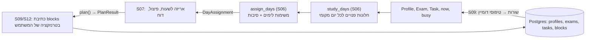

# S06 — מתכנן א': חלונות זמינות ושיבוץ לימים: תוכנית עבודה

> **For agentic workers:** REQUIRED SUB-SKILL: Use superpowers:subagent-driven-development (recommended) or superpowers:executing-plans to implement this plan task-by-task. Steps use checkbox (`- [ ]`) syntax for tracking.

**מטרה:** פונקציה טהורה ב-`api/app/domain/planner/` שמקבלת פרופיל, מבחנים, משימות ו-`now`, ומחזירה לכל יום לימוד מקומי את חלונות הזמן הפנויים ואת המשימות שנכנסות אליו (בדקות). כל משימה שלא נכנסה מקבלת סיבה.

**גישה:** שלושה שלבים מסעיף 7.6: זמינות לכל יום מקומי, חלון לכל מבחן, ושיבוץ לימים. הזמינות מעבירה את `_get_windows_for_day` ו-`_subtract_range` מהקוד הישן, על גבי העזרים של `app/domain/time.py`. השיבוץ הוא greedy לפי ימים: EDF בין מבחנים, סדר לפי תלויות, וסימולציות שמקבלות יום מראש. כלל קיבולת אחד, שמוגדר כאן, מבטיח ש-S07 יצליח לארוז לשעות כל מה ש-S06 שם ביום.

**כלים:** Python 3.14, ‏uv, ‏`zoneinfo` דרך `app/domain/time.py`. חדש: `hypothesis` כתלות פיתוח, לבדיקות property-based. אין מסד, אין מיגרציה ואין Supabase.

**מסמך תכנון:** `docs/superpowers/specs/2026-10-19-studyflow-v2-design.md`, סעיף 7.6 (שלבים 1–3, והאינווריאנטים), וגם 7.3, ‏7.4, ‏8, ‏10 ו-11 (6, ‏7, ‏13, ‏15). במפת הדרכים שב-[artifact](https://claude.ai/code/artifact/29a3c52e-d399-425e-90b6-7c05e9146bfa) זו משימה S06, והיא מוכנה כשתלויות, ימי מנוחה וסימולציות מכוסים בבדיקות.

## איך החלקים מתחברים

המתכנן הוא קוד דומיין טהור. הוא לא יודע מה זה Postgres, ‏FastAPI או Supabase, ולכן אפשר לבדוק אותו עם אלפי קלטים בלי מסד. מי שקורא את השורות מהמסד וממיר אותן לטיפוסים של המתכנן הוא ה-API (S09), ומי שמריץ את התכנון בפועל הוא ה-worker (S12).



- **`study_days`** עונה על "מתי אפשר ללמוד": לכל יום מקומי, החלונות שהמשתמש בחר בתוך שעות הערות, אחרי `now`, בלי זמן תפוס (`busy`), ובלי הלילה שאחרי היום האחרון של מבחן.
- **`assign_days`** עונה על "מה לומדים בכל יום": משימות לימים, בתוך התקציב היומי (`daily_study_minutes`) ובתוך הקיבולת של החלונות. הפלט, `DayAssignment`, הוא מה ש-S07 צורך.
- **S07** יורש חוזה: כל יום שעבר את `day_fits` נארז לשעות בלי שאריות. כך אף משימה לא נעלמת בין השלבים.
- **`existing_blocks`** (בלוקים שהושלמו או ננעלו) נכנסים כאן רק כ-`busy`: זמן שמורידים מהזמינות. ההחלטה מה מהם מקטין משימה, ומה נשאר במקום בתכנון מחדש, שייכת ל-S08.

## מה מצאתי לפני התכנון (2026-11-01)

| נושא | מצב |
|---|---|
| Dependabot | אין PRs פתוחים. שלושת הענפים שלו נמחקו ב-remote אחרי המיזוג ב-S05 |
| ה-artifact | ב"פריטים פתוחים להמשך" אין שורות של S06. ב"באגים שנרשמו" אין באגים. הסטטוס של S06 עבר ל"בעבודה" |
| הקוד הישן | `_get_windows_for_day`: שלושה חלונות (morning 8–14, ‏afternoon 14–20, ‏night 20–02), תחילת לימוד שעה אחרי הקימה, שינה אחרי חצות, fallback לכל היום כשאין חפיפה, חיסור של `fixed_breaks` ושל שעת התחביב, וזריקת חלונות קצרים מ-45 דקות. החלונות מעוגנים רק ליום עצמו. `_subtract_range` מחסירה טווח מרשימת טווחים |
| הפרופיל במסד | `wake_time` 08:00, ‏`sleep_time` 23:00, ‏`daily_study_minutes` 240 (טווח 30–960), ‏`study_windows` ‏`{morning,afternoon}` (1–4 מתוך ארבעה), ‏`rest_days_before_exam` 1 (טווח 0–14). אין עמודה לשעה שאחרי הקימה, להפסקות קבועות או לתחביב |
| המשימות במסד | `estimated_minutes` 5–600, ‏`focus` 1–10, ‏`kind` מתוך שישה, ‏`status` todo/done/skipped, ‏`depends_on_task_id` (מחיקה קשה מאפסת אותו, מחיקה רכה לא). אין עמודת סדר |
| שעון בישראל | חלון 21:00–02:00 בלילה של 2026-10-24 (מעבר לשעון חורף) הוא 6 שעות: 18:00Z–00:00Z. בלילה של 2027-03-25 (מעבר לשעון קיץ) הוא 5 שעות: 19:00Z–00:00Z, כי 02:00 נופל בפער וזז ל-03:00. ב-2026-11-01 ניו יורק עוברת לשעון חורף, והיום שם ארוך 25 שעות |

## ההחלטות שלי

| נושא | החלטה | למה | על מה ויתרנו |
|---|---|---|---|
| טיפוסי הקלט | `dataclass` קפואים בדומיין: `Profile`, ‏`Exam`, ‏`Task`. בדיקות הטווח שלהם זהות ל-`CHECK` של מיגרציה 0002, וחריגה זורקת `PlannerInputError` | המתכנן לא תלוי בצורת השורות במסד. באג במיפוי של S09 נכשל בקול, ולא מייצר תוכנית שגויה | שורות מהמסד (dict), שקושרות את הדומיין לסכמה. ‏Pydantic, שכבד יותר וקיים כבר בגבול ה-API |
| ארבעת החלונות | בוקר 06:00–12:00, צהריים 12:00–17:00, ערב 17:00–21:00, לילה 21:00–02:00 | הם מכסים ברצף את 06:00–02:00, אז בחירה של חלונות סמוכים נותנת חלון רציף אחד. זה חשוב לסימולציות. השעות האלה יוצגו ליד הבחירה באונבורדינג (S13) | השעות הישנות (8–14, ‏14–20, ‏20–02) עם "ערב" שנדחס ביניהן |
| תחילת הלימוד | `Profile.study_start_delay`, ברירת מחדל שעה אחרי הקימה (0–6 שעות). אין עמודה במסד | כך בקוד הישן ובסעיף 7.6. עמודה נוספת רק אם מסך ההגדרות (S15) יחשוף אותה | עמודה עכשיו, בלי מסך שמשתמש בה |
| מהו יום לימוד | שעות הערות שמתחילות בתאריך המקומי `d`: מהקימה ועד השינה, גם אם השינה אחרי חצות. החלונות מעוגנים ל-`d−1`, ל-`d` ול-`d+1`, ונחתכים לשעות הערות | מי שקם ב-12:00 וישן ב-03:00 מקבל את הלילה שלו, ומי שעובד בלילה (קם ב-23:00) מקבל גם את הבוקר שאחרי חצות. בקוד הישן החלונות עוגנו רק ל-`d` | עיגון ל-`d` בלבד, שמאבד שעות למי שהשעון שלו זז |
| אין חפיפה בין החלונות לשעות הערות | אין זמן לימוד. אם אף יום באופק לא מקבל חלון, יש warning בשם `no_study_time` | המשתמש בחר חלונות, ו"מילוי" שקט של כל היום סותר את 11.6. ‏warning הופך את זה להודעה ברורה | ה-fallback של הקוד הישן לכל שעות הערות |
| חלון קצר | מקטע שקצר מ-30 דקות נזרק (בקוד הישן: 45) | 30 דקות הן החלק הקצר ביותר של משימה (7.6 שלב 4) | 45 דקות, שזורק זמן שאפשר להשתמש בו |
| הלילה שלפני יום מנוחה או מבחן | נגמר בחצות. היום האחרון למבחן הוא `exam_date − rest_days − 1`, וכל חלון של יום שחוצה את החצות של `exam_date − rest_days` נחתך שם, לכל המבחנים | האינווריאנט "אין לימוד ביום המבחן או בימי המנוחה שלו" מתקיים לפי השעון, ולא רק לפי יום הלימוד. כלל סטטי אחד, בלי חיתוך שונה לכל משימה | חיתוך רק למשימות של אותו מבחן, שמסבך את הקיבולת. המחיר: מי שלומד אחרי חצות מפסיד עד שעתיים בלילה הזה |
| "היום" | האופק מתחיל באתמול, אם המשתמש עדיין ער אחרי חצות, ואחרת בהיום. חלונות מתחילים ב-`now` מעוגל קדימה לדקה שלמה. אם `now` אחרי כל החלונות, היום ריק והשיבוץ מתחיל מחר | יום שעוד לא נגמר נשאר יום לימוד. דקות שלמות מאפשרות חשבון קיבולת מדויק | עיגול ל-5 או 15 דקות. אם S07 ירצה רשת, הוא יעגל בתוך החוזה |
| `existing_blocks` | `study_days` ו-`assign_days` מקבלים `busy: Sequence[Interval]` ומחסירים אותו (כמו `_subtract_range` בקוד הישן). איזה בלוק נחשב תפוס, ואיך בלוק שהושלם מקטין משימה, נקבע ב-S07/S08 | חיסור הוא חלק מהזמינות, ועולה מעט. ההחלטות על יציבות ונעילה הן של S08 | לפרש כבר עכשיו בלוקים של המסד, לפני שיש תכנון מחדש |
| הפסקות קבועות ותחביב | לא מועברים. בפרופיל של v2 אין הפסקות קבועות, והתחביב כבוי כברירת מחדל (11.13). כשיגיע מסך ההגדרות, התחביב ייכנס כ-`busy` | אין להם שדה במסד, ו-`busy` כבר מכסה אותם | להעביר אותם עכשיו, בלי שדה ובלי משתמש |
| סדר בין מבחנים | EDF לפי `exam_date`. ‏`difficulty` גבוה יותר שובר שוויון, ואחריו סדר הקלט | EDF מוצא שיבוץ שעומד בכל המועדים בכל פעם שיש כזה. משקל שמקדים מבחן קשה על פני מבחן מוקדם יותר יכול להפיל את המוקדם: מבחן קל ביום 10 ומבחן קשה ביום 11 עם עומס יתר, והקל נשאר בלי כלום. המשקל לפי קושי כבר נכנס בתקציב הדקות לכל מבחן (7.5, ‏S11) | EDF משוקלל לפי קושי, או חלוקה יומית של השעות לפי קושי |
| מבחן אחד ביום | יוצא מה-EDF: יום מתמלא במשימות של המבחן הדחוף, ומבחן אחר נכנס רק כשאין לראשון משימה מוכנה שנכנסת, או ביום של סימולציה | העדפה רכה, בלי מנגנון נוסף | "מבחן ראשי" לכל יום, עם ניקוד |
| סדר בתוך מבחן | `review` ו-`learn` קודם, אחריהם `practice` ו-`custom`. סדר הקלט שובר שוויון, ולכן S09 מעביר את המשימות בסדר יציב | "סקירות ולמידה מוקדם" (7.6 שלב 3) | מיון לפי `focus`, ששייך לסדר בתוך היום (S07) |
| יום מלא בחלקו | אם המשימה הבאה לא נכנסת, נכנסת משימה מוכנה קטנה יותר (first-fit) | פחות זמן מבוזבז, בלי לפצל משימות | פיצול משימה בסוף כל יום |
| משימה ארוכה | נכנסת שלמה ליום אחד. רק משימה שלא נכנסת שלמה לאף יום ריק מתפרסת על כמה ימים, ברצף, בחלקים של 30 דקות לפחות (גם החלק האחרון). אם לא כל החלקים נכנסו, אף חלק לא נשאר, והמשימה מקבלת סיבה | משימה ביום אחד היא חוויה טובה יותר. "הכל או כלום" שומר על חשבון פשוט: משימה משובצת במלואה או מופיעה בדוח | פיצול חופשי בין ימים, ושיבוץ חלקי עם דוח על השארית |
| סימולציות | לפני השיבוץ, כל סימולציה מקבלת יום: הן מתפזרות שווה על ימי הלימוד של המבחן, והאחרונה ביום שלפני היום האחרון (אם יש לה תחקיר) או ביום האחרון. לא יותר מסימולציה אחת ביום, בכל המבחנים. אם היום תפוס או קצר, מחפשים יום קרוב: קודם קדימה, ואחר כך אחורה. ביום שלה הסימולציה נכנסת ראשונה | "מפוזרות לאורך התקופה, האחרונה לפני ימי המנוחה" (7.6 שלב 3). שמירת יום מראש מאפשרת לחזור אחורה כשהיום המתוכנן תפוס | שיבוץ סימולציה רק מהיום המתוכנן והלאה, שמאבד סימולציה כשהימים שאחריו תפוסים |
| חלון רציף לסימולציה | הסימולציה לא מתפצלת לעולם. היום שלה צריך חלון אחד שמחזיק אותה, ותקציב יומי שמחזיק אותה. אחרת היא בדוח עם `no_contiguous_window` | 11.7. הבדיקה כאן, ולא רק ב-S07, כדי שהיום לא יתמלא בדברים אחרים | לאפשר לסימולציה לעבור את התקציב היומי |
| תחקיר | `simulation_review` שמוכן נכנס ראשון ביום שלו, ותמיד ביום לימוד שאחרי הסימולציה. אם הסימולציה כבר הושלמה, התחקיר נכנס ראשון כבר היום | "תחקיר ביום הלימוד שאחרי הסימולציה" | — |
| תלויות | תלות במשימה שהושלמה, דולגה או חסרה בקלט (נמחקה) לא מעכבת. משימה תלויה נכנסת באותו יום או אחריו, אחרי הדרישה המוקדמת שלה בסדר היום. מעגל: כל המשימות שעליו בדוח עם `dependency_cycle` | המשתמש מחק או השלים את הדרישה, אז אין סיבה לחכות. מעגל הוא נתון שבור, ולא מנחשים מאיפה לשבור אותו | לשבור מעגל בקשת "הכי חלשה" |
| חוזה הקיבולת מול S07 | `day_fits(windows, minutes, simulation)` נכון רק אם `Σminutes + 10·(n−1) + 20·[יש לפחות 2 בלוקים ביום] + 70·(k−1) ≤ Σwindows`, אחרי שהסימולציה הורידה את עצמה ועוד 10 דקות מהחלון הקטן ביותר שמחזיק אותה. ‏S07 אורז עם הכללים האלה: חלקים של 30 דקות לפחות, 10 דקות הפסקה, הפסקה ארוכה אחת של 30 דקות אחרי הבלוק שבו עוברים חצי מהדקות של היום, סימולציה בתחילת החלון הקטן ביותר שמחזיק אותה | אריזה רציפה עם הכללים האלה מבזבזת פחות מ-70 דקות בסוף כל חלון שאינו האחרון. לכן כל יום שעובר את הכלל נארז במלואו, בכל סדר שמכבד תלויות. ‏S07 בודק את זה כ-property | שיבוץ לימים בלי הפסקות, ו-S07 שמזיז עודפים קדימה (לולאה בין השלבים). המחיר: עד 70 דקות של הערכה שמרנית לכל חלון נוסף ביום, בדרך כלל לא מורגש כי התקציב היומי מגביל קודם |
| סיבות | `no_study_days`, ‏`not_enough_time`, ‏`no_contiguous_window`, ‏`dependency_cycle`, ‏`dependency_not_scheduled` (עם `blocked_by`), ‏`dependency_too_late` (עם `blocked_by`). קודים, בלי טקסט | S07 הופך אותם לדוח בעברית עם הצעות. קוד אחד לכל מצב שהמשתמש יכול לתקן אחרת | טקסט חופשי בדומיין |
| קלט לא עקבי | `PlannerInputError` (תת-מחלקה של `ValueError`): מזהה כפול, משימה של מבחן שלא בקלט, `now` בלי אזור זמן | זה באג במיפוי, לא מצב של משתמש. "שום כשל לא נבלע" (7.5) | להכניס אותן לדוח |
| בדיקות property-based | `hypothesis` נכנס עכשיו, כתלות פיתוח. הגנרטורים יושבים בקובץ משלהם, ו-S07 ירחיב אותם. ב-CI ‏(`CI=true`) הדוגמאות קבועות (`derandomize`), ומקומית הן אקראיות | 7.6 ו-10 דורשים אותן, והאינווריאנטים של שלבים 1–3 כבר קיימים. מוטב שהגנרטורים יוולדו יחד עם הקוד שהם בודקים | לחכות ל-S07, ואז לכתוב גנרטורים לקוד שכבר לא טרי |

## מה לא נכלל ולמה

- **אריזה לשעות, מספור חלקים (`part_index`), ‏`plan()` ו-`PlanResult`, והדוח בעברית עם ההצעות:** ‏S07. ‏S06 נותן לו את `DayAssignment` ואת חוזה הקיבולת.
- **תכנון מחדש יציב, בלוקים שהושלמו או ננעלו, `plan_versions`, הנחת משימה בודדת (7.6 שלבים 6–7):** ‏S08.
- **מיפוי משורות המסד:** ‏S09. כולל: לא להעביר מבחנים ומשימות עם `deleted_at`, להחליט מה עושים במבחן שעבר, ולהעביר משימות בסדר יציב.
- **שדה בפרופיל ל-`study_start_delay` ולתחביב:** רק אם מסך ההגדרות (S15) יחשוף אותם.

## אילוצים גלובליים

- Python 3.14, ‏uv, ‏`exclude-newer = "7 days"`. תלות חדשה אחת: `hypothesis`, כתלות פיתוח (Task 6). אם subagent צריך עוד תלות, הוא כותב בדוח למה.
- `ruff check`, ‏`ruff format --check`, ‏`mypy` (strict) ו-`pytest` עם `filterwarnings = ["error"]`, כמו בטבלה שב-`CLAUDE.md`. הבדיקות הקיימות (173) נשארות ירוקות. בדיקות המתכנן לא נוגעות במסד.
- המתכנן טהור: בלי `datetime.now()`, בלי I/O, בלי אקראיות, ובלי לעבור בלולאה על `set` או `frozenset` כשהסדר משפיע על התוצאה. ‏hash של מחרוזת משתנה בין תהליכים, ולכן גם `frozenset[StudyWindow]` עובר בסדר הקבוע של `StudyWindow`. אותו קלט נותן תמיד אותו פלט.
- כל `datetime` שהמתכנן מקבל או מחזיר הוא aware. בתוך `Interval` הוא ב-UTC (`tzinfo is datetime.UTC`) ובדקה שלמה. חישובי "יום מקומי" עוברים רק דרך `app/domain/time.py`.
- `Profile`, ‏`Exam` ו-`Task` משקפים בדיוק את ה-`CHECK` של `api/migrations/versions/0002_core_tables.py`. מה שאין במסד מקבל ברירת מחדל מתועדת.
- לא נוגעים ב-`legacy/`. ‏subagent שצריך את הקוד הישן מקבל אותו בציטוט מהתוכנית, ולא קורא אותו.
- הקוד, ההערות בקוד והודעות הקומיט באנגלית. התוכנית וההודעות אליך בעברית.
- git רץ בשיחה הראשית, וה-subagents לא מריצים git. מוסיפים קבצים לפי שם, ובודקים `git status --short --untracked-files=all` לפני כל קומיט. לפני כל push מריצים `gitleaks git --redact --no-banner .`. אין force-push.
- **הריפו ב-`/Users/eyalatar/studyflow`.** תיקיית העבודה של הסשן, `~/Desktop/MyProject/studyflow`, היא העתק ישן. כל subagent עובד רק בנתיבים מלאים תחת `~/studyflow`.

## על מה לשים לב בבדיקה

1. **משתמש שישן אחרי חצות, עם מבחן בלי ימי מנוחה:** בלוק ב-00:30 של יום המבחן. מה שצריך לקרות: הלילה שלפני נגמר בחצות. Task 3 בודק את החיתוך, ו-Task 6 בודק שאף חלון של יום אחרון לא עובר את ה-cutoff.
2. **סדר שתלוי ב-hash:** לולאה על `study_windows` או על `set` של מזהים נותנת סדר אחר בכל תהליך, וה-CI נכשל לפעמים. מה שצריך לקרות: אותו פלט תמיד. Task 3 עובר על החלונות בסדר הקבוע. Task 6 משווה שתי הרצות, וה-reviewer מחפש לולאות על `set`.
3. **משימה ארוכה מיום, והשארית שלה:** חלק אחרון של 20 דקות, או חצי משימה בלוח וחצי בדוח. מה שצריך לקרות: כל החלקים לפחות 30 דקות, והמשימה כולה בלוח או כולה בדוח. Task 4 בודק, ו-Task 6 בודק כ-property.
4. **סימולציה ביום האחרון לפני המנוחה, עם תחקיר:** התחקיר ייפול על יום מנוחה. מה שצריך לקרות: הסימולציה האחרונה ביום שלפני האחרון, ואם אין יום כזה, התחקיר בדוח עם `dependency_too_late`. Task 5 בודק.
5. **`busy` או `now` מאזור זמן אחר:** בלוק שנשמר עם offset של ישראל, או `now` בלי UTC. מה שצריך לקרות: `Interval` מסרב לזמן שאינו UTC, ו-`now` עובר דרך `ensure_utc`. Task 1 ו-Task 3 בודקים.

## מי עושה מה

| Task | מה | מי | תלוי ב- |
|---|---|---|---|
| 0 | פתיחה: Dependabot, הסטטוס, הענף והתוכנית | אני (נעשה, חוץ מהקומיט) | — |
| 1 | טיפוסי הדומיין ו-`Interval` | subagent | 0 |
| 2 | כלל הקיבולת | subagent | 1 |
| 3 | הזמינות: חלונות לכל יום, יום אחרון למבחן ו-`study_days` | subagent | 1, 2 |
| 4 | השיבוץ לימים: EDF, תלויות, תקציב, משימות ארוכות וסיבות | subagent | 2, 3 |
| 5 | סימולציות ותחקירים | subagent | 4 |
| 6 | בדיקות property-based עם hypothesis | subagent | 5 |
| 7 | מסמך התכנון והלשונית שלו | אני | 6 |
| 8 | סקירה סופית, מיזוג וסגירה | אני | 7 |

## מבנה הקבצים

```
api/app/domain/planner/__init__.py       ה-API הציבורי של המתכנן (__all__)
api/app/domain/planner/intervals.py      Interval, merge, subtract (מ-_subtract_range), clip
api/app/domain/planner/model.py          Profile, Exam, Task, ה-enums, StudyDay, DayItem, DayPlan, Unscheduled, PlanWarning, DayAssignment, PlannerInputError
api/app/domain/planner/availability.py   STUDY_WINDOW_HOURS, awake_span, day_windows (מ-_get_windows_for_day), last_study_day, exam_cutoff, study_days
api/app/domain/planner/capacity.py       הקבועים של האריזה, day_fits, room, simulation_window
api/app/domain/planner/dependencies.py   resolve_dependencies
api/app/domain/planner/assign.py         assign_days
api/tests/planner/__init__.py
api/tests/planner/factories.py           make_profile, make_exam, make_task, by_day, NOW
api/tests/planner/strategies.py          הגנרטורים של hypothesis
api/tests/planner/test_model.py
api/tests/planner/test_availability.py
api/tests/planner/test_capacity.py
api/tests/planner/test_assign.py
api/tests/planner/test_simulations.py
api/tests/planner/test_properties.py
api/pyproject.toml, api/uv.lock          + hypothesis (dev)
.gitignore                               + .hypothesis/
מסמך התכנון (7.6, 8, 10, 12) והלשונית שלו ב-artifact
```

---

### Task 0: פתיחה

נעשה לפני כתיבת התוכנית: אין PRs פתוחים של Dependabot, הסטטוס של S06 ב-artifact הוא "בעבודה", והענף `s06-planner-days` נפתח מ-`main` (`1005454`).

- [ ] **Step 1: קומיט של התוכנית**
  ```bash
  git status --short --untracked-files=all
  git add docs/superpowers/plans/2026-11-01-s06-planner-days.md
  git commit -m "docs(plan): add the S06 planner day assignment plan"
  ```
  Expected: רק קובץ התוכנית ב-status, וקומיט אחד על הענף.

---

### Task 1: טיפוסי הדומיין ו-`Interval`

**למה:** כל שאר המתכנן מדבר בטיפוסים האלה, ו-S07 עד S09 יבנו עליהם. כאן נקבע שהמתכנן מקבל רק קלט תקין, ושכל זמן בתוכו הוא UTC בדקה שלמה.

**Files:**
- Create: `api/app/domain/planner/__init__.py`, ‏`intervals.py`, ‏`model.py`
- Create: `api/tests/planner/__init__.py` (ריק), ‏`api/tests/planner/factories.py`, ‏`api/tests/planner/test_model.py`

**Interfaces:**
- Consumes: —
- Produces, ב-`app.domain.planner.intervals`:
  - `@dataclass(frozen=True, slots=True, order=True) class Interval: start: datetime; end: datetime`. ‏`__post_init__` זורק `ValueError` אם אחד מהם לא `tzinfo is datetime.UTC`, אם יש בו שניות או מיקרו-שניות, או אם `start >= end`. ‏`minutes: int` (property) = `(end − start) // timedelta(minutes=1)`.
  - `merge(intervals: Iterable[Interval]) -> list[Interval]`: ממוין, ומאחד חופפים וגם נוגעים (`a.end == b.start`).
  - `subtract(intervals: Iterable[Interval], cut: Interval) -> list[Interval]`: ההעברה של `_subtract_range` (בציטוט למטה).
  - `clip(intervals: Iterable[Interval], start: datetime | None = None, end: datetime | None = None) -> list[Interval]`: רק החלקים שבתוך `[start, end)`. ‏`None` הוא בלי גבול.
- Produces, ב-`app.domain.planner.model` (כל ה-dataclasses עם `frozen=True, slots=True, kw_only=True`):
  - `class StudyWindow(StrEnum)`: ‏`MORNING = "morning"`, ‏`AFTERNOON = "afternoon"`, ‏`EVENING = "evening"`, ‏`NIGHT = "night"`, בסדר הזה.
  - `class TaskKind(StrEnum)`: ‏`LEARN`, ‏`PRACTICE`, ‏`REVIEW`, ‏`SIMULATION`, ‏`SIMULATION_REVIEW`, ‏`CUSTOM`, עם הערכים של המסד (`"learn"`, ‏…, ‏`"simulation_review"`, ‏`"custom"`).
  - `class TaskStatus(StrEnum)`: ‏`TODO = "todo"`, ‏`DONE = "done"`, ‏`SKIPPED = "skipped"`.
  - `class UnscheduledReason(StrEnum)`: ‏`NO_STUDY_DAYS = "no_study_days"`, ‏`NOT_ENOUGH_TIME = "not_enough_time"`, ‏`NO_CONTIGUOUS_WINDOW = "no_contiguous_window"`, ‏`DEPENDENCY_CYCLE = "dependency_cycle"`, ‏`DEPENDENCY_NOT_SCHEDULED = "dependency_not_scheduled"`, ‏`DEPENDENCY_TOO_LATE = "dependency_too_late"`.
  - `class WarningCode(StrEnum)`: ‏`NO_STUDY_TIME = "no_study_time"`.
  - `class PlannerInputError(ValueError)`.
  - `Profile`: ‏`timezone: ZoneInfo`, ‏`wake_time: time`, ‏`sleep_time: time`, ‏`daily_study_minutes: int`, ‏`study_windows: frozenset[StudyWindow]`, ‏`rest_days_before_exam: int`, ‏`study_start_delay: timedelta = timedelta(hours=1)`. בדיקות: שני הזמנים בלי `tzinfo`, בדקה שלמה ושונים זה מזה; ‏`daily_study_minutes` בין 30 ל-960; ‏1–4 חלונות; ‏`rest_days_before_exam` בין 0 ל-14; ‏`study_start_delay` בין 0 ל-6 שעות, בדקה שלמה.
  - `Exam`: ‏`id: UUID`, ‏`exam_date: date`, ‏`difficulty: int` (1–5).
  - `Task`: ‏`id: UUID`, ‏`exam_id: UUID`, ‏`kind: TaskKind`, ‏`estimated_minutes: int` (5–600), ‏`focus: int = 5` (1–10), ‏`depends_on: UUID | None = None` (לא שווה ל-`id`), ‏`status: TaskStatus = TaskStatus.TODO`.
  - `StudyDay`: ‏`date: date`, ‏`windows: tuple[Interval, ...]` (ממוינים, זרים, כל אחד 30 דקות לפחות).
  - `DayItem`: ‏`task_id: UUID`, ‏`minutes: int`.
  - `DayPlan`: ‏`day: StudyDay`, ‏`items: tuple[DayItem, ...]` (בסדר שמכבד תלויות).
  - `Unscheduled`: ‏`task_id: UUID`, ‏`minutes: int`, ‏`reason: UnscheduledReason`, ‏`blocked_by: UUID | None = None`.
  - `PlanWarning`: ‏`code: WarningCode`.
  - `DayAssignment`: ‏`days: tuple[DayPlan, ...]`, ‏`unscheduled: tuple[Unscheduled, ...]`, ‏`warnings: tuple[PlanWarning, ...]`.
  - כל הפרות הטווח זורקות `PlannerInputError`.
- Produces, ב-`tests/planner/factories.py` (משמש את כל הבדיקות הבאות):
  - `JLM = ZoneInfo("Asia/Jerusalem")`, ‏`NY = ZoneInfo("America/New_York")`, ‏`NOW = datetime(2026, 11, 1, 5, 0, tzinfo=UTC)` (07:00 בישראל).
  - `make_profile(**overrides) -> Profile`: ברירות המחדל של המסד: JLM, ‏08:00, ‏23:00, ‏240, ‏`{MORNING, AFTERNOON}`, ‏1.
  - `make_exam(exam_date: date, difficulty: int = 3) -> Exam` עם `uuid4()`.
  - `make_task(exam: Exam, minutes: int, kind: TaskKind = TaskKind.LEARN, **overrides) -> Task` עם `uuid4()`.
  - `by_day(result: DayAssignment) -> dict[date, list[tuple[UUID, int]]]`: רק ימים עם פריטים, לפי הסדר.
- `__init__.py` מייצא את כל השמות הציבוריים של `intervals` ו-`model` ב-`__all__`. כל Task הבא מוסיף את שלו.

הקוד הישן, לעיון (לא לקרוא את `legacy/`):
```python
def _subtract_range(windows, s, e):
    new_windows = []
    for w_start, w_end in windows:
        if s < w_end and e > w_start:
            if s > w_start: new_windows.append((w_start, s))
            if e < w_end: new_windows.append((e, w_end))
        else: new_windows.append((w_start, w_end))
    return new_windows
```

- [ ] **Step 1: הבדיקות, ב-`tests/planner/test_model.py`**

  `UTC = datetime.UTC`. ‏`at(h, m=0)` הוא `datetime(2026, 11, 2, h, m, tzinfo=UTC)`, ו-`iv(a, b)` הוא `Interval(at(*a), at(*b))`.

  | בדיקה | קלט | מצופה |
  |---|---|---|
  | `test_interval_minutes` | `iv((7,), (15,))` | `minutes == 480` |
  | `test_interval_rejects_bad_bounds` (parametrize) | `start == end`, ‏`start > end`, ‏`datetime` בלי tz, ‏`tzinfo=ZoneInfo("Asia/Jerusalem")`, שנייה 30 | `ValueError` |
  | `test_merge_joins_overlapping_and_touching` | `[iv((9,),(10,)), iv((7,),(8,)), iv((8,),(8,30)), iv((9,30),(11,))]` | `[iv((7,),(8,30)), iv((9,),(11,))]` |
  | `test_subtract_cuts_a_hole` | `[iv((7,),(15,))]` פחות `iv((8,),(9,))` | `[iv((7,),(8,)), iv((9,),(15,))]` |
  | `test_subtract_keeps_what_it_does_not_touch` | `[iv((7,),(8,)), iv((10,),(11,))]` פחות `iv((8,),(10,))` | ללא שינוי (טווח שנוגע בקצה לא נחתך) |
  | `test_subtract_removes_a_covered_interval` | `[iv((8,),(9,))]` פחות `iv((7,),(10,))` | `[]` |
  | `test_clip_to_bounds` | `[iv((7,),(9,)), iv((10,),(12,))]`, ‏`start=at(8)`, ‏`end=at(11)` | `[iv((8,),(9,)), iv((10,),(11,))]`; בלי גבולות: ללא שינוי |
  | `test_profile_accepts_database_defaults` | `make_profile()` | נבנה בלי שגיאה, ו-`study_start_delay == timedelta(hours=1)` |
  | `test_profile_rejects_out_of_range` (parametrize) | `daily_study_minutes` 29 ו-961; ‏`study_windows=frozenset()`; ‏`rest_days_before_exam` ‏−1 ו-15; ‏`wake_time == sleep_time`; ‏`wake_time=time(8, 0, 30)`; ‏`sleep_time` עם `tzinfo`; ‏`study_start_delay` ‏−1 דקה ו-6 שעות ודקה | `PlannerInputError` |
  | `test_exam_rejects_difficulty_out_of_range` | 0 ו-6 | `PlannerInputError` |
  | `test_task_rejects_out_of_range` (parametrize) | `estimated_minutes` 4 ו-601; ‏`focus` 0 ו-11; ‏`depends_on == id` | `PlannerInputError` |

- [ ] **Step 2: הבדיקות נכשלות**
  Run (מתוך `api/`): `uv run pytest tests/planner -q`
  Expected: ‏`ModuleNotFoundError: No module named 'app.domain.planner'`.

- [ ] **Step 3: מימוש `intervals.py`, ‏`model.py`, ‏`__init__.py` ו-`factories.py`**
  לפי ה-Interfaces. ‏`subtract` שומר על הסדר של הקלט ומוותר על חלקים ריקים.

- [ ] **Step 4: הכל ירוק**
  Run: `uv run pytest -q && uv run ruff check . && uv run ruff format --check . && uv run mypy`
  Expected: כל הבדיקות עוברות (173 קודמות והחדשות), ו-ruff ו-mypy נקיים.

- [ ] **Step 5: קומיט (בשיחה הראשית)**
  `git add api/app/domain/planner/__init__.py api/app/domain/planner/intervals.py api/app/domain/planner/model.py api/tests/planner/__init__.py api/tests/planner/factories.py api/tests/planner/test_model.py`
  `git commit -m "feat(api): add planner domain types and interval helpers"`

---

### Task 2: כלל הקיבולת

**למה:** זה החוזה בין S06 ל-S07. ‏S06 שם ביום רק מה ש-`day_fits` מאשר, ו-S07 חייב לארוז את זה לשעות בלי שאריות. בלי הכלל הזה, הפסקות וחלונות קטועים היו מפילים משימות בין השלבים.

**Files:**
- Create: `api/app/domain/planner/capacity.py`, ‏`api/tests/planner/test_capacity.py`
- Modify: `api/app/domain/planner/__init__.py`

**Interfaces:**
- Consumes: —
- Produces, ב-`app.domain.planner.capacity` (כל האורכים בדקות, וכל `windows` הם אורכי החלונות של היום בסדר הזמן):
  - `MIN_PART_MINUTES: Final = 30`, ‏`BREAK_MINUTES: Final = 10`, ‏`LONG_BREAK_MINUTES: Final = 30`, ‏`WINDOW_EDGE_RESERVE_MINUTES: Final = 70`. ההערה בקוד מסבירה את ה-70: הכי הרבה שחלון מבזבז לפני שהאריזה עוברת לחלון הבא, כלומר פריט של פחות משעה שלא נכנס, ועוד ההפסקה שלפניו.
  - `simulation_window(windows: Sequence[int], minutes: int) -> int | None`: האינדקס של החלון הקטן ביותר שאורכו לפחות `minutes`. בשוויון, המוקדם. ‏`None` אם אין.
  - `day_fits(windows: Sequence[int], minutes: Sequence[int], simulation: int | None = None) -> bool`:
    1. אם יש `simulation`: החלון שלה הוא `simulation_window`. אין חלון: `False`. החלון מתקצר ב-`simulation + BREAK_MINUTES`, ואם נשארו פחות מ-`MIN_PART_MINUTES` הוא יוצא מהרשימה.
    2. אין `minutes`: `True`. אין חלונות: `False`.
    3. ‏`n` הוא מספר הבלוקים ביום, כולל הסימולציה. ‏`need = Σminutes + BREAK_MINUTES·(len(minutes) − 1) + (LONG_BREAK_MINUTES − BREAK_MINUTES if n ≥ 2 else 0) + WINDOW_EDGE_RESERVE_MINUTES·(k − 1)`, כש-`k` הוא מספר החלונות שנשארו.
    4. התוצאה: `need ≤ Σwindows`.
  - `room(windows: Sequence[int], minutes: Sequence[int], simulation: int | None = None) -> int`: הפריט הארוך ביותר שאפשר להוסיף, כך ש-`day_fits(windows, [*minutes, room], simulation)`. ‏0 אם אין מקום, וגם אם הסימולציה לא נכנסת. נוסחה סגורה לפי אותו חשבון, בלי חיפוש.
  - התקציב היומי (`daily_study_minutes`) לא כאן. הוא נבדק בשיבוץ.

- [ ] **Step 1: הבדיקות, ב-`tests/planner/test_capacity.py`**

  | בדיקה | קלט | מצופה |
  |---|---|---|
  | `test_empty_day` | `day_fits([480], [])`, ‏`day_fits([], [])`, ‏`day_fits([], [30])` | `True`, ‏`True`, ‏`False` |
  | `test_single_item_uses_the_whole_window` | `day_fits([60], [60])`, ‏`day_fits([60], [61])` | `True`, ‏`False` |
  | `test_breaks_and_the_long_break` | `day_fits([100], [45, 45])`, ‏`day_fits([120], [45, 45])` | `False` (צריך 120), ‏`True` |
  | `test_long_break_needs_two_blocks` | `day_fits([70], [60])`, ‏`day_fits([80], [30, 30])`, ‏`day_fits([90], [30, 30])` | `True`, ‏`False`, ‏`True` |
  | `test_each_extra_window_reserves_70_minutes` | `day_fits([60, 60], [50])`, ‏`day_fits([60, 60], [51])` | `True`, ‏`False` |
  | `test_simulation_window_is_the_smallest_that_holds_it` | `([180, 240], 200)`, ‏`([240, 180], 180)`, ‏`([200, 200], 200)`, ‏`([100], 200)` | `1`, ‏`1`, ‏`0`, ‏`None` |
  | `test_simulation_with_other_items` | `day_fits([180, 240], [60], 180)`, ‏`day_fits([200], [30], 180)`, ‏`day_fits([230], [30], 180)`, ‏`day_fits([250], [30], 180)` | `True`, ‏`False`, ‏`False`, ‏`True` |
  | `test_room` | `room([480], [])`, ‏`room([480], [120])`, ‏`room([60, 60], [])`, ‏`room([], [])`, ‏`room([200], [], 180)`, ‏`room([100], [], 200)` | `480`, ‏`330`, ‏`50`, ‏`0`, ‏`0`, ‏`0` |
  | `test_room_is_the_exact_limit` | לכל אחד מהמקרים ב-`test_room` עם `room > 0` | `day_fits(..., [*minutes, room])` נכון, ו-`day_fits(..., [*minutes, room + 1])` לא |

- [ ] **Step 2: הבדיקות נכשלות**
  Run: `uv run pytest tests/planner/test_capacity.py -q`
  Expected: ‏`ImportError` על `day_fits`.

- [ ] **Step 3: מימוש `capacity.py`, ועדכון `__init__.py`**

- [ ] **Step 4: הכל ירוק**
  Run: `uv run pytest -q && uv run ruff check . && uv run ruff format --check . && uv run mypy`

- [ ] **Step 5: קומיט (בשיחה הראשית)**
  `git add api/app/domain/planner/capacity.py api/app/domain/planner/__init__.py api/tests/planner/test_capacity.py`
  `git commit -m "feat(api): add the day capacity rule shared with hour packing"`

---

### Task 3: הזמינות

**למה:** זה שלב 1 ושלב 2 של 7.6. כל משימה שתשובץ תשובץ רק בתוך החלונות שיוצאים מכאן, ולכן כאן נקבעים כללי השעון: חצות, מעבר שעון, "עכשיו" וימי מנוחה.

**Files:**
- Create: `api/app/domain/planner/availability.py`, ‏`api/tests/planner/test_availability.py`
- Modify: `api/app/domain/planner/__init__.py`

**Interfaces:**
- Consumes: ‏`Interval`, ‏`merge`, ‏`subtract`, ‏`clip`, ‏`Profile`, ‏`Exam`, ‏`StudyWindow`, ‏`StudyDay` (Task 1); ‏`parse_timezone` לא נדרש. מ-`app.domain.time`: ‏`ensure_utc`, ‏`local_date`, ‏`local_day_bounds`, ‏`local_span`; ‏`MIN_PART_MINUTES` מ-`capacity` (Task 2).
- Produces, ב-`app.domain.planner.availability`:
  - `STUDY_WINDOW_HOURS: Final[Mapping[StudyWindow, tuple[time, time]]]`: ‏MORNING ‏(06:00, ‏12:00), ‏AFTERNOON ‏(12:00, ‏17:00), ‏EVENING ‏(17:00, ‏21:00), ‏NIGHT ‏(21:00, ‏02:00).
  - `awake_span(profile: Profile, day: date) -> Interval | None`: מ-`wake_time + study_start_delay` ועד `sleep_time`, לפי `local_span(day, wake_time, sleep_time, tz)`. ההשהיה נוספת כזמן שעובר (על ה-UTC). ‏`None` אם לא נשאר זמן.
  - `day_windows(profile: Profile, day: date) -> tuple[Interval, ...]`: לכל חלון שנבחר, בסדר של `StudyWindow`, המופעים שלו שמתחילים ב-`day−1`, ‏`day` ו-`day+1` (דרך `local_span`), חיתוך עם `awake_span`, ‏`merge`, וזריקה של מקטעים קצרים מ-`MIN_PART_MINUTES`. בלי fallback.
  - `last_study_day(exam: Exam, profile: Profile) -> date` = `exam_date − rest_days_before_exam − 1`.
  - `exam_cutoff(exam: Exam, profile: Profile) -> datetime` = תחילת היום המקומי `exam_date − rest_days_before_exam`.
  - `study_days(profile: Profile, exams: Sequence[Exam], now: datetime, busy: Sequence[Interval] = ()) -> tuple[StudyDay, ...]`, לפי האלגוריתם שלמטה.

  האלגוריתם של `study_days`:
  1. `now` עובר `ensure_utc` (ו-`ValueError` אם הוא naive), ומעוגל קדימה לדקה שלמה.
  2. אין מבחנים: `()`. אחרת, הימים הם `local_date(now) − 1` עד `max(last_study_day)`, כולל. יום נכנס רק אם סוף שעות הערות שלו (`local_span(d, wake, sleep)[1]`, בלי ההשהיה) אחרי `now`.
  3. לכל יום: `day_windows`, ‏`clip(start=now)`, ‏`clip(start=הסוף של החלון האחרון ביום הקודם)` (מעבר שעון יכול לגרום לשעות הערות של שני ימים לחפוף), חיתוך ב-`exam_cutoff` של כל מבחן שה-cutoff שלו נופל בתוך `local_span(d, wake, sleep)` (‏`clip(end=cutoff)`), ‏`subtract` לכל `busy`, ואז שוב זריקה של מקטעים קצרים מ-`MIN_PART_MINUTES`.
  4. יום בלי חלונות נשאר ברשימה, עם `windows=()`.

  הקוד הישן, לעיון (חלקים רלוונטיים):
  ```python
  start_time_natural = day_local.replace(hour=wake_h, minute=wake_m) + timedelta(hours=1)
  if sleep_h < wake_h:
      end_time_natural = (day_local + timedelta(days=1)).replace(hour=sleep_h, minute=sleep_m)
  else:
      end_time_natural = day_local.replace(hour=sleep_h, minute=sleep_m)
  if start_time_natural >= end_time_natural: return []
  PREF_DEFINITIONS = {"morning": (8, 14), "afternoon": (14, 20), "night": (20, 2)}  # night wraps
  # per preference: intersect [p_start, p_end] with [start_natural, end_natural], then merge
  if not preference_windows:
      windows = [(start_time_natural, end_time_natural)]   # fallback: v2 drops it
  # then subtract fixed_breaks and the hobby hour (v2 drops both), keep windows >= min_block_min (45)
  ```

- [ ] **Step 1: הבדיקות, ב-`tests/planner/test_availability.py`**

  פרופיל ברירת המחדל הוא `make_profile()`, ובבדיקות של `study_days` יש מבחן אחד ב-2026-11-05, אם לא כתוב אחרת. כל הערכים אומתו מול `zoneinfo`. ‏`Z(y, mo, d, h, mi=0)` הוא `datetime(..., tzinfo=UTC)`.

  | בדיקה | קלט | מצופה |
  |---|---|---|
  | `test_default_windows_on_a_regular_day` | `day_windows(make_profile(), date(2026, 11, 2))` | `(Z(2026,11,2,7)–Z(2026,11,2,15),)`, כלומר 09:00–17:00 |
  | `test_adjacent_windows_merge` | `study_windows={AFTERNOON, EVENING}` | חלון אחד 10:00Z–19:00Z |
  | `test_separate_windows_stay_apart` | `{MORNING, EVENING}` | 07:00Z–10:00Z ו-15:00Z–19:00Z |
  | `test_study_starts_after_the_delay` (parametrize) | `wake_time=10:00`, ‏`{MORNING}`, ‏delay 60 / 90 / 100 דקות | 09:00Z–10:00Z / ‏09:30Z–10:00Z / ‏`()` (20 דקות נזרקות) |
  | `test_night_window_crosses_midnight` | `{EVENING, NIGHT}`, ‏`sleep_time=01:00`, ‏2026-11-02 | 15:00Z–23:00Z |
  | `test_fall_back_night_is_an_hour_longer` | `{NIGHT}`, ‏`sleep_time=03:00`, ‏2026-10-24 | 18:00Z–2026-10-25 00:00Z, ‏360 דקות |
  | `test_spring_forward_night` | `{NIGHT}`, ‏`sleep_time=03:00`, ‏2027-03-25 | 19:00Z–2027-03-26 00:00Z, ‏300 דקות (02:00 בפער זז ל-03:00) |
  | `test_windows_outside_waking_hours_give_nothing` | `sleep_time=11:00`, ‏`{EVENING}` | `()` |
  | `test_late_riser_keeps_the_night` | `wake_time=12:00`, ‏`sleep_time=03:00`, ‏`{MORNING, NIGHT}`, ‏2026-11-02 | `(Z(2026,11,2,19)–Z(2026,11,3,0),)` |
  | `test_night_shift_gets_the_morning_after_midnight` | `wake_time=23:00`, ‏`sleep_time=07:00`, ‏`{MORNING, NIGHT}`, ‏2026-11-02 | 22:00Z–2026-11-03 00:00Z ו-2026-11-03 04:00Z–05:00Z |
  | `test_last_study_day_and_cutoff` (parametrize) | מבחן 2026-11-05, ‏rest 1 / ‏0 | 2026-11-03 ו-`Z(2026,11,3,22)` / ‏2026-11-04 ו-`Z(2026,11,4,22)` |
  | `test_horizon_runs_from_today_to_the_last_study_day` | `NOW`, מבחן 2026-11-05 | תאריכים `[2026-11-01, 2026-11-02, 2026-11-03]` (2026-10-31 נגמר) |
  | `test_today_starts_at_now` | `now=Z(2026,11,1,12,0)` עם 30 שניות | היום הראשון: 12:01Z–15:00Z |
  | `test_today_after_all_windows_is_empty` | `now=Z(2026,11,1,16)` | 2026-11-01 ברשימה עם `windows=()` |
  | `test_still_awake_after_midnight_belongs_to_yesterday` | `{EVENING, NIGHT}`, ‏`sleep_time=01:00`, ‏`now=Z(2026,11,1,22,30)` (00:30 ב-2 בנובמבר) | היום הראשון 2026-11-01 עם 22:30Z–23:00Z |
  | `test_night_before_a_rest_day_ends_at_midnight` | `{EVENING, NIGHT}`, ‏`sleep_time=01:00`, מבחן 2026-11-05 | 2026-11-02: עד 23:00Z. 2026-11-03: עד 22:00Z |
  | `test_busy_time_is_removed` | `busy=[Interval(Z(2026,11,2,8), Z(2026,11,2,9))]` | 2026-11-02: ‏07:00Z–08:00Z ו-09:00Z–15:00Z |
  | `test_busy_leftover_shorter_than_30_minutes_is_dropped` | `busy=[Interval(Z(2026,11,2,7,20), Z(2026,11,2,9))]` | 2026-11-02: רק 09:00Z–15:00Z |
  | `test_user_in_another_timezone` | `make_profile(timezone=NY)`, ‏`now=Z(2026,11,2,3)` (22:00 ב-1 בנובמבר בניו יורק), מבחן 2026-11-04 | הימים 2026-11-01 (ריק) ו-2026-11-02 עם 14:00Z–22:00Z |
  | `test_no_exams_means_no_days` | `exams=[]` | `()` |
  | `test_naive_now_is_rejected` | `now=datetime(2026, 11, 1, 7)` | `ValueError` |

- [ ] **Step 2: הבדיקות נכשלות**
  Run: `uv run pytest tests/planner/test_availability.py -q`
  Expected: ‏`ImportError` על `availability`.

- [ ] **Step 3: מימוש `availability.py`, ועדכון `__init__.py`**
  לפי ה-Interfaces והאלגוריתם. לולאה על `StudyWindow` (הסדר הקבוע), ובדיקת שייכות ל-`profile.study_windows`.

- [ ] **Step 4: הכל ירוק**
  Run: `uv run pytest -q && uv run ruff check . && uv run ruff format --check . && uv run mypy`
  Expected: הכל עובר.

- [ ] **Step 5: קומיט (בשיחה הראשית)**
  `git add api/app/domain/planner/availability.py api/app/domain/planner/__init__.py api/tests/planner/test_availability.py`
  `git commit -m "feat(api): compute study windows per local day"`

---

### Task 4: השיבוץ לימים

**למה:** זה שלב 3 של 7.6, בלי הסימולציות. כאן נקבע מה לומדים בכל יום, ומתקיים העיקרון "אף משימה לא נעלמת": כל משימה בלוח או עם סיבה.

**Files:**
- Create: `api/app/domain/planner/dependencies.py`, ‏`api/app/domain/planner/assign.py`, ‏`api/tests/planner/test_assign.py`
- Modify: `api/app/domain/planner/__init__.py`

**Interfaces:**
- Consumes: כל מה ש-Task 1–3 מייצאים.
- Produces, ב-`app.domain.planner.dependencies`:
  - `@dataclass(frozen=True, slots=True) class Dependencies: prerequisite: Mapping[UUID, UUID]; in_cycle: frozenset[UUID]`.
  - `resolve_dependencies(tasks: Sequence[Task]) -> Dependencies`: ל-`prerequisite` נכנסת רק משימת `todo` שתלויה במשימת `todo` שנמצאת בקלט. תלות במשימה שהושלמה, דולגה או חסרה לא נכנסת. ‏`in_cycle` הוא משימות ה-`todo` שעל מעגל (משימה שרק מובילה למעגל לא בתוכו).
- Produces, ב-`app.domain.planner.assign`:
  - `assign_days(profile: Profile, exams: Sequence[Exam], tasks: Sequence[Task], now: datetime, busy: Sequence[Interval] = ()) -> DayAssignment`. ‏S07 קורא לה מתוך `plan()`.

  האלגוריתם (Task 5 משלים את הסימולציות):
  1. **בדיקת קלט:** מזהה מבחן כפול, מזהה משימה כפול, או `exam_id` שאין בקלט: `PlannerInputError`.
  2. **הכנה:** `days = study_days(profile, exams, now, busy)`. ‏`rank` של מבחן לפי `(exam_date, −difficulty, מיקום בקלט)`. יום `i` כשר למבחן `E` אם `days[i].date ≤ last_study_day(E)` ויש בו חלונות. ‏`phase`: ‏`review`/‏`learn` = 0, כל השאר = 1. משימה היא **רב-יומית** אם היא לא `simulation` ואין יום כשר למבחן שלה שבו `min(daily_study_minutes, room(windows, [])) ≥ estimated_minutes`.
  3. **משימה מוכנה ביום `i`:** אין לה `prerequisite`, או שה-prerequisite שובץ במלואו ביום `≤ i`.
  4. **לכל יום עם חלונות, בסדר:** מצב היום הוא התקציב שנשאר, אורכי החלונות והפריטים.
     - קודם, המשך של משימות רב-יומיות שהתחילו (בסדר שבו התחילו), אם היום כשר למבחן שלהן.
     - אחר כך first-fit: מועמדות הן משימות `todo` שלא שובצו, לא על מעגל, מוכנות, והיום כשר למבחן שלהן, ממוינות לפי `(rank, phase, מיקום בקלט)`. הראשונה שנכנסת שלמה (תקציב ו-`day_fits`) נכנסת. משימה רב-יומית שעוד לא התחילה מתחילה כשמגיעים אליה ברשימה. אחרי כל שיבוץ בונים את הרשימה מחדש, כי משימות חדשות נהיות מוכנות. נעצרים כשאף מועמדת לא נכנסת.
     - חלק של משימה רב-יומית: `p = min(התקציב שנשאר, room(...))`. אם `p ≥ השארית`, נכנסת כל השארית. אחרת, אם `השארית − p < MIN_PART_MINUTES`, אז `p = השארית − MIN_PART_MINUTES`. אם `p < MIN_PART_MINUTES`, לא נכנס כלום היום.
  5. **סוף:** משימה רב-יומית שלא הושלמה מוסרת מכל הימים. כל `todo` שלא שובצה מקבלת `Unscheduled` עם `minutes = estimated_minutes`, בסדר הקלט, והסיבה הראשונה שמתאימה:
     1. על מעגל: `DEPENDENCY_CYCLE`.
     2. אין למבחן שלה יום כשר: `NO_STUDY_DAYS`.
     3. ה-prerequisite לא שובץ: `DEPENDENCY_NOT_SCHEDULED`, ‏`blocked_by` = ה-prerequisite.
     4. ה-prerequisite שובץ, אבל אין יום כשר שבו היא מוכנה: `DEPENDENCY_TOO_LATE`, ‏`blocked_by` = ה-prerequisite.
     5. אחרת: `NOT_ENOUGH_TIME`.
  6. **warning:** אם יש ימים, ולאף אחד מהם אין `day_windows` (לפני `now`, ‏`busy` וה-cutoff): `PlanWarning(NO_STUDY_TIME)`.
  7. **פלט:** `DayPlan` לכל יום ב-`days`, כולל ימים ריקים. ‏`done` ו-`skipped` לא מופיעים בלוח ולא בדוח.

  עד Task 5, `simulation` היא משימה רגילה ב-`phase` 1 שלעולם לא רב-יומית, ו-`simulation_review` כמו `practice`.

- [ ] **Step 1: הבדיקות, ב-`tests/planner/test_assign.py`**

  כל הבדיקות עם `make_profile()` ו-`NOW` (החלון 07:00Z–15:00Z, ‏480 דקות, תקציב 240). מבחן "5.11" הוא `make_exam(date(2026, 11, 5))`, והימים שלו 1–3 בנובמבר. ההשוואות דרך `by_day`. כל משימה היא `learn` אם לא כתוב אחרת.

  | בדיקה | קלט | מצופה |
  |---|---|---|
  | `test_tasks_fill_days_within_the_budget` | 5.11: ‏t1, ‏t2, ‏t3 של 120 | 1.11: ‏t1, ‏t2. ‏2.11: ‏t3 |
  | `test_learning_and_review_before_practice` | 5.11: ‏practice 60, ‏learn 60, ‏review 60 (בסדר הזה) | 1.11: ‏learn, ‏review, ‏practice |
  | `test_earliest_exam_first` | A ‏10.11 (‏difficulty 1, ראשון בקלט), ‏B ‏5.11 (‏difficulty 5), משימה של 240 לכל אחד | 1.11: ‏B. ‏2.11: ‏A |
  | `test_difficulty_breaks_ties` | A ו-B ב-5.11, ‏difficulty 2 ו-4, ‏240 לכל אחד | 1.11: ‏B. ‏2.11: ‏A |
  | `test_a_day_belongs_to_one_exam` | A ‏5.11 ו-B ‏8.11, ארבע משימות של 120 לכל אחד | 1.11 ו-2.11: רק A. ‏3.11 ו-4.11: רק B |
  | `test_smaller_task_fills_the_rest_of_the_day` | A ‏5.11: 180, ‏180. ‏B ‏8.11: 60 | 1.11: ‏A1, ‏B. ‏2.11: ‏A2 |
  | `test_task_longer_than_a_day_spans_days` | 5.11: ‏custom 600 | 1.11: 240. ‏2.11: 240. ‏3.11: 120 |
  | `test_last_part_is_at_least_30_minutes` | 5.11: ‏custom 500 | 240, ‏230, ‏30 |
  | `test_long_task_is_all_or_nothing` | מבחן 4.11 (ימים 1–2), ‏custom 600 | אין פריטים. ‏`Unscheduled(t, 600, NOT_ENOUGH_TIME)` |
  | `test_dependent_comes_after_its_prerequisite` | 5.11: ‏B (תלויה ב-A) 60, ואחריה A 60 | 1.11: ‏A, ‏B |
  | `test_done_skipped_or_missing_prerequisite_does_not_block` (parametrize) | B תלויה ב-A שהיא `done`, או `skipped`, או `uuid4()` שאין בקלט | B ב-1.11. ‏A לא בלוח ולא בדוח |
  | `test_dependency_cycle` | A תלויה ב-B, ‏B ב-A, ‏C ב-A | A ו-B: ‏`DEPENDENCY_CYCLE`. ‏C: ‏`DEPENDENCY_NOT_SCHEDULED`, ‏`blocked_by=A.id` |
  | `test_prerequisite_finished_too_late` | Y ‏3.11 (יום אחד): Q ‏240, ‏T ‏60 תלויה ב-P. ‏X ‏10.11: P ‏60 | 1.11: ‏Q. ‏2.11: ‏P. ‏T: ‏`DEPENDENCY_TOO_LATE`, ‏`blocked_by=P.id` |
  | `test_exam_without_study_days` | מבחן 2.11 (מחר, עם יום מנוחה), משימה 60 | `NO_STUDY_DAYS` |
  | `test_more_work_than_time` | מבחן 3.11 (יום אחד), ארבע משימות של 120 | שתיים ב-1.11, ושתיים `NOT_ENOUGH_TIME` |
  | `test_today_after_all_windows_starts_tomorrow` | `now=Z(2026,11,1,16)`, ‏5.11: שתי משימות של 240 | 2.11 ו-3.11. ‏1.11 בלי פריטים |
  | `test_today_starts_at_now` | `now=Z(2026,11,1,12)` (180 דקות היום), ‏5.11: שתי משימות של 120 | 1.11: הראשונה. ‏2.11: השנייה |
  | `test_user_in_another_timezone` | `make_profile(timezone=NY)`, ‏`now=Z(2026,11,2,3)`, מבחן 4.11, משימה 120 | 2.11 |
  | `test_windows_outside_waking_hours` | `sleep_time=11:00`, ‏`{EVENING}`, ‏5.11, משימה 60 | `NO_STUDY_DAYS`, ו-`warnings == (PlanWarning(NO_STUDY_TIME),)` |
  | `test_done_and_skipped_tasks_are_ignored` | משימה `done` ומשימה `skipped` | לא בלוח ולא בדוח |
  | `test_invalid_input` (parametrize) | מזהה משימה כפול; מזהה מבחן כפול; משימה של מבחן שלא בקלט; `now` naive | `PlannerInputError` בשלושת הראשונים, ‏`ValueError` ברביעי |
  | `test_same_input_same_output` | קלט של `test_a_day_belongs_to_one_exam` פעמיים | שתי תוצאות שוות (`==`) |
  | `test_resolve_dependencies` | שרשרת A←B←C; ‏A←B כש-A ‏`done`; מעגל של שלוש עם משימה שמובילה אליו | `prerequisite` ו-`in_cycle` לפי ה-Interfaces |

- [ ] **Step 2: הבדיקות נכשלות**
  Run: `uv run pytest tests/planner/test_assign.py -q`
  Expected: ‏`ImportError` על `assign_days`.

- [ ] **Step 3: מימוש `dependencies.py` ו-`assign.py`, ועדכון `__init__.py`**
  פונקציות קטנות ופרטיות לכל שלב באלגוריתם. מצב היום ב-dataclass פרטי שאפשר לשנות. בלי `set` בלולאות שהסדר שלהן משפיע.

- [ ] **Step 4: הכל ירוק**
  Run: `uv run pytest -q && uv run ruff check . && uv run ruff format --check . && uv run mypy`

- [ ] **Step 5: קומיט (בשיחה הראשית)**
  `git add api/app/domain/planner/dependencies.py api/app/domain/planner/assign.py api/app/domain/planner/__init__.py api/tests/planner/test_assign.py`
  `git commit -m "feat(api): assign tasks to days with EDF, dependencies and budgets"`

---

### Task 5: סימולציות ותחקירים

**למה:** סימולציה היא הלב של המוצר (סעיף 1), והיא לא מתפצלת. היא צריכה יום עם חלון רציף, במקום הנכון בתקופה, ותחקיר ביום שאחריה.

**Files:**
- Modify: `api/app/domain/planner/assign.py`
- Create: `api/tests/planner/test_simulations.py`

**Interfaces:**
- Consumes: `assign_days` ו-`capacity` (Task 2 ו-Task 4).
- Produces: אותה חתימה של `assign_days`, עם הכללים האלה:
  1. **שמירת ימים מראש**, לפני הלולאה. לכל מבחן לפי `rank`, הסימולציות שלו (`todo`, לא על מעגל) בסדר הקלט. ‏`N` הם הימים הכשרים למבחן, ו-`k` מספר הסימולציות. ‏`end = len(N) − 2` אם לסימולציה האחרונה יש `simulation_review` ב-`todo` שתלוי בה ו-`len(N) ≥ 2`, ואחרת `len(N) − 1`. היעד של סימולציה `j` (מ-1) הוא `N[ceil(j·(end+1)/k) − 1]`. הימים שנבדקים, בסדר: מהיעד קדימה עד `N[end]`, אחר כך מהיעד אחורה עד `N[0]`, ובסוף `N[-1]` אם עוד לא נבדק. נשמר היום הראשון שאין בו סימולציה שמורה, ושבו `estimated_minutes ≤ daily_study_minutes` ו-`simulation_window` לא `None`. סימולציה שלא קיבלה יום לא משובצת, ומקבלת סיבה לפי סעיף 4.
  2. **בכל יום, לפני כל השאר:** הסימולציה ששמורה ליום הזה, אם היא מוכנה ונכנסת. אחרת, הסימולציה הראשונה שעוד מחכה (מוכנה, היום שלה כבר עבר, והיום כשר למבחן שלה), לפי `(היום השמור, rank, מיקום בקלט)`. לא יותר מאחת ביום. סימולציה תמיד שלמה.
  3. **אחריה, `simulation_review` מוכנים**, לפי `(rank, מיקום בקלט)`, לפני ההמשך של משימות רב-יומיות ולפני ה-first-fit. ‏`simulation_review` שתלוי ב-`simulation` מוכן רק ביום **אחרי** היום של הסימולציה. ה-first-fit לא מטפל יותר ב-`simulation` וב-`simulation_review`.
  4. **סיבה:** סימולציה שלא שובצה מקבלת `NO_CONTIGUOUS_WINDOW` (אחרי בדיקות המעגל והתלויות) אם בשום יום כשר אין גם `estimated_minutes ≤ daily_study_minutes` וגם `simulation_window` שאינו `None`. אחרת `NOT_ENOUGH_TIME`.

- [ ] **Step 1: הבדיקות, ב-`tests/planner/test_simulations.py`**

  אותם פרופיל ו-`NOW` כמו ב-Task 4. ‏`sim(e, m)` הוא `make_task(e, m, TaskKind.SIMULATION)`, ו-`rev(e, m, s)` הוא `make_task(e, m, TaskKind.SIMULATION_REVIEW, depends_on=s.id)`.

  | בדיקה | קלט | מצופה |
  |---|---|---|
  | `test_simulations_spread_and_the_last_is_before_rest` | מבחן 21.11 (ימים 1–19), שלוש `sim(180)`, לכל אחת `rev(60)` | סימולציות ב-6.11, ‏12.11 ו-18.11. תחקירים ב-7.11, ‏13.11 ו-19.11 |
  | `test_one_simulation_per_day` | A ו-B ב-5.11, ‏`sim(120)` לכל אחד, בלי תחקיר | של A ב-3.11, של B ב-2.11 |
  | `test_two_simulations_one_day` | מבחן 3.11 (יום אחד), שתי `sim(60)` | אחת ב-1.11, והשנייה `NOT_ENOUGH_TIME` |
  | `test_review_skips_a_day_without_time` | מבחן 9.11 (ימים 1–7), ‏`sim(180)` ו-`rev(60)`, ‏`busy` שמכסה את 07:00Z–15:00Z ב-6.11 | הסימולציה ב-5.11, והתחקיר ב-7.11 |
  | `test_simulation_needs_one_long_window` (parametrize) | `{MORNING, EVENING}` (‏180 ו-240 דקות), ‏`daily_study_minutes=300`, מבחן 3.11, ‏`sim(200)` / ‏`sim(250)` | ‏200: ב-1.11. ‏250: ‏`NO_CONTIGUOUS_WINDOW` |
  | `test_simulation_longer_than_the_daily_budget` | מבחן 5.11, ‏`sim(300)`, תקציב 240 | `NO_CONTIGUOUS_WINDOW` |
  | `test_simulation_is_never_split` | `sim(300)`, תקציב 300, מבחן 5.11 | פריט אחד של 300 ביום אחד |
  | `test_simulation_comes_first_and_shares_the_day` | מבחן 3.11: ‏learn 60, ‏learn 60, ‏`sim(120)` | 1.11: הסימולציה ואחריה שתי ה-learn |
  | `test_review_of_a_done_simulation_comes_first` | 5.11: ‏learn 60, סימולציה `done`, ‏`rev(60)` שלה | 1.11: ‏rev, ‏learn |
  | `test_review_without_a_day_after_the_simulation` | מבחן 3.11 (יום אחד), ‏`sim(120)` ו-`rev(60)` | הסימולציה ב-1.11. התחקיר: ‏`DEPENDENCY_TOO_LATE`, ‏`blocked_by` = הסימולציה |

- [ ] **Step 2: הבדיקות נכשלות**
  Run: `uv run pytest tests/planner/test_simulations.py -q`
  Expected: כישלונות של פיזור, של יום אחד לסימולציה ושל תחקיר.

- [ ] **Step 3: מימוש בתוך `assign.py`**
  שמירת הימים בפונקציה פרטית משלה.

- [ ] **Step 4: הכל ירוק, כולל הבדיקות של Task 4**
  Run: `uv run pytest -q && uv run ruff check . && uv run ruff format --check . && uv run mypy`

- [ ] **Step 5: קומיט (בשיחה הראשית)**
  `git add api/app/domain/planner/assign.py api/tests/planner/test_simulations.py`
  `git commit -m "feat(api): spread simulations and place their reviews"`

---

### Task 6: בדיקות property-based

**למה:** הבדיקות של Task 2–5 בודקות מקרים שחשבנו עליהם. ‏hypothesis מייצר אלפי פרופילים, אזורי זמן ולילות מעבר שלא חשבנו עליהם, ובודק שהאינווריאנטים של 7.6 מחזיקים בכולם. ‏S07 ירחיב את אותם גנרטורים.

**Files:**
- Modify: `api/pyproject.toml`, ‏`api/uv.lock` (‏`hypothesis` ב-`[dependency-groups] dev`), ‏`.gitignore` (‏`.hypothesis/` תחת `# Python`)
- Create: `api/tests/planner/strategies.py`, ‏`api/tests/planner/test_properties.py`

**Interfaces:**
- Consumes: ה-API הציבורי של `app.domain.planner`, ‏`local_span` ו-`local_date`.
- Produces, ב-`tests/planner/strategies.py`:
  - `profiles() -> SearchStrategy[Profile]`: אזור זמן מתוך `Asia/Jerusalem`, ‏`America/New_York`, ‏`Asia/Kolkata`, ‏`Australia/Lord_Howe` (מעבר של חצי שעה), ‏`America/Santiago` (חצות שלא קיימת) ו-`UTC`. קימה ושינה ברבעי שעה, שונות זו מזו. ‏1–4 חלונות. תקציב מתוך 30–960 בקפיצות של 30. ‏`rest_days_before_exam` ‏0–3. ‏`study_start_delay` מתוך 0, ‏30, ‏60 ו-90 דקות.
  - `nows() -> SearchStrategy[datetime]`: ‏UTC, בדקות, עד 48 שעות לפני או אחרי אחד מהרגעים 2026-10-24 12:00Z, ‏2026-10-31 12:00Z, ‏2027-03-12 12:00Z, ‏2027-03-25 12:00Z ו-2027-04-03 12:00Z. כך נבדקים לילות המעבר.
  - `planner_inputs() -> SearchStrategy[PlannerInputs]`, כש-`PlannerInputs` הוא `NamedTuple` של `profile`, ‏`exams`, ‏`tasks`, ‏`now`, ‏`busy`. ‏1–4 מבחנים, 0–40 ימים מהיום המקומי של `now`. ‏0–20 משימות, עם כל ה-`kind`-ים, דקות מתוך 5, ‏15, ‏30, ‏45, ‏60, ‏90, ‏120, ‏180, ‏240, ‏300 ו-600, רובן `todo`, ותלויות במשימה אחרת (כולל מעגלים) או ב-UUID שלא קיים. ‏0–3 טווחי `busy` בתוך 14 הימים הראשונים.
- `PROPERTY_SETTINGS = settings(max_examples=200, deadline=None, derandomize="CI" in os.environ)`.

- [ ] **Step 1: הוספת hypothesis**
  Run (מתוך `api/`): `uv add --dev hypothesis`
  Expected: ‏`hypothesis` ב-`[dependency-groups] dev` וב-`uv.lock`, בגרסה בת 7 ימים לפחות. ‏`.hypothesis/` נוסף ל-`.gitignore`.

- [ ] **Step 2: הבדיקות, ב-`tests/planner/test_properties.py`**

  | בדיקה | מה נבדק לכל קלט |
  |---|---|
  | `test_study_days_invariants` | התאריכים עולים ממש. כל חלון של 30 דקות לפחות, ב-UTC ובדקה שלמה, ‏`start ≥ now` מעוגל, ובתוך `awake_span` של היום שלו. החלונות ממוינים וזרים, גם בין ימים. אין חלון שחוצה `exam_cutoff` של מבחן שהיום האחרון שלו הוא היום הזה, ואין חלון שחופף `busy` |
  | `test_every_task_is_scheduled_or_reported` | כל `todo`: או שסכום הדקות שלה בלוח שווה ל-`estimated_minutes` והיא לא בדוח, או שהיא לא בלוח ומופיעה בדוח פעם אחת עם `minutes == estimated_minutes`. ‏`done` ו-`skipped` לא בלוח ולא בדוח. משימה לא מופיעה פעמיים באותו יום |
  | `test_days_respect_deadlines_and_capacity` | כל פריט במבחן `E` ביום `d ≤ last_study_day(E)`, וכל החלונות של `d` נגמרים עד `exam_cutoff(E)`. סכום הדקות ביום `≤ daily_study_minutes`, ו-`day_fits` נכון על החלונות, הפריטים הרגילים והסימולציה של היום |
  | `test_simulations_and_parts` | לכל היותר סימולציה אחת ביום. סימולציה מופיעה ביום אחד, בכל הדקות שלה, ויש חלון שמחזיק אותה. משימה שמופיעה ביותר מיום אחד: כל חלק לפחות `MIN_PART_MINUTES` |
  | `test_dependencies_hold` | לכל משימה בלוח עם prerequisite לפי `resolve_dependencies`: ה-prerequisite בלוח. היום האחרון שלו `≤` היום הראשון שלה, וקטן ממש אם זה סימולציה ותחקיר. באותו יום, הוא לפניה ברשימת הפריטים |
  | `test_same_input_same_output` | שתי קריאות ל-`assign_days` עם אותו קלט נותנות תוצאות שוות |

- [ ] **Step 3: הרצה**
  Run: `uv run pytest tests/planner/test_properties.py -q` ואז `CI=true uv run pytest tests/planner/test_properties.py -q`
  Expected: עובר בשתי הדרכים, בפחות מדקה. אם hypothesis מוצא דוגמה שנכשלת, זה באג באחד מ-Task 1–5: מתקנים את הקוד, ומוסיפים את הדוגמה כבדיקת יחידה בקובץ של ה-Task שלה. לא מחלישים את ה-property.

- [ ] **Step 4: הכל ירוק**
  Run: `uv run pytest -q && uv run ruff check . && uv run ruff format --check . && uv run mypy`

- [ ] **Step 5: קומיט (בשיחה הראשית)**
  `git add api/pyproject.toml api/uv.lock .gitignore api/tests/planner/strategies.py api/tests/planner/test_properties.py` (ואת הקבצים שתוקנו, לפי שם)
  `git commit -m "test(api): add property-based planner invariants with hypothesis"`

---

### Task 7: מסמכים (אני)

**Files:**
- Modify: `docs/superpowers/specs/2026-10-19-studyflow-v2-design.md`
- הלשונית "מסמך תכנון v2" ב-artifact, עם כלי ה-Docs

- [ ] **Step 1: סעיף 7.6.** שלבים 1–3 מקבלים את ההחלטות של S06: שעות החלונות, ההשהיה אחרי הקימה, יום לימוד ועיגון החלונות, בלי fallback ועם warning, מקטע מינימלי של 30 דקות, הלילה שלפני מנוחה נגמר בחצות, "היום", ‏`busy`, ‏EDF ולמה, סדר בתוך מבחן, first-fit, משימה רב-יומית "הכל או כלום", סימולציות ותחקירים, ורשימת הסיבות. שלב 4 מקבל את כללי האריזה ואת חוזה הקיבולת. מסמנים **(החלטה של מי שבונה, S06)**.
- [ ] **Step 2: סעיף 8.** בשורה של `scheduler.py`: ה-fallback, ‏`fixed_breaks` והתחביב לא עוברים.
- [ ] **Step 3: סעיפים 10 ו-12.** ‏`hypothesis` לבדיקות ה-property.
- [ ] **Step 4: הלשונית ב-artifact** מתעדכנת באותם שינויים.
- [ ] **Step 5: קומיט**
  `git add docs/superpowers/specs/2026-10-19-studyflow-v2-design.md`
  `git commit -m "docs: record the S06 planner decisions"`

---

### Task 8: סקירה סופית וסגירה (אני)

- [ ] **Step 1: סקירה סופית של כל הענף**, על המודל החזק: האלגוריתם מול 7.6, חוזה הקיבולת, סדר דטרמיניסטי, חצות ומעברי שעון, ושום משימה שנעלמת. מתקנים מה שנמצא, עם בדיקה לכל תיקון.
- [ ] **Step 2: אימות**
  Run (מתוך `api/`): `uv run pytest -q && uv run ruff check . && uv run ruff format --check . && uv run mypy && CI=true uv run pytest tests/planner -q`
  Expected: הכל עובר.
- [ ] **Step 3: מיזוג**
  ```bash
  git status --short --untracked-files=all
  gitleaks git --redact --no-banner .
  git push -u origin s06-planner-days
  git switch main && git merge --ff-only s06-planner-days && git push origin main
  git branch -d s06-planner-days && git push origin --delete s06-planner-days
  ```
  ה-CI של `api` ו-`secret-scan` ירוק ב-GitHub (ב-Chrome).
- [ ] **Step 4: ה-artifact.** הסטטוס של S06 עובר ל"הושלם". ב"פריטים פתוחים להמשך" נכנסים הפריטים ל-S07 (אריזה לפי החוזה, `existing_blocks` כ-`busy`, ‏property שכל מה ש-S06 שיבץ נארז), ל-S08 (דקות שנשארו במשימה עם בלוקים שהושלמו), ל-S09 (מיפוי: מחיקות רכות, מבחן שעבר, סדר יציב של משימות), ל-S11 (עמודת סדר למשימות בתוך מבחן) ול-S15 (‏`study_start_delay` ותחביב כ-`busy`), וכל מה שהסקירה מצאה.
- [ ] **Step 5: memory.** ‏S06 בקובץ `studyflow-commercialization-goal.md`, בשתי תיקיות ה-memory.
