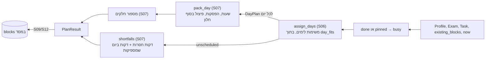

# S07 — מתכנן ב': אריזה לשעות, פיצול ודוח "לא נכנס": תוכנית עבודה

> **For agentic workers:** REQUIRED SUB-SKILL: Use superpowers:subagent-driven-development (recommended) or superpowers:executing-plans to implement this plan task-by-task. Steps use checkbox (`- [ ]`) syntax for tracking.

**מטרה:** הפונקציה הטהורה `plan(profile, exams, tasks, existing_blocks, now) -> PlanResult` ב-`api/app/domain/planner/`. היא לוקחת את מה ש-S06 שיבץ לכל יום, אורזת אותו לשעות בתוך החלונות, ממספרת חלקים ומחזירה דוח של מה שלא נכנס: לכל מבחן, כמה דקות חסרות, וכמה דקות ביום היו מכניסות אותן.

**גישה:** האריזה מכבדת בדיוק את החוזה של `capacity.py` (סעיף 7.6 שלב 4), ולכן כל יום ש-`day_fits` אישר נארז במלואו. אריזה שנכשלת היא באג בחוזה, והיא זורקת שגיאה במקום להעלים משימה. ה-properties של hypothesis בודקים את זה על אלפי ימים, כולל ימים צפופים.

**כלים:** Python 3.14, ‏uv, ‏hypothesis (כבר קיים). אין תלות חדשה, אין מסד, אין מיגרציה.

**מסמך תכנון:** `docs/superpowers/specs/2026-10-19-studyflow-v2-design.md`, סעיף 7.6 (שלבים 4–5, החוזה עם שלב 3, האינווריאנטים), וגם 7.9 (הטקסטים ב-`he.ts`), 10 ו-11.7. במפת הדרכים שב-[artifact](https://claude.ai/code/artifact/29a3c52e-d399-425e-90b6-7c05e9146bfa) זו משימה S07, והיא מוכנה כשאף משימה לא נעלמת ובדיקות ה-property ירוקות.

## איך החלקים מתחברים



- **`assign_days`** (S06) מחליט מה לומדים בכל יום, ושם ביום רק מה ש-`day_fits` מאשר.
- **`pack_day`** (חדש) מחליט מתי ביום: הסימולציה בתחילת החלון הקטן ביותר שמחזיק אותה, השאר לפי סדר שמכבד תלויות ומקדים מיקוד גבוה, עם הפסקות של 10 דקות והפסקה ארוכה אחת של 30. היא לא מחליטה מה נכנס, ולכן היא לא יכולה להפיל משימה.
- **`plan`** (חדש) מחבר: בלוקים שהושלמו או ננעלו הופכים ל-busy, השיבוץ לימים, האריזה, המספור והדוח.
- **הדוח** הוא קודים ומספרים. הטקסט בעברית נכתב ב-`he.ts` של ה-web (סעיף 7.9: כל הטקסטים שם), כשמסך יציג אותו.

## מה מצאתי לפני התכנון (2026-11-04)

| נושא | מצב |
|---|---|
| Dependabot | אין ענפים פתוחים שלו ב-remote |
| ה-artifact | ב"פריטים פתוחים להמשך" 7 שורות של S07. ב"באגים שנרשמו" אין באגים. הסטטוס של S07 עבר ל"בעבודה" |
| סימולציה ארוכה מהתקציב | מקבלת היום `no_contiguous_window` (בדקתי: סימולציה של 180 דקות, תקציב 120). ב-artifact כתוב `not_enough_time`. שניהם מטעים: יש חלון, חסר תקציב |
| זמן ריצה | `assign_days` על קלטים של הגנרטור: חציון 0.8ms, ‏p95 ‏2.5ms. בדיקות המתכנן רצות היום ב-7 שניות (309 בדיקות בסך הכל) |
| `blocks` במסד | `part_index` בין 1 ל-`part_count`, ‏`part_count ≥ 1`, ‏`status` מתוך planned/done/missed/skipped, ‏`pinned` boolean |

## ההחלטות שלי

| נושא | החלטה | למה | על מה ויתרנו |
|---|---|---|---|
| פריטי S07 ב-artifact | נכנסים: האריזה לפי החוזה; ‏`existing_blocks` כ-busy; property לסדר התלויות בזמן; קוד סיבה לסימולציה ארוכה מהתקציב; ענף של ימים צפופים בגנרטור. נדחים ל-S08: הרזרבה של 70 דקות בימים מפוצלים, והיום השמור לסימולציה שלא משתחרר | חמשת הראשונים הם האריזה עצמה, הדוח שלה והבדיקות שלה. שני האחרונים משנים את שלב 3 של S06 (כלל הקיבולת ושמירת הימים), ו-S08 בונה מחדש את השיבוץ לתכנון יציב, ושם ימים מפוצלים נעשים שגרה | לתקן עכשיו את שלב 3, ולהחליף חוזה מוכח לפני שיש לו צרכן |
| הסדר בתוך היום | מיון טופולוגי לפי התלויות בתוך היום. מבין המשימות המוכנות, `focus` גבוה קודם, ובשוויון הסדר של `assign_days` | "משימות במיקוד גבוה בחלון הראשון של היום" (7.6 שלב 4). החסם של 70 דקות לא תלוי בסדר, אז כל סדר שמכבד תלויות נארז | מיון לפי `focus` בלבד, ששובר תלויות |
| ההפסקה הארוכה | אחרי הבלוק שבו הסכום המצטבר עובר חצי מהדקות של היום (`before·2 < total ≤ after·2`), כולל הסימולציה. רק אם הבלוק הבא באותו חלון | בדיוק החוזה. בלוק אחד ויחיד עומד בתנאי | הפסקה ארוכה בשעה קבועה |
| פיצול בסוף חלון | פריט שלא נכנס: אם נשארו בחלון 30 דקות לפחות, נכנס חלק `min(free, m − 30)`, אם הוא 30 לפחות, והשאר עובר לחלון הבא בלי הפסקה. אחרת הפריט כולו עובר לחלון הבא | זה מה שהחסם של 68 דקות לחלון מניח: פריט של שעה ומעלה תמיד מתפצל, ופריט קצר משעה מבזבז לכל היותר 58 דקות ועוד ההפסקה | לא לפצל כשהחלון הבא מחזיק את הפריט שלם. נעים יותר, אבל שובר את החסם |
| הזנב של חלון הסימולציה | האריזה לא עושה לו מקרה מיוחד: אם פריט נכנס שם, הוא נכנס | החסם לא סופר את הזנב, אז מה שנכנס בו רק מקטין את מה שצריך בחלונות האחרים. ההפסקה שאחרי הסימולציה כבר בחשבון | לדלג עליו, ולבזבז עד 29 דקות |
| אריזה שנכשלת | `RuntimeError` עם היום והמשימה. לא נבלעת ולא נכנסת לדוח | זה באג בחוזה בין השלבים, לא מצב של משתמש. ה-properties מחפשים בדיוק את זה | להעביר את השארית לדוח, ולהסתיר באג |
| `existing_blocks` | טיפוס `ExistingBlock` (משימה, זמן, סטטוס, `pinned`). בלוק שהושלם או ננעל הוא busy. בלוק `planned` שלא ננעל, ‏`missed` ו-`skipped` לא תופסים זמן | סעיף 7.6 שלב 1: "בלוקים שהושלמו או ננעלו". בלוק מתוכנן שלא ננעל מוחלף בתוכנית החדשה | להחליט כבר עכשיו מה נשאר במקום בתכנון מחדש: S08 |
| משימה עם בלוק שהושלם או ננעל | S07 לא מקטין את המשימה. ‏`plan` נכון כשלמשימות todo אין בלוקים כאלה, וזה המצב בתוכנית ראשונה | הקטנת הדקות, המספור מול חלקים קיימים והתלויות מולם הם הליבה של S08 (שורה קיימת ב-artifact). ‏`plan` לא נקרא מה-API לפני S09 | לחשב דקות שנשארו עכשיו, בלי יציבות ובלי `plan_versions` |
| קוד סיבה חדש | `longer_than_daily_minutes`: סימולציה ארוכה מ-`daily_study_minutes`. אחרי התלויות, לפני `no_contiguous_window` | הסיבה האמיתית היא התקציב, וההצעה היא להעלות אותו | להשאיר `no_contiguous_window` |
| הדוח | `ExamShortfall(exam_id, minutes, daily_minutes)` לכל מבחן שיש לו משימות בדוח, בלי משימות על מעגל תלויות. ‏`daily_minutes` הוא הערך הקטן ביותר בקפיצות של 30 (מעל התקציב הנוכחי, עד 960) שבו `assign_days` לא משאיר למבחן כלום בדוח, או `None` | "חסרות 4 שעות לפני המבחן בפיזיקה, עם הצעות: להעלות את הדקות היומיות או לוותר על משימות" (7.6 שלב 5). המספר הוא ההצעה השימושית, וחיפוש לינארי מבטיח שהוא באמת מספיק. עד 31 הרצות של כ-2ms. "לוותר על משימות" תמיד אפשרי, ומשקל למשימות יגיע עם הנושאים (S11) | הצעה בלי מספר; חיפוש בינארי, שמניח מונוטוניות שאין לשיבוץ greedy |
| הטקסט בעברית | לא בדומיין. הקודים והמספרים עוברים ב-API, והתרגום ב-`he.ts` (סעיף 7.9) | שם המבחן לא בדומיין, וכל הטקסטים של הממשק בקובץ אחד | מחרוזות בעברית ב-Python |
| ימים צפופים בגנרטור | `planner_inputs()` מגריל בערך בחצי מהפעמים קלט צפוף: מבחן או שניים בעוד 1–10 ימים, 10–30 משימות של 30–120 דקות ותקציב של 60–240. כל ה-properties, הישנים והחדשים, מקבלים אותו | ב-S06 ה-property `test_reported_tasks_did_not_fit` בדק 5 משימות ב-200 דוגמאות. האריזה נבחנת באמת רק ביום מלא | גנרטור נפרד רק ל-property אחד |

## מה לא נכלל ולמה

- **הרזרבה של 70 דקות בימים מפוצלים, והיום השמור לסימולציה:** ‏S08 (למעלה).
- **דקות שנשארו במשימה עם בלוקים שהושלמו או ננעלו, ויציבות של בלוקים עתידיים:** ‏S08.
- **הטקסט בעברית של הסיבות והדוח:** ‏S13, במסך "בונים לך תוכנית".
- **מיפוי `PlanResult` לשורות `blocks`:** ‏S09 ו-S12.

## אילוצים גלובליים

- Python 3.14, ‏uv, ‏`exclude-newer = "7 days"`. אין תלות חדשה.
- `ruff check`, ‏`ruff format --check`, ‏`mypy` (strict) ו-`pytest` עם `filterwarnings = ["error"]`, כמו בטבלה שב-`CLAUDE.md`. הבדיקות הקיימות (309) נשארות ירוקות, חוץ מבדיקה אחת שהתוכנית משנה במפורש (Task 1). בדיקות המתכנן לא נוגעות במסד.
- המתכנן טהור: בלי `datetime.now()`, בלי I/O, בלי אקראיות, ובלי לעבור בלולאה על `set` או `frozenset` כשהסדר משפיע על התוצאה. אותו קלט נותן תמיד אותו פלט.
- כל `datetime` שהמתכנן מקבל או מחזיר הוא aware. בתוך `Interval` הוא ב-UTC (`tzinfo is datetime.UTC`) ובדקה שלמה. חשבון על זמנים בתוך יום נעשה על UTC, ולכן הפסקה של 10 דקות היא 10 דקות אמיתיות גם בלילה של מעבר שעון.
- החוזה של `capacity.py` לא משתנה: לא את הקבועים, לא את `day_fits`, ‏`room` ו-`simulation_window`, ולא את ההערה שמתארת את כללי האריזה. אם האריזה לא מצליחה לכבד אותו, עוצרים ומדווחים.
- ‏`assign_days` משתנה רק במה ש-Task 1 מגדיר.
- property שנכשל לא מוחלש ולא מקבל `assume` כדי לעבור. מדווחים את הדוגמה המינימלית ועוצרים.
- `Profile`, ‏`Exam`, ‏`Task`, והטיפוסים החדשים `ExistingBlock` ו-`PlannedBlock`, משקפים את ה-`CHECK` של `api/migrations/versions/0002_core_tables.py`.
- לא נוגעים ב-`legacy/`.
- הקוד, ההערות בקוד והודעות הקומיט באנגלית. התוכנית וההודעות אליך בעברית.
- git רץ בשיחה הראשית, וה-subagents לא מריצים git. מוסיפים קבצים לפי שם, ובודקים `git status --short --untracked-files=all` לפני כל קומיט. לפני כל push מריצים `gitleaks git --redact --no-banner .`. אין force-push.
- **הריפו ב-`/Users/eyalatar/studyflow`.** תיקיית העבודה של הסשן, `~/Desktop/MyProject/studyflow`, היא העתק ישן. כל subagent עובד רק בנתיבים מלאים תחת `/Users/eyalatar/studyflow`, והפקודות רצות מתוך `/Users/eyalatar/studyflow/api`.

## על מה לשים לב בבדיקה

1. **יום מלא עד הדקה:** `day_fits` מאשר בדיוק, ואז הפסקה ארוכה שנפלה במקום הלא נכון או פיצול שהשאיר 20 דקות מפילים את הפריט האחרון. מה שצריך לקרות: האריזה מצליחה. Task 2 בודק מקרים חדים, ו-Task 4 בודק כ-property על ימים צפופים.
2. **תלות בתוך היום מול מיקוד:** משימה במיקוד 9 שתלויה במשימה במיקוד 2. מה שצריך לקרות: הדרישה המוקדמת קודם. Task 2 בודק, ו-Task 4 בודק לפי שעות.
3. **סימולציה בחלון אמצעי:** משימה שמתפצלת בסוף החלון הראשון ממשיכה בחלון של הסימולציה. מה שצריך לקרות: ההמשך אחרי הסימולציה וההפסקה, לא עליה. Task 2 ו-Task 4.
4. **בלוק `planned` שלא ננעל:** אם הוא נספר כ-busy, התוכנית החדשה עוקפת את הישנה. מה שצריך לקרות: רק done או pinned תופסים זמן. Task 3.
5. **ההצעה "להעלות ל-X דקות":** X שלא באמת מספיק. מה שצריך לקרות: הרצה עם X לא משאירה למבחן כלום בדוח, והרצה עם X − 30 כן. Task 3 ו-Task 4.

## מי עושה מה

| Task | מה | מי | תלוי ב- |
|---|---|---|---|
| 0 | פתיחה: Dependabot, הסטטוס, הענף והתוכנית | אני (נעשה, חוץ מהקומיט) | — |
| 1 | טיפוסי הפלט והקלט החדשים, וקוד הסיבה | subagent | 0 |
| 2 | האריזה של יום: `pack_day` | subagent | 1 |
| 3 | `plan()`: busy, מספור ודוח | subagent | 2 |
| 4 | properties: ימים צפופים, אריזה ותלויות בזמן | subagent | 3 |
| 5 | מסמך התכנון והלשונית שלו | אני | 4 |
| 6 | סקירה סופית, מיזוג וסגירה | אני | 5 |

## מבנה הקבצים

```
api/app/domain/planner/model.py          + BlockStatus, ExistingBlock, PlannedBlock, ExamShortfall, PlanResult, UnscheduledReason.LONGER_THAN_DAILY_MINUTES
api/app/domain/planner/assign.py         הסיבה החדשה ב-_reason
api/app/domain/planner/pack.py           pack_day (חדש)
api/app/domain/planner/plan.py           plan (חדש)
api/app/domain/planner/__init__.py       + השמות החדשים ב-__all__
api/tests/planner/test_model.py          + הטיפוסים החדשים
api/tests/planner/test_simulations.py    הסיבה החדשה
api/tests/planner/test_pack.py           (חדש)
api/tests/planner/test_plan.py           (חדש)
api/tests/planner/strategies.py          + ימים צפופים, existing_blocks_for, plan_inputs
api/tests/planner/test_properties.py     בלי שינוי בבדיקות; מקבל את הענף הצפוף דרך planner_inputs
api/tests/planner/test_plan_properties.py (חדש)
מסמך התכנון (7.6) והלשונית שלו ב-artifact
```

---

### Task 0: פתיחה

נעשה לפני כתיבת התוכנית: אין ענפים פתוחים של Dependabot, הסטטוס של S07 ב-artifact הוא "בעבודה", והענף `s07-planner-hours` נפתח מ-`main` (`06e3699`).

- [ ] **Step 1: קומיט של התוכנית**
  ```bash
  git status --short --untracked-files=all
  git add docs/superpowers/plans/2026-11-04-s07-planner-hours.md
  git commit -m "docs(plan): add the S07 planner hour packing plan"
  ```

---

### Task 1: טיפוסים חדשים וקוד הסיבה

**למה:** Task 2 ו-Task 3 מדברים בטיפוסים האלה, ו-S09 ימפה אותם לשורות `blocks`. קוד הסיבה החדש נותן לדוח את הסיבה האמיתית, וממנה את ההצעה הנכונה.

**Files:**
- Modify: `api/app/domain/planner/model.py`, ‏`api/app/domain/planner/assign.py`, ‏`api/app/domain/planner/__init__.py`
- Modify: `api/tests/planner/test_model.py`, ‏`api/tests/planner/test_simulations.py`

**Interfaces:**
- Consumes: ‏`Interval` (‏`intervals.py`), ‏`_require` ו-`PlannerInputError` (‏`model.py`).
- Produces, ב-`app.domain.planner.model` (כל ה-dataclasses עם `frozen=True, slots=True, kw_only=True`, וכל הפרה זורקת `PlannerInputError`, כמו הטיפוסים הקיימים):
  - `class BlockStatus(StrEnum)`: ‏`PLANNED = "planned"`, ‏`DONE = "done"`, ‏`MISSED = "missed"`, ‏`SKIPPED = "skipped"`, בסדר הזה.
  - `UnscheduledReason.LONGER_THAN_DAILY_MINUTES = "longer_than_daily_minutes"`, אחרון ב-enum.
  - `ExistingBlock`: ‏`task_id: UUID`, ‏`interval: Interval`, ‏`status: BlockStatus`, ‏`pinned: bool`. בודק `isinstance` לכל ארבעת השדות (`pinned` חייב להיות `bool` ממש).
  - `PlannedBlock`: ‏`task_id: UUID`, ‏`interval: Interval`, ‏`part_index: int`, ‏`part_count: int`. בודק `isinstance` ל-`task_id` ול-`interval`, ‏`part_count >= 1`, ו-`1 <= part_index <= part_count`.
  - `ExamShortfall`: ‏`exam_id: UUID`, ‏`minutes: int` (גדול מ-0), ‏`daily_minutes: int | None`.
  - `PlanResult`: ‏`blocks: tuple[PlannedBlock, ...]`, ‏`unscheduled: tuple[Unscheduled, ...]`, ‏`warnings: tuple[PlanWarning, ...]`, ‏`shortfalls: tuple[ExamShortfall, ...]`. בלי בדיקות.
- Produces, ב-`assign.py`: ‏`_reason` מחזיר `LONGER_THAN_DAILY_MINUTES` לסימולציה שה-`estimated_minutes` שלה גדול מ-`daily_study_minutes`. הסדר: מעגל, ‏`no_study_days`, שתי סיבות התלות, **הסיבה החדשה**, ‏`no_contiguous_window`, ‏`not_enough_time`. ‏`_Context` מקבל `frozenset` של הסימולציות האלה, ומחושב ב-`_prepare`. שום דבר אחר ב-`assign.py` לא משתנה.
- `__init__.py` מייצא את `BlockStatus`, ‏`ExamShortfall`, ‏`ExistingBlock`, ‏`PlanResult` ו-`PlannedBlock` ב-`__all__`, בסדר האלפביתי של הרשימה הקיימת.

- [ ] **Step 1: הבדיקות**

  ב-`tests/planner/test_model.py`, עם `iv` ו-`at` הקיימים שם:

  | בדיקה | קלט | מצופה |
  |---|---|---|
  | `test_existing_block_accepts_valid_fields` | `ExistingBlock(task_id=uuid4(), interval=iv((7,),(8,)), status=BlockStatus.DONE, pinned=False)` | נבנה בלי שגיאה |
  | `test_existing_block_rejects_bad_types` (parametrize) | `task_id="x"`; ‏`interval=(at(7), at(8))`; ‏`status="done"`; ‏`pinned=1` | `PlannerInputError` |
  | `test_planned_block_part_range` (parametrize) | `(part_index, part_count)`: ‏`(1, 1)` ו-`(2, 3)` תקינים; ‏`(0, 1)`, ‏`(2, 1)`, ‏`(1, 0)` | התקינים נבנים; השאר `PlannerInputError` |
  | `test_planned_block_rejects_bad_types` (parametrize) | `task_id="x"`; ‏`interval=None` | `PlannerInputError` |
  | `test_exam_shortfall_needs_minutes` | `minutes=0` | `PlannerInputError`; עם `minutes=1, daily_minutes=None` נבנה |

  ב-`tests/planner/test_simulations.py`:
  - `test_simulation_longer_than_the_daily_budget` משתנה: הסיבה המצופה היא `UnscheduledReason.LONGER_THAN_DAILY_MINUTES` (במקום `NO_CONTIGUOUS_WINDOW`). זו הבדיקה הקיימת היחידה שמשתנה.
  - חדשה, `test_an_over_budget_simulation_reports_its_dependency_first`: מבחן ב-`nov(5)`, שתי משימות `learn` של 30 דקות, `a` ו-`b`, שתלויות זו בזו (מעגל), וסימולציה של 300 דקות שתלויה ב-`a`. מצופה: `a` ו-`b` בדוח עם `DEPENDENCY_CYCLE`, והסימולציה עם `DEPENDENCY_NOT_SCHEDULED` ו-`blocked_by == a.id`, ולא עם הסיבה החדשה.

- [ ] **Step 2: הבדיקות נכשלות**
  Run (מתוך `api/`): `uv run pytest tests/planner/test_model.py tests/planner/test_simulations.py -q`
  Expected: ‏`ImportError` על `BlockStatus`.

- [ ] **Step 3: מימוש**

- [ ] **Step 4: הכל ירוק**
  Run: `uv run pytest -q && uv run ruff check . && uv run ruff format --check . && uv run mypy`

- [ ] **Step 5: קומיט (בשיחה הראשית)**
  `git add api/app/domain/planner/model.py api/app/domain/planner/assign.py api/app/domain/planner/__init__.py api/tests/planner/test_model.py api/tests/planner/test_simulations.py`
  `git commit -m "feat(api): add planner block types and the over-budget simulation reason"`

---

### Task 2: האריזה של יום

**למה:** זה שלב 4 של 7.6. היא קובעת מתי כל בלוק מתחיל, ומכבדת את החוזה של `capacity.py`, כך שכל מה ש-`assign_days` שם ביום נכנס.

**Files:**
- Create: `api/app/domain/planner/pack.py`, ‏`api/tests/planner/test_pack.py`
- Modify: `api/app/domain/planner/__init__.py`

**Interfaces:**
- Consumes: ‏`StudyDay`, ‏`DayItem`, ‏`Task`, ‏`TaskKind` (‏`model.py`); ‏`Interval` (‏`intervals.py`); ‏`BREAK_MINUTES`, ‏`LONG_BREAK_MINUTES`, ‏`MIN_PART_MINUTES`, ‏`simulation_window` (‏`capacity.py`).
- Produces, ב-`app.domain.planner.pack`:
  - `pack_day(day: StudyDay, items: Sequence[DayItem], tasks: Mapping[UUID, Task], prerequisite: Mapping[UUID, UUID]) -> tuple[tuple[UUID, Interval], ...]`: הבלוקים של היום כ-`(task_id, interval)`, לפי סדר הזמן. ‏`prerequisite` הוא `Dependencies.prerequisite` של כל הקלט; רק דרישות מוקדמות שנמצאות בין הפריטים של היום משפיעות. ‏`items` ריק: `()`.
  - `__init__.py` מייצא את `pack_day`.

  האלגוריתם (כל הזמנים ב-UTC, בדקות שלמות):
  1. **הפרדה:** הסימולציה של היום (פריט שה-`kind` של המשימה שלו הוא `SIMULATION`; לכל היותר אחד) והשאר. לסימולציה, `index = simulation_window([w.minutes for w in day.windows], minutes)`. אם `None`: ‏`RuntimeError`.
  2. **סדר השאר:** מיון טופולוגי. כל עוד נשארו פריטים, בוחרים מבין הפריטים שהדרישה המוקדמת שלהם (`prerequisite.get(task_id)`) לא נמצאת בין הפריטים שעוד לא נבחרו, את זה עם ה-`focus` הגבוה ביותר, ובשוויון את המוקדם ב-`items`.
  3. **ההפסקה הארוכה:** `total` הוא סכום הדקות של כל הפריטים, כולל הסימולציה. בלוק הוא "הבלוק של ההפסקה הארוכה" אם `before·2 < total ≤ after·2`, כש-`before` ו-`after` הם הדקות המצטברות של הבלוקים לפי סדר הזמן, לפניו ואחריו.
  4. **המעבר על החלונות** לפי הסדר, עם סמן שמתחיל בתחילת החלון:
     - בחלון `index`, לפני כל דבר אחר: הסימולציה, מתחילת החלון.
     - ההפסקה לפני בלוק: 0 אם אין בלוק קודם באותו חלון; ‏`LONG_BREAK_MINUTES` אם הבלוק הקודם הוא הבלוק של ההפסקה הארוכה; אחרת `BREAK_MINUTES`.
     - לפריט הבא עם `m` דקות שנשארו: `free` = מסוף החלון פחות (הסמן + ההפסקה). אם `m ≤ free`: הוא נכנס שלם. אחרת, אם `free ≥ MIN_PART_MINUTES`: ‏`part = min(free, m − MIN_PART_MINUTES)`, ואם `part ≥ MIN_PART_MINUTES` נכנס חלק של `part` דקות, ו-`m − part` ממשיכות לחלון הבא. בכל מקרה אחר, הפריט עובר לחלון הבא בלי שנכנס כלום.
     - אחרי חלק, או כשפריט עובר, ממשיכים לחלון הבא. ההפסקה שלא נלקחה לא עוברת איתו.
  5. **כשל:** אם נגמרו החלונות ונשארו פריטים (או שהסימולציה לא נכנסה), ‏`RuntimeError` עם התאריך של היום ומזהה המשימה. החוזה אומר שזה לא קורה.

- [ ] **Step 1: הבדיקות, ב-`tests/planner/test_pack.py`**

  `at(h, m=0)` הוא `datetime(2026, 11, 2, h, m, tzinfo=UTC)`, ‏`iv(a, b)` הוא `Interval(at(*a), at(*b))`, ו-`day(*windows)` הוא `StudyDay(date=date(2026, 11, 2), windows=windows)`. המשימות מ-`make_task` (ב-`focus=5` אלא אם כתוב אחרת), ו-`items` הם `DayItem(task_id, minutes)` לפי הסדר שבטבלה. ‏`prerequisite` ריק אלא אם כתוב אחרת. המצופה הוא רשימת `(משימה, iv(...))`.

  | בדיקה | חלונות | פריטים | מצופה |
  |---|---|---|---|
  | `test_one_item_starts_at_the_window` | `07:00–12:00` | A 60 | `A 07:00–08:00` |
  | `test_breaks_and_the_long_break` | `07:00–12:00` | A 60, ‏B 60, ‏C 60 | `A 07:00–08:00`, ‏`B 08:10–09:10`, ‏`C 09:40–10:40` (החצי עובר ב-B) |
  | `test_the_window_gap_replaces_the_long_break` | `07:00–08:00`, ‏`09:00–12:00` | A 60, ‏B 60 | `A 07:00–08:00`, ‏`B 09:00–10:00` |
  | `test_an_item_splits_at_the_window_end` | `07:00–08:00`, ‏`09:00–12:00` | A 100 | `A 07:00–08:00`, ‏`A 09:00–09:40` |
  | `test_the_last_part_stays_long_enough` | `07:00–08:00`, ‏`09:00–12:00` | A 80 | `A 07:00–07:50`, ‏`A 09:00–09:30` |
  | `test_a_short_item_moves_to_the_next_window` | `07:00–08:00`, ‏`09:00–11:00` | A 30, ‏B 50 | `A 07:00–07:30`, ‏`B 09:00–09:50` |
  | `test_the_simulation_takes_the_smallest_window_that_holds_it` | `07:00–12:00`, ‏`13:00–16:30` | A 60, ‏S 180 (simulation) | `A 07:00–08:00`, ‏`S 13:00–16:00` |
  | `test_items_after_the_simulation_wait_for_its_break` | `07:00–12:00` | S 120 (simulation), ‏A 60 | `S 07:00–09:00`, ‏`A 09:30–10:30` (החצי עובר בסימולציה) |
  | `test_a_split_item_goes_on_after_the_simulation` | `07:00–08:00`, ‏`09:00–15:00` | A 100, ‏S 180 (simulation) | `A 07:00–08:00`, ‏`S 09:00–12:00`, ‏`A 12:30–13:10` (החצי, 140 מתוך 280, עובר בסימולציה) |
  | `test_high_focus_goes_first` | `07:00–12:00` | A 60 (focus 3), ‏B 60 (focus 8) | `B 07:00–08:00`, ‏`A 08:30–09:30` |
  | `test_focus_never_breaks_a_dependency` | `07:00–12:00` | A 60 (focus 2), ‏B 60 (focus 9, תלויה ב-A), ‏C 60 (focus 5); ‏`prerequisite={B: A}` | `C 07:00–08:00`, ‏`A 08:10–09:10`, ‏`B 09:40–10:40` |
  | `test_a_prerequisite_from_another_day_does_not_hold_back` | `07:00–12:00` | A 60 (focus 2), ‏B 60 (focus 9); ‏`prerequisite={B: X}`, כש-X לא בפריטים | `B 07:00–08:00`, ‏`A 08:30–09:30` |
  | `test_an_empty_day` | `07:00–12:00` | — | `()` |
  | `test_a_day_that_does_not_pack_raises` | `07:00–08:00` | A 61 | `RuntimeError` (‏31 דקות נכנסות, 30 נשארות בלי חלון) |
  | `test_a_simulation_without_a_window_raises` | `07:00–08:00` | S 90 (simulation) | `RuntimeError` |

- [ ] **Step 2: הבדיקות נכשלות**
  Run: `uv run pytest tests/planner/test_pack.py -q`
  Expected: ‏`ModuleNotFoundError` על `app.domain.planner.pack`.

- [ ] **Step 3: מימוש `pack.py`, ועדכון `__init__.py`**
  ה-docstring של המודול מפנה לכללי האריזה ב-`capacity.py` ולא מעתיק אותם.

- [ ] **Step 4: הכל ירוק**
  Run: `uv run pytest -q && uv run ruff check . && uv run ruff format --check . && uv run mypy`

- [ ] **Step 5: קומיט (בשיחה הראשית)**
  `git add api/app/domain/planner/pack.py api/app/domain/planner/__init__.py api/tests/planner/test_pack.py`
  `git commit -m "feat(api): pack a study day into timed blocks"`

---

### Task 3: `plan()`

**למה:** זו הפונקציה שה-worker יקרא לה (S12). היא מחברת את השלבים ומחזירה את מה שנכתב למסד ואת הדוח שהמשתמש יראה.

**Files:**
- Create: `api/app/domain/planner/plan.py`, ‏`api/tests/planner/test_plan.py`
- Modify: `api/app/domain/planner/__init__.py`

**Interfaces:**
- Consumes: ‏`assign_days` (‏`assign.py`), ‏`resolve_dependencies` (‏`dependencies.py`), ‏`pack_day` (Task 2), הטיפוסים של Task 1.
- Produces, ב-`app.domain.planner.plan`:
  - `plan(profile: Profile, exams: Sequence[Exam], tasks: Sequence[Task], existing_blocks: Sequence[ExistingBlock], now: datetime) -> PlanResult`.
  - `__init__.py` מייצא את `plan`.

  האלגוריתם:
  1. **busy:** ה-`interval` של כל בלוק ב-`existing_blocks` שהוא `pinned` או שה-`status` שלו `DONE`, לפי סדר הקלט. כל איבר ב-`existing_blocks` שאינו `ExistingBlock` זורק `PlannerInputError`.
  2. `assignment = assign_days(profile, exams, tasks, now, busy)`.
  3. לכל `DayPlan` עם פריטים: `pack_day(plan.day, plan.items, tasks_by_id, resolve_dependencies(tasks).prerequisite)`.
  4. **מספור:** לכל משימה, הבלוקים שלה לפי סדר הזמן מקבלים `part_index` מ-1 עד `n`, ו-`part_count = n`. ‏`blocks` כולו ממוין לפי זמן ההתחלה.
  5. **shortfalls:** לכל מבחן, לפי סדר הקלט: ‏`minutes` הוא סכום הדקות של המשימות שלו ב-`unscheduled`, בלי `DEPENDENCY_CYCLE`. מבחן עם 0 לא נכנס. ‏`daily_minutes`: עוברים על הערכים `c = 30·(daily_study_minutes // 30 + 1)`, ‏`c + 30`, ... עד 960, כולל. לכל ערך מריצים `assign_days` עם `dataclasses.replace(profile, daily_study_minutes=c)` ואותם `exams`, ‏`tasks`, ‏`now`, ‏`busy`. הערך הראשון שבו למבחן אין דקות כאלה הוא ה-`daily_minutes` שלו. עוצרים כשלכל המבחנים נמצא ערך. מבחן שלא נמצא לו: `None`. אם אין מבחן עם חוסר, אין הרצות נוספות.
  6. `PlanResult(blocks, assignment.unscheduled, assignment.warnings, shortfalls)`.

  ה-docstring של `plan` אומר במפורש: בלוקים שהושלמו או ננעלו רק תופסים זמן, ולא מקטינים את המשימה שלהם. ההקטנה שייכת ל-S08.

- [ ] **Step 1: הבדיקות, ב-`tests/planner/test_plan.py`**

  `make_profile()`: ב-1–3 בנובמבר, חלון אחד `07:00Z–15:00Z` ותקציב 240. מבחן ב-`nov(5)` נותן ימי לימוד 1–3 בנובמבר. ‏`Z(y, mo, d, h, mi=0)` כמו ב-`test_simulations.py`.

  | בדיקה | קלט | מצופה |
  |---|---|---|
  | `test_a_long_task_spans_days_with_numbered_parts` | מבחן `nov(5)`; ‏A ‏`learn` 300 | `blocks == (PlannedBlock(A, Z(2026,11,1,7)–Z(2026,11,1,11), 1, 2), PlannedBlock(A, Z(2026,11,2,7)–Z(2026,11,2,8), 2, 2))`; ‏`unscheduled == ()`; ‏`shortfalls == ()` |
  | `test_done_and_pinned_blocks_are_busy` | מבחן `nov(5)`; ‏A ‏`learn` 120; ‏`existing_blocks`: ‏`DONE` לא נעול `Z(…1,7)–Z(…1,9)`, ‏`PLANNED` נעול `Z(…1,13)–Z(…1,15)`, ‏`PLANNED` לא נעול `Z(…1,9)–Z(…1,10)`, ‏`MISSED` לא נעול `Z(…1,10)–Z(…1,11)` (כולם של משימה אחרת, שלא בקלט) | `A` אחד, ‏`Z(…1,9)–Z(…1,11)` |
  | `test_an_over_budget_simulation_suggests_its_minutes` | מבחן `nov(5)`; סימולציה של 300 | `unscheduled` עם `LONGER_THAN_DAILY_MINUTES`; ‏`shortfalls == (ExamShortfall(exam.id, 300, 300),)` |
  | `test_a_shortfall_that_more_minutes_cannot_fix` | `make_profile(study_windows=frozenset({StudyWindow.EVENING}))`, מבחן `nov(3)` (יום לימוד אחד: 1 בנובמבר, ‏`15:00Z–19:00Z`); ‏A ו-B ‏`learn` 240 כל אחת | A משובצת, B בדוח עם `NOT_ENOUGH_TIME`; ‏`shortfalls == (ExamShortfall(exam.id, 240, None),)` |
  | `test_more_minutes_fix_a_shortfall` | מבחן `nov(3)` (יום לימוד אחד, 1 בנובמבר, חלון 480); ‏A ו-B ‏`learn` 150 כל אחת | B בדוח עם `NOT_ENOUGH_TIME`; ‏`shortfalls == (ExamShortfall(exam.id, 150, 300),)` |
  | `test_a_cycle_is_not_a_shortfall` | שתי משימות שתלויות זו בזו | שתיהן בדוח עם `DEPENDENCY_CYCLE`; ‏`shortfalls == ()` |
  | `test_rejects_what_is_not_an_existing_block` | `existing_blocks=[Interval(...)]` | `PlannerInputError` |
  | `test_same_input_same_output` | הקלט של הבדיקה הראשונה | שתי הרצות שוות |

  **החשבון של `test_more_minutes_fix_a_shortfall`:** בתקציב 240, ‏A נכנסת ו-B לא (‏300 > 240). ב-270 עדיין לא. ב-300: ‏`150 + 150 = 300 ≤ 300`, ו-`day_fits([480], [150, 150])` נכון (‏`300 + 10 + 20 = 330 ≤ 480`). מצופה שנראה אחרת בהרצה לא משתנה בשקט: מדווחים למה.

- [ ] **Step 2: הבדיקות נכשלות**
  Run: `uv run pytest tests/planner/test_plan.py -q`
  Expected: ‏`ModuleNotFoundError` על `app.domain.planner.plan`.

- [ ] **Step 3: מימוש `plan.py`, ועדכון `__init__.py`**

- [ ] **Step 4: הכל ירוק**
  Run: `uv run pytest -q && uv run ruff check . && uv run ruff format --check . && uv run mypy`

- [ ] **Step 5: קומיט (בשיחה הראשית)**
  `git add api/app/domain/planner/plan.py api/app/domain/planner/__init__.py api/tests/planner/test_plan.py`
  `git commit -m "feat(api): plan study blocks with numbered parts and a shortfall report"`

---

### Task 4: properties

**למה:** הבדיקות האלה הן ההוכחה שהחוזה בין השלבים מחזיק: אף משימה לא נעלמת בין השיבוץ לימים לבין השעות. ‏7.6 ו-10 דורשים אותן לכל האינווריאנטים.

**Files:**
- Modify: `api/tests/planner/strategies.py`
- Create: `api/tests/planner/test_plan_properties.py`
- Modify (רק אם צריך import): `api/tests/planner/test_properties.py`

**Interfaces:**
- Consumes: ‏`plan`, ‏`pack_day`, ‏`study_days`, ‏`assign_days`, ‏`exam_cutoff`, ‏`last_study_day`, ‏`resolve_dependencies`, ‏`BREAK_MINUTES`, ‏`MIN_PART_MINUTES`, והטיפוסים של Task 1.
- Produces, ב-`tests/planner/strategies.py`:
  - **הענף הצפוף:** ‏`planner_inputs()` מגריל בערך בחצי מהפעמים קלט רחב (כמו היום) ובחצי קלט צפוף: מבחן אחד או שניים, כל אחד 1–10 ימים אחרי היום; 10–30 משימות שהדקות שלהן מתוך `(30, 45, 60, 90, 120)`; ‏`daily_study_minutes` מתוך 60–240 בקפיצות של 30. כל השאר (אזורי זמן, `now`, חלונות, תלויות, סטטוסים, busy) כמו בקלט הרחב. אבני הבניין (`profiles`, ‏`exams_for`, ‏`tasks_for`) מקבלות פרמטרים אופציונליים במקום עותק שני שלהן. ה-docstring של המודול מתעדכן.
  - `existing_blocks_for(profile, now, tasks)`: ‏0 עד `MAX_BUSY` בלוקים. הזמנים מ-`busy_for`, ‏`task_id` מתוך המשימות (או `uuid` חדש אם אין משימות), ‏`status` מתוך `BlockStatus`, ‏`pinned` בוליאני.
  - `class PlanInputs(NamedTuple)`: ‏`profile`, ‏`exams`, ‏`tasks`, ‏`existing_blocks`, ‏`now`, בסדר של `plan`, ו-`plan_inputs()` שבונה אותו מאותן אבני בניין.
- Produces, ב-`tests/planner/test_plan_properties.py` (כל הבדיקות עם `PROPERTY_SETTINGS`):
  - `test_blocks_pack_what_the_days_hold`: מריץ את `plan` פעם אחת לדוגמה ובודק:
    1. כל בלוק נמצא כולו בתוך חלון אחד של `study_days(profile, exams, now, busy)`, כש-busy מחושב כמו ב-`plan` (done או pinned).
    2. אין חפיפה בין שני בלוקים, ואין חפיפה בין בלוק לבין busy.
    3. שני בלוקים עוקבים באותו חלון רחוקים זה מזה לפחות `BREAK_MINUTES`.
    4. לכל יום לימוד, סכום הדקות של כל משימה בבלוקים שלו שווה ל-`minutes` של ה-`DayItem` שלה ב-`assign_days` עם אותו busy.
    5. כל משימה todo: או שסכום הבלוקים שלה שווה ל-`estimated_minutes` והיא לא בדוח, או שאין לה בלוקים והיא בדוח פעם אחת. למשימה שאינה todo אין בלוקים.
    6. המספור: הבלוקים של כל משימה, לפי זמן, הם `1..n` עם `part_count == n`.
    7. סימולציה היא בלוק אחד באורך `estimated_minutes`. למשימה עם יותר מבלוק אחד, כל בלוק לפחות `MIN_PART_MINUTES`.
    8. כל בלוק נגמר עד `exam_cutoff` של המבחן שלו, והיום שלו לא אחרי `last_study_day`.
  - `test_dependencies_hold_in_time`: לכל משימה עם בלוקים ועם דרישה מוקדמת (מ-`resolve_dependencies`): לדרישה יש בלוקים, והבלוק האחרון שלה נגמר עד תחילת הבלוק הראשון של המשימה. כשאחת מהן סימולציה, היום של הבלוק האחרון של הדרישה מוקדם מהיום של הבלוק הראשון של המשימה.
  - `test_shortfalls_match_the_report`: לכל מבחן, ‏`minutes` שווה לסכום הדקות שלו בדוח בלי מעגלים, ומבחן בלי דקות כאלה לא מופיע. אם `daily_minutes` לא `None`: הוא כפולה של 30, גדול מהתקציב, לכל היותר 960, ‏`assign_days` איתו לא משאיר למבחן דקות כאלה, ואם `daily_minutes − 30` גדול מהתקציב, ‏`assign_days` איתו כן משאיר.
  - `test_same_input_same_output`: ‏`plan(*inputs) == plan(*inputs)`.

- [ ] **Step 1: הענף הצפוף, ומדידה**
  לפני השינוי ואחריו, מודדים בסקריפט זמני (לא נכנס לקומיט, ב-`/private/tmp/...` או בתיקייה זמנית של ה-subagent) כמה משימות מגיעות לבדיקה הפנימית של `test_reported_tasks_did_not_fit` (הלולאה על `eligible` אחרי `ready_from`) ב-200 דוגמאות עם `derandomize=True`. היעד: לפחות 200 (ב-S06: 5). המספרים נכנסים לדוח.

- [ ] **Step 2: `existing_blocks_for`, ‏`PlanInputs`, ‏`plan_inputs`, והבדיקות של `test_plan_properties.py`**

- [ ] **Step 3: הכל ירוק**
  Run: `uv run pytest -q && uv run ruff check . && uv run ruff format --check . && uv run mypy && CI=true uv run pytest tests/planner -q`
  Expected: הכל עובר. זמן הריצה של `tests/planner` נכנס לדוח. היעד: עד 60 שניות. אם עובר, מדווחים איזו בדיקה איטית, ולא מורידים `max_examples` בלי לשאול.

  property שנכשל: לא מחלישים אותו. מדווחים את הדוגמה המינימלית שהיפותזיס מצא, ועוצרים ב-`DONE_WITH_CONCERNS`.

- [ ] **Step 4: קומיט (בשיחה הראשית)**
  `git add api/tests/planner/strategies.py api/tests/planner/test_plan_properties.py` (ו-`api/tests/planner/test_properties.py` אם השתנה)
  `git commit -m "test(api): add hour packing properties and dense planner inputs"`

---

### Task 5: מסמך התכנון והלשונית שלו

- [ ] **Step 1:** בסעיף 7.6: החתימה עם `PlanResult(blocks, unscheduled, warnings, shortfalls)`; ‏busy מ-`existing_blocks` (done או pinned); שלב 4: ההחלטות של S07 (הסדר בתוך היום, ההפסקה הארוכה, הפיצול, הזנב של חלון הסימולציה, כשל כ-`RuntimeError`); שלב 5: ‏`longer_than_daily_minutes`, ‏`ExamShortfall` והחיפוש של `daily_minutes`, והטקסט ב-`he.ts`.
- [ ] **Step 2:** אותם שינויים בלשונית "מסמך תכנון v2" ב-artifact, דרך כלי ה-Docs.
- [ ] **Step 3: קומיט**
  `git add docs/superpowers/specs/2026-10-19-studyflow-v2-design.md`
  `git commit -m "docs: record the S07 planner decisions"`

---

### Task 6: סקירה סופית, מיזוג וסגירה

- [ ] **Step 1:** סקירה של כל הענף עם Opus, גל תיקונים אחד, וסקירה ממוקדת של התיקון.
- [ ] **Step 2:** אימות מתוך `api/`: `uv run pytest -q && uv run ruff check . && uv run ruff format --check . && uv run mypy && CI=true uv run pytest tests/planner -q`.
- [ ] **Step 3:** ‏`gitleaks git --redact --no-banner .`, ‏push לענף, מיזוג `--ff-only` ל-`main`, ‏push, ומחיקת הענף מקומית וב-GitHub. ב-Chrome: ה-CI של api ושל secret-scan ירוק.
- [ ] **Step 4:** ב-artifact: ‏S07 "הושלם"; השורות של S07 שטופלו יוצאות; הרזרבה של 70 דקות והיום השמור עוברים ל-S08; השורה של S08 על דקות שנשארו מתרחבת לבלוקים נעולים; שורה חדשה ל-S13: הטקסט בעברית של הסיבות ושל הדוח ב-`he.ts`.
- [ ] **Step 5:** ‏memory בשתי התיקיות, ורשימת ה-Rulings.
