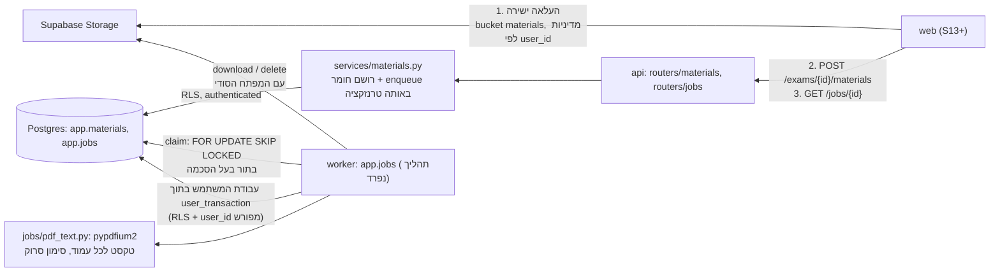

# S10 — חומרים ו-worker: העלאה ל-Storage, תור עבודות, קליטת PDF וסריקות: תוכנית עבודה

> **For agentic workers:** REQUIRED SUB-SKILL: Use superpowers:subagent-driven-development (recommended) or superpowers:executing-plans to implement this plan task-by-task. Steps use checkbox (`- [ ]`) syntax for tracking.

**מטרה:** סטודנט מעלה קובץ ל-Storage ורושם אותו ב-API; worker נפרד מוריד את הקובץ, מחלץ טקסט לכל עמוד, מסמן עמודים סרוקים, ומדווח על קובץ שנחתך. התור יושב ב-Postgres, ו-`generate_plan` של S12 יצטרף אליו בלי לשנות אותו.

**גישה:** שתי טבלאות חדשות בסכמה `app`: ‏`materials` (הקובץ ותוצאת הקליטה) ו-`jobs` (התור עצמו, וגם הסטטוס שהמשתמש רואה). ה-API רושם חומר ומכניס עבודה באותה טרנזקציה בשם המשתמש. ה-worker הוא תהליך Python נפרד שמתחבר בתור בעל הסכמה (`postgres` ב-Supabase), תופס עבודה עם `FOR UPDATE SKIP LOCKED`, ואת כל העבודה על הנתונים של המשתמש הוא עושה **בתוך `user_transaction` של אותו משתמש**, כך ש-RLS חל גם עליו. כל שאילתה מסננת `user_id` במפורש בנוסף. חילוץ הטקסט עם pypdfium2 (PDFium של Chrome), מאחורי מודול אחד שאפשר להחליף.

**כלים:** Python 3.14, ‏uv, ‏FastAPI, ‏psycopg 3, ‏Alembic עם SQL מפורש, ‏Postgres 17. תלויות חדשות: `pypdfium2` (רישיון BSD-3-Clause / Apache-2.0; ‏PDFium עצמו BSD-3) ו-`httpx2` (‏BSD; כבר היה בקבוצת dev בתור לקוח הבדיקות, ועובר לתלויות הריצה בשביל ה-API של Storage).

**מסמך תכנון:** `docs/superpowers/specs/2026-10-19-studyflow-v2-design.md`, סעיפים 7.2, 7.4 (`materials`, ‏`jobs`), 7.5 שלב א, 7.7, 7.8, 7.11, 10 ו-12. במפת הדרכים שב-[artifact](https://claude.ai/code/artifact/29a3c52e-d399-425e-90b6-7c05e9146bfa) זו משימה S10, והיא מוכנה כש"קובץ שהועלה נקלט, ועמודים סרוקים מסומנים".

## איך החלקים מתחברים



- **`materials`** היא הרשומה של הקובץ: מי, איזה מבחן, איפה ב-Storage, ומה יצא מהקליטה (`page_count`, ‏`text_by_page`, ‏`scanned_pages`, ‏`warnings`, ‏`ingest_status`). הנתיב ב-Storage נגזר מהמזהים ונבדק ב-`CHECK`, כך שאי אפשר לרשום קובץ בתיקייה של משתמש אחר.
- **`jobs`** היא התור וגם הסטטוס. ה-API מכניס שורה בשם המשתמש (רק `user_id`, ‏`kind`, ‏`payload`), וה-worker מעדכן אותה. `GET /jobs/{id}` קורא אותה דרך RLS. ב-S12 ‏`generate_plan` מצטרף כ-handler נוסף במילון, בלי מיגרציה.
- **ה-worker** עובד בשתי רמות הרשאה בכוונה: תפיסת עבודה וסיום שלה בתור בעל הסכמה (הוא צריך לראות את העבודות של כולם), והעבודה עצמה (קריאת החומר, הכתיבה של התוצאה) בתור המשתמש של העבודה. בלי זה טעות אחת בסינון חושפת קבצים של משתמש אחד למשתמש אחר; עם זה RLS עוצר אותה.
- **Storage** נמצא מאחורי Protocol קטן (`download`, ‏`delete`). ב-production זה ה-REST של Supabase עם המפתח הסודי (`SUPABASE_SECRET_KEY`), שקיים **רק בתהליך ה-worker**. ה-API לא מחזיק אף מפתח שעוקף RLS. בבדיקות זה מילון בזיכרון.

## מה מצאתי לפני התכנון (2026-11-15)

| נושא | מצב |
|---|---|
| Dependabot | ענף אחד, ‏`api` group: ‏fastapi 0.162.2, ‏pydantic 2.14.3, ‏hypothesis 6.170.15, ‏ruff 0.17.4 (‏lock בלבד). מקומית: ‏ruff, ‏format, ‏mypy ו-780 בדיקות ירוקים. הועבר ל-`main` ב-cherry-pick ‏(`6982f1c`) ונדחף. אין `gh` במק, אז ה-CI של ה-PR לא נבדק מכאן |
| ה-artifact | שורת S10 אחת ב"פריטים פתוחים" (מדיניות ה-Storage מול ה-shim). הסטטוס של S10 עבר ל"בעבודה" |
| PyMuPDF | הרישיון הוא "Dual Licensed - GNU AFFERO GPL 3.0 or Artifex Commercial License" (‏PyPI). ‏AGPL בשירות רשת סגור דורש לפרסם את קוד השרת, ואחרת לקנות רישיון מ-Artifex. ‏pypdfium2 ‏(5.15.0 בתוך חלון ה-7 ימים; ‏5.15.2 מ-9.11 מחוץ לו) הוא BSD-3/Apache-2.0 עם wheels ל-macOS arm64 ול-manylinux, ובלי תלות ב-C compiler |
| `httpx` | הספרייה בריפו היא `httpx2` ‏(2.16.0), וזו גם מה ש-`starlette.testclient` מייבא. ‏`httpx` 0.28 הישן לא מותקן. ל-`httpx2` יש `Client`, ‏`MockTransport`, ‏`Timeout`, ‏`stream()` |
| `storage.objects` ב-Supabase | הטבלה בבעלות `supabase_storage_admin`. ‏`CREATE POLICY ... ON storage.objects` מותר ל-`postgres`; ‏`ALTER TABLE storage.objects` (למשל `ENABLE ROW LEVEL SECURITY`) נכשל ב-"must be owner of table objects". ‏RLS כבר מופעל שם כברירת מחדל |
| `user_transaction` | מקבל `CurrentUser` וכותב `sub` ו-`role` ל-claims. ה-worker יכול להשתמש בו עם `CurrentUser(id=job.user_id, email=None, claims={})`, כי `postgres` ב-Supabase הוא ADMIN של `authenticated` ובעל הסכמה המקומי הוא superuser |
| `legacy/backend/uploads/` | 7 תיקיות משתמש, 69MB, מוגנות ב-`legacy/backend/.gitignore`. אין עדיין `api/eval/` |

## ההחלטות שלי

| נושא | החלטה | למה | על מה ויתרנו |
|---|---|---|---|
| ספריית ה-PDF | **pypdfium2** במקום PyMuPDF. החילוץ מאחורי `app/jobs/pdf_text.py` בלבד, עם טיפוסי דומיין משלנו | הרישיון של PyMuPDF (‏AGPL או מסחרי) לא מתאים למוצר סגור בלי לקנות רישיון, וזו הוצאה שרק בעל המוצר מחליט עליה. סעיף 12 משאיר את הספריות למי שבונה, ו-PDFium הוא המנוע של Chrome, מהיר, ועובר fuzzing מתמיד. ההחלפה, אם אייל ירצה PyMuPDF בתשלום, היא קובץ אחד | PyMuPDF נותן גם רינדור לתמונה, שלא צריך ב-S10 |
| ספריית התור | **טבלה משלנו**, ‏`app.jobs`, עם `UPDATE … WHERE id = (SELECT … FOR UPDATE SKIP LOCKED LIMIT 1) RETURNING *`. בלי procrastinate | טבלה אחת היא גם התור וגם הסטטוס ש-`GET /jobs/{id}` מראה, עם RLS. ‏procrastinate מביא סכמה משלו בלי RLS, אז היה צריך טבלת סטטוס נוספת בכל מקרה, ועוד רכיב לתחזק (סעיף 5) | הכלים של procrastinate: תזמון cron, ‏retries מוכנים, ‏admin |
| הרשאות ה-worker | מתחבר עם `WORKER_DATABASE_URL` בתור בעל הסכמה. **תפיסה וסיום של עבודה כבעל הסכמה; העבודה עצמה בתוך `ctx.user_transaction()`**, שהוא `user_transaction` עם המשתמש של העבודה. כל שאילתה גם מסננת `user_id` במפורש | שלוש שכבות: סינון מפורש, ‏RLS, ו-FK משולבים עם `user_id`. בדיקה שמזייפת `payload` עם חומר של משתמש אחר מוכיחה שהעבודה נכשלת ב-`material_missing` ולא נוגעת בו | worker שרץ כולו כ-`postgres`, שבו הסינון הוא הגנה יחידה |
| הרשאות על `materials` | `authenticated`: ‏SELECT, ‏DELETE, ‏INSERT רק לעמודות הרישום (`id`, ‏`user_id`, ‏`exam_id`, ‏`storage_path`, ‏`filename`, ‏`kind`, ‏`mime`, ‏`size_bytes`), ו-UPDATE רק לעמודות התוצאה (`ingest_status`, ‏`ingest_error`, ‏`page_count`, ‏`scanned_pages`, ‏`warnings`, ‏`text_by_page`, ‏`ingested_at`) | ה-UPDATE הוא בשביל ה-worker, שכותב את התוצאה בתור המשתמש. ל-API אין endpoint שמעדכן חומר, ומשתמש יכול בכל מקרה לפגוע רק בשורות שלו | UPDATE של ה-worker כבעל הסכמה בלי RLS |
| הרשאות על `jobs` | `authenticated`: ‏SELECT, ו-INSERT רק ל-`user_id`, ‏`kind`, ‏`payload`. בלי UPDATE ובלי DELETE. הסטטוס, ‏`run_at`, ‏`attempts` וכל השאר נכתבים רק על ידי ה-worker | משתמש לא יכול לסמן עבודה כגמורה, להקדים אותה או למחוק אותה | — |
| שני המיגרציות | **0005** ‏`materials_and_jobs` (סכמה `app`) ו-**0006** ‏`materials_bucket` (סכמה `storage`: שורת bucket ושתי מדיניות) | הסכמה `storage` בבעלות Supabase, והכללים שלה שונים (אין `ALTER TABLE`). אם 0006 נכשלת ב-dashboard, ‏0005 נשארת מוחלת ועקבית, ו-`alembic_version` מצביעה על 0005 | מיגרציה אחת |
| `storage.objects` בבדיקות (השורה הפתוחה מ-S05) | **מרחיבים את ה-shim**: סכמה `storage` עם `buckets`, ‏`objects` (‏RLS מופעל ב-shim), ‏`foldername()`, ‏`filename()`, ‏`extension()` וה-grants של Supabase. המיגרציה 0006 רצה גם מקומית, והמדיניות נבדקת עם אותו `auth.uid()` כמו שאר הטבלאות | מדיניות שלא נבדקת היא בדיוק המקום שבו תהיה דליפה. ה-shim כבר מחקה את `auth` ואת התפקידים; זו הרחבה טבעית. מה שלא נבדק מקומית: הטריגרים של Storage עצמו | לבדוק רק מול Supabase, ידנית, פעם אחת |
| מדיניות ה-bucket | `materials` פרטי, ‏`file_size_limit` = מגבלת הקובץ, ‏`allowed_mime_types` = PDF, ‏JPEG, ‏PNG. ‏`authenticated`: ‏INSERT ו-SELECT רק על `bucket_id = 'materials'` ונתיב שהתיקייה הראשונה שלו היא `auth.uid()` ושיש בו בדיוק שתי תיקיות. בלי UPDATE (אין דריסה) ובלי DELETE (מחיקה רק דרך ה-API) | 7.11: "bucket פרטי עם מדיניות לפי user_id". בלי UPDATE קובץ שהועלה לא משתנה אחרי שנרשם. העומק הקבוע מונע נתיבים משונים | upsert מהדפדפן |
| מי קובע את `material_id` | **הדפדפן** מייצר UUID v4, מעלה ל-`{user_id}/{exam_id}/{material_id}`, ואז שולח `POST /exams/{id}/materials` עם `id`. ה-API בונה את `storage_path` בעצמו מהמשתמש, מהמבחן ומה-`id`, והמסד בודק את זה ב-`CHECK`. ‏`id` תפוס → 409 ‏`already_exists` | 7.7 מגדיר את ה-endpoint כ"רישום קובץ שהועלה", אז המזהה חייב להיות ידוע לפני ההעלאה. בלי שני סבבים מול ה-API. ה-client לא שולח נתיב, אז אין מה לזייף | `POST` שמחזיר מזהה ואז `PATCH` אחרי ההעלאה |
| מה ה-API בודק ברישום | המבחן של המשתמש ולא מחוק (אחרת 404); ‏`mime` מתוך PDF/JPEG/PNG (אחרת 422); ‏`size_bytes` עד `MAX_MATERIAL_BYTES` (אחרת 422 ‏`file_too_large` עם `limit_bytes`); מספר החומרים במבחן מתחת ל-`MAX_MATERIALS_PER_EXAM` (אחרת 422 ‏`too_many_materials` עם `limit`). ‏`size_bytes` מהדפדפן לא אמין, אז ה-worker בודק את הגודל האמיתי בהורדה | 7.5 שלב 4: המגבלות בקונפיג. הדפדפן יכול להציג את השגיאה לפני ההעלאה; ה-worker הוא הקו האחרון | — |
| `GET /exams/{id}/materials` | נוסף, לא בטבלת 7.7 | מסך המבחן (S15) צריך לראות את החומרים עם הסטטוס, האזהרות והשגיאה. בלי זה "אזהרה גלויה" אין לה איפה להיות גלויה. `text_by_page` לא מוחזר: הדפדפן לא מציג אותו, ו-S11 קורא אותו בשרת | — |
| `DELETE /materials/{id}` | מחיקה **קשה** של השורה (204), ובאותה טרנזקציה עבודה `delete_material_file` עם `storage_path`, שה-worker מריץ מול Storage | 7.4 מגדיר מחיקה רכה רק למבחנים ולמשימות, ו-11.17 אומר שחומר נשמר "עד שהמשתמש מוחק אותו": המחיקה צריכה למחוק באמת גם את הקובץ. ה-API לא מחזיק את המפתח הסודי, ולכן המחיקה ב-Storage היא עבודה של ה-worker | מחיקה סינכרונית מה-API, או להשאיר את הקובץ ל-`cleanup` |
| מה הקליטה עושה | `ingest_material`: ‏(1) קריאת החומר בתור המשתמש וסימון `processing`; ‏(2) הורדה עם תקרת בייטים; ‏(3) זיהוי הסוג לפי ה-magic bytes, ולא לפי מה שהדפדפן אמר; ‏PDF → טקסט לכל עמוד עד `MAX_MATERIAL_PAGES`; תמונה → עמוד אחד סרוק; ‏(4) כתיבת התוצאה בתור המשתמש וסימון `ready` | 7.5 שלב א. תמונות הן חומר לגיטימי (7.5 שלב 3) ומקבלות אותו מודל נתונים, כך ש-S11 שולח "עמוד סרוק" בלי להבדיל | OCR; רינדור עמודים לתמונות (S11 יחליט אם צריך) |
| "סרוק" | עמוד עם `SCANNED_PAGE_MAX_CHARS` תווים נראים (לא רווחים) או פחות: ברירת מחדל **40** | עמוד סרוק מחזיר כלום או מספר עמוד וכותרת; עמוד טקסט אמיתי מחזיר מאות. עמוד שער עם כותרת בלבד ייחשב סרוק ויישלח כתמונה ב-S11, וזה בסדר | סף לפי יחס תווים לשטח |
| מגבלות (סעיף 12) | `MAX_MATERIAL_BYTES` = 20 MiB ‏(20971520); ‏`MAX_MATERIAL_PAGES` = 80; ‏`MAX_MATERIALS_PER_EXAM` = 15; ‏`MAX_CHARS_PER_PAGE` = 20000; ‏`SCANNED_PAGE_MAX_CHARS` = 40. כולם ב-`Settings` | מבחן עבר הוא 5–15 עמודים ו-1–5MB, סריקה עד ~20MB. ‏80 עמודים סרוקים הם ~120k tokens ב-S11, וזה הגבול שעדיין סביר לקריאה אחת. ‏`file_size_limit` של ה-bucket כתוב במיגרציה עם אותו מספר, וצריך לזוז יחד | — |
| קובץ שנחתך | `page_count` הוא המספר האמיתי; נשמרים רק `MAX_MATERIAL_PAGES` הראשונים; ‏`warnings` מקבל `pages_truncated`. עמוד ארוך מ-`MAX_CHARS_PER_PAGE` נחתך עם `text_truncated`. האזהרות מוחזרות ב-`GET /exams/{id}/materials` וב-`result` של העבודה | 7.5 שלב 4: "קובץ שנחתך מקבל אזהרה גלויה". קודים ולא טקסט, והעברית ב-`he.ts` (S13) | לדחות קובץ ארוך לגמרי |
| כשלים גלויים | קודים ב-`materials.ingest_error` וב-`jobs.error`, בלי הודעות פנימיות: ‏`material_missing`, ‏`file_missing` (נרשם אבל לא הועלה), ‏`file_too_large`, ‏`unsupported_file`, ‏`pdf_unreadable`, ‏`storage_unavailable`, ‏`internal_error`, ‏`worker_crashed`, ‏`unknown_kind`. חומר שנכשל הוא `failed` עם הקוד | סעיף 4: "כשלים שקטים". קובץ שהרישום שלו הצליח אבל ההעלאה לא, חייב להיראות | — |
| ניסיונות חוזרים | `max_attempts` = 3; כישלון זמני (Storage לא זמין, חריגה לא צפויה) מחזיר ל-`queued` עם `run_at = now + 30s · 2^(attempts-1)`; כישלון קבוע (`JobFailed(retry=False)`) → `failed` מיד. עבודה `running` שה-`locked_at` שלה ישן מ-`JOB_LOCK_TIMEOUT_SECONDS` ‏(600) נתפסת מחדש; אם כבר עברה את `max_attempts` היא מסומנת `failed` עם `worker_crashed`. ‏`progress()` מרענן את `locked_at` | worker שקרס באמצע לא משאיר עבודה תקועה לנצח, ועבודה ארוכה (‏`generate_plan` ב-S12) שמדווחת התקדמות לא נתפסת פעמיים | ניסיונות אינסופיים, או בלי reclaim |
| מה החומר מראה בזמן ניסיון חוזר | ה-handler מחזיר אותו ל-`queued` כשנשארו ניסיונות, ול-`failed` עם הקוד בניסיון האחרון (`ctx.last_attempt`) | אחרת חומר נתקע ב-`processing` כשהעבודה כבר נכשלה | — |
| זמן ב-worker | `now` מגיע מ-`clock` מוזרק, וכל ההשוואות (`run_at`, ‏`locked_at`) נעשות מולו ולא מול `now()` של המסד | כך הבדיקות של backoff ו-reclaim דטרמיניסטיות, כמו `app.state.clock` ב-API | — |
| פולינג | לולאה עם `WORKER_POLL_SECONDS` ‏(2.0) כשאין עבודה; בלי `LISTEN/NOTIFY` | פשוט, ומספיק לקליטה שלוקחת שניות. אפשר להוסיף NOTIFY אם יהיה צורך | השהיה של עד 2 שניות לפני תחילת קליטה |
| שורת ה-eval (מ-S02) | **נכנסת ל-S10:** כלל ignore ל-`api/eval/materials/` (עם README בפנים ש-git כן רואה), וסקריפט `api/eval/pdf_smoke.py` שמדפיס לכל PDF בתיקייה רק מספרים (עמודים, סרוקים, תווים). הקבצים מ-`legacy/backend/uploads/` **מועתקים** לשם לבדיקת עשן מקומית. המחיקה שלהם מ-`legacy/` נשארת לשלב 4 | S10 הוא ה-scope הראשון שקורא PDF, והבדיקה על מבחנים אמיתיים (סעיף 8) שייכת לו. הכלל צריך להיות ב-commit לפני שהקבצים נמצאים שם. בלי להעתיק אין איך לדעת שהעברית יוצאת נכון | להשאיר ל-S11 |
| פקודת ה-worker | `uv run python -m app.jobs` מתוך `api/`. דורש `WORKER_DATABASE_URL` ו-`SUPABASE_SECRET_KEY`, ועוצר מיד בלעדיהם | תהליך נפרד כמו ב-7.2. אין טעם ל-worker שעולה ואז נכשל על כל עבודה | worker כ-thread בתוך ה-API |

## מה לא נכלל ולמה

- **קריאה ל-Claude, ‏`topics`, ‏`POST /plans/generate`, ‏`generate_plan`, ‏`ai_usage` ומכסות:** S11 ו-S12. התור מקבל handler חדש במילון `HANDLERS`, ו-`JobContext.progress(stage, percent)` כבר קיים בשבילו.
- **`cleanup` (קבצים יתומים):** 7.8, אין לו scope. מה שיכול להשאיר קובץ יתום ב-S10: העלאה שלא נרשמה, ומחיקה קשה של מבחן (‏`ON DELETE CASCADE` על `materials` מוחק את השורה ולא את הקובץ). נרשם ב-artifact.
- **מסכים ב-`web/`:** S13 ואילך. ה-web צריך: לייצר UUID, להעלות ל-`materials/{user}/{exam}/{id}` עם supabase-js, לרשום, ולעשות polling ל-`GET /jobs/{id}`. נרשם ב-artifact ל-S13/S15.
- **`studyflow_api` דרך ה-pooler:** נשאר ל-S13, כמו שסוכם.
- **רינדור של עמוד סרוק לתמונה:** S11 מחליט אם לשלוח את ה-PDF כמסמך או עמודים כתמונות (7.5 שלב 3).

## אילוצים גלובליים

- Python 3.14, ‏uv, ‏`exclude-newer = "7 days"`. התלויות החדשות (`pypdfium2`, ‏`httpx2`) נוספו ב-Task 0; אין להוסיף אחרות.
- `ruff check`, ‏`ruff format --check`, ‏`mypy` (strict) ו-`pytest` עם `filterwarnings = ["error"]`. ‏780 הבדיקות הקיימות נשארות ירוקות, חוץ ממה שהתוכנית משנה במפורש (`test_schema.py`, ‏`test_ownership.py`).
- **routers דקים:** פענוח הבקשה, קריאה לפונקציה אחת ב-service, והחזרת מודל. אין SQL ב-router.
- **SQL:** רק דרך `conn.execute` עם פרמטרים (`%s`). אין f-string עם ערך מהבקשה או מה-`payload`. כל שאילתה של ה-API רצה בתוך `db.transaction(user)`.
- **בעלות:** כל שאילתה, ב-API וב-worker, מסננת `user_id = %s` במפורש בנוסף ל-RLS. ב-worker, כל גישה לנתוני משתמש (קריאה או כתיבה של `materials`) היא בתוך `ctx.user_transaction()`; בתור בעל הסכמה נוגעים **רק** ב-`app.jobs`.
- **סודות:** `supabase_secret_key` הוא `SecretStr`; לא מופיע ב-`repr`, בלוג או בשגיאה. הוא נקרא רק ב-`app/jobs/__main__.py` ועובר ל-`SupabaseStorage` בלבד. ה-API לא קורא אותו.
- **פרטיות:** טקסט שחולץ, שמות קבצים ותוכן `payload` לא נכתבים ללוג. ללוג הולכים מזהים, קודים ושמות מחלקות של חריגות.
- **שגיאות:** ב-API רק `ApiError(code)` עם קוד שקיים ב-`PROBLEMS`. ב-`jobs.error` וב-`materials.ingest_error` רק slug קבוע מהרשימה בטבלת ההחלטות, אף פעם לא `str(exc)`.
- **מיגרציה:** SQL מפורש, ‏RLS, מדיניות ו-grants באותה מיגרציה שיוצרת את הטבלה, ו-`downgrade` שעובד. ב-0006 אין `ALTER TABLE storage.objects` בשום צורה.
- **זמן:** כל `datetime` aware. ‏`now` ב-API מ-`app.state.clock`, וב-worker מ-`Worker.clock`. אין `datetime.now()` בקוד של `app/`.
- **טקסט ל-jsonb:** בלי `\u0000` ובלי surrogates בודדים (`normalize_text` מטפל), אחרת Postgres דוחה את השורה.
- כל ערך מהדפדפן שמגיע למסד עובר Pydantic (אורך, enum, NoNul) ו-`CHECK` במסד; ערך שהמסד לא מקבל מחזיר 422 ולא 500.
- בדיקה שנכשלת לא מוחלשת ולא מקבלת `xfail` מצד ה-implementer. מדווחים את הדוגמה המינימלית ועוצרים ב-`DONE_WITH_CONCERNS`.
- לא נוגעים ב-`legacy/` (רק מעתיקים ממנו PDF-ים לתיקייה מוגנת ב-Task 8) וב-`web/`.
- הקוד, ההערות והודעות הקומיט באנגלית. התוכנית והדיווחים בעברית.
- git רץ בשיחה הראשית, וה-subagents לא מריצים git (גם לא `git stash` או `git checkout`). מוסיפים קבצים לפי שם, ובודקים `git status --short --untracked-files=all` לפני כל קומיט. לפני push: ‏`gitleaks git --redact --no-banner .`. אין force-push.
- **הריפו ב-`/Users/eyalatar/studyflow`.** כל subagent עובד בנתיבים מלאים, והפקודות רצות מתוך `/Users/eyalatar/studyflow/api`. קבצים זמניים רק מחוץ לריפו (‏`/private/tmp/...`), ונמחקים בסוף.
- בדיקות עם מסד רצות מול ה-Postgres המקומי (`postgresql@17`) דרך הפיקסצ'רים של `tests/fixtures_db.py`: ‏`db` (בעל הסכמה), ‏`api_db` (‏`studyflow_api`), ‏`database`, ‏`api`, ‏`make_api_user`, ‏`clock`.

## על מה לשים לב בבדיקה

1. **קובץ שנרשם אבל ההעלאה נכשלה** (הדפדפן נסגר באמצע): מה שצריך לקרות: העבודה נכשלת ב-`file_missing`, החומר `failed` עם אותו קוד, ו-`GET /exams/{id}/materials` מראה את זה. Task 6 ו-Task 8.
2. **קובץ גדול מהמגבלה למרות `size_bytes` שהדפדפן שלח:** מה שצריך לקרות: ההורדה נעצרת אחרי `max_bytes + 1` בייטים (גם בלי `Content-Length`), ‏`file_too_large`, ואין קריסת זיכרון. Task 4 ו-Task 6.
3. **קובץ שאינו PDF עם סיומת PDF, או PDF מוצפן או שבור:** מה שצריך לקרות: `unsupported_file` או `pdf_unreadable`, ‏`failed` מיד בלי ניסיונות חוזרים. Task 3 ו-Task 6.
4. **worker שקרס באמצע עבודה, ושני workers במקביל:** מה שצריך לקרות: העבודה נתפסת מחדש אחרי `lock_timeout` ולא לפני, מספר הניסיונות חסום, ושני workers לא תופסים את אותה עבודה. Task 5.
5. **טקסט עם תווים שהמסד לא מקבל** (‏NUL, ‏surrogate בודד מ-PDF פגום): מה שצריך לקרות: הטקסט מנורמל ונשמר, ולא 500 או עבודה שנכשלת. Task 3 (יחידה) ו-Task 8 (מקצה לקצה דרך המסד).
6. **עברית:** PDFium מחזיר את הטקסט בסדר לוגי. נבדק ידנית בבדיקת העשן של Task 8 על המבחנים האמיתיים (מספרים בלבד בדיווח).

## מי עושה מה

| Task | מה | מי | תלוי ב- |
|---|---|---|---|
| 0 | פתיחה: Dependabot, הסטטוס, הענף, התלויות והתוכנית | אני (נעשה, חוץ מהקומיטים) | — |
| 1 | מיגרציה 0005: ‏`materials` ו-`jobs`, ובדיקות המסד | subagent | 0 |
| 2 | ה-shim של Storage, מיגרציה 0006 ובדיקת המדיניות | subagent | 0 (במקביל ל-1) |
| 3 | דומיין החומרים וחילוץ טקסט מ-PDF | subagent | 0 (במקביל ל-1, 2) |
| 4 | לקוח Storage | subagent | 0 (במקביל ל-1, 2, 3) |
| 5 | תור העבודות וה-worker | subagent | 1, 4 |
| 6 | עבודות הקליטה ומחיקת הקובץ, הפקודה | subagent | 3, 4, 5 |
| 7 | ה-API: חומרים ועבודות, בעלות | subagent | 1, 5 (במקביל ל-6) |
| 8 | מקצה לקצה, בעלות ב-worker, תיעוד, תיקיית ה-eval ובדיקת עשן | subagent | 6, 7 |
| 9 | מסמך התכנון והלשונית שלו | אני | 8 |
| 10 | סקירה סופית, מיגרציות ו-bucket ב-dev, מיזוג וסגירה | אני | 9 |

## מבנה הקבצים

```
api/pyproject.toml, api/uv.lock                    pypdfium2, httpx2 (Task 0)
api/app/jobs/__init__.py, api/tests/jobs/__init__.py  (Task 0, ריקים)
api/migrations/versions/0005_materials_and_jobs.py (חדש) materials, jobs
api/migrations/versions/0006_materials_bucket.py   (חדש) bucket + מדיניות storage.objects
api/tests/db/supabase_shim.sql                     סכמת storage מדומה
api/tests/db/test_schema.py                        רשימת הטבלאות וה-grants
api/tests/db/test_materials_jobs.py                (חדש)
api/tests/db/test_storage_policy.py                (חדש)
api/app/domain/materials.py                        (חדש) enums, mime, נרמול טקסט, כלל "סרוק", ExtractedText
api/app/jobs/pdf_text.py                           (חדש) extract_pdf עם pypdfium2
api/app/jobs/storage.py                            (חדש) Storage Protocol, SupabaseStorage, שגיאות
api/app/jobs/queue.py                              (חדש) enqueue, claim, heartbeat, finish, requeue, fail, backoff, get_job
api/app/jobs/worker.py                             (חדש) JobFailed, JobContext, Worker
api/app/jobs/ingest.py                             (חדש) ingest_material, delete_material_file, HANDLERS
api/app/jobs/__main__.py                           (חדש) python -m app.jobs
api/app/config.py                                  הגדרות ה-worker והמגבלות
api/app/deps.py                                    SettingsDep
api/app/errors.py                                  too_many_materials, file_too_large, already_exists
api/app/services/materials.py, jobs.py             (חדשים)
api/app/schemas/materials.py, jobs.py              (חדשים)
api/app/routers/materials.py, jobs.py              (חדשים)
api/app/main.py                                    רושם את שני ה-routers
api/tests/jobs/pdfs.py                             (חדש) make_pdf לבדיקות
api/tests/jobs/fake_storage.py                     (חדש) MemoryStorage
api/tests/jobs/conftest.py                         (חדש) storage, worker_settings, worker
api/tests/jobs/test_materials_domain.py, test_pdf_text.py, test_storage.py,
    test_queue.py, test_worker.py, test_ingest.py, test_end_to_end.py   (חדשים)
api/tests/api/test_materials.py, test_jobs.py      (חדשים)
api/tests/api/test_ownership.py, factories.py      CASES, Ids, dump, register_material
api/eval/README.md, api/eval/materials/README.md, api/eval/pdf_smoke.py   (חדשים)
.gitignore                                         api/eval/materials/*
api/.env.example, README.md, CLAUDE.md             WORKER_DATABASE_URL, SUPABASE_SECRET_KEY, פקודת ה-worker
מסמך התכנון (7.4, 7.5, 7.7, 7.8, 7.11, 7.12, 12) והלשונית שלו ב-artifact
```

---

### Task 0: פתיחה

נעשה לפני כתיבת התוכנית: Dependabot ב-`main` ‏(`6982f1c`), הסטטוס "בעבודה", הענף `s10-materials-worker` מ-`main`, ‏`uv add pypdfium2 httpx2` ו-`uv remove --dev httpx2`, ושני קובצי `__init__.py` ריקים.

בנוסף, שינוי קטן בתשתית הבדיקות כדי ששתי משימות עם מסד יוכלו לרוץ במקביל: ‏`tests/fixtures_db.py` קורא את שם מסד הבדיקות מ-`STUDYFLOW_TEST_DB` (ברירת מחדל `studyflow_test`). ‏`test_migrations_round_trip` עדיין לא רץ במקביל לבדיקות מסד אחרות (הוא מבטל חברות של תפקיד ברמת ה-cluster), ולכן Tasks 1 ו-2 רצים בזה אחר זה, ו-Tasks 6 ו-7 במקביל עם שמות מסד שונים ובלי `tests/db`.

- [ ] **Step 1: קומיט של התלויות והתשתית** — `git add api/pyproject.toml api/uv.lock api/app/jobs/__init__.py api/tests/jobs/__init__.py api/tests/fixtures_db.py && git commit -m "build(api): add pypdfium2 and httpx2, and a configurable test database name"`
- [ ] **Step 2: קומיט של התוכנית** — `git add docs/superpowers/plans/2026-11-15-s10-materials-worker.md && git commit -m "docs(plan): add the S10 materials and worker plan"`

---

### Task 1: מיגרציה 0005 — `materials` ו-`jobs`

**למה:** כל השאר כותב לשתי הטבלאות האלה. ההרשאות לפי עמודה הן מה שמונע ממשתמש לסמן עבודה כגמורה או לשנות את מה שה-worker כתב, וה-`CHECK` על הנתיב הוא מה שמונע רישום בתיקייה של אחר.

**Files:**
- Create: `api/migrations/versions/0005_materials_and_jobs.py`, ‏`api/tests/db/test_materials_jobs.py`
- Modify: `api/tests/db/test_schema.py` (‏`test_core_tables_exist` כולל `jobs` ו-`materials`; ‏`authenticated_grants`: ‏`materials: {"SELECT", "DELETE"}`, ‏`jobs: {"SELECT"}`, עם הערה שה-INSERT וה-UPDATE הם לפי עמודות)

**Interfaces (Produces), במיגרציה (`revision = "0005"`, ‏`down_revision = "0004"`):**
- `app.materials`:
  - עמודות: `id uuid NOT NULL DEFAULT gen_random_uuid()`, ‏`user_id uuid NOT NULL`, ‏`exam_id uuid NOT NULL`, ‏`storage_path text NOT NULL`, ‏`filename text NOT NULL`, ‏`kind text NOT NULL`, ‏`mime text NOT NULL`, ‏`size_bytes bigint NOT NULL`, ‏`page_count smallint`, ‏`scanned_pages smallint`, ‏`ingest_status text NOT NULL DEFAULT 'queued'`, ‏`ingest_error text`, ‏`warnings text[] NOT NULL DEFAULT '{}'`, ‏`text_by_page jsonb`, ‏`created_at timestamptz NOT NULL DEFAULT now()`, ‏`ingested_at timestamptz`.
  - אילוצים: ‏`materials_pkey (id)`; ‏`materials_user_id_fkey → auth.users (id) ON DELETE CASCADE`; ‏`materials_exam_fkey FOREIGN KEY (exam_id, user_id) REFERENCES app.exams (id, user_id) ON DELETE CASCADE`; ‏`materials_id_user_id_key UNIQUE (id, user_id)`; ‏`materials_storage_path_key UNIQUE (storage_path)`; ‏`materials_storage_path_format CHECK (storage_path = user_id::text || '/' || exam_id::text || '/' || id::text)`; ‏`materials_filename_length CHECK (btrim(filename) <> '' AND char_length(filename) <= 255)`; ‏`materials_kind_valid CHECK (kind IN ('syllabus', 'summary', 'past_exam', 'solution', 'notes', 'other'))`; ‏`materials_mime_format CHECK (mime ~ '^[a-z]+/[a-z0-9.+-]+$' AND char_length(mime) <= 100)`; ‏`materials_size_bytes_range CHECK (size_bytes BETWEEN 1 AND 1073741824)`; ‏`materials_page_count_range CHECK (page_count IS NULL OR page_count BETWEEN 0 AND 10000)`; ‏`materials_scanned_pages_range CHECK (scanned_pages IS NULL OR scanned_pages BETWEEN 0 AND 10000)`; ‏`materials_ingest_status_valid CHECK (ingest_status IN ('queued', 'processing', 'ready', 'failed'))`; ‏`materials_ingest_error_format CHECK (ingest_error IS NULL OR ingest_error ~ '^[a-z][a-z_]{0,59}$')`; ‏`materials_warnings_valid CHECK (coalesce(array_ndims(warnings), 1) = 1 AND cardinality(warnings) <= 10)`; ‏`materials_text_by_page_shape CHECK (text_by_page IS NULL OR jsonb_typeof(text_by_page) = 'array')`; ‏`materials_text_by_page_size CHECK (pg_column_size(text_by_page) <= 8388608)`; ‏`materials_ready_is_complete CHECK (ingest_status <> 'ready' OR (page_count IS NOT NULL AND scanned_pages IS NOT NULL AND text_by_page IS NOT NULL AND ingested_at IS NOT NULL))`; ‏`materials_failed_has_error CHECK (ingest_status <> 'failed' OR ingest_error IS NOT NULL)`.
  - אינדקס: `materials_user_exam_idx ON app.materials (user_id, exam_id, created_at)`.
  - RLS: ‏`ENABLE ROW LEVEL SECURITY`; ‏`CREATE POLICY materials_owner … FOR ALL TO authenticated USING (user_id = (SELECT auth.uid())) WITH CHECK (user_id = (SELECT auth.uid()))`.
  - grants ל-`authenticated`: ‏`GRANT SELECT, DELETE ON app.materials`; ‏`GRANT INSERT (id, user_id, exam_id, storage_path, filename, kind, mime, size_bytes) ON app.materials`; ‏`GRANT UPDATE (ingest_status, ingest_error, page_count, scanned_pages, warnings, text_by_page, ingested_at) ON app.materials`.
- `app.jobs`:
  - עמודות: `id uuid NOT NULL DEFAULT gen_random_uuid()`, ‏`user_id uuid NOT NULL`, ‏`kind text NOT NULL`, ‏`payload jsonb NOT NULL DEFAULT '{}'::jsonb`, ‏`status text NOT NULL DEFAULT 'queued'`, ‏`run_at timestamptz NOT NULL DEFAULT clock_timestamp()`, ‏`attempts smallint NOT NULL DEFAULT 0`, ‏`max_attempts smallint NOT NULL DEFAULT 3`, ‏`locked_at timestamptz`, ‏`stage text`, ‏`percent smallint`, ‏`error text`, ‏`result jsonb`, ‏`created_at timestamptz NOT NULL DEFAULT clock_timestamp()`, ‏`started_at timestamptz`, ‏`finished_at timestamptz`.
  - אילוצים: ‏`jobs_pkey`; ‏`jobs_user_id_fkey → auth.users ON DELETE CASCADE`; ‏`jobs_id_user_id_key UNIQUE (id, user_id)`; ‏`jobs_kind_format CHECK (kind ~ '^[a-z][a-z_]{0,39}$')`; ‏`jobs_payload_shape CHECK (jsonb_typeof(payload) = 'object')`; ‏`jobs_payload_size CHECK (pg_column_size(payload) <= 65536)`; ‏`jobs_status_valid CHECK (status IN ('queued', 'running', 'done', 'failed'))`; ‏`jobs_attempts_range CHECK (attempts >= 0 AND max_attempts BETWEEN 1 AND 10)`; ‏`jobs_stage_format CHECK (stage IS NULL OR stage ~ '^[a-z][a-z_]{0,39}$')`; ‏`jobs_percent_range CHECK (percent IS NULL OR percent BETWEEN 0 AND 100)`; ‏`jobs_error_format CHECK (error IS NULL OR error ~ '^[a-z][a-z_]{0,59}$')`; ‏`jobs_result_shape CHECK (result IS NULL OR jsonb_typeof(result) = 'object')`; ‏`jobs_result_size CHECK (pg_column_size(result) <= 65536)`.
  - אינדקסים: `jobs_queued_idx ON app.jobs (run_at) WHERE status = 'queued'`; ‏`jobs_running_idx ON app.jobs (locked_at) WHERE status = 'running'`; ‏`jobs_user_created_idx ON app.jobs (user_id, created_at DESC)`.
  - RLS: כמו `materials` (‏`jobs_owner`).
  - grants ל-`authenticated`: ‏`GRANT SELECT ON app.jobs`; ‏`GRANT INSERT (user_id, kind, payload) ON app.jobs`. בלי UPDATE ובלי DELETE.
- `downgrade`: ‏`DROP TABLE app.jobs, app.materials`.
- ה-docstring של המיגרציה מסביר (באנגלית) למה הרשאות לפי עמודה, למה ה-`CHECK` על הנתיב, ולמה `clock_timestamp()`.

- [ ] **Step 1: הבדיקות** (`tests/db/test_materials_jobs.py`, בתור `authenticated` דרך `user_transaction` על `api_db`, אלא אם כתוב אחרת; עזר מקומי שמכניס מבחן בתור `db`)

  | בדיקה | מצופה |
  |---|---|
  | `test_storage_path_must_follow_the_convention` | INSERT עם `storage_path = f"{user}/{exam}/{id}"` נכנס; עם `f"{other_user}/{exam}/{id}"` → `CheckViolation`; עם `f"{user}/{exam}/{id}/extra"` → `CheckViolation` |
  | `test_authenticated_insert_is_limited_to_registration_columns` | INSERT שכולל `ingest_status = 'ready'` → `InsufficientPrivilege`; INSERT שכולל `text_by_page` → `InsufficientPrivilege`; INSERT של העמודות המותרות בלבד → נכנס עם `ingest_status = 'queued'`, ‏`warnings = []` |
  | `test_authenticated_update_is_limited_to_result_columns` | UPDATE של `filename` → `InsufficientPrivilege`; UPDATE של `storage_path` → `InsufficientPrivilege`; UPDATE של `ingest_status, page_count, scanned_pages, text_by_page, ingested_at` לשורה של המשתמש → `rowcount == 1`; אותו UPDATE לשורה של משתמש אחר → `rowcount == 0` והשורה לא השתנתה (נבדק דרך `db`) |
  | `test_ready_and_failed_need_their_fields` | UPDATE ל-`ready` בלי `text_by_page` → `CheckViolation`; UPDATE ל-`failed` בלי `ingest_error` → `CheckViolation`; ‏`ingest_error = 'Boom!'` → `CheckViolation` |
  | `test_material_of_another_users_exam_is_rejected` | INSERT עם `exam_id` של משתמש אחר (ו-`storage_path` תואם) → `ForeignKeyViolation` |
  | `test_deleting_an_exam_deletes_its_materials` | מחיקה קשה של המבחן בתור `db` → השורה ב-`materials` נעלמת |
  | `test_user_can_delete_only_their_own_material` | DELETE של שורה של אחר → `rowcount == 0`; של שלו → 1 |
  | `test_jobs_insert_is_limited_to_user_kind_payload` | INSERT עם `status` → `InsufficientPrivilege`; עם `run_at` → `InsufficientPrivilege`; עם `user_id, kind, payload` → נכנס עם `status = 'queued'`, ‏`attempts = 0`, ‏`max_attempts = 3` |
  | `test_authenticated_cannot_update_or_delete_jobs` | UPDATE של `status` → `InsufficientPrivilege`; DELETE → `InsufficientPrivilege` |
  | `test_jobs_are_visible_to_their_owner_only` | SELECT של משתמש ב' לא רואה את העבודה של א'; INSERT עם `user_id` של אחר → `InsufficientPrivilege` (‏RLS) |
  | `test_job_constraints` (parametrize, בתור `db`) | `kind = 'Ingest'` → `CheckViolation`; ‏`payload = '[]'` → `CheckViolation`; ‏`percent = 101` → `CheckViolation`; ‏`max_attempts = 0` → `CheckViolation` |

  ב-`test_schema.py`: הרשימה ב-`test_core_tables_exist` היא `alembic_version, blocks, exams, jobs, materials, plan_versions, profiles, tasks`; ו-`authenticated_grants` מקבל את שתי השורות. ‏`test_migrations_round_trip` ו-`test_every_app_table_has_rls_and_an_owner_policy` נשארים ירוקים בלי שינוי.

- [ ] **Step 2: הבדיקות נכשלות** — `uv run pytest tests/db -q`
- [ ] **Step 3: מימוש**
- [ ] **Step 4: הכל ירוק** — `uv run pytest tests/db -q && uv run ruff check . && uv run ruff format --check . && uv run mypy`
- [ ] **Step 5: קומיט (בשיחה הראשית)** — `feat(db): add materials and jobs with column-level grants and RLS`

---

### Task 2: ה-shim של Storage ומיגרציה 0006 — ה-bucket והמדיניות

**למה:** זו השורה הפתוחה מ-S05. בלי סכמת `storage` מקומית המיגרציה לא רצה בבדיקות, והמדיניות היחידה שמגינה על קבצים של משתמשים לא נבדקת בשום מקום.

**Files:**
- Modify: `api/tests/db/supabase_shim.sql`
- Create: `api/migrations/versions/0006_materials_bucket.py`, ‏`api/tests/db/test_storage_policy.py`

**Interfaces (Produces):**
- ב-shim (אידמפוטנטי, אחרי החלק של `auth`): ‏`CREATE SCHEMA IF NOT EXISTS storage`; ‏`storage.buckets (id text PRIMARY KEY, name text NOT NULL UNIQUE, owner uuid, public boolean NOT NULL DEFAULT false, file_size_limit bigint, allowed_mime_types text[], created_at timestamptz NOT NULL DEFAULT now(), updated_at timestamptz NOT NULL DEFAULT now())`; ‏`storage.objects (id uuid PRIMARY KEY DEFAULT gen_random_uuid(), bucket_id text REFERENCES storage.buckets (id), name text, owner uuid, owner_id text, metadata jsonb, path_tokens text[] GENERATED ALWAYS AS (string_to_array(name, '/')) STORED, version text, user_metadata jsonb, created_at timestamptz DEFAULT now(), updated_at timestamptz DEFAULT now(), last_accessed_at timestamptz DEFAULT now())` עם `ENABLE ROW LEVEL SECURITY`; הפונקציות `storage.foldername(name text) RETURNS text[]` (כל חלקי הנתיב חוץ מהאחרון), ‏`storage.filename(name text) RETURNS text`, ‏`storage.extension(name text) RETURNS text`, כולן `LANGUAGE sql IMMUTABLE`; ‏`GRANT USAGE ON SCHEMA storage TO anon, authenticated, service_role`; ‏`GRANT ALL ON storage.objects, storage.buckets TO anon, authenticated, service_role` (כמו ב-Supabase, שם RLS הוא ההגנה). הערה בראש החלק: זה חיקוי לבדיקות בלבד, והטריגרים של Storage לא מחוקים.
- במיגרציה 0006 (`down_revision = "0005"`):
  - `INSERT INTO storage.buckets (id, name, public, file_size_limit, allowed_mime_types) VALUES ('materials', 'materials', false, 20971520, ARRAY['application/pdf', 'image/jpeg', 'image/png']) ON CONFLICT (id) DO UPDATE SET public = EXCLUDED.public, file_size_limit = EXCLUDED.file_size_limit, allowed_mime_types = EXCLUDED.allowed_mime_types`.
  - `CREATE POLICY materials_upload_own ON storage.objects FOR INSERT TO authenticated WITH CHECK (bucket_id = 'materials' AND array_length(storage.foldername(name), 1) = 2 AND (storage.foldername(name))[1] = (SELECT auth.uid())::text)`.
  - `CREATE POLICY materials_read_own ON storage.objects FOR SELECT TO authenticated USING (bucket_id = 'materials' AND (storage.foldername(name))[1] = (SELECT auth.uid())::text)`.
  - **אין** `ALTER TABLE storage.objects`. ה-docstring מסביר למה (בעלות `supabase_storage_admin`), ושה-`file_size_limit` חייב להיות שווה ל-`MAX_MATERIAL_BYTES` ב-`config.py`.
  - `downgrade`: ‏`DROP POLICY` לשתיהן, ו-`DELETE FROM storage.buckets WHERE id = 'materials'` (נכשל אם יש אובייקטים; זה מכוון, ומתועד).

- [ ] **Step 1: הבדיקות** (`tests/db/test_storage_policy.py`; ‏`A`, ‏`B` מ-`make_user`; הנתיב `f"{user}/{uuid4()}/{uuid4()}"`)

  | בדיקה | מצופה |
  |---|---|
  | `test_bucket_is_private_with_limits` | בתור `db`: שורה `materials` עם `public = false`, ‏`file_size_limit = 20971520`, ‏`allowed_mime_types` = שלושת הסוגים |
  | `test_user_uploads_only_under_their_own_folder` | בתור A דרך `user_transaction(api_db, A)`: INSERT ל-`storage.objects (bucket_id, name, owner_id)` תחת `A/…/…` → נכנס; תחת `B/…/…` → `InsufficientPrivilege`; ‏`A/file.pdf` (עומק 1) → `InsufficientPrivilege`; ‏`A/x/y/z` (עומק 3) → `InsufficientPrivilege`; ‏`bucket_id = 'other'` (שורת bucket שהבדיקה מכניסה בתור `db`) → `InsufficientPrivilege` |
  | `test_user_reads_only_their_own_objects` | אובייקטים של A ושל B (בתור `db`) → A רואה רק את שלו |
  | `test_user_cannot_change_or_delete_objects` | בתור A: UPDATE של `name` של האובייקט שלו → `rowcount == 0`; DELETE → `rowcount == 0` |
  | `test_anon_sees_nothing` | `SET LOCAL ROLE anon` בטרנזקציה של `db` (או `set_config('role','anon',true)`) → SELECT מחזיר 0 שורות |
  | `test_policies_exist_for_authenticated_only` | `pg_policies` על `storage.objects`: בדיוק `materials_upload_own` (INSERT) ו-`materials_read_own` (SELECT), שתיהן ל-`authenticated` |

  `test_migrations_round_trip` עובר עם 0006 (ה-`downgrade` מוחק את ה-bucket כשאין בו אובייקטים).

- [ ] **Step 2: נכשלות** — `uv run pytest tests/db -q`
- [ ] **Step 3: מימוש**
- [ ] **Step 4: הכל ירוק** — `uv run pytest tests/db -q && uv run ruff check . && uv run ruff format --check . && uv run mypy`
- [ ] **Step 5: קומיט** — `feat(db): create the private materials bucket with per-user policies`

---

### Task 3: דומיין החומרים וחילוץ טקסט מ-PDF

**למה:** זה הלב של "קובץ נקלט ועמודים סרוקים מסומנים", והוא טהור: בלי מסד, בלי רשת. ‏pypdfium2 נוגע רק ב-`pdf_text.py`.

**Files:**
- Create: `api/app/domain/materials.py`, ‏`api/app/jobs/pdf_text.py`, ‏`api/tests/jobs/pdfs.py`, ‏`api/tests/jobs/test_materials_domain.py`, ‏`api/tests/jobs/test_pdf_text.py`

**Interfaces (Produces):**
- `app/domain/materials.py` (בלי pypdfium2):
  - `class MaterialKind(StrEnum)`: ‏`SYLLABUS = "syllabus"`, ‏`SUMMARY`, ‏`PAST_EXAM = "past_exam"`, ‏`SOLUTION`, ‏`NOTES`, ‏`OTHER`.
  - `class IngestStatus(StrEnum)`: ‏`QUEUED`, ‏`PROCESSING`, ‏`READY`, ‏`FAILED`.
  - `PDF_MIME: Final = "application/pdf"`; ‏`IMAGE_MIMES: Final = frozenset({"image/jpeg", "image/png"})`; ‏`SUPPORTED_MIME_TYPES: Final = frozenset({PDF_MIME, *IMAGE_MIMES})`.
  - `sniff_mime(data: bytes) -> str | None`: ‏`%PDF-` בתוך 1024 הבייטים הראשונים → `PDF_MIME`; ‏`\xff\xd8\xff` → `image/jpeg`; ‏`\x89PNG\r\n\x1a\n` → `image/png`; אחרת `None`.
  - `normalize_text(text: str) -> str`: ‏`\r\n` ו-`\r` → `\n`; מסיר `\x00`; מסיר surrogates בודדים (`encode("utf-8", "ignore").decode("utf-8")`); ‏`rstrip` לכל שורה; רצף של 3 שורות ריקות או יותר הופך ל-2; ‏`strip()` בסוף.
  - `visible_chars(text: str) -> int`: מספר התווים שאינם רווח לבן.
  - `is_scanned(text: str, *, max_chars: int) -> bool`: ‏`visible_chars(text) <= max_chars`.
  - `@dataclass(frozen=True) class PageText`: ‏`page: int` (מ-1), ‏`text: str`, ‏`scanned: bool`.
  - `@dataclass(frozen=True) class ExtractedText`: ‏`pages: tuple[PageText, ...]`, ‏`page_count: int` (המספר האמיתי, גם כשנחתך), ‏`warnings: tuple[str, ...]`; מאפיין `scanned_pages -> int`; ‏`to_json(self) -> list[dict[str, object]]` → `[{"page": 1, "text": "...", "scanned": false}, ...]`.
  - `WARNING_PAGES_TRUNCATED: Final = "pages_truncated"`, ‏`WARNING_TEXT_TRUNCATED: Final = "text_truncated"`.
  - `JOB_INGEST_MATERIAL: Final = "ingest_material"`, ‏`JOB_DELETE_MATERIAL_FILE: Final = "delete_material_file"`: שמות העבודות, כאן כדי ש-Task 6 ו-Task 7 (שרצים במקביל) ייבאו את אותם שמות.
  - `image_as_pages() -> ExtractedText`: עמוד אחד, ‏`text = ""`, ‏`scanned = True`, ‏`page_count = 1`, בלי אזהרות.
- `app/jobs/pdf_text.py`:
  - `class PdfUnreadable(Exception)`.
  - `extract_pdf(data: bytes, *, max_pages: int, scanned_max_chars: int, max_chars_per_page: int) -> ExtractedText`: ‏`pdfium.PdfDocument(data)`; ‏`PdfiumError` בטעינה או בעמוד → `PdfUnreadable` (עם `from exc`, בלי טקסט מהקובץ בהודעה); ‏`page_count = len(pdf)`; לכל עמוד מ-0 עד `min(page_count, max_pages) - 1`: ‏`page.get_textpage().get_text_range()` → `normalize_text`; ארוך מ-`max_chars_per_page` → נחתך ו-`text_truncated` מתווסף פעם אחת; ‏`scanned = is_scanned(...)`; ‏`page_count > max_pages` → `pages_truncated`. סוגרים textpage, ‏page ו-document גם בחריגה (`try/finally`). PDFium לא thread-safe: תיעוד בהערה שה-worker רץ בלי threads.
- `tests/jobs/pdfs.py`: ‏`make_pdf(pages: Sequence[str]) -> bytes` שכותב PDF מינימלי תקין (אובייקטים: catalog, pages, page לכל עמוד, content stream עם Helvetica ו-`Tj` לכל שורה, טבלת xref עם offsets נכונים). מחרוזת ריקה → עמוד ריק. טקסט ASCII בלבד (‏WinAnsi). ‏`GARBAGE_PDF: Final = b"%PDF-1.7\n" + b"\x00garbage" * 50`.

- [ ] **Step 1: הבדיקות**

  | קובץ | בדיקה | מצופה |
  |---|---|---|
  | `test_materials_domain.py` | `test_sniff_mime` (parametrize) | PDF שנוצר ב-`make_pdf` → `application/pdf`; ‏`b"junk" * 100 + b"%PDF-1.4"` → PDF; ‏`b"\xff\xd8\xff\xe0..."` → jpeg; חתימת PNG → png; ‏`b"PK\x03\x04"` → `None`; ‏`b""` → `None` |
  | | `test_normalize_text` | `"a\r\nb\rc"` → `"a\nb\nc"`; ‏`"a\x00b"` → `"ab"`; ‏`"a\ud800b"` → `"ab"`; ‏`"a  \n\n\n\nb"` → `"a\n\nb"`; ‏`"  x  "` → `"x"` |
  | | `test_is_scanned_threshold` | 40 תווים נראים עם רווחים ביניהם → `True`; 41 → `False`; ‏`""` → `True` |
  | | `test_extracted_text_json_and_counts` | `ExtractedText` של שלושה עמודים, אחד סרוק → `scanned_pages == 1`, ‏`to_json()` עם המפתחות `page`, ‏`text`, ‏`scanned` בלבד |
  | | `test_image_as_pages` | עמוד אחד, סרוק, ‏`page_count == 1`, ‏`warnings == ()` |
  | `test_pdf_text.py` | `test_extracts_text_per_page_and_marks_blank_pages_scanned` | `make_pdf(["First page with enough visible text to pass the threshold easily.", "", "Third page also has enough visible characters in it."])` → 3 עמודים, ‏`pages[0].text` מכיל `"First page"`, ‏`pages[1].scanned is True`, ‏`pages[2].scanned is False`, ‏`page_count == 3`, ‏`warnings == ()` |
  | | `test_truncates_pages_with_a_warning` | אותו PDF עם `max_pages=1` → `len(pages) == 1`, ‏`page_count == 3`, ‏`warnings == ("pages_truncated",)` |
  | | `test_truncates_long_pages_with_a_warning` | `max_chars_per_page=10` → `len(pages[0].text) == 10`, ‏`"text_truncated" in warnings`, ומופיע פעם אחת גם כששני עמודים נחתכו |
  | | `test_garbage_is_unreadable` | `GARBAGE_PDF` → `PdfUnreadable`; ‏`b""` → `PdfUnreadable` |
  | | `test_zero_pages_is_ready_with_nothing` | PDF עם רשימת עמודים ריקה (אם `make_pdf([])` יוצר PDF תקין; אחרת לדלג עם הערה) → `page_count == 0`, ‏`pages == ()` |

- [ ] **Step 2: נכשלות** — `uv run pytest tests/jobs -q`
- [ ] **Step 3: מימוש**
- [ ] **Step 4: הכל ירוק** — `uv run pytest tests/jobs -q && uv run ruff check . && uv run ruff format --check . && uv run mypy`
- [ ] **Step 5: קומיט** — `feat(api): extract text per page from PDFs and mark scanned pages`

---

### Task 4: לקוח Storage

**למה:** ה-worker הוא היחיד שנוגע בקבצים, והוא עושה את זה עם מפתח שעוקף את מדיניות ה-bucket. הלקוח קטן, אבל הוא צריך תקרת גודל אמיתית, מיפוי שגיאות נכון, ושהמפתח לא יברח ללוג.

**Files:**
- Create: `api/app/jobs/storage.py`, ‏`api/tests/jobs/fake_storage.py`, ‏`api/tests/jobs/test_storage.py`

**Interfaces (Produces):**
- `app/jobs/storage.py`:
  - `class StorageError(Exception)`; ‏`class FileMissing(StorageError)`; ‏`class FileTooLarge(StorageError)`; ‏`class StorageUnavailable(StorageError)` (זמני: ניסיון חוזר).
  - `class Storage(Protocol)`: ‏`def download(self, path: str, *, max_bytes: int) -> bytes`; ‏`def delete(self, path: str) -> None` (קובץ שלא קיים אינו שגיאה).
  - `class SupabaseStorage`: ‏`__init__(self, supabase_url: str, secret_key: str, *, bucket: str = "materials", timeout: float = 30.0, transport: httpx2.BaseTransport | None = None)`; ‏`__repr__` בלי המפתח. כותרות בכל בקשה: `Authorization: Bearer <key>` ו-`apikey: <key>`.
    - `download`: ‏`GET {supabase_url}/storage/v1/object/{bucket}/{path}` ב-`client.stream(...)`: ‏404 → `FileMissing`; ‏400 שהגוף שלו מכיל `not_found` או `Object not found` → `FileMissing`; ‏`Content-Length` גדול מ-`max_bytes` → `FileTooLarge` לפני קריאת הגוף; קריאה ב-chunks של 64KiB ועצירה ב-`FileTooLarge` כשהסכום עובר `max_bytes`; כל סטטוס אחר שאינו 200, ‏`httpx2.TransportError` ו-`httpx2.TimeoutException` → `StorageUnavailable`. ההודעות של השגיאות מכילות סטטוס וסוג, בלי כותרות ובלי גוף.
    - `delete`: ‏`DELETE {supabase_url}/storage/v1/object/{bucket}` עם `json={"prefixes": [path]}`: ‏200 ו-404 → מחזיר; אחרת `StorageUnavailable`.
- `tests/jobs/fake_storage.py`: ‏`class MemoryStorage`: ‏`files: dict[str, bytes]`, ‏`deleted: list[str]`, ‏`failures: dict[str, Exception]` (נתיב → חריגה לזרוק); ‏`download` מכבד `max_bytes` (‏`FileTooLarge`) ו-`FileMissing`; ‏`delete` רושם ב-`deleted`. בלי רשת.

- [ ] **Step 1: הבדיקות** (`test_storage.py`, עם `httpx2.MockTransport(handler)` שמקבל את ה-`Request` ומחזיר `Response`)

  | בדיקה | מצופה |
  |---|---|
  | `test_download_sends_the_key_and_returns_the_body` | הבקשה: ‏`GET`, נתיב `/storage/v1/object/materials/u/e/m`, ‏`Authorization == "Bearer k"`, ‏`apikey == "k"`; התשובה (`b"%PDF-..."`) חוזרת כמו שהיא |
  | `test_download_maps_missing_files` (parametrize) | 404 → `FileMissing`; ‏400 עם `{"statusCode":"404","error":"not_found","message":"Object not found"}` → `FileMissing` |
  | `test_download_maps_outages` (parametrize) | 500, ‏503, ‏401 → `StorageUnavailable`; ‏handler שזורק `httpx2.ConnectError` → `StorageUnavailable`; ‏`httpx2.ReadTimeout` → `StorageUnavailable` |
  | `test_download_refuses_a_large_content_length_without_reading` | `Content-Length: 21` עם `max_bytes=20` → `FileTooLarge`, וה-handler מדווח שהגוף לא נקרא (stream שסופר) |
  | `test_download_stops_a_streamed_body_over_the_limit` | גוף של 100 בייטים בלי `Content-Length` (‏`Transfer-Encoding: chunked` דרך iterator), ‏`max_bytes=20` → `FileTooLarge`; גוף של 20 בדיוק → מוחזר |
  | `test_delete_sends_prefixes_and_ignores_missing` | `DELETE /storage/v1/object/materials` עם `{"prefixes": ["u/e/m"]}`; 200 → `None`; 404 → `None`; 500 → `StorageUnavailable` |
  | `test_repr_and_errors_hide_the_key` | `"k-secret" not in repr(storage)`; ‏`"k-secret" not in str(exc)` לכל חריגה שנוצרה למעלה |
  | `test_memory_storage_behaves_like_the_protocol` | `MemoryStorage`: ‏`FileMissing` לנתיב לא קיים, ‏`FileTooLarge` מעל `max_bytes`, ‏`delete` רושם, ‏`failures` זורק |

- [ ] **Step 2: נכשלות** — `uv run pytest tests/jobs/test_storage.py -q`
- [ ] **Step 3: מימוש**
- [ ] **Step 4: הכל ירוק** — `uv run pytest tests/jobs -q && uv run ruff check . && uv run ruff format --check . && uv run mypy`
- [ ] **Step 5: קומיט** — `feat(api): add the Supabase Storage client for the worker`

---

### Task 5: תור העבודות וה-worker

**למה:** זה הרכיב ש-S12 בונה עליו. התפיסה עם `SKIP LOCKED`, הניסיונות החוזרים וה-reclaim הם מה שהופך "worker" מסקריפט לרכיב שאפשר להריץ בלי לפקח עליו, ו-`JobContext.user_transaction()` הוא השכבה שמחזירה RLS לתוך ה-worker.

**Files:**
- Create: `api/app/jobs/queue.py`, ‏`api/app/jobs/worker.py`, ‏`api/tests/jobs/conftest.py`, ‏`api/tests/jobs/test_queue.py`, ‏`api/tests/jobs/test_worker.py`
- Modify: `api/app/config.py`, ‏`api/.env.example`

**Interfaces:**
- Consumes: Task 1 (הטבלה `app.jobs`), Task 4 (`Storage`, בשביל הטיפוס של `JobContext.storage`).
- Produces, ב-`config.py` (‏`Settings`): ‏`worker_database_url: str | None = None` (ריק → `None`, כמו `database_url`); ‏`supabase_secret_key: SecretStr | None = None` (ריק → `None`); ‏`max_material_bytes: int = 20_971_520`; ‏`max_material_pages: int = 80`; ‏`max_materials_per_exam: int = 15`; ‏`max_chars_per_page: int = 20_000`; ‏`scanned_page_max_chars: int = 40`; ‏`worker_poll_seconds: float = 2.0`; ‏`job_lock_timeout_seconds: int = 600`; ‏`job_max_attempts: int = 3`. כולם עם `Field(gt=0)` (או `ge=0` ל-`scanned_page_max_chars`).
- Produces, ב-`app/jobs/queue.py` (כל הפונקציות מקבלות `conn: psycopg.Connection[DictRow]`):
  - `@dataclass(frozen=True) class JobRow`: ‏`id: UUID`, ‏`user_id: UUID`, ‏`kind: str`, ‏`payload: Mapping[str, Any]`, ‏`status: str`, ‏`attempts: int`, ‏`max_attempts: int`, ‏`run_at: datetime`, ‏`locked_at: datetime | None`, ‏`stage: str | None`, ‏`percent: int | None`, ‏`error: str | None`, ‏`result: Mapping[str, Any] | None`, ‏`created_at`, ‏`started_at: datetime | None`, ‏`finished_at: datetime | None`. ‏`JOB_COLUMNS: Final` לרשימת העמודות, ו-`row_to_job(row) -> JobRow`.
  - `enqueue(conn, user_id: UUID, kind: str, payload: Mapping[str, Any]) -> UUID`: ‏`INSERT INTO app.jobs (user_id, kind, payload) VALUES (%s, %s, %s) RETURNING id` (‏`Jsonb(payload)`). הצד של ה-API, בתוך `db.transaction(user)`; ‏`max_attempts` נשאר ברירת המחדל של הטבלה.
  - `get_job(conn, user_id: UUID, job_id: UUID) -> JobRow | None`: ‏`WHERE user_id = %s AND id = %s`.
  - `claim(conn, now: datetime, *, lock_timeout: timedelta) -> JobRow | None`: בטרנזקציה אחת (‏`with conn.transaction()`), ‏`UPDATE app.jobs SET status = 'running', attempts = attempts + 1, locked_at = %(now)s, started_at = coalesce(started_at, %(now)s), stage = NULL, percent = NULL WHERE id = (SELECT id FROM app.jobs WHERE (status = 'queued' AND run_at <= %(now)s) OR (status = 'running' AND locked_at < %(now)s - %(lock_timeout)s) ORDER BY run_at, created_at LIMIT 1 FOR UPDATE SKIP LOCKED) RETURNING <JOB_COLUMNS>`.
  - `heartbeat(conn, job_id: UUID, now: datetime, *, stage: str | None = None, percent: int | None = None) -> None`: ‏`UPDATE … SET locked_at = %s, stage = coalesce(%s, stage), percent = coalesce(%s, percent) WHERE id = %s AND status = 'running'`.
  - `finish(conn, job_id: UUID, now: datetime, result: Mapping[str, Any] | None) -> None`: ‏`status = 'done'`, ‏`finished_at = now`, ‏`locked_at = NULL`, ‏`error = NULL`, ‏`percent = 100`, ‏`result`.
  - `requeue(conn, job_id: UUID, *, run_at: datetime, error: str) -> None`: ‏`status = 'queued'`, ‏`locked_at = NULL`, ‏`run_at`, ‏`error` (הקוד של הכישלון האחרון נשאר גלוי).
  - `fail(conn, job_id: UUID, now: datetime, error: str) -> None`: ‏`status = 'failed'`, ‏`finished_at = now`, ‏`locked_at = NULL`, ‏`error`.
  - `backoff(attempt: int) -> timedelta`: ‏`timedelta(seconds=30 * 2 ** (attempt - 1))` (‏30s, ‏60s, ‏120s…).
- Produces, ב-`app/jobs/worker.py`:
  - `class JobFailed(Exception)`: ‏`__init__(self, code: str, *, retry: bool = False)`; ‏`code`, ‏`retry`.
  - `type Handler = Callable[[JobContext], Mapping[str, Any] | None]`.
  - `@dataclass class JobContext`: ‏`job: JobRow`, ‏`storage: Storage`, ‏`settings: Settings`, ‏`now: datetime`, ו-`_conn`, ‏`_clock` פנימיים; ‏`user_transaction(self) -> ContextManager[psycopg.Connection[DictRow]]` → `user_transaction(conn, CurrentUser(id=job.user_id, email=None, claims={}))`; ‏`progress(self, stage: str, percent: int) -> None` → `heartbeat` עם `clock()`; מאפיין `last_attempt -> bool` (‏`job.attempts >= job.max_attempts`).
  - `class Worker`: ‏`__init__(self, conninfo: str, *, storage: Storage, settings: Settings, handlers: Mapping[str, Handler], clock: Callable[[], datetime] | None = None)`; החיבור נפתח ב-`connect()` (‏`psycopg.connect(conninfo, row_factory=dict_row, autocommit=True)`) ונסגר ב-`close()`; ‏`run_once(self) -> bool`: ‏`claim`; אין → `False`; ‏`attempts > max_attempts` → `fail(..., "worker_crashed")` ו-`True`; ‏`kind` לא ב-`handlers` → `fail(..., "unknown_kind")`; אחרת מריץ את ה-handler: הצלחה → `finish`; ‏`JobFailed(retry=True)` או חריגה אחרת (עם `logger.exception`) כש-`attempts < max_attempts` → `requeue(run_at = now + backoff(attempts), error = code או "internal_error")`, אחרת `fail`; ‏`JobFailed(retry=False)` → `fail(code)`. מחזיר `True`. ‏`run_forever(self, *, stop: threading.Event | None = None) -> None`: לולאה; ‏`run_once()`; כשאין עבודה `stop.wait(settings.worker_poll_seconds)`; ‏`psycopg.OperationalError` → `logger.warning` עם שם המחלקה, סגירה, המתנה של `worker_poll_seconds`, ו-`connect()` מחדש; יוצא כש-`stop` מסומן. ‏`logger.info` לכל עבודה: ‏`id`, ‏`kind`, סטטוס סופי וקוד שגיאה (בלי `payload`).
- Produces, ב-`tests/jobs/conftest.py`: ‏`worker_settings(settings) -> Settings` (‏`settings.model_copy(update={...})`, ברירות המחדל של ה-worker; בדיקה שצריכה ערך אחר עושה `model_copy` משלה); ‏`storage() -> MemoryStorage`; ‏`make_worker(migrated_database_url, storage, worker_settings, clock, db) -> Callable[[Mapping[str, Handler]], Worker]`: בונה `Worker(migrated_database_url, storage=storage, settings=worker_settings, handlers=handlers, clock=clock)` מחובר, וסוגר את כולם ב-teardown. תלוי ב-`db` כדי להתחיל ממסד ריק. הפיקסצ'ר `worker` (עם `HANDLERS` האמיתיים) מתווסף ב-Task 6.
- ב-`.env.example`: ‏`WORKER_DATABASE_URL=` (הסבר: חיבור בעל הסכמה, ‏`postgres` דרך ה-pooler; רק ל-worker, אף פעם לא ל-API) ו-`SUPABASE_SECRET_KEY=` (המפתח הסודי של הפרויקט, ‏`sb_secret_…`; רק ל-worker).

- [ ] **Step 1: הבדיקות** (השעון `clock` קפוא ב-`2026-11-15T06:00Z`; ‏`as_user(db_or_api_db, user)` = `user_transaction`)

  | קובץ | בדיקה | מצופה |
  |---|---|---|
  | `test_queue.py` | `test_enqueue_as_user_and_claim_as_owner` | `enqueue` בתוך `user_transaction(api_db, A)` → שורה `queued`; ‏`claim(db, now)` → אותו `id`, ‏`status == "running"`, ‏`attempts == 1`, ‏`locked_at == now`, ‏`started_at == now` |
  | | `test_claim_respects_run_at_and_order` | שלוש עבודות: ‏`run_at` עתידי (דרך `db`), ושתיים זמינות עם `created_at` שונים → נתפסות לפי `(run_at, created_at)`; השלישית רק אחרי `clock.advance` |
  | | `test_two_claims_in_open_transactions_get_distinct_jobs` | שני חיבורים (`psycopg.connect` ×2, בתור בעל הסכמה), כל אחד פותח טרנזקציה ו-`claim` בלי commit → שני מזהים שונים (או אחד `None` כשיש עבודה אחת) |
  | | `test_stale_running_job_is_reclaimed_after_the_timeout` | עבודה `running` עם `locked_at = now - 11min` → `claim(lock_timeout=10min)` תופס אותה עם `attempts + 1`; עם `locked_at = now - 9min` → `None` |
  | | `test_heartbeat_finish_requeue_fail_write_the_right_columns` | אחרי `claim`: ‏`heartbeat(stage="downloading", percent=10)` → ‏`locked_at` מתקדם, ‏`stage`, ‏`percent`; ‏`finish(result={"a": 1})` → `done`, ‏`finished_at`, ‏`percent == 100`, ‏`locked_at is None`; עבודה שנייה: ‏`requeue(run_at, error="storage_unavailable")` → `queued`, ‏`error`; ‏`fail(error="file_missing")` → `failed` |
  | | `test_backoff` | `backoff(1) == 30s`, ‏`backoff(2) == 60s`, ‏`backoff(3) == 120s` |
  | | `test_get_job_is_scoped_to_the_user` | `get_job(conn, B, job_of_A)` בתוך `user_transaction(api_db, B)` → `None`; של A → השורה |
  | `test_worker.py` | `test_run_once_returns_false_when_idle` | מסד ריק → `False` |
  | | `test_successful_handler_marks_done_with_result` | handler שמחזיר `{"pages": 3}` → `done`, ‏`result == {"pages": 3}`, ‏`error is None` |
  | | `test_permanent_failure_is_not_retried` | handler שזורק `JobFailed("file_missing")` → `failed`, ‏`error == "file_missing"`, ‏`attempts == 1` |
  | | `test_retryable_failure_backs_off_then_fails` | handler שזורק `RuntimeError("boom")`: ריצה 1 → `queued`, ‏`run_at == now + 30s`, ‏`error == "internal_error"`; ‏`run_once()` מיד → `False` (לא בשל); ‏`clock.advance(seconds=30)` → ריצה 2 → `queued`, ‏`run_at == now + 60s`; ‏`clock.advance(seconds=60)` → ריצה 3 → `failed`, ‏`attempts == 3`. אותו תרחיש עם `JobFailed("storage_unavailable", retry=True)` → `error == "storage_unavailable"` |
  | | `test_crashed_job_past_its_attempts_is_failed_as_worker_crashed` | עבודה `running`, ‏`attempts = 3`, ‏`locked_at` ישן → `run_once()` → `failed`, ‏`error == "worker_crashed"`, וה-handler לא נקרא |
  | | `test_unknown_kind_fails_without_retry` | `kind = "nope"` → `failed`, ‏`error == "unknown_kind"`, ‏`attempts == 1` |
  | | `test_context_progress_and_last_attempt` | handler שקורא `ctx.progress("extracting", 50)` ומחזיר `{"last": ctx.last_attempt}` → בזמן הריצה (נבדק מתוך ה-handler דרך `db`) ‏`stage == "extracting"`, ‏`percent == 50`; ‏`result["last"] is False` עם `max_attempts = 3` |
  | | `test_context_user_transaction_applies_rls` | מבחן של A ומבחן של B (דרך `db`); handler של עבודה של A שסופר `app.exams` בתוך `ctx.user_transaction()` → 1, ו-`current_user == 'authenticated'`; אחרי ה-handler החיבור חזר לבעל הסכמה (`current_user` של החיבור) |
  | | `test_run_forever_stops_on_the_event` | thread עם `run_forever(stop=event)` ו-`worker_poll_seconds = 0.05`; עבודה אחת נכנסת → מסתיימת `done`; ‏`event.set()` → ה-thread מסתיים תוך שנייה |

- [ ] **Step 2: נכשלות** — `uv run pytest tests/jobs -q`
- [ ] **Step 3: מימוש**
- [ ] **Step 4: הכל ירוק** — `uv run pytest tests/jobs tests/test_config.py -q && uv run ruff check . && uv run ruff format --check . && uv run mypy`
- [ ] **Step 5: קומיט** — `feat(api): add the Postgres job queue and the worker loop`

---

### Task 6: עבודות הקליטה ומחיקת הקובץ, והפקודה

**למה:** זו העבודה `ingest_material` של 7.8, והיא המקום היחיד שבו כל החלקים נפגשים: תור, ‏Storage, חילוץ, וכתיבה בשם המשתמש.

**Files:**
- Create: `api/app/jobs/ingest.py`, ‏`api/app/jobs/__main__.py`, ‏`api/tests/jobs/test_ingest.py`

**Interfaces:**
- Consumes: Task 3 (`sniff_mime`, ‏`extract_pdf`, ‏`PdfUnreadable`, ‏`image_as_pages`, ‏`IngestStatus`, ‏`PDF_MIME`, ‏`IMAGE_MIMES`), Task 4 (`Storage`, ‏`FileMissing`, ‏`FileTooLarge`, ‏`StorageUnavailable`), Task 5 (`JobContext`, ‏`JobFailed`, ‏`Worker`).
- Produces, ב-`app/jobs/ingest.py`:
  - שמות העבודות מיובאים מ-`app.domain.materials` (‏`JOB_INGEST_MATERIAL`, ‏`JOB_DELETE_MATERIAL_FILE`).
  - `ingest_material(ctx: JobContext) -> Mapping[str, Any]`: ‏`material_id = UUID(ctx.job.payload["material_id"])` (‏`KeyError`/`ValueError` → `JobFailed("material_missing")`).
    1. בתוך `ctx.user_transaction()`: ‏`SELECT id, storage_path, mime, ingest_status FROM app.materials WHERE user_id = %s AND id = %s FOR UPDATE`; אין שורה → `JobFailed("material_missing")`; ‏`ingest_status == 'ready'` → מחזיר את התוצאה הקיימת (`page_count`, ‏`scanned_pages`, ‏`warnings`) בלי לעבוד שוב; אחרת `UPDATE … SET ingest_status = 'processing', ingest_error = NULL`.
    2. `ctx.progress("downloading", 10)`; ‏`data = ctx.storage.download(storage_path, max_bytes=ctx.settings.max_material_bytes)`: ‏`FileMissing` → `JobFailed("file_missing")`; ‏`FileTooLarge` → `JobFailed("file_too_large")`; ‏`StorageUnavailable` → `JobFailed("storage_unavailable", retry=True)`.
    3. `ctx.progress("extracting", 50)`; ‏`detected = sniff_mime(data)`; ‏`None`, או PDF כשנרשם כתמונה, או תמונה כשנרשם כ-PDF → `JobFailed("unsupported_file")`; ‏PDF → `extract_pdf(data, max_pages=ctx.settings.max_material_pages, scanned_max_chars=ctx.settings.scanned_page_max_chars, max_chars_per_page=ctx.settings.max_chars_per_page)`, ו-`PdfUnreadable` → `JobFailed("pdf_unreadable")`; תמונה → `image_as_pages()`.
    4. `ctx.progress("saving", 90)`; בתוך `ctx.user_transaction()`: ‏`UPDATE app.materials SET ingest_status = 'ready', ingest_error = NULL, page_count = %s, scanned_pages = %s, warnings = %s, text_by_page = %s, ingested_at = %s WHERE user_id = %s AND id = %s` (‏`Jsonb(extracted.to_json())`, ‏`ingested_at = ctx.now`); ‏`rowcount == 0` → `JobFailed("material_missing")`.
    5. מחזיר `{"material_id": str, "page_count": int, "scanned_pages": int, "warnings": list[str]}`.
    - עטיפה: `except JobFailed as exc`: אם `exc.retry` ולא `ctx.last_attempt` → החומר חוזר ל-`queued`; אחרת החומר → `failed` עם `ingest_error = exc.code`; ואז `raise`. ‏`except Exception`: אותו דבר עם הקוד `internal_error`, ואז `raise`. הכתיבה הזו בתוך `ctx.user_transaction()` ועם `WHERE user_id = %s AND id = %s`; כשהחומר כבר לא קיים היא פשוט לא משנה כלום.
  - `delete_material_file(ctx: JobContext) -> Mapping[str, Any]`: ‏`path = ctx.job.payload["storage_path"]` (חסר → `JobFailed("material_missing")`); הנתיב חייב להתחיל ב-`f"{ctx.job.user_id}/"` אחרת `JobFailed("material_missing")` (עבודה לא יכולה למחוק קובץ של אחר גם אם ה-payload זויף); ‏`ctx.storage.delete(path)`; ‏`StorageUnavailable` → `JobFailed("storage_unavailable", retry=True)`; מחזיר `{"storage_path": path}`.
  - `HANDLERS: Final[Mapping[str, Handler]] = {JOB_INGEST_MATERIAL: ingest_material, JOB_DELETE_MATERIAL_FILE: delete_material_file}`.
- Produces, ב-`app/jobs/__main__.py`: ‏`main() -> None`: ‏`logging.basicConfig(level=INFO)`; ‏`settings = Settings()`; ‏`worker_database_url` או `supabase_secret_key` חסרים → `SystemExit("WORKER_DATABASE_URL and SUPABASE_SECRET_KEY are required")`; ‏`SupabaseStorage(str(settings.supabase_url), settings.supabase_secret_key.get_secret_value())`; ‏`Worker(...)` עם `HANDLERS`; ‏`stop = threading.Event()`, ‏`signal.signal` ל-`SIGINT` ו-`SIGTERM` שמסמנים אותו; ‏`run_forever(stop=stop)`; ‏`close()`. ‏`if __name__ == "__main__": main()`.

- [ ] **Step 1: הבדיקות** (`test_ingest.py`; עזר `register(db, user, exam, *, mime="application/pdf") -> (material_id, job_id)` שמכניס חומר ועבודה בתור `db` עם הנתיב הנכון, ו-`storage.files[path] = make_pdf([...])`)

  | בדיקה | מצופה |
  |---|---|
  | `test_pdf_is_ingested_with_text_and_scanned_pages` | PDF עם 3 עמודים, האמצעי ריק → `run_once()`; החומר: ‏`ingest_status == "ready"`, ‏`page_count == 3`, ‏`scanned_pages == 1`, ‏`text_by_page[1] == {"page": 2, "text": "", "scanned": True}`, ‏`warnings == []`, ‏`ingested_at == now`; העבודה: ‏`done`, ‏`result["page_count"] == 3` |
  | `test_truncated_pdf_gets_a_visible_warning` | `max_material_pages = 2` ו-PDF של 3 עמודים → `ready`, ‏`page_count == 3`, ‏`len(text_by_page) == 2`, ‏`warnings == ["pages_truncated"]`, וגם `result["warnings"]` |
  | `test_image_is_one_scanned_page` | `mime = "image/png"` וקובץ PNG (חתימה + כמה בייטים) → `ready`, ‏`page_count == 1`, ‏`scanned_pages == 1` |
  | `test_missing_upload_fails_visibly` | אין קובץ ב-storage → החומר `failed` עם `ingest_error == "file_missing"`, העבודה `failed` עם אותו קוד, ‏`attempts == 1` |
  | `test_wrong_type_and_unreadable_pdf_fail_permanently` (parametrize) | ZIP שנרשם כ-PDF → `unsupported_file`; PNG שנרשם כ-PDF → `unsupported_file`; ‏`GARBAGE_PDF` → `pdf_unreadable`; קובץ גדול מ-`max_material_bytes` → `file_too_large`. בכולם `failed` בלי ניסיון נוסף |
  | `test_storage_outage_retries_then_fails` | `storage.failures[path] = StorageUnavailable()`: ריצה 1 → החומר `queued`, העבודה `queued` עם `error == "storage_unavailable"`; אחרי שני advance נוספים → החומר `failed` עם `storage_unavailable`, העבודה `failed` |
  | `test_forged_payload_cannot_touch_another_users_material` | חומר של B (קובץ קיים ב-storage); עבודה של A עם `payload = {"material_id": <B>}` (דרך `db`) → העבודה `failed` עם `material_missing`; החומר של B עדיין `queued`, ‏`text_by_page is None`; ואז העבודה האמיתית של B → `ready` |
  | `test_material_deleted_mid_flight_is_reported_missing` | handler של בדיקה שעוטף את `ingest_material` ומוחק את החומר (דרך `db`) אחרי ההורדה (‏storage מדומה עם callback) → העבודה `failed` עם `material_missing`, בלי חריגה אחרת |
  | `test_already_ready_material_is_not_processed_again` | חומר `ready` (דרך `db`) עם עבודה חדשה → `done`, ‏`storage` לא נקרא (‏`MemoryStorage` סופר קריאות), והטקסט לא השתנה |
  | `test_delete_material_file_removes_from_storage` | עבודה `delete_material_file` עם `storage_path` של המשתמש → `storage.deleted == [path]`, ‏`done`; עם נתיב שמתחיל ב-`user_id` אחר → `failed` ‏`material_missing`, ו-`storage.deleted == []` |
  | `test_main_requires_the_worker_settings` | `Settings(supabase_url=..., _env_file=None)` בלי `WORKER_DATABASE_URL` → `main()` זורק `SystemExit`, בלי להתחבר (‏monkeypatch על `Settings` או על `Worker.connect`) |

- [ ] **Step 2: נכשלות** — `uv run pytest tests/jobs/test_ingest.py -q`
- [ ] **Step 3: מימוש**
- [ ] **Step 4: הכל ירוק** — `uv run pytest tests/jobs -q && uv run ruff check . && uv run ruff format --check . && uv run mypy`
- [ ] **Step 5: קומיט** — `feat(api): ingest materials through the worker and delete their files`

---

### Task 7: ה-API — חומרים ועבודות, ובעלות

**למה:** 7.7: ‏`POST /exams/{id}/materials`, ‏`DELETE /materials/{id}`, ‏`GET /jobs/{id}`, ועוד `GET /exams/{id}/materials`. כל endpoint נכנס ל-`CASES` של בדיקת הבעלות, שנכשלת בלעדיו.

**Files:**
- Create: `api/app/services/materials.py`, ‏`api/app/services/jobs.py`, ‏`api/app/schemas/materials.py`, ‏`api/app/schemas/jobs.py`, ‏`api/app/routers/materials.py`, ‏`api/app/routers/jobs.py`, ‏`api/tests/api/test_materials.py`, ‏`api/tests/api/test_jobs.py`
- Modify: `api/app/main.py` (רושם `materials.router` ו-`jobs.router`), ‏`api/app/errors.py` (קודים חדשים), ‏`api/app/deps.py` (‏`SettingsDep`), ‏`api/tests/api/test_ownership.py`, ‏`api/tests/api/factories.py`

**Interfaces:**
- Consumes: Task 1 (הטבלאות), Task 5 (`enqueue`, ‏`get_job`, ‏`JobRow`), Task 3 (`MaterialKind`, ‏`IngestStatus`, ‏`SUPPORTED_MIME_TYPES`), Task 3 (`JOB_INGEST_MATERIAL`, ‏`JOB_DELETE_MATERIAL_FILE`).
- Produces, ב-`errors.py` (‏`PROBLEMS`):

  | code | status | title |
  |---|---|---|
  | `too_many_materials` | 422 | הגעתם למספר הקבצים המקסימלי למבחן הזה. |
  | `file_too_large` | 422 | הקובץ גדול מדי. |
  | `already_exists` | 409 | הפריט הזה כבר קיים. |

- Produces, ב-`deps.py`: ‏`get_settings(request) -> Settings` (‏`request.app.state.settings`), ‏`SettingsDep = Annotated[Settings, Depends(get_settings)]`.
- Produces, ב-`schemas/materials.py`:
  - `MaterialFilename = Annotated[str, StringConstraints(strip_whitespace=True, min_length=1, max_length=255), NoNul]`.
  - `class MaterialRegister(BaseModel)` (‏`extra="forbid"`): ‏`id: UUID`, ‏`filename: MaterialFilename`, ‏`kind: MaterialKind`, ‏`mime: Literal["application/pdf", "image/jpeg", "image/png"]`, ‏`size_bytes: Annotated[int, Field(ge=1)]`.
  - `class MaterialOut(BaseModel)` (‏`from_attributes=True`): ‏`id`, ‏`exam_id`, ‏`filename`, ‏`kind`, ‏`mime`, ‏`size_bytes`, ‏`page_count: int | None`, ‏`scanned_pages: int | None`, ‏`ingest_status: str`, ‏`ingest_error: str | None`, ‏`warnings: list[str]`, ‏`created_at`, ‏`ingested_at: datetime | None`. **בלי** `text_by_page` ובלי `storage_path`.
  - `class MaterialRegisterResponse(BaseModel)`: ‏`material: MaterialOut`, ‏`job_id: UUID`.
- Produces, ב-`schemas/jobs.py`: ‏`class JobOut(BaseModel)`: ‏`id`, ‏`kind`, ‏`status`, ‏`stage: str | None`, ‏`percent: int | None`, ‏`error: str | None`, ‏`result: dict[str, Any] | None`, ‏`created_at`, ‏`started_at: datetime | None`, ‏`finished_at: datetime | None`. **בלי** `payload`, ‏`attempts`, ‏`locked_at`.
- Produces, ב-`services/materials.py`:
  - `MATERIAL_COLUMNS: Final = "id, exam_id, filename, kind, mime, size_bytes, page_count, scanned_pages, ingest_status, ingest_error, warnings, created_at, ingested_at"`.
  - `storage_path(user_id: UUID, exam_id: UUID, material_id: UUID) -> str` → `f"{user_id}/{exam_id}/{material_id}"`.
  - `list_materials(conn, user_id, exam_id) -> Sequence[Row]`: המבחן חי ושל המשתמש (אחרת `not_found`); ‏`ORDER BY created_at, id`.
  - `register_material(conn, user_id, exam_id, *, material_id, filename, kind, mime, size_bytes, settings) -> tuple[Row, UUID]`: סדר הבדיקות: המבחן (‏`not_found`); ‏`size_bytes > settings.max_material_bytes` → `ApiError("file_too_large", extra={"limit_bytes": ...})`; ‏`SELECT count(*) … WHERE user_id = %s AND exam_id = %s` ≥ `settings.max_materials_per_exam` → `ApiError("too_many_materials", extra={"limit": ...})`; ‏`INSERT … RETURNING <MATERIAL_COLUMNS>` עם `psycopg.errors.UniqueViolation` → `ApiError("already_exists")`; ‏`job_id = enqueue(conn, user_id, JOB_INGEST_MATERIAL, {"material_id": str(material_id)})`. הכל בטרנזקציה אחת של הקורא.
  - `delete_material(conn, user_id, material_id) -> UUID`: ‏`DELETE FROM app.materials WHERE user_id = %s AND id = %s RETURNING storage_path`; אין → `not_found`; ‏`enqueue(conn, user_id, JOB_DELETE_MATERIAL_FILE, {"storage_path": path})`; מחזיר את מזהה העבודה.
- Produces, ב-`services/jobs.py`: ‏`read_job(conn, user_id, job_id) -> JobRow` (‏`get_job`, ואין → `not_found`).
- Produces, ב-API:
  - `GET /exams/{exam_id}/materials` → `list[MaterialOut]`.
  - `POST /exams/{exam_id}/materials` → 201 ‏`MaterialRegisterResponse`.
  - `DELETE /materials/{material_id}` → 204, בלי גוף.
  - `GET /jobs/{job_id}` → `JobOut`.
- `tests/api/factories.py`: ‏`register_material(api, user, exam_id, *, material_id=None, filename="מבחן.pdf", kind="past_exam", mime="application/pdf", size_bytes=1000) -> dict` (קורא ל-API, מצפה ל-201, מחזיר את הגוף) ו-`insert_material(db, user_id, exam_id, *, material_id=None, ...) -> UUID` (ישירות למסד, עם הנתיב הנכון).
- `tests/api/test_ownership.py`: ‏`Ids` מקבל `a_material: UUID`, ‏`a_job: UUID` (נוצרים ב-`world` דרך `register_material`); ‏`dump` כולל `materials` ו-`jobs`; ‏`CASES` מקבל: ‏`list_a_materials` (‏GET `/exams/{exam_id}/materials`), ‏`register_material_in_a_exam` (‏POST עם `id = uuid4()` וגוף תקין), ‏`delete_material` (‏DELETE `/materials/{material_id}`), ‏`get_job` (‏GET `/jobs/{job_id}`); ‏`test_unauthenticated_everywhere` מפרמט גם `material_id` ו-`job_id`.

- [ ] **Step 1: הבדיקות** (אותו `user` כמו ב-`test_exams.py`)

  | קובץ | בדיקה | מצופה |
  |---|---|---|
  | `test_materials.py` | `test_register_creates_material_and_job` | `POST` → 201; ‏`material.ingest_status == "queued"`, ‏`warnings == []`, ‏`page_count is None`; במסד `storage_path == f"{user}/{exam}/{id}"`; ‏`job_id` מצביע על עבודה `queued` עם `kind == "ingest_material"` ו-`payload == {"material_id": id}`; ‏`GET /jobs/{job_id}` → `status == "queued"` בלי מפתח `payload` |
  | | `test_list_materials_in_order_and_without_text` | שלושה חומרים → לפי `(created_at, id)`; אין מפתח `text_by_page` ולא `storage_path` בתשובה |
  | | `test_register_validation` (parametrize) | `mime = "application/zip"` → 422; ‏`filename = ""` → 422; ‏`filename` של 256 → 422; ‏`kind = "exam"` → 422; ‏`size_bytes = 0` → 422; שדה לא מוכר → 422; ‏`size_bytes = max + 1` → 422 ‏`file_too_large` עם `limit_bytes`; מבחן מחוק → 404; מבחן של אחר → 404 |
  | | `test_too_many_materials` | `max_materials_per_exam` של ה-app הוא 15 → 15 רישומים עוברים, ה-16 → 422 ‏`too_many_materials` עם `limit == 15`, ואין לו שורה ולא עבודה |
  | | `test_duplicate_id_is_409` | אותו `id` פעמיים → 409 ‏`already_exists`; ספירת החומרים והעבודות לא השתנתה |
  | | `test_delete_material_enqueues_file_deletion` | `DELETE` → 204; השורה נעלמה; עבודה `delete_material_file` עם `payload == {"storage_path": path}`; ‏`DELETE` שוב → 404 |
  | | `test_filename_is_stored_as_text` | `filename = "<script>x</script>.pdf"` → מוחזר זהה, ‏`content-type` הוא `application/json` |
  | `test_jobs.py` | `test_get_job_shows_status_and_hides_internals` | עבודה `done` עם `result` (דרך `db`) → `status`, ‏`result`, ‏`finished_at`; אין `payload`, ‏`attempts`, ‏`locked_at` בגוף |
  | | `test_get_job_of_another_user_is_404` | (גם ב-`CASES`) → 404 |
  | `test_ownership.py` | הקיימות + ארבעת ה-cases החדשים | ירוק; ‏`test_every_route_is_covered` ירוק |

- [ ] **Step 2: נכשלות** — `uv run pytest tests/api/test_materials.py tests/api/test_jobs.py tests/api/test_ownership.py -q`
- [ ] **Step 3: מימוש**
- [ ] **Step 4: הכל ירוק** — `uv run pytest tests/api -q && uv run ruff check . && uv run ruff format --check . && uv run mypy`
- [ ] **Step 5: קומיט** — `feat(api): register, list and delete materials, and read job status`

---

### Task 8: מקצה לקצה, בעלות ב-worker, תיעוד, תיקיית ה-eval ובדיקת עשן

**למה:** קריטריון הקבלה של S10 הוא תרחיש שעובר דרך ה-API והתור יחד, ושום בדיקה קודמת לא מריצה את שניהם. בנוסף, המבחנים האמיתיים הם הבדיקה היחידה לעברית.

**Files:**
- Create: `api/tests/jobs/test_end_to_end.py`, ‏`api/eval/README.md`, ‏`api/eval/materials/README.md`, ‏`api/eval/pdf_smoke.py`
- Modify: `.gitignore`, ‏`README.md`, ‏`CLAUDE.md`
- **לא נוגעים בקוד של `app/`.** ממצא נרשם כבדיקה עם `@pytest.mark.xfail(strict=True, reason="<ממצא>: <דוגמה מינימלית>")` ומדווח.

- [ ] **Step 1: `test_end_to_end.py`** (דרך `api` + `worker` + `storage` מ-`tests/jobs/conftest.py`; הקובץ נכנס ל-`storage.files[f"{user}/{exam}/{id}"]` אחרי שהבדיקה בוחרת `id`)

  | בדיקה | מצופה |
  |---|---|
  | `test_registered_pdf_is_ingested_and_visible_in_the_api` | `PATCH /me`, ‏`POST /exams`, ‏`POST /exams/{id}/materials`; ‏`GET /jobs/{job}` → `queued`; ‏`worker.run_once()` → `True`; ‏`GET /jobs/{job}` → `done`, ‏`percent == 100`, ‏`result["page_count"] == 3`; ‏`GET /exams/{id}/materials` → `ingest_status == "ready"`, ‏`page_count == 3`, ‏`scanned_pages == 1`, ‏`warnings == []`; ‏`run_once()` נוסף → `False` |
  | `test_truncated_file_shows_a_warning_in_the_api` | `worker_settings.max_material_pages = 2` → ‏`warnings == ["pages_truncated"]` ב-`GET /exams/{id}/materials` וב-`result` |
  | `test_failed_upload_is_visible_in_the_api` | רישום בלי קובץ → אחרי `run_once()`: ‏`GET /jobs/{job}` → `failed`, ‏`error == "file_missing"`; החומר `failed` עם `ingest_error == "file_missing"` |
  | `test_two_users_get_their_own_texts` | A ו-B רושמים כל אחד PDF עם טקסט שונה; שתי ריצות; לכל אחד הטקסט שלו ב-`text_by_page` (דרך `db`), ו-`GET /exams/{id}/materials` של B לא מכיל מזהה של A |
  | `test_delete_removes_the_row_and_then_the_file` | רישום, קליטה, ‏`DELETE` → 204; ‏`run_once()` → `storage.deleted == [path]`; ‏`GET /exams/{id}/materials` ריק |
  | `test_text_with_nul_survives_the_database` | מוכיח שהנרמול נחוץ ומספיק: INSERT דרך `db` ל-`app.materials.text_by_page` עם `Jsonb([{"page": 1, "text": "a\x00b", "scanned": False}])` נכשל ב-`psycopg.errors.UntranslatableCharacter` (או `DataError`); אותו INSERT עם `normalize_text("a\x00b\ud800c")` במקום הטקסט מצליח, והערך שנקרא חזרה הוא `"abc"` |

- [ ] **Step 2: תיקיית ה-eval ובדיקת העשן**
  - `.gitignore`: אחרי החלק של `legacy/backend/uploads/`: ‏`api/eval/materials/*` ו-`!api/eval/materials/README.md`.
  - `api/eval/README.md` (עברית): מה התיקייה, ש-`materials/` מקומית בלבד, ושה-golden cases מגיעים ב-S11.
  - `api/eval/materials/README.md`: "קבצים אמיתיים לבדיקות מקומיות. לא נכנסים ל-git."
  - `api/eval/pdf_smoke.py`: ‏`uv run python eval/pdf_smoke.py eval/materials` → לכל PDF (רקורסיבי): שם קובץ (basename בלבד), עמודים, סרוקים, תווים, אזהרות, זמן; ושורת סיכום. משתמש ב-`extract_pdf` עם ברירות המחדל של `Settings` (בלי לקרוא `.env`: ‏`Settings(supabase_url="https://x.supabase.co", _env_file=None)`). **לא מדפיס טקסט.** ‏`PdfUnreadable` נספר ומודפס כ-`unreadable`.
  - העתקה (לא העברה): `mkdir -p api/eval/materials/legacy && cp -R legacy/backend/uploads/. api/eval/materials/legacy/`, ואז `git status --short --untracked-files=all` חייב להראות **רק** את הקבצים המתוכננים (שני ה-README, הסקריפט, ‏`.gitignore`), ולא PDF.
  - הרצה: `cd /Users/eyalatar/studyflow/api && uv run python eval/pdf_smoke.py eval/materials`. בדיווח: מספר הקבצים, כמה נקראו, כמה סרוקים לגמרי, טווח העמודים, הזמן הכולל, וכל קובץ שנכשל (שם בלבד). אם יש PDF עברי שחולץ, לבדוק ידנית (בלי להדפיס לדיווח יותר מ-20 תווים) שהאותיות בסדר לוגי ולא הפוך, ולכתוב כן/לא.
- [ ] **Step 3: תיעוד**
  - `README.md`: סעיף "הרצת ה-worker": ‏`uv run python -m app.jobs` מתוך `api/`, המשתנים `WORKER_DATABASE_URL` ו-`SUPABASE_SECRET_KEY`, ושהם רק ל-worker.
  - `CLAUDE.md`: שורה בטבלת `api/`: "הרצת ה-worker | `uv run python -m app.jobs`", ושורה על `api/eval/materials/` (מקומי, מוגן ב-ignore, לא לשים בו קבצים שצריכים להיכנס ל-git).
- [ ] **Step 4: הכל רץ** — `uv run pytest -q && uv run ruff check . && uv run ruff format --check . && uv run mypy`
- [ ] **Step 5: קומיט** — `test(api): cover materials end to end through the API and the worker` ואז `docs: add the worker command and the local eval materials folder`

---

### Task 9: מסמך התכנון

- [ ] 7.4: שורות `materials` ו-`jobs` עם העמודות וההרשאות לפי עמודה; הנתיב ב-`CHECK`; מחיקה קשה של חומר עם עבודת מחיקת קובץ.
- [ ] 7.5 שלב א: pypdfium2 במקום PyMuPDF (וההחלטה ברישיון); כלל "סרוק" (≤ 40 תווים נראים); תמונה = עמוד סרוק אחד; המגבלות והערכים; `pages_truncated` ו-`text_truncated`; קודי הכשל.
- [ ] 7.7: הטבלה מסמנת מה נבנה ב-S10 (כולל `GET /exams/{id}/materials`, ו-`GET /jobs/{id}` שנבנה כאן ולא ב-S12); ההחלטות של "מי שבונה, S10": ‏`material_id` מהדפדפן, מה ה-API בודק, 204 במחיקה, ‏`already_exists`.
- [ ] 7.8: תיאור התור (טבלה, ‏`SKIP LOCKED`, ניסיונות, ‏backoff, ‏lock timeout, ‏`stage`/`percent`, ‏`result`), העבודה `delete_material_file`, ושה-worker עובד בשם המשתמש.
- [ ] 7.11: המדיניות של ה-bucket (INSERT ו-SELECT בתיקייה שלו בלבד), והמפתח הסודי רק ב-worker.
- [ ] 7.12: פקודת ה-worker, ‏`WORKER_DATABASE_URL`.
- [ ] 12: ספריית התור (טבלה משלנו) וספריית ה-PDF (pypdfium2) נקבעו ב-S10.
- [ ] הלשונית "מסמך תכנון v2" ב-artifact, אותם שינויים.
- [ ] קומיט: `docs(spec): record the S10 materials and worker decisions`

### Task 10: סגירה

- [ ] סקירה של כל הענף (המודל החזק ביותר), עם דגש על: דליפה בין משתמשים ב-worker (payload מזויף, ‏`user_transaction`), הרשאות לפי עמודה, המדיניות על `storage.objects`, מה קורה כשה-worker קורס באמצע, והמפתח הסודי. גל תיקונים אחד, וסקירה ממוקדת על הטווח שלו.
- [ ] אימות מתוך `api/`: `find app tests -name __pycache__ -type d -prune -exec rm -rf {} + && uv run pytest -q && uv run ruff check . && uv run ruff format --check . && uv run mypy && CI=true uv run pytest tests/planner -q`; ומתוך `web/`: ‏`npm run lint && npm run typecheck && npm test && npm run build` (לא נגענו, אבל "כל הפקודות שב-CLAUDE.md עוברות").
- [ ] מיגרציות 0005 ו-0006 על פרויקט ה-dev דרך ה-SQL Editor, לפי הנוהל בזיכרון, עם בדיקה מקדימה לקריאה בלבד (`alembic_version` = 0004; אין סכמה `app.materials`; האם `storage.buckets` כבר מכיל `materials`), ווידוא בקטלוג (טבלאות, מדיניות, ‏bucket). אם 0006 נכשלת על בעלות: להשאיר את הגרסה על 0005 ולדווח.
- [ ] gitleaks, ‏push, מיזוג ff-only, ‏push, מחיקת הענף, ‏CI ירוק (api, ‏secret-scan).
- [ ] artifact: S10 "הושלם"; השורה הפתוחה של S10 נמחקת; שורות חדשות: ‏S11 (קריאת `text_by_page` ועמודים סרוקים; האם לשלוח PDF שלם או עמודים), ‏S12 (‏`generate_plan` כ-handler; ‏`progress`), ‏S13/S15 (ה-web: UUID, העלאה, רישום, polling, ‏`he.ts` לקודים), ‏S21 (‏`cleanup`: קבצים יתומים מהעלאות שלא נרשמו וממחיקה קשה של מבחן; ‏`file_size_limit` של ה-bucket מול הקונפיג; מספר workers), ‏S13 (ההתחברות של `studyflow_api`, נשאר). ‏memory של הפרויקט. הדיווח הסופי.
