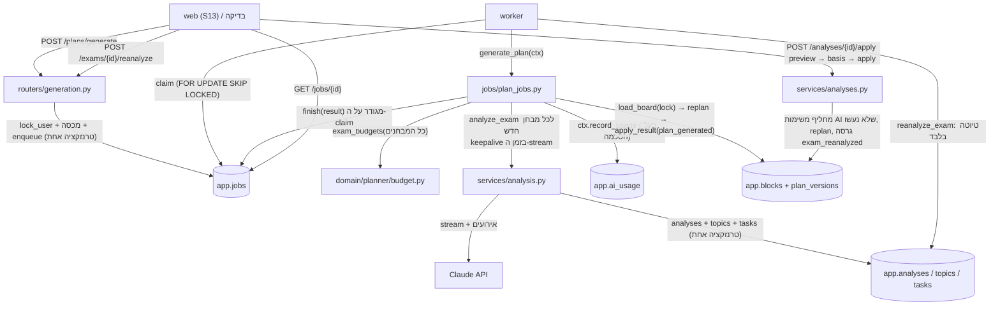

# S12 — יצירת תוכנית מקצה לקצה, eval ומכסות AI: תוכנית עבודה

> **For agentic workers:** REQUIRED SUB-SKILL: Use superpowers:subagent-driven-development (recommended) or superpowers:executing-plans to implement this plan task-by-task. Steps use checkbox (`- [ ]`) syntax for tracking.

**מטרה:** סטודנט שסיים אונבורדינג שולח `POST /plans/generate`, מקבל מזהה עבודה, וה-worker מנתח כל מבחן חדש עם Claude ומשבץ את המשימות ללוח. ‏`GET /jobs/{id}` מראה התקדמות אמיתית, וכשל מגיע לשם כקוד. כל קריאה ל-Claude נרשמת ב-`ai_usage`, ויש מכסה יומית. מבחן שכבר נותח אפשר לנתח שוב, והשינוי עובר דרך תצוגה מקדימה ואישור.

**גישה:** חמש שכבות, כל אחת נבדקת לבד:
1. **התור** (`app/jobs/queue.py`, ‏`worker.py`): הגנה על ה-claim, כדי שעבודה שנתפסה מחדש לא תכתוב פעמיים, ו-heartbeat בזמן הקריאה ל-Claude.
2. **הלקוח** (`app/ai/client.py`): קוד נפרד לחשבון בלי קרדיט, ואירוע "עדיין חי" מתוך ה-stream.
3. **השירות** (`app/services/analysis.py`, ‏`analyses.py`): הניתוח נשמר כשורה ב-`app.analyses`. בניתוח ראשון הוא נכתב עם המשימות; בניתוח חוזר הוא טיוטה, עד אישור.
4. **העבודות** (`app/jobs/plan_jobs.py`): ‏`generate_plan` ו-`reanalyze_exam`, עם `ai_usage`, מיפוי כשלים, ותוצאה ב-`jobs.result`.
5. **ה-API** (`app/routers/generation.py`): ‏`POST /plans/generate`, ‏`POST /exams/{id}/reanalyze`, ‏`POST /analyses/{id}/apply` (תצוגה מקדימה ואישור), מכסה וקודי שגיאה.

ובנוסף: בדיקת אונבורדינג מלאה עם לקוח מזויף, מדידה של המתכנן על תוכניות אמיתיות, ו-eval אמיתי מחומר ועד לוח.

**כלים:** Python 3.14, ‏uv, ‏psycopg 3, ‏Alembic עם SQL מפורש, ‏Postgres 17, ‏`anthropic` 2.6.0. בלי תלויות חדשות.

**מסמך תכנון:** `docs/superpowers/specs/2026-10-19-studyflow-v2-design.md`, סעיפים 7.4 (`ai_usage`), 7.5 (רישום ומכסה), 7.7 (`POST /plans/generate`), 7.8 (`generate_plan`), 10 (eval). במפת הדרכים שב-[artifact](https://claude.ai/code/artifact/29a3c52e-d399-425e-90b6-7c05e9146bfa) זו משימה S12: "אונבורדינג דרך ה-API מסתיים בתוכנית מלאה, וה-eval עובר". היא סוגרת את שלב 3.

## איך החלקים מתחברים



- **למה טבלת `analyses`:** ניתוח הוא דבר שקרה, עם תוצאה, ולא רק "משימות שנוצרו". הטבלה עונה על שלוש שאלות שהמבנה הנוכחי לא עונה עליהן: איפה שומרים טיוטה של ניתוח חוזר עד שהמשתמש מאשר (בלי לגעת במשימות); איך ניסיון חוזר של עבודה יודע שמבחן כבר נכשל בכשל קבוע ולא משלם עליו שוב; ואיך ביטול של ניתוח חוזר יודע אילו משימות הוסיף ואילו החליף. גם ה-`reason` של כל משימה וה-`gaps`, שלא נשמרו ב-S11, נשמרים בה (בתוך `output`).
- **למה ה-API סופר את המכסה ולא ה-worker:** הבקשה היא הרגע שבו אפשר לסרב בצורה גלויה (429). ה-API נועל את המשתמש (`lock_user`), סופר וכותב את העבודה באותה טרנזקציה, ולכן שתי לחיצות במקביל לא עוברות שתיהן את המכסה.
- **למה `ai_usage` נכתב בתור בעל הסכמה:** זו טבלת מערכת כמו `jobs`. כשניתוח נכשל, הטרנזקציה של המשתמש לא נכתבת, אבל הכסף כבר הוצא; רישום על החיבור של ה-worker, מחוץ לטרנזקציה של המשתמש, לא הולך לאיבוד עם ה-rollback. למשתמש יש רק SELECT, דרך RLS.
- **למה התצוגה המקדימה של ניתוח חוזר מריצה את הכתיבה ומבטלת אותה:** ניתוח חוזר משנה משימות, נושאים ובלוקים יחד. במקום לבנות לוח מדומה בזיכרון (קוד שני שצריך להתאים לראשון), התצוגה המקדימה מריצה את אותה פונקציה בתוך `conn.transaction(force_rollback=True)`, אוספת מה היא עשתה, ומבטלת. מה שהמשתמש רואה הוא בדיוק מה שהאישור יכתוב, וה-`basis` (טביעת האצבע של הלוח, כמו ב-S09) מבטיח שהלוח לא השתנה בין התצוגה לאישור.

## מה מצאתי לפני התכנון (2026-11-15)

| נושא | מצב |
|---|---|
| `heartbeat`, ‏`finish`, ‏`requeue`, ‏`fail` | מסננים רק `id` (ו-`heartbeat` גם `status = 'running'`). worker ישן שעבודתו נתפסה מחדש עדיין יכול לסיים אותה |
| הקריאה ל-Claude | `messages.stream(...).get_final_message()` בלי מעבר על האירועים. ‏`ai_timeout_seconds` = 600 ו-`job_lock_timeout_seconds` = 600; עם 2 ניסיונות של ה-SDK, קריאה תקועה יכולה להחזיק עד 1,800 שניות בלי heartbeat |
| חשבון בלי קרדיט | לפי ה-API: ‏402 ‏`billing_error`. בהרצה של S11 ראינו 400 עם ההודעה "Your credit balance is too low". היום שניהם נופלים ל-`ai_rejected` או ל-`ai_unavailable` |
| `jobs.result` | עד 64KB (`jobs_result_size`). 150 משימות עם `reason` של 300 תווים בעברית הם כ-90KB, ולכן ה-`reason` לא נכנס ל-`jobs.result` |
| `plan_versions.reason` | CHECK של slug בלבד, ה-enum בקוד (`VersionReason`). אפשר להוסיף ערכים בלי מיגרציה |
| `jobs.created_at` | `clock_timestamp()` של המסד, לא השעון המוזרק. בדיקות של המכסה צריכות לקבוע אותו בתור בעל הסכמה (כמו `make_job` ב-`tests/jobs/conftest.py`) |
| תוצאות ה-eval של S11 | ב-`api/eval/results/` (מקומי) יש 7 קבצים עם הנושאים והמשימות האמיתיים שהמודלים החזירו. אפשר למדוד עליהם את המתכנן בלי לשלם |
| `stage` | CHECK ‏`^[a-z][a-z_]{0,39}$`, בלי ספרות. לכן השלב לא יכול להגיד "מבחן 2 מתוך 3"; את זה אומר `percent` |

## ההחלטות שלי

| נושא | החלטה | למה | על מה ויתרנו |
|---|---|---|---|
| **המכסה: מה נספר** | יחידה אחת = בקשה אחת שמכניסה עבודה שקוראת ל-Claude: `generate_plan` או `reanalyze_exam`. נספרות העבודות של היום, **חוץ מעבודה שנכשלה בלי אף שורה ב-`ai_usage`** (כלומר בלי כסף שהוצא: אין מפתח, אין קרדיט, אין זמן לימוד, Claude לא זמין עד הניסיון האחרון). עבודה שבתור או רצה נספרת | המכסה מגינה על התקציב. כשל שלא עלה כסף הוא בדרך כלל אשמתנו או של Anthropic, ואסור שיאכל לסטודנט ניסיון. כשל שעלה כסף (`analysis_invalid` פעמיים) נספר, כי אחרת לולאה של כשלים יכולה לשרוף את החשבון. עבודה רצה נספרת, אחרת שלוש לחיצות מהירות עוברות | לספור קריאות ל-Claude (עבודה עם 3 מבחנים הייתה שווה 3) |
| **המכסה: ניסיון חוזר** | ניסיון חוזר של התור (backoff של S10) הוא אותה עבודה ולא נספר שוב. "נסה שוב" של המשתמש הוא בקשה חדשה ונספר, לפי הכלל הקודם | המשתמש לא שולט בניסיונות של התור | — |
| **המכסה: "יום"** | יום מקומי ב-**`Asia/Jerusalem`** (`AI_QUOTA_TIMEZONE`), מחצות לחצות, ולא אזור הזמן של הפרופיל. הגבול: `created_at >= חצות המקומית של today(now)`. ‏`AI_DAILY_GENERATION_LIMIT` = 3 | אזור הזמן של הפרופיל נקבע ב-`PATCH /me`, ומשתמש שמחליף אותו יכול להזיז את החצות שלו ולקבל עוד ניסיונות. כל המשתמשים בישראל, אז זה גם היום שהם מכירים. ה-429 מחזיר `resets_at` | חלון מתגלגל של 24 שעות (לא מובן למשתמש: "נסה בעוד 7 שעות ו-12 דקות") |
| **בקשה כפולה** | `POST /plans/generate` כשיש למשתמש `generate_plan` שבתור או רץ → 202 עם המזהה של העבודה הקיימת, בלי לספור. אותו דבר ל-`reanalyze` של אותו מבחן | לחיצה כפולה, או רענון של מסך "בונים לך תוכנית", לא צריכים לעלות ניסיון | 409 |
| **אילו מבחנים `generate` מנתח** | כל מבחן חי שתאריכו לא עבר ושאין לו משימות `ai` חיות. הרשימה נקבעת בבקשה ונשמרת ב-`payload.exam_ids`. אין כאלה → 409 ‏`nothing_to_analyze` (ה-web מציע `POST /plan/replan`) | 7.6.8: "מבחן שנוסף אחרי האונבורדינג מנותח לבד; שאר המבחנים לא מנותחים שוב". לכן כל `generate` קורא ל-AI, והמכסה פשוטה | לתת ל-`generate` לתכנן בלי ניתוח |
| **התקציב בין מבחנים** (פריט 5) | `exam_budgets` מקבל **את כל המבחנים החיים**, גם אלה שכבר נותחו, ו-`generate` מנתח רק את החדשים | מבחן חדש מתחרה על אותם ימים עם המבחנים הקיימים. אם רק הוא ייכנס לחישוב, הוא יקבל את כל הימים, והתוכנית תחרוג מהזמן שיש. ההתנהגות הנוכחית נכונה, ונבדקת עכשיו במפורש | לחשב תקציב לפי מה שנשאר אחרי הבלוקים הקיימים (תלוי בלוח, משתנה בכל תכנון) |
| **כשל של מבחן אחד מתוך כמה** (פריט 7) | שלוש קבוצות: **(א) של החשבון** (`ai_not_configured`, ‏`ai_no_credit`): העבודה נכשלת מיד בקוד הזה, בלי ניסיון חוזר ובלי שיבוץ. **(ב) זמני** (`ai_unavailable`, ‏`storage_unavailable`): ‏`JobFailed(code, retry=True)` כל עוד יש ניסיונות; בניסיון הבא מבחנים שכבר נותחו מדולגים, כי יש להם משימות. בניסיון האחרון זה נרשם ככשל של המבחן. **(ג) של המבחן** (כל השאר): נרשם ב-`analyses` כ-`failed`, והעבודה ממשיכה. אחרי הלולאה: אם **אף** מבחן לא נותח בהצלחה, העבודה נכשלת עם הקוד של הכשל הראשון; אחרת היא משבצת ומסתיימת ב-`done`, וב-`result.exams` לכל מבחן `status` ו-`error` | 4: "ה-AI נכשל והמשתמש רואה הצלחה עם לוח ריק" אסור. אבל אם מבחן אחד מתוך שלושה נכשל, תוכנית לשניים האחרים עם הודעה גלויה על השלישי עדיפה על כשל כולל. ניסיון חוזר מדלג על מה שהצליח ועל מה שנכשל בכשל קבוע (שורת `failed` של אותה עבודה), כדי לא לשלם פעמיים | כל כשל מכשיל את העבודה |
| **heartbeat** (פריט 1) | `AnalysisClient.complete(..., keepalive=None)`: הלקוח עובר על אירועי ה-stream וקורא ל-`keepalive()` על כל אירוע. ‏`JobContext.keepalive()` כותב heartbeat רק אם עברו 30 שניות מהקודם. בנוסף, `Settings` מחייב `ai_timeout_seconds × (ai_max_retries + 1) < job_lock_timeout_seconds`, וה-default של `AI_TIMEOUT_SECONDS` יורד ל-180 (עם `ai_max_retries` = 2: ‏540 < 600) | ה-API שולח אירועי `ping` גם בזמן thinking ארוך, כך שבקשה חיה מחדשת את הנעילה כל 30 שניות. ה-timeout של ה-SDK הוא לכל קריאה מהרשת, לא לבקשה כולה, ולכן 180 שניות של שקט פירושן חיבור מת. הכלל ב-`Settings` מבטיח שגם בקשה תקועה לגמרי מסתיימת לפני שהנעילה פגה, כך שאין שני workers שמשלמים על אותו ניתוח | thread נפרד ל-heartbeat (מסוכן: הוא היה כותב לאותו חיבור בזמן שטרנזקציה של המשתמש פתוחה, תחת `role authenticated`); נעילה של שעה (worker שמת היה תוקע עבודה לשעה) |
| **גדר על ה-claim** (S10) | `heartbeat`, ‏`finish`, ‏`requeue` ו-`fail` מקבלים `attempts` ומסננים `attempts = %s AND status = 'running'`, ומחזירים אם עדכנו שורה. ‏`JobContext.progress`/`keepalive` זורקים `JobLost` כשהגדר נכשלה, וה-worker עוזב את העבודה בלי לכתוב (רק לוג) | worker ישן שהתעורר אחרי שהעבודה נתפסה מחדש לא ידרוס את התוצאה של החדש, ויפסיק לפני שהוא קורא שוב ל-Claude | — |
| **`slug` ו-`percent`** (S10) | `JobContext.progress` בודק את ה-slug (אותו regex של ה-CHECK) ואת `0 ≤ percent ≤ 100` לפני ה-SQL, וזורק `ValueError`. גם `JobFailed` בודק את הקוד שלו | היום שגיאה כזו עולה מה-CHECK כשגיאת מסד, בשורה אחרת לגמרי. כאן היא נתפסת במקום שבו נכתב הבאג | — |
| **`statement_timeout` ב-worker** (S10) | **נשאר 5 שניות.** | ה-timeout הוא לכל פקודה, לא לטרנזקציה. הכתיבה הגדולה ביותר היא 150 INSERT של משימות, כל אחד פקודה נפרדת. ‏`plan()` רץ בפייתון, לא במסד. ‏Task 9 מודד את זה על תוכניות אמיתיות; אם פקודה אחת מתקרבת לשנייה, נחזור לזה | timeout ארוך שמסתיר שאילתה איטית |
| **חשבון בלי קרדיט** (פריט 8) | קוד חדש `ai_no_credit`: ‏402, או `error.type == "billing_error"`, או 400 שההודעה שלו מכילה `credit balance` (לא נכתבת ללוג). בלי ניסיון חוזר. נכתב ללוג ב-ERROR, כדי שמי שמתפעל יראה | זו לא שגיאה של הסטודנט ולא באג שלנו (`ai_rejected`), וזה לא זמני (`ai_unavailable` היה מנסה שלוש פעמים). ה-web יציג "השירות לא זמין כרגע", ולא "משהו לא תקין בחומרים שלך" | לקפל ל-`ai_not_configured` (מסתיר את הסיבה מהלוג) |
| **`from_settings`** (פריט 3) | נשאר `AiError("ai_not_configured")`. ‏`JobContext` מקבל `ai_client()`, שבונה את הלקוח בפעם הראשונה; ה-handler תופס `AiError` וממפה ל-`JobFailed` עם אותו קוד | השכבה של ה-AI לא צריכה להכיר את `AnalysisFailed` של השירות. המיפוי שייך ל-handler, שמחליט מה קורה לעבודה | — |
| **`ai_usage`** (פריט 2) | שורה לכל קריאה: `user_id`, ‏`job_id`, ‏`exam_id`, ‏`model` (מה שה-API החזיר), ארבעת מוני הטוקנים, `created_at`. נכתבת מ-`AnalysisOutcome.usage` ומ-`AnalysisFailed.usage` מיד אחרי כל מבחן, לפני הכתיבה של התוכנית. ‏`ai_usage` בלי עלות בדולרים | המחירים משתנים; מוני הטוקנים והמודל מספיקים לחישוב בכל רגע. רישום אחרי כל מבחן (ולא בסוף העבודה) כדי שקריסה באמצע לא תמחק את הכסף שכבר הוצא. נשאר פער: worker שמת **בתוך** הקריאה ל-Claude לא רושם את הקריאה ההיא; מתועד | עמודת `usd` |
| **ניתוח חוזר: מה מוחלף** (החלטה של אייל) | מוחלפות משימות שמקיימות הכל: `source = 'ai'`, ‏`status = 'todo'`, לא מחוקות, **ואין להן אף בלוק `done`**. הן נמחקות רך (`deleted_at`), והבלוקים הפתוחים שלהן נמחקים. נשארות: משימות `done` ו-`skipped`, משימות `ai` שיש להן בלוק `done` (התחילו ללמוד אותן), ומשימות `user` | "משימות שנעשו נשארות". משימה שחצי ממנה נלמד היא התקדמות אמיתית; מחיקה שלה הייתה מוחקת את הדקות שנלמדו מהתוכנית (4: "אובדן נתונים"). ‏`skipped` נשארת כי היא החלטה של המשתמש, והיא לא תופסת זמן | להחליף גם משימות שהתחילו |
| **ניתוח חוזר: איך מזהים "משימה של AI"** | `tasks.source = 'ai'` (קיים מ-S05), ועמודה חדשה `tasks.analysis_id` שמצביעה על הניתוח שיצר אותה. גם `topics.analysis_id` | `source` מספיק כדי לדעת מה להחליף; `analysis_id` נדרש לביטול, שצריך למחוק בדיוק את המשימות שהניתוח החדש הוסיף | רשימת מזהים ב-JSON |
| **ניתוח חוזר: נושאים** | נושאים ישנים לא נמחקים. ניתוח חוזר מוסיף נושאים חדשים עם `analysis_id` שלו | משימות שנשארו (שנעשו) מצביעות על הנושאים הישנים, ומחיקה הייתה מאפסת להן את `topic_id` ולא הייתה ניתנת לביטול. מסך המבחן (S14) יציג את הנושאים של הניתוח האחרון שהוחל, ואת אלה שמשימה חיה מצביעה עליהם; נרשם ב-artifact | מחיקת נושאים יתומים |
| **ניתוח חוזר: הבלוקים** | בתוך האישור: נמחקים הבלוקים `planned` של המשימות המוחלפות שמתחילים מ-`now` (כמו מחיקת משימה ב-S09), נכתבות המשימות החדשות, ואז `replan` יציב על כל הלוח. גרסה אחת, `exam_reanalyzed`, עם snapshot של הלוח **לפני** המחיקה ו-`analysis_id` | אותו מודל של S08 ו-S09: בלוק שהתחיל, נעול או `done` לא זז; כל השאר יציב ככל האפשר; שינוי אחד = גרסה אחת = ביטול אחד | שתי גרסאות (מחיקה ותכנון) |
| **ניתוח חוזר: ביטול** | `undo` של `exam_reanalyzed`: המשימות עם `analysis_id` של הגרסה נמחקות רך, המשימות שב-`analyses.replaced_task_ids` חוזרות (`deleted_at = NULL`), הניתוח מסומן `undone`, וה-snapshot מחזיר את הבלוקים הישנים (המנגנון של S08) | הביטול צריך להחזיר את מה שהיה לפני, כולל המשימות. אחרי ביטול, הטיוטה לא חוזרת להיות טיוטה; ניתוח חדש עולה ניסיון | לאפשר החלה חוזרת של אותה טיוטה |
| **ניתוח חוזר: הזרימה** | `POST /exams/{id}/reanalyze` → 202 ‏`job_id`. העבודה `reanalyze_exam` שומרת טיוטה (`analyses.status = 'draft'`) ולא נוגעת במשימות. ‏`result.analysis_id`. ‏`POST /analyses/{id}/apply {"preview": true}` → מה יוחלף, מה יתווסף, מה ישתנה בלוח, ו-`basis`. ‏`{"preview": false, "basis": …}` → כותב, או 409 ‏`stale_plan`. טיוטה שכבר הוחלה, או שלא של המבחן הזה → 409 ‏`invalid_state`. טיוטה חדשה של אותו מבחן מבטלת את הקודמות (`superseded`) | זו ההחלטה של אייל ("דרך תצוגה מקדימה, כמו תכנון מחדש ב-S08 וב-S09, ושום דבר לא נכתב לפני אישור"), באותו חוזה `preview`/`basis` של `POST /plan/replan`. הקריאה ל-Claude לוקחת דקה ולכן היא עבודה; התצוגה המקדימה מהירה ולכן היא בקשה סינכרונית | תצוגה מקדימה בתוך העבודה (הלוח יכול להשתנות עד שהמשתמש מסתכל) |
| **`already_analyzed`** | נשאר רק ב-`generate_plan` (ניתוח ראשון): מבחן שקיבל משימות `ai` בינתיים מדולג כהצלחה (`status = "skipped"`). ‏`reanalyze_exam` לא בודק אותו | שני ניתוחים ראשונים במקביל לא יכתבו כפול. ניתוח חוזר לא כותב משימות, אז אין מה לבדוק | — |
| **השיבוץ אחרי `generate`** | `load_board(lock=True)` → `replan` → `apply_result(..., VersionReason.PLAN_GENERATED)` בטרנזקציה אחת של המשתמש, בלי תצוגה מקדימה. ביטול של `plan_generated` מחזיר את הבלוקים בלבד; המשימות נשארות | זו הפעולה המפורשת "בנו לי תוכנית", והמשתמש מחכה לה במסך ההתקדמות. ‏`replan` יציב, אז מבחן שנוסף אחרי האונבורדינג לא מזיז בלוקים של מבחנים אחרים אלא אם חייבים. הביטול זמין כמו בכל שינוי | תצוגה מקדימה לפני שיבוץ ראשון |
| **`jobs.result`** (פריט 6) | `{"exams": [{"exam_id", "status": "analyzed" / "failed" / "skipped", "error"?, "analysis_id"?, "topics", "tasks", "gaps": [{"topic", "note"}], "warnings": [...], "dropped": [...], "total_minutes", "budget_minutes"}], "plan": {"version_id", "blocks", "unscheduled": [{"task_id", "reason"}] (עד 200), "unscheduled_count", "shortfalls": [{"exam_id", "minutes", "daily_minutes"}], "warnings": [...]}}`. ה-`reason` של כל משימה נשמר ב-`analyses.output`, לא ב-`jobs.result` | הגבול של 64KB. ‏`gaps` והאזהרות קטנים ושייכים למסך הסיום; ה-`reason` שייך למסך המבחן (S14), שיקרא אותו מ-`analyses` | — |
| **התקדמות** | `reading_materials` (2), לכל מבחן i מתוך n: ‏`analyzing` (‏`5 + 80·i/n`), ‏`saving`; ואז `planning` (88), ‏`saving_plan` (95). ה-`percent` של שלב בתוך מבחן מתמפה לחלק שלו בטווח | `percent` הוא האמת היחידה שה-web יכול להראות (stage בלי ספרות) | — |
| **מספרים** | `AI_DAILY_GENERATION_LIMIT` = 3, ‏`AI_QUOTA_TIMEZONE` = `Asia/Jerusalem`, ‏`AI_TIMEOUT_SECONDS` = 180, ‏`AI_MAX_RETRIES` = 2, keepalive כל 30 שניות | ההחלטה של אייל (3); השאר מהחשבון של ה-heartbeat | — |

## הפריטים מ-S06 עד S09: איך מודדים

Task 9 בונה סקריפט, `api/eval/plan_eval.py`, שקורא את המשימות האמיתיות מ-`api/eval/results/*.json` (תשובות אמיתיות של Haiku, ‏Sonnet ו-Opus מ-S11, בלי עלות), בונה מהן לוחות (1–3 מבחנים, שלושה פרופילים: 120, ‏240 ו-360 דקות ביום, חלונות שונים), ומודד:

| פריט | מה נמדד | מתי מתקנים |
|---|---|---|
| זמן הריצה של `plan()`/`replan()` | חציון, p95 ומקסימום, כולל החיפוש של `daily_minutes` | p95 מעל 2 שניות, או מקסימום מעל 10 (העבודה מחכה לו בתוך טרנזקציה עם נעילה) |
| כלל ה-rerun | כמה פעמים הוא רץ, וכמה דקות נשארות בדוח לעומת הרצה שמוציאה כל משימה אחרת בתורה (oracle) | אם בתוכנית אמיתית ה-oracle משבץ יותר דקות ביותר מ-1% מהלוחות |
| רזרבה של 70 דקות | הדקות שנשארו בדוח, לעומת אותו לוח עם רזרבה קטנה יותר (רק למדידה; יום שלא נארז נספר בנפרד) | אם הרזרבה גורמת ל-`unscheduled` שהיה נכנס, ביותר מ-5% מהלוחות |
| יום שמור לסימולציה | ימים שמורים שהסימולציה שלהם לא נכנסה, ושהיו בהם דקות פנויות שמשימה בדוח הייתה יכולה לקחת | אותו סף |
| `place_task` ברצף | 5 משימות `user` שנוספות אחת אחרי השנייה ליום אמיתי: כמה ימים עוברים את חצי הדקות בלי הפסקה של 30 | אם זה קורה ביותר ממחצית הימים, ויש תיקון קטן ב-`place.py`. אחרת נדחה עם המספרים |

הסקריפט מדפיס מספרים בלבד (בלי כותרות). מה שלא עובר את הסף נדחה ונרשם מחדש ב-artifact עם המספרים. התיקון, אם יש, הוא Task נפרד אחרי המדידה (9b), עם בדיקה שנכשלת לפניו.

## מה לא נכלל ולמה

- **כל מסך ב-`web/`** (אונבורדינג, "בונים לך תוכנית", טקסט בעברית לקודים החדשים): S13 ואילך. נרשם ב-artifact.
- **מכסה לשינוי בשפה חופשית** (7.11): S20, עם ה-endpoint שלו. ‏`ai_usage` ופונקציית הספירה כבר מוכנות לו.
- **`GET /analyses/{id}`** עם ה-`reason` לכל משימה ומסך המבחן: S14. ‏S12 שומר את הנתונים.
- **עלות בדולרים ודוח שימוש למפעיל**: אחרי הבטא. ‏`ai_usage` מספיק לשאילתה ידנית.
- **רישום של קריאה ל-Claude שה-worker מת באמצעה**: מתועד כפער; פתרון אמיתי צריך כתיבה לפני הקריאה ועדכון אחריה, וזה לא שווה את המורכבות עכשיו.

## אילוצים גלובליים

- Python 3.14, ‏uv, ‏`exclude-newer = "7 days"`. אין תלויות חדשות.
- `ruff check`, ‏`ruff format --check`, ‏`mypy` (strict) ו-`pytest` עם `filterwarnings = ["error"]`. ‏1087 הבדיקות הקיימות נשארות ירוקות, חוץ ממה שהתוכנית משנה במפורש.
- **אין שמות מודלים ב-`app/` ובבדיקות של `app/`.** בבדיקות `"test-model"`.
- **אין קריאות רשת בבדיקות.** ‏`FakeAnalysisClient` או `httpx2.MockTransport`.
- **סודות:** `ANTHROPIC_API_KEY` לא מודפס, לא נכתב ללוג, לא יוצא מ-`api/.env`.
- **פרטיות:** טקסט מהחומרים, כותרות משימות, הפרומפט ותשובת המודל לא נכתבים ללוג. ללוג: מזהים, קודים, מספרים, שמות מחלקות.
- **טרנזקציות:** אין קריאה ל-Claude או ל-Storage בתוך טרנזקציה. כל שאילתה מסננת `user_id` במפורש מעל RLS. ה-worker כותב בתור בעל הסכמה רק ל-`app.jobs` ול-`app.ai_usage`.
- **מיגרציה 0008:** SQL מפורש, ‏RLS על כל טבלה חדשה, מדיניות ו-grants באותה מיגרציה, ו-`downgrade` שעובד (`test_migrations_round_trip`).
- כל route חדש עם מזהה נכנס ל-`CASES` ב-`tests/api/test_ownership.py`; כל קוד שגיאה חדש נכנס ל-`PROBLEMS` ב-`app/errors.py`.
- הקוד, ההערות והודעות הקומיט באנגלית. התוכנית והדיווחים בעברית.
- git רץ בשיחה הראשית; ה-subagents לא מריצים git. מוסיפים קבצים לפי שם. לפני commit: ‏`git status --short --untracked-files=all` (בלי קבצים זרים, ‏`* 2.*`, ‏`.env.*`). לפני push: ‏`gitleaks git --redact --no-banner .`.
- הריפו ב-`/Users/eyalatar/studyflow`, הפקודות מתוך `/Users/eyalatar/studyflow/api`. קבצים זמניים רק ב-scratchpad. subagents שרצים במקביל מקבלים `STUDYFLOW_TEST_DB` שונה (למשל `studyflow_test_t1`), ו-`tests/db` רץ לבד.
- לא נוגעים ב-`legacy/` וב-`web/`.
- בדיקה שנכשלת לא מוחלשת ולא מקבלת `xfail` מצד ה-implementer. מדווחים ועוצרים ב-`DONE_WITH_CONCERNS`. פגם בתוכנית מדווחים.

## על מה לשים לב בבדיקה

1. **worker ישן מתעורר** אחרי שהעבודה שלו נתפסה מחדש: ה-heartbeat הבא שלו זורק `JobLost`, הוא לא קורא שוב ל-Claude, ו-`finish` שלו לא דורס את התוצאה של החדש. Task 1.
2. **ניסיון חוזר אחרי כשל זמני באמצע:** מבחן A נותח, מבחן B קיבל `ai_unavailable`. בניסיון השני רק B נקרא ל-Claude, ו-A לא משלם שוב. Task 6.
3. **כשל קבוע ואז כשל זמני:** A נכשל ב-`analysis_invalid` (שתי קריאות), B ב-`ai_unavailable`. בניסיון השני A לא נקרא שוב (שורת `failed` של העבודה). Task 6.
4. **כל המבחנים נכשלו:** העבודה `failed`, ולא `done` עם לוח ריק. Task 6.
5. **מכסה במקביל:** שתי בקשות של אותו משתמש כשנשאר ניסיון אחד: אחת 202, השנייה 429. Task 5.
6. **ניתוח חוזר אחרי שהמשתמש סימן משימה כ-done בין התצוגה לאישור:** ה-`basis` השתנה → `stale_plan`, ושום דבר לא נכתב. Task 7.
7. **ביטול ניתוח חוזר** מחזיר את המשימות הישנות ואת הבלוקים שלהן, ומוחק את החדשות. Task 7.

## מי עושה מה

| Task | מה | מי | תלוי ב- |
|---|---|---|---|
| 0 | פתיחה: הענף, הסטטוס, התוכנית | אני (נעשה) | — |
| 1 | התור: גדר על ה-claim, `JobLost`, בדיקת slug ו-percent, `keepalive`, ‏`ai_client` ו-`record_usage` ב-`JobContext` | subagent | 2 (`record_usage` כותב ל-`ai_usage`) |
| 2 | מיגרציה 0008 | subagent | 0 |
| 3 | לקוח Claude: `ai_no_credit`, ‏keepalive מתוך ה-stream, timeout וניסיונות, הכלל ב-`Settings` | subagent | 0 (במקביל ל-2) |
| 9 | מדידת המתכנן על תוכניות אמיתיות | subagent | 0 (במקביל ל-2, 3) |
| 4 | השירות: `analyses`, טיוטה, `analysis_id`, ‏keepalive | subagent | 2, 3 |
| 5 | מכסה, `POST /plans/generate`, ‏`POST /exams/{id}/reanalyze` | subagent | 2 (במקביל ל-4) |
| 6 | העבודות `generate_plan` ו-`reanalyze_exam` | subagent | 1, 4, 5 |
| 7 | `POST /analyses/{id}/apply` וביטול של `exam_reanalyzed` | subagent | 6 |
| 8 | אונבורדינג מלא דרך ה-API (לקוח מזויף) | subagent | 7 |
| 9b | תיקון מהמדידה, אם יש | subagent | 9 |
| 10 | eval אמיתי מחומר ועד לוח (עד 2$) | subagent + אני (ההרצה בתשלום אני מאשר) | 8 |
| 11 | מסמכים, סקירה סופית, מיגרציה ב-dev, מיזוג | אני | הכל |

## מבנה הקבצים

```
api/migrations/versions/0008_ai_usage_and_analyses.py   (חדש)
api/tests/db/test_ai_usage_and_analyses.py              (חדש)
api/tests/db/test_schema.py                             הטבלאות וה-grants
api/app/jobs/queue.py, worker.py                        גדר, JobLost, keepalive, ai_client, record_usage
api/app/jobs/__main__.py                                ai_client factory
api/tests/jobs/test_queue.py, test_worker.py            בדיקות הגדר
api/app/ai/client.py, api/app/config.py                 ai_no_credit, keepalive, timeout, AI_* חדשים
api/tests/ai/test_client.py, tests/test_config.py, tests/ai/fake_client.py
api/app/services/analysis.py                            analyses, טיוטה, analysis_id, keepalive
api/tests/jobs/test_analysis.py
api/app/services/generation.py                          (חדש) מכסה, enqueue, dedupe
api/app/routers/generation.py, api/app/schemas/generation.py   (חדשים)
api/app/errors.py                                       ai_quota_exceeded, nothing_to_analyze
api/app/main.py                                         router
api/tests/api/test_generation.py                        (חדש)
api/tests/api/test_ownership.py                         CASES
api/app/jobs/plan_jobs.py                               (חדש) generate_plan, reanalyze_exam
api/app/jobs/ingest.py                                  HANDLERS
api/app/domain/materials.py                             JOB_GENERATE_PLAN, JOB_REANALYZE_EXAM (או מקום משותף)
api/tests/jobs/test_plan_jobs.py                        (חדש)
api/app/services/analyses.py                            (חדש) preview/apply של טיוטה
api/app/services/plan_writes.py                         VersionReason, undo של exam_reanalyzed
api/tests/api/test_reanalysis.py                        (חדש)
api/tests/jobs/test_onboarding_flow.py                  (חדש) אונבורדינג מלא
api/eval/plan_eval.py                                   (חדש) מדידת המתכנן
api/eval/generate_eval.py                               (חדש) eval אמיתי מחומר ועד לוח
api/eval/README.md, CLAUDE.md                           פקודות ותוצאות
מסמך התכנון (7.4, 7.5, 7.7, 7.8, 10, 12) והלשונית שלו ב-artifact
```

---

### Task 0: פתיחה

נעשה: הענף `s12-plan-generation` מ-`main` (`5278230`), הסטטוס "בעבודה" ב-artifact.

- [ ] **Step 1: קומיט של התוכנית** — `git add docs/superpowers/plans/2026-11-15-s12-plan-generation.md && git commit -m "docs(plan): add the S12 plan generation plan"`

---

### Task 2: מיגרציה 0008

**Files:** Create `api/migrations/versions/0008_ai_usage_and_analyses.py`, ‏`api/tests/db/test_ai_usage_and_analyses.py`; Modify `api/tests/db/test_schema.py`.

- **`app.analyses`:** `id uuid PK default gen_random_uuid()`, ‏`user_id` (FK `auth.users` cascade), ‏`exam_id` (FK `(exam_id, user_id) → app.exams(id, user_id)` cascade), ‏`job_id uuid` (FK `(job_id, user_id) → app.jobs(id, user_id)` עם `ON DELETE SET NULL (job_id)`), ‏`status text` (`draft`, ‏`applied`, ‏`failed`, ‏`superseded`, ‏`undone`), ‏`error text` (slug כמו ב-`jobs.error`; חובה כש-`failed`, אסור אחרת), ‏`output jsonb` (אובייקט; חובה כש-`draft`/`applied`; ‏`pg_column_size ≤ 1 MiB`), ‏`material_keys jsonb` (אובייקט `M1 → uuid`, ברירת מחדל `{}`), ‏`warnings text[]` (חד-ממדי, עד 20), ‏`dropped text[]` (עד 150), ‏`total_minutes int`, ‏`budget_minutes int` (0–100000), ‏`replaced_task_ids uuid[]` (ברירת מחדל `{}`), ‏`created_at timestamptz default clock_timestamp()`, ‏`applied_at`, ‏`undone_at`. ‏`UNIQUE (id, user_id)`. אינדקס `(user_id, exam_id, created_at DESC)` ו-`(job_id)`. ‏RLS ‏owner; ל-`authenticated`: ‏SELECT, ‏INSERT, ‏UPDATE (ה-worker כותב בשם המשתמש, ה-API מחיל). בלי DELETE.
- **`app.ai_usage`:** `id uuid PK`, ‏`user_id` (FK cascade), ‏`job_id uuid` (FK `(job_id, user_id)` עם `ON DELETE SET NULL (job_id)`), ‏`exam_id uuid` (בלי FK: מבחן שנמחק קשה לא מוחק את הרישום), ‏`model text` (1–100 תווים), ‏`input_tokens`, ‏`output_tokens`, ‏`cache_creation_input_tokens`, ‏`cache_read_input_tokens` (`integer ≥ 0`), ‏`created_at default clock_timestamp()`. אינדקס `(user_id, created_at)` ו-`(job_id)`. ‏RLS ‏owner; ל-`authenticated` רק SELECT.
- **`app.tasks.analysis_id`** ו-**`app.topics.analysis_id`**: `uuid`, ‏FK `(analysis_id, user_id) → app.analyses(id, user_id)` עם `ON DELETE SET NULL (analysis_id)`, ואינדקס חלקי.
- **`app.plan_versions.analysis_id`**: אותו FK; ‏INSERT grant ל-`authenticated` על העמודה (בנוסף לעמודות של S09).
- **בדיקות:** הטבלאות, ה-CHECKs (סטטוס לא חוקי, `failed` בלי `error`, ‏`draft` בלי `output`), RLS (B לא רואה ולא כותב שורות של A ב-`analyses` וב-`ai_usage`), ‏`authenticated` לא יכול INSERT ל-`ai_usage`, ה-FK המשולב (משימה לא יכולה להצביע על ניתוח של משתמש אחר), ‏round trip.

- [ ] **Step 1: בדיקות** → **Step 2: נכשלות** → **Step 3: מימוש** → **Step 4: ירוק** (`uv run pytest tests/db -q` לבד, ואז כל החבילה) → **Step 5: קומיט** — `feat(db): add ai_usage and analyses, and link tasks, topics and plan versions to an analysis`

---

### Task 1: התור — גדר על ה-claim, `JobLost`, ‏keepalive

**Files:** Modify `api/app/jobs/queue.py`, ‏`worker.py`, ‏`__main__.py`; ‏`api/tests/jobs/test_queue.py`, ‏`test_worker.py`, ‏`conftest.py`.

**Interfaces (Produces):**
- `heartbeat(conn, job_id, attempts, now, *, stage=None, percent=None) -> bool`, ‏`finish(conn, job_id, attempts, now, result) -> bool`, ‏`requeue(conn, job_id, attempts, *, run_at, error) -> bool`, ‏`fail(conn, job_id, attempts, now, error) -> bool`. כולם `WHERE id = %s AND attempts = %s AND status = 'running'`. ה-callers הקיימים מעבירים `job.attempts`.
- `class JobLost(Exception)` ב-`worker.py`. ‏`JobContext.progress(stage, percent)` בודק slug (`^[a-z][a-z_]{0,39}$`) ו-`0 ≤ percent ≤ 100` (אחרת `ValueError`), וזורק `JobLost` כש-`heartbeat` החזיר False. ‏`JobFailed.__init__` בודק את הקוד (`^[a-z][a-z_]{0,59}$`).
- `JobContext.keepalive() -> None`: ‏heartbeat בלי stage ו-percent, רק אם עברו `KEEPALIVE_SECONDS` = 30 לפי השעון המוזרק מאז ה-heartbeat הקודם (progress מאפס את המונה); ‏`JobLost` כמו progress.
- `JobContext.ai_client() -> AnalysisClient`: ה-`Worker` מקבל `ai_client_factory: Callable[[Settings], AnalysisClient] | None` (ברירת מחדל `AnthropicAnalysisClient.from_settings`), ו-`JobContext` בונה פעם אחת לכל עבודה. ‏`AiError` עולה ל-handler.
- `JobContext.record_usage(usage: Sequence[Usage], *, exam_id: UUID | None) -> None`: ‏INSERT ל-`app.ai_usage` על החיבור של בעל הסכמה (autocommit), עם `user_id` ו-`job_id` של העבודה. אסור לקרוא לה בתוך `user_transaction` (בודקת `conn.info.transaction_status` ו-`RuntimeError`).
- ה-worker: `JobLost` מ-handler → לוג INFO ויציאה, בלי finish/fail. כש-finish/requeue/fail החזירו False → לוג WARNING ("claim lost").

| בדיקה | מצופה |
|---|---|
| `test_stale_attempt_cannot_finish` | עבודה שנתפסה (attempts=1) ואז נתפסה מחדש (attempts=2): ‏`finish(..., attempts=1, ...)` מחזיר False, השורה לא השתנתה |
| `test_stale_attempt_cannot_fail_or_requeue_or_heartbeat` | אותו דבר לשלושה |
| `test_handler_that_lost_its_claim_writes_nothing` | handler שבו העבודה נתפסת מחדש (עדכון ישיר כבעל הסכמה) ואז קורא `ctx.progress` → `JobLost`; העבודה נשארת כפי שהחדש השאיר |
| `test_progress_rejects_a_bad_stage_or_percent` | `"Analyzing"`, ‏`"a1"`, ‏101, ‏-1 → `ValueError`, בלי SQL |
| `test_job_failed_rejects_a_bad_code` | `JobFailed("Bad Code")` → `ValueError` |
| `test_keepalive_writes_at_most_every_30_seconds` | שעון קפוא: שתי קריאות → `locked_at` לא השתנה; קידום של 31 שניות → השתנה |
| `test_record_usage_writes_rows_as_the_owner` | שתי `Usage` → שתי שורות עם `job_id`, ‏`user_id`, ‏`exam_id` |
| `test_record_usage_refuses_inside_a_user_transaction` | `RuntimeError` |
| `test_ai_client_is_built_once` | factory שסופר קריאות → 1 גם בשתי קריאות ל-`ctx.ai_client()` |

- [ ] Steps 1–5 כמו ב-Task 2. קומיט: `feat(jobs): fence queue writes on the claim, and add keepalive, the AI client and usage to the job context`

---

### Task 3: לקוח Claude

**Files:** Modify `api/app/ai/client.py`, ‏`api/app/config.py`, ‏`api/.env.example`, ‏`api/tests/ai/test_client.py`, ‏`api/tests/test_config.py`, ‏`api/tests/ai/fake_client.py`.

**לפני הקוד:** סקיל `claude-api`. העובדות שמצאתי בו: שגיאת חיוב היא 402 עם `error.type == "billing_error"`; ב-SDK‏ 2.6 יש `APIStatusError.type`; ה-SDK מנסה שוב 408/409/429/5xx ושגיאות חיבור (`max_retries`); ‏`for event in stream:` עובר על האירועים לפני `get_final_message()`.

**Interfaces (Produces):**
- `AnalysisClient.complete(*, system, messages, schema, keepalive: Callable[[], None] | None = None) -> AnalysisReply`. ‏`AnthropicAnalysisClient` עובר `for _event in stream: keepalive()` ואז `stream.get_final_message()`.
- קוד חדש `ai_no_credit` (retry=False): ‏`status_code == 402`, או `error.type == "billing_error"`, או 400 שה-message שלו (lowercase) מכיל `"credit balance"`. גם `anthropic.EnforcedSpendLimitReachedError` ו-`anthropic.OrganizationOnHoldError` אם הם תת-מחלקות של `APIStatusError` (לבדוק ב-SDK המותקן; אם לא — לדלג ולדווח). נכתב ללוג ב-ERROR עם status ו-request_id בלבד. נבדק **לפני** ה-ענף של 4xx → `ai_rejected`.
- `Settings`: `ai_timeout_seconds` default 180, ‏`ai_max_retries: int = Field(2, ge=0, le=5)`, ‏`ai_daily_generation_limit: int = Field(3, ge=0)`, ‏`ai_quota_timezone: str = "Asia/Jerusalem"` (נבדק מול IANA דרך `app/domain/time.py`); ‏model validator: `ai_timeout_seconds * (ai_max_retries + 1) < job_lock_timeout_seconds`, אחרת שגיאה עם הסבר. ‏`from_settings` מעביר `max_retries=settings.ai_max_retries`.
- `FakeAnalysisClient.complete` מקבל `keepalive` וקורא לו פעם אחת לפני כל תשובה (כדי שבדיקות יראו שהוא עובר).

| בדיקה | מצופה |
|---|---|
| `test_billing_error_is_no_credit` | ‏MockTransport: ‏402 `{"type":"error","error":{"type":"billing_error","message":"..."}}` → `AiError("ai_no_credit", retry=False)` |
| `test_credit_balance_400_is_no_credit` | 400 ‏`invalid_request_error` עם "Your credit balance is too low to access the Anthropic API." → `ai_no_credit`; ההודעה לא בלוג (`caplog`) |
| `test_other_400_is_still_rejected` | 400 אחר → `ai_rejected` |
| `test_keepalive_runs_on_stream_events` | ‏MockTransport עם SSE של כמה אירועים (כולל `ping`) → `keepalive` נקרא לפחות פעם לכל אירוע; התשובה כרגיל |
| `test_settings_reject_a_timeout_longer_than_the_lock` | `AI_TIMEOUT_SECONDS=300`, ‏`AI_MAX_RETRIES=2`, ‏`JOB_LOCK_TIMEOUT_SECONDS=600` → שגיאת ולידציה |
| `test_quota_settings_defaults` | 3, ‏`Asia/Jerusalem`; אזור לא חוקי → שגיאה |

- [ ] Steps 1–5. קומיט: `feat(ai): tell an account without credit apart, keep the job alive during the stream, and bound the call time`

---

### Task 4: השירות — `analyses`, טיוטה, ‏`analysis_id`

**Files:** Modify `api/app/services/analysis.py`, ‏`api/tests/jobs/test_analysis.py`.

**Interfaces (Produces):**
- `analyze_exam(..., keepalive: Callable[[], None] | None = None, job_id: UUID | None = None) -> AnalysisOutcome`: כמו היום, ובנוסף: ‏`keepalive` עובר ל-`run_analysis` ול-`client.complete`; הכתיבה (בטרנזקציה אחת, תחת `lock_user`) יוצרת שורת `analyses` (`status = 'applied'`, ‏`applied_at = now()`, ‏`output` = `draft.output.model_dump(mode="json")`, ‏`material_keys`, ‏`warnings`, ‏`dropped`, ‏`total_minutes`, ‏`budget_minutes`, ‏`job_id`), ואז הנושאים והמשימות עם `analysis_id` שלה. ‏`AnalysisOutcome.analysis_id: UUID`.
- `draft_analysis(*, transaction, storage, client, settings, user_id, exam_id, budget_minutes, today, progress=None, keepalive=None, job_id=None) -> DraftOutcome(analysis_id, gaps, warnings, dropped, total_minutes, budget_minutes, tasks: int, usage)`: אותה טעינה וקריאה, **בלי** בדיקת `already_analyzed`; הכתיבה: שורת `analyses` עם `status = 'draft'`, ובאותה טרנזקציה הטיוטות הקודמות של אותו מבחן → `superseded`. לא נוגעת במשימות ובנושאים.
- `record_failed_analysis(conn, user_id, exam_id, job_id, code) -> None`: שורת `analyses` עם `status = 'failed'`, ‏`error`.
- `failed_exams_of_job(conn, user_id, job_id) -> set[UUID]`: מבחנים עם שורת `failed` של העבודה הזו.
- `insert_analysis_tasks(conn, user_id, exam_id, analysis_id, output: AnalysisOutput, material_ids: Mapping[str, UUID]) -> SavedAnalysis`: החלק של הכתיבה של נושאים ומשימות, שגם Task 7 משתמש בו (טיוטה מוחלת).
- שמירה על ההתנהגות של S11 בכל השאר (אותן בדיקות ירוקות).

| בדיקה | מצופה |
|---|---|
| `test_analysis_row_is_written_with_the_tasks` | שורת `applied` עם `output.tasks[*].reason`, ‏`material_keys`; כל משימה ונושא עם `analysis_id` שלה |
| `test_draft_writes_no_tasks` | `draft_analysis` על מבחן שכבר נותח → שורת `draft`, ‏`app.tasks` לא השתנה |
| `test_new_draft_supersedes_the_old_one` | שתי טיוטות → הראשונה `superseded` |
| `test_keepalive_reaches_the_client` | ה-fake רושם שקיבל `keepalive` |
| `test_failed_analysis_row` | `record_failed_analysis` + `failed_exams_of_job` |

- [ ] Steps 1–5. קומיט: `feat(api): record every analysis, save a reanalysis as a draft, and link tasks to their analysis`

---

### Task 5: מכסה ו-endpoints של יצירה

**Files:** Create `api/app/services/generation.py`, ‏`api/app/routers/generation.py`, ‏`api/app/schemas/generation.py`, ‏`api/tests/api/test_generation.py`; Modify `api/app/errors.py`, ‏`api/app/main.py`, ‏`api/app/domain/materials.py` (קבועי `JOB_GENERATE_PLAN = "generate_plan"`, ‏`JOB_REANALYZE_EXAM = "reanalyze_exam"`), ‏`api/tests/api/test_ownership.py`.

**Interfaces (Produces):**
- `quota_day_start(now, settings) -> datetime`: חצות המקומית ב-`ai_quota_timezone` של היום של `now`, ב-UTC. ‏`quota_resets_at` = חצות הבאה.
- `ai_requests_today(conn, user_id, now, settings) -> int`: הספירה שבטבלת ההחלטות (kinds = שני הקבועים; `created_at >= quota_day_start`; בלי `failed` שאין לו `ai_usage`).
- `request_generation(conn, user_id, now, settings) -> GenerationRequest(job_id, created: bool)`: ‏`lock_user`; עבודת `generate_plan` פעילה → אותה, `created=False`; המבחנים לניתוח (חיים, `exam_date >= היום המקומי של הפרופיל`, בלי משימות `ai` חיות) — אין → `ApiError("nothing_to_analyze")`; ספירה ≥ ‏`ai_daily_generation_limit` → `ApiError("ai_quota_exceeded", extra={"limit", "resets_at"})`; ‏`enqueue(..., {"exam_ids": [...]})`.
- `request_reanalysis(conn, user_id, exam_id, now, settings) -> GenerationRequest`: מבחן לא של המשתמש או מחוק → 404; תאריך עבר → `exam_in_past`; עבודת `reanalyze_exam` פעילה לאותו מבחן → אותה; מכסה; ‏`enqueue(..., {"exam_id": ...})`.
- Routes: ‏`POST /plans/generate` (בלי גוף, או `{}`) → **202** ‏`{"job_id", "created"}`; ‏`POST /exams/{exam_id}/reanalyze` → 202 אותו דבר.
- `PROBLEMS`: ‏`"ai_quota_exceeded": Problem(429, "הגעתם למספר יצירות התוכנית היומי. אפשר לנסות שוב מחר.")`, ‏`"nothing_to_analyze": Problem(409, "כל המבחנים כבר נותחו. אפשר לתכנן מחדש את הלוח.")`.
- `CASES`: ‏`reanalyze_a_exam` (‏B על המבחן של A → 404, ושום עבודה לא נכתבה). ‏`POST /plans/generate` בלי מזהה: בדיקה ש-B רואה רק את המבחנים שלו (העבודה של B כוללת רק את המבחנים של B).

| בדיקה | מצופה |
|---|---|
| `test_generate_enqueues_the_unanalyzed_exams` | שני מבחנים, אחד עם משימות `ai` → `payload.exam_ids` רק השני; 202 |
| `test_generate_without_anything_to_analyze` | 409 ‏`nothing_to_analyze` |
| `test_fourth_request_of_the_day_is_refused` | 3 עבודות היום (שעון וקביעת `created_at` בתור בעל הסכמה) → 429 עם `limit: 3` ו-`resets_at` = חצות ירושלים הבאה ב-UTC |
| `test_failed_job_without_usage_does_not_count` | 3 עבודות, אחת `failed` בלי `ai_usage` → הרביעית 202 |
| `test_failed_job_with_usage_counts` | אותו דבר עם שורת `ai_usage` → 429 |
| `test_yesterdays_jobs_do_not_count` | 3 עבודות ב-23:59 של אתמול בירושלים → 202 |
| `test_quota_day_follows_jerusalem_not_the_profile` | פרופיל ב-`Pacific/Kiritimati` → אותו גבול |
| `test_active_generation_is_returned_not_counted` | עבודה פעילה → אותו `job_id`, ‏`created: false`, מספר העבודות לא גדל |
| `test_concurrent_requests_respect_the_quota` | 2 עבודות קיימות, שתי בקשות במקביל (threads, שני חיבורים) → אחת 202 ואחת 429 או החזרה של הפעילה; לכל היותר 3 עבודות |
| `test_reanalyze_*` | 202; מבחן שעבר → 422; מבחן מחוק → 404; מכסה משותפת עם generate |

- [ ] Steps 1–5. קומיט: `feat(api): request a plan or a reanalysis as a job, under a daily AI quota`

---

### Task 6: העבודות `generate_plan` ו-`reanalyze_exam`

**Files:** Create `api/app/jobs/plan_jobs.py`, ‏`api/tests/jobs/test_plan_jobs.py`; Modify `api/app/jobs/ingest.py` (`HANDLERS`), ‏`api/app/services/plan_writes.py` (`VersionReason.PLAN_GENERATED = "plan_generated"`, ‏`EXAM_REANALYZED = "exam_reanalyzed"`; ‏`apply_result(..., analysis_id=None)` ו-`_create_version` עם `analysis_id`).

**Interfaces (Produces):** `generate_plan(ctx) -> dict`, ‏`reanalyze_exam(ctx) -> dict`, רשומים ב-`HANDLERS`.

`generate_plan`, לפי הסדר:
1. `exam_ids` מה-payload (מזהים לא תקינים → `JobFailed("exam_missing")`). ‏`progress("reading_materials", 2)`.
2. טרנזקציה: הפרופיל, כל המבחנים החיים שתאריכם לא עבר → `exam_budgets(profile, exams, ctx.now)`; ‏`failed_exams_of_job`.
3. לקוח: `ctx.ai_client()`; ‏`AiError` → `JobFailed(code)` (קבוצה א).
4. לכל מבחן (לפי הסדר של ה-payload): מבחן שנמחק, שתאריכו עבר, שכבר יש לו משימות `ai`, או שיש לו שורת `failed` של העבודה → מדולג (`skipped`/`failed` מה-DB). אחרת `analyze_exam(..., keepalive=ctx.keepalive, job_id=ctx.job.id, progress=<ממופה לחלק של המבחן>)`. אחרי כל מבחן: `ctx.record_usage(outcome.usage או failed.usage, exam_id=...)`. ‏`AnalysisFailed`: קבוצה א → `JobFailed(code)` מיד; קבוצה ב ולא `ctx.last_attempt` → `JobFailed(code, retry=True)`; אחרת `record_failed_analysis` (טרנזקציה) וממשיכים. ‏`already_analyzed` → `skipped`.
5. אם אף מבחן לא `analyzed` ולא `skipped` → `JobFailed(<הקוד של הכשל הראשון>)`.
6. `progress("planning", 88)`; טרנזקציה: `load_board(lock=True)` → `replan` (מדידת זמן, לוג `plan took %d ms`) → `progress("saving_plan", 95)` → `apply_result(..., VersionReason.PLAN_GENERATED)`.
7. התוצאה בצורה שבטבלת ההחלטות.

`reanalyze_exam`: ‏`exam_id` מה-payload; תקציב כמו ב-2; ‏`draft_analysis`; ‏usage; מיפוי כשלים: א → `JobFailed(code)`; ב → retry כל עוד יש; אחרת `JobFailed(code)`. התוצאה: `{"analysis_id", "exam_id", "tasks", "topics", "gaps", "warnings", "dropped", "total_minutes", "budget_minutes"}`.

`ON_CRASHED`: לא נדרש (העבודה עצמה נכשלת ב-`worker_crashed`, ואין חומר תקוע). לתעד בהערה.

| בדיקה | מצופה |
|---|---|
| `test_generate_analyzes_and_plans` | שני מבחנים עם חומרים, fake עם שתי תשובות תקינות → `done`; ‏`result.exams` שני `analyzed`; בלוקים ב-DB; גרסה `plan_generated`; ‏2 שורות `ai_usage` עם `job_id` |
| `test_progress_moves_forward` | ה-fake רושם את `percent` של העבודה בכל קריאה → עולה, ומסתיים ב-100 |
| `test_retry_after_a_transient_failure_skips_the_analyzed_exam` | פריט 2 ב"על מה לשים לב" |
| `test_permanent_failure_is_not_paid_again` | פריט 3 |
| `test_all_exams_failed_fails_the_job` | פריט 4; ‏`ai_usage` של שתי הקריאות קיים |
| `test_one_failed_exam_still_plans_the_others` | `done`, ‏`exams[1].status == "failed"`, ‏`error == "analysis_invalid"` |
| `test_no_credit_fails_at_once` | `AiError("ai_no_credit")` → `failed` ‏`ai_no_credit`, ניסיון אחד, בלי `ai_usage` |
| `test_not_configured_fails_at_once` | factory שזורק `AiError("ai_not_configured")` → `failed` |
| `test_exam_analyzed_meanwhile_is_skipped` | משימת `ai` נוספה לפני העבודה → `skipped`, בלי קריאה |
| `test_budgets_count_the_analyzed_exams` | מבחן ישן מנותח ומבחן חדש באותם ימים → התקציב שנשלח לניתוח של החדש קטן מהתקציב שהיה מקבל לבד (פריט 5) |
| `test_keepalive_during_the_call_keeps_the_lock` | fake שמקדם את השעון ב-400 שניות בתוך `complete` וקורא `keepalive` → `locked_at` עודכן |
| `test_result_fits_jobs_result_size` | 3 מבחנים × 150 משימות → `finish` מצליח |
| `test_reanalyze_saves_a_draft` | מבחן מנותח → `done`, ‏`result.analysis_id`, המשימות לא השתנו |

- [ ] Steps 1–5. קומיט: `feat(jobs): generate a plan from every new exam, and analyze an exam again as a draft`

---

### Task 7: החלת ניתוח חוזר, תצוגה מקדימה וביטול

**Files:** Create `api/app/services/analyses.py`, ‏`api/tests/api/test_reanalysis.py`; Modify `api/app/routers/generation.py`, ‏`api/app/schemas/generation.py`, ‏`api/app/services/plan_writes.py` (`_undo_side_effect`), ‏`api/tests/api/test_ownership.py`.

**Interfaces (Produces):**
- `apply_analysis(conn, user_id, analysis_id, now) -> ReanalysisOutcome` (בטרנזקציה של הקורא, תחת `load_board(lock=True)`): הניתוח של המשתמש (אחרת 404), `status == 'draft'` (אחרת `invalid_state`), המבחן חי ולא עבר; המשימות המוחלפות לפי ההחלטה; ‏`_create_version(board_before, EXAM_REANALYZED, exam_id, analysis_id)`; מחיקת הבלוקים הפתוחים שלהן ו-`deleted_at = now` להן; ‏`insert_analysis_tasks` מה-`output` השמור (`AnalysisOutput.model_validate`; ‏`material_keys` שחומר שלהם נמחק → בלי קישור); ‏`analyses.status = 'applied'`, ‏`applied_at`, ‏`replaced_task_ids`; ‏`load_board` → `replan` → `_write_changes` עם ה-version_id; ‏`renumber`. מחזיר: `replaced` (id, title), ‏`kept` (מספר), ‏`added` (title, kind, minutes), ‏`added_blocks`, ‏`removed_blocks` (BlockView), ‏`unscheduled`, ‏`shortfalls`, ‏`version_id`.
- `preview_analysis(conn, user_id, analysis_id, now) -> (ReanalysisOutcome, basis)`: ‏`basis = fingerprint(load_board(...))` לפני; ‏`with conn.transaction(force_rollback=True): apply_analysis(...)`; ‏`version_id = None` בתשובה.
- `POST /analyses/{analysis_id}/apply` עם `{"preview": true}` או `{"preview": false, "basis": "..."}` (כמו `ReplanRequest`): apply בודק `fingerprint` לפני ומחזיר `stale_plan` אם השתנה.
- undo: `EXAM_REANALYZED` עם `analysis_id` → משימות עם `analysis_id` הזה `deleted_at = now`; ‏`replaced_task_ids` → `deleted_at = NULL`; ‏`analyses.status = 'undone'`, ‏`undone_at`. ‏`VersionRow` קורא את `analysis_id`.
- `CASES`: ‏`apply_a_analysis_preview` ו-`apply_a_analysis` (B על הניתוח של A → 404, הכל נשאר).

| בדיקה | מצופה |
|---|---|
| `test_preview_writes_nothing` | dump של tasks/blocks/plan_versions/analyses לפני ואחרי זהה |
| `test_apply_replaces_only_untouched_ai_tasks` | משימות: ‏`ai todo` בלי done (מוחלפת), ‏`ai todo` עם בלוק done (נשארת), ‏`ai done` (נשארת), ‏`ai skipped` (נשארת), ‏`user` (נשארת) |
| `test_preview_matches_apply` | ה-`replaced`/`added`/מספרי הבלוקים של התצוגה = של האישור |
| `test_stale_basis_writes_nothing` | פריט 6 |
| `test_applied_draft_cannot_apply_again` / `test_superseded_draft_cannot_apply` | 409 ‏`invalid_state` |
| `test_started_and_pinned_blocks_stay` | בלוק שהתחיל ובלוק נעול של משימה מוחלפת: ההתחלה כמו מחיקת משימה ב-S09 (בלוק שהתחיל נשאר; נעול שעוד לא התחיל נמחק עם המשימה) — לפי 7.4 "מה מחיקה רכה עושה" |
| `test_undo_brings_back_the_old_tasks_and_blocks` | פריט 7 |
| `test_deleted_material_loses_its_link` | חומר שנמחק בין הטיוטה לאישור → הסימולציה בלי `material_id` |

- [ ] Steps 1–5. קומיט: `feat(api): preview and apply a reanalysis, and undo it`

---

### Task 8: אונבורדינג מלא דרך ה-API

**Files:** Create `api/tests/jobs/test_onboarding_flow.py`.

בדיקה אחת ארוכה ועוד כמה קצרות, דרך `TestClient` ו-worker אמיתי עם `MemoryStorage` ו-`FakeAnalysisClient` (ה-factory של Task 1), כמו `tests/jobs/test_end_to_end.py`:

1. `GET /me` → `PATCH /me` (שעות, חלונות, `daily_study_minutes`).
2. `POST /exams` ×2.
3. העלאה ל-`MemoryStorage` + `POST /exams/{id}/materials` (סילבוס ומבחן עבר, PDF מ-`tests/jobs/pdfs.py`), ‏`worker.run_once()` עד שהחומרים `ready`.
4. `POST /plans/generate` → 202; ‏`worker.run_once()`; ‏`GET /jobs/{id}` → `done`, ‏`percent == 100`, ‏`result.exams` שני `analyzed`, ‏gaps.
5. `GET /plan` (טווח עד המבחן האחרון, בחלקים של 62 ימים) → כל משימה משובצת או ב-`unplaced`; אין בלוק ביום המבחן; ‏`GET /today`.
6. **מכסה:** עוד שתי בקשות (`reanalyze`) → 202; הרביעית 429.
7. **כשל גלוי:** משתמש שני, fake שמחזיר `AiError("ai_no_credit")` → `GET /jobs/{id}` → `failed`, ‏`error == "ai_no_credit"`. משתמש שלישי, שתי תשובות לא תקינות → `failed` ‏`analysis_invalid`, ו-2 שורות `ai_usage` (קריאה כבעל הסכמה).
8. **ניתוח חוזר:** `POST /exams/{id}/reanalyze` → worker → `result.analysis_id` → `POST /analyses/{id}/apply {"preview": true}` → `basis` → `{"preview": false, "basis"}` → `GET /exams/{id}/tasks` מראה את המשימות החדשות ואת אלה שנעשו; ‏`POST /plan/undo` מחזיר.

- [ ] Steps 1–4 (הבדיקה צריכה לעבור על הקוד של Tasks 1–7; אם לא — באג, מדווחים). קומיט: `test(api): run a whole onboarding through the API to a full plan`

---

### Task 9: מדידת המתכנן על תוכניות אמיתיות

**Files:** Create `api/eval/plan_eval.py`; ‏README.

לפי הטבלה "הפריטים מ-S06 עד S09". הסקריפט: ‏`uv run python eval/plan_eval.py [--seed N]`, ‏בלי רשת ובלי מסד; קורא את `eval/results/*.json`, ממיר כל ריצה תקינה ל-`Task` של המתכנן (מזהים יציבים → UUID דטרמיניסטי), ובונה לוחות עם `Exam` ו-`Profile` מהדומיין. המדידה של רזרבה אחרת או של oracle ל-rerun נעשית עם `unittest.mock.patch` על הקבוע או על הפונקציה, **רק בסקריפט**. ‏`app.domain.planner.plan` הוא הפונקציה ולא המודול (הייצוא מסתיר אותו): להשתמש ב-`importlib.import_module("app.domain.planner.plan")`. הפלט: מספרים בלבד, בטבלה, ושורה לכל פריט "עובר את הסף / לא".

- [ ] **Step 1:** ‏`ruff check eval && ruff format --check eval`. **Step 2:** הרצה ושמירת הפלט. **Step 3:** קומיט — `test(eval): measure the planner on the real analysis results`. **Step 4:** החלטה (אני) על 9b.

---

### Task 10: eval אמיתי מחומר ועד לוח

**Files:** Create `api/eval/generate_eval.py`; Modify `api/eval/README.md`, ‏`CLAUDE.md`.

הסקריפט מריץ את `generate_plan` האמיתי על Postgres המקומי: יוצר מסד `studyflow_eval` (כמו הבדיקות: המיגרציות וה-shim של `tests/fixtures_db.py`, ואם צריך מייבא משם), משתמש, פרופיל, 2–3 מבחנים מהמקרים של `analysis_cases.json`, חומרים מ-`eval/materials/` דרך `extract_pdf` (ה-`ingest_material` האמיתי עם storage מקומי שקורא מהדיסק), ו-`Worker` עם `AnthropicAnalysisClient.from_settings`. לפני ההרצה: הערכת עלות (אותה פונקציה של `analysis_eval.py`) ועצירה אם `הערכה × 2.2 > --max-usd`. בלי `--run`: הערכה בלבד. אחרי: העלות בפועל מ-`ai_usage` לפי `models.json`, זמן לכל מבחן, ומדדי הלוח (בלוקים, דקות משובצות מול דקות משימות, `unscheduled`, ‏`shortfalls`, ימים עם בלוקים, זמן ה-`replan`), ואז ניתוח חוזר של מבחן אחד עם תצוגה מקדימה (אופציונלי, `--reanalyze`). התוצאות המלאות ל-`eval/results/` (מוגן), המסך מספרים בלבד.

- [ ] **Step 1:** הערכה בלי `--run`. **Step 2:** ‏(אני) הרצה עם `--max-usd 1.5`, ושמירת המספרים. **Step 3:** README ותיעוד העלות. **Step 4:** קומיט — `test(eval): run plan generation end to end on real materials`

---

### Task 11: סגירה

- [ ] מסמך התכנון: 7.4 (`ai_usage`, ‏`analyses`, ‏`analysis_id`); 7.5 (רישום, מכסה, `ai_no_credit`, heartbeat); 7.7 (שלושת ה-endpoints, קודי השגיאה); 7.8 (`generate_plan`, ‏`reanalyze_exam`, הגדר); 10 (ה-eval ותוצאותיו); 12 (מספרי המכסה). הלשונית ב-artifact.
- [ ] `CLAUDE.md`: הפקודות החדשות.
- [ ] סקירה של כל הענף (Opus), עם דגש על: כסף שמשולם פעמיים, מכסה שאפשר לעקוף, כתיבה של worker שאיבד את ה-claim, ניתוח חוזר שמוחק התקדמות, ביטול, דליפה בין משתמשים, טקסט מהחומרים בלוג. גל תיקונים וסקירה ממוקדת.
- [ ] `rm -rf` ל-`__pycache__`, וכל הפקודות של `CLAUDE.md` ב-`api/` וב-`web/`.
- [ ] מיגרציה 0008 על פרויקט ה-dev, לפי הנוהל בזיכרון.
- [ ] gitleaks, ‏push, מיזוג `--ff-only`, ‏push של `main`, מחיקת הענף.
- [ ] artifact: S12 "הושלם", שורות S12 הוסרו או נדחו עם נימוק, שורות חדשות ל-S13/S14/S20. ‏memory של הפרויקט. הדיווח.
