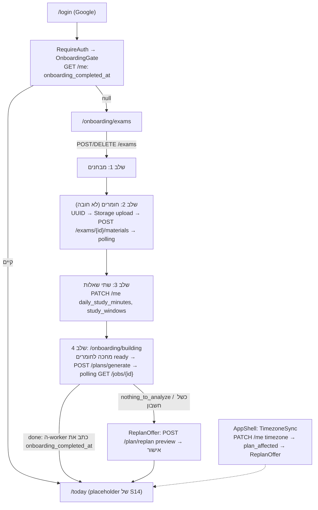

# S13 — אונבורדינג ומסך "בונים לך תוכנית": תוכנית עבודה

> **For agentic workers:** REQUIRED SUB-SKILL: Use superpowers:subagent-driven-development (recommended) or superpowers:executing-plans to implement this plan task-by-task. Steps use checkbox (`- [ ]`) syntax for tracking.

**מטרה:** סטודנט חדש נכנס עם Google, מוסיף מבחנים (שם, תאריך, קושי), מעלה חומרים אם יש לו, עונה על שתי שאלות (כמה שעות ביום, ומתי נוח ללמוד), רואה את התוכנית נבנית עם התקדמות אמיתית מה-worker, ומגיע למסך "היום". כל זה תוך פחות מ-5 דקות מהכניסה.

**גישה:** שלוש שכבות ב-web ושינוי קטן אחד ב-API:
1. **תשתית משותפת (Task 0)**, שגם S14 בונה עליה: לקוח API מלא, timeout ל-supabase-js, `he.ts` עם קטע לכל מסך ופונקציה אחת לקודים, toast עם "בטל", layout וניתוב, משתני צבע.
2. **שכבת נתונים של האונבורדינג** (`src/onboarding/api.ts`): hooks של TanStack Query לכל קריאה, וזרימת ההעלאה.
3. **המסכים:** מבחנים, חומרים, שאלות, בנייה, ושער שמחליט אם המשתמש באונבורדינג או ב"היום".
4. **API:** ‏`onboarding_completed_at` נכתב כשהתוכנית הראשונה נכתבת.

**כלים:** ‏Vite 8, ‏React 19, ‏TypeScript strict, ‏React Router 8, ‏TanStack Query 5, ‏Tailwind 4, ‏React Aria Components 1.22, ‏supabase-js 2.119, ‏Vitest 5. ב-API: ‏Python 3.14, ‏psycopg 3. בלי תלויות חדשות.

**מסמך תכנון:** `docs/superpowers/specs/2026-10-19-studyflow-v2-design.md`, סעיפים 7.3 (timezone), 7.7 (ה-API), 7.9 (Frontend), 7.5 ו-7.8 (קודי הכשל), 2 (G1: תוכנית ראשונה תוך 5 דקות). במפת הדרכים: S13, "תוכנית ראשונה תוך 5 דקות מהכניסה".

## איך החלקים מתחברים

- **למה השלב נשמר ב-URL** (`/onboarding/exams`, ‏`/materials`, ‏`/schedule`, ‏`/building?job=…`): רענון של הדף, או חזרה מהטלפון אחרי שהמסך כבה, ממשיכים מאותו מקום. כל הנתונים עצמם (מבחנים, חומרים, פרופיל) כבר בשרת, אז אין state מקומי שצריך לשחזר. ‏`POST /plans/generate` מחזיר את העבודה הפעילה (`created: false`) אם כבר יש אחת, ולכן גם לחיצה כפולה או רענון במסך הבנייה לא יוצרים עבודה שנייה ולא אוכלים מכסה.
- **למה ה-API מסמן את סוף האונבורדינג ולא ה-web:** האונבורדינג נגמר כשיש תוכנית. אם הסטודנט סוגר את הדפדפן באמצע הבנייה, ה-worker ממשיך ומסיים, וכשהוא חוזר הוא צריך להגיע ל"היום" ולא להתחיל מחדש. אם ה-web היה כותב את הדגל אחרי שראה `done`, הדגל לא היה נכתב במקרה הזה. לכן הכתיבה של התוכנית הראשונה (ב-`generate_plan`, וגם ב-`POST /plan/replan` שמאשר) כותבת `onboarding_completed_at` באותה טרנזקציה, רק אם הוא עדיין `NULL`. בלי מיגרציה: העמודה קיימת מ-0002, ול-`authenticated` יש UPDATE על `profiles`.
- **למה ה-web מחכה לחומרים לפני `generate`:** ה-worker יודע לחכות בעצמו (`materials_processing`), אבל ההמתנה שלו היא ניסיון חוזר של התור, עם backoff של 30 ו-60 שניות. ה-web רואה את סטטוס החומרים כל 2 שניות, ולכן מחכה מהר יותר, ומציג את זה כשלב הראשון של מסך הבנייה ("קוראים את החומרים").
- **למה מחיקת חומר נדחית ב-10 שניות:** מחיקת חומר היא מחיקה קשה, בלי ביטול בשרת. כדי לקיים את הכלל של 7.9 (פעולה הרסנית מקבלת "בטל" ל-10 שניות), ה-web מסתיר את החומר מיד, מציג toast עם "בטל", ושולח `DELETE` רק אחרי 10 שניות. מחיקת מבחן היא מחיקה רכה עם גרסה, ולכן שם "בטל" שולח `POST /plan/undo` עם ה-`version_id`.

## מה מצאתי לפני התכנון (2026-11-16)

| נושא | מצב |
|---|---|
| לקוח ה-API | רק `get`. ‏`ApiError` שומר `code` ו-`title`, ולא את השדות הנוספים (`limit`, ‏`resets_at`, ‏`reason`, ‏`blocked_by`, ‏`errors`) |
| 401 | ה-web מנתק מיד, בלי לנסות `refreshSession` |
| supabase-js | בלי timeout. ‏auth-js מנסה שוב כשל רשת (`AuthRetryableFetchError`) עם backoff עד חלון של 30 שניות (`AUTO_REFRESH_TICK_DURATION_MS`), ולכן מול שרת שלא עונה הטעינה נמשכת כ-48 שניות |
| Toast | ב-React Aria Components 1.22 יש `UNSTABLE_ToastRegion`, ‏`UNSTABLE_Toast` ו-`UNSTABLE_ToastQueue` |
| `onboarding_completed_at` | קיים ב-`profiles` וב-`GET /me`, אבל אף קוד לא כותב אותו |
| ברירות המחדל של הפרופיל | קימה 08:00, שינה 23:00, ‏240 דקות, חלונות בוקר וצהריים, יום מנוחה אחד |
| `api/.env` | יש רק `SUPABASE_URL`, ‏`CORS_ORIGINS`, ‏`ANTHROPIC_API_KEY`. חסרים `DATABASE_URL` (החלטה 1), ‏`AI_MODEL_ANALYSIS`, ‏`AI_MODEL_LIGHT`, וגם `WORKER_DATABASE_URL` (בעל הסכמה, `postgres`) ו-`SUPABASE_SECRET_KEY` (הורדה מ-Storage) |
| ה-worker מול פרויקט הפיתוח | לא רץ אף פעם: ה-eval של S12 רץ על Postgres מקומי. בלי הסיסמה של `postgres` ובלי מפתח סודי הוא לא יכול לרוץ, ואת שניהם אין לי |

## ההחלטות שלי

1. **סוף האונבורדינג = התוכנית הראשונה**, ונכתב בשרת (ראו למעלה).
2. **השלבים ב-URL**, והנתונים רק בשרת.
3. **toast של React Aria (`UNSTABLE_`)** ולא רכיב משלנו: הוא נותן landmark, ניווט ב-F6 ו-`aria-live`, שאחרת הייתי כותב לבד. ה-API שלו עלול להשתנות, ולכן הוא עטוף ב-`src/ui/toast.tsx` אחד, וכל השאר משתמש בעטיפה.
4. **timeout ל-supabase-js דרך `global.fetch`:** עטיפה של `fetch` עם 15 שניות (העלאה ל-Storage: 120 שניות, כי קובץ של 20 MiB בחיבור איטי לוקח זמן). אחרי timeout, כל בקשה ל-Auth ב-30 השניות הבאות נכשלת מיד בלי רשת, וכך הניסיונות החוזרים של auth-js לא מחכים שוב. התוצאה: מול שרת שלא עונה, 15 שניות ואז הודעה, ולא 48.
5. **401 מה-API:** ‏`refreshSession()` פעם אחת, ואז הבקשה נשלחת שוב פעם אחת. רק אם גם היא 401 (או שהרענון נכשל בגלל session לא תקף) המשתמש מנותק. רענון שנכשל בגלל רשת לא מנתק.
6. **קודים לטקסט:** ‏`he.ts` מחזיק טבלה אחת של קודים (`he.codes`), ו-`codeText(code)` ב-`src/i18n/codes.ts` מחזירה טקסט לכל קוד, או טקסט כללי לקוד לא מוכר. ‏`errorMessage(error)` הקיים עובר דרכה: קוד מוכר קודם, ואחריו ה-`title` של השרת. הדוח של "לא נכנס" (`shortfallText`, ‏`unscheduledText`) באותו קובץ, כי הוא צריך את שם המבחן, שקיים רק ב-web.
7. **צבעים במשתני CSS** של Tailwind 4 (`@theme` ב-`index.css`): ‏`--color-surface`, ‏`--color-surface-muted`, ‏`--color-ink`, ‏`--color-ink-muted`, ‏`--color-line`, ‏`--color-brand`, ‏`--color-brand-strong`, ‏`--color-on-brand`, ‏`--color-danger`, ‏`--color-success`, ‏`--color-warning`. רכיבים משתמשים רק בהם (`bg-brand`, ‏`text-ink-muted`), כך שהמיתוג של S17 מחליף ערכים בקובץ אחד. ניגודיות AA נבדקת בטבלה בבדיקה (`theme.test.ts`).
8. **שתי השאלות:** "כמה שעות ביום" היא בחירה מתוך 1, 2, 3, 4, 5, 6 ו-8 שעות (ברירת מחדל 4, כמו הפרופיל), ולא שדה חופשי: מהיר יותר במובייל, ו-30–960 של ה-API מכוסה. "מתי נוח ללמוד" היא ארבע תיבות סימון (בוקר 06–12, צהריים 12–17, ערב 17–21, לילה 21–02), לפחות אחת. ‏שעות קימה ושינה לא נשאלות (שתי שאלות בלבד, 7.9), וברירת המחדל 08:00–23:00 נשארת.
9. **פריטי S13/S15:** ‏`study_start_delay` והתחביב לא נשאלים באונבורדינג (התחביב כבוי כברירת מחדל, 11.13, והשעה שאחרי הקימה לא נחשפת, 7.6), ולכן שניהם עוברים ל-S15 עם מסך ההגדרות. משמרת לילה: באונבורדינג אין שעות קימה ושינה, אז משתמש כזה ייתקן ב-S15. כשהמשתמש בוחר "לילה", מוצגת הערה ש"הלילה שלפני מבחן או יום מנוחה נגמר בחצות". השאר נרשם מחדש ל-S15.
10. **הקושי:** חמישה כפתורי רדיו עם תוויות (קל מאוד … קשה מאוד), ברירת מחדל 3. התאריך: ‏`DatePicker` של React Aria, מחר עד 730 ימים.
11. **סוג החומר:** נקבע לפי שם הקובץ: "פתרון"/"solution" → ‏`solution`, ‏"סילבוס"/"syllabus" → ‏`syllabus`, ‏"סיכום"/"summary" → ‏`summary`, אחרת `past_exam` (מבחני עבר הם הקלט החשוב, 1). ההעלאה מתחילה מיד, בלי שלב בחירה, כדי שהאונבורדינג יישאר מהיר; הסוג מוצג בשורה. שינוי סוג אחרי ההעלאה צריך `PATCH /materials/{id}`, שלא קיים, ולכן נרשם ל-S15 (מסך המבחן). **(עודכן בזמן הבנייה.)**
12. **ReplanOffer** הוא רכיב משותף (`src/plan/ReplanOffer.tsx`): ‏`POST /plan/replan {preview: true}`, סיכום (כמה בלוקים נוספים, כמה זזים, מה לא נכנס ולמה), ו"אישור" עם `basis`. ‏`stale_plan` מריץ תצוגה מקדימה שוב. ב-S13 הוא מופעל משלושה מקומות: שינוי timezone, ‏`nothing_to_analyze`, וכשל חשבון באמצע עבודה. ‏S14/S15 קוראים לו מ-`plan_affected` ומ-`placement.placed = false` / ‏`placement_failed`.

## Global Constraints

- כל טקסט שהמשתמש רואה או שומע ב-`src/i18n/he.ts` (ה-lint של `eslint/guards.js` אוכף).
- RTL עם logical properties בלבד (`ms-`, ‏`pe-`, ‏`start-`, ‏`text-start`).
- רכיבים מ-React Aria Components; נתוני שרת דרך TanStack Query; בלי `alert` ובלי `confirm`; בלי `dangerouslySetInnerHTML`.
- פעולה הרסנית מקבלת toast עם "בטל" ל-10 שניות.
- נגישות AA: לכל שדה תווית, כל פעולה כפתור גלוי, ניגודיות 4.5:1 לטקסט.
- `npm run dev` על פורט 5173 בלבד.
- `material_id` הוא UUID v4 של הדפדפן (`crypto.randomUUID()`); הנתיב `{user_id}/{exam_id}/{id}` ב-bucket `materials`, בלי upsert; ‏PDF, ‏JPEG או PNG עד 20 MiB; עד 15 חומרים למבחן.
- polling: חומרים ועבודות כל 2 שניות, ומפסיקים כשהסטטוס סופי או אחרי `DELETE`.

## Review Focus

1. **רענון באמצע כל שלב** — המשתמש חוזר לאותו שלב ולאותה עבודה, בלי עבודה כפולה. בדיקה: `BuildingStep` עם `?job=` לא שולח `POST /plans/generate` (Task 5).
2. **העלאה שנכשלה באמצע** (Storage עונה שגיאה, או הרישום נכשל אחרי שהקובץ עלה) — מוצגת שגיאה בעברית, הקובץ לא נשאר "מעלה…" לנצח, ואפשר לנסות שוב. בדיקה ב-Task 4.
3. **אזור זמן של הדפדפן שונה מהפרופיל בזמן האונבורדינג** — ה-PATCH נשלח, אבל ההצעה לתכנן מחדש לא מוצגת לפני שיש תוכנית. בדיקה ב-Task 5.
4. **429 עם `resets_at`** — הטקסט מציג את השעה המקומית שבה המכסה מתאפסת, ולא תאריך UTC. בדיקה ב-Task 0 (`codeText` עם פרמטרים) וב-Task 5.
5. **עבודה `done` שבה חלק מהמבחנים `failed`** — זו לא הצלחה שקטה: כל מבחן שנכשל מוצג עם הסיבה, ויש מעבר ל"היום". בדיקה ב-Task 5.

## מה רץ במקביל

| גל | משימות | למה אפשר |
|---|---|---|
| 1 | Task 0 (השיחה הראשית) ‖ Task 1 (API, subagent) | ‏Task 1 נוגע רק ב-`api/` |
| — | מיזוג Task 0 ל-`main`, דחיפה, הודעה ל-`studyflow-09`, ענף ממשיך | ‏S14 מתחיל מכאן |
| 2 | Task 2 (שכבת הנתונים) ‖ הגדרת הסביבה מול פרויקט הפיתוח (השיחה הראשית: סיסמה ל-`studyflow_api`, ‏`api/.env`) | קבצים נפרדים |
| 3 | Task 3 ‖ Task 4 ‖ Task 5 | כל אחד בקבצים משלו; ב-`he.ts` כל אחד ממלא רק את הקטע שלו, שנוצר ריק ב-Task 0 |
| 4 | סקירה של כל הענף, תיקונים, בדיקה בדפדפן, הרצה אמיתית | |

הכל רץ בעץ העבודה המשותף (לא worktree, כי ב-S12 התברר שה-worktrees נבנים מ-`main`), עם רשימת קבצים נפרדת לכל subagent. git רק בשיחה הראשית.

## קבצים משותפים עם S14

- **משותפים (Task 0 יוצר, שינויים אחר כך קטנים ועם rebase):** `web/src/api/client.ts`, ‏`web/src/i18n/he.ts`, ‏`web/src/i18n/codes.ts`, ‏`web/src/ui/*`, ‏`web/src/app/routes.tsx`, ‏`web/src/app/AppShell.tsx`, ‏`web/src/app/AppProviders.tsx`, ‏`web/src/index.css`, ‏`web/src/auth/*`, ‏`web/src/test/*`.
- **של S14 בלבד:** `web/src/pages/TodayPage.tsx` (ה-placeholder שנוצר ב-Task 0), ‏`web/src/today/**`, ‏`web/src/week/**`, הקטעים `he.today` ו-`he.week`.
- **של S13 בלבד:** `web/src/onboarding/**`, ‏`web/src/plan/ReplanOffer.tsx`, ‏`web/src/app/TimezoneSync.tsx`, ‏`web/src/app/OnboardingGate.tsx`, הקטעים `he.onboarding*`, ‏`he.building`, ‏`he.replan`.

---

### Task 0: תשתית ה-web המשותפת

**Files:**
- Modify: `web/src/api/client.ts`, ‏`web/src/api/client.test.ts`, ‏`web/src/app/createAppApi.ts`, ‏`web/src/auth/supabase.ts`, ‏`web/src/i18n/he.ts`, ‏`web/src/index.css`, ‏`web/src/ui/Button.tsx`, ‏`web/src/app/routes.tsx`, ‏`web/src/app/AppProviders.tsx`, ‏`web/src/test/renderRoute.tsx`, ‏`web/src/test/fakeAuth.ts`, ‏`web/src/pages/HomePage.tsx` (נמחק; `/` מפנה)
- Create: `web/src/auth/timeoutFetch.ts`, ‏`web/src/i18n/codes.ts`, ‏`web/src/ui/toast.tsx`, ‏`web/src/app/AppShell.tsx`, ‏`web/src/pages/TodayPage.tsx`, ‏`web/src/test/fakeApi.ts`, ובדיקות לכל אחד.

**Interfaces (Produces):**
- `ApiError(status, code, title, details: Record<string, unknown>)` — ‏`details` הוא שאר השדות של ה-problem (`limit`, ‏`resets_at`, ‏`reason`, ‏`blocked_by`, ‏`errors`).
- `ApiClient { get<T>(path, init?), post<T>(path, body?, init?), patch<T>(path, body, init?), delete<T>(path, init?) }` — ‏`delete` מחזיר `undefined` על 204. גוף JSON עם `Content-Type: application/json`.
- `ApiClientOptions.refreshAccessToken?: () => Promise<string | null>` — נקרא פעם אחת על 401; ‏`null` = session לא תקף.
- `createTimeoutFetch({ timeoutMs, uploadTimeoutMs, cooldownMs, now? }): typeof fetch` — ב-`createSupabase`, דרך `global.fetch`.
- `codeText(code: string, params?: CodeParams): string`, ‏`shortfallText(examName, minutes, dailyMinutes: number | null)`, ‏`unscheduledText(reason)`; ‏`errorMessage(error)` מעדיף `codeText` לקוד מוכר.
- `useToast(): ToastApi` in `web/src/ui/useToast.ts` (`show({ text, tone?, action?: { label, onAction }, timeoutMs?, onExpire? }) → key`, `close(key)`); `ToastProvider` and `ToastRegion` in `web/src/ui/toast.tsx`; פעולה הרסנית: `timeoutMs` = 10000 עם `action` "בטל" (`he.common.undo`).
- `AppShell` (header עם שם המוצר ויציאה, ‏`<main>` ו-`ToastRegion`), ‏`routes`: ‏`/today` → ‏`TodayPage` (placeholder), ‏`/` → ‏`Navigate` ל-`/today`.
- `createFakeApi(handlers)` ב-`src/test/fakeApi.ts`: לקוח מזויף עם `on('GET /me', reply)`, ‏`calls()`, ותשובות `ApiError`.

- [ ] **Step 1: בדיקות נכשלות** — ‏`client.test.ts`: ‏`post`/`patch`/`delete` שולחים method, ‏JSON ו-token; ‏204 מחזיר `undefined`; ‏problem+json עם `limit` ו-`resets_at` נשמר ב-`details`; ‏401 → ‏`refreshAccessToken` פעם אחת, הבקשה נשלחת שוב עם הטוקן החדש, ו-`onUnauthenticated` לא נקרא; ‏401 שני → ‏`onUnauthenticated`; רענון שזורק (רשת) → ‏`ApiError(0,'network')` בלי ניתוק. ‏`timeoutFetch.test.ts`: בקשה תקועה נכשלת אחרי `timeoutMs`; בקשת Auth שנייה בתוך `cooldownMs` נכשלת מיד בלי לקרוא ל-fetch; אחרי ה-cooldown היא יוצאת; ‏`/storage/v1/object` מקבל `uploadTimeoutMs`; ‏signal של הקורא עדיין מבטל. ‏`codes.test.ts`: כל קוד ברשימה של S07–S12 (למטה) מחזיר טקסט שאינו הכללי; קוד לא מוכר → ‏`he.errors.generic`; ‏`ai_quota_exceeded` עם `resets_at` מציג `HH:MM` לפי `Asia/Jerusalem`; ‏`shortfallText('חדו"א', 240, 300)` מכיל "4 שעות" ו-"5 שעות"; עם `null` מציע לוותר על משימות או להוסיף ימים, בלי מספר. ‏`toast.test.tsx`: toast מוצג עם הטקסט, כפתור "בטל" קורא ל-`onAction` וסוגר. ‏`theme.test.ts`: ניגודיות של `ink`/`surface`, ‏`ink-muted`/`surface`, ‏`on-brand`/`brand`, ‏`danger`/`surface` ≥ 4.5. ‏`routes.test.tsx`: ‏`/` מפנה ל-`/today`, ו-`/today` מציג את ה-placeholder בתוך ה-shell.
- [ ] **Step 2:** הרצה: `npm test` — נכשלות.
- [ ] **Step 3:** מימוש. רשימת הקודים ב-`he.codes`: הסיבות `no_study_days`, ‏`not_enough_time`, ‏`no_contiguous_window`, ‏`dependency_cycle`, ‏`dependency_not_scheduled`, ‏`dependency_too_late`, ‏`longer_than_daily_minutes`, ‏`dependent_too_early`; ‏S10 `file_missing`, ‏`file_too_large`, ‏`unsupported_file`, ‏`pdf_unreadable`, ‏`storage_unavailable`, ‏`material_missing`, ‏`internal_error`, ‏`worker_crashed`, ‏`pages_truncated`, ‏`text_truncated`, ‏`too_many_materials`, ‏`already_exists`, ‏`unknown_kind`; ‏S11 `exam_missing`, ‏`already_analyzed`, ‏`no_study_time`, ‏`analysis_invalid`, ‏`ai_unavailable`, ‏`ai_rejected`, ‏`ai_refused`, ‏`ai_not_configured`, ‏`response_truncated`, והאזהרות `under_budget`, ‏`trimmed_to_budget`, ‏`materials_not_ready`, ‏`scanned_pages_skipped`, ‏`budget_raised_to_minimum`; ‏S12 `ai_no_credit`, ‏`ai_quota_exceeded`, ‏`nothing_to_analyze`, ‏`materials_processing`; וה-API `unauthenticated`, ‏`not_found`, ‏`validation_error`, ‏`database_unavailable`, ‏`plan_conflict`, ‏`stale_plan`, ‏`placement_failed`, ‏`invalid_state`, ‏`nothing_to_undo`, ‏`exam_in_past`, ‏`network`, ‏`timeout`. קטעים ריקים מוכנים: `onboarding`, ‏`onboardingExams`, ‏`onboardingMaterials`, ‏`onboardingSchedule`, ‏`building`, ‏`replan`, ‏`today`, ‏`week`.
- [ ] **Step 4:** `npm test && npm run lint && npm run typecheck && npm run build` — עוברים.
- [ ] **Step 5:** commit, מיזוג `--ff-only` ל-`main`, ‏gitleaks, ‏push, הודעה ל-`studyflow-09`, ענף `s13-onboarding` נמשך מ-`main`.

### Task 1: ה-API מסמן את סוף האונבורדינג

**Files:**
- Modify: `api/app/services/profiles.py`, ‏`api/app/jobs/plan_jobs.py`, ‏`api/app/services/replans.py` (או המקום שבו `POST /plan/replan` כותב)
- Test: `api/tests/jobs/test_plan_jobs.py` (או קובץ חדש `api/tests/api/test_onboarding_completed.py`)

**Interfaces (Produces):** ‏`complete_onboarding(conn, user_id, now) -> None` ב-`profiles.py`: ‏`UPDATE app.profiles SET onboarding_completed_at = %(now)s WHERE id = %(user_id)s AND onboarding_completed_at IS NULL`.

- [ ] **Step 1: בדיקות נכשלות** — ‏`generate_plan` שהצליח (גם כשחלק מהמבחנים `failed`) משאיר `GET /me` עם `onboarding_completed_at` = השעון של העבודה; ‏`generate_plan` שנכשל משאיר `null`; ריצה שנייה לא משנה ערך קיים; ‏`POST /plan/replan` עם `preview: false` כותב אותו, ו-`preview: true` לא.
- [ ] **Step 2:** `uv run pytest <files> -q` — נכשלות.
- [ ] **Step 3:** קריאה ל-`complete_onboarding` בתוך הטרנזקציה של השיבוץ ב-`generate_plan`, ובטרנזקציה של ה-apply של replan.
- [ ] **Step 4:** `uv run pytest -q && uv run ruff check . && uv run ruff format --check . && uv run mypy` — עוברים.
- [ ] **Step 5:** commit.

### Task 2: שכבת הנתונים של האונבורדינג

**Files:**
- Create: `web/src/onboarding/api.ts`, ‏`web/src/onboarding/upload.ts`, ‏`web/src/auth/storage.ts`, ובדיקות.
- Modify: `web/src/api/me.ts` (שדות הפרופיל המלאים), ‏`web/src/main.tsx` ו-`AppProviders.tsx` (העברת `StorageClient`).

**Interfaces (Produces):**
- טיפוסים: `Me` (כל שדות `MeResponse`), ‏`Exam`, ‏`Material`, ‏`Job`, ‏`GenerateResult` (`exams[]`, ‏`plan`), ‏`ReplanPreview` (לפי `ReplanResponse`).
- `StorageClient { upload(path: string, file: Blob, options: { contentType: string; upsert: false }): Promise<{ error: Error | null }> }`, ו-`StorageContext`/`useStorage()`.
- hooks: `useExams()`, ‏`useCreateExam()`, ‏`useDeleteExam()` (מחזיר `version_id`), ‏`useUndo()` (`POST /plan/undo`), ‏`useUpdateMe()` (`PATCH /me`), ‏`useMaterials(examId)` עם `refetchInterval` של 2000 כשיש חומר `queued`/`processing`, ‏`useDeleteMaterial()`, ‏`useGenerate()`, ‏`useJob(jobId)` עם `refetchInterval` 2000 עד `done`/`failed`, ‏`useReplanPreview()`, ‏`useReplanApply()`. מפתחות query כוללים את ה-user id.
- `uploadMaterial({ storage, api, userId, examId, file, kind }): Promise<Material>` — בודק סוג וגודל לפני הכל (`unsupported_file`, ‏`file_too_large`), ‏`crypto.randomUUID()`, העלאה, רישום. כשל העלאה → ‏`UploadError('storage_unavailable')`; כשל רישום → ‏`ApiError` כמו שהוא.
- `guessKind(filename): MaterialKind` (החלטה 11).

- [ ] **Step 1: בדיקות נכשלות** — ‏`uploadMaterial` מעלה לנתיב `${userId}/${examId}/${id}` עם `upsert: false` ו-`contentType`, ואז `POST /exams/{examId}/materials` עם אותו `id`; קובץ `.docx` או 21 MiB נדחים בלי רשת; כשל Storage לא שולח רישום; ‏`guessKind` לפי החלטה 11; ‏`useJob` מפסיק polling ב-`done`; ‏`useMaterials` מפסיק כשכולם `ready`/`failed`.
- [ ] **Step 2–4:** הרצה, מימוש, ‏`npm test && npm run lint && npm run typecheck`.
- [ ] **Step 5:** commit.

### Task 3: שלב המבחנים ושלב השאלות, והמעטפת של האונבורדינג

**Files:**
- Create: `web/src/onboarding/OnboardingLayout.tsx` (כותרת, "שלב X מתוך 4", כפתורי הבא/חזרה), ‏`ExamsStep.tsx`, ‏`ScheduleStep.tsx`, ובדיקות.
- Modify: `he.onboarding`, ‏`he.onboardingExams`, ‏`he.onboardingSchedule` בלבד.

**Interfaces (Consumes):** hooks של Task 2; ‏`useToast` של Task 0. **(Produces):** routes ילדים: `exams`, ‏`schedule` (Task 5 מחבר את כולם ל-`routes.tsx`).

- [ ] **Step 1: בדיקות נכשלות** — הוספת מבחן שולחת `POST /exams {name, exam_date, difficulty}` ומציגה אותו ברשימה; שם ריק או תאריך חסר מציגים שגיאה ליד השדה; ‏422 `exam_in_past` מוצג בעברית; מחיקה מסתירה, מציגה toast עם "בטל", ו"בטל" שולח `POST /plan/undo {version_id}`; "הבא" כבוי בלי מבחן. שלב השאלות: ברירת המחדל מהפרופיל (4 שעות, בוקר וצהריים); "הבא" שולח `PATCH /me {daily_study_minutes, study_windows}` ועובר ל-`/onboarding/building`; בלי חלון — שגיאה; "לילה" מציג את ההערה של החלטה 9.
- [ ] **Step 2–4:** הרצה, מימוש, בדיקות + lint + typecheck.
- [ ] **Step 5:** commit.

### Task 4: שלב החומרים

**Files:**
- Create: `web/src/onboarding/MaterialsStep.tsx`, ‏`MaterialItem.tsx`, ובדיקות. Modify: `he.onboardingMaterials` בלבד.

- [ ] **Step 1: בדיקות נכשלות** — לכל מבחן: בחירת קובץ (`FileTrigger`, ‏accept pdf/jpeg/png, כמה קבצים), סוג לפי `guessKind` שאפשר לשנות; חומר שעלה מוצג "בעיבוד" ואז "מוכן" עם מספר העמודים; חומר `failed` מציג את `ingest_error` בעברית וכפתור מחיקה; אזהרת `pages_truncated` מוצגת; מחיקה: החומר נעלם, toast עם "בטל", ו-`DELETE /materials/{id}` נשלח רק אחרי 10 שניות (fake timers), ו"בטל" מבטל אותו; כשל Storage → הודעה ו"לנסות שוב"; ‏`too_many_materials` → הודעה; "דלג" ו"הבא" עוברים ל-`/onboarding/schedule`.
- [ ] **Step 2–4:** הרצה, מימוש, בדיקות + lint + typecheck.
- [ ] **Step 5:** commit.

### Task 5: מסך הבנייה, השער, ReplanOffer ו-TimezoneSync

**Files:**
- Create: `web/src/onboarding/BuildingStep.tsx`, ‏`web/src/onboarding/routes.tsx`, ‏`web/src/app/OnboardingGate.tsx`, ‏`web/src/app/TimezoneSync.tsx`, ‏`web/src/plan/ReplanOffer.tsx`, ובדיקות; כולל בדיקת זרימה מלאה `web/src/onboarding/flow.test.tsx`.
- Modify: `web/src/app/routes.tsx` (חיבור `/onboarding/*` והשער), ‏`web/src/app/AppShell.tsx` (שורה אחת: `<TimezoneSync />`), ‏`he.building`, ‏`he.replan`.

**Interfaces (Produces):** ‏`<ReplanOffer open onClose reasonText? />` — dialog של React Aria; ‏`useReplanOffer(): { offer(reasonText?: string): void }` (מתוך context ב-AppShell) ל-S14/S15.

- [ ] **Step 1: בדיקות נכשלות** —
  - השער: ‏`onboarding_completed_at = null` → ‏`/today` מפנה ל-`/onboarding/exams`; קיים → ‏`/onboarding/*` מפנה ל-`/today`.
  - הבנייה: מחכה לחומרים `processing` ("קוראים את החומרים"), ורק כשכולם סופיים שולח `POST /plans/generate` ומכניס `?job=` ל-URL; עם `?job=` לא שולח generate; ‏`stage`+`percent` מוצגים (progressbar עם `aria-valuenow`); ‏`done` → סיכום (מבחנים שנותחו, מבחן `failed` עם הסיבה, `shortfalls` בעברית) וכפתור "למסך היום", שמרענן את `me` ומנווט; ‏`failed` עם `analysis_invalid` → הודעה ו"לנסות שוב" (generate חדש); ‏429 → טקסט עם השעה המקומית, בלי כפתור ניסיון; ‏409 `nothing_to_analyze` → ‏ReplanOffer; ‏`failed` עם `ai_no_credit` אחרי שמבחן נותח → הודעה + ReplanOffer.
  - ReplanOffer: מציג תצוגה מקדימה, "אישור" שולח `{preview: false, basis}`; ‏`stale_plan` → תצוגה מקדימה חדשה.
  - TimezoneSync: אזור שונה → ‏`PATCH /me {timezone}` פעם אחת; עם `plan_affected` ומשתמש שסיים אונבורדינג → toast עם פעולה שפותחת ReplanOffer; באונבורדינג → בלי הצעה.
  - הזרימה המלאה: ‏`/` → מבחן → דילוג על חומרים → שאלות → בנייה → ‏`done` → ‏`/today`.
- [ ] **Step 2–4:** הרצה, מימוש, בדיקות + lint + typecheck + build.
- [ ] **Step 5:** commit.

### Task 6: סביבה, בדיקה בדפדפן, הרצה אמיתית, סקירה וסגירה

- [ ] סיסמה ל-`studyflow_api` (החלטה 1 של אייל): סקריפט ב-scratchpad מגריל `secrets.token_urlsafe(32)`, כותב `DATABASE_URL` דרך ה-session pooler ל-`api/.env`, ומעתיק ל-clipboard רק `ALTER ROLE studyflow_api WITH LOGIN PASSWORD '<SCRAM verifier>'` (גיבוב, לא הסיסמה). ההדבקה ל-SQL Editor עם Cmd+V, ואחר כך ה-clipboard מתרוקן. בדיקה: `GET /me` מקומי מול פרויקט הפיתוח מחזיר 200.
- [ ] ‏`AI_MODEL_ANALYSIS=claude-sonnet-5-5`, ‏`AI_MODEL_LIGHT=claude-haiku-5-5` ב-`api/.env`.
- [ ] ‏`WORKER_DATABASE_URL` ו-`SUPABASE_SECRET_KEY`: לא בידיים שלי. אם אין דרך, נעצרים בנקודה נקייה ושואלים את אייל לפני ההרצה האמיתית.
- [ ] בדיקה בדפדפן במסך רחב ובמובייל (375px), עם צילומי מסך.
- [ ] הרצה אמיתית: כניסה → מבחן אמיתי → חומר מ-`api/eval/materials/` → לוח. מדידה מהכניסה עד הלוח, עלות (הערכה לפני, תקרה מצטברת 0.6$), צילום מסך.
- [ ] סקירה של כל הענף (Opus), תיקונים, עדכון מסמך התכנון (7.9, 12) והטאב שלו, מפת הדרכים, מיזוג.
