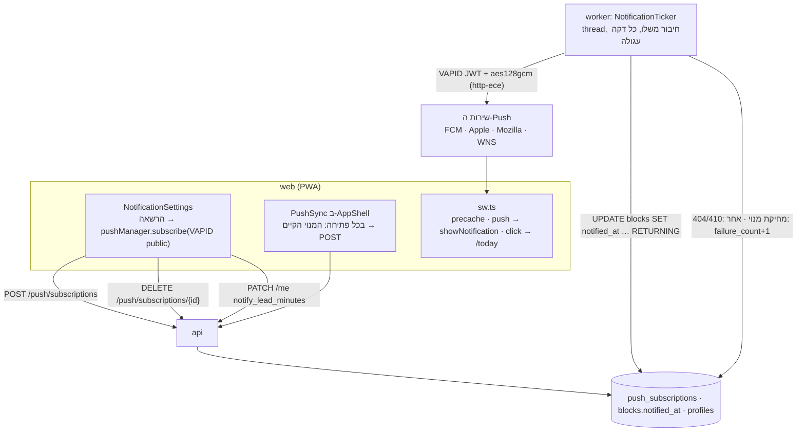

# S16 — PWA ותזכורות Push בעברית: תוכנית עבודה

> **For agentic workers:** REQUIRED SUB-SKILL: Use superpowers:subagent-driven-development (recommended) or superpowers:executing-plans to implement this plan task-by-task. Steps use checkbox (`- [ ]`) syntax for tracking.

**מטרה:** האפליקציה ניתנת להתקנה (manifest ו-service worker), והסטודנט מקבל תזכורת Push בעברית לפני כל בלוק, בזמן שבחר בהגדרות: בתחילת הבלוק, או 5, 10 או 15 דקות לפני. התזכורת מגיעה בזמן לאייפון ולאנדרואיד שהאפליקציה מותקנת בהם.

**גישה:** ארבע שכבות:
1. **מסד (מיגרציה 0010):** ‏`app.push_subscriptions`, ‏`blocks.notified_at`, וברירת מחדל חדשה ל-`profiles.notify_lead_minutes`.
2. **API:** ‏`POST /push/subscriptions` ו-`DELETE /push/subscriptions/{id}`, ו-`PATCH /me` שמקבל רק 0, 5, 10 או 15.
3. **worker:** ‏`send_due_notifications`, שרץ כל דקה ב-thread משלו בתוך תהליך ה-worker, תופס בלוקים עם `UPDATE … RETURNING` ושולח Web Push.
4. **web:** ‏vite-plugin-pwa עם service worker משלנו (precache, ‏push, ‏notificationclick), אייקונים זמניים, הרכיב `NotificationSettings`, הסבר התקנה ל-iOS, והקטנת ה-bundle של supabase-js.

**כלים:** ‏API: ‏Python 3.14, ‏psycopg 3, ‏PyJWT (כבר קיים), ‏httpx2 (כבר קיים), ו-`http-ece` 1.2.1 (חדש, MIT). ‏web: ‏vite-plugin-pwa 2.0.0 (MIT, תומך ב-Vite 8), ‏workbox-precaching/routing/core 7.4 (MIT), ‏`@supabase/auth-js` ו-`@supabase/storage-js` 2.119.0 (במקום `@supabase/supabase-js`).

**מסמך תכנון:** `docs/superpowers/specs/2026-10-19-studyflow-v2-design.md`, סעיפים 7.4 (הטבלאות), 7.8 (`send_due_notifications`), 7.9 (PWA), 7.10 (התראות), 8 (מה עובר מהקוד הישן). במפת הדרכים: S16, "תזכורת מגיעה בזמן לאייפון ולאנדרואיד שהאפליקציה מותקנת בהם".

## איך החלקים מתחברים

- **למה ה-worker ולא ה-API שולח:** ה-API קצר ומהיר ולא יוצא לרשת (7.2). השליחה צריכה מפתח פרטי של VAPID, ולכן הוא נמצא רק בתהליך ה-worker, כמו המפתח הסודי של Storage. ה-web מקבל רק את המפתח הציבורי (`VITE_VAPID_PUBLIC_KEY`), כי הדפדפן צריך אותו ב-`pushManager.subscribe`.
- **למה thread בתוך ה-worker ולא עבודה בתור:** תזכורת צריכה לצאת בדקה שלה. ה-worker מריץ עבודה אחת בכל פעם, ו-`generate_plan` לוקח 30–60 שניות, כך שעבודה בתור הייתה מאחרת. ‏thread נפרד, עם **חיבור משלו** למסד (חיבור psycopg לא משותף בין threads), מתעורר בתחילת כל דקה עגולה: הבלוקים מתחילים בדקה שלמה (`blocks_whole_minutes`), ולכן התזכורת יוצאת בשנייה הראשונה של הדקה שלה. אין צורך בתהליך נוסף להרים, ואם ה-worker לא רץ, גם התור לא רץ, כך שיש דבר אחד לנטר.
- **למה אין שליחה כפולה:** כל ticker (גם של כמה workers) תופס בלוקים ב-`UPDATE app.blocks SET notified_at = now WHERE id IN (SELECT … FOR UPDATE SKIP LOCKED) AND notified_at IS NULL RETURNING …`. שורה שאחד תפס נעולה או כבר מסומנת, והשני מדלג עליה. המחיר: ה-claim נכתב לפני השליחה, ולכן worker שמת בין ה-claim לשליחה מפספס תזכורת אחת. זה עדיף על כפילות, ונכתב במסמך התכנון.
- **למה מנוי לכל מכשיר ולא דגל בפרופיל:** לכל דפדפן יש endpoint משלו. "כיבוי" מוחק את המנוי של המכשיר הזה (`DELETE`) ומבטל אותו בדפדפן (`unsubscribe`), ומכשיר אחר ממשיך לקבל. זמן התזכורת, לעומת זאת, הוא העדפה של המשתמש, ולכן הוא בפרופיל.
- **למה `PushSync` בכל פתיחה:** מנוי בצד השרת יכול להימחק (410 מהשירות), ו-iOS מחליף לפעמים endpoint. ה-service worker לא יכול לקרוא ל-API, כי אין לו טוקן. לכן בכל פתיחה, אם יש הרשאה ומנוי בדפדפן, ה-web שולח אותו שוב. ה-`POST` הוא upsert שמחזיר את ה-`id`, וכך ה-web גם יודע מה למחוק בכיבוי.

## מה מצאתי לפני התכנון (2026-11-16)

| נושא | מצב |
|---|---|
| `profiles.notify_lead_minutes` | קיים מ-0002: ‏`DEFAULT 10`, ‏`CHECK 0–120`, וב-`GET/PATCH /me` (0–120). אין שום UI שכותב אותו, ולכן 10 בכל השורות הוא ברירת המחדל ולא בחירה |
| `blocks.notified_at`, ‏`push_subscriptions` | לא קיימים (7.4: נוספים ב-S16). המיגרציה האחרונה ב-`main` היא 0008 |
| כתיבת בלוקים | אף קוד לא משנה `starts_at` של בלוק קיים: דחייה ותכנון מחדש מוחקים ומכניסים בלוק חדש (`write_changes`, ‏`undo`). לכן בלוק שנדחה הוא בלוק חדש עם `notified_at` ריק, והבלוק הישן נמחק ולא שולח |
| הקוד הישן | `legacy/backend/notifications/utils.py` (‏pywebpush, ‏`dict(VAPID_CLAIMS)` בכל שליחה, מחיקה רק על 404/410); ‏`legacy/frontend/sw.js` (cache ידני עם `?v=AUTO`, מעקף `/debug`, ‏`debug_action`/`debug_payload`) |
| pywebpush 2.5.0 | ‏MPL-2.0. דורש גם `requests` וגם `aiohttp` (בלי extras), ‏`py-vapid` ו-`http-ece` |
| vite-plugin-pwa 2.0.0 | ‏MIT, ‏peer של `vite ^8`. ‏`workbox-build` שהוא מביא (ב-build בלבד) מוסיף 3 ממצאים בינוניים ב-`npm audit` (‏deepmerge, ‏glob, ‏minimatch); ב-`npm audit --omit=dev`: ‏0 |
| Lighthouse | מגרסה 12 אין בו קטגוריית PWA. התקינות של ה-manifest נבדקת בבדיקה אוטומטית על הפלט של ה-build, וב-Chrome (אירוע `beforeinstallprompt` וכפתור ההתקנה) |
| supabase-js | ה-web משתמש רק ב-`auth` וב-`storage.from('materials').upload`. ‏`createClient` מביא גם postgrest-js, ‏realtime-js ו-functions-js |
| מפתחות VAPID | זוג חדש נוצר (P-256) ונכתב ל-`api/.env` (‏`VAPID_PRIVATE_KEY`, ‏`VAPID_PUBLIC_KEY`, ‏`VAPID_SUBJECT`) ול-`web/.env` (‏`VITE_VAPID_PUBLIC_KEY`), בלי הדפסה |

## ההחלטות שלי

1. **שולח משלנו, בלי pywebpush.** ‏Web Push הוא שלושה חלקים: הצפנה `aes128gcm` (RFC 8291), ‏JWT של VAPID (RFC 8292) ו-POST אחד. ההצפנה עוברת ל-`http-ece`, אותה ספרייה ש-pywebpush משתמש בה (MIT, תלויה רק ב-`cryptography` שכבר מותקן). ה-JWT נחתם ב-PyJWT ‏(ES256), שכבר בפרויקט. ה-POST עובר ב-httpx2, כמו Storage, ולכן נבדק עם `MockTransport`. כך נחסכות שתי ספריות HTTP (‏requests ו-aiohttp) שאף קוד אחר לא צריך. גם הלקח של "עותק של ה-claims" (7.10) נסגר מעצמו: ה-claims נבנים מחדש בכל שליחה, עם `aud` של ה-endpoint הזה.
2. **thread של ticker בתוך ה-worker** (ראו למעלה), עם חיבור משלו, בדקה עגולה. הוא מופעל רק כש-VAPID מוגדר; אחרת ה-worker כותב אזהרה אחת וממשיך בלי תזכורות.
3. **מה נחשב "בלוק שצריך תזכורת":** ‏`status = 'planned'`, ‏`notified_at IS NULL`, המשימה `todo` ולא מחוקה, המבחן לא מחוק, ויש למשתמש לפחות מנוי אחד. הזמן: ‏`starts_at − notify_lead_minutes ≤ now`, ו-`starts_at > now − 10 דקות` (`PUSH_GRACE_MINUTES`). אחרי הפסקה של ה-worker נשלחת תזכורת שאיחרה בעד 10 דקות, ולא "מתחיל עכשיו" על בלוק שהתחיל לפני שעה. בלוק שבוטל (`skipped`, ‏`done`) או נמחק בדחייה לא נבחר. ‏`LIMIT 200` לכל סבב.
4. **ה-ticker עובד בתור בעל הסכמה,** כמו ה-claim של התור. זה חריגה מ-7.8, שלפיו ה-worker נוגע בתור בעל הסכמה רק ב-`app.jobs` וב-`app.ai_usage`. החריגה הכרחית, כי הסריקה היא על כל המשתמשים. היא מוגבלת לעמודות `blocks.notified_at`, ‏`push_subscriptions.last_success_at`/`failure_count` ולמחיקת מנוי, ונכתבת במסמך התכנון.
5. **at-most-once:** ה-claim נכתב (autocommit) לפני השליחה, ולכן אין כפילות, ו-worker שמת באמצע מפספס תזכורת.
6. **תשובות של שירות ה-Push:** ‏2xx → ‏`last_success_at = now`, ‏`failure_count = 0`. ‏404 או 410 → מחיקת המנוי. כל השאר (‏403 של Apple על JWT, ‏400, ‏413, ‏429, ‏5xx, כשל רשת או timeout) → ‏`failure_count + 1` ושורת לוג עם הסטטוס בלבד, בלי ה-endpoint (הוא סוד: מי שמחזיק אותו יכול לשלוח). ניקוי של מנויים עם הרבה כשלים שייך לעבודת `cleanup` (נרשם ל-S21).
7. **רשימה סגורה של שירותי Push (הגנת SSRF).** ה-worker שולח POST לכתובת שהמשתמש נתן, ולכן כתובת כמו `https://169.254.169.254/` הייתה גורמת לו לפנות לרשת פנימית. ה-API וה-worker מקבלים רק `https://` בפורט 443, ומארח שהוא `fcm.googleapis.com` או שנגמר ב-`.push.services.mozilla.com`, ‏`.push.apple.com` או `.notify.windows.com` (‏Chrome ואנדרואיד, ‏Firefox, ‏Safari ו-iOS, ‏Edge). אחרת: ‏422 ‏`push_endpoint_invalid`. גם המפתחות נבדקים: ‏`p256dh` הוא נקודה לא דחוסה של 65 בתים, ו-`auth` הוא 16 בתים, ב-base64url.
8. **endpoint ייחודי בכל הטבלה, עם העברה בין משתמשים.** מכשיר משותף: א' נרשם ויצא, ב' נכנס ונרשם באותו דפדפן, ולכן ה-endpoint זהה. התזכורות של א' (עם שמות המשימות שלו) לא אמורות להמשיך להגיע למכשיר הזה. ה-`POST` קורא קודם לפונקציה `app.take_push_endpoint(endpoint)` (‏`SECURITY DEFINER`), שמוחקת את השורה של משתמש אחר עם אותו endpoint, ואז עושה upsert לשורה של המשתמש. ה-endpoint הוא כתובת סודית שרק הדפדפן מכיר, ולכן מי שמציג אותו מחזיק במנוי. במקרה הגרוע, מי שהשיג endpoint של אחר יכול רק לבטל לו את התזכורות במכשיר. הוא לא יקבל אותן, כי הן מוצפנות למפתחות של הדפדפן.
9. **יציאה מהחשבון מבטלת את המנוי בדפדפן** (`subscription.unsubscribe()`), כדי שהתזכורות לא ימשיכו להופיע במכשיר אחרי היציאה. בפעם הבאה שה-worker שולח לשם, השירות עונה 410 והשורה נמחקת. זה עובד גם בלי API.
10. **זמן התזכורת:** ‏`notify_lead_minutes` ∈ {0, 5, 10, 15}, וברירת המחדל 0 (בתחילת הבלוק; החלטה של אייל, 16.11). מיגרציה 0010 משנה את ה-DEFAULT ל-0, מעדכנת שורות שהן 10 ל-0 (אף אחת לא נבחרה, כי לא היה UI), ומחליפה את ה-CHECK ב-`IN (0, 5, 10, 15)`. ‏`PATCH /me` מקבל רק את ארבעת הערכים.
11. **הטקסט (7.10, תבניות קבועות):** הכותרת היא שם המשימה (עד 80 תווים). הגוף הוא `בעוד 10 דקות · 09:00–10:30 · <שם המבחן>`, או `מתחיל עכשיו · …` כשנשארה פחות מדקה, ו-`בעוד דקה` לדקה אחת. הדקות מחושבות מהזמן האמיתי שנשאר (ולא מההגדרה), כך שתזכורת שאיחרה לא משקרת. השעות לפי אזור הזמן של הפרופיל, ב-`zoneinfo`: בלוק בלילה של מעבר שעון מוצג בשעה המקומית הנכונה, והתזכורת יוצאת ברגע הנכון ב-UTC, כי `starts_at` הוא רגע מוחלט וההפרש הוא בדקות אמיתיות. הפונקציה `reminder_text` טהורה ב-`app/domain/notifications.py`. ה-payload: ‏`{"title", "body", "url": "/today", "tag": "block:<id>"}`. ‏`tag` גורם למערכת להחליף תזכורת קודמת של אותו בלוק ולא להוסיף עוד אחת.
12. **כותרות השליחה:** ‏`TTL` הוא השניות עד סוף הבלוק (מינימום 60), כי תזכורת לבלוק שנגמר חסרת ערך. ‏`Urgency: high`, כי בלי זה אנדרואיד במצב חיסכון דוחה. ‏JWT ל-12 שעות.
13. **`VAPID_SUBJECT`** בפיתוח הוא `mailto:studyflow-dev@example.com`, כדי לא לשלוח כתובת אישית לשירותי Push של Google ו-Apple. לפני production מחליפים לכתובת קשר אמיתית של המוצר (נרשם ל-S21).
14. **ה-service worker (`web/src/sw.ts`, ‏`injectManifest`):** ‏precache של ה-build (קבצים עם hash; זה מחליף את `?v=AUTO`), ‏`NavigationRoute` ל-`index.html`, ‏`cleanupOutdatedCaches`, ‏`skipWaiting` ו-`clientsClaim` (גרסה חדשה נכנסת בטעינה הבאה, בלי רענון כפוי באמצע אונבורדינג). ה-API נמצא ב-origin אחר, ולכן ה-SW לא נוגע בבקשות אליו. ‏`push` מציג התראה עם `lang: 'he'`, ‏`dir: 'rtl'` ואייקון. ‏`notificationclick` מתמקד בחלון פתוח ומנווט ל-`url`, או פותח חלון חדש. המעקף של `/debug` וההעברה של `debug_action`/`debug_payload` מהקוד הישן לא עוברים (סקירת S02). גם ה-`postMessage` של `PUSH_RECEIVED` לא עובר, כי אין לו צרכן. הלוגיקה (קריאת ה-payload, בחירת הכתובת) בפונקציות טהורות ב-`src/pwa/notification.ts`, עם בדיקות ב-Vitest.
15. **בדיקה מקומית של Push אמיתי:** ה-SW לא פעיל ב-`npm run dev`, כדי שלא יישאר SW ישן בפיתוח. הבדיקה רצה עם `npm run build && npm run preview`, על פורט 5173, כי זה הפורט ש-Google, ‏Supabase ו-`CORS_ORIGINS` מאשרים.
16. **ה-manifest:** ‏`name` ו-`short_name` מ-`PRODUCT_NAME`, ‏`lang: 'he'`, ‏`dir: 'rtl'`, ‏`display: 'standalone'`, ‏`start_url: '/today'`, ‏`theme_color` ו-`background_color` מערכי ה-theme. אייקונים זמניים: ‏PNG של 192 ו-512, ‏maskable של 512, ו-`apple-touch-icon` של 180, צבע המותג עם צורה פשוטה. נוצרים פעם אחת בסקריפט ונשמרים ב-`web/public/`. המיתוג מחליף אותם ב-S17.
17. **הסבר ההתקנה ל-iOS:** באייפון, Push עובד רק באפליקציה שהותקנה מספארי ("הוסף למסך הבית"). כרטיס `InstallHint` מוצג ב-AppShell **פעם אחת**, רק בספארי של iOS ולא כשהאפליקציה מותקנת (`navigator.standalone`). ‏"הוצג" נשמר ב-`localStorage`, בתוך try/catch. זה נשמר לכל מכשיר ולא בפרופיל, כי ההתקנה היא של המכשיר. ‏`NotificationSettings` מציג את אותו הסבר תמיד כשהאפליקציה לא מותקנת ב-iOS, כי שם אין דרך אחרת להפעיל.
18. **מסך ההגדרות שייך ל-S15.** הרכיב `web/src/notifications/NotificationSettings.tsx` עצמאי. עד ש-S15 ימוזג, הוא מוצג בנתיב `/settings/notifications` משלנו (`NotificationsPage`). אם S15 ימוזג לפנינו, אחבר אותו למסך שלו בשינוי אחד.
19. **הקטנת ה-bundle:** ‏`createSupabase` בונה `AuthClient` מ-`@supabase/auth-js` ו-`StorageClient` מ-`@supabase/storage-js` ישירות, עם אותן אפשרויות (‏PKCE, ‏timeoutFetch, ‏storage key). ‏Storage מקבל את הטוקן הנוכחי בכל בקשה, דרך fetch עטוף שקורא `auth.getSession()`, כמו ש-supabase-js עושה. ‏`@supabase/supabase-js` יוצא מה-dependencies. היעד הוא כ-55 kB פחות אחרי gzip; נמדד לפני ואחרי.

## Global Constraints

- כל טקסט למשתמש ב-`web/src/i18n/he.ts`, בקטע `notifications` החדש (ה-lint אוכף).
- RTL עם logical properties; רכיבים מ-React Aria Components; רק משתני הצבע של ה-theme; בלי `alert` ו-`confirm`.
- כל טבלה ב-`app` עם RLS; כל שאילתה ב-API מסננת `user_id` במפורש; משאב של אחר → 404.
- ה-endpoint ומפתחות המנוי לא נכתבים ללוג.
- `api/`: ‏`exclude-newer` של 7 ימים; ‏`web/`: ‏`min-release-age=7`.
- `legacy/` לקריאה בלבד.

## Review Focus

1. **שליחה כפולה** — שני tickers על אותו מסד, באותה דקה, שולחים לכל בלוק פעם אחת. בדיקה ב-Task 4 (שני חיבורים, ‏barrier).
2. **SSRF** — endpoint שאינו ברשימה לא נשמר ב-API, ולא נשלח אליו POST ב-worker גם אם נכנס למסד ישירות. בדיקה ב-Task 2 וב-Task 4.
3. **403 לא מוחק** — רק 404 ו-410 מוחקים מנוי. בדיקה ב-Task 4.
4. **מעבר שעון** — בלוק ב-01:30 בלילה של המעבר לשעון חורף ב-`Asia/Jerusalem`, עם 15 דקות לפני: התזכורת יוצאת 15 דקות אמיתיות לפני `starts_at`, והטקסט מציג את השעה המקומית הנכונה. בדיקה ב-Task 2 (טקסט) וב-Task 4 (זמן).
5. **מכשיר משותף** — endpoint שעובר ממשתמש א' לב' נמחק אצל א'. בדיקה ב-Task 1 (הפונקציה) וב-Task 3 (ה-API).

## מה רץ במקביל

| גל | משימות | למה אפשר |
|---|---|---|
| 0 | השיחה הראשית: התקנת התלויות (`http-ece`, ‏vite-plugin-pwa, ‏workbox, ‏auth-js, ‏storage-js), מפתחות VAPID, התוכנית | `package.json`, ‏`pyproject.toml` והנעילות הם קבצים משותפים, ולכן לפני הכל |
| 1 | Task 1 (מיגרציה) ‖ Task 2 (טקסט, כתובות, שולח, הגדרות) ‖ Task 5 (PWA) ‖ Task 6 (bundle) ‖ Task 7 (רכיב ההתראות) | קבצים נפרדים. רק Task 1 מריץ את `tests/db`. כל משימת API עם `STUDYFLOW_TEST_DB` משלה |
| 2 | Task 3 (endpoints) ‖ Task 4 (ticker) | שתיהן צריכות את 0010 ואת Task 2; הקבצים נפרדים |
| 3 | השיחה הראשית: כל הבדיקות, Push אמיתי ב-Chrome, סקירה של כל הענף, תיקונים | |
| 4 | ngrok, ‏Supabase redirect, "שאלה לאייל:" לבדיקה באייפון; אחרי האישור: סגירה, מיזוג | |

הכל בעץ העבודה המשותף (`~/studyflow-s16`), בלי worktree נוסף (ב-S12 התברר ש-worktree של subagent נבנה מ-`main` ולא מהענף). לכל subagent יש רשימת קבצים. git רק בשיחה הראשית, ו-commit לכל משימה.

## קבצים משותפים עם S15

- **משותפים (שינוי קטן, נפתר ב-rebase):** ‏`web/src/i18n/he.ts` (S16 מוסיף רק את הקטע `notifications`), ‏`web/src/app/routes.tsx` (נתיב אחד, `/settings/notifications`), ‏`web/src/app/AppShell.tsx` (‏`PushSync`, ‏`InstallHint`, ויציאה שמבטלת מנוי), ‏`api/app/schemas/me.py` (‏`notify_lead_minutes`), ‏`api/tests/api/test_me.py`, ‏`api/tests/api/test_ownership.py`, ‏`api/app/main.py` (router אחד), ‏`web/src/config/env.ts`.
- **של S15 בלבד, ולא נוגעים בהם:** ‏`web/src/exam/**`, ‏`web/src/settings/**`, הקטעים `exam` ו-`settings` ב-`he.ts`.
- **מיגרציה:** ‏S16 היא 0010 (S15 לוקח 0009 אם הוא צריך). לפני המיזוג: אם ב-`origin/main` אין 0009, הקובץ שלנו עובר ל-0009 עם `down_revision = "0008"`; אם יש, ‏`down_revision = "0009"`.

---

### Task 1: מיגרציה 0010

**Files:**
- Create: `api/migrations/versions/0010_push_notifications.py`, ‏`api/tests/db/test_push_notifications.py`
- Modify: `api/tests/db/test_schema.py` (אם הוא מונה טבלאות או עמודות)

**Interfaces (Produces):**
- `app.push_subscriptions (id uuid PK DEFAULT gen_random_uuid(), user_id uuid NOT NULL FK auth.users ON DELETE CASCADE, endpoint text NOT NULL UNIQUE (CHECK: מתחיל ב-`https://`, עד 2048), p256dh text NOT NULL (CHECK אורך 80–100), auth text NOT NULL (CHECK אורך 16–30), user_agent text (עד 500), created_at timestamptz DEFAULT now(), last_success_at timestamptz, failure_count integer NOT NULL DEFAULT 0 CHECK ≥ 0)`; אינדקס על `user_id`. ‏RLS ‏`user_id = auth.uid()`. ל-`authenticated`: ‏SELECT, ‏DELETE, ‏INSERT (`user_id, endpoint, p256dh, auth, user_agent`), ‏UPDATE (`p256dh, auth, user_agent, failure_count`).
- `app.blocks.notified_at timestamptz` (NULL), ואינדקס חלקי `blocks_due_reminder_idx ON app.blocks (starts_at) WHERE status = 'planned' AND notified_at IS NULL`.
- טריגר `blocks_reset_notified_at` (`BEFORE UPDATE OF starts_at`): כש-`starts_at` משתנה, ‏`notified_at := NULL` (להזזה ב-S18).
- `app.take_push_endpoint(p_endpoint text) RETURNS void`, ‏`SECURITY DEFINER`, ‏`SET search_path = ''`: ‏`DELETE FROM app.push_subscriptions WHERE endpoint = p_endpoint AND user_id <> auth.uid()`; ‏`auth.uid()` ריק → שגיאה. ‏EXECUTE רק ל-`authenticated` (REVOKE מ-PUBLIC).
- `profiles.notify_lead_minutes`: ‏DEFAULT 0, ‏`UPDATE … SET 0 WHERE = 10`, ו-CHECK `IN (0, 5, 10, 15)` במקום 0–120.
- downgrade מחזיר הכל (כולל CHECK 0–120 ו-DEFAULT 10).

- [ ] **Step 1: בדיקות נכשלות** — RLS: ב' לא רואה, לא מוחק ולא מעדכן מנוי של א'; ‏INSERT עם `user_id` של אחר נכשל; ‏endpoint כפול → 23505; ‏`take_push_endpoint` בתור ב' מוחק את השורה של א' עם אותו endpoint ולא נוגע בשורה של ב' או ב-endpoint אחר; ‏`notify_lead_minutes = 7` נדחה ו-0/5/10/15 מתקבלים; פרופיל חדש מקבל 0; עדכון `starts_at` מאפס `notified_at`, ועדכון של `status` לא; ‏round-trip של המיגרציה (`test_migrations.py` הקיים) עובר.
- [ ] **Step 2:** `STUDYFLOW_TEST_DB=studyflow_test_s16_t1 uv run pytest tests/db -q` — נכשלות.
- [ ] **Step 3:** המיגרציה, ‏SQL מפורש ב-`op.execute`.
- [ ] **Step 4:** `uv run pytest tests/db -q`, ‏ruff, ‏mypy — עוברים.

### Task 2: טקסט, כתובות, שולח והגדרות (בלי מסד)

**Files:**
- Create: `api/app/domain/notifications.py`, ‏`api/app/jobs/webpush.py`, ‏`api/tests/test_notifications_domain.py`, ‏`api/tests/jobs/test_webpush.py`
- Modify: `api/app/config.py`, ‏`api/tests/test_config.py`, ‏`api/.env.example`, ‏`api/pyproject.toml` (רק override של mypy ל-`http_ece`, אם צריך)

**Interfaces (Produces):**
- `reminder_text(*, task_title: str, exam_name: str, starts_at: datetime, ends_at: datetime, now: datetime, timezone: str) -> ReminderText(title, body)` — ראו החלטה 11.
- `reminder_payload(block_id: UUID, text: ReminderText) -> bytes` — ‏JSON ‏UTF-8 עם `title`, ‏`body`, ‏`url: "/today"`, ‏`tag: "block:<id>"`.
- `check_push_endpoint(url: str) -> str | None` (הקוד `push_endpoint_invalid`, או None), ‏`check_push_keys(p256dh: str, auth: str) -> bool` — החלטה 7.
- `WebPushSender(private_key_b64: str, public_key_b64: str, subject: str, *, timeout: float, transport: httpx2.BaseTransport | None = None)` עם `send(subscription: PushTarget, payload: bytes, *, ttl: int, now: datetime) -> SendOutcome` ו-`close()`. ‏`PushTarget(endpoint, p256dh, auth)`. ‏`SendOutcome` = ‏`SENT` / ‏`GONE` (404, ‏410) / ‏`FAILED` עם `status: int | None`. בודק את הכתובת שוב לפני השליחה (‏FAILED בלי רשת אם היא לא ברשימה). כותרות: `Authorization: vapid t=<jwt>, k=<public>`, ‏`Content-Encoding: aes128gcm`, ‏`TTL`, ‏`Urgency: high`. ‏claims: ‏`aud` = ה-origin של ה-endpoint, ‏`exp` = ‏now + 12h, ‏`sub`.
- `Settings`: ‏`vapid_private_key: SecretStr | None`, ‏`vapid_public_key: str | None`, ‏`vapid_subject: str | None` — שלושתם או אף אחד; המפתח הפרטי הוא 32 בתים ב-base64url, והציבורי שלו שווה ל-`vapid_public_key`; ‏subject מתחיל ב-`mailto:` או `https://`. ‏`push_timeout_seconds = 10`, ‏`push_grace_minutes = 10`. מאפיין `push_configured`.

- [ ] **Step 1: בדיקות נכשלות** — טקסט: 0/1/5/15 דקות ("מתחיל עכשיו", "בעוד דקה", "בעוד 5 דקות"); שעה לפי `Asia/Jerusalem` בקיץ ובחורף; בלוק 01:30 בלילה של 2026-10-25 (המעבר לשעון חורף; 01:30 מופיעה פעמיים) מוצג לפי המופע הנכון של ה-UTC; כותרת ארוכה נחתכת ל-80 עם "…"; שם עם `<b>` נשאר טקסט. כתובות: ‏`https://fcm.googleapis.com/fcm/send/x` עובר; ‏`http://`, פורט 8443, ‏`https://evil.com/fcm.googleapis.com`, ‏`https://fcm.googleapis.com.evil.com`, ‏IP, ‏userinfo — נדחים. מפתחות: אורך ו-0x04. שולח: ה-payload נפתח בחזרה עם `http_ece.decrypt` ומפתח פרטי של "דפדפן" שנוצר בבדיקה; ה-JWT נבדק מול המפתח הציבורי, עם `aud` של ה-endpoint, ושני endpoints שונים באותו sender מקבלים `aud` משלהם; ‏201 → ‏SENT, ‏404/410 → ‏GONE, ‏403/429/500 → ‏FAILED עם הסטטוס, ‏`TransportError`/timeout → ‏FAILED עם None. הגדרות: חלקי → שגיאה; מפתח ציבורי שלא מתאים → שגיאה.
- [ ] **Step 2:** `uv run pytest tests/test_notifications_domain.py tests/jobs/test_webpush.py tests/test_config.py -q` — נכשלות.
- [ ] **Step 3:** מימוש.
- [ ] **Step 4:** אותן בדיקות, ruff, ‏mypy — עוברים.

### Task 3: ה-endpoints וזמן התזכורת ב-`PATCH /me`

**Files:**
- Create: `api/app/routers/push.py`, ‏`api/app/services/push.py`, ‏`api/app/schemas/push.py`, ‏`api/tests/api/test_push.py`
- Modify: `api/app/main.py`, ‏`api/app/schemas/me.py`, ‏`api/tests/api/test_me.py` (ו-`tests/test_me.py` אם יש שם 0–120), ‏`api/tests/api/test_ownership.py`, ‏`api/app/errors.py` (אם הקוד צריך כותרת עברית ב-`PROBLEMS`)

**Interfaces:**
- `POST /push/subscriptions` עם `{"endpoint", "keys": {"p256dh", "auth"}, "user_agent"?}` (‏`extra="forbid"`, ‏`user_agent` עד 500, ‏NUL אסור) → ‏201 `{"id", "created": true}` למנוי חדש, ‏200 `{"id", "created": false}` כשהוא כבר של המשתמש (המפתחות וה-`user_agent` מתעדכנים, ‏`failure_count = 0`). כתובת או מפתחות לא תקינים → ‏422 ‏`push_endpoint_invalid`. טרנזקציה אחת: ‏`take_push_endpoint`, ואז `INSERT … ON CONFLICT (endpoint) DO UPDATE … RETURNING id, (xmax = 0) AS created`.
- `DELETE /push/subscriptions/{id}` → ‏204; של אחר או לא קיים → ‏404.
- `PATCH /me {"notify_lead_minutes"}` מקבל רק 0, 5, 10, 15 (‏`Literal`); אחר → ‏422. ‏`plan_affected` לא משתנה בגללו.

- [ ] **Step 1: בדיקות נכשלות** — רישום חדש 201, ושוב 200 עם אותו id ומפתחות חדשים; ‏endpoint של א' שב' שולח → ‏201 לב', והשורה של א' נמחקה; כתובת לא ברשימה, מפתח קצר, שדה נוסף → ‏422; ‏DELETE של שלי 204 ואז 404; ‏DELETE של אחר 404 והשורה שלו נשארת; ‏PATCH 0/5/10/15 עובר, 7 ו-120 → ‏422; ‏`GET /me` של משתמש חדש מחזיר 0; ‏`test_every_route_is_covered` כולל את שני ה-routes (ב' מקבל 404 על ה-DELETE).
- [ ] **Step 2:** `STUDYFLOW_TEST_DB=studyflow_test_s16_t3 uv run pytest tests/api/test_push.py tests/api/test_me.py tests/api/test_ownership.py -q` — נכשלות.
- [ ] **Step 3:** מימוש.
- [ ] **Step 4:** הבדיקות, ruff, ‏mypy — עוברים.

### Task 4: ‏`send_due_notifications` וה-ticker

**Files:**
- Create: `api/app/jobs/notifications.py`, ‏`api/tests/jobs/test_notifications.py`
- Modify: `api/app/jobs/__main__.py`

**Interfaces:**
- `send_due_notifications(conn, sender: PushSender, *, now: datetime, grace: timedelta, limit: int = 200) -> NotifyStats(claimed, sent, gone, failed)` — ‏`conn` בתור בעל הסכמה, autocommit. שלב 1: ה-claim (החלטה 3, ‏`UPDATE … FROM (SELECT … FOR UPDATE OF b SKIP LOCKED) … RETURNING` עם שם המשימה, המבחן, אזור הזמן). שלב 2: המנויים של המשתמשים שנתפסו, ובדיקת ה-endpoint (שורה שלא עוברת לא נשלחת, ‏`failure_count + 1`). שלב 3: שליחה מחוץ לכל טרנזקציה. שלב 4: עדכון המנויים (החלטה 6), כל שורה עם `WHERE id = … AND user_id = …`. ‏`PushSender` הוא Protocol עם `send(...)`, כך שהבדיקות מעבירות שולח מזויף.
- `NotificationTicker(conninfo, sender, settings, *, clock, stop)` עם `run()`: מחכה לתחילת הדקה הבאה (`stop.wait`), מריץ, תופס כל חריגה (לוג עם שם המחלקה בלבד), ומתחבר מחדש אחרי `OperationalError`. ‏`__main__` מפעיל אותו ב-thread כש-`settings.push_configured`, ומחכה לו ביציאה.

- [ ] **Step 1: בדיקות נכשלות** — (שעון מוזרק) ‏lead 0: בדקה של ההתחלה נשלח, דקה לפני לא; ‏lead 15: ‏15 דקות לפני נשלח, ‏16 לא; הגדרה של המשתמש נקראת מהפרופיל; בלוק `done`/`skipped`, משימה מחוקה או `done`, מבחן מחוק — לא נשלחים; בלוק שנדחה (`POST /blocks/{id}/defer` דרך ה-API, או מחיקה והכנסה כמו `write_changes`) — הישן לא נשלח, והחדש נשלח בזמן שלו; בלוק שהתחיל לפני 11 דקות — לא; משתמש בלי מנוי — לא נתפס (וכשהוא נרשם אחר כך, הוא נתפס); ריצה שנייה באותה דקה לא שולחת שוב; **שני tickers במקביל** (שני חיבורים, ‏`threading.Barrier`, שולח מזויף שסופר) — כל בלוק נשלח פעם אחת; ‏404 ו-410 מוחקים את המנוי, ‏403 ו-500 מעלים `failure_count` ולא מוחקים, ‏SENT מאפס ומעדכן `last_success_at`; מנוי עם endpoint שלא ברשימה (נכתב ישירות כבעל הסכמה) — לא נשלח אליו; שני מנויים למשתמש — שניהם מקבלים; מעבר שעון: בלוק ב-`2026-10-24T22:30Z` (‏01:30 שעון קיץ) עם 15 דקות — יוצא ב-22:15Z והטקסט אומר 01:30; ה-payload נבנה מ-`reminder_text`; ה-ticker: ‏`run()` עם `stop` שנקבע אחרי סבב אחד — רץ פעם אחת, וחריגה בסבב לא מפילה אותו.
- [ ] **Step 2:** `STUDYFLOW_TEST_DB=studyflow_test_s16_t4 uv run pytest tests/jobs/test_notifications.py -q` — נכשלות.
- [ ] **Step 3:** מימוש.
- [ ] **Step 4:** הבדיקות, ruff, ‏mypy — עוברים.

### Task 5: ‏PWA — manifest, ‏service worker ואייקונים

**Files:**
- Create: `web/src/sw.ts`, ‏`web/src/pwa/notification.ts`, ‏`web/src/pwa/notification.test.ts`, ‏`web/src/pwa/register.ts`, ‏`web/src/pwa/manifest.ts` (האובייקט, כדי לבדוק אותו), ‏`web/src/pwa/manifest.test.ts`, ‏`web/public/icons/*.png`, ‏`web/tsconfig.sw.json` (אם צריך lib של `WebWorker`)
- Modify: `web/vite.config.ts`, ‏`web/index.html` (‏`theme-color`, ‏`apple-touch-icon`, ‏`apple-mobile-web-app-capable`, ‏`apple-mobile-web-app-title`), ‏`web/src/main.tsx` (שורה אחת: `registerServiceWorker()`), ‏`web/package.json` (סקריפט `preview` בלבד: `vite preview --port 5173 --strictPort`), ‏`web/tsconfig*.json`, ‏`web/eslint.config.js` (אם ה-SW צריך globals)

**Interfaces:** ‏`readPushPayload(data: unknown): {title, options: NotificationOptions}` (payload חסר או שבור → כותרת `PRODUCT_NAME` וגוף כללי מ-`he.ts`, ‏`url` רק נתיב יחסי שמתחיל ב-`/`, אחרת `/today`); ‏`clickTarget(data: unknown, origin: string): string`; ‏`registerServiceWorker()` (רק ב-production build וכש-`'serviceWorker' in navigator`).

- [ ] **Step 1: בדיקות נכשלות** — ‏`readPushPayload` עם payload תקין (title, ‏body, ‏tag, ‏`lang: 'he'`, ‏`dir: 'rtl'`, אייקון), עם JSON שבור, ועם `url: 'https://evil.com'` → ‏`/today`; ‏`clickTarget`; ה-manifest: ‏`name` = ‏`PRODUCT_NAME`, ‏`lang`, ‏`dir`, ‏`start_url`, ‏`display`, אייקון 192 ו-512 ו-maskable.
- [ ] **Step 2:** `npx vitest run src/pwa` — נכשלות.
- [ ] **Step 3:** מימוש; האייקונים בסקריפט Python קטן (‏zlib, בלי ספריות) מחוץ לריפו.
- [ ] **Step 4:** `npm run build` מייצר `dist/manifest.webmanifest` ו-`dist/sw.js` עם רשימת precache; ‏lint, ‏typecheck — עוברים.

### Task 6: הקטנת ה-bundle של supabase-js

**Files:**
- Modify: `web/src/auth/supabase.ts`, ‏`web/src/auth/supabase.test.ts`, ‏`web/src/auth/AuthContext.ts` (ייבוא הטיפוס `Session`), ‏`web/src/auth/storage.ts` רק אם הממשק `StorageSource` משתנה, ‏`web/vite.config.ts` רק את קבוצת `supabase` ב-`codeSplitting` (תיאום עם Task 5: Task 5 לא נוגע בה)

**Interfaces:** ‏`createSupabase(env): { auth: AuthClient-compatible (GoTrueClient), storage: { from(bucket) } }`, כך ש-`main.tsx`, ‏`createStorage` ו-`AuthProvider` לא משתנים.

- [ ] **Step 1:** מדידה לפני: `npm run build` ו-gzip של ה-chunk `supabase`.
- [ ] **Step 2: בדיקות נכשלות** — ה-auth נבנה עם `flowType: 'pkce'` ועם ה-fetch של timeoutFetch; בקשת upload ל-Storage נושאת `Authorization: Bearer <access token מה-session>` ו-`apikey`, ובלי session — את המפתח הציבורי בלבד; ה-URL הוא `<supabaseUrl>/storage/v1/object/materials/<path>`.
- [ ] **Step 3:** מימוש; ‏`@supabase/supabase-js` יוצא מ-`package.json` בשיחה הראשית.
- [ ] **Step 4:** מדידה אחרי; ‏`npm test`, ‏lint, ‏typecheck, ‏build — עוברים.

### Task 7: ‏`NotificationSettings`, ‏`InstallHint`, ‏`PushSync`

**Files:**
- Create: `web/src/notifications/api.ts`, ‏`web/src/notifications/push.ts`, ‏`web/src/notifications/NotificationSettings.tsx`, ‏`web/src/notifications/InstallHint.tsx`, ‏`web/src/notifications/PushSync.tsx`, ‏`web/src/notifications/NotificationsPage.tsx`, ובדיקות לכל אחד
- Modify: `web/src/i18n/he.ts` (קטע `notifications` בלבד), ‏`web/src/app/routes.tsx` (‏`/settings/notifications`), ‏`web/src/app/AppShell.tsx` (‏`PushSync`, ‏`InstallHint`, ויציאה שקוראת קודם ל-`unsubscribeThisDevice()` עם timeout של 3 שניות), ‏`web/src/config/env.ts` ו-`env.test.ts` (‏`VITE_VAPID_PUBLIC_KEY` אופציונלי → ‏`vapidPublicKey: string | null`), ‏`web/.env.example`

**Interfaces:**
- `push.ts`: ‏`pushSupport(): 'supported' | 'ios_not_installed' | 'unsupported'`, ‏`isIos()`, ‏`isStandalone()`, ‏`currentSubscription()`, ‏`subscribe(vapidKey)`, ‏`unsubscribeThisDevice()`, ‏`toSubscriptionBody(sub)`, ‏`base64UrlToUint8Array`. הכל דרך `navigator`/`window` שאפשר לזייף בבדיקות.
- `api.ts`: ‏`useRegisterSubscription()` (`POST /push/subscriptions`), ‏`useDeleteSubscription()`, ‏`useSetLeadMinutes()` (`PATCH /me`, ומעדכן את ה-cache של `GET /me`).
- `NotificationSettings`: מצבים — לא נתמך; ‏iOS לא מותקן (הסבר: שיתוף → "הוסף למסך הבית" → לפתוח מהמסך → כאן); הרשאה חסומה (איך לפתוח בהגדרות הדפדפן); כבוי (כפתור "הפעלת תזכורות": ‏`Notification.requestPermission()` בתוך הלחיצה, ‏subscribe, ‏POST); פעיל ("כיבוי": ‏DELETE ואז unsubscribe). בחירת הזמן: ‏`RadioCards` עם "בתחילת הבלוק", ‏"5 דקות לפני", ‏"10 דקות לפני", ‏"15 דקות לפני", מ-`GET /me`, ונשמרת מיד עם toast. בלי מפתח VAPID ב-env: הודעה שההתראות לא מוגדרות.
- `InstallHint`: רק ב-`ios_not_installed`, פעם אחת (`localStorage['studyflow.installHintSeen']`), עם "הבנתי" וקישור ל-`/settings/notifications`.
- `PushSync`: בטעינה, אם `Notification.permission === 'granted'` ויש מנוי → ‏`POST`, פעם אחת לכל משתמש לכל טעינה; כשל שקט.

- [ ] **Step 1: בדיקות נכשלות** — כל מצב של `NotificationSettings` עם navigator מזויף; הפעלה שולחת POST עם הגוף הנכון ומציגה "פעיל"; הרשאה שנדחתה → מצב חסום, בלי POST; כיבוי → ‏DELETE עם ה-id ו-unsubscribe; בחירת "10 דקות לפני" → ‏`PATCH /me {notify_lead_minutes: 10}`; ‏`InstallHint` מוצג פעם אחת ולא אחרי "הבנתי" או בטעינה שנייה, ו-localStorage שזורק לא מפיל; ‏`PushSync` שולח פעם אחת; יציאה קוראת ל-unsubscribe ואז ל-`signOut`; ‏`/settings/notifications` מוצג בתוך ה-shell; ‏env בלי מפתח → ‏`null`.
- [ ] **Step 2:** `npx vitest run src/notifications src/config src/app` — נכשלות.
- [ ] **Step 3:** מימוש (סקיל `frontend-design`: נקי, משתני הצבע בלבד).
- [ ] **Step 4:** `npm test`, ‏lint, ‏typecheck — עוברים.

### Task 8: בדיקה, סקירה וסגירה (השיחה הראשית)

- [ ] כל הפקודות של `CLAUDE.md` ב-`api/` וב-`web/`.
- [ ] **Push אמיתי ב-Chrome במק:** ‏API, ‏worker (עם VAPID), ‏`npm run build && npm run preview` מול פרויקט הפיתוח; כניסה, הפעלת התראות, בלוק שמתחיל בעוד 2 דקות (דחייה, או כתיבה ישירה בתור בעל הסכמה); ההתראה מוצגת, ולחיצה פותחת את `/today`. ה-manifest וה-SW ב-Chrome (‏installable, ‏`beforeinstallprompt`).
- [ ] מיגרציה 0010 לפרויקט הפיתוח דרך ה-SQL Editor, ובדיקה בקטלוג.
- [ ] סקירה של כל הענף (Opus), תיקונים, עדכון מסמך התכנון (7.4, ‏7.8, ‏7.9, ‏7.10, ‏12) והטאב שלו ב-artifact.
- [ ] ‏ngrok, ‏Redirect URL זמני ב-Supabase, ו"שאלה לאייל:" עם הוראות לאייפון. אחרי האישור: סגירת ngrok, הסרת ה-URL, ‏rebase, מספר המיגרציה, בדיקות, gitleaks, ‏push ל-`main`, מחיקת הענף, ‏artifact.
