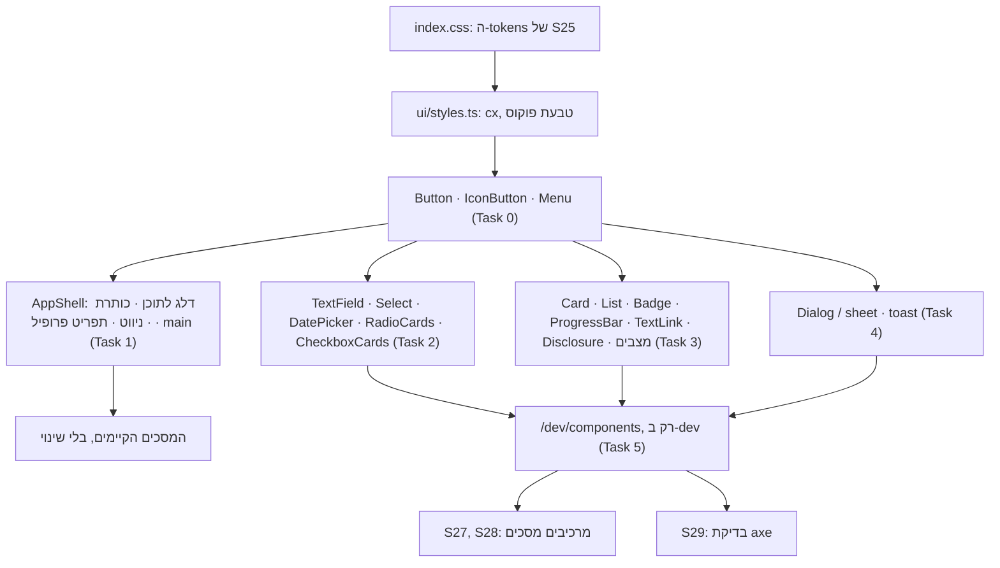

# S26 — שלד האפליקציה, ניווט למובייל ורכיבי הבסיס: תוכנית עבודה

> **For agentic workers:** REQUIRED SUB-SKILL: Use superpowers:subagent-driven-development (recommended) or superpowers:executing-plans to implement this plan task-by-task. Steps use checkbox (`- [ ]`) syntax for tracking.

**מטרה:** כל מסך של StudyFlow יושב בתוך שלד אחד בשפה "נייר": בטלפון סרגל תחתון עם ארבעה יעדים וכותרת דקה, במחשב ניווט בשורה העליונה, ותפריט פרופיל עם הגדרות ויציאה. מתחת לשלד יש ערכת רכיבים אחת ב-`web/src/ui/`, על React Aria, שממנה S27 ו-S28 ירכיבו את המסכים בלי להמציא מראה משלהם. דף פנימי ב-`/dev/components` מציג כל רכיב בכל מצב.

**השער במפת הדרכים:** "כל רכיבי הבסיס בשפה החדשה, עם מצבי טעינה, ריק ושגיאה, ודף שמציג את כולם".

**גישה:** שלוש שכבות, מלמטה למעלה:
1. **יסודות** (Task 0, השיחה הראשית): קובץ סגנון משותף, המפתחות ב-`he.ts`, והרכיבים שאחרים תלויים בהם (`Button`, ‏`IconButton`, ‏`Menu`).
2. **ארבע קבוצות רכיבים במקביל** (Tasks 1–4): השלד והניווט; שדות; רכיבי תצוגה ומצבים; שכבות צפות.
3. **מה שנשען על כולם** (Tasks 5–7): דף הרכיבים, מסמך העיצוב, בדיקה בדפדפן, סקירה ומיזוג.

**כלים:** React 19, ‏TypeScript strict, ‏React Router 8, ‏Tailwind 4, ‏React Aria Components 1.22, ‏lucide-react 1.71, ‏Vitest 5. בלי תלות חדשה, בלי שינוי ב-API ובלי מיגרציה.

**מסמך תכנון:** `docs/design/design-language.md` (מקור האמת), סעיף 7.9 ב-`docs/superpowers/specs/2026-10-19-studyflow-v2-design.md`, ו"שלב העיצוב ו-UX" במפת הדרכים.

## איך החלקים מתחברים

- **למה ניווט אחד ולא שניים:** אפשר היה לכתוב `nav` תחתון לטלפון ו-`nav` עליון למחשב ולהסתיר אחד מהם ב-CSS. אבל אז קורא מסך שומע (או לא שומע, תלוי בהסתרה) שני אזורי ניווט עם אותו שם, וכל בדיקה צריכה לבחור ביניהם. לכן יש `nav` אחד ב-DOM: בטלפון הוא `fixed` בתחתית, ומ-`md` הוא `static` בתוך השורה העליונה. אותם ארבעה `NavLink`, ו-React Router שם להם `aria-current="page"`.
- **למה הפוקוס עובר לכותרת:** באפליקציה של עמוד אחד מעבר בין מסכים לא טוען דף, ולכן קורא מסך לא מכריז כלום והפוקוס נשאר על הקישור שנלחץ. `useRouteFocus` ב-`AppShell` מזיז את הפוקוס ל-`h1` של המסך החדש (ואם עוד אין, ל-`main`) אחרי כל מעבר שהמשתמש יזם. קורא המסך מקריא את הכותרת, ו-Tab הבא מתחיל מהתוכן. זה עובד על כל `h1` בתוך `main`, ולכן המסכים הקיימים מרוויחים את זה בלי שינוי.
- **למה `PageHeader` קובע גם את `document.title`:** היום כל הלשוניות נקראות "StudyFlow". הרכיב שיודע מה שם המסך הוא הכותרת שלו, ולכן הוא זה שמעדכן את שם הלשונית ("שבוע · StudyFlow"). מסך ש-S27 או S28 מעבירים ל-`PageHeader` מקבל את זה לבד (WCAG 2.4.2).
- **למה הדף הפנימי לא ב-`he.ts`:** `he` הוא אובייקט אחד שנכנס כולו ל-bundle. טקסטים של דף פנימי בתוכו היו נשלחים לכל משתמש. לכן הטקסטים של הדף ב-`web/src/dev/devText.ts`, וה-route שלו נטען ב-`import()` שמותנה ב-`import.meta.env.DEV`: ‏Vite מחליף את התנאי ב-`false` בזמן build, והקוד המת נזרק יחד עם ה-chunk.
- **למה React Aria ולא HTML רגיל:** הוא נותן לכל רכיב את התפקיד, המקלדת, ניהול הפוקוס וה-RTL, ושם על האלמנט `data-hovered`, ‏`data-pressed`, ‏`data-focus-visible`, ‏`data-disabled`. הסגנון שלנו נשען רק על המאפיינים האלה, כך שהמראה והנגישות לא יכולים לצאת מסנכרון.

## מה מצאתי לפני התכנון (2026-11-17)

| נושא | מצב |
|---|---|
| `AppShell` | חמש לשוניות בשורה (כולל "הגדרות"), כפתור "יציאה" גלוי, ‏`max-w-3xl px-4`. אין "דלג לתוכן", ואין ניהול פוקוס |
| `web/src/ui/` | `Button`, ‏`TextField`, ‏`DatePicker`, ‏`RadioCards`, ‏`CheckboxCards`, ‏`toast`. כולם ב-`min-h-11`, ‏`rounded-lg`, ‏`text-sm`, ‏`shadow-lg`. ב-`DatePicker` שני SVG מצוירים ביד |
| מחוץ ל-`ui/` | `exam/SelectField.tsx` (‏`select` של הדפדפן) ו-`exam/Disclosure.tsx` (כפתור עם SVG), בשימוש רק בתוך `exam/` |
| טעינה ושגיאה | כל מסך כותב `
טוען…
` ו-`
` משלו (כ-45 מקומות) |
| דיאלוג | `plan/ReplanOffer.tsx` בונה דיאלוג משלו. אין רכיב משותף |
| באגים שתויגו S26 | שורה אחת: כפתור כבוי ב-`opacity-50` חלש מדי; הקישור ב-404 בצבע הטקסט. ב"פריטים פתוחים" אין שורה של S26 |
| ‏S16 (ענף `s16-pwa-push`) | מוסיף `app/AppErrorBoundary.tsx`, משנה את `index.html`, ‏`main.tsx`, ‏`renderRoute.tsx`, ‏`SettingsPage.tsx`, ‏`vite.config.ts`. לא נוגע ב-`AppShell.tsx` |
| ‏S18 (ענף `s18-review-drag`) | `today/`, ‏`board/`, ‏`pages/TodayPage.tsx`. ב-`today/today.test.tsx` יש בדיקה שלוחצת על הכפתור "יציאה" ישירות |
| פורט 5173 | של S16. הבדיקה בדפדפן רצה על build עם נתוני דמה בפורט אחר |

## ההחלטות שלי

1. **`nav` אחד ב-DOM**, קבוע בתחתית בטלפון ובשורה העליונה מ-`md` (ראו למעלה). הסדר ב-DOM: דלג לתוכן, כותרת (שם, ניווט, פרופיל), ‏`main`. הניווט לפני התוכן גם בטלפון, כדי שסדר ה-Tab יהיה זהה בשני הרוחבים; "דלג לתוכן" חוסך אותו.
2. **הפוקוס עובר רק במעבר שהמשתמש יזם.** לא בטעינה הראשונה, ולא בהפניה (`REPLACE`, כמו `/` ← `/today` או השער של האונבורדינג), כדי לא לחטוף פוקוס שהמשתמש לא ביקש להזיז. שינוי של `?from=` בלבד (שבוע קודם, שבוע הבא) לא מזיז פוקוס: זה אותו מסך. ל-`h1` שמקבל פוקוס אין טבעת: הוא לא פקד, ואי אפשר להגיע אליו ב-Tab.
3. **כפתור הפרופיל** מציג את האות הראשונה של השם מ-Google (`user_metadata.full_name`), ואם אין, של כתובת המייל; אם אין שניהם, אייקון `User`. השם הנגיש שלו "פרופיל". התפריט: "הגדרות" (ניווט) ו"יציאה". "הגדרות" הוא `menuitem` ולא קישור בניווט, ולכן כשנמצאים ב-`/settings` אף יעד בסרגל לא מסומן; כותרת המסך אומרת איפה נמצאים.
4. **כפתור כבוי קריא:** `bg-surface-muted text-ink-muted border-line`, בלי שקיפות, בכל הסוגים (בסוג השקט בלי מילוי). ‏`ink-muted` על `surface-muted` הוא זוג שכבר נבדק (מעל 4.5:1), ולכן "שמירה" כבויה נקראת גם על רקע רך. כפתור כבוי של שלושת הסוגים נראה אותו דבר, וזה בכוונה: כבוי הוא מצב אחד. זה מחליף את "כפתור כבוי: `opacity-50`" בסעיף 5.3.
5. **מצב טעינה של כפתור (`isPending`):** הטקסט נשאר (כדי שהרוחב לא יקפוץ), לפניו מחוון מסתובב, והכפתור לא מגיב ללחיצה אבל נשאר בפוקוס. ‏React Aria מטפל ב-`aria-disabled` ובהכרזה.
6. **`Select` של React Aria במקום `select` של הדפדפן.** המחיר: בטלפון נפתחת רשימה שלנו ולא הגלגל של המערכת. הרווח: אותו מראה, אותו פוקוס ואותו RTL כמו שאר השדות, ורשימה שאפשר לבדוק. `exam/SelectField.tsx` נמחק, ושלושת הקבצים שהשתמשו בו עוברים ל-`ui/Select` באותם props.
7. **דיאלוג אחד, שתי צורות:** מתחת ל-`md` הוא sheet שצמוד לתחתית (פינות עליונות `rounded-card`, ריפוד `safe-area`), ומ-`md` חלון ממורכז ב-`max-w-md`. אותו רכיב ואותו קוד אצל מי שמשתמש בו. הרקע שמאחוריו: `ink` בשקיפות 40% (נוסף למסמך העיצוב).
8. **שלד טעינה (skeleton) ולא טקסט:** `LoadingState` מצייר שורות אפורות בצורת התוכן שיגיע, עם `role="status"` והטקסט "טוען…" לקוראי מסך בלבד. כך הבדיקות הקיימות שמחפשות את "טוען…" ממשיכות לעבור כשמסך עובר לרכיב. הפעימה של השלד היא "מחוון טעינה", האנימציה היחידה בלולאה שסעיף 7 מתיר.
9. **`OnboardingGate` עובר ל-`LoadingState` ול-`ErrorState`**, כי הוא חלק מהשלד (כל מסך עובר דרכו) ולא מסך. שאר 45 המקומות הם של S27 ו-S28, ורשומים בסעיף 10 של מסמך העיצוב.
10. **`TextLink`:** קישור בטקסט הוא `text-brand` עם קו תחתון תמיד. קו תחתון, כי WCAG 1.4.1 לא מרשה להבדיל קישור מטקסט בצבע בלבד, והמסמך כבר שומר קו תחתון לקישורים. זה גם התיקון של הקישור ב-404.
11. **`viewport-fit=cover` ב-`index.html`:** בלעדיו `env(safe-area-inset-bottom)` שווה 0 באייפון, והסרגל התחתון יושב על פס הבית. S16 משנה את אותו קובץ בשורות אחרות; ב-rebase שומרים את שני השינויים.
12. **דף הרכיבים מחוץ ל-`RequireAuth`**, כ-route עליון משלו: S29 מריץ עליו axe, ו-S27 ו-S28 פותחים אותו, בלי להתחבר ובלי נתונים.
13. **הבדיקה "יציאה" ב-`today/today.test.tsx` (של S18):** היא לוחצת על כפתור שעובר לתפריט. אם S18 מוזג לפני: מתקנים אותה אחרי ה-rebase (פותחים את התפריט ואז לוחצים). אם לא: זו השורה היחידה ב-`today/` שמשתנה, כי בלעדיה הבדיקות אדומות, והיא נרשמת כאן.
14. **לא נכנס ל-S26:** החלפת `
` במסכים, מעבר של `ReplanOffer` ל-`Dialog`, כותרות המסכים (`PageHeader`), ו-`RequireAuth`. הכול רשום ל-S27 ול-S28 עם שם הקובץ ובמה להחליף.

## Global Constraints

- בהיר בלבד. קו דק לכרטיס, `shadow-overlay` רק למה שצף. פעולה ראשית אחת במסך.
- רק מחלקות של ה-tokens: צבעים לפי שם, `text-display|title|body|small|caption`, ‏`font-normal|font-semibold`, ‏`rounded-badge|control|card`, ‏`min-h-touch`, ‏`size-touch`, ‏`px-gutter`, ‏`p-card`, ‏`space-y-section`. אסור `slate-*`, ‏hex, ‏`rounded-lg`, ‏`shadow-lg`, ‏`font-medium`, ‏`font-bold`, ‏`text-sm`.
- אייקונים רק מ-`lucide-react`, בשם, `strokeWidth={1.75}`, ‏`aria-hidden` כשיש טקסט לידם. 22px בניווט, 18px בכפתור, 14px בשורת משנה.
- כל טקסט שמשתמש רואה ב-`he.ts`. אין `alert` ו-`confirm`. רק logical properties (`ms-`, ‏`pe-`, ‏`start-`).
- תנועה רק מה-tokens (`transition-*` מקבל 160ms לבד; `duration-(--duration-fast|slow)`), תזוזה של 8px לכל היותר, ורכיב לא עוקף את `prefers-reduced-motion`.
- לכל רכיב בדיקה של: תפקיד, שם נגיש, מקלדת, ופוקוס גלוי (`data-focus-visible` נותן `ring-2 ring-brand`).
- אין שינוי בהתנהגות של מסך או בקריאה ל-API. לא נוגעים ב-`today/` וב-`board/`.
- אין תלות חדשה ב-`package.json`.

## Review Focus

1. **מקלדת בלבד בסרגל ובתפריט:** Tab מגיע ל"דלג לתוכן" ראשון; Enter עליו מעביר פוקוס ל-`main`. התפריט נפתח ב-Enter, חצים עוברים בין הפריטים, Escape סוגר ומחזיר פוקוס לכפתור. (Task 1)
2. **שם משתמש חריג:** בלי `full_name` ובלי מייל, או שם שמתחיל באימוג'י או ברווח: כפתור הפרופיל לא נשבר ומציג אייקון. (Task 1)
3. **כפתור בטעינה לא נשלח פעמיים:** לחיצה ו-Enter על כפתור עם `isPending` לא קוראים ל-`onPress`. (Task 0)
4. **`Select` עם ערך שאינו ברשימה, ורשימה ריקה:** מוצג ה-placeholder, בלי שגיאה. (Task 2)
5. **טקסט ארוך:** כותרת מסך, שורת רשימה ותג עם שם ארוך בלי רווחים לא יוצרים גלילה אופקית ב-390px (`break-words`, ‏`min-w-0`). (Tasks 1, 3)

## מה רץ במקביל

| גל | משימות | מי |
|---|---|---|
| 0 | Task 0 | השיחה הראשית |
| 1 | Tasks 1, 2, 3, 4 במקביל, כל אחת בקבצים משלה | ארבעה subagents |
| 2 | Task 5 (דף הרכיבים) במקביל ל-Task 6 (מסמך העיצוב, `OnboardingGate`) | subagent, והשיחה הראשית |
| 3 | Task 7: סקירה, דפדפן, rebase, מיזוג | השיחה הראשית, עם subagent לסקירה |

ה-subagents עובדים באותה תיקייה, כל אחד בקבצים שלו בלבד, ולא מריצים git. השיחה הראשית עושה commit לכל משימה ומריצה את כל הבדיקות אחרי כל גל.

## קבצים משותפים

- `web/src/i18n/he.ts`: כל המפתחות נכתבים ב-Task 0. ‏subagent שחסר לו מפתח מוסיף אותו רק בקטע `ui` או `shell`.
- `web/src/ui/styles.ts`, ‏`Button.tsx`, ‏`IconButton.tsx`, ‏`Menu.tsx`: נכתבים ב-Task 0, ואחר כך לקריאה בלבד.
- `web/src/app/routes.tsx`: רק Task 5 (ה-route של הדף הפנימי).
- עם S16: ‏`web/index.html` (שורת ה-viewport שלנו, ה-meta והסקריפט שלהם). עם S18: ‏`today/today.test.tsx` (החלטה 13). ‏`package-lock.json` לא משתנה אצלנו.

---

### Task 0: יסודות (השיחה הראשית)

**קבצים:** `web/src/ui/styles.ts`, ‏`Button.tsx`, ‏`IconButton.tsx`, ‏`Menu.tsx`, ‏`Button.test.tsx`, ‏`Menu.test.tsx`, ‏`web/src/i18n/he.ts`.

**ממשקים שנוצרים:**
- `cx(...parts: (string | false | null | undefined)[]): string`
- `FOCUS_RING` (ל-React Aria: `data-[focus-visible]`) ו-`FOCUS_RING_NATIVE` (לאלמנט רגיל: `focus-visible:`).
- `Button({ variant?: 'primary' | 'secondary' | 'quiet' | 'danger', isPending?, ...AriaButtonProps })`
- `IconButton({ 'aria-label': string, variant?: 'quiet' | 'secondary', ...AriaButtonProps })`, ‏`size-touch`, הילד הוא אייקון.
- `Menu({ trigger: ReactElement, children })` ו-`MenuItem({ icon?: LucideIcon, tone?: 'default' | 'danger', onAction, children })`.
- `he.shell.skipToContent`, ‏`he.shell.profile`, ‏`he.common.choose`.

- [ ] בדיקות: כפתור כבוי בלי `opacity`; ‏`isPending` לא קורא ל-`onPress` ומציג מחוון; ‏`IconButton` עם שם נגיש; תפריט נפתח ב-Enter, חץ מעביר, Escape מחזיר פוקוס
- [ ] מימוש, והבדיקות עוברות
- [ ] commit

### Task 1: השלד והניווט

**קבצים:** `web/src/app/AppShell.tsx`, ‏`app/ProfileMenu.tsx`, ‏`app/useRouteFocus.ts`, ‏`app/AppShell.test.tsx`, ‏`app/routes.test.tsx`, ‏`ui/PageHeader.tsx`, ‏`ui/PageHeader.test.tsx`, ‏`ui/PageContainer.tsx`, ‏`web/index.html`.

**ממשקים:**
- `PageHeader({ title: string, subtitle?: ReactNode, action?: ReactNode })`: ‏`h1` ב-`text-display font-semibold`, ‏`tabIndex={-1}`, וקובע `document.title`.
- `StandalonePage({ children })`: ‏`main` באותו רוחב ושוליים, למסכים שמחוץ לשלד (כניסה, 404, פרידה).
- `useRouteFocus(main: RefObject<HTMLElement | null>): void`
- `ProfileMenu()`: משתמש ב-`Menu`, ‏`IconButton`, ‏`useAuth`.

- [ ] בדיקות: "דלג לתוכן" הוא הראשון ב-Tab ומעביר פוקוס ל-`main`; ‏`nav` אחד עם ארבעה קישורים בסדר הנכון ו-`aria-current`; אין קישור "הגדרות" בניווט; התפריט מנווט ל-`/settings` ומתנתק; באונבורדינג אין `nav` ואין תפריט; מעבר בין מסכים מעביר פוקוס ל-`h1`, והפניה לא; שם חריג מציג אייקון
- [ ] מימוש לפי סעיף 6 במסמך העיצוב, והבדיקות עוברות
- [ ] commit

### Task 2: שדות

**קבצים:** `web/src/ui/TextField.tsx`, ‏`Select.tsx`, ‏`DatePicker.tsx`, ‏`RadioCards.tsx`, ‏`CheckboxCards.tsx` והבדיקות שלהם; `exam/SelectField.tsx` נמחק; `exam/TaskForm.tsx`, ‏`TopicList.tsx`, ‏`TaskRow.tsx`, ‏`TaskList.test.tsx` (רק ה-import והדרך שבה הבדיקה בוחרת ערך).

**ממשקים:** ה-props הקיימים נשארים. חדש: `Select({ label, value, options: readonly SelectOption[], onChange, description?, errorMessage?, isDisabled?, placeholder? })`, ו-`SelectOption { value: string; label: string }`.

- [ ] בדיקות לכל רכיב: תפקיד, שם, מקלדת, שגיאה שמקושרת לשדה; ‏`Select` עם ערך שאינו ברשימה
- [ ] מימוש לפי 5.4, אייקונים של lucide ב-`DatePicker`, והבדיקות עוברות (כולל `exam/`)
- [ ] commit

### Task 3: תצוגה ומצבים

**קבצים:** `web/src/ui/Card.tsx`, ‏`List.tsx`, ‏`Badge.tsx`, ‏`ProgressBar.tsx`, ‏`TextLink.tsx`, ‏`Disclosure.tsx`, ‏`states.tsx` והבדיקות; `exam/Disclosure.tsx` נמחק ושני הקבצים שהשתמשו בו מייבאים מ-`ui/`; ‏`pages/NotFoundPage.tsx`.

**ממשקים:**
- `Card({ tone?: 'plain' | 'danger' | 'warning' | 'success', className?, children, ...div })`
- `List({ children, 'aria-label'? })`, ‏`ListRow({ leading?, title, subtitle?, trailing?, to?, done? })`
- `Badge({ tone: 'brand' | 'success' | 'warning' | 'neutral', children })`
- `ProgressBar({ label, value, max?, valueText })`
- `TextLink({ to, children })`
- `Disclosure({ label, children, defaultExpanded? })`
- `Skeleton({ className? })`, ‏`LoadingState({ shape?: 'list' | 'card' | 'text', rows?, label? })`, ‏`EmptyState({ icon, title, description?, action? })`, ‏`ErrorState({ message?, onRetry?, retryLabel? })`

- [ ] בדיקות: תפקידים ושמות (`progressbar` עם `aria-valuetext`, ‏`status`, ‏`alert`), ‏`Disclosure` במקלדת, שורה עם `to` היא קישור והפקד שבקצה נלחץ בנפרד, טקסט ארוך
- [ ] מימוש לפי 5.1, 5.2, 5.5, 5.6, והבדיקות עוברות
- [ ] commit

### Task 4: שכבות צפות

**קבצים:** `web/src/ui/Dialog.tsx`, ‏`Dialog.test.tsx`, ‏`toast.tsx`, ‏`toast.test.tsx`.

**ממשקים:** `Dialog({ title, description?, isOpen, onOpenChange, role?: 'dialog' | 'alertdialog', isDismissable?, children, footer? })`. ‏`useToast` לא משתנה.

- [ ] בדיקות: דיאלוג עם שם מהכותרת, הפוקוס נכנס ונלכד, Escape סוגר, ‏`alertdialog` לא נסגר בלחיצה בחוץ; ל-toast כפתור סגירה עם שם נגיש
- [ ] מימוש (sheet מתחת ל-`md`), ‏toast ב-`rounded-card shadow-overlay`, מעל הסרגל התחתון
- [ ] commit

### Task 5: דף הרכיבים

**קבצים:** `web/src/dev/ComponentsPage.tsx`, ‏`dev/devText.ts`, ‏`dev/ComponentsPage.test.tsx`, ‏`app/routes.tsx`.

- [ ] בדיקה: ב-dev ה-route קיים, ולכל רכיב יש קטע עם כותרת
- [ ] הדף: כל רכיב בכל המצבים (רגיל, כבוי, טעינה, שגיאה, נבחר), ב-RTL
- [ ] מדידה: `npm run build`, ואז אין ב-`dist/` את הטקסט של הדף ואין chunk שלו; המספרים נרשמים כאן
- [ ] commit

### Task 6: מסמך העיצוב ו-`OnboardingGate` (השיחה הראשית)

- [ ] `design-language.md`: לכל רכיב מתי משתמשים בו ודוגמת קוד; 5.3 (כפתור כבוי וטעינה); סעיף 6 (מה נבנה בפועל); סעיף 10 ל-S27 ול-S28: אילו קבצים להחליף ובמה
- [ ] `OnboardingGate` עם `LoadingState` ו-`ErrorState`
- [ ] commit

### Task 7: איחוד, סקירה, דפדפן וסגירה (השיחה הראשית)

- [ ] כל הפקודות של `web/`, ובדיקות ה-API שלא נוגעות במסד
- [ ] סקירת קוד ב-subagent, ותיקונים
- [ ] build עם נתוני דמה בפורט אחר; צילומים של כל המסכים ב-390px וב-1280px ב-`~/studyflow-manager/s26-screens/`
- [ ] `git fetch`, ‏rebase, ה-error boundary של S16 (אם ב-`main`), הבדיקות שוב, gitleaks, ‏push ל-`main`, מחיקת הענף
- [ ] מפת הדרכים: "הושלם", שורת הבאג נסגרת, פריטים שנדחו נרשמים; סעיף 7.9 במסמך התכנון

## מה נעשה בפועל

(מתמלא בסוף.)
