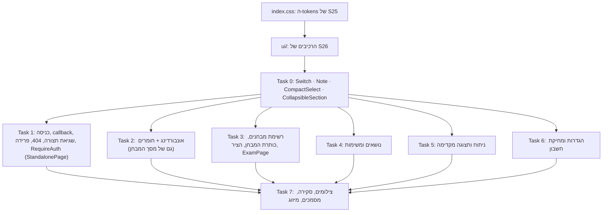

# S28 — עיצוב כניסה, אונבורדינג, מבחנים והגדרות: תוכנית עבודה

> **For agentic workers:** REQUIRED SUB-SKILL: Use superpowers:subagent-driven-development (recommended) or superpowers:executing-plans to implement this plan task-by-task. Steps use checkbox (`- [x]`) syntax for tracking.

**מטרה:** כל המסכים שאינם "היום", "שבוע" ו"התקדמות" עוברים לשפה "נייר": כניסה (וארבעת המסכים שמחוץ לשלד), ארבעת שלבי האונבורדינג, רשימת המבחנים ומסך המבחן, הגדרות ומחיקת חשבון. אחרי ה-scope אין בקבצים האלה אף מחלקה מלפני S25, וכל מסך מורכב רק מהרכיבים של `web/src/ui/`.

**השער במפת הדרכים:** "כל שאר המסכים בעיצוב החדש, והאונבורדינג עדיין מסתיים תוך 5 דקות".

**גישה:** שלוש שכבות.
1. **רכיבים חסרים** (Task 0, השיחה הראשית): ארבעה קבצים חדשים ב-`ui/`, כי אסור לשנות רכיב קיים בזמן ש-S27 רץ במקביל.
2. **שש קבוצות מסכים במקביל** (Tasks 1–6), כל אחת בתיקיות ובקטעי `he.ts` משלה.
3. **מה שנשען על כולם** (Task 7): צילומים בכל המצבים, מעבר עליהם, סקירה, מסמכים, rebase ומיזוג.

**כלים:** React 19, ‏TypeScript strict, ‏React Router 8, ‏TanStack Query 5, ‏Tailwind 4, ‏React Aria Components 1.22, ‏lucide-react, ‏Vitest 5. בלי תלות חדשה, בלי שינוי ב-API ובלי מיגרציה.

**מסמך תכנון:** `docs/design/design-language.md` (מקור האמת; סעיפים 5.8, 6, 8, 9, 10), ההדמיה `docs/design/mockups/a.png`, וסעיף 7.9 ב-`docs/superpowers/specs/2026-10-19-studyflow-v2-design.md`.

## איך החלקים מתחברים

- **מה לא משתנה:** ה-hooks (`useExams`, ‏`useUpdateMe`, ‏`useJob`…), מפתחות ה-query, הקריאות ל-API, ה-routes, והרגע שבו כל דבר נשלח. מסך הוא שכבה דקה מעל ה-hooks האלה, ולכן אפשר להחליף את כולה בלי לגעת בלוגיקה: אותם נתונים נכנסים, ואותן פעולות יוצאות.
- **למה הבדיקות כן משתנות בחלקן:** הבדיקות של המסכים מוצאות פקדים לפי תפקיד ושם נגיש. כשכפתור "מחיקה" של משימה עובר לתפריט, הבדיקה צריכה קודם לפתוח את התפריט. זו בדיקה של אותה התנהגות דרך מבנה חדש; ה-assertions על הקריאות ל-API נשארות כמו שהן.
- **למה המסכים שמחוץ לשלד עוטפים את עצמם ב-`StandalonePage`:** בתוך האפליקציה ה-`main` של `AppShell` נותן רוחב ושוליים. כניסה, 404 ופרידה מוצגות בלי השלד, ועד עכשיו כל אחת כתבה `main` משלה (שלוש פריסות שונות, שוליים של 16px). `StandalonePage` הוא אותו `main` בדיוק, ולכן הכותרת של מסך הכניסה יושבת באותו מקום שבו יושבת הכותרת של "היום".
- **למה האונבורדינג וההגדרות מאבדים את `max-w-xl`:** הם יושבים בתוך השלד (`max-w-3xl`) והצרו את עצמם שוב, ולכן במחשב הכותרת לא התיישרה עם השם StudyFlow שבשורה העליונה. עכשיו הרוחב הוא של השלד, ושדות שלא צריכים להימתח מוגבלים בעצמם.

## מה מצאתי לפני התכנון (2026-11-17)

| נושא | מצב |
|---|---|
| צילומי "לפני" | `~/studyflow-manager/s28-screens/before/`: כל המסכים של S28 בכל המצבים, 390 ו-1280. הסביבה (`web/.shots/`, פורט 4228) הורחבה ב-`?shot=loading/error/empty/…` |
| מסך המבחן בטלפון | 7,640px של גלילה. כל משימה היא כרטיס של חמש שורות עם ארבעה כפתורים (בוצעה, דילוג, עריכה, מחיקה), כלומר כ-40 כפתורים במסך אחד |
| הציר | "מתוכנן" ב-`brand-soft` על לבן (כמעט לא נראה); יום המבחן הוא בלוק כחול מלא עם טקסט שנשבר לשתי שורות |
| שם קובץ | "מבחן מועד א 2025.pdf" מוצג "pdf.2025 מבחן מועד א": הסיומת נדבקת למספר בצד שמאל. יש כבר `bdi`; הסדר הזה הוא ה-bidi התקין של טקסט RTL, ולכן `bdi` לא יתקן אותו |
| טווחי שעות | `'06:00–12:00'` הוא מחרוזת ב-`he.ts` שנכנסת כ-`description` לרכיב של `ui/`, ומוצגת "12:00–06:00" |
| הגדרות | ארבעה כרטיסים, ובתוכם כרטיס בתוך כרטיס ("זמן לעצמי"); המתג כתוב ביד עם `shadow-sm`; ‏`input type="time"` של הדפדפן |
| S16 (`origin/s16-pwa-push`, לא מוזג) | ב-`SettingsPage.tsx` מחליף את ה-`
` של "התראות יגיעו בקרוב" ב-`<NotificationSettings />` ומוסיף import. ב-`index.html` מוסיף meta וסקריפט, ולא נוגע בשורת ה-`body` |
| S27 | עוד לא דחף ענף. אם יוסיף ל-`ui/` קובץ באותו שם כמו שלי, זה יתגלה ב-rebase |

## ההחלטות שלי

1. **מסך המבחן: שורה לכל משימה, ופעולות בתפריט.** משימה היא `ListRow`: שם, שורת משנה אחת ("לימוד, 60 דקות. ריכוז 3/10. בלוח: יום ג׳ 10:00"), `CheckButton` לסימון "בוצעה", ותפריט "פעולות" עם עריכה, דילוג ומחיקה. כך 40 כפתורים הופכים ל-10 עיגולי סימון, והעין רואה רשימת משימות ולא ערימת כרטיסים (סעיף 5.2: "פעולות נוספות על שורה נמצאות בתפריט"). משימה שדולגה מקבלת תג "דולגה" במקום עיגול, ו"החזרה לביצוע" בתפריט. הנימוק ("למה המשימה הזו?") נפתח מהתפריט ומוצג כ-`Note` מתחת לשורת המשנה (עודכן אחרי הצילומים, ראו בסוף).
2. **מסך המבחן: ההיררכיה.** מלמעלה למטה: קישור חזרה, כותרת (שם, ומתחתיו "23 בנובמבר 2026, בעוד 6 ימים. קושי: קשה") עם כפתור "עריכה", הציר, נושאים ומשימות, ואז שני קטעים **מתקפלים**: "חומרים" ו"ניתוח החומרים". הם משניים למי שכבר יש לו תוכנית, ולכן סגורים כברירת מחדל, עם שורת סיכום ("3 קבצים"). הם נפתחים לבד כשהם העיקר: למבחן שעוד לא נותח (שם "בניית תוכנית למבחן" היא הפעולה הראשית של המסך), כשניתוח רץ, נכשל, או כשטיוטה מחכה לאישור.
3. **`Disclosure` הקיים הוא הערה קטנה בתוך שורה, לא קטע של מסך.** לכן נוסף `ui/CollapsibleSection.tsx`: כותרת `h2` שהיא כפתור עם חץ ושורת סיכום. אפשר היה להרחיב את `Disclosure`, אבל אסור לשנות רכיב קיים ב-scope הזה, ואלה באמת שני דברים שונים (האחד בלי כותרת במבנה העמוד, השני עם).
4. **הציר:** עמודה "מתוכנן" היא מסגרת `line-strong` על לבן, והחלק שבוצע מתמלא ב-`success` מלמטה: אותה שפה כמו עיגול הסימון (ריק = עוד לא, ירוק = בוצע), ושניהם עומדים ב-3:1. יום המבחן ויום מנוחה מסומנים באייקון (`Flag`, ‏`Coffee`) ולא בבלוק צבע ובטקסט שנשבר; המקרא מסביר את ארבעת הסימנים, ולכל יום יש `aria-label` מלא כמו היום. העמודות ב-48px. התוויות של הציר ב-`text-caption`: זה השימוש השני שלו (אחרי הניווט התחתון), ונרשם במסמך העיצוב.
5. **שם קובץ בלי סיומת.** השורה מציגה "מבחן מועד א 2025", והסוג עובר לשורת המשנה: "מבחן עבר, PDF. מוכן, 24 עמודים". כך אין מה שיקפוץ, והשם קריא יותר. השמות הנגישים של הכפתורים ("מחיקה: מבחן מועד א 2025.pdf") נשארים עם השם המלא. זה גם סוגר את הפריט מטבלת הבאגים.
6. **טווחי שעות:** המחרוזות ב-`he.ts` נעטפות בתווי הכיוון LRI/PDI (`⁦…⁩`), המקבילה בטקסט ל-`dir="ltr"`. כך הן נקראות נכון בכל מקום שמציג אותן, בלי לשנות את `RadioCards` ו-`CheckboxCards`.
7. **כניסה:** השם ב-`text-display`, משפט אחד, כפתור ראשי אחד, מיושרים להתחלה כמו כל מסך אחר (לא ממורכזים): הרושם הראשון הוא אותו "דף ביומן" שהמשתמש יראה בפנים. ה-`h1` כאן כתוב ישירות ולא דרך `PageHeader`, כי `PageHeader` היה קורא ללשונית "StudyFlow · StudyFlow".
8. **אונבורדינג: כפתור המשך אחד, ראשון ומתרחב.** בסרגל התחתון הכפתור הראשי ראשון (ימין) ומתרחב, ו"חזרה" אחריו (5.3). בשלבים 1–2 הוא "המשך", בשלב 3 "בניית התוכנית". בשלב החומרים, בלי קבצים, אותו כפתור אומר **"המשך בלי חומרים"**: הדילוג גלוי בתוך הכפתור עצמו, בלי כפתור שני ובלי שהמשתמש יחפש איך לדלג. הלוגיקה (`leave(schedule)`) לא משתנה.
9. **שלב המבחנים:** "הוספת מבחן" הוא הכפתור הראשי כל עוד אין מבחנים ("המשך" כבוי ואפור ממילא), ומשני אחרי המבחן הראשון, כש"המשך" נהיה הראשי. כך בכל רגע יש במסך כחול אחד, והוא אומר מה הצעד הבא. מחיקת מבחן היא `IconButton` עם פח ושם נגיש.
10. **פס השלבים** נשאר רכיב של האונבורדינג (`h-1`, ‏`brand` על `line`), ומעליו "שלב 2 מתוך 4".
11. **הגדרות בלי כרטיסים.** ההעדפות הן טופס אחד עם ארבע קבוצות (`h3`): "כמה ומתי", "שגרת היום", "זמן לעצמי", "לפני מבחן", מופרדות בקו, ו"שמירה" אחת בסוף. אחריהן "התראות" ו"ייצוא הנתונים" כקטעים רגילים, ובסוף אזור מסוכן אחד: `Card tone="danger"`. זה מבטל את הכרטיס שבתוך כרטיס, ומשאיר את האדום למקום אחד במסך.
12. **המקום של S16:** הקטע "התראות" נשאר `<Section title={t.notifications.title}>` עם `
` אחד בתוכו, באותן שורות שהענף של S16 מחליף, כדי שה-rebase שלו יהיה החלפה של שורה.
13. **`TimeField` שומר על ההתנהגות של `input type="time"`:** שדה שנוקה לא מוחק את הערך האחרון בטופס (`if (value !== '') …`), כמו היום.
14. **רשימת מבחנים:** `ListRow to=…` עם שם, תאריך, ותג של הימים שנשארו (`brand` עד שבוע, אחרת ניטרלי). "מבחן חדש" הוא הכפתור הראשי בכותרת; כשאין מבחנים הוא עובר ל-`EmptyState`, כדי שלא יהיו שני כחולים.
15. **`CompactSelect`** (חדש): בחירת סוג הקובץ בשורה של קובץ. `ui/Select` דורש תווית גלויה מעל השדה, ו-15 תוויות "סוג" ברשימת קבצים הן רעש. מסמך העיצוב הציע להוסיף ל-`Select` אפשרות של `aria-label`; זה שינוי ברכיב קיים, ולכן נרשם ל-S29 לאחד את השניים.
16. **`Note`** (חדש): הערה שקטה בתוך מסך (`surface-muted`, ‏`rounded-control`), עם גוון אזהרה. היא חזרה ביד בשבעה מקומות.
17. **שגיאה של טופס** (שמירה שנכשלה) נשארת `
` מתחת לשדות, כמו שסעיף 10 קובע. תוכן שלא נטען הוא `ErrorState`.
18. **לא נכנס ל-S28:** בדיקת axe והגדלה ל-200% (S29); איחוד "לנסות שוב" מול "נסו שוב" (S29); שינוי ב-`ui/` קיים.

## Global Constraints

- בהיר בלבד. קו דק לכרטיס, `shadow-overlay` רק למה שצף. **כפתור ראשי אחד במסך או בכרטיס.**
- רק הרכיבים של `web/src/ui/` וה-tokens. מסך לא כותב `<button>`, ‏`<input>`, ‏`<select>` או תג משלו.
- אסור בקבצים של S28 בסוף: `text-xs|sm|base|lg|xl|2xl|3xl`, ‏`font-medium`, ‏`font-bold`, ‏`rounded-sm|md|lg|xl|2xl|3xl`, ‏`shadow-sm|md|lg|xl`, ‏`min-h-11`, ‏`slate-*`, ‏`red-*`, ‏`opacity-50`, ‏`duration-500`, ‏SVG ביד, ‏`ml-|mr-|pl-|pr-|left-|right-|text-left|text-right`.
- מותר: `text-display|title|body|small|caption`, ‏`font-normal|font-semibold`, ‏`rounded-badge|control|card|full`, ‏`min-h-touch`, ‏`size-touch`, ‏`p-card`, ‏`space-y-section`/`gap-6`, צבעים לפי שם ורק בזוגות של סעיף 2.
- **לא משנים קובץ קיים ב-`web/src/ui/`**, ולא נוגעים ב-`today/`, ‏`week/`, ‏`progress/`, ‏`board/`, ‏`plan/`, ‏`notifications/`, ‏`pwa/`, ‏`pages/TodayPage.tsx`, ‏`app/`.
- אין שינוי ב-hooks, במפתחות ה-query, בקריאות ל-API או ב-routes. בדיקה משתנה רק כשהיא נשענת על מבנה ה-DOM או על טקסט שהשתנה; assertion על קריאה ל-API לא נמחק ולא מוחלש.
- לכל מסך: `PageHeader` (ה-`h1` מחוץ לתנאי הטעינה), `LoadingState` בצורת התוכן, `EmptyState`, ‏`ErrorState`. טלפון (390px) קודם.
- נגישות (סעיף 8): שם נגיש לכל פקד (כפתור שחוזר ברשימה כולל את שם הפריט), יעד מגע 44px, מידע לא רק בצבע, `h1` אחד ו-`h2` לכל קטע.
- כל טקסט ב-`he.ts`, כל agent רק בקטעים שלו. פרטים בשורת משנה מופרדים בפסיק ובנקודה, לא ב-`·`. שעה וטווח שעות בתוך `dir="ltr"`.
- אייקונים רק מ-`lucide-react`, ‏`strokeWidth={ICON_STROKE}`, ‏18px בכפתור, 14px בשורת משנה, `aria-hidden`.

## Review Focus

1. **שם ארוך בלי רווחים** (מבחן, משימה, קובץ) ב-390px: לא נוצרת גלילה אופקית, והתפריט והעיגול של השורה נשארים במסך. (Tasks 2, 3, 4)
2. **מקלדת בשורת משימה:** Tab מגיע לעיגול ואז ל"פעולות"; התפריט נפתח ב-Enter, ואחרי "עריכה" → "ביטול" אפשר להמשיך לעבוד. (Task 4)
3. **קטע מתקפל סגור לא מסתיר משהו שדורש פעולה:** טיוטה שמחכה, ניתוח שנכשל, או מבחן בלי תוכנית פותחים את "ניתוח החומרים" לבד. (Task 5)
4. **לחיצה כפולה על כפתור ששולח:** `isPending` במקום `isDisabled`, ועדיין נשלחת בקשה אחת (שמירה, הוספת מבחן, מחיקת חשבון). (Tasks 2, 3, 6)
5. **קובץ בלי סיומת, או עם שם שהוא רק סיומת (`.pdf`):** השורה מציגה את השם המלא ולא שורה ריקה. (Task 2)

## מה רץ במקביל

| גל | משימות | מי |
|---|---|---|
| 0 | Task 0: ארבעת הרכיבים, דף הרכיבים | השיחה הראשית |
| 1 | Tasks 1–6 במקביל, כל אחת בקבצים משלה | שישה subagents, באותה תיקייה, בלי git |
| 2 | Task 7: בדיקות, צילומים, מעבר על כל צילום, סקירה, תיקונים, מסמכים, rebase, מיזוג | השיחה הראשית, עם subagent לסקירה |

## קבצים משותפים

- `web/src/i18n/he.ts`: כל agent עורך רק את הקטעים שלו (רשומים בכל Task), בעריכות קטנות, ובודק אחרי כל עריכה שהמפתחות שלו קיימים. לא מוחקים ולא משנים מפתח ב-`common`, ‏`shell`, ‏`errors`, ‏`codes`, ‏`replan`, ‏`board`, ‏`today`, ‏`review`, ‏`move`, ‏`week`, ‏`progress`.
- `web/src/onboarding/ExamMaterials.tsx` ו-`MaterialItem.tsx` משמשים גם את מסך המבחן; שניהם, וגם `exam/MaterialsSection.tsx`, של Task 2.
- `web/src/exam/ExamPage.tsx` של Task 3; הוא רק מרכיב את הקטעים, וכל קטע עוטף את עצמו.
- `web/src/dev/ComponentsPage.tsx`, ‏`devText.ts`, ‏`docs/design/design-language.md`: רק Task 0 ו-Task 7, ורק תוספות.
- עם S16: ‏`settings/SettingsPage.tsx` (החלטה 12) ו-`web/index.html` (רק שורת ה-`body`).

---

### Task 0: הרכיבים החסרים (השיחה הראשית)

**קבצים:** חדשים: `web/src/ui/Switch.tsx`, ‏`Note.tsx`, ‏`CompactSelect.tsx`, ‏`CollapsibleSection.tsx`, ‏`web/src/ui/s28.test.tsx`, ‏`web/src/dev/s28Sections.tsx`. תוספות: `dev/ComponentsPage.tsx`, ‏`dev/devText.ts`.

**ממשקים שנוצרים:**
- `Switch({ label: string, description?: string, isSelected: boolean, onChange: (on: boolean) => void, isDisabled?: boolean })`: על `Switch` של React Aria (`role="switch"`). שורה של 44px: התווית בהתחלה, המתג בסוף; מסילה `line-strong`, נבחר `brand`, כבוי `surface-muted`, בלי צל. התיאור מקושר ב-`aria-describedby`.
- `Note({ tone?: 'neutral' | 'warning', role?: 'status' | 'alert' | 'note', children })`: ‏`rounded-control px-3 py-2 text-small`; ניטרלי `bg-surface-muted text-ink`, אזהרה `bg-warning-soft text-ink`.
- `CompactSelect({ 'aria-label': string, value: string, options: readonly SelectOption[], onChange: (value: string) => void, isDisabled?: boolean })`: כפתור של 44px ברוחב התוכן, אותה רשימה כמו `Select`.
- `CollapsibleSection({ title: string, summary?: string, isExpanded: boolean, onExpandedChange: (open: boolean) => void, children })`: ‏`section` עם `h2` שבתוכו הכפתור (`aria-expanded`), חץ שמסתובב, והסיכום ב-`text-small text-ink-muted` בקצה השורה. התוכן נשאר ב-DOM כשהוא סגור (`hidden="until-found"`).

- [x] בדיקות (נכשלות): תפקיד ושם של כל רכיב; `Switch` מתחלף ברווח ולא מגיב כשהוא כבוי; `CompactSelect` קורא ל-`onChange` עם הערך; `CollapsibleSection` מדווח `aria-expanded` וקורא ל-`onExpandedChange`; ‏`Note` עם `role="alert"`.
- [x] הרכיבים, ואז `npm test -- src/ui src/dev`, ‏`npm run lint`, ‏`npm run typecheck`.
- [x] ארבעה קטעים בדף הרכיבים (`#switch`, ‏`#note`, ‏`#compact-select`, ‏`#collapsible-section`).
- [x] commit: `feat(web): Switch, Note, CompactSelect and CollapsibleSection, the components S28 was missing`.

### Task 1: המסכים שמחוץ לשלד

**קבצים:** `pages/LoginPage.tsx`, ‏`AuthCallbackPage.tsx`, ‏`ConfigErrorScreen.tsx`, ‏`NotFoundPage.tsx` והבדיקות שלהם, ‏`auth/RequireAuth.tsx`, ‏`settings/GoodbyePage.tsx`, ‏`web/index.html`. ‏`he.ts`: ‏`tagline`, ‏`login`, ‏`callback`, ‏`notFound`, ‏`config`, ‏`settings.goodbye`.

- כולם ב-`StandalonePage`. כניסה לפי החלטה 7; שגיאת התחברות היא `
` מתחת לכפתור; הכפתור `isPending` בזמן שהבקשה יוצאת.
- `AuthCallbackPage`: ‏`PageHeader` ("התחברות"), בזמן ההמתנה `LoadingState shape="text" label={he.callback.working}`; בכישלון `ErrorState message=…` בלי "לנסות שוב", ו-`ButtonLink variant="primary"` למסך הכניסה.
- `ConfigErrorScreen`: ‏`PageHeader`, משפט, והבעיות ב-`Card` כרשימה `dir="ltr"` (בלי `font-mono`: אין פונט שני).
- 404 ופרידה: `PageHeader`, משפט, ו-`ButtonLink` (ב-404 `TextLink` נשאר).
- `RequireAuth`: ‏`StandalonePage` עם `LoadingState shape="card"`.
- `index.html`: ה-`body` נשאר עם `min-h-dvh antialiased` בלבד; הצבעים מגיעים מ-`index.css`. ‏`viewport-fit=cover` נשאר.
- [x] בדיקה לפני קוד לכל מסך (ה-`h1`, ה-role של המצב, היעד של הקישור), מימוש, `npm test -- src/pages src/auth src/settings/GoodbyePage`.

### Task 2: אונבורדינג וחומרים

**קבצים:** כל `onboarding/*.tsx` והבדיקות, ‏`exam/MaterialsSection.tsx` והבדיקה שלו. ‏`he.ts`: ‏`onboarding`, ‏`onboardingExams`, ‏`onboardingMaterials`, ‏`onboardingSchedule`, ‏`building`, ‏`exam.materials`.

- `OnboardingLayout` לפי החלטות 8 ו-10: בלי `max-w-xl`; ‏`PageHeader`; ה-intro ב-`max-w-prose`; סרגל הפעולות `px-page`, הראשי ראשון ו-`flex-1`.
- `ExamsStep` לפי החלטה 9: הטופס ב-`Card`; הרשימה `List`/`ListRow` ("20 בינואר 2027. קושי: קשה"); `LoadingState`/`ErrorState`/`EmptyState`.
- `MaterialsStep` לפי החלטה 8; ההערות על פרטיות וסוגי קבצים ב-`text-small text-ink-muted`.
- `ExamMaterials`/`MaterialItem` לפי החלטה 5: שורה עם שם בלי סיומת, שורת משנה (סוג, סיומת באותיות גדולות, מצב), אזהרות ב-`Note tone="warning"`, מחיקה כ-`IconButton` עם פח. מצב "נכשל" מסומן באייקון ובטקסט, לא רק באדום. prop חדש `bare?: boolean` מוותר על הכותרת ועל המסגרת (למסך המבחן).
- `ScheduleStep`: ‏`Note` להערת הלילה; החלטה 6 לטווחים.
- `BuildingStep`: ‏`ui/ProgressBar` (עם `label` ו-`valueText` של השלב), הכישלון ב-`Card tone="danger"`, הסיכום כ-`List` של מבחנים, "לא נכנס" ב-`Card tone="warning"`, ו"למסך היום" הוא הכפתור הראשי.
- `MaterialsSection` לפי החלטות 2 ו-15: ‏`CollapsibleSection title="חומרים" summary="3 קבצים"`, פתוח כשהמבחן לא נותח או כשהמשתמש פתח; ‏`CompactSelect` לסוג; הרמז לניתוח חוזר ב-`Note role="status"`.
- [x] בדיקות לפני קוד, כולל Review Focus 1, 4, 5; ‏`npm test -- src/onboarding src/exam/MaterialsSection`.

### Task 3: רשימת מבחנים, כותרת וציר

**קבצים:** `exam/ExamsPage.tsx`, ‏`ExamPage.tsx`, ‏`ExamHeader.tsx`, ‏`ExamFields.tsx`, ‏`Timeline.tsx` והבדיקות. ‏`he.ts`: ‏`exam.list`, ‏`exam.inDays`, ‏`exam.notFound`, ‏`exam.backToList`, ‏`exam.header`, ‏`exam.timeline`.

- `ExamsPage` לפי החלטה 14; הטופס של מבחן חדש ב-`Card title=…`.
- `ExamPage`: קישור החזרה הוא `TextLink` עם `ChevronRight` (ב-RTL "חזרה" פונה ימינה); `LoadingState`/`ErrorState`; מבחן שלא נמצא: `EmptyState` עם קישור. ה-`h1` מופיע מיד: בזמן טעינה `PageHeader title={he.exam.title}` ("מבחן").
- `ExamHeader` לפי החלטה 2: ‏`PageHeader` נשאר גם בזמן עריכה, והטופס נפתח מתחתיו ב-`Card`.
- `Timeline` לפי החלטה 4.
- [x] בדיקות לפני קוד, כולל Review Focus 1 ו-4; ‏`npm test -- src/exam/ExamsPage src/exam/ExamPage src/exam/dates`.

### Task 4: נושאים ומשימות

**קבצים:** `exam/TaskList.tsx`, ‏`TaskRow.tsx`, ‏`TaskForm.tsx`, ‏`AddTask.tsx`, ‏`TopicList.tsx` והבדיקות. ‏`he.ts`: ‏`exam.topics`, ‏`exam.tasks`.

- לפי החלטה 1. נושא: `h3` (שם, נקודות המשקל עם הטקסט "חשיבות 4 מתוך 5" גלוי ב-`text-small`, כך שהמשקל לא מועבר רק בצבע), כפתור "עריכה" שקט, וה-`Disclosure` של הביסוס.
- טופס עריכה של משימה או נושא: בתוך השורה, על `surface-muted` עם `rounded-control`. "הוספת משימה": כפתור משני עם `Plus`, והטופס ב-`Card title=…`.
- "נושאים בלי חומר": `Card tone="warning" title=…`.
- [x] בדיקות לפני קוד, כולל Review Focus 1 ו-2; ‏`npm test -- src/exam/TaskList`.

### Task 5: ניתוח ותצוגה מקדימה

**קבצים:** `exam/AnalysisSection.tsx`, ‏`AnalysisPreview.tsx` והבדיקות. ‏`he.ts`: ‏`exam.analysis`.

- `AnalysisSection` לפי החלטה 2: ‏`CollapsibleSection`; ‏`ui/ProgressBar`; כישלון ב-`Card tone="danger"`; הטיוטה שמחכה היא `Card` עם הכפתור הראשי, ואז "ניתוח חוזר" משני.
- `AnalysisPreview` עובר ל-`ui/Dialog` (`title`, ‏`footer` עם "אישור" ראשי ו-`isPending`, ו"לא עכשיו"); הרשימות ב-`List`; הדוח ב-`Note tone="warning"`.
- [x] בדיקות לפני קוד, כולל Review Focus 3; ‏`npm test -- src/exam/AnalysisSection`.

### Task 6: הגדרות ומחיקת חשבון

**קבצים:** `settings/SettingsPage.tsx`, ‏`PreferencesForm.tsx`, ‏`ExportSection.tsx`, ‏`DeleteAccountPage.tsx` והבדיקות. ‏`he.ts`: ‏`settings` (בלי `goodbye`).

- לפי החלטות 11–13. המתג הוא `ui/Switch`; השעות `ui/TimeField`; ההערה על שינה אחרי חצות ב-`Note`.
- מחיקת חשבון: `PageHeader`; "מה נמחק" ברשימה; הקישור לייצוא `TextLink`; האישור ב-`Card tone="danger"` עם השדה, `Button variant="danger" isPending`, ו-`ButtonLink` חזרה להגדרות.
- [x] בדיקות לפני קוד, כולל Review Focus 4; ‏`npm test -- src/settings`.

### Task 7: צילומים, סקירה, מסמכים ומיזוג (השיחה הראשית)

- [x] כל הפקודות של `web/` (בדיקות, lint, טיפוסים, build), ו-grep שמוכיח שאין מחלקות ישנות בקבצים של S28.
- [x] צילומי "אחרי" ל-`~/studyflow-manager/s28-screens/after/`, מעבר על כל צילום, ותיקון מה שלא נראה טוב.
- [x] סקירת קוד (subagent), ותיקון הממצאים.
- [x] `design-language.md` (5.8: ארבעת הרכיבים; סעיף 3: `text-caption` בציר; סעיף 10: מה נסגר ומה עובר ל-S29), סעיף 7.9 במסמך התכנון ובלשונית שלו, מפת הדרכים (הושלם; שלוש שורות הבאגים ושורת הפריטים הפתוחים).
- [x] בדיקות ה-API בלי `tests/db`, ‏gitleaks, ‏`git fetch` ו-`rebase origin/main`, כל הבדיקות שוב, `git push origin s28-entry-exam-settings:main`, ואחרי שהצליח מחיקת הענף ב-`origin`.

## מה השתנה מול התוכנית (נכתב בסוף, 18.11.2026)

- **הנימוק של משימה עבר לתפריט.** בצילומים הראשונים "למה המשימה הזו?" היה קישור כחול בכל שורה, ושוב הפך את הרשימה לעמוסה. עכשיו הוא פריט בתפריט "פעולות" שמציג ומסתיר `Note` מתחת לשורה (החלטה 1 תוקנה בהתאם).
- **עמודות הציר גמישות** (44px לפחות, מתרחבות) ולא 48px קבועים: כך שבוע שלם נכנס ב-390px בלי גלילה.
- **הקבוצות בהגדרות** הן `h3` בגודל של שם שורה ולא `SectionHeading`: שתי רמות של תווית אפורה קטנה נקראו כאותה רמה. לקבוצה "זמן לעצמי" אין כותרת גלויה, כי המתג שמתחתיה אומר אותו דבר.
- **S16 מוזג באמצע.** "תזכורות" בהגדרות הוא הרכיב של S16 בתוך `Section`; שני הכרטיסים שלו נשארו כמו שהם ונרשמו ל-S29.
- **הסקירה הסופית** מצאה שהרמז "החומרים השתנו" נבלע בקטע סגור (Review Focus 3, בקטע החומרים ולא רק בניתוח). הוא יצא מחוץ לקטע. עוד תוקנו: אייקונים עם כיוון בתפריט, שם נגיש של "עריכה" שלא התחיל בטקסט הגלוי, וספרות בלבד שנחשבו סיומת של קובץ.
- **נבדק בצילומים ולא בדפדפן חי:** פורט 5173 היה תפוס, ולכן הבדיקה הייתה על build עם נתוני דמה בפורט 4228 (`~/studyflow-manager/s28-screens/before` ו-`after`, 390 ו-1280, כל המצבים).
