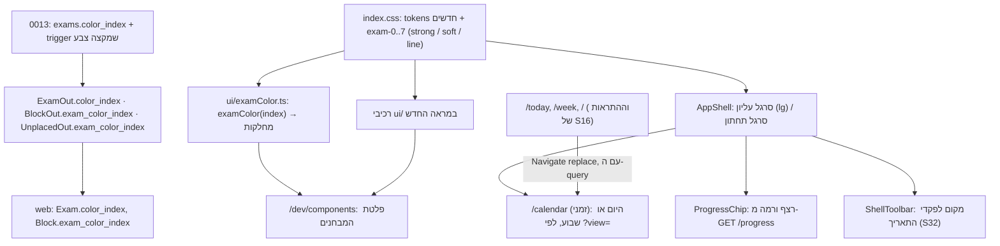

# S31 — עיצוב מחדש א': שפה עיצובית, צבע לכל מבחן והשלד החדש: תוכנית עבודה

> **For agentic workers:** REQUIRED SUB-SKILL: Use superpowers:subagent-driven-development (recommended) or superpowers:executing-plans to implement this plan task-by-task. Steps use checkbox (`- [ ]`) syntax for tracking.

**מטרה:** כל המסכים הקיימים עובדים בשלד חדש (סרגל עליון במחשב, סרגל תחתון בטלפון, שלושה יעדים: יומן, מבחנים, התקדמות), בשפה העיצובית של אב-הטיפוס (Rubik, אינדיגו, רקע `#f6f7fb`, פינות רכות), ולכל מבחן יש צבע יציב מתוך פלטה של 8, שה-API מחזיר עם המבחן ועם כל בלוק.

**השער במפת הדרכים:** "כל המסכים הקיימים עובדים בשלד החדש, וכל צבע עומד ב-AA".

**גישה:** חלק אחד ב-API (מיגרציה 0013 והשדה בתשובות), וארבעה ב-web: ה-tokens והפונט, השלד, רכיבי `ui/`, ודף הרכיבים. ה-tokens הם החוזה בין החלקים: השמות נקבעים כאן, ולכן השלד והרכיבים נבנים במקביל ל-tokens עצמם.

**כלים:** כמו ב-S26: ‏React 19, ‏TypeScript strict, ‏React Router 8, ‏TanStack Query 5, ‏Tailwind 4, ‏React Aria Components 1.22, ‏lucide-react, ‏Vitest 5; ב-API ‏Python 3.14, ‏psycopg 3. בלי תלויות חדשות. הפונט נחתך עם `fonttools` דרך `uvx` (כלי חד-פעמי, לא תלות).

**מסמכים:** `docs/superpowers/specs/2026-11-18-calendar-redesign-design.md` (כולו, ובמיוחד 2, 3, 6.2, 7), אב-הטיפוס `docs/design/prototype/calendar-prototype.html`, וסעיף 7.9 במסמך התכנון הראשי.

## איך החלקים מתחברים

- **למה הצבע נקבע במסד ב-trigger, ולא בקוד של ה-API:** הכלל ("הצבע הראשון שלא בשימוש בין המבחנים החיים") צריך לראות את כל המבחנים של המשתמש באותו רגע. ב-trigger מסוג `BEFORE INSERT` הוא חל על כל דרך שבה נוצר מבחן (ה-API, האונבורדינג, בדיקות שמכניסות שורה ישירות), ונעילת advisory לכל משתמש בתוך ה-trigger מונעת משני `POST /exams` במקביל לקבל אותו צבע. ה-API רק קורא את העמודה. ‏trigger עם `search_path` ריק, כמו `plan_versions_undo_once` של 0004, ורץ בהרשאות של מי שמכניס (בלי `SECURITY DEFINER`): ה-RLS כבר מגביל אותו לשורות של אותו משתמש, והוא מסנן גם לפי `user_id`.
- **למה הצבע עובר גם בבלוק:** היומן של S32 מצייר בלוקים מ-`GET /plan` ו-`GET /today` בלבד. `BlockOut` משותף לכל התשובות שמחזירות בלוק (`plan`, ‏`today`, ‏`complete`, ‏`defer`, ‏`review`, ‏`reschedule`), ולכן שדה אחד ב-`BlockView` מגיע לכולן, וה-cache של הלוח לא מתערבב בין בלוק עם צבע לבלוק בלעדיו.
- **למה ה-tokens שומרים את השמות של S25:** כל רכיב וכל מסך כבר כתובים מול `bg-surface`, ‏`text-ink-muted`, ‏`border-line-strong` וכו'. ערכים חדשים לאותם שמות מעבירים את כל המסכים למראה החדש בלי לגעת בהם, וזה בדיוק הכלל של ה-scope ("המסכים מקבלים מראה חדש רק דרך ה-tokens והרכיבים"). נוספים רק שמות למה שלא היה: צבעי המבחנים, ה-toast הכהה, "עכשיו", צללים ופינה של sheet.
- **למה `/calendar` מציג גם את "שבוע":** ההוראה היא ש-`/week` מפנה ל-`/calendar`, אבל "כל המסכים הקיימים עובדים". אם `/calendar` היה מציג רק את "היום", מסך השבוע היה נעלם עד S32. לכן `CalendarPage` זמני מציג מתג "יום / שבוע" (`SegmentedControl` הקיים) ומתחתיו את `TodayPage` או את `WeekPage` לפי `?view=week`, ו-`/week?from=X` מפנה ל-`/calendar?view=week&from=X`. ‏S32 מחליף את הקובץ כולו.

## מה מצאתי לפני התכנון (2026-11-18)

| נושא | מצב |
|---|---|
| ‏tokens | ב-`web/src/index.css` (S25), עם שמות שכל הרכיבים משתמשים בהם; `theme.test.ts` בודק זוגות, tokens ופונט |
| ניגודיות באב-הטיפוס | ‏`--muted:#6b7385` על הרקע `#f6f7fb` הוא 4.44:1, מתחת ל-AA; ‏`#0891b2` ו-`#ea580c` (מבחן 2 ו-3) עם טקסט לבן הם 3.7:1 ו-3.6:1 |
| השלד | ‏`nav` אחד לשני הרוחבים, נקודת שבירה `md`, ארבעה יעדים; "הגדרות" ו"יציאה" בתפריט פרופיל |
| המעבר ל-`/today` | ‏`routes.tsx` (index), ‏`OnboardingGate`, ‏`pwa/notification.ts` (ברירת המחדל של לחיצה על התראה), ‏`manifest.start_url` |
| ‏`manifest` | אין `id`, ולכן ה-id של אפליקציה מותקנת הוא `start_url`: שינוי שלו יוצר "אפליקציה אחרת" למי שכבר התקין |
| בלוקים ב-API | כל `BlockView` נבנה ב-`plan_views._view` מתוך `_BLOCK_QUERY` אחד |
| ייצוא | ‏`app/services/account.py` מונה את העמודות של `exams` במפורש |
| ‏fakeApi | קריאה בלי handler נדחית ב-404; צ'יפ ההתקדמות בשלד יקרא `GET /progress` בכל מסך |
| שורות במפה מתויגות S31 | אין |

## ההחלטות שלי

1. **הצבע (6.2):** ‏`exams.color_index smallint NOT NULL CHECK (0–7)`, בלי ברירת מחדל: ה-trigger `exams_assign_color` ממלא אותו כשהוא NULL. מבחן חדש מקבל את המספר הקטן ביותר ב-0–7 שאינו בשימוש בין המבחנים החיים (`deleted_at IS NULL`) של אותו משתמש; כשכל השמונה בשימוש, `(מספר המבחנים החיים) % 8`. ערך מפורש ב-INSERT נשמר (בחירה ידנית "בהמשך" תשתמש בזה).
2. **מילוי למבחנים קיימים:** לפי `row_number()` לכל משתמש, בסדר `(deleted_at IS NOT NULL), created_at, id`, מודולו 8. המבחנים החיים מקבלים קודם את הצבעים הראשונים, כך שלמשתמש עם עד 8 מבחנים חיים אין כפילות, גם אם נמחק מבחן לפני כן.
3. **יציבות:** מחיקה לא משנה שום צבע. מבחן שנמחק ושוחזר ב"בטל" שומר את הצבע שלו, גם אם בינתיים מבחן חדש קיבל אותו: שני מבחנים באותו צבע עדיפים על מבחן שמחליף צבע בלי שביקשו.
4. **ה-API:** ‏`color_index` ב-`ExamOut` (‏`GET`, ‏`POST`, ‏`PATCH /exams`) ובייצוא. ‏`exam_color_index` ב-`BlockOut` (כל תשובה עם בלוק) וב-`UnplacedOut` של `GET /plan`, שגם הוא יופיע ביומן (הדוח "לא נכנס"). ‏`ExamPatch` לא מקבל אותו: אין עדיין בחירה ידנית.
5. **הפלטה:** שמונה גוונים, שלושת הראשונים בגוונים של אב-הטיפוס. לכל אחד שלושה tokens: `exam-N` (חזק), ‏`exam-N-soft` (רקע) ו-`exam-N-line` (גבול). הכללים שנבדקים: ‏`ink` על `soft` ועל `line` ‏≥ 4.5; ‏`exam-N` על `soft` ‏≥ 3; ‏`exam-N` על `surface` ועל `canvas` ‏≥ 3; **ולבן על `exam-N` ‏≥ 4.5**, כי כרטיס "המשימה הבאה" של S32 הוא לבן על צבע המבחן, ובאב-הטיפוס שניים מהשלושה לא עמדו בזה. לכן הציאן והכתום הוכהו קצת (`#0e7490`, ‏`#c2410c`). הסגול נשאר `#7c3aed`.

   | N | שם | חזק | soft | line |
   |---|---|---|---|---|
   | 0 | סגול | `#7c3aed` | `#f1eaff` | `#c9b3fb` |
   | 1 | ציאן | `#0e7490` | `#e3f6fb` | `#9fdcec` |
   | 2 | כתום | `#c2410c` | `#fff0e6` | `#fbc39f` |
   | 3 | ירוק | `#047857` | `#e3f7ee` | `#9fdfc4` |
   | 4 | ורוד | `#be185d` | `#fde8f1` | `#f7b3d0` |
   | 5 | ענבר | `#a16207` | `#fdf4d8` | `#f0d48a` |
   | 6 | כחול | `#1d4ed8` | `#e6efff` | `#a9c3fb` |
   | 7 | צפחה | `#475569` | `#eef1f5` | `#c3cbd6` |

   הסדר מרחיק גוונים קרובים זה מזה (הכחול, הקרוב לאינדיגו של המותג, ‏שביעי; האפור, שנראה "כבוי", אחרון). ‏`ink-muted` לא מותר על רקע מבחן (4.07 על הסגול): בתוך בלוק הטקסט הוא `ink`.
6. **ה-tokens הכלליים** (שמות קיימים, ערכים חדשים, מאב-הטיפוס, מתוקנים ל-AA):

   | token | ערך | הערה |
   |---|---|---|
   | `canvas` | `#f6f7fb` | הרקע |
   | `surface` | `#ffffff` | |
   | `surface-muted` | `#f0f1f6` | ה-`line-soft` של אב-הטיפוס: מילוי שקט, מסילה של פס |
   | `ink` | `#1b1f2a` | |
   | `ink-muted` | `#5f6779` | באב-הטיפוס `#6b7385`, שהוא 4.44 על `canvas`; ‏`#5f6779` הוא 5.30 |
   | `line` | `#e6e8ef` | קישוט, בלי כלל ניגודיות |
   | `line-strong` | `#7d8496` | גבול של שדה ושל בחירה: 3:1 על שלושת הרקעים |
   | `brand` / `brand-strong` / `brand-soft` / `on-brand` | `#4f46e5` / `#4338ca` / `#eef0ff` / `#ffffff` | |
   | `brand-accent` | `#8b5cf6` | רק קצה הגרדיאנט של סימן הלוגו |
   | `now` | `#ef4444` | קו "עכשיו" (S32), לא טקסט: 3:1 על `surface` |
   | `danger` / `danger-soft` | `#c81e1e` / `#fdecec` | |
   | `success` / `success-soft` | `#147a3b` / `#e7f6ec` | גם המילוי של פס התקדמות וטבעת היום |
   | `warning` / `warning-soft` | `#a14a07` / `#fdf1e2` | |
   | `inverse` / `on-inverse` | `#1b1f2a` / `#ffffff` | ה-toast הכהה של אב-הטיפוס |
   | `inverse-action` / `inverse-success` / `inverse-danger` | `#a5b4fc` / `#86efac` / `#fca5a5` | "בטל" ואייקוני המצב על ה-toast |

   בלי מצב כהה (החלטה של אייל: "בהיר").
7. **טיפוגרפיה:** Rubik ‏(OFL), variable, ציר המשקל נחתך ל-400–700, שני קבצים עם `unicode-range` כמו ב-S25 (עברית 7KB, לטינית 35KB). ארבעה משקלים אמיתיים, כמו באב-הטיפוס: 400 קריאה, 500 תוויות ולשוניות, 600 כותרות ושמות, 700 הלוגו והכותרת הגדולה. המיפוי של S25, שבו `medium` ו-`bold` היו 600, מתבטל. הגדלים: `display` ‏1.625rem/1.15 (ה-26px של כותרת הטלפון), ‏`title` ‏1.25rem/1.3, ‏`body` ‏1rem/1.5, ‏`small` ‏0.875rem/1.4, ‏`caption` ‏0.75rem/1.35. קובצי Assistant נמחקים.
8. **פינות, צללים, ריווח:** `radius-badge` ‏6px, ‏`radius-control` ‏10px, ‏`radius-card` ‏16px, וחדש `radius-sheet` ‏20px. צללים: `shadow-raised` (המקטע הנבחר במתג), ‏`shadow-overlay` (תפריט, popover, ‏toast, דיאלוג), ‏`shadow-lift` (בלוק נגרר, S32), ‏`shadow-sheet` (גיליון תחתון). כרטיס נשאר עם קו ובלי צל, כמו באב-הטיפוס. ‏`spacing-gutter` ‏1.125rem (ה-18px של הטלפון באב-הטיפוס), ‏`spacing-topbar` ‏4rem, ‏`spacing-bottombar` ‏3.5rem. התנועה של S25 לא משתנה.
9. **נקודת השבירה של השלד היא `lg` (1024px)**, כמו ב-6 של מסמך העיצוב מחדש ("במחשב, מ-1024px"). מתחתיה: כותרת דקה (סימן הלוגו, הצ'יפ, הפרופיל) וסרגל תחתון. הרכיבים (דיאלוג כ-sheet וכו') נשארים על `md`, כי הם תלויים ברוחב החלון ולא בשלד.
10. **`nav` אחד** לשני הרוחבים, כמו ב-S26: קורא מסך פוגש ניווט אחד, וסדר ה-Tab זהה. מתחת ל-`lg` הוא קבוע בתחתית; מ-`lg` הוא בסרגל העליון כלשוניות (הנבחרת: `bg-brand-soft text-brand font-semibold`, והשאר `text-ink-muted font-medium`; המשקל הוא הסימן שאינו צבע).
11. **השלד:** הסרגל העליון לכל רוחב המסך (`h-topbar`, ‏`bg-surface`, קו תחתון): לוגו (סימן 30px בגרדיאנט `brand` → `brand-accent` עם ✓, ו-"StudyFlow" ב-700), הניווט, `ShellToolbar` (מקום ריק ש-S32 ממלא ב-portal; מוסתר מתחת ל-`lg`), ‏`ProgressChip` והפרופיל. ה-`main` נשאר בעמודה של `max-w-3xl` לכל המסכים הקיימים; S32 יפתח רוחב מלא ליומן.
12. **`ProgressChip`:** קישור ל-`/progress`, עם `Flame` ומספר ימי הרצף, וטבעת קטנה עם הרמה (SVG, ‏`stroke` של `brand` על `surface-muted`, לפי ההתקדמות לרמה הבאה). שם נגיש אחד: "רצף של 5 ימים, רמה 3". בטעינה ובשגיאה הוא לא מוצג (הוא תוספת, לא מידע חיוני). משתמש ב-`useProgress()` הקיים, ולכן מתרענן אחרי כל פעולה על בלוק בלי קוד חדש. באונבורדינג אין צ'יפ, כמו שאין ניווט. האנימציות של הטבעת שייכות ל-S33.
13. **הנתיבים:** `CALENDAR_PATH = '/calendar'` הוא הבית (`/` מפנה אליו). ‏`/today` מפנה ל-`/calendar` עם ה-query כפי שהוא, ו-`/week` ל-`/calendar?view=week` עם שאר ה-query. ‏`OnboardingGate` מפנה ל-`/calendar`. ‏`pwa/notification.ts` ו-`manifest.start_url` נשארים `/today`: התראות שכבר נשלחו והאפליקציה המותקנת ממשיכות לעבוד דרך ההפניה, ושינוי `start_url` בלי `id` היה הופך את האפליקציה המותקנת לאחרת. ‏`theme_color` ו-`background_color` של ה-manifest מתעדכנים ל-`#4f46e5` ו-`#f6f7fb`.
14. **ה-toast כהה** (`bg-inverse text-on-inverse`), כמו באב-הטיפוס, עם אייקון מצב בצבע בהיר (`inverse-success`, ‏`inverse-danger`) ו"בטל" ב-`inverse-action`. לשם כך `Button` מקבל `variant="inverse"` ו-`IconButton` מקבל `variant="inverse"`. המצב עדיין לא נישא בצבע בלבד: יש אייקון.
15. **רכיבים:** ההתנהגות וה-API שלהם לא משתנים (חוץ מ-`variant="inverse"`). מה שמשתנה: פינות (10px לפקדים, 16px לכרטיסים, 20px ל-sheet עם ידית גרירה דקורטיבית), כפתור משני עם `border-line` כמו "היום" של אב-הטיפוס (לכפתור יש טקסט, ולכן הגבול שלו הוא לא מה שמזהה אותו, WCAG 1.4.11), שדות עם `border-line-strong` (שם הגבול הוא מה שמזהה את השדה), המתג המקוטע כמו `.seg` של אב-הטיפוס (מסילה `surface-muted`, הנבחר `bg-surface shadow-raised` עם `border-line-strong`, כדי שהבחירה תעמוד ב-3:1 גם בלי הצל), תיבת סימון מרובעת בפינה של 7px כמו `.chk`, תגים כגלולות, פס התקדמות של 6px מעוגל.
16. **עזר הצבע:** `web/src/ui/examColor.ts`, טבלה קבועה של מחלקות (Tailwind מוצא רק מחלקות שכתובות כמו שהן בקוד), ו-`examColor(index)` שמחזיר את הטבלה של `index`. ערך מחוץ ל-0–7 או לא שלם → `((⌊index⌋ % 8) + 8) % 8`; ‏`null` או `undefined` → 7 (צפחה), כדי שתשובה ישנה מה-cache לא תפיל מסך.
17. **השלב הבא ממלא את השלד:** S32 ממלא את `ShellToolbar` ומחליף את `CalendarPage`; S33 מחליף את `ProgressChip` בגיימיפיקציה המלאה; S34 מעצב את שאר המסכים. זה כתוב בסעיף "מה בונים הלאה" של מסמך העיצוב.

## Global Constraints

- כל טקסט שמשתמש רואה ב-`web/src/i18n/he.ts` (טקסטים של דף הרכיבים ב-`web/src/dev/devText.ts`).
- נגישות לפי 7.9: שם נגיש לכל פקד, מקלדת, פוקוס גלוי (טבעת `brand` של 2px עם רווח 2px), יעד מגע 44px, ‏AA לכל זוג טקסט, ‏3:1 לחלקי פקדים.
- כל אנימציה ומעבר מכבדים `prefers-reduced-motion` (הכלל הגלובלי ב-`index.css` נשאר).
- לא משנים התנהגות של מסכים, פעולות, hooks ומפתחות query. בדיקה של התנהגות לא משתנה; בדיקה שנשענת על מבנה, מחלקה או טקסט שהשתנו מתעדכנת, ולא נמחקת.
- המסכים עצמם (`today/`, ‏`week/`, ‏`exam/`, ‏`settings/`, ‏`onboarding/`, ‏`progress/`, ‏`pages/`) לא נערכים, חוץ מעדכון בדיקה שנשברה בגלל טקסט או מבנה של רכיב.
- מיגרציה 0013 עם `down_revision = "0012"`, ו-SQL מפורש ב-`op.execute`. כל `downgrade` מחזיר בדיוק את המצב של 0012.
- מסד הבדיקות: `STUDYFLOW_TEST_DB=studyflow_test_s31`. את `tests/db` לא מריצים בשני תהליכים במקביל.
- בלי תלויות חדשות ב-`package.json` וב-`pyproject.toml`.
- `legacy/` לא נקרא ולא נערך.

## Review Focus

1. **שני `POST /exams` במקביל** אצל אותו משתמש: שניהם צריכים לקבל צבעים שונים. בדיקה ב-Task 1 עם שני חיבורים וטרנזקציות פתוחות.
2. **מבחן שנמחק ושוחזר ב-`POST /plan/undo`** שומר את הצבע שלו. בדיקה ב-Task 1.
3. **התראה ישנה שפותחת `/today?x=1`** מגיעה ל-`/calendar?x=1`, ו-`/week?from=2026-11-15` ל-`/calendar?view=week&from=2026-11-15`, בלי רשומת היסטוריה נוספת ובלי שהפוקוס יקפוץ. בדיקה ב-Task 3.
4. **`GET /progress` שנכשל** לא שובר שום מסך ולא מציג שגיאה בשלד (הצ'יפ פשוט חסר). בדיקה ב-Task 3.
5. **טקסט ארוך** (שם מבחן של 200 תווים, שם Google ארוך) לא שובר את הסרגל העליון ב-1024px ולא את הכותרת ב-390px. נבדק בצילומים ב-Task 6, ו-`min-w-0`/`truncate` נבדקים ב-Task 3.

## מה רץ במקביל

| גל | משימות | למה |
|---|---|---|
| 1 | Task 1 (API), Task 2 (tokens, פונט, עזר, טיפוסים), Task 3 (שלד), Task 4 (רכיבים) | קבצים נפרדים; שמות ה-tokens קבועים בתוכנית, ולכן 3 ו-4 לא מחכים לערכים |
| 2 | Task 5 (דף הרכיבים) | צריך את `examColor` של 2 ואת `variant="inverse"` של 4 |
| 3 | Task 6 (מסמך העיצוב, צילומים, סקירה, מיגרציה על dev, סגירה) | אחרי שהכול אוחד |

כל סוכן עובד ב-worktree משלו מהענף, ומחזיר commits. השיחה הראשית עושה cherry-pick לפי הסדר 1, 2, 3, 4, ומריצה את כל הבדיקות אחרי כל איחוד.

## קבצים משותפים

| קובץ | מי נוגע | איך |
|---|---|---|
| `web/src/i18n/he.ts` | Task 3 בלבד | ‏`he.shell` ו-`he.calendar` |
| `web/src/ui/styles.ts` | Task 4 בלבד | |
| `web/src/index.css` | Task 2 בלבד | Task 3 ו-4 משתמשים רק בשמות שבהחלטות 6 ו-8 |
| `web/src/test/boardFixtures.tsx`, ‏`onboarding/testFixtures.ts`, ‏`exam/testFixtures.ts` | Task 2 בלבד | השדות החדשים בטיפוסים |

---

### Task 1: מיגרציה 0013 והצבע ב-API

**Files:**
- Create: `api/migrations/versions/0013_exam_colors.py`
- Create: `api/tests/db/test_exam_colors.py`
- Modify: `api/app/services/exams.py` (`EXAM_COLUMNS`), ‏`api/app/schemas/exams.py` (`ExamOut`), ‏`api/app/services/plan_views.py` (`_BLOCK_QUERY`, ‏`BlockView`, ‏`_view`, ‏`UnplacedTask`), ‏`api/app/schemas/plan.py` (`BlockOut`, ‏`UnplacedOut`), ‏`api/app/services/account.py` (ייצוא)
- Test: `api/tests/api/test_exams.py`, ‏`api/tests/api/test_plan_views.py`, ‏`api/tests/api/test_account.py`, ‏`api/tests/api/test_undo.py`, ‏`api/tests/db/test_migrations.py` (אם הוא מונה את ה-head)

**Interfaces:**
- Produces: עמודה `app.exams.color_index smallint NOT NULL` (0–7); ‏`ExamOut.color_index: int`; ‏`BlockOut.exam_color_index: int`; ‏`UnplacedOut.exam_color_index: int`; בייצוא, `exams[].color_index`.

- [ ] **Step 1: בדיקות המסד** ב-`tests/db/test_exam_colors.py`, לפי הדפוס של `test_xp_and_badges.py`:
  - `test_new_exams_take_the_first_free_colour`: שלושה INSERT בלי צבע → 0, 1, 2.
  - `test_a_deleted_exam_frees_its_colour_and_keeps_it`: 0, 1, 2; מוחקים (soft) את 1; חדש → 1; למחוק נשאר 1, ולאחרים לא השתנה.
  - `test_when_all_eight_are_used_the_order_continues`: שמונה חיים → 0..7; התשיעי → `8 % 8 = 0`, העשירי → `9 % 8 = 1`.
  - `test_colours_are_per_user`: למשתמש א' 0, 1; המבחן הראשון של ב' → 0.
  - `test_an_explicit_colour_is_kept`: INSERT עם `color_index = 5` → 5.
  - `test_the_range_is_checked`: ‏8 ו-‏‎-1 נכשלים ב-`CheckViolation`.
  - `test_concurrent_inserts_get_different_colours`: שני חיבורים, כל אחד פותח טרנזקציה ומכניס מבחן לאותו משתמש; השני מחכה לנעילה; אחרי commit של שניהם הצבעים 0 ו-1.
  - `test_upgrade_fills_existing_exams_in_order`: ‏downgrade ל-0012, הכנסת מבחנים לשני משתמשים (כולל מחוק שנוצר ראשון), ‏upgrade: החיים לפי `created_at` מקבלים 0, 1, …, והמחוק אחריהם; ‏downgrade מוחק עמודה, trigger ופונקציה.
  - ה-trigger עובד גם כ-`authenticated` תחת RLS (INSERT כמשתמש, לפי הדפוס של `test_rls.py`).
- [ ] **Step 2:** להריץ `STUDYFLOW_TEST_DB=studyflow_test_s31 uv run pytest tests/db/test_exam_colors.py -q` ולראות כשל (אין עמודה).
- [ ] **Step 3: המיגרציה** `0013_exam_colors.py`, ‏`revision = "0013"`, ‏`down_revision = "0012"`, עם docstring שמסביר את ההחלטות 1–3. ‏upgrade: `ADD COLUMN color_index smallint`; ‏UPDATE מילוי לפי החלטה 2; ‏`SET NOT NULL` ו-`CONSTRAINT exams_color_index_range CHECK (color_index BETWEEN 0 AND 7)`; ‏`CREATE FUNCTION app.exams_assign_color() RETURNS trigger LANGUAGE plpgsql SET search_path = ''` שקוראת `pg_advisory_xact_lock(hashtextextended('app.exams.color_index:' || NEW.user_id::text, 0))` ואז מחשבת לפי החלטה 1; ‏`CREATE TRIGGER exams_assign_color BEFORE INSERT ON app.exams FOR EACH ROW EXECUTE FUNCTION app.exams_assign_color()`. ‏downgrade: ‏DROP TRIGGER, ‏DROP FUNCTION, ‏DROP COLUMN.
- [ ] **Step 4:** הבדיקות של Step 1 עוברות, וכל `tests/db` עובר (כולל `test_schema.py`).
- [ ] **Step 5: בדיקות ה-API:** ב-`test_exams.py`: ‏`POST /exams` מחזיר `color_index` 0 ואז 1; ‏`GET /exams` מחזיר אותם; ‏`PATCH` מחזיר את הצבע בלי לשנות אותו; ‏`PATCH {"color_index": 3}` הוא 422 (`extra="forbid"`); משתמש אחר לא רואה ולא משפיע (צבע ראשון שלו 0). ב-`test_plan_views.py`: כל בלוק ב-`GET /plan` וב-`GET /today` נושא `exam_color_index` ששווה ל-`color_index` של המבחן שלו, גם לבלוק `done` של מבחן שנמחק; ‏`unplaced[].exam_color_index`. ב-`test_undo.py`: מחיקת מבחן, יצירת מבחן חדש (שלוקח את הצבע), ‏undo: המשוחזר שומר את הצבע שלו. ב-`test_account.py`: הייצוא כולל `color_index`.
- [ ] **Step 6: הקוד:** `EXAM_COLUMNS` עם `color_index`; ‏`ExamOut.color_index: int`; ב-`_BLOCK_QUERY` ‏`e.color_index AS exam_color_index`, ‏`BlockView.exam_color_index: int`, ‏`_view` מעביר אותו; ‏`UnplacedTask.exam_color_index` (השאילתה שבונה את `titles` מביאה גם את הצבע); ‏`BlockOut` ו-`UnplacedOut` עם השדה; הייצוא עם העמודה.
- [ ] **Step 7:** `uv run pytest`, ‏`uv run ruff check .`, ‏`uv run ruff format --check .`, ‏`uv run mypy` עוברים.
- [ ] **Step 8: Commit** (קבצים לפי שם): `feat(api): a colour per exam (0013): exams.color_index, assigned by a trigger, in every exam and block`.

### Task 2: tokens, הפונט, פלטת המבחנים, העזר והטיפוסים

**Files:**
- Modify: `web/src/index.css`, ‏`web/src/theme.test.ts`, ‏`web/src/pwa/manifest.ts`, ‏`web/src/pwa/manifest.test.ts`, ‏`web/index.html` (צבע `theme-color` אם יש), וכל מקום אחר שמחזיק את `#2f5aa8` או `#faf9f6` (`grep -rn` ב-`web/src` וב-`web/index.html`, למשל `pwa/bootTexts.ts` / מסך הנפילה)
- Create: `web/src/assets/fonts/rubik-hebrew.woff2`, ‏`web/src/assets/fonts/rubik-latin.woff2` (העתקה מ-`/private/tmp/claude-501/-Users-eyalatar-studyflow-s31/94c3756f-0e98-4a15-958f-b75f7d774666/scratchpad/font/`), ‏`web/src/assets/fonts/OFL.txt` (הרישיון של Rubik מאותה תיקייה, במקום של Assistant)
- Delete: `web/src/assets/fonts/assistant-hebrew.woff2`, ‏`assistant-latin.woff2`
- Create: `web/src/ui/examColor.ts`, ‏`web/src/ui/examColor.test.ts`
- Modify: `web/src/onboarding/types.ts` (`Exam.color_index: number`), ‏`web/src/board/types.ts` (`Block.exam_color_index: number`, ‏`Unplaced.exam_color_index: number` אם יש טיפוס כזה), והפיקסצ'רים: `web/src/onboarding/testFixtures.ts`, ‏`web/src/test/boardFixtures.tsx`, ‏`web/src/exam/testFixtures.ts`, ‏`web/src/progress/testFixtures.ts` אם צריך, וכל מקום ש-`tsc` מצביע עליו

**Interfaces:**
- Produces: כל ה-tokens של החלטות 6 ו-8 בשמות האלה בדיוק (`--color-canvas` … `--color-inverse-danger`, ‏`--color-exam-0` … `--color-exam-7`, ‏`--color-exam-N-soft`, ‏`--color-exam-N-line`, ‏`--radius-sheet`, ‏`--shadow-raised`, ‏`--shadow-overlay`, ‏`--shadow-lift`, ‏`--shadow-sheet`, ‏`--spacing-topbar`, ‏`--spacing-bottombar`, ‏`--font-weight-medium: 500`, ‏`--font-weight-bold: 700`), ולכן המחלקות `bg-exam-3-soft`, ‏`rounded-sheet`, ‏`shadow-raised`, ‏`h-topbar` וכו'.
- Produces: `export const EXAM_COLOR_COUNT = 8`; ‏`export interface ExamColorClasses { solid: string; text: string; soft: string; line: string; borderStrong: string; fill: string }` (`solid` = ‏`bg-exam-N`, ‏`text` = ‏`text-exam-N`, ‏`soft` = ‏`bg-exam-N-soft`, ‏`line` = ‏`border-exam-N-line`, ‏`borderStrong` = ‏`border-exam-N`, ‏`fill` = ‏`fill-exam-N`); ‏`export function examColor(index: number | null | undefined): ExamColorClasses`; ‏`export function examColorIndex(index: number | null | undefined): number`.

- [ ] **Step 1: `theme.test.ts`** מתעדכן לפני ה-CSS: רשימת `TEXT` ו-`BACKGROUNDS` כמו היום; ‏`PAIRS` מוסיף `['on-inverse','inverse']`, ‏`['inverse-action','inverse']`, ‏`['inverse-success','inverse']`, ‏`['inverse-danger','inverse']`, ‏`['ink','brand-soft']` (קיים), ומחליף את זוגות ה-toast הבהיר (`brand` על `success-soft` וכו', שכבר לא בשימוש) בזוגות האלה; ‏`EXAM` = ‏0..7, ולכל N: ‏`ink` על `exam-N-soft` ועל `exam-N-line` ‏≥ 4.5, ‏`on-brand` (לבן) על `exam-N` ‏≥ 4.5; ‏`NON_TEXT_PAIRS` מוסיף `exam-N` על `exam-N-soft`, על `surface` ועל `canvas` ‏≥ 3, ‏`now` על `surface` ו-`canvas` ‏≥ 3, ‏`success` על `surface-muted` (מילוי פס על המסילה) ‏≥ 3, ‏`brand` על `surface-muted` ‏≥ 3. ‏`TOKENS` מוסיף את השמות החדשים. בדיקת הפונט: `--font-sans: 'Rubik', …`, שני קבצים עם `font-weight: 400 700`, כל אחד מתחת ל-60KB, ו-`OFL.txt` מזכיר את Rubik. בדיקה חדשה: כל אחד משמונת הצבעים שונה מהאחרים.
- [ ] **Step 2:** `npm test -- src/theme.test.ts` נכשל.
- [ ] **Step 3: `index.css`:** ערכים לפי החלטות 6–8, עם הערות שמסבירות כל token (כמו היום), ‏`@font-face` ל-Rubik, ‏`body` עם `background-color: var(--color-canvas)`. ההערה שבראש הקובץ מתעדכנת ל-S31 ולאב-הטיפוס.
- [ ] **Step 4:** `examColor.test.ts`: לכל N ב-0..7 המחלקות בדיוק `bg-exam-N` וכו'; ‏8 → 0, ‏‎-1 → 7, ‏`2.7` → 2, ‏`null`/`undefined` → 7; וכל מחרוזת מחלקה בטבלה מופיעה כמו שהיא ב-`examColor.ts` (מחלקות שנבנות בתבנית לא נמצאות על ידי Tailwind).
- [ ] **Step 5:** `examColor.ts` עם טבלה כתובה במלואה (שמונה אובייקטים, בלי template strings).
- [ ] **Step 6:** הטיפוסים והפיקסצ'רים: `color_index` במבחן ו-`exam_color_index` בבלוק (פיקסצ'רים של בלוקים מקבלים את הצבע של המבחן שלהם). ‏manifest: ‏`theme_color: '#4f46e5'`, ‏`background_color: '#f6f7fb'`, ו-`start_url` נשאר `/today` (החלטה 13), עם הערה.
- [ ] **Step 7:** `npm test`, ‏`npm run lint`, ‏`npm run typecheck`, ‏`npm run build` עוברים. ב-build לבדוק שה-woff2 של Rubik נמצאים ב-`dist/assets` ושל Assistant לא.
- [ ] **Step 8: Commit:** `feat(web): the design tokens of the calendar redesign, Rubik, and a palette of eight exam colours`.

### Task 3: השלד החדש, הנתיבים והצ'יפ

**Files:**
- Modify: `web/src/app/AppShell.tsx`, ‏`web/src/app/ProfileMenu.tsx`, ‏`web/src/app/routes.tsx`, ‏`web/src/app/OnboardingGate.tsx`, ‏`web/src/i18n/he.ts` (`he.shell`, ‏`he.calendar`)
- Create: `web/src/app/ShellToolbar.tsx`, ‏`web/src/app/ProgressChip.tsx`, ‏`web/src/app/Logo.tsx`, ‏`web/src/calendar/CalendarPage.tsx`, ‏`web/src/app/legacyRedirects.tsx`
- Test: `web/src/app/AppShell.test.tsx`, ‏`web/src/app/routes.test.tsx`, ‏`web/src/app/OnboardingGate.test.tsx`, ‏`web/src/app/ProgressChip.test.tsx`, ‏`web/src/calendar/CalendarPage.test.tsx`, ‏`web/src/app/ShellToolbar.test.tsx`, ובדיקות אחרות שפותחות `/today` ומצפות לנתיב (`renderRoute('/today')` ממשיך לעבוד דרך ההפניה; ‏`expect(pathname).toBe('/today')` מתעדכן ל-`/calendar`)

**Interfaces:**
- Consumes: tokens של Task 2 בשמות בלבד (`h-topbar`, ‏`bg-canvas`, ‏`rounded-control`, ‏`shadow-raised`, ‏`from-brand`, ‏`to-brand-accent`); ‏`useProgress()` מ-`progress/api.ts`; ‏`SegmentedControl` מ-`ui/`.
- Produces: `export const CALENDAR_PATH = '/calendar'` ב-`routes.tsx` (ו-`TODAY_PATH`, ‏`WEEK_PATH` נשארים כנתיבי הפניה); ‏`export function ShellToolbar({ children }: { children: ReactNode }): ReactPortal | null` (רנדר לתוך המקום בסרגל העליון; ‏`null` כשאין שלד); ‏`export function ProgressChip(): JSX.Element | null`.

- [ ] **Step 1: בדיקות השלד** (מתעדכנות ב-`AppShell.test.tsx`):
  - הניווט: ‏`navigation` אחד בשם `he.shell.mainNav`, עם שלושה קישורים בסדר `[he.shell.calendar, he.shell.exams, he.shell.progress]` ו-href `['/calendar','/exams','/progress']`; ב-`/exams` רק השני `aria-current="page"`; ב-`/calendar?view=week` הראשון מסומן.
  - יש `banner` אחד שמכיל את הלוגו (טקסט `he.appName`), את כפתור הפרופיל ואת הקישור של הצ'יפ.
  - "דלג לתוכן" עדיין ה-Tab הראשון, ו-Enter מעביר פוקוס ל-`main`.
  - תפריט הפרופיל: הגדרות ויציאה, מקלדת, Escape מחזיר פוקוס (הבדיקות הקיימות נשארות).
  - באונבורדינג אין ניווט, אין צ'יפ ואין פרופיל.
  - `PushSync` ו-`InstallHint` עדיין מרונדרים (הבדיקות הקיימות של S16 עוברות בלי שינוי).
- [ ] **Step 2: בדיקות הנתיבים** (`routes.test.tsx`): ‏`/` → ‏`/calendar`; ‏`/today` → ‏`/calendar`; ‏`/today?x=1` → ‏`/calendar?x=1`; ‏`/week` → ‏`/calendar?view=week`; ‏`/week?from=2026-11-15` → ‏`/calendar?view=week&from=2026-11-15`; כל אלה עם `history.action === 'REPLACE'`. ‏`OnboardingGate` שולח משתמש עם תוכנית מהאונבורדינג ל-`/calendar`.
- [ ] **Step 3: בדיקות `CalendarPage`:** בלי `view` מוצג מסך "היום" (`heading` ברמה 1 `he.today.title` או מה שהמסך מציג היום), ו-radiogroup `he.calendar.view` עם "יום" נבחר; בחירה ב"שבוע" (עכבר ומקלדת) עוברת ל-`?view=week` ומציגה את "שבוע" בלי להזיז את הפוקוס מהמתג; ‏`?view=week&from=…` שומר את `from`; ‏`?view=nonsense` → "יום".
- [ ] **Step 4: בדיקות `ProgressChip`:** עם `GET /progress` שמחזיר רצף 5 ורמה 3: קישור אחד ל-`/progress` בשם `he.shell.progressChip(5, 3)` = "רצף של 5 ימים, רמה 3"; עם רצף 1: "רצף של יום אחד, רמה 1"; רצף 2: "רצף של יומיים, רמה …"; כש-`GET /progress` נכשל או בטעינה: אין קישור, ואין `alert`. ה-SVG `aria-hidden`.
- [ ] **Step 5: בדיקת `ShellToolbar`:** ילד של `<ShellToolbar>` שמרונדר מתוך מסך מופיע בתוך ה-`banner`, ונעלם כשהמסך יורד.
- [ ] **Step 6:** להריץ ולראות כשל.
- [ ] **Step 7: הקוד:**
  - `he.shell`: ‏`calendar: 'יומן'`, ‏`progressChip: (streak, level) => \`רצף של ${he.progress.streak.days(streak)}, רמה ${level}\`` (או כפונקציה עצמאית שמשתמשת באותה צורה), ‏`today`/`week` עוברים ל-`he.calendar = { view: 'תצוגה', day: 'יום', week: 'שבוע' }` אם אין להם שימוש אחר; ‏`progressChipLevel: (level) => \`רמה ${level}\``.
  - `AppShell`: לפי החלטות 9–11. ב-`lg`: ‏`header` בגובה `topbar` לכל הרוחב: ‏`Logo`, ‏`nav` (כלשוניות), ‏div של `ShellToolbar` (`hidden lg:flex flex-1 justify-end`), ‏`ProgressChip`, ‏`ProfileMenu`. מתחת ל-`lg`: אותו `header` בגובה 56px עם `Logo` (סימן ושם), ‏`ProgressChip`, ‏`ProfileMenu`, וה-`nav` קבוע בתחתית (`bg-surface/95`, קו עליון, ‏`min-h-bottombar` ועוד ה-safe-area), כל יעד עמודה של אייקון 22px ותווית `text-caption`, הנבחר `text-brand font-semibold`. הפוקוס של יעד בסרגל התחתון `ring-inset` (כמו היום). אייקונים: `CalendarDays`, ‏`FileText`, ‏`TrendingUp`. ה-`main` שומר על `id`, ‏`tabIndex=-1`, ‏`useRouteFocus`, והריפוד התחתון עובר מ-`md` ל-`lg`.
  - `Logo`: סימן 30px `rounded-[9px] bg-linear-135 from-brand to-brand-accent` עם `Check` לבן, ו-`he.appName` ב-`font-bold text-[1.125rem]`. הסימן `aria-hidden`.
  - `ProfileMenu`: אותו קוד; העיגול 36px `bg-brand-soft text-brand-strong font-semibold`.
  - `ProgressChip`: לפי החלטה 12; ‏`min-h-touch`, ‏`rounded-full`, ‏`border border-line bg-surface px-3`, ‏`Flame` ב-`text-warning`, המספר ב-`font-semibold`, וטבעת 24px עם הרמה במרכזה. ‏`truncate` לא נדרש (מספרים).
  - `ShellToolbar`: ‏context שמחזיק את האלמנט של המקום (`useState<HTMLElement | null>` עם callback ref ב-`AppShell`), ו-`createPortal`.
  - `CalendarPage`: לפי "איך החלקים מתחברים"; ‏`SegmentedControl` מעל המסך, `setSearchParams` שמשנה רק את `view` (ומוחק את `from` במעבר ל"יום").
  - `legacyRedirects.tsx`: ‏`TodayRedirect` ו-`WeekRedirect` עם `<Navigate replace>` שמעביר את `location.search` לפי Step 2.
  - `routes.tsx` ו-`OnboardingGate.tsx`: ‏`CALENDAR_PATH` כבית.
- [ ] **Step 8:** `npm test`, ‏`lint`, ‏`typecheck`, ‏`build` עוברים.
- [ ] **Step 9: Commit:** `feat(web): the new app shell: a top bar on a computer, a bottom bar on a phone, three destinations, /calendar as home`.

### Task 4: רכיבי `ui/` במראה החדש

**Files:**
- Modify: `web/src/ui/styles.ts` וכל `web/src/ui/*.tsx` שהמראה שלו משתנה: `Button`, ‏`ButtonLink`, ‏`IconButton`, ‏`Menu`, ‏`Dialog`, ‏`toast`, ‏`Badge`, ‏`ProgressBar`, ‏`CheckButton`, ‏`Card`, ‏`List`, ‏`states`, ‏`TextField`, ‏`Select`, ‏`CompactSelect`, ‏`DatePicker`, ‏`TimeField`, ‏`RadioCards`, ‏`CheckboxCards`, ‏`OptionGrid`, ‏`SegmentedControl`, ‏`Switch`, ‏`Note`, ‏`Disclosure`, ‏`CollapsibleSection`, ‏`SectionHeading`, ‏`PageHeader`, ‏`TextLink`, ‏`PageContainer`
- Test: הבדיקות של `ui/` שבודקות מחלקות (`SegmentedControl.test.tsx`, ‏`Dialog.test.tsx`, ‏`toast.test.tsx`, ‏`Note.test.tsx`, ‏`Disclosure.test.tsx`, ‏`Menu.test.tsx`, ‏`Button.test.tsx` וכו'), ובדיקה חדשה ל-`variant="inverse"`

**Interfaces:**
- Consumes: שמות ה-tokens של Task 2.
- Produces: `ButtonVariant = 'primary' | 'secondary' | 'quiet' | 'danger' | 'inverse'`; ‏`IconButtonProps.variant?: 'quiet' | 'secondary' | 'inverse'`. כל שאר ה-props של הרכיבים לא משתנים.

- [ ] **Step 1:** לפתוח את אב-הטיפוס בדפדפן (`http://127.0.0.1:4300/calendar-prototype.html`, או `python3 -m http.server 4300` מתוך `docs/design/prototype`) ולמפות כל רכיב לחלק שלו: `.today` (כפתור משני), ‏`.tabs` (קישור נבחר), ‏`.seg` (מתג), ‏`.chk` (סימון), ‏`.exam .bar` (פס), ‏`.ph-sheet` (sheet), ‏`.toast`, ‏`.avatar`, ‏`.task` (שורה ברשימה: `rounded-[12px] bg-canvas`).
- [ ] **Step 2: בדיקות:** הבדיקות שמצפות למחלקות מתעדכנות לפי החלטות 14–15 (למשל ה-toast: `bg-inverse`, ‏`text-on-inverse`, ‏`rounded-card`, ‏`shadow-overlay`; ה-sheet: `rounded-t-sheet`; המקטע הנבחר: `bg-surface shadow-raised border-line-strong`). חדשות: `Button variant="inverse"` עם `text-inverse-action`; ‏`IconButton variant="inverse"` עם `text-on-inverse`; ‏toast של הצלחה עם אייקון `text-inverse-success` ושגיאה עם `text-inverse-danger`, ושה"בטל" שלו הוא `variant="inverse"`. בדיקות ההתנהגות (מקלדת, פוקוס, `isPending`, סגירה, timeout, ‏sheet מול המקלדת) לא משתנות.
- [ ] **Step 3:** להריץ ולראות כשל.
- [ ] **Step 4: הקוד,** רכיב אחרי רכיב, לפי החלטות 8, 14, 15: פינות `rounded-control`/`rounded-card`/`rounded-sheet`, ‏`font-medium` לתוויות וללשוניות ו-`font-semibold` לכותרות, ‏`hover` רך (`bg-surface-muted`), ‏`disabled` כמו היום (`bg-surface-muted text-ink-muted`, בלי שקיפות). הדיאלוג בטלפון: ידית 38×5px `bg-line rounded-full` בראש ה-sheet (`aria-hidden`), ‏`shadow-sheet`. ‏`LoadingState`: שלד `bg-surface-muted animate-pulse` (נעצר ב-reduced motion דרך הכלל הגלובלי). ‏`EmptyState`: אייקון בעיגול `bg-brand-soft text-brand`. ההערות בקוד מתעדכנות לשפה החדשה (הן מפנות למסמך העיצוב; מספרי הסעיפים לפי המסמך החדש של Task 6: 5.x רכיבים).
- [ ] **Step 5:** `npm test`, ‏`lint`, ‏`typecheck`, ‏`build` עוברים.
- [ ] **Step 6: Commit:** `feat(web): the base components in the look of the calendar prototype; an inverse button for the dark toast`.

### Task 5: דף הרכיבים

**Files:**
- Modify: `web/src/dev/ComponentsPage.tsx`, ‏`web/src/dev/devText.ts`, ‏`web/src/dev/displaySections.tsx` (או קובץ חדש)
- Create: `web/src/dev/paletteSections.tsx` (פלטת המבחנים, ה-tokens הכלליים, הטיפוגרפיה, הצללים והפינות), `web/src/dev/shellSections.tsx` (הלוגו והצ'יפ עם נתוני דמה)
- Test: `web/src/dev/ComponentsPage.test.tsx`

**Interfaces:**
- Consumes: `examColor`, ‏`EXAM_COLOR_COUNT` (Task 2); ‏`Logo` (Task 3); ‏`variant="inverse"` (Task 4).

- [ ] **Step 1: בדיקה:** הדף מציג קטע "פלטת המבחנים" עם 8 שורות, ובכל אחת דוגמת בלוק (`bg-exam-N-soft border-exam-N-line` עם פס התחלה `border-exam-N`, תיבת סימון בצבע החזק, שם ושעה ב-`ink`) ודוגמת "המשימה הבאה" (לבן על `bg-exam-N`); קטע tokens עם כל צבע ושמו; קטע טיפוגרפיה עם ארבעת המשקלים וחמשת הגדלים; וכל קטע מופיע ב-TOC.
- [ ] **Step 2:** להריץ ולראות כשל; לממש; לעבור. הטקסטים ב-`devText.ts` בלבד.
- [ ] **Step 3:** `npm test`, ‏`lint`, ‏`typecheck`, ‏`build` עוברים, וה-build של production עדיין בלי זכר לדף (`grep -r "פלטת המבחנים" dist` ריק).
- [ ] **Step 4: Commit:** `feat(web): the components page shows the new tokens, the exam palette and the shell pieces`.

### Task 6: מסמך העיצוב, צילומים, סקירה, dev וסגירה (השיחה הראשית)

**Files:**
- Modify: `docs/design/design-language.md` (נכתב מחדש), ‏`docs/design/mockups/README.md` (הערה שהכיוון הוחלף), ‏`docs/superpowers/specs/2026-10-19-studyflow-v2-design.md` (7.9: ‏"(החלטות של מי שבונה, S31)"), ‏`docs/superpowers/specs/2026-11-18-calendar-redesign-design.md` (הערה קצרה ב-6.2 וב-8 על מה שנקבע)
- סביבת צילום: `~/studyflow-manager/s31-shots-harness/` (מחוץ לריפו; משלבת את s27 ו-s28, פורט 4231), צילומים ב-`~/studyflow-manager/s31-screens/`

- [ ] **Step 1: מסמך העיצוב** לפי ה-brief: העקרונות (בהיר, יומן במרכז, צבע מבחן הוא הזהות של המשימה, גיימיפיקציה גלויה, נגישות), כל token עם ערך ומתי משתמשים בו, הזוגות המותרים, פלטת המבחנים עם הכללים, טיפוגרפיה, פינות/צללים/ריווח, השלד (שני הרוחבים, `ShellToolbar`, הצ'יפ, הנתיבים), הרכיבים, תנועה, נגישות, כן/לא, ומה S32–S34 בונים.
- [ ] **Step 2: צילומים** ב-390×844 וב-1280×800 של כל המסכים (כמו ב-s27 ו-s28: היום, שבוע, התקדמות, מבחנים, מבחן, הגדרות, מחיקת חשבון, אונבורדינג, כניסה, 404, פרידה, מצבי טעינה ושגיאה) ושל `/dev/components`, ושל אב-הטיפוס בשני המצבים. לעבור עליהם ולהשוות לאב-הטיפוס; כל פער בשלד וברכיבים מתוקן כאן, ופער של מסך שייך ל-S32/S34 ונרשם.
- [ ] **Step 3: סקירה סופית** (`superpowers:requesting-code-review`) על כל הענף, ותיקונים.
- [ ] **Step 4: מיגרציה על dev** לפי הנוהל (Alembic offline → SQL Editor): בדיקת `alembic_version = 0012` ושל `down_revision` מול `origin/main`, ‏pre-check קריא בלבד, הרצה, ובדיקה בקטלוג (העמודה, ה-CHECK, ה-trigger, ושלכל מבחן יש צבע).
- [ ] **Step 5:** ‏rebase על `origin/main`, כל הפקודות של `api/` ו-`web/`, ‏gitleaks, ‏push ל-`main` (ff-only), מחיקת הענף, ומפת הדרכים: "הושלם".

---

## שינוי כיוון באמצע ה-scope (18.11.2026): הפלטה של ארצ׳י ורכיב `Archie`

**מה קרה:** אחרי ש-Tasks 1–5 נבנו, אייל אישר את המראה של ארצ׳י (`docs/superpowers/specs/2026-11-18-archie-look-and-gamification.md`, ‏commit ‏30f46d3 על `main`). סעיף 2 שלו מחליף את הצבעים של סעיף 2 במסמך העיצוב מחדש: האינדיגו יוצא, ונכנסים חומים, ירוק של צמחייה ותכלת "שחר". סעיף 5 מוסיף ל-S31 את רכיב `Archie` עם שש הסצנות. המבנה, Rubik, השלד, הרכיבים והמיגרציה נשארים. **אין התנגשות** עם מה שנבנה: שמות ה-tokens נשארים, ורק הערכים מתחלפים, וזה בדיוק מה שהארכיטקטורה של ה-tokens נועדה לאפשר.

**איך זה מתחבר:** ה-tokens הם השכבה היחידה שהמסכים והרכיבים קוראים ממנה, ולכן הפלטה החדשה היא בעיקר שינוי של `index.css` ו-`theme.test.ts`. החריג הוא `text-brand`: הירוק `#4f7a3a` כטקסט עומד ב-4.4 בלבד על הרקע, ולכן כל טקסט ירוק עובר ל-`text-brand-strong` (`#3f6430`, ה-`brand-ink` של המסמך), ו-`brand` נשאר רק למילוי, לקווים ולטבעת הפוקוס (3:1). הרכיב `Archie` הוא יחידה נפרדת (`web/src/archie/`) שקוראת רק את האיורים ואת ה-tokens של התכלת, ולכן הוא נבנה במקביל לפלטה.

### החלטות נוספות

18. **מיפוי שמות:** `bg` של המסמך = ‏`canvas`; ‏`muted` = ‏`ink-muted`; ‏`brand-ink` = ‏`brand-strong` (גם הצבע של hover על כפתור ראשי וגם הירוק של טקסט). נוספים: `sprout`, ‏`clay` (+ ‏`on-clay`), ‏`sand`, ‏`gold`, ‏`sky-from`, ‏`sky-to`, ‏`sky` (הגוון שעליו נמדד טקסט), ‏`now-text`. ‏`brand-accent` נמחק, והלוגו עובר לגרדיאנט `brand` → `sprout`.
19. **הערכים:**

    | token | ערך | נמדד |
    |---|---|---|
    | `canvas` | `#eef0e4` | |
    | `surface` | `#f8f7f0` | |
    | `surface-muted` | `#efede2` | מילוי שקט בתוך משטח |
    | `ink` / `ink-muted` | `#3b2a1e` / `#6e5948` | ‏≥ 4.5 על שלושת הרקעים |
    | `line` / `line-strong` | `#d9d6c3` / `#8c7b67` | ‏`line-strong` ‏3.48–3.80 |
    | `brand` / `brand-strong` / `brand-soft` / `on-brand` | `#4f7a3a` / `#3f6430` / `#e2ead3` / `#ffffff` | ‏`brand` לא לטקסט |
    | `sprout` / `sand` / `gold` | `#8db45e` / `#c9a77c` / `#d4a24c` | קישוט; ‏`ink` על `gold` ‏5.9 |
    | `clay` / `on-clay` | `#9a5f38` / `#ffffff` | ‏`clay` רק כמילוי (כטקסט 4.48) |
    | `sky-from` / `sky-to` / `sky` | `#96c6e8` / `#d6ecf8` / `#a9d3ee` | ‏`ink` על `sky` ‏8.6 |
    | `now` / `now-text` | `#c2502e` / `#a8401f` | |
    | `danger` / `danger-soft` | `#a33a1c` / `#f6e2d8` | לבנים, לא אדום (פעולה הרסנית בלבד) |
    | `success` / `success-soft` | `#3f6430` / `#e2ead3` | |
    | `warning` / `warning-soft` | `#80520e` / `#f5ead0` | |
    | `inverse` / `on-inverse` | `#3b2a1e` / `#f8f7f0` | ה-toast: קליפת עץ |
    | `inverse-action` / `inverse-success` / `inverse-danger` | `#c5dea0` / `#c5dea0` / `#f0a98e` | |
    | `busy` / `busy-soft` / `busy-line` | `#7d7062` / `#e5e2d6` / `#c9c3b3` | |

20. **צבעי המבחנים, אדמתיים,** בסדר שמרחיק גוונים קרובים ואת מה שקרוב ל-`brand`:

    | N | שם | חזק | soft | line |
    |---|---|---|---|---|
    | 0 | טרקוטה | `#b04a26` | `#f8e4da` | `#ebb59d` |
    | 1 | אבן כחולה | `#3d6688` | `#e2ecf3` | `#a9c4da` |
    | 2 | חרדל | `#8a6410` | `#f7ecd2` | `#e2c78a` |
    | 3 | שזיף | `#7b3f6e` | `#f3e3ee` | `#d6aecb` |
    | 4 | מנטה כהה | `#2f6f62` | `#dcefe9` | `#9dcdc0` |
    | 5 | ורד עתיק | `#a3485b` | `#f7e2e6` | `#e2aab5` |
    | 6 | זית | `#5f6a1c` | `#eef0d6` | `#c9cf96` |
    | 7 | אדמה | `#7a5236` | `#f1e6dc` | `#d2b49c` |

    כל הכללים של החלטה 5 נשארים ונמדדו (לבן על החזק 5.37–7.56; החזק על ה-soft ‏4.44–6.13). בדיקה חדשה: אף צבע מבחן לא שווה ל-`brand` או ל-`brand-strong`.
21. **הצ'יפ** עובר מ-`Flame` ל-`Leaf` (4.3 במסמך של ארצ׳י), וטבעת הרמה ב-`gold`. האנימציות של S33 לא נבנות כאן.
22. **פונט תצוגה לארצ׳י: לא עכשיו.** כותרות של ארצ׳י ב-Rubik 700. פונט תצוגה עם אופי של מכחול ייבחר כשיגיעו האיורים המלאים והחגיגות (S33), כי הוא תלוי בהם, ועד אז פונט נוסף הוא עוד 30–60KB בלי מסך שמשתמש בו.
23. **`Archie`:** ‏`web/src/archie/Archie.tsx`, ‏`mood: 'intentions' | 'eureka' | 'wisdom' | 'flow' | 'rest' | 'joy'`, ‏`size: 'avatar' | 'card' | 'scene'`. האיורים: `*-dawn.jpg` של חמשת המצבים ו-`flow.jpg`, מומרים ל-webp (`cwebp`) בשני רוחבים (המקורי, ~900px, ו-450px), עם `srcset`, ‏`loading="lazy"` ו-`decoding="async"`. ‏`avatar`: עיגול חתוך סביב הפנים, בלי שכבת אנימציה. ‏`card` ו-`scene`: האיור ומעליו שכבת האנימציה של המצב, לפי `archie-moods.html` (טיפות ונבטים, הילה וניצוצות, עשן ודיו, אדוות וענפים, אדים ועלי פריחה, ול-`joy` נשימה). האנימציה רצה רק כשהרכיב במסך (`IntersectionObserver`) ולא רצה בכלל ב-`prefers-reduced-motion`. ה-CSS שלה בקובץ משלו (`archie.css`), לא ב-`index.css`. שם נגיש: `he.archie.alt[mood]`, ו-`decorative` שהופך אותו ל-`alt=""` כשהטקסט שלידו כבר אומר הכול. ארצ׳י לא מוצג עדיין באף מסך; S32–S34 משבצים אותו.
24. **שם האפליקציה** נשאר StudyFlow ב-S31: ההחלטה "האפליקציה נקראת ארצ׳י" (6d99184) לא שובצה ב-scope, והיא נוגעת ב-manifest, בכותרות, בהתראות ובמסמכים. נרשם במפה.

### Task 7: הפלטה של ארצ׳י

**Files:** `web/src/index.css`, ‏`web/src/theme.test.ts`, ‏`web/src/pwa/manifest.ts`, ‏`web/index.html`, ‏`web/src/app/Logo.tsx`, ‏`web/src/app/ProgressChip.tsx` (+ test), ‏`web/src/dev/paletteSections.tsx`, ‏`web/src/dev/devText.ts`, וכל קובץ ב-`web/src` שמשתמש ב-`text-brand` כטקסט (`grep -rn "text-brand\b"`).

- [ ] בדיקות קודם: ‏`theme.test.ts` עם הערכים של החלטות 19–20; ‏`brand` יוצא מרשימת הטקסט ונשאר בבדיקות 3:1; ‏`brand-strong` על שלושת הרקעים ועל `brand-soft`; ‏`ink` על `gold`, על `sky`, ‏`sky-from`, ‏`sky-to`; לבן על `clay`; ‏`now-text` על הרקעים; ‏`now` ‏3:1; בדיקה שאין `text-brand` כטקסט בקוד (סריקה של `src/**/*.tsx` ל-`text-brand(?![-\w])`, חוץ מבדיקות); צבעי מבחן שונים מ-`brand`.
- [ ] הערכים, ההחלפות, הלוגו, הצ'יפ (`Leaf`, ‏`gold`), ה-manifest (`theme_color: '#4f7a3a'`, ‏`background_color: '#eef0e4'`) ו-`index.html`.
- [ ] דף הרכיבים: הקטעים של הצבעים מציגים גם `sprout`, ‏`clay`, ‏`sand`, ‏`gold` ומעבר ה-`sky`.
- [ ] כל הבדיקות, lint, typecheck, build. Commit: `feat(web): Archie's palette: bark, leaf green and dawn sky instead of indigo; earthy exam colours`.

### Task 8: רכיב `Archie`

**Files:** `web/src/archie/Archie.tsx`, ‏`web/src/archie/archie.css`, ‏`web/src/archie/moods.ts`, ‏`web/src/archie/Archie.test.tsx`, ‏`web/src/assets/archie/*.webp`, ‏`web/src/i18n/he.ts` (`he.archie`), ‏`web/src/dev/archieSections.tsx`, ‏`web/src/dev/archieText.ts`, ‏`web/src/dev/ComponentsPage.tsx`.

- [ ] בדיקות קודם: לכל מצב ולכל גודל מוצג `img` עם השם הנגיש מ-`he.archie.alt`; ‏`decorative` → ‏`alt=""`; ‏`avatar` בלי שכבת אנימציה; ‏`card`/`scene` עם שכבה `aria-hidden` שמסומנת לפי המצב; עם `prefers-reduced-motion` השכבה לא מתחילה (אין `data-playing`); מחוץ למסך היא עוצרת ובתוכו מתחילה (`IntersectionObserver` מזויף); ה-`img` עם `loading="lazy"` ו-`srcset` של שני רוחבים.
- [ ] המימוש, ההמרה ל-webp, הקטע בדף הרכיבים (שש הסצנות ב-`card`, אחת ב-`scene`, ושש ב-`avatar`).
- [ ] כל הבדיקות, lint, typecheck, build (ובדיקה שה-webp נכנסים ל-`dist/assets`). Commit: `feat(web): the Archie component: six cut-paper moods with their motion layer, still under reduced motion`.

**במקביל:** Tasks 7 ו-8 רצים יחד. משותף: `ComponentsPage.tsx` (רק 8), ‏`devText.ts` (רק 7; ל-8 יש `archieText.ts`), ‏`he.ts` (רק 8), ‏`index.css` (רק 7).

---

## יישור להדמיה המלאה (18.11.2026, אחר הצהריים)

**מה קרה:** נוספה ב-`main` הדמיה של כל המסכים במראה של ארצ׳י, `docs/design/prototype/all-screens.html` (‏9de6719), והיא המקור החזותי לשלד ולרכיבים, יחד עם מסמך המראה של ארצ׳י. מה שנבנה כבר תואם לה ברוב הדברים (הפלטה, Rubik, הלשוניות, הסרגל התחתון, ה-sheet, ה-toast הכהה). הפערים הם בערכים ובשלושה פרטים של השלד, ולכן הם נסגרים ב-Task 9 בלי לשנות מבנה.

### החלטות נוספות

25. **צבעי המבחנים לפי ההדמיה:** ארבעת הראשונים לוקחים את הערכים ואת הסדר של ההדמיה, וארבעת האחרים נשארים מהחלטה 20:

    | N | שם | חזק | soft | line |
    |---|---|---|---|---|
    | 0 | זית | `#6b7a2f` | `#eef0d9` | `#c9cf9c` |
    | 1 | טרקוטה | `#b0532f` | `#f8e6dc` | `#e8b79d` |
    | 2 | אבן כחולה | `#4a6b84` | `#e2ebf2` | `#a9c0d2` |
    | 3 | שזיף | `#7b4a6d` | `#f1e3ec` | `#d2aec6` |
    | 4 | חרדל | `#8a6410` | `#f7ecd2` | `#e2c78a` |
    | 5 | מנטה כהה | `#2f6f62` | `#dcefe9` | `#9dcdc0` |
    | 6 | ורד עתיק | `#a3485b` | `#f7e2e6` | `#e2aab5` |
    | 7 | אדמה | `#7a5236` | `#f1e6dc` | `#d2b49c` |

    נמדד: לבן על החזק 4.72–6.90, החזק על ה-soft ‏4.07–5.57, ‏`ink` על ה-soft ‏≥ 11. הזית שונה מ-`brand` בגוון (צהבהב לעומת ירוק עלה), כמו בהדמיה שאייל אישר.
26. **ערכים שמתיישרים להדמיה:** `surface-muted` ‏`#e6e7d8` (ה-`soft` של ההדמיה: מסילה של פס, רקע של אייקון, המקטעים; ‏`ink-muted` עליו 5.27, ‏`line-strong` ‏3.26, ‏`brand` ‏4.02); ‏`on-inverse` ‏`#f3ead9` ו-`inverse-action` ‏`#cfe3b4` (ה-toast); חדשים: `field` ‏`#ffffff` (רקע של שדה ושל כרטיס בחירה, כמו `.field` ו-`.opt`), ‏`gold-soft` ‏`#f6e7c6` ו-`gold-ink` ‏`#6b4a12` (הצ'יפ הזהוב של XP, 6.57), ‏`gold-track` ‏`#eadfc4` (המסילה של טבעת הרמה).
27. **פינות לפי ההדמיה:** `radius-control` ‏12px (שדה), חדש `radius-button` ‏14px (כפתור), ‏`radius-card` ‏18px, ‏`radius-sheet` ‏24px. ‏`radius-badge` ‏6px נשאר. גובה הסרגל העליון 60px (`spacing-topbar` ‏3.75rem).
28. **פונט תצוגה: Amatic SC** (OFL), מאוחסן אצלנו, משקל 700 בלבד, עברית ‏9KB ולטינית ‏24KB, עם `unicode-range` ו-`swap`. משמש רק את הלוגו עכשיו, ובהמשך את הכותרות הגדולות של ארצ׳י (`font-display`, מ-24px בלבד). זה מבטל את החלטה 22: ההדמיה, שהיא עכשיו המקור החזותי, משתמשת בו בלוגו ובכותרות של ארצ׳י, והוא קטן מספיק.
29. **השלד לפי ההדמיה:**
    - **הלוגו:** ארצ׳י (`Archie mood="joy" size="avatar"`, ‏34px, ‏decorative) ולידו `he.appName` ב-Amatic SC ‏30px. השם עצמו נשאר StudyFlow (החלטה 24).
    - **הצ'יפ:** שני חלקים, כמו `gam` בהדמיה: גלולה ירוקה (`bg-brand-soft text-brand-strong`, ‏`Leaf` ומספר ימי הרצף) וטבעת רמה של 34px (`gold` על `gold-track`, מרכז `surface`, המספר ב-700). קישור אחד ל-`/progress` עם השם הנגיש הקיים.
    - **האייקון של "התקדמות":** `Sprout` במקום `TrendingUp` (העלה של ההדמיה).
    - **כפתור הפרופיל** נשאר האות של המשתמש: בהדמיה מופיע שם ארצ׳י כ-placeholder, אבל התפריט הוא של המשתמש.
30. **תיקונים קטנים מהסקירות של Tasks 3–4:** "יומן" בניווט בזמן תצוגת שבוע מחזיר ליום בלי רשומת היסטוריה כפולה (state על הקישור); הבדיקה של אזור ה-toast לא מתבלבלת בין `bg-surface` ל-`bg-surface-muted`; ל-`ButtonLink variant="inverse"` יש בדיקה.

### Task 9: יישור להדמיה

**Files:** `web/src/index.css`, ‏`web/src/theme.test.ts`, ‏`web/src/assets/fonts/` (‏`amatic-hebrew.woff2`, ‏`amatic-latin.woff2`, והרישיון שלו ליד `OFL.txt`), ‏`web/src/app/Logo.tsx`, ‏`web/src/app/ProgressChip.tsx` (+ test), ‏`web/src/app/AppShell.tsx` (+ test), ‏`web/src/calendar/CalendarPage.tsx` (+ test), ‏`web/src/ui/Button.tsx`, ‏`ButtonLink.tsx`, ‏`styles.ts`, ‏`TextField.tsx` ושאר השדות וכרטיסי הבחירה (`bg-field`), ‏`web/src/ui/toast.test.tsx`, ‏`web/src/ui/Button.test.tsx`, ‏`web/src/dev/paletteSections.tsx`, ‏`web/src/dev/devText.ts`, ‏`docs/design/design-language.md` (הסעיפים שהשתנו).

- [ ] בדיקות קודם: הערכים של החלטות 25–27 ב-`theme.test.ts` (כולל `gold-ink` על `gold-soft`, ‏`on-inverse` ו-`inverse-action` על `inverse`, ‏`ink` על `field`, ‏`line-strong` על `field`); שני `@font-face` של Amatic SC עם `font-weight: 700`, ‏`swap`, ‏`unicode-range` ומתחת ל-60KB, ו-`--font-display` שמתחיל ב-`'Amatic SC'`; הלוגו מכיל `img` עם `alt=""` ואת `he.appName`; הצ'יפ מציג את המספר ואת הרמה; ‏`Sprout` ב"התקדמות"; "יומן" מתצוגת שבוע → יום, בלי רשומה כפולה.
- [ ] המימוש, דף הרכיבים (הפלטה המעודכנת, הפונט), ועדכון מסמך העיצוב.
- [ ] כל הבדיקות, lint, typecheck, build. Commit: `feat(web): aligned to the all-screens mockup: exam shades, radii, field and gold tokens, Amatic SC for the logo, the two-part chip`.

31. **מה שנוסף בזמן הביצוע של Task 9:**
    - **שם האפליקציה הוא "ארצ׳י"** (`PRODUCT_NAME`), ומבטל את החלטה 24: אייל החליט על השם (6d99184, "השם מחליף את StudyFlow"), וההדמיה, שהיא המקור החזותי של השלד, מציגה אותו בלוגו. הקבוע הוא המקום היחיד שבו השם כתוב, ולכן הוא מגיע בבת אחת ללשונית, ל-manifest, להתראות ולמסך הכניסה. ה-`id` של אפליקציה מותקנת תלוי ב-`start_url` ולא בשם. שם ה-API, הריפו והמסמכים לא משתנים.
    - **תיבת סימון שסומנה** היא `bg-brand` עם ✓ לבן, גם בתוך בלוק בצבע מבחן: "בוצע" נשאר ירוק עלה ומזוהה (מסמך ארצ׳י, 4.1). לבן על `brand` ‏5.0.
    - **הצללים בגוון קליפת העץ** (`rgb(59 42 30 / …)`) כמו בהדמיה, וה-scrim של דיאלוג `bg-ink/35`.
    - "יומן" מתצוגת שבוע נושא את `DAY_CHOSEN` (`web/src/calendar/calendarState.ts`), ולכן נוחת על יום בלי רשומה כפולה.
