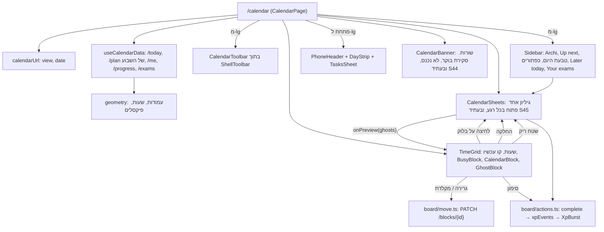

# S32 — מסך היומן: תוכנית עבודה (גרסה 2, 21.11.2026)

> **For agentic workers:** REQUIRED SUB-SKILL: Use superpowers:subagent-driven-development to implement this plan task-by-task. Steps use checkbox (`- [ ]`) syntax for tracking. הבקר (השיחה הראשית) מריץ implementer אחד לכל Task, לפי הסדר, ועושה בעצמו את כל ה-git. ‏implementer לא עושה commit: הוא מדווח לבקר אילו קבצים נוצרו, שונו ונמחקו.

**מטרה:** מסך הבית של Archi הוא יומן. במחשב רשת של שבוע עם סרגל צד, בטלפון יום אחד עם פס ימים וגיליון משימות. כל הזרימה היומית קורית בתוך היומן: סימון Done בבלוק עם תגובה של XP, גרירה, החלקה, דחייה עם שלוש אפשרויות, דילוג מפורש, "I have free time now", סימון זמן תפוס, סקירת הבוקר והדוח "לא נכנס".

**השער במפת הדרכים:** "כל הזרימה היומית עובדת ביומן, בטלפון ובמחשב, עם מקלדת ועם מגע".

**גישה:** בלי שינוי ב-API ובלי מיגרציה. כל מה שהיומן צריך כבר קיים בשרת: ‏`GET /plan` ו-`GET /today` (עם `busy` ו-`exam_color_index`), הפעולות של S14–S19, ‏`web/src/availability/api.ts` של S35, ו-`PATCH /tasks/{id} {status: 'skipped'}` של S15. ה-web בונה את המסך מחדש ושומר את הלוגיקה של `board/`.

**כלים:** ‏React 19, ‏TypeScript strict, ‏React Router 8, ‏TanStack Query 5, ‏Tailwind 4, ‏React Aria Components 1.22, ‏Vitest. בלי תלויות חדשות. התנועה ב-Web Animations API (`element.animate`) וב-CSS.

**מקורות, לפי סדר הכוח:** ‏`CLAUDE.md`; מסמך הביקורת `docs/design/2026-11-21-archi-ux-audit.md` (גובר על כל מסמך עיצוב ישן ממנו; הנחיות 10 ו-13 הן של ה-scope הזה); ‏`docs/design/archi-voice.md`; ההדמיה המחייבת `docs/design/prototype/all-screens.html` (המסכים `s2` "Calendar", ‏`s3` "Calendar actions", והמצבים "A break", "A task did not fit", "Empty: calendar"); ‏`docs/design/design-language.md` (1א, 2.5–2.9, 5, 6, 8, 9, 11); ‏`docs/superpowers/specs/2026-11-18-calendar-redesign-design.md` (4, 5) ו-`2026-11-18-availability-design.md` (7, 10, 11) להתנהגות בלבד. ההדמיה העברית `all-screens-he-2026-11-18.html` לא בתוקף.

## מה השתנה מאז הגרסה של 18.11

התוכנית נכתבה כשהמוצר היה בעברית וב-RTL. מאז הענף עבר rebase על `main` (‏7a21e5e), ונכנסו S39 (אנגלית בלבד, LTR, השם Archi), ‏S35, והשרת של S44 ושל S45. מה שהתחלף בתוכנית:

| לפני | עכשיו | למה |
| --- | --- | --- |
| טקסטים ב-`he.ts` דרך `heCalendar*.ts` | `en.ts` דרך `enCalendar*.ts`, בגוף ראשון | החלטה של אייל מ-21.11; ‏`he.ts` כבר לא קיים |
| תיבת הסימון בתחילת הבלוק | אייקון הסוג (`KIND_ICON[kind]`) בתחילת הבלוק, והסימון בסופו | הנחיה 13: רואים את סוג המאמץ במבט אחד |
| שם הבלוק כטקסט רגיל | `<UserText truncate>` | תוכן משתמש יכול להיות בעברית בתוך ממשק LTR |
| צללית "פנוי/תפוס" בגרירה בלבד | `GhostBlock`: תצוגת רפאים בגרירה, בבחירת שעה, בזמן פנוי ובזמן תפוס | הנחיה 10: רואים לאן הבלוק הולך לפני האישור |
| משפט של ארצ׳י בתחילת ה-toast של "בוצע" | ה-toast של S19 כמו שהוא ("Marked as done. +20 XP") | כך בהדמיה המחייבת; ה-toast אומר מה קרה |
| כרטיס המשימה הבאה ב-`soft` | מילוי מלא בצבע המבחן, טקסט `on-brand` | כך בהדמיה, והזוג נבדק (2.8) |
| `Leaf`, ‏`Coffee`, ‏`Lock` מ-lucide | `StreakLeafIcon`, ‏`TeaCupIcon` ושאר הסט, רק מ-`ui/icons` | lint חוסם ייבוא מ-`lucide-react` |
| `dir="ltr"` על שעות, החלקה "לכיוון הסוף ב-RTL" | בלי `dir` על שעות; החלקה שמאלה, הכפתורים בקצה הימני | הממשק LTR |
| שמונה משימות בארבעה גלים במקביל | 13 משימות בזו אחר זו, ועוד ארבע של הבקר | implementer אחד לכל משימה; סדר קבוע מונע התנגשויות |

## מה כבר נעשה (לא לעשות שוב)

Task 0 נמצא ב-commit ‏`6a09b28` ("wip(web): S32 Task 0"), אחרי ה-rebase:

- `web/src/board/types.ts`: ‏`busy: BusyItem[]` חובה ב-`Plan` וב-`Today`; ‏`web/src/test/boardFixtures.tsx`: ‏`busy: []`.
- `web/src/app/shellFrame.ts`: ‏`useShellFrame({ fullBleed, ownPhoneHeader })`, ‏`PLAIN_FRAME`, ‏`ShellFrameRequest`. ‏`AppShell.tsx` מכבד אותו (בלי `max-w-3xl` ובלי ריפוד כש-`fullBleed`; הכותרת של השלד מתקפלת מתחת ל-`lg` כש-`ownPhoneHeader`). הבדיקות: `web/src/app/shellFrame.test.tsx`.
- `web/src/calendar/calendarState.ts`: ‏`CALENDAR_PATH`; ‏`onboarding/BuildingStep.tsx` מנווט אליו.
- `web/src/i18n/enCalendarGrid.ts`, ‏`enCalendarSheets.ts`, ‏`enCalendarSide.ts`, ‏`enCalendarArchi.ts`, ‏`enCalendarPage.ts`: קיימים, ריקים (`{} as const`), ומחוברים ל-`en.calendar.grid|sheets|side|archi|page` ב-`en.ts`.
- שבעה קודים של S35 ב-`en.codes`: ‏`slot_busy`, ‏`event_in_past`, ‏`too_many_events`, ‏`not_after_starts_at`, ‏`too_long`, ‏`nothing_to_place`, ‏`no_free_time`.

**קובצי `heCalendar*.ts` לא קיימים בענף**, ואין `he.` ב-`web/src`: ה-rebase כבר המיר אותם. מה שנשאר מתקופת העברית הוא קטן, ו-Task 1 סוגר אותו.

## איך החלקים מתחברים

- **למה הנתונים הם תמיד השבוע של התאריך הנבחר:** פס הימים בטלפון צריך את נקודות הצבע של כל השבוע, ותצוגת שבוע במחשב צריכה אותו בכל מקרה. בקשה אחת של `GET /plan?from=<ראשון>&to=<שבת>` משרתת יום, שבוע ופס, ומעבר בין ימים באותו שבוע לא מחכה לרשת. ‏`GET /today` נשאר המקור של הדקות, של שעות הערות של היום ושל "Up next".
- **למה `board/` נשאר הלב:** הפעולות האופטימיות, ה-cache תחת `['board', userId]`, הפוקוס אחרי פעולה, ה-Undo וה-toasts נבדקו ב-S14–S19. היומן הוא מראה חדש מעליהם. ל-`board/` נוסף רק מה שהיומן צריך ולא היה: דחייה עם בחירה, דילוג על כל בלוק, וזמן תפוס כסיבה לסירוב בגרירה.
- **למה המיקום של בלוק נקבע לפי `study_date`:** השרת מחליט לאיזה יום לימוד שייך בלוק. בלוק של 00:30 שייך ליום הקודם, ולכן הוא מצויר בעמודה של היום הקודם, מתחת ל-24:00.
- **למה תצוגת הרפאים עוברת דרך `CalendarPage`:** הגיליון יודע מה המשתמש בוחר, והרשת יודעת לצייר. ‏`CalendarPage` מחזיק `ghosts: Ghost[]` אחד, הגיליונות כותבים אליו דרך `onPreview`, והרשת מציירת. כך גם ה-UI של S44 יוכל להציג הצעת פיצול בלי לגעת ברשת.
- **למה כל הטקסטים נכתבים במשימה אחת (Task 2):** הקול של Archi קובע את איכות המוצר, ולכן מודל אחד (fable) כותב את כולו ברצף. שאר המשימות רק קוראות מפתחות, ו-implementer של sonnet לא ממציא ניסוחים.

## מה מצאתי בקוד (21.11.2026)

1. **לשרת אין תצוגה מקדימה לדחייה, לזמן תפוס ולזמן פנוי.** רק ל-`/plan/replan` ולניתוח יש `preview`. בהדמיה הגיליונות אומרים את היעד לפני האישור ("Today at 19:30", "to Fri at 11:00"). בלי שינוי בשרת ה-web יודע רק חלק: ראו החלטה 9 ו"החלטות לבעל המוצר".
2. **חסרים שמונה קודים של S35 ב-`en.codes`:** ‏`too_many_commitments` (עם `limit`), ‏`already_applied`, ‏`job_not_ready`, ‏`timetable_unreadable`, ‏`timetable_invalid`, ‏`too_many_pages`, ‏`too_short`, ‏`range_too_long`. המקורות: `api/app/errors.py` (`PROBLEMS`), ‏`api/app/schemas/busy_events.py` ו-`commitments.py` (סוגי שגיאת validation), ‏`api/app/ai/timetable.py` ו-`api/app/jobs/timetable.py` (קודי job), ‏`api/app/services/busy_events.py` ו-`plan_views.py` (`range_too_long`).
3. **השומר של גוף ראשון ב-`test/sourceGuards.test.ts` בודק רק את `en.ts`, ‏`enCrash.ts`, ‏`enPwa.ts`**, והספירה של `isolate()` ב-`en.test.ts` סופרת רק את `en.ts`. קובצי `enCalendar*.ts` לא מכוסים. שני הקבצים משותפים עם S34, ולכן S32 מוסיף קובץ בדיקה משלו (`i18n/enCalendar.test.ts`) במקום לשנות אותם.
4. **`useShellFrame` חי ב-`app/shellFrame.ts`**, לא ב-`ShellToolbar.tsx` כמו שכתבה הגרסה הקודמת.
5. **`app/routes.tsx` עדיין מגדיר `CALENDAR_PATH` משלו** (עותק, לא ייצוא מ-`calendarState.ts`). משאירים: S34 נוגע בקובץ הזה, ושני קבועים זהים לא מזיקים. נרשם ל-S29.
6. **רכיב הדמות נקרא `Archie`** (`web/src/archie/Archie.tsx`, ‏`ArchieMood`) גם אחרי S39, כי הוא נקודת ההחלפה של הנכסים. קוד חדש מייבא אותו בשם הזה; בטקסט ובשמות קבצים חדשים כותבים Archi.
7. **ה-toast של `ui/` לא מקבל אייקון**, ובהדמיה יש בו אייקון קטן. אסור לשנות רכיב קיים ב-`ui/`; נרשם ל-S29.
8. **`ProgressBar` ממלא תמיד ב-`success`**, ובהדמיה הפס של כל מבחן בצבע שלו. נשאר `ProgressBar`, והצבע של המבחן בריבוע שליד השם; נרשם ל-S29.
9. **`DAY_CHOSEN` ב-`calendarState.ts` וב-`AppShell.tsx`** שייך ל-`CalendarPage` הזמני של S31. ‏Task 13 מסיר אותו.
10. **`sourceGuards` מתיר אות עברית רק ב-`*.test.ts(x)`, בתיקייה `web/src/test/` וב-`dev/sampleContent.ts`.** לכן `calendar/testFixtures.ts` נכתב בלי עברית, והבדיקות עצמן מעבירות שמות בעברית.

## ההחלטות שלי

1. **תצוגה ו-URL:** במחשב (מ-`lg`, ‏1024px) ברירת המחדל היא שבוע, ו-`?view=day` הוא יום. בטלפון תמיד יום. התאריך ב-`?date=YYYY-MM-DD`; ‏`?from=` (של ההפניה מ-`/week`) נקרא כמו `date`. בלי `date`: היום (`Today.date`). תאריך לא תקין, או רחוק מהיום ביותר מ-1800 ימים, נקרא כהיום. *למה:* "אחורה" וקישור משותף עובדים, וכל רוחב מקבל את ברירת המחדל שלו בלי state נסתר.
2. **השלד:** `CalendarPage` קורא `useShellFrame({ fullBleed: true, ownPhoneHeader: true })`, ומצייר בטלפון כותרת אחת משלו עם `ProgressChip` ו-`ProfileMenu`. *למה:* בהדמיה יש כותרת אחת, ושתיים לוקחות 112px מתוך 844.
3. **גובה שעה:** 48px במחשב, 60px בטלפון. גבולות הרשת: מהשעה העגולה של הקימה (`/me`) או של הפריט המוקדם ביותר, עד השעה העגולה של השינה או של הפריט המאוחר ביותר, ולכל היותר 26:00. בלי `/me`: ‏08:00–22:00. *למה:* בהדמיה 46 ו-50, אבל ב-48 בלוק של חצי שעה נותן אזור לחיצה של 24px (WCAG 2.5.8), וב-60 בלוק של חצי שעה בטלפון מציג שורת כותרת שלמה.
4. **הבלוק (הנחיה 13):** `examColor(block.exam_color_index)`: רקע `soft`, גבול `line`, פס התחלה של 4px בצבע החזק. שורת הכותרת, משמאל לימין: אייקון הסוג `KIND_ICON[block.task_kind]` (‏14px בשבוע, 16px ביום, בצבע המבחן דרך `currentColor`), השם ב-`<UserText truncate>` (600, ‏`text-ink`), ו-`BlockCheck` בסוף. מתחתיה שורת משנה כשיש מקום. **המצבים, בלי שקיפות:**
   - `done`: רקע `surface-muted`, גבול `line` (הכללי), פס ההתחלה נשאר בצבע המבחן, השם `ink-muted` במשקל 400 עם קו חוצה, התיבה מלאה `brand` עם `CheckMarkIcon`.
   - `overdue`: רקע `surface`, גבול מקווקו בגוון `line` של המבחן, ו-`en.board.states.overdue` בשורת המשנה.
   - `in_progress`: כמו upcoming, עם `en.board.states.in_progress` בשורת המשנה.
   - נעול: `Lock` של 14px (מ-`ui/icons`) בשורת המשנה, והמילה בשם הנגיש.
   - `missed` ו-`skipped` לא מצוירים: הם היסטוריה.
   *למה בלי שקיפות:* שקיפות על טקסט אסורה (2.7), ובלוק שעבר נשאר קריא.
5. **שתי שורות כותרת בשבוע:** בתצוגת שבוע (עמודה של כ-130px ב-1280) בלוק בגובה 38px ומעלה מציג את השם בעד שתי שורות. שורת המשנה מופיעה רק מגובה 58px (בלוק של 75 דקות ומעלה). בתצוגת יום (מחשב וטלפון) תמיד שורה אחת ושורת משנה מגובה 38px, כמו בהדמיה. *למה:* בעמודה צרה השם נחתך ל-8 עד 10 תווים, ושם המשימה חשוב מהשעות, שנקראות ממיקום הבלוק. זו סטייה מודעת מההדמיה, שמציגה שעות מגובה 38px גם בשבוע.
6. **`BlockCheck`** (רכיב חדש ב-`ui/`): ‏toggle עם ריבוע של 16px ופינות 6px, בסוף הבלוק, ואזור לחיצה של 44px לרוחב ולכל גובה הבלוק. הכפתור הגלוי של 44px לכל פעולה נמצא ברשימת המשימות (סרגל הצד, גיליון המשימות). *למה:* בלוק של חצי שעה נמוך מ-44px, ו-WCAG 2.5.8 דורש 24px או חלופה.
7. **לחיצה על בלוק** (עכבר, מגע, Enter, רווח) פותחת `BlockActionsSheet`: ‏Done או Mark as not done, ‏Defer, ‏Move (ה-`MoveDialog` של S18), ‏Lock או Unlock, ‏Skip. *למה גיליון ולא `Menu`:* popover נצמד לבלוק קטן בתוך רשת שנגללת, וגיליון הוא הצורה של כל שאר הפעולות בהדמיה.
8. **מקלדת על בלוק:** Enter או רווח פותחים פעולות. חץ למעלה או למטה מתחיל הזזה וממשיך ב-15 דקות; PageUp ו-PageDown שעה; Enter מאשר; Escape ו-Tab מבטלים. ההוראות ב-`aria-describedby`, וה-live region מכריז על כל שעה מוצעת. *למה חץ ולא Enter:* Enter פנוי עכשיו לפעולות, וחץ הוא המחווה הטבעית להזזה.
9. **תצוגת רפאים (הנחיה 10), בלי שינוי בשרת:** `GhostBlock` הוא בלוק עם גבול מקווקו של 2px, רקע `surface`, ובלי שקיפות. הוא מופיע בארבעה מקומות:
   - **גרירה:** הבלוק המורם (`shadow-lift`) עוקב אחרי המצביע, והרפאים יושב על הרבע שעה שאליה הוא ייפול, עם תווית השעות. מקום תפוס: גבול `danger` והמילה מ-`en.calendar.grid.problem`.
   - **Pick a time בדחייה:** השעה שנבחרה מצוירת כרפאים ביום שלה (אם הוא בשבוע שעל המסך), ובגיליון שורה עם השעות הישנות והחדשות.
   - **זמן פנוי:** הטווח מעכשיו ועד סוף הזמן שנבחר מצויר כרפאים של הבלוקים הבאים בתור.
   - **זמן תפוס:** הטווח החדש מצויר כרפאים של זמן תפוס, והבלוקים שחופפים לו מקבלים סימון `leaving` (גבול מקווקו ואייקון `MoveVertical`) במקומם. **לאן הם יעברו ה-web לא יודע** לפני התשובה; ה-toast אחרי התשובה אומר כמה זזו.
   "Next free spot" ו-"Tomorrow" לא מציגים שעה מראש, כי רק המתכנן בשרת יודע אותה. *למה כך:* אסור להבטיח יעד שהשרת לא אישר; מה שידוע מוצג, והשאר נאמר במילים.
10. **גרירה:** עכבר ועט: אחרי 4px של תנועה אנכית. מגע: לחיצה ארוכה של 350ms בלי תזוזה, כי לבלוק יש `touch-action: pan-y` והאצבע צריכה לגלול את היום גם מעל בלוקים. מרגע שהגרירה התחילה, `touchmove` לא פסיבי עוצר את הגלילה. גרירה רק באותה עמודה. `moveProblem` מחזיר גם `slot_busy`, כמו השרת.
11. **החלקה (מגע בלבד):** החלקה שמאלה של יותר מ-8px, שגדולה מהאנכית, מזיזה את הבלוק עד 132px ומגלה בקצה הימני שני כפתורים אמיתיים: Defer (מילוי `gold`, טקסט `ink`) ו-Skip (מילוי `clay`, טקסט `on-clay`). שחרור אחרי 60px משאיר אותם פתוחים; לחיצה מחוץ סוגרת. מבלוק `done` אין החלקה. *למה שמאלה:* כך בהדמיה, וזה כיוון "הלאה" ב-LTR.
12. **דחייה:** `DeferSheet` שמתחיל בשאלה של Archi ("Where should I move this block?"), ומתחתיה שלוש `ActionCard`: ‏Next free spot, ‏Tomorrow, ‏Pick a time. ‏Pick a time מחליף את התוכן ל-`DatePicker` ו-`OptionGrid` של השעות מ-`useDeferSlots`. בתחתית כפתור Skip עם השורה "The task leaves your plan." כל בחירה כותבת toast של לאן זה הלך, עם Undo. ‏`placement_failed` → ‏`offerReplan`; ‏`slot_taken`, ‏`slot_busy`, ‏`outside_day` → הודעה בתוך הגיליון, והוא נשאר פתוח.
13. **דילוג:** בלוק שעבר → ‏`POST /blocks/{id}/skip`; כל בלוק אחר → ‏`PATCH /tasks/{task_id} {status: 'skipped'}`. שניהם מחזירים `version_id`, וה-Undo הוא `POST /plan/undo` דרך `undoOnce`. *למה שתי קריאות:* ‏`/skip` של S18 עובד רק על בלוק שעבר.
14. **"I have free time now":** `FreeTimeSheet` עם Archi (`joy`) מעל קצה הגיליון ושאלה, ‏`OptionGrid` של 30 min, ‏1 hour, ‏1.5 hours, ‏Other (ואז `Select` של 2–8 שעות בקפיצות של חצי שעה). "מה יוקדם" מחושב בדפדפן (הבלוקים העתידיים הבאים בסדר הלוח, עד שהזמן נגמר). השרת מחליט, וה-toast אומר כמה הוקדמו, עם Undo.
15. **זמן תפוס:** `BusyBlock` מתחת לבלוקים: קווים אלכסוניים, פס התחלה `busy`, אייקון לפי `kind` (`WorkIcon`, ‏`ClassIcon`; אירוע ו-`other`: ‏`CalendarClock`). לחיצה על אירוע → ‏`BusySheet` לעריכה ולמחיקה. לחיצה על התחייבות קבועה → ‏`CommitmentSheet` עם קישור ל-`/settings`. סימון חדש: לחיצה על שטח ריק פותחת `BusySheet` מהרבע שעה שנלחץ, לשעה; גרירה בעכבר על שטח ריק בוחרת טווח. במגע רק לחיצה. הכפתור הגלוי: "Mark busy time" בסרגל הצד ובגיליון המשימות. **מחיקת אירוע:** אין לה Undo בשרת, ולכן ה-DELETE נשלח רק כשה-toast של Undo פג (`onExpire`), והאירוע מוסתר בינתיים.
16. **סרגל הצד (מחשב, 300px), מלמעלה:** Archi (לפי הרגע, בגובה 92px, בלי רקע ובלי מסגרת) עומד על כרטיס "Up next" ואומר את משפט היום; הכרטיס עצמו במילוי מלא בצבע המבחן עם טקסט `on-brand`, כפתור Done על `surface` ו-Defer בקו; טבעת היום (`ProgressRing`) עם "90 of 285 minutes"; "I have free time now" ו-"Mark busy time"; "Later today"; "Your exams" (ריבוע צבע, שם, "in 22 days", ‏`ProgressBar`).
17. **הטלפון:** כותרת אחת (החלטה 2), ‏`CalendarBanner`, ‏`DayStrip`, הרשת של היום, והבר של גיליון המשימות מעל הסרגל התחתון ("Today's blocks", "3 left, 3 hours 15 min"). הדף נגלל בחלון, והכותרת והפס דבוקים למעלה. החלקה אופקית על שטח ריק עוברת יום.
18. **פס הימים:** שבעה כפתורים (ראשון עד שבת), כל אחד עם היום, התאריך, ועד ארבע נקודות בצבעי המבחנים של אותו יום, או `StreakLeafIcon` ליום שעבר והרצף נשמר בו. הנבחר `bg-inverse text-on-inverse`; היום `aria-current="date"`.
19. **יום חופשי:** יום מהיום והלאה שאין בו אף בלוק, בשבוע שיש בו בלוקים בימים אחרים, מסומן "Free day" עם `TeaCupIcon`.
20. **הרגעים של Archi (`calendar/archi.ts`):** פונקציה טהורה בוחרת את הרגע: יש בלוקים בסקירה → ‏`review`; יש `unplaced` → ‏`report`; היום יום חופשי → ‏`restDay`; כל הבלוקים של היום בוצעו → ‏`dayDone`; בלוק של 60 דקות ומעלה בתהליך → ‏`deepWork`; אחרת `morning` לפני 12:00 ו-`day` אחריה. לרגעים הקבועים שלושה ניסוחים, והניסוח נבחר לפי היום בשנה: יציב במשך היום ושונה ממחר. ‏`morning` ו-`day` אומרים את סיכום היום עם המספרים ("I've set 4 blocks for today. 1 is done. The next starts at 12:00."). הודעת ההפסקה אחרי 90 דקות עוברת דרך `archiMayInterrupt()`: אחת ל-20 דקות לכל היותר.
21. **רגע Done:** הסימון אופטימי ומיידי. כשהתשובה מגיעה עם `xp_change > 0`: ‏`XpBurst` מצייר צ'יפ "+20 XP" (`gold-soft`/`gold-ink`, עם `XpSparkIcon`) ליד התיבה, ומעיף אותו ב-600ms אל טבעת הרמה (`[data-part="level"]` של `ProgressChip`), שמקבלת הילה `gold-soft`. ‏`progressKey` מתעדכן מיד מ-`result.progress`. עם `prefers-reduced-motion` אין שום תנועה: רק המספרים והטקסט. ה-toast הוא של S19 כמו שהוא.
22. **`CalendarBanner`:** מעל הרשת, שורה לכל נושא. סגור: Archi קטן, משפט אחד וכפתור (`aria-expanded`). פתוח: התוכן של `ReviewCard` או `PlanReport` (הלוגיקה והבדיקות שלהם נשארות). ‏`#report` פותח את הדוח וגולל אליו.
23. **גלילה ל"עכשיו":** פעם אחת בכל כניסה למסך ובכל מעבר לשבוע או ליום שיש בו את היום: "עכשיו" שליש מגובה האזור מלמעלה. ביום אחר: הבלוק הראשון, או תחילת היום. בלי `smooth`.
24. **מה נמחק (ב-Task 13):** `pages/TodayPage.tsx`, ‏`week/` (שלושת הקבצים), ‏`today/DayTimeline.tsx` והבדיקה שלו, ‏`TodayBlocks.tsx`, ‏`TodayViewSwitch.tsx`, ‏`todayView.ts` והבדיקה שלו, ‏`DayProgress.tsx`, ‏`today.test.tsx`. נשארים: ‏`today/ReviewCard`, ‏`today/chooseNext`, ‏`board/*`, ‏`app/legacyRedirects.tsx`.

## נקודות החיבור ל-S44 ול-S45 (לא נבנות כאן)

שני ה-UIs הבאים מתחברים ליומן בשלושה מקומות, וכל אחד מהם מתועד בהערה בראש הקובץ שלו ובסעיף היומן ב-`design-language.md`:

| מי | איפה | איך מתחברים |
| --- | --- | --- |
| S44, הצעת פיצול (`GET /split-offers`, ‏`POST /tasks/{id}/split`, ‏`/split/dismiss`) | `web/src/calendar/CalendarBanner.tsx` | המערך `BANNER_ROWS` מגדיר את השורות לפי הסדר (`review`, ‏`report`). ‏S44 מוסיף שורה `split` אחרי `report`: רכיב שמקבל `{ expanded, onToggle, onPreview }` כמו השתיים הקיימות |
| S44, תצוגת הפיצול על הרשת | `ghosts: Ghost[]` ב-`CalendarPage` | השורה של S44 קוראת ל-`onPreview` עם שני רפאים של 30 דקות (`tone: 'target'`) ועם רפאים `tone: 'leaving'` לבלוק המקורי |
| S45, גיליון סגירת מבחן (`GET /closures`, ‏`POST /exams/{id}/close`, ‏`/moed-b`) | `web/src/calendar/CalendarSheets.tsx` | הטיפוס `SheetState` הוא union לפי `kind`. ‏S45 מוסיף `{ kind: 'closure'; examId: string }` וענף אחד ב-`switch`, ופותח אותו מ-`CalendarPage` כשל-`GET /closures` יש פריט |

*למה מקום אחד לגיליונות:* רק גיליון אחד פתוח בכל רגע, והפוקוס חוזר למי שפתח אותו. גיליון חדש הוא ענף חדש, בלי state נוסף במסך.

## Global Constraints

- **אנגלית בלבד ב-`web/src`.** כל טקסט שהמשתמש רואה או שומע (גם `aria-label`) בקובצי `web/src/i18n/enCalendar*.ts`, שמחוברים ל-`en.ts` בשורת ייבוא אחת לכל קובץ. אין טקסט ישיר ב-JSX (lint). אות עברית מותרת רק בקובצי `*.test.ts(x)` וב-`web/src/test/`, כנתוני דמה של תוכן משתמש.
- **הקול של Archi:** גוף ראשון (`I`, ‏`me`, ‏`my`), פנייה ב-`you`, אף פעם לא "Archi will". משפטים קצרים, בלי סימן קריאה. משפט של Archi נגמר בנקודה; כפתור, תווית וכותרת לא. איות בריטי. בלי נקודה אמצעית. שעות 24 שעות, טווח במקף ארוך `09:00–10:30`; תאריך קצר `Sun, 22 Nov`, מלא `22 November 2026`. המילון של `archi-voice.md` מחייב: Block, Task, Busy time, Commitment, Defer, Skip, Move, Lock, Done.
- **Archi מוביל:** בכל גיליון ובכל שורה של הפס, קודם השאלה או ההקשר של Archi, ומתחתיו הפקדים.
- **תוכן משתמש** (שם משימה, שם מבחן, כותרת אירוע או התחייבות): ב-JSX רק דרך `ui/UserText` (`truncate` לכותרת שנחתכת); בתוך מחרוזת רק דרך `isolate()` מ-`i18n/bidi.ts`. בלי מירכאות סביבו. לא שמים כותרת משתמש באמצע משפט שעלול להישבר לשתי שורות.
- **אייקונים רק מ-`web/src/ui/icons/`** (גם הגליפים של lucide מיובאים רק משם). סוג משימה: `KIND_ICON[kind]`. **אפס אימוג׳י**, גם לא סימן וי, סימן זכויות או חץ כתו: בבדיקה כותבים `String.fromCodePoint`.
- **הדמות:** רק דרך הרכיב `Archie` (`web/src/archie/Archie.tsx`), בלי רקע ובלי מסגרת חותכת, ישר על `canvas` או `surface`. לא מציירים אותה.
- **תנועה:** לכל אינטראקציה תגובה, כל תנועה עד 600ms ולא חוסמת, ו**שקט מלא** עם `prefers-reduced-motion: reduce`: בלי `animate`, בלי transition של מיקום, רק שינוי המצב.
- **צבע:** רק tokens של `index.css` ורק זוגות של 2.5, ‏2.6, ‏2.8 ו-2.9 במסמך העיצוב. בלי `text-brand`, בלי שקיפות על טקסט או על בלוק, בלי hex ברכיב. צבע מבחן רק דרך `examColor()`; אסור לבנות `bg-exam-${n}`.
- **רכיבים:** רק רכיבי `web/src/ui/`. רכיב חסר: קובץ חדש ב-`ui/` עם בדיקה, ב-`/dev/components` ובטבלה 5.8. **לא משנים רכיב קיים ב-`ui/`.**
- **LTR:** logical properties (`ms-`, ‏`ps-`, ‏`border-s-`, ‏`start-`); בלי `rtl:`; בלי `dir` על שעות. מספרים ושעות ב-`tabular-nums`. "הקודם" הוא `ChevronLeft`.
- **נגישות:** 44px לכל פקד מחוץ לבלוק; לכל מחווה כפתור גלוי; שם נגיש לכל כפתור שחוזר ("Done: X"), שנבנה מאותה פונקציה של `en` גם בבדיקה (יש בו תווי בידוד).
- **ההתנהגות של S14–S19 ו-S35 לא משתנה.** בדיקה קיימת משתנה רק כשהיא נשענת על מבנה או טקסט שהשתנה, ולא מחלישים בדיקה כדי שתעבור.
- `ShellToolbar` מוצג רק מ-`lg`.
- **פקודות**, מתוך `web/`: ‏`npm test -- <pattern>`, ‏`npm run typecheck`, ‏`npm run lint`. ‏Node ו-npm לפי `devEngines`. לא מריצים `npm run dev` (הפורט 5173 משותף עם S34).
- **git רק אצל הבקר.** ‏implementer לא עושה commit, ‏checkout או stash. באג שלא קשור למשימה לא מתוקן: מדווחים עליו לבקר, והוא רושם אותו במפת הדרכים.
- `legacy/` לקריאה בלבד.

## Review Focus

1. **בלוק אחרי חצות ויום עם מעבר שעון:** בלוק 00:30 של יום הלימוד הקודם, ובלוק ביום של מעבר לשעון חורף. צפוי: בעמודה של `study_date`, בגובה הנכון (Task 4).
2. **רענון שמגיע באמצע גרירה:** ה-`refetchInterval` מחליף את הבלוק שנגרר או הופך אותו ל-`in_progress`. צפוי: הגרירה נגמרת ב-`en.move.cancelled`, בלי שגיאה ובלי קפיצה, והרפאים נעלם (Task 8).
3. **גלילה במגע מעל בלוקים:** אצבע שגוללת את היום מעל בלוק לא מתחילה גרירה ולא החלקה (Task 8).
4. **Undo אחרי מעבר יום:** toast של דחייה שנלחץ אחרי שהמשתמש עבר ליום אחר. צפוי: עובד, כי הקריאות חיות על ה-mutation (Task 5).
5. **תשובה ישנה מה-cache בלי `busy` או בלי `exam_color_index`:** המסך עולה, בלי זמן תפוס ובצבע 7 (Task 4).
6. **רפאים שנשאר:** גיליון שנסגר ב-Escape, בלחיצה על הרקע או בניווט משאיר `ghosts` ריק (Task 9, ‏Task 10, ‏Task 13).
7. **כותרת עברית בבלוק צר:** נחתכת בסופה, לא בתחילתה, ומתחילה מאותו קצה שמאלי כמו כותרת באנגלית (Task 7).
8. **reduced motion:** אף קריאה ל-`animate` בכל המסך (Task 7, ‏Task 8, ‏Task 13).

## סדר ותלויות

המשימות רצות אחת אחרי השנייה, לפי המספר. כל משימה נשענת רק על קודמות לה:

| Task | נשען על | מודל |
| --- | --- | --- |
| 1 קודי S35 ושאריות | 0 | sonnet |
| 2 הטקסטים | 1 | fable |
| 3 רכיבי `ui/` | 2 | sonnet |
| 4 נתונים וגאומטריה | 2 | sonnet |
| 5 הפעולות ב-`board/` | 2 | opus |
| 6 הרגעים של Archi | 2 | sonnet |
| 7 הרשת והבלוק | 2, 3, 4 | fable |
| 8 גרירה ומחוות | 4, 5, 7 | opus |
| 9 פעולות ודחייה | 3, 4, 5 | sonnet |
| 10 זמן פנוי וזמן תפוס | 3, 4 | sonnet |
| 11 סרגל הצד | 3, 4, 6 | fable |
| 12 הטלפון והפס | 4, 11 | sonnet |
| 13 המסך | הכול | opus |
| 14–17 | 13 | הבקר |

אם מודל נכשל פעמיים באותה משימה, הבקר עולה מדרגה ולא מנסה שוב באותו מודל.

## קבצים משותפים

**בתוך S32** (מי נוגע במה, כדי ששתי משימות לא יכתבו לאותו מקום):

- `web/src/i18n/en.ts`: רק Task 1 (שורת ייבוא ושורת spread של `enCalendarCodes`, והסרת שבעת הקודים שעוברים). אחריו אף משימה לא נוגעת בו, חוץ מ-Task 13 שמוחק מפתחות של `en.today`, ‏`en.week` ו-`en.move` שנשארו בלי משתמש.
- `web/src/i18n/enCalendar*.ts`: ‏Task 2 כותב את כולם. משימה מאוחרת שחסר לה מפתח מוסיפה אותו לקובץ של החלק שלה (Grid: ‏7, ‏8; Sheets: ‏9, ‏10; Side: ‏11, ‏12; Archi: ‏6; Page: ‏13), באותו קול, ומדווחת עליו לבקר.
- `web/src/i18n/enCalendar.test.ts`: ‏Task 1 יוצר, ‏Task 2 מרחיב.
- `web/src/dev/ComponentsPage.tsx`, ‏`web/src/dev/devText.ts`: רק Task 3 (שורת ייבוא ושורת render; קטע `s32`).
- `web/src/calendar/testFixtures.ts`: ‏Task 4 יוצר; משימות מאוחרות רק מוסיפות פונקציות.
- `web/src/board/actions.ts`, ‏`move.ts`: רק Task 5.
- `web/src/calendar/TimeGrid.tsx`, ‏`CalendarBlock.tsx`: ‏Task 7 יוצר, ‏Task 8 מוסיף את המחוות.
- `web/src/today/ReviewCard.tsx`, ‏`web/src/board/PlanReport.tsx`: רק Task 12 (‏prop ‏`bare`).
- `docs/design/design-language.md`: ‏Task 3 (שלוש שורות ב-5.8), ו-Task 16 של הבקר.

**מול S34, שרץ במקביל ב-worktree משלו** (כניסה, אונבורדינג, מבחנים, הגדרות; לא נוגע ב-`calendar/`):

| קובץ | S32 | S34 | איך לא מתנגשים |
| --- | --- | --- | --- |
| `web/src/i18n/en.ts` | Task 1: שתי שורות ב-`codes`, והסרת שבעה קודים; ‏Task 13: מחיקת מפתחות של `today`, ‏`week`, ‏`move` | שורת ייבוא לכל קובץ טקסטים שלו | מי שממזג שני עושה rebase; השינויים בשורות שונות |
| הקודים של S35 | **S32 הוא הבעלים של כולם**, ב-`enCalendarCodes.ts` | רק קורא אותם דרך `codeText` | הבקר מעדכן את S34 שלא יוסיף את `too_many_commitments`, ‏`timetable_*`, ‏`already_applied`, ‏`job_not_ready`, ‏`too_many_pages`, ‏`too_short` |
| `web/src/i18n/codes.ts`, ‏`codes.test.ts` | Task 1: ענף אחד ב-`switch` ורשימת קודים | לא נוגע | |
| `web/src/dev/ComponentsPage.tsx`, ‏`devText.ts` | Task 3: שורה אחת בכל אחד, וקטע `s32` | שורה אחת, וקטע `s34` | רק תוספות |
| `web/src/theme.test.ts` | לא נוגע | מוסיף | |
| `web/src/app/routes.tsx` | **לא נוגע** | שני נתיבים חדשים | |
| `web/src/app/AppShell.tsx` | Task 0 (נעשה), ו-Task 13 מסיר `DAY_CHOSEN` | לא נוגע | |
| `web/src/test/sourceGuards.test.ts`, ‏`web/src/i18n/en.test.ts` | **לא נוגע**: השומרים של S32 ב-`enCalendar.test.ts` | אם יצטרך, בקובץ משלו | |
| `web/src/ui/` | שלושה קבצים חדשים ו-`s32.test.tsx` | קבצים חדשים משלו ו-`s34.test.tsx` | אף אחד לא משנה רכיב קיים |
| `docs/design/design-language.md` | 5.8 (שלוש שורות), סעיף חדש ליומן, 6, 11 | 5.8 (שורות שלו), 11 | תוספות בקטעים נפרדים |
| `web/src/pages/`, ‏`onboarding/`, ‏`exam/`, ‏`settings/`, ‏`commitments/` | רק מחיקת `pages/TodayPage.tsx`; מ-`exam/api.ts` רק מייבאים | הבעלים | |

התוכנית של S34 עדיין מהגרסה העברית, ומונה את `he.ts` כקובץ משותף; היא תתעדכן בנפרד, והטבלה הזו היא הצד של S32.

---

### Task 0: השלד המשותף — **נעשה** (commit ‏`6a09b28`)

לא מריצים. הפירוט בסעיף "מה כבר נעשה". מה שהמשימות הבאות מקבלות ממנו:

- `useShellFrame(frame: Partial<{ fullBleed: boolean; ownPhoneHeader: boolean }>): void` מ-`web/src/app/shellFrame.ts`.
- `ShellToolbar` מ-`web/src/app/ShellToolbar.tsx` (portal למקום בכותרת, רק מ-`lg`).
- `CALENDAR_PATH` מ-`web/src/calendar/calendarState.ts`.
- `en.calendar.grid`, ‏`sheets`, ‏`side`, ‏`archi`, ‏`page`.

### Task 1: קודי S35 ושאריות תקופת העברית

**מודל: `sonnet`.** העברת מחרוזות ובדיקות לפי רשימה מדויקת, בלי החלטות.

**Files:**
- Create: `web/src/i18n/enCalendarCodes.ts`, ‏`web/src/i18n/enCalendar.test.ts`
- Modify: `web/src/i18n/en.ts`, ‏`web/src/i18n/codes.ts`, ‏`web/src/i18n/codes.test.ts`, ושורת ההערה הראשונה בכל אחד מחמשת `web/src/i18n/enCalendar{Grid,Sheets,Side,Archi,Page}.ts`

**מה עושים:**

1. `enCalendarCodes.ts` מייצא `export const enCalendarCodes = { ... } as const` עם 15 המפתחות האלה, בדיוק כך (גרש מתולתל `’` כמו בשאר `en.ts`):

   | מפתח | טקסט |
   | --- | --- |
   | `slot_busy` | `That time falls on busy time in your calendar.` |
   | `event_in_past` | `Busy time can only be marked from now on.` |
   | `too_many_events` | `You have too many upcoming events. Delete one to add another.` |
   | `not_after_starts_at` | `The end time needs to come after the start time.` |
   | `too_long` | `Busy time can be up to 14 days long.` |
   | `nothing_to_place` | `I don’t have a task I can bring forward right now.` |
   | `no_free_time` | `That time is already taken in your calendar.` |
   | `too_many_commitments` | פונקציה `(limit: number \| null) =>`: עם `null` ‏`You’ve reached the limit of weekly commitments. Delete one to add another.`; אחרת `` `You can have up to ${String(limit)} weekly commitments. Delete one to add another.` `` |
   | `too_short` | `A commitment needs to be at least 15 minutes long.` |
   | `range_too_long` | `That’s too long a range for me to show at once.` |
   | `already_applied` | `I’ve already saved that timetable.` |
   | `job_not_ready` | `I haven’t finished reading that yet. Give me a moment.` |
   | `timetable_unreadable` | `I couldn’t read a timetable in that file. Try a sharper photo or a PDF.` |
   | `timetable_invalid` | `I couldn’t make sense of that timetable. Try again, or add your commitments by hand.` |
   | `too_many_pages` | `That PDF has too many pages. Send me only the page with your timetable.` |

2. ב-`en.ts`: מוחקים מ-`codes` את שבע השורות של S35 ואת ההערה שמעליהן (מ-`slot_busy` עד `no_free_time`), מוסיפים `import { enCalendarCodes } from './enCalendarCodes'` ובתוך `codes`, לפני ההערה `// Push reminders (S16)`, את `...enCalendarCodes,` עם ההערה `// S35: availability, through the calendar (S32) and the settings (S34)`.
3. ב-`codes.ts`, ב-`codeText`: ענף `case 'too_many_commitments': return en.codes.too_many_commitments(numberParam(params, 'limit'))`.
4. בחמשת קובצי החלקים, ההערה הראשונה מציינת מספרי משימות ישנים. מחליפים ל: Grid → "(S32 Tasks 7, 8)", ‏Sheets → "(S32 Tasks 9, 10)", ‏Side → "(S32 Tasks 11, 12)", ‏Archi → "(S32 Tasks 2, 6)", ‏Page → "(S32 Task 13)". התוכן (`{} as const`) לא משתנה.

**Steps:**
- [ ] **Step 1 (בדיקות קודם):** ב-`codes.test.ts` מוסיפים ל-`CODES` את 15 המפתחות, ובדיקה ש-`codeText('too_many_commitments', { limit: 40 })` מכיל `40`, ובלי `limit` לא מכיל ספרה. ב-`enCalendar.test.ts` (עם `// @vitest-environment node` ו-`/// <reference types="node" />`, כמו `en.test.ts`): (א) קוראים מהדיסק כל קובץ `src/i18n/enCalendar*.ts` שאינו בדיקה, מסירים שורות הערה (`/^\s*\/\/.*$/gm`), ובודקים שאין התאמה ל-`/\bArchie?\s+(will|would|can|could|is|was|has|had|does|did|may|might|should|must|shall|[a-z]+s)\b/` ולא ל-`/\bArchie\b|\bthe (app|system) (will|has|can)\b/`; (ב) שרשימת הקבצים שנמצאה היא בדיוק שישה: Archi, ‏Codes, ‏Grid, ‏Page, ‏Sheets, ‏Side; (ג) שב-`src` אין קובץ ששמו מתחיל ב-`heCalendar`, ושאין `src/i18n/he.ts`.
- [ ] **Step 2:** `npm test -- i18n` ורואים שהחדשות נכשלות.
- [ ] **Step 3:** מממשים את 1–4.
- [ ] **Step 4:** `npm test -- i18n sourceGuards`, ‏`npm run typecheck`, ‏`npm run lint`.

**Acceptance:** כל הבדיקות ירוקות; `git grep -n "heCalendar" web/src` מחזיר רק את `enCalendar.test.ts`; ‏`en.codes` מכיל את 15 המפתחות; אין שינוי בשום קובץ אחר.

### Task 2: הטקסטים של היומן, בקול של Archi

**מודל: `fable`.** הניסוחים של Archi קובעים את איכות המוצר, וקשה לתפוס בהם טעות בסקירה.

**Files:**
- Modify: `web/src/i18n/enCalendarGrid.ts`, ‏`enCalendarSheets.ts`, ‏`enCalendarSide.ts`, ‏`enCalendarArchi.ts`, ‏`enCalendarPage.ts`, ‏`web/src/i18n/enCalendar.test.ts`

**לקרוא קודם:** `docs/design/archi-voice.md` (כולו), והמסכים `s2`, ‏`s3` והמצבים ב-`docs/design/prototype/all-screens.html`. הניסוחים שבהדמיה מחייבים; הטבלאות כאן כבר לקוחות ממנה. מותר ללטש ניסוח שאינו מההדמיה אם הוא לא עומד במסמך הקול, ומדווחים לבקר על כל שינוי כזה. **אין לשנות שמות מפתחות או חתימות**: המשימות הבאות קוראות אותם.

**כללים טכניים:** כל קובץ מייצא אובייקט אחד `as const` (מקונן לפי הנקודה בשם המפתח: `defer.title` הוא `defer: { title }`). פונקציה שמקבלת תוכן משתמש עוטפת אותו ב-`isolate()` (`import { isolate } from './bidi'`). ריבוי דרך פונקציית עזר מקומית בכל קובץ: `const plural = (n: number, one: string, many: string) => `${String(n)} ${n === 1 ? one : many}``. לא מייבאים מ-`en.ts` (מעגל). מפתחות שכבר קיימים ב-`en.board`, ‏`en.today`, ‏`en.review`, ‏`en.move`, ‏`en.common` לא משוכפלים: המשימות הבאות קוראות אותם משם. גרש מתולתל `’` בכל הטקסטים.

**`enCalendarGrid`:**

| מפתח | ערך |
| --- | --- |
| `label` | `(range: string) => `Calendar, ${range}`` |
| `today` | `Today` |
| `streakDay` | `Streak kept` |
| `freeDay` | `Free day` |
| `busyUntitled` | `Busy` |
| `blockLabel` | `(name: string, range: string, exam: string, kind: string, state: string \| null, locked: boolean) =>` ‏`` `${isolate(name)}, ${range}, ${isolate(exam)}, ${kind}${state === null ? '' : `, ${state}`}${locked ? ', locked' : ''}` `` |
| `busyLabel` | `(title: string, range: string) => `Busy time: ${isolate(title)}, ${range}`` |
| `meta` | `(kind: string, range: string) => `${kind}. ${range}`` |
| `metaState` | `(state: string) => `. ${state}`` |
| `metaLocked` | `, locked` |
| `instructions` | `Press Enter for actions. To move the block, press the up or down arrow. Each press moves it 15 minutes, Page Up and Page Down move it an hour, Enter confirms and Escape cancels.` |
| `problem` | `{ free: 'free', slot_taken: 'taken', slot_busy: 'busy time', outside_day: 'outside your day', invalid_state: 'can’t move' }` |
| `candidate` | `(range: string, state: string) => `${range}, ${state}`` |
| `ghostLeaving` | `Will move` |
| `newBusy` | `New busy time` |

**`enCalendarSheets`:**

| מפתח | ערך |
| --- | --- |
| `actions.title` | `What would you like to do with this block?` |
| `actions.skipHint` | `The task leaves your plan.` |
| `defer.title` | `Where should I move this block?` |
| `defer.next` | `Next free spot` |
| `defer.nextHint` | `I’ll find the nearest free time.` |
| `defer.tomorrow` | `Tomorrow` |
| `defer.tomorrowHint` | `I’ll find a spot for this tomorrow.` |
| `defer.pick` | `Pick a time` |
| `defer.pickHint` | `From your free hours` |
| `defer.day` | `Day` |
| `defer.slots` | `Free times` |
| `defer.loading` | `Looking for free times…` |
| `defer.noSlots` | `There’s no free time that day.` |
| `defer.back` | `Back` |
| `defer.confirmAt` | `(time: string) => `Defer to ${time}`` |
| `defer.preview` | `(from: string, to: string) => `Now ${from}. New time: ${to}.`` |
| `defer.skip` | `Skip` |
| `defer.skipped` | `(title: string) => `I took ${isolate(title)} out of your plan.`` |
| `defer.skipUndone` | `Skip undone` |
| `freeTime.title` | `Good, some free time. How much do you have?` |
| `freeTime.amount` | `How much time` |
| `freeTime.options` | `{ m30: '30 min', m60: '1 hour', m90: '1.5 hours', other: 'Other' }` |
| `freeTime.otherLabel` | `How long?` |
| `freeTime.nextOne` | `I’ll bring this one forward to now` |
| `freeTime.nextMany` | `I’ll bring these forward to now` |
| `freeTime.instead` | `(range: string, was: string) => `${range}, instead of ${was}`` |
| `freeTime.start` | `Start now` |
| `freeTime.starting` | `Starting…` |
| `freeTime.done` | `(count: number, range: string) => count === 1 ? `I brought 1 block forward to ${range}.` : `I brought ${String(count)} blocks forward to ${range}.`` |
| `freeTime.undone` | `Free time undone` |
| `busy.titleNew` | `What should I keep free?` |
| `busy.titleEdit` | `Busy time` |
| `busy.what` | `What is it? (optional)` |
| `busy.day` | `Day` |
| `busy.from` | `From` |
| `busy.to` | `To` |
| `busy.willMove` | `(count: number, title: string) => count === 1 ? `I’ll move 1 block to make room: ${isolate(title)}.` : `I’ll move ${String(count)} blocks to make room.`` |
| `busy.save` | `Mark as busy` |
| `busy.saveEdit` | `Save` |
| `busy.saving` | `Saving…` |
| `busy.delete` | `Delete` |
| `busy.saved` | `Busy time marked` |
| `busy.savedMoved` | `(count: number) => count === 1 ? 'I marked it as busy and moved 1 block.' : `I marked it as busy and moved ${String(count)} blocks.`` |
| `busy.savedUnplaced` | `(count: number) => count === 1 ? 'I marked it as busy, but 1 task didn’t fit anywhere else.' : `I marked it as busy, but ${String(count)} tasks didn’t fit anywhere else.`` |
| `busy.updated` | `Busy time updated` |
| `busy.deleted` | `Busy time deleted` |
| `busy.undone` | `Change undone` |
| `commitment.lead` | `This is one of your weekly commitments. I plan around it every week.` |
| `commitment.edit` | `Edit in settings` |
| `commitment.kinds` | `{ work: 'Work', class: 'Class', other: 'Commitment' }` |

**`enCalendarSide`:**

| מפתח | ערך |
| --- | --- |
| `freeTime` | `I have free time now` |
| `markBusy` | `Mark busy time` |
| `exams` | `Your exams` |
| `examProgress` | `(percent: number) => `${String(percent)}% of the plan done`` |
| `examLabel` | `(name: string, when: string, percent: number) => `${isolate(name)}, ${when}, ${String(percent)}% of the plan done`` |
| `peekLeft` | `(left: number, duration: string) => left === 0 ? 'All done for today' : `${String(left)} left, ${duration}`` |
| `stripLabel` | `Days of this week` |
| `stripDay` | `(weekday: string, day: number, blocks: number) => `${weekday} ${String(day)}, ${blocks === 0 ? 'no blocks' : plural(blocks, 'block', 'blocks')}`` |
| `banner.review` | `Review` |
| `banner.report` | `(count: number) => count === 1 ? 'One task didn’t fit before the exam.' : `${String(count)} tasks didn’t fit before their exams.`` |
| `banner.details` | `Details` |
| `banner.close` | `Close` |

**`enCalendarArchi`:** לכל רגע קבוע מערך של שלושה ניסוחים.

| מפתח | ערך |
| --- | --- |
| `review` | `Before we start, there’s a block from earlier I’d like to sort with you.` / `Let’s look at yesterday first, then today.` / `One thing from before today needs an answer. Then we go on.` |
| `report` | `Something didn’t fit before the exam. I’ve laid it out for you.` / `I couldn’t fit everything in. Take a look when you have a minute.` / `Your plan is a little too full. I have a way out to suggest.` |
| `restDay` | `Nothing is planned for today. Enjoy the quiet.` / `Today is a free day. I’ve put the kettle on.` / `No blocks today. Rest is part of the plan.` |
| `dayDone` | `That’s every block for today. Well done.` / `Today is complete. The rest of the day is yours.` / `You finished today’s plan. I’ll see you tomorrow.` |
| `deepWork` | `A long block is under way. I’ll keep quiet.` / `You’re in the middle of a long one. Take it page by page.` / `Deep work now. I’m right here.` |
| `summary` | `(total: number, done: number, next: string \| null) =>` עד שלושה משפטים מחוברים ברווח: `` `I’ve set ${plural(total, 'block', 'blocks')} for today.` ``; אם `done > 0`: ‏`` `${String(done)} ${done === 1 ? 'is' : 'are'} done.` ``; אם `next !== null`: ‏`` `The next starts at ${next}.` `` |
| `breakTitle` | `That was 90 minutes in a row. I’ve poured the tea.` |
| `breakBody` | `(next: string \| null) => next === null ? 'Take five minutes away from the screen.' : `Take five minutes away from the screen. Your next block is at ${next}.`` |
| `breakClose` | `Close` |

**`enCalendarPage`:**

| מפתח | ערך |
| --- | --- |
| `title` | `Calendar` |
| `dateNav` | `Move between dates` |
| `previousWeek` / `nextWeek` | `Previous week` / `Next week` |
| `previousDay` / `nextDay` | `Previous day` / `Next day` |
| `rangeJoin` | `(first: string, last: string) => `${first}–${last}`` (מקף ארוך, U+2013) |
| `stale` | `I couldn’t refresh, so your calendar may be out of date.` |
| `xp` | `(xp: number) => `+${String(xp)} XP`` |

**Steps:**
- [ ] **Step 1 (בדיקות קודם)** ב-`enCalendar.test.ts`: טבלת ריבוי (`it.each`) עם הטקסט המדויק של: `sheets.freeTime.done` (‏1, ‏3), ‏`sheets.busy.willMove` (‏1, ‏2), ‏`sheets.busy.savedMoved` (‏1, ‏2), ‏`sheets.busy.savedUnplaced` (‏1, ‏2), ‏`side.peekLeft` (‏0, ‏3), ‏`side.stripDay` (‏0, ‏1, ‏3), ‏`side.banner.report` (‏1, ‏2), ‏`archi.summary` (‏`(4, 1, '12:00')` → ‏`I’ve set 4 blocks for today. 1 is done. The next starts at 12:00.`; ‏`(4, 2, null)` → ‏`I’ve set 4 blocks for today. 2 are done.`; ‏`(1, 0, null)` → ‏`I’ve set 1 block for today.`). טבלת בידוד: לכל פונקציה שמקבלת תוכן משתמש (`grid.blockLabel` לשם ולמבחן, ‏`grid.busyLabel`, ‏`sheets.defer.skipped`, ‏`sheets.busy.willMove`, ‏`side.examLabel`), עם השם `'חדו״א 1 (מועד ב׳)'`, הטקסט מכיל את השם עטוף ב-U+2068 ו-U+2069, ושום חלק מהשם מחוץ לעטיפה. בדיקה שמספר ההופעות של `${isolate(` בחמשת הקבצים שווה למספר השורות בטבלת הבידוד (כמו ב-`en.test.ts`; ‏`blockLabel` נספר פעמיים). בדיקה שלכל אחד מ-`review`, ‏`report`, ‏`restDay`, ‏`dayDone`, ‏`deepWork` יש בדיוק שלושה ניסוחים שונים, שכל אחד נגמר בנקודה ואין בו `!`.
- [ ] **Step 2:** `npm test -- enCalendar` ורואים שנכשל.
- [ ] **Step 3:** כותבים את חמשת הקבצים.
- [ ] **Step 4:** `npm test -- i18n sourceGuards`, ‏`npm run typecheck`, ‏`npm run lint`.

**Acceptance:** כל מפתח בטבלאות קיים בחתימה שנכתבה; אין אות עברית, אימוג׳י או "Archi" כנושא של פועל באף קובץ; הדיווח לבקר מפרט כל ניסוח ששונה מהטבלה ולמה.

### Task 3: רכיבי `ui/` חדשים

**מודל: `sonnet`.** שלושה רכיבים קטנים עם חתימות ומחלקות מדויקות.

**Files:**
- Create: `web/src/ui/BlockCheck.tsx`, ‏`web/src/ui/ProgressRing.tsx`, ‏`web/src/ui/ActionCard.tsx`, ‏`web/src/ui/s32.test.tsx`, ‏`web/src/dev/s32Sections.tsx`
- Modify: `web/src/dev/ComponentsPage.tsx` (שורת ייבוא ושורת render אחת, בסוף הרשימה), ‏`web/src/dev/devText.ts` (קטע `s32`), ‏`docs/design/design-language.md` (שלוש שורות בטבלה של 5.8, בעברית)
- **לא משנים שום רכיב קיים ב-`ui/`.**

**Interfaces (Produces):**
- `BlockCheck({ isDone: boolean; onChange: (isDone: boolean) => void; 'aria-label': string; isDisabled?: boolean; dataId?: string; className?: string })`: ‏`ToggleButton` של React Aria. הריבוע: 16px, פינות 6px (`rounded-[6px]`), גבול 2px ‏`border-current` על `bg-surface`; בוצע: `bg-brand border-brand` ובתוכו `CheckMarkIcon` (מ-`./icons`) של 12px ב-`text-on-brand`. הכפתור עצמו: `min-w-touch self-stretch` עם הריבוע ממורכז, ‏`FOCUS_RING` מ-`./styles`. ‏`onPointerDown` עוצר propagation, כדי שלחיצה על התיבה לא תתחיל גרירה ולא תפתח את הבלוק. ‏`dataId` נכתב על הכפתור כ-`data-check={dataId}`: לפיו `XpBurst` מוצא את התיבה. מעבר הצבע ב-`transition-colors duration-(--duration-fast) motion-reduce:transition-none`.
- `ProgressRing({ value: number; max: number; size?: number /* 56 */; 'aria-label': string; valueText: string; children?: ReactNode })`: ‏SVG עם `role="meter"`, ‏`aria-valuenow` (הערך אחרי חיתוך ל-`0..max`), ‏`aria-valuemin="0"`, ‏`aria-valuemax`, ‏`aria-valuetext`. מסילה `stroke-surface-muted`, קשת `stroke-brand-strong` בעובי 6, ‏`stroke-linecap="round"`, ‏`transition-[stroke-dashoffset] duration-(--duration-slow) motion-reduce:transition-none`. המרכז מציג `children`, ובלעדיהם את האחוז המעוגל (`32%`) ב-`font-semibold tabular-nums`.
- `ActionCard({ icon: IconType; title: string; description?: string; onPress: () => void; isDisabled?: boolean; isPending?: boolean })` (`IconType` מ-`./icons`): ‏`Button` של React Aria בצורת `.opt` של ההדמיה: `flex w-full items-center gap-3 rounded-control border border-line bg-field p-3 min-h-touch text-start`, אריח אייקון 36px ‏`bg-surface-muted rounded-control` עם אייקון 20px, כותרת 600, תיאור `text-small text-ink-muted` שמקושר ב-`aria-describedby`, ו-`ChevronRight` של 18px ב-`text-ink-muted` בסוף (`ms-auto`, ‏`aria-hidden`). ‏`isPending`: ‏`aria-disabled`, לא מגיב, והטקסט `en.common.loading` ב-sr-only.

**Steps:**
- [ ] **Step 1 (בדיקות קודם)** ב-`s32.test.tsx`: ‏`BlockCheck` הוא `button` עם `aria-pressed` ועם השם שניתן; רווח ו-Enter קוראים ל-`onChange` עם הערך ההפוך; ‏`isDisabled` חוסם; ‏`dataId="b1"` נותן `data-check="b1"`; ‏`pointerdown` עליו לא מגיע ל-handler של ההורה. ‏`ProgressRing` הוא `meter` עם `aria-valuenow="90"`, ‏`aria-valuemax="285"`, ‏`aria-valuetext="90 of 285 minutes"`; ‏`value` גדול מ-`max` נחתך (`aria-valuenow` שווה ל-`max`, והמרכז `100%`); ‏`max={0}` לא זורק ומציג `0%`. ‏`ActionCard` הוא `button` שהשם שלו הוא הכותרת, התיאור ב-`aria-describedby`; ‏`isPending` לא קורא ל-`onPress`.
- [ ] **Step 2:** `npm test -- ui/s32` ורואים שנכשל.
- [ ] **Step 3:** מממשים, ומוסיפים את שלושתם ל-`/dev/components` דרך `s32Sections.tsx` בכל מצב (תיבה: ריקה, בוצע, כבויה; טבעת: 0%, ‏32%, ‏100%; כרטיס: רגיל, עם תיאור, בטעינה, כבוי). הטקסטים של הדף ב-`devText.ts` תחת `s32`, באנגלית.
- [ ] **Step 4:** `npm test -- ui ComponentsPage theme sourceGuards`, ‏`npm run typecheck`, ‏`npm run lint`.

**Acceptance:** שלושת הרכיבים מיוצאים בחתימות האלה; `git status` לא מראה שינוי בקובץ קיים תחת `web/src/ui/`; שלוש שורות חדשות ב-5.8.

### Task 4: הנתונים והגאומטריה (קוד טהור)

**מודל: `sonnet`.** פונקציות טהורות עם בדיקות מדויקות; החלק העדין (שעון קיר ומעבר שעון) מוגדר כאן בערכים.

**Files:**
- Create ב-`web/src/calendar/`: ‏`calendarUrl.ts`, ‏`geometry.ts`, ‏`days.ts`, ‏`useCalendarData.ts`, ‏`useIsDesktop.ts`, ‏`examProgress.ts`, ‏`ghost.ts`, ‏`testFixtures.ts`; בדיקות: `calendarUrl.test.tsx`, ‏`geometry.test.ts`, ‏`days.test.ts`, ‏`examProgress.test.tsx`
- לא משנים קובץ קיים.

**Interfaces (Produces):**
- `type CalendarView = 'day' | 'week'`; ‏`useCalendarUrl(): { view: CalendarView; date: string | null; setDate(date: string): void; setView(view: CalendarView): void; goToday(): void }`. ‏`view`: בטלפון תמיד `'day'`; במחשב `'day'` רק כש-`?view=day`, אחרת `'week'`. ‏`date`: מ-`?date=`, ואם אין, מ-`?from=`; לא תקין (לא `YYYY-MM-DD` של יום אמיתי) או רחוק מ-`dateIn(tz)` ביותר מ-1800 ימים → ‏`null`. ‏`setDate` ו-`setView` כותבים ל-URL (push) ושומרים את הפרמטר השני; ‏`setView('week')` מוחק את `view`; ‏`setDate` מוחק את `from`; ‏`goToday()` מוחק `date` ו-`from`.
- `useIsDesktop(): boolean`: ‏`matchMedia('(min-width: 1024px)')` דרך `useSyncExternalStore`; בלי `matchMedia` (jsdom) → ‏`false`.
- `interface GridSpan { startMin: number; endMin: number }`: דקות מחצות של יום העמודה; ‏`endMin` עד 1560 (‏26:00).
- `localMinutes(iso: string, columnDate: string, tz: string): number`: הדקות מחצות של `columnDate` בשעון הקיר של `tz`; רגע אחרי חצות של היום הבא נותן מעל 1440. החישוב דרך `Intl.DateTimeFormat` עם `timeZone` (כמו ב-`board/time.ts`), בלי ספרייה.
- `gridSpan(input: { days: string[]; blocks: Block[]; busy: BusyItem[]; wake: string | null; sleep: string | null; tz: string }): GridSpan`: ‏`startMin` = השעה העגולה (למטה) של המוקדם מבין הקימה והפריט המוקדם ביותר; ‏`endMin` = השעה העגולה (למעלה) של המאוחר מבין השינה והפריט המאוחר ביותר, עד 1560; שינה לפני קימה = אחרי חצות. בלי קימה ושינה: ‏`{ startMin: 480, endMin: 1320 }`. בלוק ממוקם לפי `study_date`, לא לפי התאריך המקומי שלו.
- `busyColumn(item: BusyItem, days: string[], span: GridSpan, tz: string): { date: string; startMin: number; endMin: number } | null`: העמודה של התאריך המקומי של ההתחלה; אם ההתחלה לפני `span.startMin` והעמודה הקודמת נמתחת מעבר ל-1440 עד אחריה → העמודה הקודמת; נחתך לגבולות ה-span; מחוץ ל-`days` או בלי חפיפה → ‏`null`.
- `toPx(min: number, span: GridSpan, hourPx: number): number`; ‏`HOUR_PX = { desktop: 48, phone: 60 } as const`.
- `titleLines(heightPx: number, view: CalendarView): { lines: 1 | 2; meta: boolean }`: ביום: ‏`{ lines: 1, meta: heightPx >= 38 }`. בשבוע: מתחת ל-38 ‏`{ lines: 1, meta: false }`; ‏38 עד 57 ‏`{ lines: 2, meta: false }`; ‏58 ומעלה ‏`{ lines: 2, meta: true }` (החלטה 5).
- `days.ts`: ‏`weekDays(date: string): string[]` (ראשון עד שבת, דרך `weekStart` של `board/time.ts`); ‏`streakDays(progress: Progress | undefined): Set<string>` (ימים עם `xp > 0`); ‏`restDays(days: string[], blocks: Block[], today: string): Set<string>` (החלטה 19; בלוקים `missed` ו-`skipped` לא נספרים); ‏`dayDots(blocks: Block[], date: string): number[]` (אינדקסי צבע ייחודיים לפי סדר ההתחלה, עד 4; בלי `missed` ו-`skipped`); ‏`wakingSpan(date: string, me: Me | undefined, tz: string): { dayStart: number | null; dayEnd: number | null }` (מילישניות, מ-`wake_time` ו-`sleep_time`); ‏`weekRangeText(days: string[]): string` (‏`22–28 November 2026`; חודשים שונים: `29 November–5 December 2026`; שנים שונות: `27 December 2026–2 January 2027`; דרך `Intl` עם `LOCALE` מ-`i18n/locale.ts`, ועם `en.calendar.page.rangeJoin`); ‏`shortDate(date: string): string` (‏`Tue, 24 Nov`); ‏`weekdayShort(date: string): string` (‏`Tue`); ‏`weekdayLong(date: string): string` (‏`Tuesday`).
- `useCalendarData(date: string | null): { today: UseQueryResult<Today, ApiError>; plan: UseQueryResult<Plan, ApiError>; me: UseQueryResult<Me, ApiError>; progress: UseQueryResult<Progress, ApiError>; exams: UseQueryResult<…>; busy: BusyItem[]; days: string[]; anchor: string | undefined }`: ‏`anchor = date ?? today.data?.date`; ה-plan של `weekDays(anchor)` דרך `usePlan(from, to)` הקיים; ‏`busy = plan.data?.busy ?? today.data?.busy ?? []` (Review Focus 5). המבחנים: דרך ה-hook הקיים שמחזיר את `GET /exams` עם `exam_date` ו-`color_index` (לחפש ב-`exam/api.ts` וב-`board/api.ts`; רק מייבאים).
- `useExamProgress(examIds: string[]): Map<string, { done: number; total: number }>`: ‏`useQueries` עם אותו `queryKey` ואותו `queryFn` של `useExamTasks` ב-`exam/api.ts` (כדי לשתף cache; רק מייבאים משם); דקות המשימות `done` מתוך `todo` ועוד `done`; ‏`skipped` לא נספר.
- `ghost.ts`: ‏`interface Ghost { id: string; date: string; startMin: number; endMin: number; colorIndex: number | null /* null = busy time */; title: string; kind?: TaskKind; tone: 'target' | 'leaving' | 'problem'; label?: string }`, והפונקציה `ghostOf(block: Block, startsAt: string, endsAt: string, date: string, tz: string, tone: Ghost['tone'], label?: string): Ghost` (ה-`id` הוא ה-`id` של הבלוק; ‏`startMin` ו-`endMin` דרך `localMinutes`).
- `testFixtures.ts`: ‏`makeBusy(overrides?: Partial<BusyItem>): BusyItem`, ‏`makeExam(overrides?)` (כולל `color_index` ו-`exam_date`), ‏`makeMe(overrides?)`. בלי אות עברית בקובץ (הוא לא קובץ בדיקה): שמות באנגלית, והבדיקות עצמן מעבירות שמות בעברית כשצריך.

**Steps:**
- [ ] **Step 1 (בדיקות קודם):** ‏`localMinutes('2026-11-16T22:30:00Z', '2026-11-16', 'Asia/Jerusalem') === 1470`; ביום מעבר לשעון חורף (25.10.2026, ירושלים) בלוק של 10:00 מקומי (`2026-10-25T08:00:00Z`) בעמודה `2026-10-25` → ‏600. ‏`gridSpan` בלי פריטים עם קימה `08:00` ושינה `23:00` → ‏`{480, 1380}`; עם בלוק ש-`study_date` שלו הוא יום העמודה ונגמר ב-00:30 → ‏`endMin` ‏1500; בלי `/me` → ‏`{480, 1320}`; פריט שנגמר ב-03:00 → ‏1560. ‏`busyColumn` של משמרת 22:00–06:00 → העמודה של ההתחלה, ‏`endMin` חתוך ל-`span.endMin`. ‏`titleLines(45, 'week')` → ‏`{2, false}`; ‏`(69, 'week')` → ‏`{2, true}`; ‏`(45, 'day')` → ‏`{1, true}`; ‏`(30, 'day')` → ‏`{1, false}`. ‏`calendarUrl` (עם `createMemoryRouter` ו-`matchMedia` מזויף): ‏`?from=2026-11-24` → ‏`date` ‏`2026-11-24`; ‏`?date=2026-02-31` → ‏`null`; ‏`?date=2032-01-01` → ‏`null`; במחשב בלי view → ‏`week`; במחשב `?view=day` → ‏`day`; בטלפון `?view=week` → ‏`day`; ‏`setDate` שומר `view=day`. ‏`restDays`: יום עתידי בלי בלוקים בשבוע שיש בו בלוקים → כן; שבוע ריק → קבוצה ריקה; יום שעבר → לא. ‏`dayDots`: חמישה מבחנים ביום → ארבעה. ‏`weekRangeText` לשלושת המקרים שלמעלה, בדיוק; ‏`shortDate('2026-11-24')` → ‏`Tue, 24 Nov`. תשובה של plan בלי `busy` → ‏`busy` הוא `[]`. ‏`useExamProgress`: משימות 60 ‏done, ‏90 ‏todo, ‏30 ‏skipped → ‏`{ done: 60, total: 150 }`.
- [ ] **Step 2:** `npm test -- calendar` ורואים שנכשל.
- [ ] **Step 3:** מממשים.
- [ ] **Step 4:** `npm test -- calendar sourceGuards`, ‏`npm run typecheck`, ‏`npm run lint`.

**Acceptance:** כל החתימות קיימות; אין JSX בקבצים האלה; ‏`CalendarPage.tsx` הקיים לא נגע.

### Task 5: הפעולות ב-`board/`: דחייה עם בחירה, דילוג, זמן תפוס בגרירה, ואירוע ה-XP

**מודל: `opus`.** עדכונים אופטימיים, mutations שחיות אחרי ה-unmount ו-Undo: לוגיקה של concurrency שקל לשבור.

**Files:**
- Modify: `web/src/board/actions.ts`, ‏`web/src/board/actions.test.tsx`, ‏`web/src/board/move.ts`, ‏`web/src/board/move.test.ts`
- Create: `web/src/calendar/xpEvents.ts`, ‏`web/src/calendar/xpEvents.test.ts`
- **לא משנים** את `board/progressText.ts`: ה-toast של Done נשאר כמו שהוא.

**Interfaces (Produces):**
- ב-`BlockActions` (ב-`useBlockActions()`):
  - `defer(block: Block, request?: DeferRequest, options?: { onSuccess?(): void; onError?(error: ApiError): boolean }): void`. בלי `request`: כמו היום, ‏`POST /blocks/{id}/defer` בלי גוף. עם `request` (`DeferRequest` מ-`availability/types.ts`): הוא הגוף. ה-toast של ההצלחה (`en.board.deferred` או `deferredSomewhere`) וה-Undo כמו היום. ‏`placement_failed` → ‏`offerReplan` כמו היום, ואחריו `options.onError` אם יש. כל שגיאה אחרת: אם `options.onError` קיים ומחזיר `true`, אין toast (הגיליון מציג בעצמו); אחרת toast כמו היום. ‏`request` ו-`options` עוברים ב-`Vars` של ה-mutation, וה-callbacks נשארים על ה-mutation, כך שהם רצים גם אחרי unmount; ‏`onSuccess` נקרא אחרי ה-toast.
  - `skip(block: Block): void`: אם `Date.parse(block.ends_at) <= Date.now()` → ‏`api.post<SkipResult>('/blocks/<id>/skip')`; אחרת `api.patch<SkipResult>('/tasks/<task_id>', { status: 'skipped' })`. לא אופטימי. בהצלחה: toast ‏`en.calendar.sheets.defer.skipped(blockName(block))` עם Undo כש-`version_id` לא `null` (‏`undoOnce` ו-`POST /plan/undo`, ואחריו toast ‏`en.calendar.sheets.defer.skipUndone`); בכישלון toast שגיאה. בסוף `invalidateQueries` על `boardKey`. מפתח ה-mutation תחת `actionKey(userId)` (עם `'skip'`), כך ש-`pending(id)` מכסה אותו. לפני המימוש: לוודא ב-`api/app/routers/tasks.py` שהתשובה של `PATCH /tasks/{id}` כוללת `version_id`; אם השם שונה, להתאים את הטיפוס ולדווח.
  - `skipping(blockId: string): boolean`.
  - `complete`: ב-`onSuccess`, לפני ה-toast: אם יש `result.progress`, ‏`queryClient.setQueryData(progressKey(userId), …)` שמעדכן ב-cache הקיים את ה-XP הכולל ואת הרמה מ-`result.progress.total_xp` ו-`level` (לבדוק את שמות השדות ב-`web/src/progress/types.ts`; ‏cache ריק נשאר ריק); ואם `xp_change > 0`, ‏`emitCompleted({ blockId: result.block.id, xp: result.progress.xp_change })`. ‏`uncomplete` לא מפיץ אירוע.
- `xpEvents.ts`: ‏`interface CompletedEvent { blockId: string; xp: number }`; ‏`emitCompleted(event: CompletedEvent): void`; ‏`onCompleted(listener: (event: CompletedEvent) => void): () => void` (מחזיר ביטול הרשמה). רשימת מאזינים ברמת המודול, בלי תלות ב-React. *למה אירוע ולא state:* הרגע חד-פעמי, ואסור שרענון של ה-cache ינגן אותו שוב.
- ב-`move.ts`: ‏`MoveDay.busy?: { starts_at: string; ends_at: string }[]`; ‏`MoveProblem` מקבל גם `'slot_busy'`; ‏`moveProblem` בודק חפיפה ל-`busy` אחרי `slot_taken` (נגיעה בקצה מותרת), כמו השרת (`api/app/services/moves.py`).

**Steps:**
- [ ] **Step 1 (בדיקות קודם):** ‏`defer(block, { to: 'tomorrow' })` שולח `POST /blocks/<id>/defer` עם הגוף `{ to: 'tomorrow' }`, מציג את ה-toast של `en.board.deferred`, ו-Undo שולח `POST /plan/undo` עם ה-`version_id`. ‏`defer(block)` שולח בלי גוף, וכל הבדיקות הקיימות של defer עוברות בלי שינוי. ‏`onError` שמחזיר `true` על `slot_busy` → אין toast; שמחזיר `false` → יש. ‏`placement_failed` → ‏`offerReplan` נקרא וגם `onError`. ‏`skip` של בלוק `upcoming` → ‏`PATCH /tasks/<task_id>` עם `{ status: 'skipped' }`; של בלוק שנגמר → ‏`POST /blocks/<id>/skip`; ה-toast שווה ל-`en.calendar.sheets.defer.skipped(blockName(block))`; ‏Undo → ‏`POST /plan/undo`; ‏`version_id: null` → toast בלי Undo; ‏`skipping(id)` הוא `true` עד התשובה. ‏`complete` עם `progress: { total_xp: 1240, level: 4, xp_change: 20, … }` → ה-cache של `progressKey` מחזיק 1240 לפני כל refetch, ו-`onCompleted` נקרא פעם אחת עם `{ blockId, xp: 20 }`; ‏`xp_change: 0` → לא נקרא; ‏`uncomplete` → לא נקרא; cache ריק של progress → נשאר `undefined` ולא זורק. Undo של דחייה אחרי unmount של הרכיב שקרא ל-`defer` עדיין שולח (Review Focus 4). ‏`moveProblem` על שעה שחופפת ל-busy → ‏`'slot_busy'`; נוגעת בקצה → ‏`null`; חופפת גם לבלוק וגם ל-busy → ‏`'slot_taken'`; בלי `busy` ב-`MoveDay` → כמו היום. ‏`xpEvents`: מאזין שבוטל לא נקרא.
- [ ] **Step 2:** `npm test -- board calendar/xpEvents` ורואים שהחדשות נכשלות.
- [ ] **Step 3:** מממשים.
- [ ] **Step 4:** `npm test -- board calendar today week`, ‏`npm run typecheck`, ‏`npm run lint`.

**Acceptance:** אף בדיקה קיימת לא שונתה חוץ מתוספות; ‏`BlockActions` מכיל את `defer` בחתימה החדשה, ‏`skip`, ‏`skipping`; הרכיבים הקיימים (`BlockRow`, ‏`NextBlock`, ‏`DayTimeline`) מתקמפלים בלי שינוי.

### Task 6: הרגעים של Archi (קוד טהור)

**מודל: `sonnet`.** פונקציות טהורות לפי כללים וערכים מדויקים; הניסוחים כבר ב-`en.calendar.archi`.

**Files:**
- Create: `web/src/calendar/archi.ts`, ‏`web/src/calendar/archi.test.ts`
- Modify (רק אם חסר מפתח): `web/src/i18n/enCalendarArchi.ts`

**Interfaces (Produces):**
- `type ArchiMoment = 'review' | 'report' | 'restDay' | 'dayDone' | 'deepWork' | 'morning' | 'day'`.
- `archiMoment(input: { reviewCount: number; unplacedCount: number; todayIsRest: boolean; todayBlocks: Block[]; hour: number }): ArchiMoment`, לפי הסדר: ‏`reviewCount > 0` → ‏`review`; ‏`unplacedCount > 0` → ‏`report`; ‏`todayIsRest` → ‏`restDay`; יש לפחות בלוק אחד שאינו `missed` או `skipped`, וכולם `done` → ‏`dayDone`; יש בלוק `in_progress` של 60 דקות ומעלה → ‏`deepWork`; ‏`hour < 12` → ‏`morning`; אחרת `day`.
- `MOMENT_MOOD: Record<ArchiMoment, ArchieMood>` (`ArchieMood` מ-`../archie/Archie`): ‏`review: 'intentions'`, ‏`report: 'flow'`, ‏`restDay: 'rest'`, ‏`dayDone: 'eureka'`, ‏`deepWork: 'wisdom'`, ‏`morning: 'intentions'`, ‏`day: 'joy'`.
- `archiLine(moment: ArchiMoment, date: string, summary: { total: number; done: number; next: string | null }): string`: ל-`morning` ול-`day` → ‏`en.calendar.archi.summary(total, done, next)`; לשאר → הניסוח במקום `dayOfYear(date) % 3` במערך של הרגע. ‏`dayOfYear` מחושב מהמחרוזת `YYYY-MM-DD` ב-UTC, בלי תלות באזור הזמן של המכונה.
- `archiMayInterrupt(now: number, storage?: Pick<Storage, 'getItem' | 'setItem'>): boolean`: המפתח `archi.lastInterrupt`; מחזיר `true` ושומר את `now` רק אם אין ערך או שעברו לפחות 20 דקות (‏1,200,000ms); ‏storage שזורק או חסר → ‏`true` בלי שמירה. ברירת המחדל: `window.localStorage`, בתוך `try`.
- `needsBreak(todayBlocks: Block[], now: number): boolean`: יש רצף של בלוקים `done` (לפי סדר ההתחלה, עם רווח של עד 15 דקות בין סוף אחד לתחילת הבא) שסך הדקות שלו 90 ומעלה, והאחרון ברצף נגמר ב-30 הדקות האחרונות (`now - end` בין 0 ל-30 דקות).

**Steps:**
- [ ] **Step 1 (בדיקות קודם):** סדר העדיפויות של `archiMoment` (סקירה גוברת על דוח, דוח על מנוחה, מנוחה על השאר); יום שכל הבלוקים שלו `done` → ‏`dayDone`; יום שיש בו רק בלוק `skipped` → לא `dayDone`; בלוק `in_progress` של 60 דקות → ‏`deepWork`, של 45 → לא; ‏`hour: 11` → ‏`morning`, ‏`12` → ‏`day`. ‏`archiLine('restDay', '2026-11-24', …)` שונה מ-`archiLine('restDay', '2026-11-25', …)` וזהה לעצמו בקריאה שנייה; ‏`archiLine('morning', …, { total: 4, done: 1, next: '12:00' })` שווה ל-`en.calendar.archi.summary(4, 1, '12:00')`. ‏`archiMayInterrupt` פעמיים בהפרש של 5 דקות → ‏`true` ואז `false`; אחרי 21 דקות → ‏`true`; ‏storage שזורק ב-`getItem` → ‏`true`. ‏`needsBreak`: ‏60 ועוד 30 צמודים שנגמרו לפני 10 דקות → ‏`true`; עם רווח של 30 דקות ביניהם → ‏`false`; אותו רצף שנגמר לפני שעה → ‏`false`.
- [ ] **Step 2:** `npm test -- calendar/archi` ורואים שנכשל.
- [ ] **Step 3:** מממשים.
- [ ] **Step 4:** `npm test -- calendar/archi sourceGuards`, ‏`npm run typecheck`, ‏`npm run lint`.

**Acceptance:** אין JSX ואין קריאה לרשת בקובץ; כל הטקסט מגיע מ-`en.calendar.archi`.

### Task 7: הרשת והבלוק: המראה, בלי מחוות

**מודל: `fable`.** זה העיצוב החזותי של המסך הראשי: הבלוק במצביו, אייקון הסוג, הכותרת בשתי שורות והרפאים קובעים איך המוצר נראה.

**Files:**
- Create ב-`web/src/calendar/`: ‏`TimeGrid.tsx`, ‏`CalendarBlock.tsx`, ‏`BusyBlock.tsx`, ‏`GhostBlock.tsx`, ‏`calendar.css` (רק למה שאי אפשר לכתוב ב-Tailwind, למשל חיתוך לשתי שורות של תוכן משתמש; מיובא מ-`TimeGrid.tsx`); בדיקות: `TimeGrid.test.tsx`, ‏`CalendarBlock.test.tsx`
- Modify (רק אם חסר מפתח): `web/src/i18n/enCalendarGrid.ts`
- לא נוגעים ב-`today/DayTimeline.tsx` ולא ב-`ui/UserText.tsx`.

**לקרוא קודם:** ב-`docs/design/prototype/all-screens.html`: ה-CSS של `.blk`, ‏`.busy`, ‏`.nowl`, ‏`.hrs`, ‏`.col`, ‏`.free` (שורות 164–200) והפונקציות `blk`, ‏`busy`, ‏`hours`, ‏`dayCol`; ב-`design-language.md`: ‏2.7, ‏2.8, ‏2.9; ‏`web/src/ui/UserText.tsx` והמחלקה `.user-text-truncate` ב-`index.css`.

**Interfaces:**
- Consumes: ‏`BlockCheck` (Task 3); ‏`GridSpan`, ‏`localMinutes`, ‏`busyColumn`, ‏`toPx`, ‏`titleLines`, ‏`CalendarView`, ‏`Ghost`, ‏`weekdayShort` (Task 4); ‏`useBlockActions()` (`complete`, ‏`uncomplete`, ‏`pending`); ‏`examColor`; ‏`KIND_ICON`, ‏`StreakLeafIcon`, ‏`TeaCupIcon`, ‏`WorkIcon`, ‏`ClassIcon`, ‏`CalendarClock`, ‏`Lock`, ‏`MoveVertical` מ-`ui/icons`; ‏`formatRange`, ‏`formatTime` מ-`board/time.ts`; ‏`blockName` מ-`board/blockName.ts`; הטקסטים של `en.calendar.grid`, ‏`en.board.kinds`, ‏`en.board.states`, ‏`en.board.completeLabel`, ‏`en.board.uncompleteLabel`.
- Produces:
  - `TimeGrid(props: { days: string[]; today: string; view: CalendarView; span: GridSpan; hourPx: number; blocks: Block[]; busy: BusyItem[]; ghosts: Ghost[]; tz: string; now: number; restDays: Set<string>; streakDays: Set<string>; showHeader: boolean; rangeText: string; onOpenBlock(block: Block): void; onOpenBusy(item: BusyItem): void })`. ‏Task 8 יוסיף props של מחוות; כאן אין גרירה, החלקה או לחיצה על שטח ריק.
  - `CalendarBlock({ block: Block; tz: string; view: CalendarView; top: number; height: number; onOpen(block: Block): void; lifted?: boolean; leaving?: boolean; style?: CSSProperties })`.
  - `BusyBlock({ item: BusyItem; tz: string; top: number; height: number; onOpen(item: BusyItem): void })`.
  - `GhostBlock({ ghost: Ghost; top: number; height: number })`.
  - על אלמנט הרשת: `data-now-y` (המיקום של "עכשיו" בפיקסלים, רק כשהיום על המסך) ו-`data-first-y` (ראש הבלוק הראשון, או 0), בשביל הגלילה של Task 13. על כל עמודה `data-date`. על כל בלוק `data-block-id`. על כל רפאים `data-ghost`.

**המראה (ערכים מחייבים):**
- **הרשת:** `grid` עם עמודת שעות של 52px ועמודה שווה לכל יום. קו לכל שעה עגולה (`border-t border-line`). עמודת השעות: כל שעה עגולה ב-`text-caption text-ink-muted tabular-nums`, חוץ משעה שרחוקה מ"עכשיו" פחות מ-28 דקות; השעה של "עכשיו" ב-`text-now-text font-bold` על `bg-surface`, בגובה הקו. קו "עכשיו": ‏`border-t-2 border-now` ועיגול של 10px בתחילתו, רק בעמודה של `today`. עמודת היום: `bg-canvas`; השאר `bg-surface`. לרשת `role="group"` ו-`aria-label={en.calendar.grid.label(rangeText)}`.
- **שורת הימים** (כש-`showHeader`): שם היום הקצר, התאריך (היום: עיגול `bg-brand text-on-brand`, ו-`en.calendar.grid.today` ב-sr-only), ו-`StreakLeafIcon` של 13px ב-`text-brand-strong` עם `en.calendar.grid.streakDay` ב-sr-only ליום של רצף.
- **יום חופשי** (`restDays`): במרכז העמודה `TeaCupIcon` של 20px ו-`en.calendar.grid.freeDay`, ב-`text-ink-muted text-caption`.
- **`CalendarBlock`:** ממוקם `absolute` עם `inset-x-[3px]`, פינות 10px, גבול 1px ופס התחלה `border-s-4`. ריפוד `py-1 ps-[7px] pe-0` (התיבה ממלאת את הקצה). גופן: בשבוע 12px/15px, ביום 13.5px/17px. המצבים לפי החלטה 4, בדיוק. שורת הכותרת: `flex items-start gap-[5px]`: אייקון הסוג (`aria-hidden`, ‏14px בשבוע ו-16px ביום, בצבע `examColor().text`), השם, ו-`BlockCheck` בסוף עם `dataId={block.id}` ועם `aria-label` של `en.board.completeLabel(blockName(block))` או `uncompleteLabel`, ו-`isDisabled` כש-`pending(block.id)`. השם: לפי `titleLines(height, view)`: שורה אחת → ‏`<UserText truncate className="flex-1 font-semibold">`; שתי שורות → ‏`UserText` עם חיתוך לשתי שורות, מיושר לקצה ההתחלה של הממשק גם כשהטקסט בעברית, וחתוך בסופו (מחלקה ב-`calendar.css`, באותה שיטה של `.user-text-truncate`). שורת המשנה (כש-`meta`): ביום `en.calendar.grid.meta(en.board.kinds[kind], formatRange(block, tz))`, בשבוע רק `formatRange`; אחריה `metaState(...)` ל-`in_progress` ול-`overdue`, ו-`Lock` של 14px עם `metaLocked` לנעול; ‏`tabular-nums`, ‏`truncate`, מוזחת לקו של השם (`ps-[19px]` בשבוע, ‏`ps-[21px]` ביום).
- **הבלוק כפקד:** האלמנט החיצוני הוא `div` עם `role="button"`, ‏`tabIndex={0}`, ‏`aria-label={en.calendar.grid.blockLabel(blockName(block), formatRange(block, tz), block.exam_name, en.board.kinds[block.task_kind], stateText, block.pinned)}` (‏`stateText` הוא `en.board.states[...]` ל-`in_progress`, ‏`overdue`, ‏`done`, ואחרת `null`), ‏`aria-describedby` להוראות (`en.calendar.grid.instructions`, אלמנט sr-only אחד לכל הרשת), ‏`FOCUS_RING_NATIVE`. לחיצה, Enter ורווח → ‏`onOpen(block)`. *למה לא `<button>`:* יש בתוכו כפתור (התיבה), וכפתור בתוך כפתור אסור.
- **`lifted`:** ‏`shadow-lift`, ‏`outline` של 2px בצבע המבחן, ‏`z-10`. **`leaving`:** גבול מקווקו בצבע החזק של המבחן, ובשורת המשנה `MoveVertical` של 14px ו-`en.calendar.grid.ghostLeaving`.
- **`BusyBlock`:** מתחת לבלוקים (`z-0`): ‏`bg-[repeating-linear-gradient(135deg,var(--color-busy-soft)_0_7px,var(--color-surface-muted)_7px_14px)]`, גבול `border-busy-line`, פס התחלה `border-s-4 border-s-busy`. אייקון ב-`text-busy`: ‏`WorkIcon` ל-`kind === 'work'`, ‏`ClassIcon` ל-`'class'`, אחרת `CalendarClock`. הכותרת `<UserText truncate>` (משקל 500, ‏`text-ink`), ובלי כותרת `en.calendar.grid.busyUntitled`; השעות ב-`text-ink-muted`. הוא `button` אמיתי עם `aria-label={en.calendar.grid.busyLabel(title ?? en.calendar.grid.busyUntitled, range)}`. לוודא שהזוג `ink` ו-`ink-muted` על `surface-muted` מאושר ב-2.5; אם לא, הפס השני של הקווים הוא `busy-line`.
- **`GhostBlock`:** לא פקד (`aria-hidden`; מי שמציג רפאים מכריז ב-live region או בטקסט של הגיליון). גבול מקווקו 2px: ‏`target` בצבע החזק של המבחן (`examColor().borderStrong`), או `border-busy` כש-`colorIndex === null`; ‏`problem` ב-`border-danger`; ‏`leaving` לא מצויר כרפאים: הוא מועבר לבלוק עצמו (`TimeGrid` נותן `leaving` לבלוק שה-`id` שלו שווה ל-`id` של רפאים כזה). רקע `bg-surface`, בלי שקיפות. בפנים: אייקון הסוג (אם יש), הכותרת ב-`UserText truncate`, ותווית (`label`) ב-`tabular-nums`. ‏`z-20`, ‏`pointer-events-none`.
- **תנועה:** שינוי מצב של בלוק (ל-`done` ובחזרה) ב-transition של צבע בלבד, ‏`duration-(--duration-base)`, ו-`motion-reduce:transition-none`.

**Steps:**
- [ ] **Step 1 (בדיקות קודם):** ב-`CalendarBlock.test.tsx`: אייקון הסוג הוא הילד הראשון בשורת הכותרת והתיבה האחרון (סדר ה-DOM); לכל אחד מששת הסוגים מצויר האייקון של `KIND_ICON` (להשוות את ה-SVG לרינדור של האייקון לבדו); השם בתוך אלמנט עם `data-user-text` ו-`dir="auto"`; השם הנגיש שווה בדיוק לתוצאה של `en.calendar.grid.blockLabel(...)`; ‏`done` → התיבה `aria-pressed="true"` והשם עם `line-through`; ‏`overdue` → ‏`border-dashed` והמילה `Overdue`; נעול → המילה `locked` בשם הנגיש; גובה 45 בשבוע → אין שורת משנה ולשם יש מחלקת שתי השורות; גובה 69 בשבוע → יש שורת משנה; גובה 45 ביום → שורה אחת ושורת משנה; לחיצה על התיבה שולחת `POST /blocks/<id>/complete` ולא קוראת ל-`onOpen`; Enter על הבלוק קורא ל-`onOpen`; כותרת בעברית (`'למידה: גרפים ו-BFS'`) מוצגת כמו שהיא; ‏`leaving` → המילים `Will move`. ב-`TimeGrid.test.tsx`: שבע עמודות עם `data-date`; בלוק של 00:30 (`starts_at: '2026-11-24T22:30:00Z'`, ‏`study_date: '2026-11-24'`) מצויר בעמודה של `2026-11-24` (Review Focus 1); בלוק `missed` ובלוק `skipped` לא מצוירים; busy עם `title: null` נקרא `Busy`; busy של `kind: 'work'` עם האייקון של `WorkIcon`; קו "עכשיו" רק בעמודה של היום, ו-`data-now-y` שווה ל-`toPx` של השעה; שבוע בלי היום → אין `data-now-y`; יום חופשי מציג `Free day`; יום של רצף מציג `Streak kept`; ‏`ghosts` עם פריט `target` מצייר אלמנט `data-ghost` בעמודה ובגובה הנכונים, עם `aria-hidden`; רפאים `leaving` עם `id` של בלוק → הבלוק מציג `Will move` ואין `data-ghost`; ‏`showHeader={false}` → אין שורת ימים.
- [ ] **Step 2:** `npm test -- calendar/TimeGrid calendar/CalendarBlock` ורואים שנכשל.
- [ ] **Step 3:** מממשים. להשתמש בסקיל `frontend-design:frontend-design` למראה, בתוך הערכים המחייבים שלמעלה.
- [ ] **Step 4:** `npm test -- calendar theme sourceGuards`, ‏`npm run typecheck`, ‏`npm run lint`.

**Acceptance:** אין מחלקת שקיפות (`opacity-`, ‏`/NN` על צבע) בקבצים; אין `dir="ltr"`; אין ייבוא מ-`lucide-react`; כל טקסט מ-`en`; הדיווח לבקר כולל כל סטייה מההדמיה ולמה.

### Task 8: המחוות על הרשת: גרירה, מקלדת, החלקה, שטח ריק, ורפאים בגרירה

**מודל: `opus`.** גרירה במגע מול גלילה, מקלדת, רענון באמצע גרירה ופוקוס: הלוגיקה העדינה ביותר ב-scope.

**Files:**
- Create ב-`web/src/calendar/`: ‏`useBlockDrag.ts`, ‏`useSwipe.ts`, ‏`useEmptyPress.ts`, ‏`gestures.test.tsx`
- Modify: `web/src/calendar/TimeGrid.tsx`, ‏`web/src/calendar/CalendarBlock.tsx`; (רק אם חסר מפתח) `web/src/i18n/enCalendarGrid.ts`
- **לא מוחקים ולא משנים** את `today/DayTimeline.tsx` ואת הבדיקה שלו: ‏`TodayPage` עדיין משתמש בו עד Task 13. קוראים אותם כמקור ללוגיקה ולבדיקות.

**Interfaces:**
- Consumes: ‏`TimeGrid`, ‏`CalendarBlock`, ‏`GhostBlock` (Task 7); ‏`moveProblem`, ‏`snapToGrid`, ‏`GRID_MINUTES`, ‏`useMoveBlock`, ‏`MoveDay` עם `busy` (Task 5); ‏`Ghost`, ‏`ghostOf` (Task 4); ‏`useFocusRequest` מ-`board/focus.ts`; ‏`useToast`; ‏`codeText`; הטקסטים `en.calendar.grid.candidate`, ‏`problem`, ‏`newBusy`, ‏`en.move.cancelled`, ‏`en.move.refused`, ‏`en.board.defer`, ‏`en.board.deferLabel`, ‏`en.review.skip`, ‏`en.review.skipLabel`.
- Produces: ‏props נוספים ל-`TimeGrid`:
  - `dayBounds: (date: string) => { dayStart: number | null; dayEnd: number | null }`
  - `onSwipeAction(block: Block, action: 'defer' | 'skip'): void`
  - `onCreateBusy(range: { date: string; startsAt: string; endsAt: string }): void` (מחרוזות ISO ב-UTC)
  - `onSwipeDay?: (direction: 1 | -1) => void` (‏1 = היום הבא)

**ההתנהגות (החלטות 8–11, 15):**
- **גרירה בעכבר ובעט:** רק לבלוק `planned` שעוד לא התחיל. מתחילה אחרי 4px של תנועה אנכית מה-`pointerdown`; פחות מזה הוא לחיצה (פותחת פעולות). ‏`setPointerCapture`. הבלוק המורם (`lifted`) זז עם המצביע; המועמד הוא `snapToGrid` של השעה שמתחת, בקפיצות של 15 דקות; ‏`GhostBlock` מצויר במועמד עם `tone: 'target'` ועם `label` של טווח השעות, או `tone: 'problem'` ו-`label` של `en.calendar.grid.candidate(range, en.calendar.grid.problem[problem])` כש-`moveProblem` מחזיר בעיה. ה-`MoveDay`: ‏`dayBounds(block.study_date)`, הבלוקים של אותה עמודה, ‏`busy` של הרשת, ו-`now`. שחרור על מקום פנוי → ‏`move(block, startsAt)`; על בעיה → הבלוק חוזר, ה-live region אומר `en.move.refused`, ו-toast של `codeText(problem)`. ‏Escape בזמן גרירה מבטל. רק באותה עמודה: תנועה אופקית לא משנה יום.
- **גרירה במגע:** לחיצה ארוכה של 350ms בלי תזוזה של יותר מ-8px. לבלוק `touch-action: pan-y`. תזוזה לפני 350ms מבטלת את הטיימר (זו גלילה). אחרי שהגרירה התחילה: מאזין `touchmove` עם `{ passive: false }` שקורא ל-`preventDefault`.
- **מקלדת:** חץ למעלה או למטה על בלוק ממוקד מתחיל הזזה ומזיז 15 דקות; PageUp ו-PageDown ‏60 דקות; Enter מאשר; Escape ו-Tab מבטלים (`en.move.cancelled`). כל מועמד מוכרז ב-live region (`aria-live="polite"`, אחד לכל הרשת) עם `en.calendar.grid.candidate(range, en.calendar.grid.problem[problem ?? 'free'])`, ומצויר כרפאים. בזמן הזזה Enter לא פותח פעולות. אחרי הזזה הפוקוס חוזר לבלוק (לקחת את מנגנון ה-`refocus` של `DayTimeline`).
- **רענון באמצע גרירה:** אם הבלוק הנגרר נעלם מהרשימה או הפסיק להיות `planned` ו-`upcoming`, הגרירה נגמרת: בלי PATCH, הרפאים נעלם, וה-live region אומר `en.move.cancelled` (Review Focus 2).
- **החלקה (מגע בלבד, `pointerType === 'touch'`):** תנועה שמאלה של יותר מ-8px שגדולה מהאנכית מזיזה את הבלוק עד 132px ומגלה מאחוריו, בקצה הימני, שני כפתורים: ‏`en.board.defer` (‏`bg-gold text-ink`) ו-`en.review.skip` (‏`bg-clay text-on-clay`), עם שמות נגישים `en.board.deferLabel(name)` ו-`en.review.skipLabel(name)`. שחרור אחרי 60px משאיר פתוח; פחות → נסגר. לחיצה מחוץ לבלוק, גלילה או Escape סוגרים. לחיצה על כפתור → ‏`onSwipeAction(block, 'defer' | 'skip')` וסגירה. מבלוק `done` אין החלקה. הכפתורים ב-DOM רק כשההחלקה פתוחה, כדי שלא יהיו בסדר ה-Tab.
- **שטח ריק:** לחיצה (בלי תזוזה) על שטח ריק בעמודה, בעכבר או במגע → ‏`onCreateBusy` עם הרבע שעה שנלחץ (עיגול למטה ל-15 דקות), לשעה אחת. גרירה בעכבר על שטח ריק (יותר מ-4px) בוחרת טווח, עם `GhostBlock` של זמן תפוס (`colorIndex: null`, ‏`title: en.calendar.grid.newBusy`) בזמן הגרירה; בשחרור → ‏`onCreateBusy` עם הטווח (לפחות 15 דקות). לחיצה על שעה שעברה לא עושה כלום. במגע: החלקה אופקית של יותר מ-60px על שטח ריק, שגדולה מהאנכית → ‏`onSwipeDay(1)` שמאלה (היום הבא) או `onSwipeDay(-1)` ימינה.
- **reduced motion:** הבלוק המורם עוקב אחרי המצביע בכל מקרה (זו תגובה ישירה), אבל החזרה למקום וסגירת ההחלקה בלי transition, ואין קריאה ל-`animate`.

**Steps:**
- [ ] **Step 1 (בדיקות קודם)** ב-`gestures.test.tsx`: להעתיק מ-`today/DayTimeline.test.tsx` כל בדיקת התנהגות ולהתאים ל-`TimeGrid`: גרירה במקלדת (עם חץ כהתחלה במקום Enter), בעכבר (`pointerType: 'mouse'`), ההכרזות ב-live region, סירוב (`slot_taken`, ‏`outside_day`) בלי PATCH, ‏Escape, ‏Tab, רענון שמבטל גרירה, והפוקוס שחוזר לבלוק. חדשות: תזוזה של 3px בעכבר ושחרור → ‏`onOpenBlock` ולא PATCH; בזמן גרירה יש אלמנט `data-ghost` במועמד, והוא נעלם בשחרור, ב-Escape וברענון; גרירה מעל busy → ההכרזה כוללת `busy time`, והשחרור לא שולח PATCH; מגע: אחרי 350ms בלי תזוזה (`vi.useFakeTimers`) הגרירה מתחילה, ותזוזה של 10px אחרי 100ms לא מתחילה גרירה ולא החלקה אנכית (Review Focus 3); החלקה שמאלה של 80px במגע → שני הכפתורים גלויים עם השמות הנכונים, ולחיצה על Skip קוראת ל-`onSwipeAction(block, 'skip')`; החלקה של 40px → נסגר; בלוק `done` → אין כפתורים; החלקה בעכבר לא פותחת; לחיצה על שטח ריק בגובה של 10:07 → ‏`onCreateBusy` עם 10:00–11:00 של אותו יום ב-UTC; גרירה בעכבר מ-10:00 עד 11:30 → ‏`onCreateBusy` עם הטווח הזה; לחיצה על שעה שעברה → לא נקרא; החלקה אופקית של 80px שמאלה על שטח ריק במגע → ‏`onSwipeDay(1)`. עם `matchMedia('(prefers-reduced-motion: reduce)')` מזויף: אין קריאה ל-`Element.prototype.animate`. אחרי unmount: מספר ה-`addEventListener` על `document` ועל `window` שווה למספר ה-`removeEventListener`.
- [ ] **Step 2:** `npm test -- calendar/gestures` ורואים שנכשל.
- [ ] **Step 3:** מממשים. שלושת ה-hooks מחזירים handlers ו-state; ‏`TimeGrid` מחבר אותם.
- [ ] **Step 4:** `npm test -- calendar board today`, ‏`npm run typecheck`, ‏`npm run lint`.

**Acceptance:** כל בדיקות Task 7 עדיין עוברות (עם ה-props החדשים בבדיקות); ‏`DayTimeline` ובדיקותיו לא נגעו.

### Task 9: גיליון הפעולות וגיליון הדחייה

**מודל: `sonnet`.** שני גיליונות מרכיבי `ui/` קיימים, לפי חתימות, טקסטים ובדיקות מדויקים.

**Files:**
- Create ב-`web/src/calendar/`: ‏`BlockCard.tsx`, ‏`BlockActionsSheet.tsx`, ‏`DeferSheet.tsx`, ‏`sheetsBlock.test.tsx`
- Modify (רק אם חסר מפתח): `web/src/i18n/enCalendarSheets.ts`

**Interfaces:**
- Consumes: ‏`Dialog`, ‏`Button`, ‏`DatePicker`, ‏`OptionGrid`, ‏`Note`, ‏`UserText` מ-`ui/` (לקרוא את ה-props של כל אחד בקובץ שלו); ‏`ActionCard` (Task 3); ‏`useBlockActions()` עם `defer(block, request, options)`, ‏`skip`, ‏`complete`, ‏`uncomplete`, ‏`setPinned`, ‏`pending` (Task 5); ‏`useDeferSlots(blockId, date)` מ-`availability/api.ts`; ‏`MoveDialog` מ-`board/MoveDialog.tsx`; ‏`actionsFor(block)` מ-`board/actionsFor.ts`; ‏`blockName`; ‏`Ghost`, ‏`ghostOf`, ‏`shortDate` (Task 4); ‏`formatRange`, ‏`formatTime`, ‏`blockMinutes`, ‏`durationText` מ-`board/time.ts`; ‏`examColor`; ‏`codeText`; האייקונים `NextSlotIcon`, ‏`MorningIcon`, ‏`PickTimeIcon`, ‏`KIND_ICON`.
- Produces:
  - `BlockCard({ block: Block; tz: string })`: "כרטיס הבלוק" שבראש כל גיליון של בלוק: אייקון הסוג של 16px בצבע המבחן (`examColor().text`), השם ב-`<UserText truncate>` (600), ומתחתיו שורה ב-`text-small text-ink-muted tabular-nums`: ‏`formatRange(block, tz)` ואחריו `en.board.nextMeta(durationText(blockMinutes(block)), block.exam_name, en.board.kinds[block.task_kind])`.
  - `BlockActionsSheet({ block: Block | null; tz: string; onClose(): void; onDefer(block: Block): void })`: פתוח כש-`block !== null`.
  - `DeferSheet({ block: Block | null; tz: string; today: string; onClose(): void; onPreview(ghosts: Ghost[]): void })`.

**המבנה:**
- **`BlockActionsSheet`:** `Dialog` עם `title={en.calendar.sheets.actions.title}`, ומתחתיו `BlockCard`. אחריו הכפתורים, לפי `actionsFor(block)`, כל אחד `Button` ברוחב מלא: ‏`en.board.complete` (`variant="primary"`) או `en.board.uncomplete`; ‏`en.board.defer` (→ ‏`onDefer(block)`); ‏`en.move.move` (פותח `MoveDialog` של אותו בלוק; רק כש-`actionsFor` כולל `move`); ‏`en.board.pin` או `en.board.unpin`; ובסוף, לכל בלוק שאינו `done`, ‏`en.review.skip` (`variant="danger"`) ומתחתיו `en.calendar.sheets.actions.skipHint` ב-`text-small text-ink-muted`. לכל כפתור `aria-label` מהפונקציה המתאימה (`en.board.completeLabel(name)`, ‏`uncompleteLabel`, ‏`deferLabel`, ‏`en.move.moveLabel`, ‏`pinLabel`, ‏`unpinLabel`, ‏`en.review.skipLabel`), עם `name = blockName(block)`. כל פעולה סוגרת את הגיליון (`onClose`), חוץ מ-Move, שסוגר רק אחרי שה-`MoveDialog` נסגר. בלוק `done`: רק `uncomplete`.
- **`DeferSheet`:** `Dialog` עם `title={en.calendar.sheets.defer.title}` (השאלה של Archi), ו-`BlockCard`. **מצב ראשון:** שלוש `ActionCard`: ‏(`NextSlotIcon`, ‏`defer.next`, ‏`defer.nextHint`) → ‏`defer(block, { to: 'next' }, options)`; ‏(`MorningIcon`, ‏`defer.tomorrow`, ‏`defer.tomorrowHint`) → ‏`{ to: 'tomorrow' }`; ‏(`PickTimeIcon`, ‏`defer.pick`, ‏`defer.pickHint`) → המצב השני. מתחתיהן `Button variant="danger"` עם `defer.skip`, ומתחתיו `actions.skipHint` → ‏`skip(block)` וסגירה. **מצב שני (Pick a time):** כפתור `defer.back`; ‏`DatePicker` עם התווית `defer.day`, מ-`today` והלאה, ברירת המחדל `today`; ‏`useDeferSlots(block.id, date)`: בטעינה `defer.loading`, בלי שעות `defer.noSlots` ב-`Note`, אחרת `OptionGrid` עם `aria-label={defer.slots}` של השעות (`formatTime`). כשנבחרה שעה: שורה `defer.preview(formatRange(block, tz), <shortDate(date), ואז הטווח החדש>)` ב-`text-small tabular-nums` עם `aria-live="polite"`, קריאה ל-`onPreview([ghostOf(block, startsAt, endsAt, date, tz, 'target', <הטווח החדש>)])`, וכפתור ראשי `defer.confirmAt(time)` → ‏`defer(block, { to: 'at', starts_at }, options)`. שינוי תאריך או חזרה → ‏`onPreview([])`.
- `options`: ‏`onSuccess: onClose`; ‏`onError: (error) =>` אם `error.code` הוא `slot_taken`, ‏`slot_busy` או `outside_day` → מציגים `codeText(error.code)` ב-`Note` (גוון שגיאה) בתוך הגיליון ומחזירים `true`; אחרת סוגרים ומחזירים `false`.
- בזמן בקשה: הכרטיס שנלחץ `isPending`, והאחרים `isDisabled`.
- **בכל סגירה** (הצלחה, Escape, לחיצה על הרקע, unmount) → ‏`onPreview([])` (Review Focus 6).

**Steps:**
- [ ] **Step 1 (בדיקות קודם)** ב-`sheetsBlock.test.tsx`: ‏`BlockActionsSheet` לבלוק `upcoming` מציג את חמשת הכפתורים עם השמות הנגישים שנבנים מאותן פונקציות; לבלוק `done` רק `Mark as not done`; לבלוק `overdue` אין Move; Done שולח `POST /blocks/<id>/complete` וסוגר; Move פותח דיאלוג שהכותרת שלו `en.move.dialogTitle(name)`; Defer קורא ל-`onDefer`; Skip שולח את הבקשה של `skip`; שם המשימה בתוך `data-user-text`. ‏`DeferSheet`: הכותרת היא השאלה; "Tomorrow" שולח `POST /blocks/<id>/defer` עם `{ to: 'tomorrow' }` ו-`onClose` נקרא אחרי התשובה; "Next free spot" שולח `{ to: 'next' }`; "Pick a time" → ‏`GET /blocks/<id>/slots?date=<today>`, בחירה ב-`14:15` → מופיע הכפתור `Defer to 14:15`, ‏`onPreview` נקרא עם רפאים אחד שה-`startMin` שלו 855, ולחיצה שולחת `{ to: 'at', starts_at }` עם ה-ISO של השעה; תשובת 409 ‏`slot_busy` → הטקסט של `en.codes.slot_busy` בתוך הגיליון, אין toast, ‏`onClose` לא נקרא; תשובת `placement_failed` → הגיליון נסגר; Skip מציג `The task leaves your plan.`; ‏Escape → ‏`onPreview([])` ו-`onClose`.
- [ ] **Step 2:** `npm test -- calendar/sheetsBlock` ורואים שנכשל.
- [ ] **Step 3:** מממשים.
- [ ] **Step 4:** `npm test -- calendar board`, ‏`npm run typecheck`, ‏`npm run lint`.

**Acceptance:** אין טקסט ישיר ב-JSX; שם משימה ושם מבחן רק דרך `UserText` או `isolate`; בכל גיליון כפתור ראשי אחד לכל היותר.

### Task 10: זמן פנוי וזמן תפוס

**מודל: `sonnet`.** שלושה גיליונות ושני hooks של כתיבה לפי חתימות ובדיקות מדויקות; המחיקה הדחויה מוגדרת כאן צעד אחר צעד.

**Files:**
- Create ב-`web/src/calendar/`: ‏`FreeTimeSheet.tsx`, ‏`BusySheet.tsx`, ‏`CommitmentSheet.tsx`, ‏`busyActions.ts`, ‏`freeTimeActions.ts`, ‏`sheetsTime.test.tsx`, ‏`busyActions.test.tsx`
- Modify (רק אם חסר מפתח): `web/src/i18n/enCalendarSheets.ts`
- לא משנים את `availability/api.ts`.

**Interfaces:**
- Consumes: ‏`Dialog`, ‏`Button`, ‏`ButtonLink`, ‏`OptionGrid`, ‏`Select`, ‏`TextField`, ‏`TimeField`, ‏`DatePicker`, ‏`Note`, ‏`UserText` מ-`ui/` (לקרוא את ה-props של כל אחד בקובץ שלו); ‏`Archie`; ‏`useCreateBusyEvent`, ‏`useUpdateBusyEvent`, ‏`useDeleteBusyEvent`, ‏`useFreeTime` מ-`availability/api.ts`; הטיפוסים `BusyItem`, ‏`BusyEventInput`, ‏`BusyEventPatch` מ-`availability/types.ts`; ‏`undoOnce` מ-`board/undoOnce.ts`; ‏`useOfferReplan`; ‏`useToast`, ‏`UNDO_TIMEOUT_MS`; ‏`Ghost`, ‏`ghostOf`, ‏`localMinutes` (Task 4); ‏`blockName`; ‏`formatRange`, ‏`formatTime`, ‏`durationText`, ‏`blockMinutes`; ‏`codeText`; ‏`KIND_ICON`.
- Produces:
  - `useFreeTimeWrite(): { start(minutes: number, options: { onSuccess(): void; onError(error: ApiError): boolean }): void; pending: boolean }` ב-`freeTimeActions.ts`. בהצלחה: toast ‏`en.calendar.sheets.freeTime.done(placed_task_ids.length, <טווח ה-session>)` עם Undo כש-`version_id` לא `null` (‏`undoOnce`, ‏`POST /plan/undo`, ואז toast ‏`freeTime.undone`). בכישלון: אם `onError` מחזיר `true` אין toast; אחרת toast שגיאה.
  - `useBusyWrite(): { create(input: BusyEventInput, options): void; update(id: string, patch: BusyEventPatch, options): void; remove(item: BusyItem): void; hidden: ReadonlySet<string>; pending: boolean }` ב-`busyActions.ts` (`options` כמו למעלה). ‏`create` ו-`update` בהצלחה: toast לפי התשובה: ‏`unplaced.length > 0` → ‏`busy.savedUnplaced(n)` ואחריו `offerReplan()`; אחרת `blocks.length > 0` → ‏`busy.savedMoved(<מספר ה-task_id השונים ב-blocks>)`; אחרת `busy.saved` (בעריכה `busy.updated`); עם Undo כש-`version_id` לא `null` (ואחריו toast ‏`busy.undone`). ‏`remove(item)`: מוסיף את `item.id` ל-`hidden`, ומציג toast ‏`busy.deleted` עם Undo ו-`timeoutMs: UNDO_TIMEOUT_MS`; ‏Undo מסיר מ-`hidden` ולא שולח כלום; ‏`onExpire` שולח `DELETE /busy-events/<id>`, ובסיום (הצלחה או כישלון) מסיר מ-`hidden`, ובכישלון toast שגיאה. ‏`hidden` חי ב-store ברמת המודול עם `useSyncExternalStore`, כדי שכל המסך יראה אותו.
  - `FreeTimeSheet({ isOpen: boolean; onClose(): void; upcoming: Block[]; now: number; today: string; tz: string; onPreview(ghosts: Ghost[]): void })` (`upcoming`: הבלוקים `planned` שעוד לא התחילו, בסדר ההתחלה).
  - `BusySheet({ draft: { date: string; startsAt: string; endsAt: string } | null; event: BusyItem | null; blocks: Block[]; tz: string; today: string; onClose(): void; onPreview(ghosts: Ghost[]): void })`: פתוח כשאחד מהשניים לא `null`; עם `event` הוא עריכה ומחיקה.
  - `CommitmentSheet({ item: BusyItem | null; tz: string; onClose(): void })`.

**המבנה:**
- **`FreeTimeSheet`:** `Dialog` עם `title={freeTime.title}`. בראש התוכן `Archie mood="joy"` בגובה 104px (`decorative`, כי השאלה שלידו אומרת הכול), בלי רקע ובלי מסגרת. ‏`OptionGrid` עם `aria-label={freeTime.amount}` וארבע אפשרויות (`freeTime.options`), ברירת המחדל `m60`. ‏Other → ‏`Select` עם `freeTime.otherLabel` ואפשרויות 2 עד 8 שעות בקפיצות של חצי שעה (`durationText`), ברירת המחדל שעתיים. תיבת "הבאים בתור": הכותרת `freeTime.nextOne` או `freeTime.nextMany`, ומתחתיה הבלוקים שייכנסו: הולכים על `upcoming` לפי הסדר ומוסיפים כל עוד סכום הדקות לא עובר את הזמן שנבחר (אם הראשון ארוך מהזמן, הרשימה ריקה); לכל אחד אייקון הסוג, השם ב-`UserText truncate`, ושורה `freeTime.instead(<הטווח החדש, ברצף מ-now>, formatTime(block.starts_at, tz))`. ‏`onPreview` עם רפאים `target` לכל אחד, ברצף מ-`now`, בעמודה של `today`. רשימה ריקה → בלי תיבה ו-`onPreview([])`. כפתור ראשי `freeTime.start` (בזמן בקשה `freeTime.starting`) → ‏`start(minutes, …)`. ‏`nothing_to_place` ו-`no_free_time` → ‏`Note` עם `codeText` בתוך הגיליון, והוא נשאר פתוח.
- **`BusySheet`:** `Dialog` עם `title` של `busy.titleNew` או `busy.titleEdit`, ו-`onSubmit`. שדות: ‏`TextField` ‏`busy.what` (לא חובה; ריק → ‏`title: null`); ‏`DatePicker` ‏`busy.day` (מ-`today`); ‏`TimeField` ‏`busy.from` ו-`busy.to` זה ליד זה. סיום שאינו אחרי ההתחלה → שגיאה בשדה `to` (`en.codes.not_after_starts_at`) בלי בקשה. הבלוקים `planned` שחופפים לטווח: ‏`Note` עם `busy.willMove(count, blockName(<הראשון>))`, ו-`onPreview` עם רפאים של זמן תפוס (`id: 'busy-draft'`, ‏`colorIndex: null`, ‏`title` של השדה או `en.calendar.grid.newBusy`, ‏`tone: 'target'`) ועוד רפאים `leaving` לכל בלוק חופף (ה-`id` שלו הוא ה-`id` של הבלוק). כפתור ראשי `busy.save` (עריכה: `busy.saveEdit`; בזמן בקשה `busy.saving`). בעריכה גם `Button variant="danger"` ‏`busy.delete` → ‏`remove(event)` וסגירה. שגיאות `event_in_past`, ‏`too_many_events`, ‏`too_long` → ‏`Note` עם `codeText` בתוך הגיליון.
- **`CommitmentSheet`:** `Dialog` שה-`title` שלו הוא שם ההתחייבות ב-`UserText` (בלי שם: `commitment.kinds[item.kind ?? 'other']`). בפנים: הסוג (`commitment.kinds`), טווח השעות, ‏`commitment.lead`, ו-`ButtonLink` אל `/settings` עם `commitment.edit`.
- **בכל סגירה** של `FreeTimeSheet` ושל `BusySheet` → ‏`onPreview([])`.

**Steps:**
- [ ] **Step 1 (בדיקות קודם):** ב-`sheetsTime.test.tsx`: ‏`FreeTimeSheet`: הכותרת היא השאלה; עם `1 hour` ושני בלוקים של 30 דקות ב-`upcoming` → שניהם תחת `I’ll bring these forward to now`, ו-`onPreview` עם שני רפאים רצופים מ-`now`; עם בלוק ראשון של 90 דקות → אין תיבה ו-`onPreview([])`; ‏Start now שולח `POST /plan/free-time` עם `{ minutes: 60 }`; תשובת 409 ‏`nothing_to_place` → הטקסט של `en.codes.nothing_to_place` בגיליון, והוא פתוח; Other → ‏`Select`, ובחירה ב-2.5 שעות שולחת `{ minutes: 150 }`; הצלחה → toast ששווה ל-`freeTime.done(1, range)` ו-`onClose`. ‏`BusySheet`: בלי כותרת שולח `title: null`; ‏`to` לפני `from` → שגיאה בשדה ואין בקשה; בלוק חופף → ‏`I’ll move 1 block to make room:` עם השם מבודד, ו-`onPreview` עם רפאים תפוס ורפאים `leaving`; ‏201 → ‏`onClose`; ‏422 ‏`event_in_past` → הטקסט בגיליון; עם `event` → השדות מלאים, ‏Save שולח `PATCH /busy-events/<id>`, ו-Delete מופיע; ‏Escape → ‏`onPreview([])`. ‏`CommitmentSheet`: שם ההתחייבות בכותרת עם `data-user-text`, והקישור `Edit in settings` אל `/settings`. ב-`busyActions.test.tsx` (עם `vi.useFakeTimers`): ‏`create` עם תשובה של שני בלוקים של אותה משימה → toast ‏`busy.savedMoved(1)` עם Undo ששולח `POST /plan/undo`; עם `unplaced` → ‏`busy.savedUnplaced(1)` ו-`offerReplan` נקרא; ‏`version_id: null` → בלי Undo; ‏`remove`: ה-`id` ב-`hidden` מיד, אין בקשה; אחרי `UNDO_TIMEOUT_MS` נשלח `DELETE /busy-events/<id>` וה-`id` יוצא מ-`hidden`; ‏Undo לפני כן → אין בקשה וה-`id` יוצא מ-`hidden`; DELETE שנכשל → toast שגיאה וה-`id` יוצא מ-`hidden`.
- [ ] **Step 2:** `npm test -- calendar/sheetsTime calendar/busyActions` ורואים שנכשל.
- [ ] **Step 3:** מממשים.
- [ ] **Step 4:** `npm test -- calendar`, ‏`npm run typecheck`, ‏`npm run lint`.

**Acceptance:** אין שינוי ב-`availability/api.ts`; אין טקסט ישיר ב-JSX; כותרת אירוע רק דרך `UserText` או `isolate`.

### Task 11: סרגל הצד (מחשב)

**מודל: `fable`.** הסרגל הוא המקום שבו Archi מדבר ועומד על כרטיס המשימה הבאה: עיצוב חזותי ונוכחות של הדמות.

**Files:**
- Create ב-`web/src/calendar/`: ‏`Sidebar.tsx`, ‏`ArchiSays.tsx`, ‏`NextCard.tsx`, ‏`TodayTasks.tsx`, ‏`ExamsList.tsx`, ‏`Sidebar.test.tsx`
- Modify (רק אם חסר מפתח): `web/src/i18n/enCalendarSide.ts`
- **לא משנים** את `today/NextBlock.tsx` ואת `board/BlockRow.tsx`: ‏`TodayPage` עדיין משתמש בהם עד Task 13, והכרטיס החדש שונה מהם מספיק כדי להיות רכיב משלו. *למה:* שינוי מראה ברכיב שמסך אחר עוד מציג שובר את הבדיקות שלו בלי תועלת.

**לקרוא קודם:** הפונקציה `desktop()` ב-`docs/design/prototype/all-screens.html` (ה-`<aside class="side">`), וה-CSS של `.side`, ‏`.next`, ‏`.task`, ‏`.ring`, ‏`.lead`, ‏`.say`, ‏`.examrow`, ‏`.pbar`.

**Interfaces:**
- Consumes: ‏`ProgressRing` (Task 3); ‏`useExamProgress` (Task 4); ‏`ArchiMoment`, ‏`MOMENT_MOOD`, ‏`archiLine` (Task 6); ‏`Archie`; ‏`useBlockActions()`; ‏`nextToday`, ‏`nextLater`, ‏`sortByStart` מ-`today/chooseNext.ts`; ‏`examColor`; ‏`CheckButton`, ‏`Button`, ‏`ProgressBar`, ‏`UserText` מ-`ui/`; ‏`KIND_ICON`, ‏`FreeTimeIcon`, ‏`CheckMarkIcon`, ‏`CalendarClock`; ‏`blockName`; ‏`formatRange`, ‏`formatTime`, ‏`blockMinutes`, ‏`durationText`, ‏`dayLabel`; הטקסטים `en.today.*`, ‏`en.board.*`, ‏`en.exam.inDays`, ‏`en.archie.alt`, ‏`en.calendar.side.*`.
- Produces:
  - `Sidebar({ todayData: Today; plan: Plan | undefined; exams: { id: string; name: string; exam_date: string; color_index: number }[]; tz: string; moment: ArchiMoment; onFreeTime(): void; onMarkBusy(): void; onDefer(block: Block): void; onOpenBlock(block: Block): void })`.
  - `ArchiSays({ mood: ArchieMood; children: ReactNode; size?: 'sm' | 'md' })`: הדמות ולידה המשפט (ה-`children`, בתוך `
`). ‏`md`: ‏`Archie` בגובה 92px ולידו הטקסט ב-`font-semibold` (ה-`.q.sm` של ההדמיה); ‏`sm`: גובה 50px וטקסט רגיל. בלי בועה עם מסגרת ובלי רקע מאחורי הדמות: היא עומדת ישר על המשטח. ל-`Archie` יש `alt` מ-`en.archie.alt[mood]` (לא `decorative`), כי מצב הרוח הוא מידע.
  - `NextCard({ block: Block; tz: string; when?: string; onDefer(block: Block): void })`.
  - `TodayTasks({ blocks: Block[]; tz: string; heading?: string; onOpenBlock(block: Block): void })`.
  - `ExamsList({ exams; today: string })`.

**המראה (ערכים מחייבים):**
- **`Sidebar`:** `aside` ברוחב 300px, ‏`bg-surface border-e border-line`, ריפוד `px-4 pt-3.5 pb-3`, ‏`flex flex-col gap-3.5`, גלילה אנכית משלו. ‏`aria-label={en.today.title}`.
- **Archi וכרטיס "Up next" צמודים:** ‏`ArchiSays` עם `MOMENT_MOOD[moment]` ועם `archiLine(moment, todayData.date, { total, done, next })` (‏`total`: בלוקי היום שאינם `missed` או `skipped`; ‏`done`: כמה מהם `done`; ‏`next`: השעה של `nextToday`, או `null`), ומיד מתחתיו, בלי רווח, ‏`NextCard`: כך הדמות "עומדת" על הכרטיס.
- **`NextCard`:** `region` עם `aria-labelledby` לכותרת `en.today.next`. ‏`rounded-card p-3.5 text-on-brand` עם `examColor(block.exam_color_index).solid`. בפנים: `en.today.next` ב-`text-small`; השם ב-`<UserText truncate>` בגודל 17px ומשקל 600; טווח השעות והמשך ב-`text-small tabular-nums` (כש-`when` ניתן, הוא במקום הטווח: "Tomorrow, 09:00"); שורה עם אייקון הסוג של 15px ואחריו שם המבחן (`UserText`) והסוג. שני כפתורים בגובה 44px: ‏Done (‏`bg-surface text-ink`, עם `CheckMarkIcon`, ‏`flex-1`, שם נגיש `en.board.completeLabel(name)`) ו-Defer (גבול `border-on-brand`, טקסט `on-brand`, רקע שקוף, שם נגיש `en.board.deferLabel(name)` → ‏`onDefer`). טבעת פוקוס: `FOCUS_RING_INVERSE`. אם אין זוג מאושר לכפתור בקו על צבע מבחן, להשתמש ב-`Button variant="inverse"` הקיים ולדווח לבקר.
- **בלי בלוק הבא היום:** אם יש `nextLater(plan.blocks, today)` → ‏`NextCard` עם `when={en.today.nextAt(dayLabel(...), formatTime(...))}` ומעליו `en.today.noBlocksToday`; אחרת אין כרטיס.
- **טבעת היום:** `ProgressRing` (56px) עם `value={done_minutes}`, ‏`max={planned_minutes + done_minutes}`, ‏`aria-label={en.today.progressLabel}`, ‏`valueText={en.today.progress(done, total)}`, ולידה אותו טקסט ב-`font-semibold tabular-nums` ומתחתיו `en.today.progressLabel` ב-`text-small text-ink-muted`. בלי דקות (`max === 0`): לא מוצגת. (לוודא ב-`api/app/services/plan_views.py` ש-`planned_minutes` לא כולל את ה-done; אם הוא כולל, ‏`max={planned_minutes}`.)
- **כפתורים:** ‏`Button variant="secondary"` ברוחב מלא: ‏`en.calendar.side.freeTime` עם `FreeTimeIcon` (→ ‏`onFreeTime`), ו-`en.calendar.side.markBusy` עם `CalendarClock` (→ ‏`onMarkBusy`).
- **`TodayTasks`** (בסרגל עם `heading={en.today.moreBlocks}`): מקבל את הבלוקים להצגה (הסרגל מעביר את בלוקי היום שאינם הבלוק שבכרטיס ושאינם `missed` או `skipped`), וממיין לפי שעה. שורה (`.task` של ההדמיה): `bg-canvas rounded-control min-h-[54px]`, פס של 4px בצבע המבחן בתחילתה, השעה (`formatTime`, ‏600, ‏`tabular-nums`, רוחב 38px), השם ב-`<UserText truncate>` ומתחתיו אייקון הסוג של 14px עם `en.board.kinds[kind]` והמשך, ובסוף `CheckButton` עם השם הנגיש של `completeLabel` או `uncompleteLabel`. גוף השורה הוא כפתור נפרד מהתיבה (שם נגיש `en.board.actionsLabel(name)`) → ‏`onOpenBlock`. בלוק `done`: השם `ink-muted`, ‏400, קו חוצה. רשימה ריקה: לא מוצג דבר, גם לא הכותרת.
- **`ExamsList`:** כותרת `en.calendar.side.exams`. לכל מבחן שורה: ריבוע של 10px בצבע המבחן (`solid`), השם ב-`<UserText truncate>` (500), ‏`en.exam.inDays(days)` ב-`text-small text-ink-muted tabular-nums`, ומתחת `ProgressBar` עם `aria-label={en.calendar.side.examLabel(name, when, percent)}` ו-`valueText={en.calendar.side.examProgress(percent)}`; האחוז מ-`useExamProgress` (‏`total === 0` → ‏0). עד ארבעה מבחנים, לפי תאריך; מבחנים שעברו לא מוצגים.

**Steps:**
- [ ] **Step 1 (בדיקות קודם)** ב-`Sidebar.test.tsx`: המשפט של Archi שווה ל-`archiLine(...)` לנתונים שניתנו, ולתמונה `alt` של `en.archie.alt.intentions` ב-`morning`; ‏`NextCard` הוא `region` בשם `Up next`, עם הכפתורים בשמות `en.board.completeLabel(name)` ו-`deferLabel(name)`; Done שולח `POST /blocks/<id>/complete`; Defer קורא ל-`onDefer(block)` ולא שולח בקשה; לכרטיס מחלקת `bg-exam-2` לבלוק עם `exam_color_index: 2`; בלי בלוק היום ועם בלוק מחר → ‏`Tomorrow, 09:00` ו-`No blocks today.`; ‏`meter` עם `aria-valuetext` של `90 of 285 minutes`; ‏`I have free time now` קורא ל-`onFreeTime`, ‏`Mark busy time` ל-`onMarkBusy`; "Later today" לא כולל את הבלוק שבכרטיס ולא בלוק `skipped`; לחיצה על שורה קוראת ל-`onOpenBlock`, ולחיצה על התיבה שלה לא; "Your exams" מציג `in 22 days` ו-`progressbar` עם `aria-valuetext` של `42% of the plan done` (משימות 63 ‏done מתוך 150); מבחן שעבר לא מוצג; שם מבחן בעברית בתוך `data-user-text`.
- [ ] **Step 2:** `npm test -- calendar/Sidebar` ורואים שנכשל.
- [ ] **Step 3:** מממשים, עם הסקיל `frontend-design:frontend-design`.
- [ ] **Step 4:** `npm test -- calendar today theme sourceGuards`, ‏`npm run typecheck`, ‏`npm run lint`.

**Acceptance:** אין שינוי ב-`today/` וב-`board/`; אין רקע או מסגרת סביב `Archie`; הדיווח לבקר כולל כל סטייה מההדמיה ולמה.

### Task 12: הטלפון והפס: כותרת, פס הימים, גיליון המשימות ופס הסקירה

**מודל: `sonnet`.** ארבעה רכיבים לפי חתימות, מחלקות ובדיקות מדויקות, מעל לוגיקה קיימת.

**Files:**
- Create ב-`web/src/calendar/`: ‏`PhoneHeader.tsx`, ‏`DayStrip.tsx`, ‏`TasksSheet.tsx`, ‏`CalendarBanner.tsx`, ‏`phone.test.tsx`, ‏`CalendarBanner.test.tsx`
- Modify: `web/src/today/ReviewCard.tsx` ו-`web/src/board/PlanReport.tsx` (‏prop חדש `bare?: boolean`, ברירת המחדל `false`: בלי ה-`Card` ובלי הכותרת שמסביב, כדי שהתוכן ייכנס לפס; בלי `bare` הם בדיוק כמו היום), והבדיקות שלהם (תוספת בלבד); (רק אם חסר מפתח) `web/src/i18n/enCalendarSide.ts`

**Interfaces:**
- Consumes: ‏`TodayTasks`, ‏`ArchiSays` (Task 11); ‏`dayDots`, ‏`weekdayShort`, ‏`weekdayLong`, ‏`shortDate`, ‏`Ghost` (Task 4); ‏`examColor`; ‏`ProgressChip`, ‏`ProfileMenu` מ-`app/`; ‏`useReview` מ-`board/review.ts`; ‏`Dialog`, ‏`Button` מ-`ui/`; ‏`StreakLeafIcon`, ‏`FreeTimeIcon`, ‏`CalendarClock`, ‏`ChevronRight`; ‏`durationText`; הטקסטים `en.today.blocks`, ‏`en.board.today`, ‏`en.review.title`, ‏`en.review.lead`, ‏`en.calendar.side.*`.
- Produces:
  - `PhoneHeader({ date: string; today: string })`: ‏`header` עם `h1` (‏`en.board.today` כש-`date === today`, אחרת `weekdayLong(date)`), מתחתיו `shortDate(date)` ב-`text-ink-muted`, ובקצה `ProgressChip` ו-`ProfileMenu`. ריפוד עליון `pt-[env(safe-area-inset-top)]`.
  - `DayStrip({ days: string[]; selected: string; today: string; blocks: Block[]; streakDays: Set<string>; onSelect(date: string): void })`.
  - `TasksSheet({ todayData: Today; tz: string; onFreeTime(): void; onMarkBusy(): void; onOpenBlock(block: Block): void })`.
  - `CalendarBanner({ unplacedCount: number; expandTo?: 'report'; onPreview(ghosts: Ghost[]): void })`, והמערך המיוצא `BANNER_ROWS`.

**המבנה:**
- **`DayStrip`:** `div` עם `role="group"` ו-`aria-label={en.calendar.side.stripLabel}`, ‏`flex gap-[3px] px-3 pb-2.5`. שבעה כפתורים `flex-1`, כל אחד `min-h-touch rounded-[13px]`: שם היום הקצר (12px, ‏`text-ink-muted`), התאריך (16px, ‏600, ‏`tabular-nums`), ושורת סימנים בגובה 12px: ליום לפני `today` שנמצא ב-`streakDays` → ‏`StreakLeafIcon` של 12px ב-`text-brand-strong`; אחרת עד ארבע נקודות של 5px מ-`dayDots(blocks, date)` (`examColor(i).solid`). הנבחר: `bg-inverse text-on-inverse` (גם שם היום, התאריך והעלה), ‏`aria-pressed="true"`. היום: ‏`aria-current="date"`. השם הנגיש: `en.calendar.side.stripDay(weekdayLong(date), <היום בחודש>, <מספר הבלוקים שאינם missed או skipped>)`. מקלדת: חץ ימינה → היום הבא, חץ שמאלה → הקודם (מזיזים פוקוס ובוחרים; בקצוות לא עושים כלום); ‏Tab נכנס רק לנבחר (roving tabindex).
- **`TasksSheet`:** בר `fixed` מעל הסרגל התחתון (`bottom-[calc(var(--spacing-bottombar)+env(safe-area-inset-bottom)+6px)]`, ‏`inset-x-2`, ‏`z-30`), ‏`rounded-sheet bg-surface shadow-sheet`, כפתור אחד בגובה 44px לפחות: ידית קטנה (‏36×4, ‏`bg-line`, ‏`aria-hidden`), ובשורה: `en.today.blocks` (600) ובסוף `en.calendar.side.peekLeft(left, durationText(<סך הדקות של הבלוקים שנשארו>))` ב-`text-small text-ink-muted tabular-nums` (`left`: בלוקי היום `planned`). לחיצה פותחת `Dialog` עם `title={en.today.blocks}`: ‏`TodayTasks` של כל בלוקי היום (בלי `missed` ו-`skipped`, בלי `heading`), ומתחת שני הכפתורים של `en.calendar.side.freeTime` ו-`markBusy`; כל אחד סוגר את הגיליון וקורא ל-callback שלו; ‏`onOpenBlock` סוגר וקורא. בלי בלוקים היום: הבר עדיין מוצג, ובגיליון שני הכפתורים בלבד.
- **`CalendarBanner`:** קורא בעצמו ל-`useReview()`. ‏`export const BANNER_ROWS = ['review', 'report'] as const`, עם הערה באנגלית בראש הקובץ שמסבירה את נקודת החיבור של S44: שורה חדשה היא רכיב שמקבל `{ expanded: boolean; onToggle(): void; onPreview(ghosts: Ghost[]): void }`, ונוספת למערך אחרי `report` (ב-S32 ‏`onPreview` מועבר לשורות ולא נקרא). כל שורה מוצגת רק כשיש לה תוכן (`review`: יש בלוקים בסקירה; ‏`report`: ‏`unplacedCount > 0`); בלי אף שורה הרכיב מחזיר `null`. **שורה סגורה:** ‏`ArchiSays size="sm"` (‏`intentions` לסקירה, ‏`flow` לדוח), והטקסט: לסקירה `en.review.title` במשקל 600, נקודה, ואחריו `en.review.lead(count)`; לדוח `en.calendar.side.banner.report(count)`; ובסוף `Button variant="quiet"` קטן עם `ChevronRight`: ‏`banner.review` או `banner.details`, עם `aria-expanded` ו-`aria-controls`. **שורה פתוחה:** אותו ראש (הכפתור הופך ל-`banner.close`), ומתחתיו `<ReviewCard bare />` או `<PlanReport bare />`. רק שורה אחת פתוחה בכל רגע. ‏`expandTo="report"` פותח את הדוח ב-mount וגולל אליו (`scrollIntoView({ block: 'nearest' })`, בלי `smooth`). השורות מופרדות ב-`border-b border-sand`.

**Steps:**
- [ ] **Step 1 (בדיקות קודם):** ב-`phone.test.tsx`: ‏`PhoneHeader` עם `date === today` (‏`2026-11-24`) → ‏`h1` ‏`Today` ו-`Tue, 24 Nov`; עם `2026-11-26` → ‏`Thursday`; יש קישור ל-`/progress` (הצ'יפ). ‏`DayStrip`: שבעה כפתורים; ‏`aria-current="date"` רק להיום; ‏`aria-pressed="true"` רק לנבחר; חץ ימינה על הנבחר קורא ל-`onSelect` עם היום הבא, חץ שמאלה עם הקודם, ובשבת חץ ימינה לא קורא; יום עם שלושה מבחנים → שלוש נקודות; חמישה → ארבע; יום עבר ברצף → עלה ובלי נקודות; השם הנגיש שווה ל-`en.calendar.side.stripDay('Tuesday', 24, 3)`; רק לכפתור הנבחר `tabIndex={0}`. ‏`TasksSheet`: הבר מציג `Today’s blocks` ו-`3 left, 3 hours 15 min`; לחיצה פותחת דיאלוג עם שורות הבלוקים; ‏`I have free time now` קורא ל-`onFreeTime` והדיאלוג נסגר; בלי בלוקים `planned` → ‏`All done for today`. ב-`CalendarBanner.test.tsx`: בלי סקירה ובלי `unplaced` → לא מרנדר כלום; עם בלוק אחד בסקירה → ‏`Morning review` ו-`1 block went by without a mark. What happened with it?`, והכפתור `Review` עם `aria-expanded="false"`; לחיצה → ‏`aria-expanded="true"` ומופיעים הכפתורים `en.review.completeLabel(name)`, ‏`moveTodayLabel(name)`, ‏`skipLabel(name)`; עם `unplacedCount: 1` → ‏`One task didn’t fit before the exam.`; עם שניהם → שתי שורות, הסקירה ראשונה; ‏`expandTo="report"` → הדוח פתוח; ‏`BANNER_ROWS` שווה ל-`['review', 'report']`. **הבדיקות הקיימות** `today/ReviewCard.test.tsx` ו-`board/PlanReport.test.tsx` עוברות בלי שינוי, ונוספת לכל אחת בדיקה אחת: עם `bare` אין `Card` מסביב והפקדים אותם פקדים.
- [ ] **Step 2:** `npm test -- calendar/phone calendar/CalendarBanner` ורואים שנכשל.
- [ ] **Step 3:** מממשים.
- [ ] **Step 4:** `npm test -- calendar today board`, ‏`npm run typecheck`, ‏`npm run lint`.

**Acceptance:** ‏`ReviewCard` ו-`PlanReport` בלי `bare` לא השתנו במראה ובהתנהגות; ההערה על S44 קיימת בראש `CalendarBanner.tsx`.

### Task 13: המסך: `CalendarPage`, סרגל הכלים, הגלילה, רגע ה-XP, ההפסקה, והמחיקות

**מודל: `opus`.** הרכבת המסך מכל החלקים: state של גיליונות ורפאים, מעבר בדיקות משלושה קבצים, ומחיקה של מסכים ישנים בלי לאבד התנהגות.

**Files:**
- Rewrite: `web/src/calendar/CalendarPage.tsx`, ‏`web/src/calendar/CalendarPage.test.tsx`
- Create ב-`web/src/calendar/`: ‏`CalendarToolbar.tsx`, ‏`CalendarSheets.tsx`, ‏`XpBurst.tsx`, ‏`BreakNotice.tsx`, ‏`useAutoScroll.ts`, ‏`useNow.ts`, ‏`calendarFlow.test.tsx`
- Modify: `web/src/calendar/calendarState.ts` (מוחקים `DAY_CHOSEN` ו-`dayChosen`; נשאר `CALENDAR_PATH`), ‏`web/src/app/AppShell.tsx` (מוחקים את `state: DAY_CHOSEN`, את השדה `state` מ-`DESTINATIONS` ומה-`NavLink`, ואת הייבוא), ‏`web/src/app/AppShell.test.tsx` ו-`routes.test.tsx` (רק מה שנשען על `DAY_CHOSEN` או על המסכים שנמחקו), ‏`web/src/i18n/enCalendarPage.ts` (אם חסר מפתח), ‏`web/src/i18n/en.ts` (רק מחיקת מפתחות של `today`, ‏`week`, ‏`move` שאין להם יותר משתמש)
- Delete: `web/src/pages/TodayPage.tsx`, ‏`web/src/week/WeekPage.tsx`, ‏`week/WeekDay.tsx`, ‏`week/week.test.tsx`, ‏`web/src/today/today.test.tsx`, ‏`today/DayTimeline.tsx`, ‏`today/DayTimeline.test.tsx`, ‏`today/TodayBlocks.tsx`, ‏`today/TodayViewSwitch.tsx`, ‏`today/todayView.ts`, ‏`today/todayView.test.ts`, ‏`today/DayProgress.tsx`. ‏`today/NextBlock.tsx` ו-`board/BlockRow.tsx`: נמחקים עם הבדיקות שלהם רק אם `git grep` מראה שאין להם יותר משתמש; אחרת נשארים. **נשארים תמיד:** `today/ReviewCard.tsx`, ‏`today/chooseNext.ts`, שאר `board/*`, ‏`app/legacyRedirects.tsx`.
- **לא נוגעים** ב-`app/routes.tsx`.

**Interfaces:**
- Consumes: הכול מ-Tasks 0–12. בפרט: ‏`useShellFrame`, ‏`ShellToolbar`; ‏`useCalendarUrl`, ‏`useIsDesktop`, ‏`useCalendarData`, ‏`gridSpan`, ‏`HOUR_PX`, ‏`restDays`, ‏`streakDays`, ‏`wakingSpan`, ‏`weekDays`, ‏`weekRangeText`, ‏`shortDate`, ‏`Ghost`; ‏`TimeGrid` עם כל ה-props של Tasks 7 ו-8; ‏`BlockActionsSheet`, ‏`DeferSheet`, ‏`FreeTimeSheet`, ‏`BusySheet`, ‏`CommitmentSheet`, ‏`useBusyWrite` (`hidden`); ‏`Sidebar`; ‏`PhoneHeader`, ‏`DayStrip`, ‏`TasksSheet`, ‏`CalendarBanner`; ‏`archiMoment`, ‏`archiMayInterrupt`, ‏`needsBreak`; ‏`onCompleted`; ‏`useBlockActions`; ‏`useReview`; ‏`addDays` מ-`board/time.ts`; ‏`SegmentedControl`, ‏`Button`, ‏`ButtonLink`, ‏`IconButton`, ‏`LoadingState`, ‏`ErrorState`, ‏`Note`, ‏`UserText` מ-`ui/`; ‏`Archie`; ‏`XpSparkIcon`, ‏`ChevronLeft`, ‏`ChevronRight`, ‏`KIND_ICON`.
- Produces:
  - `CalendarSheets.tsx`: ‏`type SheetState = { kind: 'block'; block: Block } | { kind: 'defer'; block: Block } | { kind: 'freeTime' } | { kind: 'busyNew'; draft: { date: string; startsAt: string; endsAt: string } } | { kind: 'busyEdit'; item: BusyItem } | { kind: 'commitment'; item: BusyItem } | null`, והרכיב `CalendarSheets({ sheet: SheetState; setSheet(sheet: SheetState): void; setGhosts(ghosts: Ghost[]): void; blocks: Block[]; upcoming: Block[]; tz: string; today: string; now: number })` שמצייר את הגיליון המתאים ב-`switch`. בראש הקובץ הערה באנגלית על נקודת החיבור של S45 (ענף `closure`). כל מעבר ל-`null` מאפס גם את הרפאים.
  - `CalendarToolbar({ view: CalendarView; rangeText: string; onToday(): void; onPrevious(): void; onNext(): void; onView(view: CalendarView): void })`.
  - `useNow(intervalMs = 30_000): number`.
  - `useAutoScroll(scroller: RefObject<HTMLElement | null>, grid: RefObject<HTMLElement | null>, key: string, ready: boolean): void`.
  - `XpBurst()`, ‏`BreakNotice({ todayBlocks: Block[]; now: number; tz: string })`.

**ההרכבה:**
- **נתונים:** ‏`useCalendarUrl()`, ‏`useCalendarData(date)`. היום המוצג: ‏`selected = date ?? today.data.date`. ‏`days`: בשבוע `weekDays(selected)`, ביום `[selected]`. הבלוקים: מ-`plan.data.blocks`, ולעמודת היום מ-`today.data.blocks` (המקור העדכני יותר; לפי `id`, בלי כפילות). ‏busy: מ-`useCalendarData`, בלי מה ש-`useBusyWrite().hidden` מסתיר. ‏`span` מ-`gridSpan`. ‏`now` מ-`useNow()`. ‏`dayBounds`: להיום מ-`today.data.day_starts_at` ו-`day_ends_at`, ולשאר הימים מ-`wakingSpan`.
- **מחשב (`useIsDesktop()`):** ‏`ShellToolbar` עם `CalendarToolbar`. הגוף: `grid grid-cols-[300px_1fr] h-[calc(100dvh-var(--spacing-topbar))]`; ‏`Sidebar` בעמודה הראשונה; בשנייה `CalendarBanner` ואחריו הרשת בקופסה נגללת (`overflow-y-auto`). ‏`h1` ב-sr-only: ‏`en.calendar.page.title` ואחריו הטווח.
- **טלפון:** ‏`PhoneHeader` ו-`DayStrip` ב-`sticky top-0 z-30 bg-canvas`; ‏`CalendarBanner`; הרשת של יום אחד (`showHeader={false}`, ‏`hourPx={HOUR_PX.phone}`), והדף נגלל בחלון; ‏`TasksSheet`. ‏`onSwipeDay` ו-`DayStrip.onSelect` קוראים ל-`setDate` (פס הימים תמיד מציג את `weekDays(selected)`).
- **`CalendarToolbar`:** `Button variant="secondary"` קטן `en.board.today` (→ ‏`goToday`); שני `IconButton` עם `ChevronLeft` ו-`ChevronRight`, בתוך `div role="group" aria-label={en.calendar.page.dateNav}`, עם השמות `previousWeek`/`nextWeek` בשבוע ו-`previousDay`/`nextDay` ביום (→ ‏`setDate` של 7 ימים או יום אחד, דרך `addDays`); הטווח ב-`font-semibold tabular-nums` (שבוע: `weekRangeText(days)`; יום: `shortDate(selected)`), עם `aria-live="polite"`; ו-`SegmentedControl` עם `aria-label={en.calendar.view}` והאפשרויות `en.calendar.day` ו-`en.calendar.week` (→ ‏`setView`). שינוי של ה-query לבדו לא מזיז את הפוקוס (`useRouteFocus`), כך שהוא נשאר על הפקד שנלחץ.
- **גיליונות ורפאים:** state אחד `sheet: SheetState` ו-state אחד `ghosts: Ghost[]`. ‏`onOpenBlock` → ‏`{ kind: 'block' }`; ‏`onDefer` (מהסרגל ומגיליון הפעולות) ו-`onSwipeAction(block, 'defer')` → ‏`{ kind: 'defer' }`; ‏`onSwipeAction(block, 'skip')` → ‏`actions.skip(block)`; ‏`onOpenBusy(item)` → ‏`busyEdit` כש-`item.source === 'event'`, אחרת `commitment`; ‏`onCreateBusy(range)` → ‏`busyNew`; ‏"Mark busy time" → ‏`busyNew` עם השעה העגולה הבאה, לשעה, ביום הנבחר (או היום, אם הנבחר עבר); ‏"I have free time now" → ‏`freeTime`. הרפאים עוברים ל-`TimeGrid`, ו-`setGhosts` לגיליונות ול-`CalendarBanner` (כ-`onPreview`). ניווט (שינוי `date` או `view`) מאפס את שניהם.
- **`useAutoScroll`:** כש-`ready` (הרשת צוירה עם נתונים), פעם אחת לכל `key` (ה-`key` הוא `view` ועוד היום הראשון של `days`): אם ל-grid יש `data-now-y` → גוללים כך ש"עכשיו" יהיה שליש מגובה האזור מלמעלה; אחרת ל-`data-first-y` פחות 16px. במחשב גוללים את ה-`scroller`; בטלפון (`scroller.current === null`) את החלון, פחות הגובה של הכותרת הדבוקה. ‏`behavior: 'auto'`. רענון של הנתונים לא גולל שוב.
- **`XpBurst`:** נרשם ל-`onCompleted` ב-mount ומבטל ב-unmount. לכל אירוע: מוצא את `[data-check="<blockId>"]` (הראשון שגלוי) ואת טבעת הרמה הגלויה (`[data-part="level"]` הראשון ש-`offsetParent !== null`). אם `matchMedia('(prefers-reduced-motion: reduce)').matches`, או שאין `Element.prototype.animate`, או שאחד מהם לא נמצא → לא עושה כלום (ה-toast כבר אמר את ה-XP). אחרת מצייר ב-portal על `document.body` צ'יפ `fixed` (‏`bg-gold-soft text-gold-ink rounded-badge font-semibold tabular-nums`, עם `XpSparkIcon` ו-`en.calendar.page.xp(xp)`, ‏`aria-hidden`), ומריץ `animate` של 600ms מהתיבה אל הטבעת (translate ו-scale עד 0.6; בלי opacity: בסוף הצ'יפ פשוט מוסר), ואז `animate` של 400ms על הטבעת: ‏`boxShadow` מ-`0 0 0 0 var(--color-gold-soft)` ל-`0 0 0 4px var(--color-gold-soft)` ובחזרה. מסיר את האלמנט ב-`finished` וב-unmount.
- **`BreakNotice`:** כש-`needsBreak(todayBlocks, now)` הופך ל-`true` ו-`archiMayInterrupt(now)` מחזיר `true`: כרטיס צף מעל הרשת (לא מודאלי, ‏`role="status"`, ‏`bg-surface rounded-card shadow-raised`): ‏`Archie mood="rest"` (רוחב 170px, עולה מעל הכרטיס, בלי מסגרת), ‏`en.calendar.archi.breakTitle`, ומתחת לקו `en.calendar.archi.breakBody(<השעה של הבלוק הבא היום, או null>)`, אייקון הסוג ושם הבלוק הבא ב-`UserText truncate`, וכפתור `breakClose`. נסגר לבד אחרי 20 שניות או בכפתור, ולא חוסם שום פקד. מופיע פעם אחת לכל רצף (לא חוזר אחרי סגירה באותו רצף).
- **מצבים:** טעינה ראשונה: ה-`h1` מיד, ו-`LoadingState`. שגיאה של `today` בלי נתונים: ‏`ErrorState` עם `onRetry`. רענון שנכשל כשיש נתונים: ‏`Note` עם `en.calendar.page.stale` מעל הרשת. לוח ריק (אין בלוקים בשבוע, אין `unplaced`, אין סקירה, ואין בלוק עתידי ב-plan): במקום הרשת `Archie mood="rest"` (רוחב 270px, בלי מסגרת), ‏`en.today.noTasks`, ‏`en.today.noTasksHint`, ו-`ButtonLink` ‏`en.today.toExams` ל-`/exams`; בטלפון פס הימים נשאר, בלי סימנים. ‏`#report` ב-URL → ‏`CalendarBanner expandTo="report"`.
- **Archi:** ‏`moment = archiMoment({ reviewCount, unplacedCount, todayIsRest, todayBlocks, hour })` עובר ל-`Sidebar` (‏`hour` הוא השעה המקומית של `now` ב-`tz`).

**Steps:**
- [ ] **Step 1 (בדיקות קודם: מעבירים התנהגות לפני שמוחקים).** ב-`calendarFlow.test.tsx`, מ-`today/today.test.tsx`: המשימה הבאה היום, ואם אין, מחר (`Tomorrow, 09:00`); שלושת המצבים (טעינה עם `h1` מיד, שגיאה עם retry, רענון שנכשל → ‏`Note`); לוח ריק → ‏`Your calendar is empty` וקישור ל-`/exams`; ‏`#report` פותח את הדוח. מ-`week/week.test.tsx`: ‏`?from=` תקין, לא תקין ורחוק; "Previous week" ו-"Next week" כותבים `?date=` ל-URL; "Today" מוחק אותו. ב-`CalendarPage.test.tsx` (חדש): במחשב (`matchMedia` מזויף שמחזיר `true` ל-`(min-width: 1024px)`) שבע עמודות, סרגל צד, ובתוך הכותרת של השלד: ‏`Today`, שני החצים, הטווח `22–28 November 2026` והמתג; ‏`?view=day` → עמודה אחת, והחצים בשמות `Previous day` ו-`Next day`; אחרי לחיצה על המתג הפוקוס נשאר עליו; בטלפון: עמודה אחת, פס ימים, בר המשימות, ‏`h1` אחד בלבד בדף, ואין סרגל צד; בחירת יום בפס כותבת `?date=`; החלקה אופקית על שטח ריק עוברת יום; לחיצה על בלוק פותחת את גיליון הפעולות, ו-Defer בו מחליף לגיליון הדחייה; בחירת שעה ב-Pick a time מציירת `data-ghost` ברשת, וסגירה ב-Escape מסירה אותו (Review Focus 6); לחיצה על busy של `source: 'commitment'` פותחת את גיליון ההתחייבות, ושל `'event'` את גיליון העריכה; אירוע שנמחק נעלם מהרשת מיד; Done בבלוק עם `xp_change: 20` מוסיף אלמנט עם `+20 XP` וקורא ל-`animate`; עם reduced motion: אין אלמנט ואין `animate` (Review Focus 8); ה-toast הוא `Marked as done. +20 XP`; ההפסקה: אחרי 90 דקות `done` רצופות מופיע `That was 90 minutes in a row. I’ve poured the tea.`, ולא שוב בתוך 20 דקות (`localStorage` מזויף); הגלילה: ‏`scrollTop` של הקופסה נקבע פעם אחת, ורענון נתונים לא משנה אותו; מעבר שבוע מאפס גיליון פתוח ורפאים; ‏`busy` חסר בתשובה ישנה → המסך עולה (Review Focus 5).
- [ ] **Step 2:** `npm test -- calendar/CalendarPage calendar/calendarFlow` ורואים שנכשל.
- [ ] **Step 3:** מממשים את המסך, ורק כשהבדיקות החדשות ירוקות מוחקים את הקבצים שברשימת Delete ומנקים את `DAY_CHOSEN`. אחרי המחיקה: `git grep -n "TodayPage\|WeekPage\|DayTimeline\|TodayBlocks\|TodayViewSwitch\|todayView\|DayProgress\|DAY_CHOSEN\|dayChosen" web/src` ריק. לכל מפתח של `en.today`, ‏`en.week`, ‏`en.move`: ‏`git grep "en\.<section>\.<key>" web/src`; בלי משתמש → נמחק (ואיתו השורה שלו ב-`en.test.ts`, אם יש); עם משתמש → נשאר.
- [ ] **Step 4:** `npm test` (הכול), ‏`npm run typecheck`, ‏`npm run lint`, ‏`npm run build`.

**Acceptance:** `/calendar` הוא המסך החדש; ‏`/`, ‏`/today` ו-`/week` עדיין מפנים אליו; כל בדיקת התנהגות של `today.test.tsx`, ‏`week.test.tsx` ו-`CalendarPage.test.tsx` הישן קיימת בקובץ חדש (הדיווח לבקר כולל טבלה: בדיקה ישנה → בדיקה חדשה, או "לא רלוונטי" עם סיבה); ‏build ירוק; ההערות על S44 ו-S45 במקומן.

---

## משימות הבקר (השיחה הראשית; לא נשלחות כמשימת מימוש)

### Task 14: צילומים מול ההדמיה — **בקר** (subagent של `sonnet` לצילום; הבקר משווה)

- [ ] סביבת צילום ב-`~/studyflow-manager/s32-shots-harness/` (העתק של `s31-shots-harness`), בפורט 4232 (לא 5173: הוא משותף עם S34), עם נתוני הדמה של ההדמיה: השבוע 22–28.11.2026, היום שלישי 24, עכשיו 11:25, ארבעה מבחנים עם שמות בעברית, משמרות (work), שיעור (class) וחתונה (event) כזמן תפוס, סקירה עם בלוק אחד, דוח עם משימה אחת, רצף של יומיים.
- [ ] מצבים, ב-390×844 וב-1280×800, לצד ההדמיה, ב-`~/studyflow-manager/s32-screens/`: שבוע ויום במחשב; יום בטלפון; סקירה סגורה ופתוחה; דוח; גרירה עם רפאים; החלקה פתוחה; כל אחד מחמשת הגיליונות (ו-Pick a time עם רפאים); זמן תפוס עם "Will move"; אחרי Done; הפסקה; טעינה; שגיאה; לוח ריק; reduced motion.
- [ ] לעבור על כל צילום מול ההדמיה ומול הנחיות 10 ו-13. כל פער: תיקון דרך implementer (במודל של המשימה המקורית), או רישום כסטייה מודעת במסמך העיצוב.
- [ ] לבדוק במיוחד ב-1280: כותרות הבלוקים בשתי שורות (החלטה 5) קריאות, וכותרת בעברית מתחילה מאותו קצה שמאלי.

### Task 15: סקירה סופית — **בקר** (הסוקר: `fable`)

- [ ] `superpowers:requesting-code-review` על כל הענף מול התוכנית הזו, ה-Global Constraints, ה-Review Focus, מסמך הביקורת ומסמך הקול. הסוקר קורא גם את כל `enCalendar*.ts` כטקסט: כל משפט בקול של Archi.
- [ ] תיקונים דרך implementer, ובדיקה חוזרת של מה שתוקן.

### Task 16: מסמכים — **בקר**

- [ ] `docs/design/design-language.md`: סעיף חדש ליומן (הבלוק במצביו עם אייקון הסוג והסימון בסוף, שתי שורות הכותרת, הרשת, זמן תפוס, `GhostBlock` וארבעת המקומות שלו, הגיליונות, Archi ביומן, רגע Done, ונקודות החיבור של S44 ו-S45); עדכון 6 (`useShellFrame`) ו-11 (מה נבנה, ומה נשאר ל-S33, ‏S34, ‏S29).
- [ ] מסמך התכנון הראשי, 7.9: ההחלטות של S32. מסמך העיצוב מחדש של היומן, סעיף 8: מה נסגר.
- [ ] מפת הדרכים (artifact, עם כלי ה-Docs): הפריט "קודים של S35 בלי מפתח ב-`en.codes`" נסגר; הפריטים שב"מה נרשם ל-scopes אחרים" נרשמים; וכל באג שה-implementers דיווחו עליו.

### Task 17: כל הפקודות, מיזוג ומפת הדרכים — **בקר**

- [ ] כל הפקודות של `web/` (‏`npm test`, ‏`lint`, ‏`typecheck`, ‏`build`) ושל `api/` (‏`uv run pytest`, בלי `tests/db` אם S34 מריץ אותן באותו זמן; ‏`ruff check`, ‏`ruff format --check`, ‏`mypy`). ‏gitleaks נקי.
- [ ] `git fetch`, ‏`git rebase origin/main` (אם S34 מוזג קודם: ההתנגשויות הצפויות הן ב-`en.ts`, ‏`dev/ComponentsPage.tsx`, ‏`dev/devText.ts` ו-`design-language.md`, כולן תוספות), וכל הבדיקות שוב.
- [ ] `git push origin s32-calendar:main` (רק fast-forward); בדיקה שה-push הצליח, **ורק אחר כך** מחיקת הענף ב-origin. בלי `;` בין הפקודות.
- [ ] מפת הדרכים: S32 "הושלם", עם ה-commit של `main`. הודעה לאייל: מה נבנה, ההחלטות, מה נבדק, ואיפה S44 ו-S45 מתחברים.

## מה נרשם ל-scopes אחרים

- **שרת (scope קטן חדש):** ‏`preview: true` ל-`POST /blocks/{id}/defer`, ל-`POST /busy-events` ול-`POST /plan/free-time`, כדי שתצוגת הרפאים תראה גם את היעד של "Next free spot" ואת אפקט הדומינו המלא (הנחיה 10). ראו "החלטות לבעל המוצר".
- **S44:** שורת `split` ב-`CalendarBanner` ורפאים דרך `onPreview`; מפתח ל-`no_split_offer` ב-`en.codes`.
- **S45:** ענף `closure` ב-`CalendarSheets`.
- **S29:** אייקון בתוך ה-toast (דורש שינוי ב-`ui/toast.tsx`); ‏`ProgressBar` בצבע מבחן; הקבוע הכפול `CALENDAR_PATH` ב-`routes.tsx`; שם התיקייה והרכיב `archie`/`Archie`.
- **S33:** החגיגה של "היום הושלם", והחגיגה של רמה ותג.
- **S34:** עריכה של ההתחייבויות הקבועות בהגדרות (היומן רק מציג ומקשר); S34 לא מוסיף קודים של S35 ל-`en.codes`.
- **הנחיות 12 ו-17 של הביקורת (Focus Mode, ‏"Just 5 minutes"):** לא בתוכנית הזו; גיליון הפעולות הוא המקום הטבעי לכפתור "Start now".

## החלטות לבעל המוצר

1. **כמה רחוק הולכת תצוגת הרפאים בלי שינוי בשרת.** ההדמיה מציגה את היעד לפני האישור גם ב-"Next free spot" ("Today at 19:30") וגם בזמן תפוס ("to Fri at 11:00"), אבל לשרת אין תצוגה מקדימה לפעולות האלה.
   - **א (בתוכנית):** בלי שינוי בשרת. רפאים מלא בגרירה, ב-Pick a time ובזמן פנוי; בזמן תפוס רואים מה יזוז אבל לא לאן; "Next free spot" ו-"Tomorrow" בלי שעה מראש.
   - **ב:** להוסיף `preview` לשלוש הקריאות בשרת (בלי מיגרציה, כמשימה של `opus` לפני Task 9), ואז כל היעדים מוצגים לפני האישור, כמו בהדמיה.
   - **ההמלצה:** א עכשיו, ו-ב כ-scope קטן מיד אחרי המיזוג. כך S32 לא נוגע ב-`api/` במקביל ל-S34, והמסך לא מבטיח יעד שהשרת לא אישר.
2. **שתי שורות כותרת בשבוע במקום השעות (החלטה 5).** סטייה מההדמיה, שמציגה שעות מתחת לשם גם בבלוק של שעה. אם אייל מעדיף את ההדמיה כלשונה: מחזירים את `titleLines` בשבוע ל-`{ lines: 1, meta: heightPx >= 38 }`. **ההמלצה:** שתי שורות, ולהחליט סופית מול הצילומים של Task 14.
