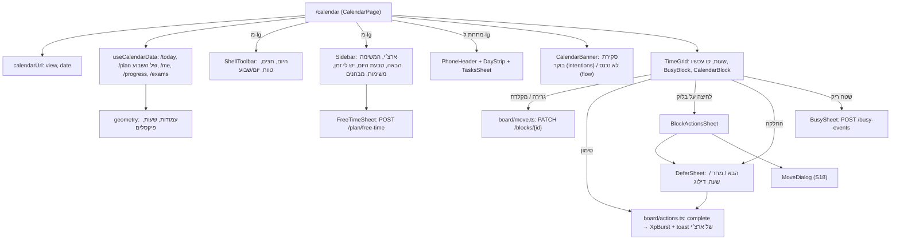

# S32 — מסך היומן: תוכנית עבודה

> **For agentic workers:** REQUIRED SUB-SKILL: Use superpowers:subagent-driven-development (recommended) or superpowers:executing-plans to implement this plan task-by-task. Steps use checkbox (`- [ ]`) syntax for tracking.

**מטרה:** מסך הבית של ארצ׳י הוא יומן. במחשב רשת של שבוע עם סרגל צד, בטלפון יום אחד עם פס ימים וגיליון משימות. כל הזרימה היומית קורית בתוך היומן: סימון "בוצע" בבלוק עם תגובה של XP, גרירה, החלקה, דחייה עם שלוש אפשרויות, דילוג מפורש, "יש לי זמן עכשיו", סימון זמן תפוס, סקירת הבוקר והדוח "לא נכנס".

**השער במפת הדרכים:** "כל הזרימה היומית עובדת ביומן, בטלפון ובמחשב, עם מקלדת ועם מגע".

**גישה:** בלי שינוי ב-API ובלי מיגרציה. כל מה שהיומן צריך כבר קיים: ‏`GET /plan` ו-`GET /today` (עם `busy` ו-`exam_color_index`), הפעולות של S14–S19, ‏`web/src/availability/api.ts` של S35, ו-`PATCH /tasks/{id} {status: 'skipped'}` של S15 לדילוג על משימה עתידית. ה-web בונה את המסך מחדש, ושומר את הלוגיקה של `board/`.

**כלים:** ‏React 19, ‏TypeScript strict, ‏React Router 8, ‏TanStack Query 5, ‏Tailwind 4, ‏React Aria Components 1.22, ‏lucide-react, ‏Vitest. בלי תלויות חדשות. התנועה ב-Web Animations API (`element.animate`) וב-CSS.

**מקורות:** `docs/superpowers/specs/2026-11-18-calendar-redesign-design.md` (4, 5), ‏`2026-11-18-archie-look-and-gamification.md` (3, 4.1, 4.7), ‏`2026-11-18-availability-design.md` (7, 10, 11), ‏`docs/design/design-language.md` (כולו, ובמיוחד 2.8, 2.9, 5, 6, 8, 9, 11), ההדמיה המחייבת `docs/design/prototype/all-screens.html` (המסכים "יומן", "פעולות ביומן", "רגעים ומצבים"), ו-`calendar-prototype.html` לאינטראקציות.

## איך החלקים מתחברים

- **למה הנתונים הם תמיד השבוע של התאריך הנבחר:** פס הימים בטלפון צריך את נקודות הצבע של כל השבוע, ותצוגת שבוע במחשב צריכה אותו בכל מקרה. בקשה אחת של `GET /plan?from=<ראשון>&to=<שבת>` משרתת יום, שבוע ופס, והמעבר בין ימים באותו שבוע לא מחכה לרשת. `GET /today` נשאר המקור של הדקות, של שעות הערות של היום ושל "המשימה הבאה", כמו ב-S14.
- **למה `board/` נשאר הלב:** הפעולות האופטימיות, ה-cache תחת `['board', userId]`, הפוקוס אחרי פעולה (`focus.ts`), ה"בטל" וה-toasts נבדקו ב-S14–S19. היומן הוא מראה חדש מעליהם. מה שנוסף ל-`board/` הוא מה שהיומן צריך ולא היה: דחייה עם בחירה, דילוג על כל בלוק, וזמן תפוס כסיבה לסירוב בגרירה.
- **למה המיקום של כל בלוק נקבע לפי `study_date`:** השרת מחליט לאיזה יום לימוד שייך בלוק (7.3). בלוק של 00:30 אחרי חצות שייך ליום הקודם, ולכן הוא מצויר בעמודה של היום הקודם, מתחת ל-24:00. הרשת נמתחת עד סוף היום המאוחר ביותר שבמסך.

## מה מצאתי לפני התכנון (18.11.2026)

1. **`POST /blocks/{id}/skip` עובד רק על בלוק שעבר** (`_review_block`), כי הוא של סקירת הבוקר. לבלוק עתידי יש `PATCH /tasks/{task_id} {status: 'skipped'}` (S15): הוא מוחק את הבלוקים הפתוחים של המשימה ומחזיר `version_id`, וה"בטל" הוא `POST /plan/undo`. אין צורך בשינוי בשרת.
2. **ל-`busy` אין עדיין מקום בטיפוסים כחובה** (שורת S35 במפה): ‏S32 הופך אותו לחובה, וה-fixtures מקבלים `busy: []`.
3. **הקודים של S35 בלי טקסט בעברית:** `slot_busy`, ‏`event_in_past`, ‏`too_many_events`, ‏`not_after_starts_at`, ‏`too_long`, ‏`nothing_to_place`, ‏`no_free_time`. ‏S32 מוסיף אותם ל-`he.codes`.
4. **ה-toast של `ui/` לא מקבל אייקון או תמונה**, ובהדמיה של "אחרי בוצע" יש בו את ארצ׳י. אסור לשנות רכיב קיים ב-`ui/` (S34 רץ במקביל), ולכן המשפט של ארצ׳י נכנס לטקסט של ה-toast, והאווטאר נרשם ל-S29.
5. **`ProgressBar` ממלא תמיד ב-`success`**, ובהדמיה הפס של כל מבחן בצבע שלו. נשאר `ProgressBar` (ירוק הוא "בוצע", וזו התקדמות של עבודה, 5.6), והצבע של המבחן עובר לריבוע שליד השם. נרשם ל-S29.
6. **`BuildingStep` מנווט ל-`/today`**, ו-`CALENDAR_PATH` מוגדר ב-`routes.tsx`, שמייבא את מסכי האונבורדינג. כדי לא ליצור מעגל, הקבוע עובר ל-`calendar/calendarState.ts`, ו-`routes.tsx` מייצא אותו משם.
7. **הסרגל העליון של השלד בטלפון** (56px) והכותרת של היומן לוקחים יחד 112px. ההדמיה מראה רק כותרת אחת.

## ההחלטות שלי

1. **תצוגה:** במחשב (מ-`lg`) ברירת המחדל היא שבוע, ו-`?view=day` הוא יום. בטלפון תמיד יום. התאריך ב-`?date=YYYY-MM-DD`; ‏`?from=` (של ההפניה מ-`/week`) נקרא כמו `date`. בלי `date`: היום (`Today.date`). תאריך לא תקין, או רחוק מ-1800 ימים, נקרא כהיום, כמו ב-`WeekPage`. מעבר בין ימים ושבועות כותב ל-URL, כך ש"אחורה" וקישור משותף עובדים. ‏`DAY_CHOSEN` של S31 כבר לא נחוץ: "יומן" בניווט מגיע ל-`/calendar` בלי פרמטרים, שהוא ברירת המחדל של כל רוחב. הקובץ נשאר רק בשביל `CALENDAR_PATH`.
2. **השלד:** `CalendarPage` מבקש מהשלד שני דברים, דרך hook חדש ב-`ShellToolbar.tsx`: ‏`useShellFrame({ fullBleed: true, ownPhoneHeader: true })`. ‏`AppShell` מוותר אז על `max-w-3xl` ועל הריפוד של `main`, ומסתיר את הסרגל העליון שלו מתחת ל-`lg`. היומן מצייר בטלפון כותרת אחת: הכותרת (`h1`), התאריך, ‏`ProgressChip` ו-`ProfileMenu` (אותם רכיבים של S31, כך שההגדרות והיציאה נשארות במקום שלהן). מסך אחר לא מבקש, ולכן לא משתנה.
3. **גובה שעה:** 48px במחשב (רשת של שבוע צריכה לראות את רוב היום), 60px בטלפון. גבולות הרשת: מהשעה העגולה של הקימה (`/me`, ‏`wake_time`) או של הפריט המוקדם ביותר שבמסך, ועד השעה העגולה של השינה או של הפריט המאוחר ביותר, ומעבר לחצות עד 26:00 לכל היותר. ברירת מחדל בלי `/me`: ‏08:00–22:00, כמו בהדמיה.
4. **בלוק:** `examColor(block.exam_color_index)`: רקע `soft`, גבול `line`, פס התחלה `border-s-4` ב-`currentColor` של `text`. בפנים: תיבת סימון, שם (600), ושורת משנה "10:00–11:30, אלגוריתמים" (השעות ב-`dir="ltr"`) כשיש מקום. **המצבים, בלי שקיפות** (2.7):
   - `done`: רקע `surface-muted`, השם `ink-muted` ב-400 עם קו חוצה, התיבה מלאה `brand` עם ✓.
   - עבר ולא בוצע (`overdue`): רקע `surface` עם גבול מקווקו בגוון `line` של המבחן, והמילים "עבר הזמן" בשורת המשנה. כך הוא "מעומעם בצבע" ונשאר קריא.
   - `in_progress`: כמו upcoming, עם "עכשיו" בשורת המשנה.
   - נעול: `Lock` של 14px בשורת המשנה, עם `aria` במילה.
   - `missed` ו-`skipped` לא מצוירים ברשת, כמו בציר של S18: הם היסטוריה.
5. **תיבת הסימון בבלוק** היא רכיב חדש, `ui/BlockCheck`: ‏toggle של React Aria עם ריבוע של 16px ופינות 6px (4: "6px לתיבה בתוך בלוק"), ואזור לחיצה של 44px לרוחב ולכל גובה הבלוק. בלוק של חצי שעה בטלפון גבוה 30px, ולכן 44px לגובה לא אפשרי בתוך הבלוק. **הכפתור הגלוי של 44px** לכל פעולה נמצא ברשימת "המשימות של היום" (`BlockRow` עם `CheckButton` ותפריט), בסרגל הצד ובגיליון. זה עומד ב-2.5.8 של WCAG 2.2 (24px), וביעד של 44px דרך החלופה.
6. **לחיצה על בלוק** (העכבר, מגע, Enter) פותחת `BlockActionsSheet`: גיליון בטלפון וחלון במחשב (`Dialog`), עם השם, השעות והמבחן, ובו "בוצע" (או "ביטול סימון"), "דחייה", "הזזה" (ה-`MoveDialog` של S18), "נעילה" או "ביטול נעילה", ו"דילוג". זה תפריט הפעולות למקלדת ולקורא מסך. גיליון ולא `Menu` כי ה-popover של `Menu` נצמד לבלוק קטן בתוך רשת שנגללת, והגיליון הוא הצורה של כל שאר הפעולות ביומן בהדמיה.
7. **מקלדת על בלוק:** Enter או רווח פותחים את הפעולות. חץ למעלה או למטה מתחיל הזזה (במקום Enter של S18, שעכשיו פותח פעולות), וממשיך ב-15 דקות; PageUp ו-PageDown שעה; Enter מאשר; Escape מבטל; Tab מבטל. ההוראות ב-`aria-describedby`, וה-live region מכריז על כל שעה מוצעת, כמו ב-S18.
8. **גרירה:** עכבר ועט: מתחילה אחרי 4px של תנועה אנכית. מגע: לחיצה ארוכה של 350ms בלי תזוזה, כי לבלוק יש `touch-action: pan-y` והאצבע צריכה לגלול את היום גם מעל בלוקים (באב-הטיפוס הבלוק חסם גלילה). מרגע שהגרירה התחילה, `touchmove` לא פסיבי עוצר את הגלילה. הבלוק מקבל `shadow-lift`, ומעליו תווית שעה בצבע `inverse` (‏`on-inverse` על `inverse`, זוג מותר). מקום תפוס מסומן במילה "תפוס" ובגבול `danger`, ושחרור שם מחזיר את הבלוק למקום. **תפוס כולל זמן תפוס** (`busy`): `moveProblem` מחזיר `slot_busy`, בדיוק כמו השרת. גרירה רק באותה עמודה, כמו במסמך הראשי.
9. **החלקה (מגע בלבד):** החלקה אופקית של יותר מ-8px, שגדולה מהאנכית, מזיזה את הבלוק לכיוון הסוף (שמאלה ב-RTL) עד 144px, ומגלה שני כפתורים אמיתיים: "דחייה" (מילוי `gold`, טקסט `ink`) ו"דילוג" (מילוי `clay`, טקסט `on-clay`). שחרור אחרי 60px משאיר אותם פתוחים; לחיצה מחוץ סוגרת. "דחייה" פותח את `DeferSheet`, "דילוג" מדלג עם "בטל". מבלוק `done` אין החלקה.
10. **דחייה:** `DeferSheet` עם שלוש `ActionCard` (רכיב חדש ב-`ui/`): "למקום הפנוי הבא", "מחר", "בחירת שעה". "בחירת שעה" מחליף את התוכן ל-`DatePicker` (מהיום) ו-`OptionGrid` של השעות מ-`useDeferSlots`, עם "דחייה ל-HH:MM". בתחתית `Button variant="danger"`: "דילוג: המשימה יוצאת מהתוכנית". כל אחת כותבת toast של לאן זה הלך, עם "בטל" (`POST /plan/undo`). ‏`placement_failed` → ‏`ReplanOffer` כמו היום; ‏`slot_taken`, ‏`slot_busy`, ‏`outside_day` → הודעה בתוך הגיליון, והבחירה נשארת פתוחה.
11. **דילוג:** בלוק שעבר → ‏`POST /blocks/{id}/skip` (S18); כל בלוק אחר → ‏`PATCH /tasks/{task_id} {status: 'skipped'}`. שניהם מחזירים `version_id`, וה"בטל" הוא `POST /plan/undo` (עם `undoOnce`). ה-toast: "דילגת על "X". המשימה יצאה מהתוכנית".
12. **"יש לי זמן עכשיו":** `FreeTimeSheet` עם ארצ׳י (`joy`, אווטאר) ובועה "יופי, זמן פנוי! כמה יש לך?", ‏`OptionGrid` של 30 דקות, שעה, שעה וחצי, "אחר" (ואז `Select` של 2–8 שעות בקפיצות של חצי שעה). "מה יוקדם" מחושב בדפדפן לפי הכלל של S35 (הבלוקים העתידיים הבאים בסדר הלוח, עד שהזמן נגמר), ומוצג כ"כנראה יוקדמו". השרת מחליט, וה-toast אחרי התשובה אומר כמה הוקדמו, עם "בטל". ‏`nothing_to_place` ו-`no_free_time` → ‏`Note` בתוך הגיליון.
13. **זמן תפוס:** `BusyBlock` מתחת לבלוקים: `bg-busy-soft`, קווים אלכסוניים ב-`busy-line`, גבול מקווקו ב-`busy`, הכותרת ב-`ink` והשעות ב-`ink-muted` (זוגות מותרים). לחיצה על אירוע → ‏`BusySheet` לעריכה ולמחיקה. לחיצה על התחייבות קבועה → גיליון קטן שאומר מה היא ומתי, עם קישור "עריכה בהגדרות" (`/settings`; העריכה של S34). **סימון חדש:** לחיצה על שטח ריק פותחת `BusySheet` מהרבע שעה שנלחץ, לשעה; גרירה בעכבר על שטח ריק בוחרת טווח, עם תצוגה מקווקוות. במגע רק לחיצה, כי גרירה על שטח ריק היא גלילה. הכפתור הגלוי: "סימון זמן תפוס" בסרגל הצד ובגיליון המשימות. **"מה יזוז":** הבלוקים המתוכננים שחופפים לטווח מוצגים בגיליון לפני השמירה ("בלוק אחד יזוז: X"); לאן הם עברו אומר ה-toast אחרי התשובה, עם "בטל". ‏`unplaced` → ה-toast אומר שמשהו לא נכנס, והדוח נפתח. **מחיקת אירוע:** אין לה "בטל" בשרת, ולכן היא נשלחת רק כשה-toast של "בטל" פג (`onExpire`), והאירוע מוסתר בינתיים, כמו המחיקה הקשה של חומר ב-S13.
14. **סרגל הצד (מחשב, 300px):** מלמעלה: ארצ׳י (`Archie size="avatar"`) ובועה עם השעה והמשפט של הרגע; המשימה הבאה (`NextBlock` בעיצוב חדש: רקע `soft` של המבחן, גבול `line`, פס התחלה, "בוצע" ראשי ו"דחייה"); טבעת היום (`ui/ProgressRing` חדש, ‏`sprout` על `surface-muted`, עם "90 מתוך 195 דקות"); "יש לי זמן עכשיו" ו"סימון זמן תפוס"; "המשימות של היום" (`BlockRow` עם פס צבע); "המבחנים" (שם, "בעוד 22 ימים", ‏`ProgressBar` של דקות המשימות שבוצעו מתוך כל המשימות שלא דולגו, מ-`GET /exams/{id}/tasks`). **הסטייה מההדמיה:** בהדמיה הכרטיס של המשימה הבאה הוא מעבר מה-soft ללבן; כאן הוא soft מלא, כי `examColor()` לא נותן מחלקות של מעבר ואסור לבנות אותן מספר.
15. **הטלפון:** הכותרת (החלטה 2), ‏`CalendarBanner`, ‏`DayStrip`, הרשת של היום, והבר של הגיליון מעל הסרגל התחתון: "המשימות של היום, 3 נשארו, 195 דקות". הבר פותח `Dialog` (גיליון) עם הרשימה, "יש לי זמן עכשיו" ו"סימון זמן תפוס". הדף נגלל בחלון (לא קופסה פנימית), והכותרת והפס דבוקים למעלה. החלקה אופקית על שטח ריק ברשת עוברת ליום הבא או הקודם, וגם החצים של המקלדת על הפס.
16. **פס הימים:** שבעה כפתורים (ראשון עד שבת), כל אחד עם היום, התאריך, ועד ארבע נקודות בצבעי המבחנים של אותו יום, או `Leaf` ליום שעבר והרצף נשמר בו (`progress.days[].xp > 0`). הנבחר `bg-inverse text-on-inverse`; היום `aria-current="date"` וגם מילה ב-sr-only. השם הנגיש: "רביעי 18, 3 משימות".
17. **יום מנוחה:** יום מהיום והלאה שאין בו אף בלוק, בשבוע שיש בו בלוקים בימים אחרים, מסומן "יום מנוחה" עם `Coffee`. ביום מנוחה של היום ארצ׳י במצב `rest`.
18. **ארצ׳י (`calendar/archie.ts`):** פונקציה טהורה שבוחרת את הרגע: יש בלוקים בסקירה → ‏`intentions`; יש `unplaced` → ‏`flow`; היום יום מנוחה → ‏`rest`; כל הבלוקים של היום בוצעו → ‏`eureka` (רק משפט; החגיגה של S33); בלוק של 60 דקות ומעלה בתהליך → ‏`wisdom`; אחרת `intentions` לפני 12:00 ו-`joy` אחריה. לכל רגע כמה ניסוחים ב-`he.ts`, והניסוח נבחר לפי היום בשנה, כדי שיהיה יציב במשך היום ושונה ממחר. **הודעות שקופצות** (ההפסקה אחרי 90 דקות של בלוקים שבוצעו ברצף) עוברות דרך `archieMayInterrupt()`, ששומר את הזמן האחרון ב-`localStorage` ונותן הודעה אחת ל-20 דקות. התגובה ל"בוצע" לא עוברת דרכו (מסמך ארצ׳י 3.3).
19. **רגע "בוצע" (4.1, בסיסי):** הסימון אופטימי ומיידי (S14). כשהתשובה מגיעה עם `xp_change > 0`: ‏`XpBurst` מצייר "+20 XP" (`gold-soft`/`gold-ink`) ופתית זהב מעל התיבה, ומעיף אותו ב-600ms אל טבעת הרמה (`header a[href="/progress"]`, או זו שבכותרת הטלפון), וטבעת הרמה מקבלת הילה זהובה קצרה. ‏`progressKey` מתעדכן מיד מ-`result.progress` (total_xp, level), כך שהקשת מתמלאת בלי לחכות לרענון. טבעת היום זזה ב-transition של 600ms. עם `prefers-reduced-motion` אין תעופה: רק המספרים והטקסט. ביטול סימון לא מציג אנימציה. ה-toast: משפט של ארצ׳י, ואחריו הטקסט של S19 ("יפה. עוד אבן במקום. בוצע. 20 XP"), עם "בטל". ה-toast הוא live region, כך שקורא מסך שומע הכול.
20. **פס הסקירה והדוח (`CalendarBanner`):** מעל הרשת. סגור: ארצ׳י (`intentions` או `flow`, אווטאר) ושורה אחת ("סקירת בוקר: בלוק אחד מאתמול לא סומן", "משהו לא נכנס: 2 משימות"), עם כפתור "לסקירה" / "לפרטים" (`aria-expanded`). פתוח: התוכן של `ReviewCard` ו-`PlanReport` (הלוגיקה, הפוקוס והבדיקות שלהם נשארים; רק העטיפה משתנה). כשיש שניהם, שתי שורות. ‏`#report` (מ-`offerReplan`) פותח את הדוח וגולל אליו.
21. **גלילה ל"עכשיו":** פעם אחת בכל כניסה למסך ובכל מעבר לשבוע או ליום שיש בו את היום: "עכשיו" שליש מגובה האזור מלמעלה. ביום אחר: הבלוק הראשון, או תחילת היום. בלי `smooth` (וגם reduced motion).
22. **הטקסטים** בקובצי `i18n/heCalendar*.ts` (אחד לכל משימה), ש-`he.ts` מרכיב תחת `he.calendar`, כמו `heCrash.ts` ו-`hePwa.ts`. כך משימות במקביל לא נוגעות באותו קובץ.
23. **מה נמחק:** `pages/TodayPage.tsx`, ‏`week/` (שני הקבצים), ‏`today/DayTimeline.tsx`, ‏`TodayBlocks.tsx`, ‏`TodayViewSwitch.tsx`, ‏`todayView.ts`, ‏`DayProgress.tsx`. הבדיקות שלהם שבודקות התנהגות עוברות לרכיבים החדשים (כל משימה מפרטת). נשארים: ‏`today/NextBlock`, ‏`today/ReviewCard`, ‏`today/chooseNext`, ‏`board/*`.

## Global Constraints

- רק tokens של `index.css` ורק זוגות של 2.5 ו-2.6 במסמך העיצוב. בלי `text-brand`, בלי שקיפות על טקסט או בלוק, בלי hex ברכיב.
- רק רכיבי `web/src/ui/`. רכיב חסר: קובץ חדש ב-`ui/` עם בדיקה, ב-`/dev/components` ובטבלה 5.8. **לא משנים רכיב קיים ב-`ui/`.**
- logical properties בלבד; שעות תמיד `dir="ltr"` ו-`tabular-nums`.
- כל טקסט ב-`he.ts` (דרך `heCalendar*.ts`); טקסט של דף הרכיבים ב-`dev/devText.ts`.
- 44px לכל פקד מחוץ לבלוק; לכל מחווה כפתור גלוי; שם נגיש לכל כפתור שחוזר ("בוצע: X").
- כל תנועה עד 600ms, לא חוסמת, ונעצרת עם `prefers-reduced-motion`.
- ארצ׳י רק דרך `Archie` והאיורים שב-`web/` (לא מציירים אותו).
- ההתנהגות של S14–S19 ו-S35 לא משתנה. בדיקה משתנה רק כשהיא נשענת על מבנה או טקסט שהשתנה.
- `ShellToolbar` מוצג רק מ-`lg`.

## Review Focus

1. **בלוק אחרי חצות ויום עם מעבר שעון:** בלוק 00:30 של יום הלימוד הקודם, ובלוק ביום של מעבר לשעון חורף. צפוי: בעמודה של `study_date`, בגובה הנכון, בלי לקפוץ לעמודה הבאה (Task 2).
2. **רענון שמגיע באמצע גרירה:** ה-`refetchInterval` של דקה מחליף את הבלוק שנגרר, או הופך אותו ל-`in_progress`. צפוי: הגרירה נגמרת ב"בוטל", בלי שגיאה ובלי קפיצה (Task 5).
3. **גלילה במגע מעל בלוקים:** אצבע שגוללת את היום מעל בלוק לא מתחילה גרירה ולא החלקה. צפוי: הדף נגלל (Task 5).
4. **"בטל" אחרי מעבר יום:** toast של דחייה שנלחץ אחרי שהמשתמש עבר ליום אחר. צפוי: ה"בטל" עובד, כי הקריאות חיות על ה-mutation ולא על המסך (Task 3).
5. **תשובה ישנה מה-cache בלי `busy` או בלי `exam_color_index`:** צפוי: המסך עולה, בלי זמן תפוס ובצבע 7 (Task 2).

## מה רץ במקביל

| גל | משימות | למה אפשר במקביל |
| --- | --- | --- |
| 0 | Task 0 (השיחה הראשית) | השלד המשותף: טיפוסים, טקסטים, השלד והקבוע |
| 1 | Task 1, ‏Task 2, ‏Task 3 | קבצים נפרדים: `ui/`, ‏`calendar/` הטהור, ‏`board/` |
| 2 | Task 4, ‏Task 5, ‏Task 6 | הרשת, הגיליונות, הסרגל והטלפון: כל אחד בקבצים שלו, ונפגשים רק דרך ה-props שב-Interfaces |
| 3 | Task 7 | מרכיב את המסך מכל החלקים |
| 4 | Task 8 (השיחה הראשית) | צילומים, סקירה, מסמכים ומיזוג |

## קבצים משותפים

- `web/src/i18n/he.ts`: רק Task 0 (מרכיב את `heCalendar*.ts` ומוסיף את הקודים של S35). כל משימה כותבת לקובץ `heCalendar<Part>.ts` שלה (Grid: Task 4, ‏Sheets: Task 5, ‏Side: Task 6, ‏Archie: Task 3, ‏Page: Task 7).
- `web/src/dev/ComponentsPage.tsx`, ‏`devText.ts`: רק Task 1.
- `docs/design/design-language.md`: Task 1 (שורות ב-5.8), ו-Task 8 (סעיף היומן ו-11).
- `web/src/test/boardFixtures.tsx`: Task 0 (`busy: []`). משימה שצריכה fixture נוסף מוסיפה פונקציה חדשה בקובץ משלה (`calendar/testFixtures.ts`).
- **S34 במקביל:** לא נוגעים ב-`pages/` (חוץ מ-`TodayPage`), ‏`onboarding/` (חוץ משורת הניווט של `BuildingStep`), ‏`exam/`, ‏`settings/`. מ-`exam/api.ts` רק מייבאים.

---

### Task 0: השלד המשותף (השיחה הראשית)

**Files:**
- Modify: `web/src/board/types.ts` (`busy: BusyItem[]` חובה ב-`Plan` וב-`Today`), ‏`web/src/test/boardFixtures.tsx` (`busy: []`)
- Create: `web/src/i18n/heCalendarGrid.ts`, ‏`heCalendarSheets.ts`, ‏`heCalendarSide.ts`, ‏`heCalendarArchie.ts`, ‏`heCalendarPage.ts` (אובייקט ריק `as const` בכל אחד); Modify: `web/src/i18n/he.ts` (`calendar: { ...הקיים, grid, sheets, side, archie, page }`, וקודים: `slot_busy`, ‏`event_in_past`, ‏`too_many_events`, ‏`not_after_starts_at`, ‏`too_long`, ‏`nothing_to_place`, ‏`no_free_time`)
- Modify: `web/src/calendar/calendarState.ts` (`export const CALENDAR_PATH = '/calendar'`), ‏`web/src/app/routes.tsx` (מייצא אותו משם), ‏`web/src/onboarding/BuildingStep.tsx` (`navigate(CALENDAR_PATH)`, והבדיקה שלו)
- Modify: `web/src/app/ShellToolbar.tsx` (`useShellFrame`), ‏`web/src/app/AppShell.tsx`; Test: `web/src/app/AppShell.test.tsx`

**Interfaces:**
- Produces: `useShellFrame(frame: { fullBleed?: boolean; ownPhoneHeader?: boolean }): void` (מבקש בזמן mount, משחרר ב-unmount). `he.calendar.grid|sheets|side|archie|page`.

- [ ] **Step 1:** בדיקה ב-`AppShell.test.tsx`: מסך שקורא `useShellFrame({ fullBleed: true, ownPhoneHeader: true })` → ל-`header` יש `hidden lg:block` ול-`main` אין `max-w-3xl`; מסך שלא קורא → כמו היום. בדיקה ל-`BuildingStep` שהניווט הוא ל-`/calendar`.
- [ ] **Step 2:** להריץ ולראות שנכשל.
- [ ] **Step 3:** לממש. ה-context חי ב-`ShellToolbar.tsx`, ליד ה-slot.
- [ ] **Step 4:** `npm test`, ‏`npm run typecheck`, ‏`npm run lint` ירוקים (כולל כל ה-fixtures עם `busy`).
- [ ] **Step 5:** commit.

### Task 1: רכיבי `ui/` חדשים

**Files:**
- Create: `web/src/ui/BlockCheck.tsx`, ‏`ProgressRing.tsx`, ‏`ActionCard.tsx`, ‏`web/src/ui/s32.test.tsx`, ‏`web/src/dev/s32Sections.tsx`
- Modify: `web/src/dev/ComponentsPage.tsx` (שורת import ו-render), ‏`web/src/dev/devText.ts` (קטע `s32`), ‏`docs/design/design-language.md` (שלוש שורות ב-5.8)

**Interfaces:**
- Produces:
  - `BlockCheck({ isDone: boolean; onChange: (isDone: boolean) => void; 'aria-label': string; isDisabled?: boolean; className?: string })`: ‏ToggleButton; ריבוע 16px, פינות 6px, גבול 2px `border-current` (צבע המבחן) על `bg-field`; בוצע: `bg-brand border-brand` ו-`Check` של 12px ב-`text-on-brand`. אזור הלחיצה `min-w-touch self-stretch`; `onPointerDown` עוצר propagation (כדי שלא יתחיל גרירה).
  - `ProgressRing({ value: number; max: number; size?: number /* 56 */; 'aria-label': string; valueText: string; children?: ReactNode })`: ‏`role="meter"` עם `aria-valuenow/min/max/valuetext`; מסילה `stroke-surface-muted`, קשת `stroke-sprout`, ‏`transition-[stroke-dashoffset] duration-600`; המרכז מציג `children` (ברירת מחדל: האחוז).
  - `ActionCard({ icon: LucideIcon; title: string; description?: string; onPress: () => void; isDisabled?: boolean; isPending?: boolean })`: כפתור של React Aria בצורת `.opt` של ההדמיה: `bg-field border border-line rounded-control p-3 min-h-touch`, אריח אייקון 36px `bg-surface-muted rounded-control`, כותרת 600 ותיאור `text-small text-ink-muted`.

- [ ] **Step 1:** בדיקות ב-`s32.test.tsx`: ‏`BlockCheck` הוא `button` עם `aria-pressed`, השם שניתן, רווח ו-Enter מחליפים, `isDisabled` חוסם; ‏`ProgressRing` הוא `meter` עם `aria-valuenow="90"` ו-`aria-valuetext="90 מתוך 195 דקות"`, ו-value מעל max נחתך ל-100%; ‏`ActionCard` הוא `button` שהשם שלו כולל את הכותרת, והתיאור ב-`aria-describedby`; `isPending` מכריז "טוען" ולא מגיב.
- [ ] **Step 2:** להריץ ולראות שנכשל.
- [ ] **Step 3:** לממש, ולהוסיף את שלושתם ל-`/dev/components` בכל מצב (ריק, בוצע, כבוי; 0%, 46%, 100%; רגיל, בטעינה).
- [ ] **Step 4:** `npm test -- s32 ComponentsPage theme`, ‏typecheck, ‏lint.
- [ ] **Step 5:** commit.

### Task 2: הנתונים והגאומטריה (טהור)

**Files:**
- Create: `web/src/calendar/calendarUrl.ts`, ‏`geometry.ts`, ‏`days.ts`, ‏`useCalendarData.ts`, ‏`useIsDesktop.ts`, ‏`examProgress.ts`, ‏`testFixtures.ts`; Tests: `calendarUrl.test.ts`, ‏`geometry.test.ts`, ‏`days.test.ts`, ‏`examProgress.test.ts`

**Interfaces:**
- Produces:
  - `type CalendarView = 'day' | 'week'`; `useCalendarUrl(): { view: CalendarView; date: string | null; setDate(date: string): void; setView(view: CalendarView): void; goToday(): void }` (מחשב את ברירת המחדל לפי `useIsDesktop()`; `?from=` נקרא כ-`date`; `setView('week')` שומר את `date`).
  - `useIsDesktop(): boolean` (`matchMedia('(min-width: 1024px)')`, חי; ב-jsdom בלי `matchMedia` → `false`).
  - `interface GridSpan { startMin: number; endMin: number }` (דקות מחצות של יום העמודה; `endMin` עד 1560).
  - `localMinutes(iso: string, columnDate: string, tz: string): number` (דקות מחצות של `columnDate` בשעון הקיר של `tz`; אחרי חצות מעל 1440).
  - `gridSpan(input: { days: string[]; blocks: Block[]; busy: BusyItem[]; wake: string | null; sleep: string | null; tz: string }): GridSpan`.
  - `busyColumn(item: BusyItem, days: string[], span: GridSpan, tz: string): { date: string; startMin: number; endMin: number } | null` (החלטה: עמודת התאריך המקומי של ההתחלה; התחלה לפני `span.startMin` כשהעמודה הקודמת נמתחת אחרי 1440 → העמודה הקודמת; נחתך לגבולות).
  - `toPx(min: number, span: GridSpan, hourPx: number): number`; `HOUR_PX = { desktop: 48, phone: 60 }`.
  - `weekDays(date: string): string[]` (ראשון עד שבת, דרך `weekStart`).
  - `streakDays(progress: Progress | undefined): Set<string>` (ימים עם `xp > 0`); `restDays(days: string[], blocks: Block[], today: string): Set<string>` (החלטה 17); `dayDots(blocks: Block[], date: string): number[]` (צבעים ייחודיים לפי סדר ההתחלה, עד 4).
  - `wakingSpan(date: string, me: Me | undefined, tz: string): { dayStart: number | null; dayEnd: number | null }` (מ-`wake_time`/`sleep_time`; שינה לפני קימה = אחרי חצות).
  - `useCalendarData(date: string | null): { today: UseQueryResult<Today>; plan: UseQueryResult<Plan>; me; progress; exams; days: string[]; anchor: string | undefined }` (`anchor` = ‏`date ?? today.data?.date`; ה-plan של `weekDays(anchor)`).
  - `useExamProgress(examIds: string[]): Map<string, { done: number; total: number }>` (עם `useQueries` ועם אותו מפתח של `useExamTasks` ב-`exam/api.ts`, כדי לשתף cache; דקות של משימות `done` מתוך `todo` ו-`done`).
  - `calendar/testFixtures.ts`: `makeBusy(overrides?: Partial<BusyItem>): BusyItem`, `makeProgress(overrides?): Progress`, `makeExam(overrides?)` (כולל `color_index` ו-`exam_date`).

- [ ] **Step 1:** בדיקות. ‏`localMinutes('2026-11-16T22:30:00Z', '2026-11-16', 'Asia/Jerusalem') === 1470` (00:30 של ה-17 בעמודה של ה-16); ביום מעבר לשעון חורף (25.10.2026, ירושלים) בלוק 10:00 מקומי → ‏600. ‏`gridSpan` בלי פריטים ועם קימה 08:00 ושינה 23:00 → ‏`{480, 1380}`; עם בלוק עד 00:30 → ‏`endMin` 1500 (עיגול לשעה: 1500); בלי `/me` → ‏`{480, 1320}`. ‏`busyColumn` של משמרת 22:00–06:00 → העמודה של ההתחלה, נחתכת ב-`endMin`. ‏`calendarUrl`: ‏`?from=2026-11-18` → ‏`date` = ‏`2026-11-18`; ‏`?date=2026-02-31` → ‏`null`; במחשב בלי view → ‏`week`, בטלפון עם `view=week` → ‏`day`. ‏`restDays`: יום עתידי בלי בלוקים בשבוע שיש בו בלוקים → מנוחה; שבוע ריק → אין. ‏`dayDots`: חמישה מבחנים ביום → ארבע נקודות. תשובה בלי `busy` → ‏`[]` (Review Focus 5). ‏`examProgress`: משימות 60 done, ‏90 todo, ‏30 skipped → ‏`{60, 150}`.
- [ ] **Step 2:** להריץ ולראות שנכשל.
- [ ] **Step 3:** לממש. החישוב של שעון הקיר דרך `Intl.DateTimeFormat` עם `timeZone` (כמו `board/time.ts`), בלי ספרייה.
- [ ] **Step 4:** `npm test -- calendar`, ‏typecheck, ‏lint.
- [ ] **Step 5:** commit.

### Task 3: הפעולות (`board/`) וארצ׳י

**Files:**
- Modify: `web/src/board/actions.ts` (+ `actions.test.tsx`), ‏`web/src/board/move.ts` (+ `move.test.ts`), ‏`web/src/board/progressText.ts` (+ test)
- Create: `web/src/calendar/archie.ts` (+ `archie.test.ts`); Modify: `web/src/i18n/heCalendarArchie.ts`

**Interfaces:**
- Produces:
  - `BlockActions.defer(block: Block, request?: DeferRequest): void` (בלי request: כמו היום, `POST /blocks/{id}/defer` בלי גוף; עם request: הגוף). אותו toast של "נדחה ל…" ואותו "בטל"; ‏`placement_failed` → ‏`offerReplan`; ‏`slot_taken`, ‏`slot_busy`, ‏`outside_day` → toast של `codeText`. ‏`BlockActions.deferError(blockId): ApiError | null` לא נחוץ: הגיליון מקבל `onError` (ראו הבא).
  - `BlockActions.defer(block, request, options?: { onSuccess?(): void; onError?(error: ApiError): boolean /* true = הגיליון מציג בעצמו, בלי toast */ })`.
  - `BlockActions.skip(block: Block): void` (החלטה 11), ו-`BlockActions.skipping(blockId): boolean`.
  - `BlockActions.complete` מוסיף: `setQueryData(progressKey(userId))` עם `total_xp` ו-`level` מ-`result.progress`, ו-`emitCompleted({ blockId, xp: number })` (אירוע קטן ב-`calendar/xpEvents.ts`: ‏`onCompleted(listener) => unsubscribe`) שה-`XpBurst` של Task 7 מאזין לו.
  - `completeText(result, undone, archieLine?: string)`: המשפט של ארצ׳י ראשון, רק כשלא `undone`.
  - `MoveDay.busy?: { starts_at: string; ends_at: string }[]`; ‏`MoveProblem` מוסיף `'slot_busy'` (נבדק אחרי `slot_taken`).
  - `archie.ts`: `type ArchieMoment = 'review' | 'report' | 'restDay' | 'dayDone' | 'deepWork' | 'morning' | 'day'`; `archieMoment(input: { reviewCount: number; unplacedCount: number; todayIsRest: boolean; todayBlocks: Block[]; now: number; hour: number }): ArchieMoment`; `MOMENT_MOOD: Record<ArchieMoment, ArchieMood>`; `archieLine(moment: ArchieMoment | 'done' | 'break', date: string): string` (ניסוח לפי היום בשנה, מתוך `he.calendar.archie[moment]`, שלכל אחד לפחות שלושה ניסוחים); `archieMayInterrupt(now: number, storage?: Storage): boolean` (מחזיר true ושומר רק אם עברו 20 דקות; storage שזורק → true בלי שמירה); `needsBreak(todayBlocks: Block[], now: number): boolean` (90 דקות לפחות של בלוקים `done` רצופים, עם רווח של עד 15 דקות ביניהם, שהאחרון נגמר בחצי השעה האחרונה).

- [ ] **Step 1:** בדיקות. ‏`defer(block, {to: 'tomorrow'})` שולח `POST /blocks/b/defer` עם `{to: 'tomorrow'}`, ‏toast "נדחה למחר בשעה 09:00", ו"בטל" שולח `POST /plan/undo` עם ה-version. ‏`defer(block)` בלי request שולח בלי גוף (הבדיקות הקיימות לא משתנות). ‏`onError` שמחזיר true → אין toast. ‏`skip` של בלוק `upcoming` → ‏`PATCH /tasks/task-1 {status: 'skipped'}`; של `overdue` → ‏`POST /blocks/block-1/skip`; ה-toast כולל "יצאה מהתוכנית", ו"בטל" → ‏`POST /plan/undo`. ‏`complete` עם `progress.total_xp: 1240` → ה-cache של `progressKey` מחזיק 1240 לפני הרענון, ו-`onCompleted` נקרא עם `xp: 20`; ‏`uncomplete` לא קורא לו. ‏`moveProblem` על בלוק שחופף ל-busy → ‏`'slot_busy'`; נוגע בקצה → ‏`null`. ‏`archieMoment`: סקירה גוברת על דוח, דוח על מנוחה; ‏`archieLine('morning', '2026-11-18') !== archieLine('morning', '2026-11-19')` כשיש שלושה ניסוחים; ‏`archieMayInterrupt` פעמיים בהפרש 5 דקות → true ואז false, ואחרי 21 דקות → true. ‏`needsBreak` עם 60+30 רצופים → true; עם רווח של 30 → false. "בטל" אחרי unmount של המסך (Review Focus 4) עדיין שולח.
- [ ] **Step 2:** להריץ ולראות שנכשל.
- [ ] **Step 3:** לממש.
- [ ] **Step 4:** `npm test -- board calendar/archie`, ‏typecheck, ‏lint.
- [ ] **Step 5:** commit.

### Task 4: הרשת והבלוק

**Files:**
- Create: `web/src/calendar/TimeGrid.tsx`, ‏`CalendarBlock.tsx`, ‏`BusyBlock.tsx`, ‏`useBlockDrag.ts`, ‏`useSwipe.ts`, ‏`useEmptyPress.ts`; Tests: `TimeGrid.test.tsx` (ההעברה של `today/DayTimeline.test.tsx`), ‏`CalendarBlock.test.tsx`
- Modify: `web/src/i18n/heCalendarGrid.ts`
- Delete (בסוף המשימה): `web/src/today/DayTimeline.tsx`, ‏`DayTimeline.test.tsx` (אחרי שכל בדיקת התנהגות עברה)

**Interfaces:**
- Consumes: Task 1 (`BlockCheck`), Task 2 (`GridSpan`, ‏`localMinutes`, ‏`busyColumn`, ‏`toPx`, ‏`HOUR_PX`, ‏`wakingSpan`), Task 3 (`MoveDay.busy`, ‏`'slot_busy'`), ‏`useMoveBlock`, ‏`useBlockActions`.
- Produces:
  - `TimeGrid(props: { days: string[]; today: string; span: GridSpan; hourPx: number; blocks: Block[]; busy: BusyItem[]; tz: string; now: number; restDays: Set<string>; streakDays: Set<string>; dayBounds: (date: string) => { dayStart: number | null; dayEnd: number | null }; showHeader: boolean /* שורת הימים של השבוע */; scrollRef?: RefObject<HTMLElement | null>; onOpenBlock(block: Block): void; onSwipeAction(block: Block, action: 'defer' | 'skip'): void; onOpenBusy(item: BusyItem): void; onCreateBusy(range: { date: string; startsAt: string; endsAt: string }): void; onSwipeDay?(direction: 1 | -1): void })`.
  - שורת הימים (כש-`showHeader`): השם, עיגול התאריך (היום: `bg-brand text-on-brand`, והמילה ב-sr-only), ו-`Leaf` ב-`text-brand-strong` ליום של רצף. עמודת השעות: כל שעה עגולה, ושעת "עכשיו" ב-`now-text` (font-semibold) בגובה הקו, במקום התווית הלבנה על `now` של ההדמיה (זוג אסור). קו "עכשיו": ‏`border-t-2 border-now` ועיגול של 8px בתחילתו, רק בעמודה של `today`. יום היום: עמודה ב-`bg-canvas` מעל `bg-surface`.
  - `data-now-y` על אלמנט הרשת (המיקום של "עכשיו" בפיקסלים) ו-`data-first-y` (הבלוק הראשון), בשביל הגלילה של Task 7.

- [ ] **Step 1:** להעביר את `DayTimeline.test.tsx` ל-`TimeGrid.test.tsx`: כל בדיקה של גרירה במקלדת (עם חץ כהתחלה במקום Enter; החלטה 7), בעכבר (pointer עם `pointerType: 'mouse'`), הכרזות ה-live region, צללית "פנוי"/"תפוס", סירוב (`slot_taken`, ‏`outside_day`), Escape, Tab, רענון שמבטל גרירה (Review Focus 2), והפוקוס שחוזר לבלוק אחרי הזזה. בדיקות חדשות: מגע מתחיל גרירה רק אחרי 350ms בלי תזוזה (`vi.useFakeTimers`), ותזוזה של 10px לפני כן לא גוררת (Review Focus 3); גרירה מעל busy → "תפוס" ושחרור לא שולח PATCH; החלקה אופקית של 80px במגע → כפתורי "דחייה" ו"דילוג" גלויים, ולחיצה על "דילוג" קוראת ל-`onSwipeAction(block, 'skip')`; לחיצה על שטח ריק ב-10:07 → ‏`onCreateBusy` עם 10:00–11:00; לחיצה על בלוק → ‏`onOpenBlock`; ‏`BlockCheck` בבלוק → ‏`complete` בלי `onOpenBlock`; בלוק של 00:30 מצויר בעמודה של `study_date` (Review Focus 1); בלוק `missed` לא מצויר; busy עם `title: null` נקרא "תפוס".
- [ ] **Step 2:** להריץ ולראות שנכשל.
- [ ] **Step 3:** לממש. `useBlockDrag` לוקח את הלוגיקה של `DayTimeline` (dead zone, ‏`snapToGrid`, ‏`moveProblem`, ‏`refocus`), ומוסיף את הלחיצה הארוכה ואת `touchmove` הלא פסיבי. השם הנגיש של בלוק: "<שם>, <שעות>, <מבחן>[, <מצב>][, נעול]", וההוראות ב-`aria-describedby`. הקווים האלכסוניים של busy ב-`bg-[repeating-linear-gradient(135deg,var(--color-busy-line)_0_6px,var(--color-busy-soft)_6px_12px)]`.
- [ ] **Step 4:** `npm test -- calendar/TimeGrid calendar/CalendarBlock board`, ‏typecheck, ‏lint.
- [ ] **Step 5:** commit.

### Task 5: הגיליונות

**Files:**
- Create: `web/src/calendar/BlockActionsSheet.tsx`, ‏`DeferSheet.tsx`, ‏`FreeTimeSheet.tsx`, ‏`BusySheet.tsx`, ‏`CommitmentSheet.tsx`, ‏`busyActions.ts`, ‏`freeTimeActions.ts`; Tests: `sheets.test.tsx`, ‏`busyActions.test.tsx`
- Modify: `web/src/i18n/heCalendarSheets.ts`

**Interfaces:**
- Consumes: Task 1 (`ActionCard`), Task 3 (`defer(block, request, options)`, ‏`skip`), ‏`availability/api.ts` (`useDeferSlots`, ‏`useCreateBusyEvent`, ‏`useUpdateBusyEvent`, ‏`useDeleteBusyEvent`, ‏`useFreeTime`), ‏`MoveDialog`, ‏`undoOnce`.
- Produces:
  - `BlockActionsSheet({ block: Block | null; tz: string; onClose(): void; onDefer(block: Block): void })`.
  - `DeferSheet({ block: Block | null; tz: string; today: string; onClose(): void })` (החלטה 10).
  - `FreeTimeSheet({ isOpen: boolean; onClose(): void; upcoming: Block[]; tz: string })` (החלטה 12; `upcoming` = הבלוקים המתוכננים העתידיים בסדר הלוח).
  - `BusySheet({ draft: { date: string; startsAt: string; endsAt: string } | null; event: BusyItem | null; blocks: Block[]; tz: string; onClose(): void })` (החלטה 13; עם `event` הוא עריכה ומחיקה).
  - `CommitmentSheet({ item: BusyItem | null; tz: string; onClose(): void })`.
  - `useBusyWrite()` ב-`busyActions.ts`: `create(input)`, ‏`update(id, patch)`, ‏`remove(item)` עם ה-toasts וה"בטל" (החלטה 13); ‏`useFreeTimeWrite()` דומה.

- [ ] **Step 1:** בדיקות. ‏`BlockActionsSheet` מציג "בוצע", "דחייה", "הזזה" (רק ל-`upcoming`), "נעילה", "דילוג", ולכל כפתור שם עם הבלוק; "הזזה" פותח את `MoveDialog`. ‏`DeferSheet`: "מחר" שולח `{to: 'tomorrow'}` ונסגר; "בחירת שעה" → ‏`GET /blocks/b/slots?date=2026-11-16`, בחירה ב-14:15 → "דחייה ל-14:15" שולח `{to: 'at', starts_at}`; ‏`slot_busy` → הודעה בתוך הגיליון והגיליון נשאר פתוח; כפתור הדילוג אומר "המשימה יוצאת מהתוכנית" וקורא ל-`skip`. ‏`FreeTimeSheet`: ‏"שעה" → מציג את שני הבלוקים הבאים תחת "כנראה יוקדמו"; "להתחיל עכשיו" שולח `{minutes: 60}`; ‏`nothing_to_place` → ‏`Note` בגיליון; "אחר" → ‏`Select` עם 2–8 שעות. ‏`BusySheet`: בלי כותרת שולח `title: null`; סיום לפני התחלה → שגיאה בשדה בלי בקשה; "בלוק אחד יזוז: X" לבלוק חופף; אחרי 201 → toast עם "בטל" ששולח `POST /plan/undo`; ‏`event_in_past` → שגיאה בגיליון; מחיקה → האירוע מוסתר, ה-DELETE נשלח רק כשה-toast פג, ו"בטל" לא שולח כלום. ‏`CommitmentSheet` מציג "לו"ז קבוע" וקישור ל-`/settings`.
- [ ] **Step 2:** להריץ ולראות שנכשל.
- [ ] **Step 3:** לממש. כל הגיליונות הם `Dialog` של `ui/` (גיליון בטלפון, חלון במחשב), עם כפתור ראשי אחד.
- [ ] **Step 4:** `npm test -- calendar/sheets calendar/busyActions`, ‏typecheck, ‏lint.
- [ ] **Step 5:** commit.

### Task 6: הסרגל, הטלפון והפס

**Files:**
- Create: `web/src/calendar/Sidebar.tsx`, ‏`ArchieSays.tsx`, ‏`ExamsList.tsx`, ‏`DayStrip.tsx`, ‏`TasksSheet.tsx`, ‏`CalendarBanner.tsx`; Tests: `Sidebar.test.tsx`, ‏`DayStrip.test.tsx`, ‏`CalendarBanner.test.tsx`
- Modify: `web/src/today/NextBlock.tsx` (המראה: רקע `soft` וגבול `line` של המבחן; ההתנהגות כמו שהיא), ‏`web/src/board/BlockRow.tsx` (prop `colorBar?: boolean`: פס של 4px בצבע המבחן כ-`leading`), ‏`web/src/today/ReviewCard.tsx` ו-`web/src/board/PlanReport.tsx` (prop `bare?: boolean`: בלי ה-`Card` שמסביב, כדי שייכנסו לפס), ‏`web/src/i18n/heCalendarSide.ts`

**Interfaces:**
- Consumes: Task 1 (`ProgressRing`), Task 2 (`useExamProgress`, ‏`dayDots`, ‏`streakDays`, ‏`weekDays`), Task 3 (`archieMoment`, ‏`MOMENT_MOOD`, ‏`archieLine`).
- Produces:
  - `Sidebar({ todayData: Today; plan: Plan | undefined; tz: string; moment: ArchieMoment; now: number; onFreeTime(): void; onMarkBusy(): void })`.
  - `ArchieSays({ mood: ArchieMood; line: string; time?: string; size?: 'sm' | 'md' })` (אווטאר 44px ובועה `bg-surface border-line` עם הפינה הקטנה בצד של ארצ׳י, כמו `.say` של ההדמיה).
  - `DayStrip({ days: string[]; selected: string; today: string; blocks: Block[]; streakDays: Set<string>; onSelect(date: string): void })` (החלטה 16; חצים ימינה ושמאלה בתוך הפס עוברים בין ימים, כמו קבוצת radio).
  - `TasksSheet({ todayData: Today; tz: string; onFreeTime(): void; onMarkBusy(): void })` (הבר והגיליון; החלטה 15).
  - `CalendarBanner({ expandTo?: 'report' })` (החלטה 20; קורא בעצמו את `useReview`, ‏`usePlan`).

- [ ] **Step 1:** בדיקות. ‏`Sidebar`: המשימה הבאה עם "בוצע: X" ו"דחייה: X"; ‏`meter` של היום עם "90 מתוך 195 דקות"; "יש לי זמן עכשיו" קורא ל-`onFreeTime`; רשימת המשימות של היום עם `CheckButton` לכל בלוק (אותם שמות של `BlockRow`); המבחנים עם "בעוד 22 ימים" ו-`progressbar` ‏40%; ארצ׳י עם `alt` של המצב. ‏`DayStrip`: שבעה כפתורים, `aria-current="date"` להיום, `aria-pressed` לנבחר, חץ שמאלה בוחר את היום הבא (RTL), נקודות לפי `dayDots`, ו-`Leaf` ליום של רצף. ‏`CalendarBanner`: בלי סקירה ובלי דוח לא מציג כלום; עם בלוק בסקירה מציג "סקירת בוקר: בלוק אחד מאתמול לא סומן" סגור, ו"לסקירה" פותח את השורה עם "בוצע", "העבר להיום", "דלג"; עם `expandTo="report"` הדוח פתוח. **הבדיקות הקיימות** של `ReviewCard.test.tsx`, ‏`PlanReport.test.tsx` ו-`BlockRow.test.tsx` עוברות כמו שהן (החלק של `NextBlock` משתנה רק אם הוא נשען על מבנה של `Card`).
- [ ] **Step 2:** להריץ ולראות שנכשל.
- [ ] **Step 3:** לממש.
- [ ] **Step 4:** `npm test -- calendar today board`, ‏typecheck, ‏lint.
- [ ] **Step 5:** commit.

### Task 7: המסך

**Files:**
- Rewrite: `web/src/calendar/CalendarPage.tsx`, ‏`CalendarPage.test.tsx`
- Create: `web/src/calendar/CalendarToolbar.tsx`, ‏`PhoneHeader.tsx`, ‏`XpBurst.tsx`, ‏`useAutoScroll.ts`, ‏`useBreakNotice.ts`, ‏`calendar.test.tsx` (ההעברה של `today/today.test.tsx` ושל `week/week.test.tsx`)
- Modify: `web/src/i18n/heCalendarPage.ts`
- Delete: `pages/TodayPage.tsx`, ‏`week/WeekPage.tsx`, ‏`week/WeekDay.tsx`, ‏`week/week.test.tsx`, ‏`today/today.test.tsx`, ‏`TodayBlocks.tsx`, ‏`TodayViewSwitch.tsx`, ‏`todayView.ts`, ‏`todayView.test.ts`, ‏`DayProgress.tsx`; הקטעים של `he.today`/`he.week` שאף אחד לא קורא (רק אם אין להם משתמש; אחרת נשארים)

**Interfaces:**
- Consumes: הכול מ-Tasks 0–6.
- Produces: המסך.

- [ ] **Step 1:** להעביר בדיקות התנהגות. מ-`today.test.tsx`: המשימה הבאה (היום, ואם אין, מחר "מחר, 09:00"), שלושת המצבים (טעינה עם `h1` מיד, שגיאה עם "לנסות שוב", רענון שנכשל → ‏`Note`), לוח ריק → ‏`EmptyState` עם "למבחנים", "סיימת להיום", `#report` שגולל לדוח. מ-`week.test.tsx`: ‏`?from=` תקין, לא תקין ורחוק; "שבוע קודם" ו"הבא" כותבים ל-URL; "היום" חוזר. מ-`CalendarPage.test.tsx` הישן: ‏`view` ב-URL והפוקוס שנשאר על המתג. חדשות: במחשב (`matchMedia` מזויף) שבוע עם שבע עמודות וסרגל צד; בטלפון יום אחד, פס וגיליון, וכותרת אחת (`useShellFrame`); `ShellToolbar` מכיל "היום", החצים, הטווח "16–22 בנובמבר 2026" והמתג; בחירת יום בפס משנה את `?date=`; החלקה על שטח ריק עוברת יום; "בוצע" בבלוק עם `xp_change: 20` מוסיף "+20 XP" (ובלי `matchMedia` של reduced motion: בלי `animate`), וה-toast מתחיל במשפט של ארצ׳י; ההפסקה אחרי 90 דקות מופיעה פעם אחת ב-20 דקות; הגלילה ל"עכשיו" קורית פעם אחת.
- [ ] **Step 2:** להריץ ולראות שנכשל.
- [ ] **Step 3:** לממש. מחשב: `grid-cols-[300px_1fr]` בגובה `calc(100dvh-var(--spacing-topbar))`, הרשת בקופסה שנגללת (`scrollRef`). טלפון: הדף נגלל, הכותרת והפס `sticky top-0 bg-canvas`, ובר הגיליון `fixed` מעל הסרגל התחתון. ‏`h1`: בטלפון "היום" או שם היום, ובמחשב `sr-only` "יומן" עם הטווח. ‏`XpBurst` מאזין ל-`onCompleted` (Task 3), מוצא את התיבה של הבלוק (`[data-check="<id>"]`) ואת טבעת הרמה, ומריץ `animate` של 600ms; בלי `animate` או עם reduced motion לא מצייר תנועה.
- [ ] **Step 4:** `npm test`, ‏`npm run typecheck`, ‏`npm run lint`, ‏`npm run build`.
- [ ] **Step 5:** commit.

### Task 8: צילומים, סקירה, מסמכים ומיזוג (השיחה הראשית)

- [ ] **Step 1: צילומים.** ‏`~/studyflow-manager/s32-shots-harness/` מהעתק של `s31-shots-harness` (המאוחד והאחרון), בפורט 4232, עם נתוני דמה של השבוע של ההדמיה (16–22.11.2026, היום רביעי 18, עכשיו 11:25, ארבעה מבחנים, משמרות וחתונה כזמן תפוס, סקירה עם בלוק אחד, דוח עם משימה אחת). מצבים: יומן (שבוע ויום במחשב, יום בטלפון), גרירה, החלקה פתוחה, כל גיליון, אחרי "בוצע", סקירה פתוחה, דוח, טעינה, שגיאה, לוח ריק. ‏390×844 ו-1280×800, לפני (main) ואחרי, לצד ההדמיה, ב-`~/studyflow-manager/s32-screens/`. לעבור על כל צילום מול ההדמיה ולתקן.
- [ ] **Step 2: סקירה** (`requesting-code-review`) על כל הענף, ותיקונים.
- [ ] **Step 3: מסמכים.** ‏`design-language.md`: סעיף חדש ליומן (הבלוק במצביו, הרשת, הזמן התפוס, הגיליונות, ארצ׳י ביומן, רגע "בוצע"), ועדכון של 6 (השלד: `useShellFrame`) ו-11 (מה נבנה, ומה נשאר ל-S33/S34/S29). מסמך התכנון הראשי 7.9: ההחלטות של S32. מסמך העיצוב מחדש, סעיף 8: מה נסגר.
- [ ] **Step 4: כל הפקודות** של `api/` (בלי `tests/db`) ושל `web/`, כולל build. ‏gitleaks.
- [ ] **Step 5: מיזוג:** ‏fetch, ‏rebase על `origin/main`, כל הבדיקות שוב, ‏`git push origin s32-calendar:main`, בדיקה שהצליח, מחיקת הענף ב-origin. המפה: "הושלם", והפריטים שנדחו בטבלה.

## מה נרשם ל-scopes אחרים

- **S29:** אווטאר של ארצ׳י בתוך ה-toast (דורש שינוי ב-`ui/toast.tsx`); ‏`ProgressBar` בצבע מבחן; מעבר (gradient) בכרטיס המשימה הבאה (דורש שדה ב-`examColor()`).
- **S33:** החגיגה של "היום הושלם", החגיגה של רמה ותג, וצ'יפ הרצף עם עלה (`ProgressChip`).
- **S34:** עריכה של ההתחייבויות הקבועות בהגדרות (היומן רק מציג אותן ומקשר).
