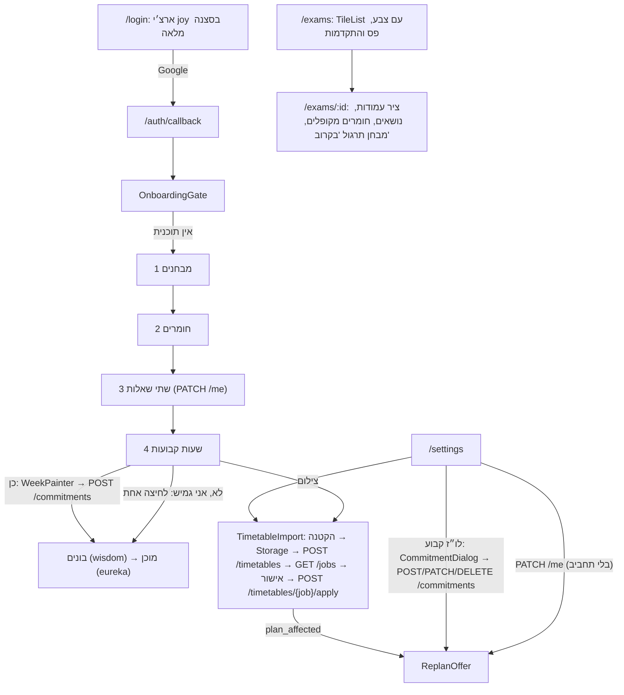

# S34 — עיצוב מחדש ד': כניסה, אונבורדינג, מבחנים והגדרות: תוכנית עבודה

> **For agentic workers:** REQUIRED SUB-SKILL: Use superpowers:subagent-driven-development (recommended) or superpowers:executing-plans to implement this plan task-by-task. Steps use checkbox (`- [ ]`) syntax for tracking.

**מטרה:** כל המסכים שמחוץ ליומן (כניסה, callback, שגיאת תצורה, 404, פרידה, תנאי שימוש ופרטיות, האונבורדינג, המבחנים, מסך המבחן, ההגדרות ומחיקת החשבון) נראים כמו ההדמיה המלאה (`docs/design/prototype/all-screens.html`), באונבורדינג נוסף שלב "שעות קבועות" (מסמך הזמינות, סעיף 7), ובהגדרות קטע "לו"ז קבוע" מחליף את התחביב. התחביב יוצא מ-`/me` ומהמסד (מיגרציה 0015).

**השער במפת הדרכים:** "כל המסכים בשפה החדשה, והאונבורדינג עדיין מסתיים תוך 5 דקות".

**גישה:** שלושה גלים. הגל הראשון בונה את מה שהמסכים נשענים עליו (רכיבי `ui/` חדשים, מודול `commitments/`, ייבוא מערכת השעות, ה-API) ואת המסכים שעומדים לבד (כניסה וחבריה). הגל השני מעצב את שלושת אזורי המסכים הגדולים במקביל. הגל השלישי: צילומים מול ההדמיה, סקירה, תיקונים ומסמכים.

**כלים:** כמו ב-S31: ‏React 19, ‏TypeScript strict, ‏React Router, ‏TanStack Query 5, ‏Tailwind 4, ‏React Aria Components, ‏lucide-react, ‏Vitest; ב-API ‏Python 3.14, ‏psycopg 3, ‏Alembic עם SQL מפורש. בלי תלויות חדשות.

**מקורות:** `docs/superpowers/specs/2026-11-18-calendar-redesign-design.md`, ‏`2026-11-18-archie-look-and-gamification.md`, ‏`2026-11-18-availability-design.md` (סעיפים 7, 10, 11), ‏`docs/design/design-language.md`, ההדמיה המלאה ו-`onboarding-prototype.html` לאינטראקציות, וסעיף 7.9 במסמך התכנון הראשי.

## איך החלקים מתחברים

- **`web/src/commitments/`** הוא מודול חדש, משותף לאונבורדינג ולהגדרות: המודל (קיבוץ של התחייבויות זהות לשורה אחת, "שני, רביעי, 14:00–17:00"), הדיאלוג שמוסיף ועורך קבוצה, השבוע הקטן שמסמנים בו בגרירה, וייבוא הצילום. הוא קורא רק ל-`web/src/availability/api.ts` של S35, כך שהשרת לא משתנה בשבילו.
- **התחייבות היא "שינוי גלובלי"** (מסמך הזמינות, סעיף 5): כל כתיבה מחזירה `plan_affected`, וההגדרות מציעות `ReplanOffer` כמו שינוי העדפה. באונבורדינג אין עוד תוכנית, ולכן אין הצעה: ההתחייבויות נשמרות לפני מסך הבנייה, וה-`generate_plan` כבר רואה אותן.
- **הרכיבים החדשים ב-`ui/`** (Task 2) הם קבצים חדשים בלבד. אף רכיב קיים ב-`ui/` לא משתנה, כי S32 רץ במקביל (כלל של ה-scope).

## מה מצאתי לפני התכנון (18.11.2026)

- `api/eval/materials/timetables/` לא קיימת: אייל עוד לא סיפק צילומים. ה-eval על צילומים אמיתיים נשאר פתוח ונרשם מחדש (Task 10).
- XP ניתן רק על השלמת בלוק (`api/app/services/gamification.py`). אין XP על תוכנית ראשונה, ולכן "+50 XP" של ההדמיה היה מספר שקרי (החלטה 6).
- למבחן אין שדה התקדמות ב-API. ה"42% מהתוכנית" של ההדמיה מחושב מהמשימות של המבחן (`GET /exams/{id}/tasks`: הדקות של משימות `done` מתוך כל המשימות שלא דולגו) (החלטה 9).
- `BuildingStep` נמצא בשלב 4 של `OnboardingLayout`. עכשיו שלב 4 הוא "שעות קבועות", ומסך הבנייה יוצא מפס השלבים, כמו בהדמיה.
- `NotificationSettings` (S16) מצייר שני כרטיסים משלו. כרטיס בתוך כרטיס אסור, ולכן הוא מקבל `variant` בלי כרטיסים (Task 8), בתוך `notifications/`, שאף scope אחר לא נוגע בו עכשיו.
- יעד הניווט בסוף הבנייה שייך ל-S32 (לפי ה-brief). השורה `navigate('/today')` נשארת כמו שהיא, ועובדת דרך ההפניה ליומן.

## ההחלטות שלי

1. **שלב "שעות קבועות" הוא שלב 4 מתוך 4, בנתיב `/onboarding/fixed-hours`.** מסך הבנייה ו"מוכן" אינם שלב ממוספר, כמו בהדמיה. `STEP_COUNT` נשאר 4.
2. **"לא, אני גמיש" ממשיך מיד למסך הבנייה**, בלחיצה אחת. "כן, יש לי" פותח את השבוע. כשיש כבר התחייבויות (חזרה לשלב), "כן" נבחר מראש. היעד של 5 דקות: אין שדה חובה חדש.
3. **השבוע הקטן הוא רשת של שעות שלמות**, משעת הקימה עד שעת השינה של הפרופיל (ברירת המחדל 08:00–23:00, 15 שורות), כמו `onboarding-prototype.html`. שעה שלמה מהירה לסימון באצבע, ושעות מדויקות (10:15) נכנסות ב"הוספה עם שעות מדויקות" (הדיאלוג) או בהגדרות. ריצה רציפה של תאים ביום אחד = התחייבות אחת, בשם "שעות קבועות" ומסוג `other`. אפשר לשנות שם וסוג בהגדרות.
4. **מה שכבר נשמר לא נמחק מהשבוע בגרירה.** התחייבויות קיימות מוצגות בשבוע כתאים "שמורים" (גוון כהה יותר) וברשימה קצרה מתחת, עם כפתור מחיקה. גרירה צובעת ומוחקת רק סימונים שעוד לא נשמרו. כך אין diff מסובך בין שעות שלמות להתחייבות של 10:15, ומשתמש לא מוחק הרצאה בטעות.
5. **נגישות של השבוע:** כל תא הוא toggle עם שם ("ראשון 10:00"), בתוך `role="grid"` עם roving tabindex וחצים. הקשה היא החלופה הגלויה לגרירה; הגרירה היא קיצור. Space או Enter מסמנים.
6. **"מוכן" בלי XP מזויף.** הצ'יפ הזהוב אומר "+XP על כל בלוק שתסמנו · הזרע הראשון בגן". אם אייל רוצה XP אמיתי על התוכנית הראשונה, זה סוג אירוע חדש בשרת (S33 או S29), ונרשם בטבלה.
7. **ארצ׳י באונבורדינג:** `wisdom` בזמן הבנייה ו-`eureka` ב"מוכן", לפי ה-brief וההדמיה. מסמך העיצוב אמר `intentions` בסוף האונבורדינג, והוא מתעדכן. בכניסה ובפרידה `joy`, ב-404 `flow` (הלכת לאיבוד, מסדרים את החול), במסך המבחנים הריק `intentions` ("כאן ייזרעו המבחנים שלך"). כל ארצ׳י כאן הוא איור במסך, לא הודעה, ולכן לא נספר במגבלת ההודעה ל-20 דקות.
8. **מבחנים על `canvas` הם `TileList`** (Task 2): אריח `bg-surface` עם קו `line` ופינות `card`, כמו `.card` של ההדמיה. זה הפתרון לפריט של S31 ("ListRow שנבלע בעמוד"): `ListRow` נשאר לרשימה שבתוך משטח, ו-`TileList` לרשימה שיושבת ישר על העמוד. אותו דבר לטעינה: `LoadingState shape="card"` במקום `list` על העמוד.
9. **ההתקדמות של מבחן** ברשימה = דקות של משימות שבוצעו מתוך דקות כל המשימות שלא דולגו, מ-`GET /exams/{id}/tasks` לכל מבחן (`useQueries`). מבחן בלי משימות מציג "עוד אין משימות" ופס ריק. הצבע של הפס הוא צבע המבחן, כמו בהדמיה ובסרגל הצד של היומן: הירוק שמור ל"בוצע" של בלוק, והפס כאן מזהה מבחן.
10. **האות של המבחן** (הריבוע "ה" של "הסתברות") היא `exam-N` על `exam-N-soft`, ב-20px ו-700. זה טקסט גדול לפי WCAG (‏18.66px בולט), ולכן 3:1 מספיק, ו-`exam-N` על `exam-N-soft` כבר נבדק ב-3:1 (‏4.07–5.57). נוסף לבדיקה זוג "טקסט גדול" מפורש, ובמסמך העיצוב כלל: רק מ-20px ו-700.
11. **כפתור כהה (`InkButton`)** ל"המשך עם Google" ול"+ הוספת מבחן" בטופס של האונבורדינג, כמו בהדמיה: `bg-inverse text-on-inverse` (זוג מותר, 11.45:1). הוא לא מחליף את הכפתור הראשי: במסך יש עדיין כפתור ירוק אחד לכל היותר.
12. **סדר ההגדרות:** לימוד, שגרת היום, "שמירה", ואז לו"ז קבוע, תזכורות ואזור מסוכן. בהדמיה "שמירה" אחרי התזכורות, אבל הלו"ז הקבוע והתזכורות נשמרים מיד, וכפתור אחרי שלושתם היה מרמז שהוא שומר גם אותם. הייצוא עובר לתוך האזור המסוכן, כמו בהדמיה, ושומר על ה-`id="export"` שמסך המחיקה מקשר אליו.
13. **קבוצה של התחייבויות** = אותו `title`, ‏`kind`, ‏`start_time`, ‏`end_time`, ‏`valid_from` ו-`valid_until`, בכמה ימים. בהגדרות היא שורה אחת, והדיאלוג עורך אותה: ימים שנוספו → `POST`, ימים שהוסרו → `DELETE`, שדות ששונו → `PATCH` לכל השאר. הצעת תכנון מחדש אחת בסוף. מחיקה: toast עם "בטל" ל-10 שניות שיוצר אותן מחדש (במקום "בטוח?", כמו בכל האפליקציה).
14. **אייקונים לסוגים:** עבודה `Briefcase`, לימודים `GraduationCap`, אחר `Clock`. ההדמיה השתמשה באימוג'י, ומסמך העיצוב אוסר אימוג'י במקום אייקון.
15. **הצילום:** תמונה מוקטנת בדפדפן לצד ארוך של 2000 פיקסלים ולכל היותר 3.75 MiB (JPEG, איכות יורדת עד שזה נכנס); PDF עולה כמו שהוא, בגבול של השרת. אחרי הפענוח מוצגות ההצעות עם תיבת סימון לכל אחת (כולן מסומנות), עריכה של כל אחת בדיאלוג, ו"בתוקף עד" אופציונלי (סוף הסמסטר). כשל: הודעה לפי הקוד, ו"אפשר לסמן ידנית".
16. **מסך הכניסה במחשב:** שתי עמודות מ-`lg`: הסצנה של ארצ׳י בצד אחד, והטקסט והכפתור באמצע הצד השני. בטלפון הסצנה במלוא הרוחב למעלה, עם פינות תחתונות של 28px, כמו בהדמיה.
17. **תנאי שימוש ומדיניות פרטיות** הם `/terms` ו-`/privacy`, מחוץ ל-`RequireAuth`, עם "בקרוב" וקישור חזרה. המסמכים עצמם ב-S21.
18. **המיגרציה 0015** מוחקת את `profiles.hobby_start`, ‏`hobby_minutes` ושלושת ה-CHECK שלהן. ה-downgrade מחזיר אותן ריקות עם אותם CHECK; את התוכן מחזיר ה-downgrade של 0014, שקורא את ההתחייבויות. לפני ההחלה על פרויקט הפיתוח בודקים שאין שורה עם תחביב שלא הועבר (`hobby_start IS NOT NULL` = 0).
19. **שינוי ב-`OnboardingLayout`:** כפתור "חזרה" (חץ) בראש, ליד פס השלבים, כמו בהדמיה. ה"חזרה" שבתחתית יוצא, כדי שבתחתית יישאר רק הכפתור הראשי (והמשני של השלב, אם יש).

## Global Constraints

- רק רכיבי `web/src/ui/` וה-tokens. אין hex, אין צבע מהלוח של Tailwind, אין `text-brand`, אין שקיפות על טקסט (מסמך העיצוב 2.7).
- לא משנים רכיב קיים ב-`ui/`. רכיב חסר = קובץ חדש עם בדיקה, ב-`dev/s34Sections.tsx` ובמסמך העיצוב.
- ב-`he.ts`, ‏`ComponentsPage.tsx`, ‏`devText.ts`, ‏`theme.test.ts` ו-`design-language.md` מוסיפים קטעים משלנו בלבד. קוראים את הקובץ מחדש ממש לפני כל Edit, ועורכים בעריכות קטנות (סוכנים אחרים עורכים את אותו קובץ).
- ההתנהגות, הבדיקות של ההתנהגות וה-API של S14–S19 ו-S35 נשמרים. בדיקה משתנה רק כשהיא נשענת על מבנה או טקסט שהשתנה.
- כל טקסט ב-`he.ts`. שעות בתוך `dir="ltr"`. ‏`tabular-nums` למספרים. רק logical properties.
- 44px לכל מה שלוחצים עליו, שם נגיש לכל כפתור שחוזר ("מחיקה: עבודה"), `h1` אחד שמופיע מיד, `prefers-reduced-motion`.
- ארצ׳י רק דרך `<Archie>`. לא מציירים אותו, לא חותכים מחדש את האיורים.
- הסוכנים עובדים באותה תיקייה ולא מריצים git. השיחה הראשית עושה commit לפי שמות קבצים אחרי כל משימה. typecheck ו-lint נבדקים על הקבצים של המשימה; שגיאה בקובץ של משימה אחרת שרצה במקביל אינה של המשימה.
- `legacy/` לא נוגעים.

## Review Focus

1. **גרירה בשבוע שיוצאת מהרשת או מסתיימת מחוץ לחלון** (pointerup מחוץ לרשת, pointercancel במגע): הסימון נעצר ולא נשאר "צובע". בדיקה ב-Task 3.
2. **"בניית התוכנית" אחרי שחלק מה-POST נכשלו** (‏`too_many_commitments`, רשת): מה שנשמר מופיע כשמור, השאר נשאר מסומן, הודעה, ואפשר לנסות שוב בלי כפילות. בדיקה ב-Task 6.
3. **צילום שגדול מדי גם אחרי הקטנה, PDF גדול, או סוג קובץ אחר**: הודעה ברורה לפני העלאה, בלי בקשה לשרת. בדיקה ב-Task 4.
4. **עריכת קבוצה שבה רק חלק מהבקשות הצליחו**: הרשימה מתרעננת מהשרת (לא נשארת אופטימית), הודעת שגיאה, והצעת תכנון מחדש אם משהו השתנה. בדיקה ב-Task 8.
5. **משתמש ותיק עם "זמן לעצמי" (שבע התחייבויות מהמיגרציה)**: בהגדרות הוא שורה אחת "כל יום, 18:00–19:00", ניתן לעריכה ולמחיקה כמו כל קבוצה. בדיקה ב-Task 3 (המודל) וב-Task 8.

## מה רץ במקביל

| גל | משימות | למה אפשר במקביל |
| --- | --- | --- |
| 1 | 1 (API), 2 (`ui/`), 3 (`commitments/` מודל, דיאלוג ושבוע), 4 (ייבוא צילום), 5 (מסכים עצמאיים), 11 (סביבת הצילום וצילומי "לפני") | קבצים נפרדים. 3 ו-4 באותה תיקייה, בקבצים שונים, עם הממשק שקבוע כאן |
| 2 | 6 (אונבורדינג), 7 (מבחנים), 8 (הגדרות) | כל אחת בתיקייה משלה; כולן צורכות את 2–4 |
| 3 | 9 (צילומי "אחרי", מעבר מול ההדמיה ותיקונים), 10 (מסמכים, סקירה, מיזוג) | ברצף, בשיחה הראשית |

המיגרציה (Task 1) היא היחידה, ורצה לבד בצד ה-API.

## קבצים משותפים עם S32

`web/src/i18n/he.ts`, ‏`web/src/dev/ComponentsPage.tsx`, ‏`web/src/dev/devText.ts`, ‏`web/src/theme.test.ts`, ‏`web/src/app/routes.tsx` (שני נתיבים חדשים), ‏`web/src/onboarding/BuildingStep.tsx` (S32 משנה את שורת הניווט; אני לא נוגע בה), ‏`docs/design/design-language.md`, סעיף 7.9. בכולם רק תוספות או שינויים בקטעים שלי, כדי שה-rebase יהיה פשוט.

---

### Task 1: הסרת התחביב מה-API, ומיגרציה 0015

**Files:**
- Create: `api/migrations/versions/0015_drop_hobby_columns.py` (`revision = "0015"`, ‏`down_revision = "0013"`)
- Delete: `api/app/services/hobby.py`
- Modify: `api/app/routers/me.py`, ‏`api/app/schemas/me.py` (בלי `hobby_*`, בלי `NULLABLE` ו-`hobby_errors`), ‏`api/app/routers/account.py`, ‏`api/app/services/account.py` (הייצוא בלי `hobby`; ההתחייבויות כבר בייצוא אם `commitments` ב-`_EXPORTED`, ואם לא, מוסיפים), ‏`api/app/services/profiles.py` (הערות)
- Test: `api/tests/api/test_me_preferences.py`, ‏`api/tests/db/test_settings_and_account.py`, ‏`api/tests/db/test_drop_hobby_columns.py` (חדש), ובדיקות הייצוא

**Interfaces:**
- Produces: `GET /me` ו-`PATCH /me` בלי `hobby_start` ו-`hobby_minutes`. ‏`PATCH /me` עם אחד מהם → ‏422 (`extra_forbidden`, כמו כל שדה לא מוכר; לבדוק שה-schema הוא `extra="forbid"`).

- [ ] **Step 1: בדיקות שנכשלות.** `test_me_has_no_hobby_fields` (‏`"hobby_start" not in GET /me`); `test_patch_me_rejects_hobby` (‏422); `test_export_has_commitments_and_no_hobby`; ‏`tests/db/test_drop_hobby_columns.py`: אחרי `upgrade head` אין עמודות `hobby_*` ב-`app.profiles`; ‏downgrade ל-0013 מחזיר אותן ריקות עם שלושת ה-CHECK; ‏upgrade חוזר עובר. הבדיקות של התחביב ב-`test_me_preferences.py` ו-`test_settings_and_account.py` שנשענות על העמודות נמחקות או מוחלפות.
- [ ] **Step 2:** `STUDYFLOW_TEST_DB=studyflow_test_s34 uv run pytest tests/api/test_me_preferences.py tests/db/test_drop_hobby_columns.py -q` → נכשל.
- [ ] **Step 3:** המיגרציה (SQL מפורש ב-`op.execute`, ‏DROP CONSTRAINT ואז DROP COLUMN; ‏downgrade לפי `0009`), והסרת הקוד.
- [ ] **Step 4:** `uv run pytest -q` (כולל `tests/db`, לבד, לא במקביל לסשן אחר), ‏`uv run ruff check .`, ‏`uv run ruff format --check .`, ‏`uv run mypy` → נקי.

### Task 2: רכיבי `ui/` חדשים

**Files (כולם חדשים):** `web/src/ui/TileList.tsx`, ‏`ui/Stepper.tsx`, ‏`ui/IconChoiceCards.tsx`, ‏`ui/ExamMark.tsx`, ‏`ui/InkButton.tsx`, ‏`ui/s34.test.tsx`, ‏`web/src/dev/s34Sections.tsx`; ‏Modify: `dev/ComponentsPage.tsx` (ייבוא ושורה אחת), ‏`dev/devText.ts` (קטע `s34`), ‏`web/src/theme.test.ts` (זוג טקסט גדול)

**Interfaces (Produces):**
- `TileList({ 'aria-label', children, className? })` ו-`TileRow({ leading?, title, subtitle?, trailing?, footer?, to?, onPress? })`: אותו מבנה ו"stretched link" של `ListRow`, אבל `rounded-card border border-line bg-surface p-3`, ‏8px בין אריחים. `footer` הוא שורה מתחת לכותרת לכל הרוחב (הפס של המבחן). `to` ו-`onPress` כמו ב-`ListRow`.
- `Stepper({ label, value, options: readonly { value: number; label: string }[], onChange, description? })`: קבוצה (`role="group"`, ‏`aria-labelledby`) עם `IconButton` "יותר" (`Plus`) ו"פחות" (`Minus`), ובאמצע הערך ב-`text-display font-bold` ו-`<output aria-live="polite">`. בקצוות הכפתור כבוי. חצים למעלה/למטה על הקבוצה משנים גם הם. ב-RTL "יותר" ראשון (ימין), כמו בהדמיה.
- `IconChoiceCards({ label, description?, options: readonly { value: string; label: string; description?: string; icon: LucideIcon }[], value: string[], onChange, errorMessage?, errorId? })`: כמו `CheckboxCards` (‏`CheckboxGroup` של React Aria), אריחים מיושרים להתחלה ב-2 עמודות: אייקון 22px, תווית 600, תיאור `ltr` ב-`text-caption text-ink-muted`. נבחר: `border-2 border-brand bg-brand-soft` ו-✓ בפינה (מצב לא בצבע בלבד).
- `ExamInitial({ name, colorIndex, size?: 'md' | 'lg' })`: ריבוע 42px (‏`lg` 44px), ‏`rounded-[13px]`, ‏`examColor().soft`, האות הראשונה ב-`text-title font-bold` ובצבע `examColor().text`, ‏`aria-hidden`.
- `ExamProgressBar({ colorIndex, value, max, 'aria-label', valueText })`: פס 5px, מסילה `surface-muted`, מילוי `examColor().solid`, ‏`role="progressbar"` עם `aria-valuetext`.
- `ExamChip({ colorIndex, children })`: גלולה `examColor().soft` עם גבול `examColor().line` וטקסט `ink`, ‏`text-small font-semibold tabular-nums`.
- `InkButton(props של Button בלי variant)`: מבוסס `Button` של React Aria עם `BUTTON_BASE` (מ-`styles.ts`), ‏`bg-inverse text-on-inverse border-inverse`, ‏hover: `shadow-raised`, טבעת `FOCUS_RING`, ‏`isPending` כמו `Button`.

- [ ] **Step 1: בדיקות ב-`ui/s34.test.tsx`:** ‏TileRow עם `to` הוא קישור אחד בשם הכותרת, ו-trailing לחיץ בנפרד; Stepper: "יותר" מעלה לערך הבא ברשימה, כבוי בקצה, חץ למעלה עובד, הערך מוכרז; IconChoiceCards: בחירה של שתיים מחזירה את שתיהן, תפקיד checkbox, שם = התווית; ExamProgressBar עם `aria-valuetext`; InkButton עם `isPending` לא מגיב. ‏`theme.test.ts`: `LARGE_TEXT_PAIRS` עם `exam-N` על `exam-N-soft` ≥ 3:1.
- [ ] **Step 2:** `npm test -- src/ui/s34.test.tsx` → נכשל. **Step 3:** הרכיבים, `s34Sections.tsx` (כל רכיב בכל מצב). **Step 4:** הבדיקות, lint ו-typecheck על הקבצים → נקי.

### Task 3: `commitments/`: המודל, הדיאלוג והשבוע

**Files (חדשים):** `web/src/commitments/model.ts`, ‏`model.test.ts`, ‏`CommitmentDialog.tsx`, ‏`CommitmentDialog.test.tsx`, ‏`WeekPainter.tsx`, ‏`WeekPainter.test.tsx`, ‏`kindIcon.ts`; ‏Modify: `he.ts` (קטע `commitments`)

**Interfaces (Produces):**
- `interface CommitmentGroup { key: string; title: string; kind: CommitmentKind; weekdays: Weekday[]; start_time: string; end_time: string; valid_from: string; valid_until: string | null; ids: string[] }` (‏`ids` לפי סדר ה-weekdays).
- `groupCommitments(list: Commitment[]): CommitmentGroup[]` — לפי החלטה 13, ממוין לפי היום הראשון ואז שעת ההתחלה.
- `weekdaysText(days: Weekday[]): string` — "כל יום" לשבעה, "ראשון עד חמישי" לרצף של 5 ומעלה, אחרת "שני, רביעי".
- `groupSubtitle(g): string` — `"שני, רביעי, ⁦14:00–17:00⁩"`, ועם `valid_until`: "עד 10 בינואר".
- `paintedRanges(cells: ReadonlySet<string>, firstHour: number): { weekday: Weekday; start_time: string; end_time: string }[]` — תא = `"${weekday}-${hour}"`, ריצה רציפה = טווח; שעה 23 נגמרת ב-`"00:00"` (חוצה חצות).
- `cellsOf(list: Commitment[], firstHour: number, lastHour: number): Set<string>` — התאים שהתחייבות קיימת מכסה (גם חלקית).
- `groupWrites(before: CommitmentGroup | null, after: CommitmentInput & { weekdays: Weekday[] }): { create: CommitmentInput[]; update: { id: string; patch: CommitmentPatch }[]; remove: string[] }`.
- `kindIcon(kind): LucideIcon` — החלטה 14.
- `CommitmentDialog({ isOpen, onOpenChange, group: CommitmentGroup | null, onSaved: (planAffected: boolean) => void, onDeleted?: (group) => void, mode?: 'save' | 'draft', onDraft?: (draft) => void })` — שם (חובה), סוג (`RadioCards` 3), ימים (`CheckboxCards` 7 עמודות, "א׳"…"ש׳" עם שם נגיש מלא), מ-/עד (`TimeField`), "בתוקף עד" (`DatePicker`, לא חובה). ‏`mode="draft"` לא שולח לשרת אלא מחזיר את הטיוטה (לעריכת הצעה של צילום, Task 4). שגיאות השרת לפי הקוד (`too_short`, ‏`same_as_start_time`, ‏`before_valid_from`, ‏`too_many_commitments`) ליד השדה. בעריכה כפתור "מחיקה" (`danger`).
- `WeekPainter({ firstHour, lastHour, painted: ReadonlySet<string>, saved: ReadonlySet<string>, onChange: (next: Set<string>) => void })` — החלטות 3–5. ‏pointerdown קובע "צובע" או "מוחק" לפי התא הראשון; pointermove עם `elementFromPoint`; ‏`touch-action: none` על הרשת בלבד; pointerup/cancel בכל המסמך עוצרים. תא שמור לא משתנה. תצוגה כמו ההדמיה: עמודת שעה צרה, כותרות א–ש על `surface-muted`, תא מסומן בקווים אלכסוניים (`busy`), שמור ב-`busy` מלא יותר.

- [ ] **Step 1: בדיקות:** `model.test.ts` (קיבוץ של שבעת "זמן לעצמי" לשורה אחת "כל יום"; שתי התחייבויות עם שם שונה לא מתקבצות; `paintedRanges` של 10,11 ביום 0 → ‏`10:00–12:00`; ‏22,23 → ‏`22:00–00:00`; ‏`groupWrites` שמוסיף יום, מוריד יום ומשנה שעה); ‏`WeekPainter.test.tsx` (לחיצה מסמנת, גרירה על שלושה תאים מסמנת שלושה, גרירה שמתחילה על מסומן מוחקת, pointerup מחוץ לרשת עוצר, תא שמור לא משתנה, חצים ו-Space); ‏`CommitmentDialog.test.tsx` (הוספה שולחת POST לכל יום, עריכה שמורידה יום שולחת DELETE, שגיאת `too_short` ליד השעות, `mode="draft"` לא קורא לשרת).
- [ ] **Step 2–4:** נכשל → מימוש → עובר, lint ו-typecheck.

### Task 4: ייבוא צילום של מערכת השעות

**Files (חדשים):** `web/src/commitments/downscale.ts`, ‏`downscale.test.ts`, ‏`TimetableImport.tsx`, ‏`TimetableImport.test.tsx`, ‏`timetableUpload.ts`; ‏Modify: `he.ts` (קטע `timetable`); אם צריך, `onboarding/upload.ts` מוציא פונקציית העלאה כללית ל-Storage בלי לשנות את `uploadMaterial`.

**Interfaces:**
- Consumes: `useRegisterTimetable`, ‏`useApplyTimetable` (‏`availability/api.ts`), ‏`useJob<TimetableResult>` (‏`onboarding/api.ts`), ‏`CommitmentDialog` במצב `draft` (Task 3), ‏`useUserId`.
- Produces: `downscaleImage(file: Blob, opts?: { maxSide?: number; maxBytes?: number }): Promise<Blob>` (ברירות מחדל 2000 ו-`3.75 * 1024 * 1024`); ‏`timetableFileProblem(file): 'unsupported_file' | 'file_too_large' | null`; ‏`TimetableImport({ onApplied: (r: TimetableApplyResponse) => void, buttonVariant?: 'onboarding' | 'row' })` — מצבים: כפתור ("העלאת צילום של מערכת השעות", ‏`Camera`), מכין ומעלה, "ארצ׳י קורא את המערכת…" (‏`role="status"`), הצעות (כרטיס `brand-soft`: "מצאתי 3 שעות קבועות. לאשר?", תיבת סימון לכל אחת, "עריכה" לכל אחת, "בתוקף עד", "אישור", "ביטול"), כשל (‏`Note tone="warning"` לפי הקוד ו"אפשר לסמן ידנית").

- [ ] **Step 1: בדיקות:** הקטנה (תמונה מזויפת דרך `createImageBitmap` ו-canvas מזויפים: הצד הארוך 2000, הגודל מתחת לתקרה); PDF לא מוקטן; קובץ `.heic` → ‏`unsupported_file` בלי בקשה; זרימה מלאה עם API מזויף: העלאה, `POST /timetables`, ‏job ‏done עם 3 הצעות, ביטול סימון של אחת, אישור שולח 2 פריטים; job ‏failed עם `timetable_unreadable` מציג את ההודעה; ‏`ai_quota_exceeded` ‏(429) מציג את המכסה.
- [ ] **Step 2–4:** נכשל → מימוש → עובר, lint ו-typecheck.

### Task 5: המסכים שעומדים לבד

**Files:** Modify: `web/src/pages/LoginPage.tsx`, ‏`AuthCallbackPage.tsx`, ‏`ConfigErrorScreen.tsx`, ‏`NotFoundPage.tsx`, ‏`web/src/settings/GoodbyePage.tsx`, ‏`web/src/auth/RequireAuth.tsx`, ‏`web/index.html`, ‏`web/src/app/routes.tsx` (שני נתיבים); Create: `web/src/pages/LegalPage.tsx` (‏`kind: 'terms' | 'privacy'`); הבדיקות שלהם; ‏`he.ts` (‏`login`, ‏`legal`, ‏`notFound`, ‏`callback`, ‏`settings.goodbye`).

- [ ] **Step 1: בדיקות:** בכניסה: `h1` "ארצ׳י", הכותרת, ארצ׳י עם שם נגיש, כפתור Google, קישורים ל-`/terms` ול-`/privacy`; ‏`/terms` ו-`/privacy` מוצגים בלי התחברות עם "בקרוב"; פרידה עם ארצ׳י; 404 עם קישור הביתה. הבדיקות הקיימות של ההתנהגות (כשל בכניסה, callback שנכשל, הפניה כשמחובר) נשארות.
- [ ] **Step 2–3:** מימוש לפי ההדמיה וההחלטות 11, 16, 17: `Archie mood="joy" size="scene"` במלוא הרוחב בטלפון, השם ב-`font-display` גדול, הכותרת בשתי שורות (השנייה `text-brand-strong`), `InkButton` עם האות G. ‏`index.html`: ‏`theme-color` ורקע לפי `canvas` (רק אם לא כבר).
- [ ] **Step 4:** הבדיקות, lint ו-typecheck.

### Task 6: האונבורדינג (גל 2)

**Files:** Modify: `web/src/onboarding/OnboardingLayout.tsx`, ‏`ExamsStep.tsx`, ‏`MaterialsStep.tsx`, ‏`ExamMaterials.tsx`, ‏`MaterialItem.tsx`, ‏`ScheduleStep.tsx`, ‏`BuildingStep.tsx` (חוץ משורת `navigate('/today')`), ‏`steps.ts`, ‏`routes.tsx`; Create: `web/src/onboarding/FixedHoursStep.tsx`, ‏`FixedHoursStep.test.tsx`; הבדיקות הקיימות; ‏`he.ts` (‏`onboarding*`, ‏`building`, ‏`fixedHours`).

**Interfaces:** Consumes Tasks 2–4. ‏`STEP_PATHS.fixedHours = '/onboarding/fixed-hours'`.

- [ ] **Step 1: בדיקות:** ‏`FixedHoursStep.test.tsx`: "לא, אני גמיש" מנווט לבנייה בלחיצה אחת ולא שולח כלום; "כן" מציג את השבוע; סימון של 10–12 בראשון ו"בניית התוכנית" שולח `POST /commitments` אחד (`{title:'שעות קבועות', kind:'other', weekday:0, start_time:'10:00', end_time:'12:00'}`) ואז מנווט; כשל ב-POST השני משאיר את מה שנכשל מסומן ומציג הודעה (Review Focus 2); התחייבות קיימת מוצגת כשמורה ונמחקת מהרשימה. ‏`flow.test.tsx`: הזרימה עוברת דרך השלב החדש. ‏`ScheduleStep`: "המשך" שומר ומנווט ל-`fixedHours`; ה-Stepper משנה שעות. ‏`BuildingStep`: ארצ׳י `wisdom` בזמן הבנייה, `eureka` ו"אאוריקה!" במוכן, הסטטיסטיקה מהתוצאה, הצ'יפ של החלטה 6.
- [ ] **Step 2–3:** מימוש לפי ההדמיה וההחלטות 1–7, 19. ‏`flushDeletes()` עובר מ"שתי השאלות" לשלב 4, לפני הניווט לבנייה. כשל בבנייה חוזר ל-`fixedHours` (במקום `schedule`).
- [ ] **Step 4:** כל בדיקות `src/onboarding`, lint ו-typecheck.

### Task 7: המבחנים ומסך המבחן (גל 2)

**Files:** Modify: `web/src/exam/ExamsPage.tsx`, ‏`ExamPage.tsx`, ‏`ExamHeader.tsx`, ‏`Timeline.tsx`, ‏`TopicList.tsx`, ‏`TaskList.tsx`, ‏`TaskRow.tsx`, ‏`MaterialsSection.tsx`, ‏`AnalysisSection.tsx` (מראה בלבד), והבדיקות שלהם; Create: `web/src/exam/examProgress.ts` (+בדיקה), ‏`exam/PracticeExamButton.tsx`; ‏`he.ts` (‏`exam`).

**Interfaces:** Produces `examProgress(tasks: ExamTask[]): { done: number; total: number; percent: number }` (החלטה 9).

- [ ] **Step 1: בדיקות:** הרשימה: אריח לכל מבחן עם האות, השם, "10 בדצמבר, 42% מהתוכנית", פס עם `aria-valuetext`, צ'יפ "22 ימים", והאריח הוא קישור; מסך ריק עם ארצ׳י `intentions` וכפתור "הוספת מבחן"; מסך המבחן: האות בצבע, "יצירת מבחן תרגול" כבוי עם "בקרוב"; החומרים מקופלים עם מספר הקבצים בכותרת. הבדיקות של ההתנהגות (עריכה, ציר, משימות, ניתוח) נשארות.
- [ ] **Step 2–3:** מימוש לפי ההדמיה וההחלטות 8–10: ציר העמודות בכרטיס ("עד המבחן", "42% בוצע"): עבר = `brand`, מתוכנן = `soft` עם `line` של המבחן, יום בלי לימוד = קו מקווקו, ‏`Target` בסוף; נושאים כאריחים עם נקודות משקל בצבע המבחן ו"2 מתוך 4 משימות".
- [ ] **Step 4:** כל בדיקות `src/exam`, lint ו-typecheck.

### Task 8: ההגדרות, הלו"ז הקבוע ומחיקת החשבון (גל 2)

**Files:** Modify: `web/src/settings/SettingsPage.tsx`, ‏`PreferencesForm.tsx` (בלי תחביב), ‏`ExportSection.tsx`, ‏`DeleteAccountPage.tsx`, ‏`web/src/api/me.ts` (בלי `hobby_*`), ‏`web/src/notifications/NotificationSettings.tsx` (‏`variant="bare"` בלי כרטיסים), והבדיקות; Create: `web/src/settings/CommitmentsSection.tsx`, ‏`CommitmentsSection.test.tsx`; ‏`he.ts` (‏`settings`).

- [ ] **Step 1: בדיקות:** הקבוצות ככרטיסים (לימוד, שגרת היום, לו"ז קבוע, תזכורות, אזור מסוכן) בסדר של החלטה 12; אין "זמן לעצמי" בטופס; הלו"ז הקבוע: שבעת "זמן לעצמי" = שורה אחת "כל יום, 18:00–19:00"; "הוספה" פותחת את הדיאלוג, שמירה עם `plan_affected` מציעה תכנון מחדש; מחיקה עם "בטל" שיוצר מחדש; עריכה שבה בקשה אחת נכשלה מרעננת ומציגה הודעה (Review Focus 4); "עדכון מצילום" פותח את `TimetableImport`; הייצוא בתוך האזור המסוכן עם `id="export"`.
- [ ] **Step 2–3:** מימוש לפי ההדמיה והחלטה 12–14.
- [ ] **Step 4:** כל בדיקות `src/settings` ו-`src/notifications`, lint ו-typecheck.

### Task 9: צילומי "אחרי", מעבר מול ההדמיה ותיקונים (השיחה הראשית)

- [ ] build של סביבת הצילום עם נתוני דמה (Task 11) בפורט 4234, צילום של כל מסך ומצב ב-390px וב-1280px, לצד ההדמיה, ל-`~/studyflow-manager/s34-screens/after/`.
- [ ] מעבר על כל צילום מול ההדמיה, רשימת פערים, תיקון, וצילום חוזר עד שאין פער שאפשר לתקן בכללים.

### Task 10: סגירה (השיחה הראשית)

- [ ] eval של הצילומים: התיקייה ריקה → נרשם כפתוח בטבלה (S29), עם הפקודה.
- [ ] סקירה סופית (`requesting-code-review`) ותיקונים.
- [ ] מסמך העיצוב (סעיף 5.8 ו-11, הרכיבים החדשים, הכלל של האות הגדולה, ארצ׳י), סעיף 7.9, מסמך הזמינות (סעיף 12: מה נבנה ב-S34), מסמך ארצ׳י (סוף האונבורדינג = eureka).
- [ ] כל הפקודות של `api/` ו-`web/` כולל build; ‏fetch, ‏rebase, בדיקות, gitleaks, ‏push ל-main, מחיקת הענף; ‏0015 על פרויקט הפיתוח לפי הנוהל (בדיקה מקדימה של `alembic_version` = ‏0013 ושל `hobby_start IS NOT NULL` = 0).
- [ ] מפת הדרכים: S34 "הושלם", שתי השורות של S34 נסגרות, והפריטים שנדחו נרשמים.

### Task 11: סביבת הצילום וצילומי "לפני" (גל 1, מחוץ לריפו)

- [ ] העתקה של `~/studyflow-manager/s31-shots-harness/` ל-`~/studyflow-manager/s34-shots-harness/`, פורט 4234, ‏`SHOTS_OUT=~/studyflow-manager/s34-screens`. נתוני דמה ל-`/commitments`, ‏`/timetables`, ‏`/jobs` (פענוח), ולכל שלב של האונבורדינג.
- [ ] צילומי "לפני" של כל המסכים של S34 על הבסיס `7e19d28` (‏`before/`), וצילומי ההדמיה של אותם מסכים (‏`prototype/`).
