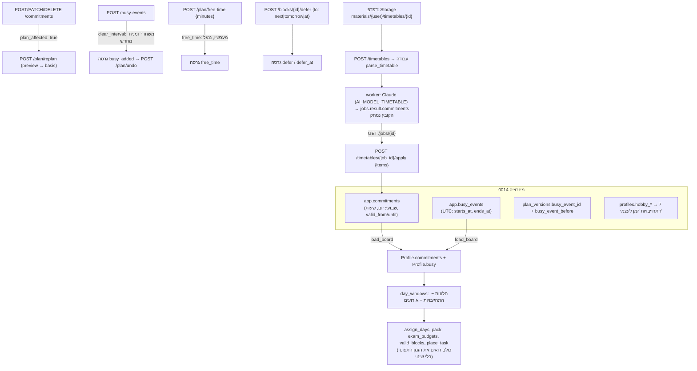

# S35 — זמינות: לו"ז קבוע, אירועים חד-פעמיים, "יש לי זמן עכשיו", דחייה עם בחירה ופענוח מערכת שעות (שרת): תוכנית עבודה

> **For agentic workers:** REQUIRED SUB-SKILL: Use superpowers:subagent-driven-development (recommended) or superpowers:executing-plans to implement this plan task-by-task. Steps use checkbox (`- [ ]`) syntax for tracking.

**מטרה:** המתכנן יודע מתי הסטודנט תפוס. עבודה, הרצאות ואימונים שחוזרים כל שבוע (התחייבויות), ואירועים חד-פעמיים ביומן, יורדים מהזמינות כזמן שאסור לשבץ בו. הסטודנט יכול לומר "יש לי זמן עכשיו" ולקבל את המשימות הבאות מיד, לדחות בלוק לאחת משלוש אפשרויות, ולהעלות צילום של מערכת השעות ש-Claude הופך להצעה של התחייבויות לאישור.

**השער במפת הדרכים:** "המתכנן לעולם לא משבץ על התחייבות או אירוע, וצילום אמיתי של מערכת שעות הופך ללו"ז נכון לאישור".

**מסמכי תכנון:** `docs/superpowers/specs/2026-11-18-availability-design.md` (המקור המחייב), ומהמסמך הראשי: 7.4 (טבלאות), 7.5 (Claude, structured outputs, מכסות), 7.6 (המתכנן), 7.7 (API), 7.8 (תור), 11.13 (התחביב).

**כלים:** Python 3.14, ‏psycopg 3, ‏Hypothesis, ‏anthropic SDK (קיים). בלי תלויות חדשות ב-`api/`. ב-eval: Chrome headless לצילום ה-HTML של מערכות השעות לדוגמה (כלי מקומי, לא תלות של הפרויקט).

## איך החלקים מתחברים

**למה כך:** התחביב של S15 כבר הוכיח את הדרך: זמן תפוס שיורד **בתוך `day_windows`** מגיע לכל שלב של המתכנן בלי לגעת בו, כי התקציב, `day_fits`, האריזה, תקפות של בלוק קיים והנחת משימה בודדת כולם מתחילים מהחלונות. לכן ההתחייבויות והאירועים נכנסים ל-`Profile` (כמו התחביב), ו-`day_windows` מחסירה אותם. הסיכון היחיד הוא מקום שבונה `Profile` בלי לטעון אותם; לכן יש פונקציה אחת שטוענת אותם (`load_availability`), וכל מקום שמחשב זמן פנוי (הלוח, ההזזה, הסלוטים, הסקירה, התקציב של הניתוח) עובר דרכה.

## מה מצאתי לפני התכנון (18.11.2026)

- `Profile.hobby` יורד ב-`day_windows` מהיום שלפני, היום והיום שאחרי. אותו דבר נכון להתחייבות שבועית, כולל אחת שחוצה חצות.
- `place_task` משחרר רק בלוקים של המשימה שלו. הוספת אירוע יכולה לחפוף לבלוקים של כמה משימות, ולכן צריך פונקציה שמריצה `place_task` אחת אחרי השנייה על לוח שמתעדכן (`clear_interval`).
- `undo` בדומיין מחשיב בלוק נעול שלא היה ב-snapshot כ"סגור" (המשתמש נעל אחרי השינוי) ולא מוחק אותו. "יש לי זמן עכשיו" ודחייה לשעה **יוצרים** בלוקים נעולים, ולכן הביטול שלהם צריך לדעת אילו בלוקים הגרסה עצמה יצרה.
- `PlannedBlock` אין בו `pinned`, ו-`write_changes` לא כותב אותו.
- מסך ההגדרות של S15 (שלא שלי לגעת בו) שולח `hobby_start`/`hobby_minutes` ב-`PATCH /me`.
- הקבצים של מערכת השעות יכולים לשבת ב-bucket הקיים `materials`, בנתיב `{user_id}/timetables/{id}`: המדיניות הקיימת דורשת בדיוק שתי תיקיות ותיקייה ראשונה של המשתמש, וכך אין bucket חדש, ומחיקת חשבון כבר מוחקת את כל התיקייה.
- במפת הדרכים אין שורות נוספות שמתויגות S35 (רק השורה של ה-scope).

## ההחלטות שלי

1. **שבוע מתחיל ביום ראשון = 0** (`weekday` 0–6). כמו `getDay()` ב-JavaScript וכמו `extract(dow)` ב-Postgres, וכמו השבוע בישראל. ההמרה מ-Python (`weekday()`, שני = 0) נעשית במקום אחד בדומיין.
2. **התחייבות:** ‏`start_time`/`end_time` בדקה שלמה, שונים זה מזה; ‏`end_time < start_time` = חוצה חצות. ‏15 דקות לפחות. ‏`valid_from` (ברירת מחדל: היום המקומי) ו-`valid_until` (כולל, או NULL) חלים על **התאריך המקומי שבו המופע מתחיל**, כך שמשמרת לילה של יום חמישי האחרון בסמסטר נכנסת כולה. המופע מחושב עם `local_span` (אותם כללי מעבר שעון כמו החלונות). עד 100 התחייבויות חיות למשתמש.
3. **אירוע חד-פעמי:** ‏`starts_at < ends_at`, בדקה שלמה, עד 14 ימים, ולא נגמר בעבר. עד 500 אירועים עתידיים חיים.
4. **בלי ריפוד סביב זמן תפוס.** חלונות הלימוד לא מרופדים, וגם התחביב לא היה. מי שצריך זמן הגעה מאריך את ההתחייבות. (הריפוד של 10 דקות נשאר סביב בלוקים קבועים.)
5. **בלוק קבוע (נעול, שהתחיל או שהושלם) לא זז בגלל התחייבות** בתכנון מחדש, כמו בתחביב: התכנון מחדש לעולם לא מזיז בלוק קבוע. **אבל הוספת אירוע כן משחררת גם בלוק נעול שחופף לו**: זו פעולה מפורשת של המשתמש ("אני תפוס אז"), בדיוק כמו דחייה, שהיא הדרך המפורשת היחידה שבה בלוק קבוע זז. בלוק `done` לא משתחרר לעולם.
6. **הזזה ידנית (`PATCH /blocks/{id}`) ודחייה לשעה מסרבות לשטח תפוס** (409 ‏`slot_busy`), והסלוטים לא מציעים אותו. ההתחייבות היא איסור (סעיף 4 במסמך הזמינות), ולכן הכלל פשוט: אין בלוק על זמן תפוס, גם לא ביד. מי שהרצאה שלו בוטלה מוחק או מקצר אותה.
7. **התחביב עובר להתחייבויות במיגרציה:** שבע שורות `kind = 'other'`, כותרת `זמן לעצמי`, אותן שעות, בלי `valid_until`. העמודות `hobby_start`/`hobby_minutes` מתאפסות ונשארות (מחיקה של עמודה לא הפיכה, וה-downgrade משחזר מהן). **שכבת תאימות זמנית** עד S34: ‏`GET /me` מחזיר את התחביב מתוך "קבוצת התחביב" (שבע התחייבויות `other` עם הכותרת הזו ואותן שעות), ו-`PATCH /me` עם שדות התחביב מחליף את הקבוצה. כך מסך ההגדרות הקיים ממשיך לעבוד, ויש מנגנון אחד במתכנן. S34 מוחק את השכבה ואת העמודות.
8. **התחייבויות: בלי גרסה, `plan_affected: true`**, כמו שינוי בהגדרות (7.6 שלב 8, שינוי גלובלי). ה-web מציע `POST /plan/replan` עם תצוגה מקדימה.
9. **אירוע:** ‏`POST /busy-events` שומר, ואז `clear_interval` משחרר כל בלוק `planned` שנגמר אחרי "עכשיו" וחופף לאירוע (גם נעול, גם שהתחיל), ומניח מחדש כל משימה שנפגעה (`place_task` עם `release`), משימה אחרי משימה לפי הבלוק הראשון שלה. משימה שאין לה מקום: הבלוקים החופפים שלה נמחקים בכל זאת, והיא מוחזרת ב-`unplaced` עם הסיבה (והחוסר מופיע ב-`GET /plan`). תמיד נכתבת גרסה `busy_added` עם `busy_event_id`; הביטול מוחק את האירוע (רך) ומחזיר את הבלוקים. ‏`PATCH` שמשנה זמן עושה אותו דבר עם `busy_changed` ושומר את הזמן הקודם ב-`busy_event_before`; שינוי כותרת בלבד לא נוגע בלוח. ‏`DELETE` מוחק רך, בלי גרסה, ושום דבר לא זז (כמו במסמך).
10. **"יש לי זמן עכשיו" (`free_time`):** ‏`minutes` 30–480. החלון הוא `[עכשיו, עכשיו + minutes)` פחות זמן תפוס ופחות בלוקים חיים שבו (עם 10 דקות הפסקה סביבם). התור הוא סדר המתכנן כפי שהוא על הלוח: משימות `todo` לפי ההתחלה של הבלוק המועמד הבא שלהן, ואחריהן משימות עם דקות שלא נכנסו (לפי סדר הקלט). כל משימה בודקת: המבחן שלה עוד לא נגמר (יום הלימוד ≤ היום האחרון, וסוף הבלוק ≤ `exam_cutoff`), התלות שלה גמורה או נגמרת לפני הבלוק (ולסימולציה ולתחקיר: ביום לימוד קודם), סימולציה אחת ביום ובלי פיצול. משימה שנכנסת כולה עוברת לחלון; משימה ארוכה מקבלת חלק של 30 דקות לפחות שמשאיר שארית של 30 לפחות, והשארית מונחת אחרי החלון ב-`place_task` (אם השארית לא נכנסת, המשימה מדולגת). 10 דקות הפסקה בין בלוקים בחלון. **חלונות הלימוד והמכסה היומית לא חלים** על הזמן הזה, כי המשתמש אמר במפורש שהוא פנוי עכשיו; זמן תפוס חל. הבלוקים בחלון **ננעלים**, כדי שתכנון מחדש (שבודק חלונות ומכסה) לא יזיז אותם. אין מה להניח → 409 ‏`nothing_to_place`; אין זמן פנוי בחלון → 409 ‏`no_free_time`. גרסה `free_time`.
11. **דחייה עם שלוש אפשרויות:** ‏`POST /blocks/{id}/defer {"to": "next" | "tomorrow" | "at", "starts_at"?, "not_before"?}`. בלי גוף, או `{not_before}`, זה כמו היום (תאימות). ‏`tomorrow` = ‏`place_task` עם `not_before` = תחילת יום הלימוד של מחר (קימה + ההשהיה). ‏`at` = שעה מתוך `GET /blocks/{id}/slots?date=YYYY-MM-DD` (כל יום לימוד מהיום ועד היום האחרון של המבחן), באותו אורך, ננעל, גרסה `defer_at`. ‏`at` מתיר גם בלוק שכבר התחיל, כמו כל דחייה.
12. **ביטול של גרסה שיצרה בלוקים נעולים** (`free_time`, ‏`defer_at`): הבלוקים שהגרסה עצמה כתבה (`plan_version_id`) ועדיין `planned` ולא התחילו נחשבים פתוחים, ונמחקים בביטול. `undo` בדומיין מקבל `created`. בלוק כזה שהמשתמש הזיז אחר כך גם נמחק (הוא חלק מהפעולה שבוטלה); זה מתועד.
13. **ביטול לא מחזיר בלוק על זמן תפוס:** בלוק מה-snapshot שחופף עכשיו להתחייבות או לאירוע (למשל התחייבות שנוספה אחרי הגרסה) נכנס ל-`dropped`, והמשימה שלו מונחת מחדש. כך האינווריאנט נשמר גם בביטול.
14. **`GET /plan` ו-`GET /today` מחזירים `busy`:** המופעים של ההתחייבויות והאירועים בטווח (`source`, ‏`id`, ‏`title`, ‏`kind`, ‏`starts_at`, ‏`ends_at`), כדי שהיומן של S32 יצייר אותם בבקשה אחת.
15. **מערכת שעות:** הקובץ ב-`materials/{user_id}/timetables/{id}` (החלטה מהממצאים). ‏`POST /timetables {id, mime, size_bytes}` → ‏202 ‏`{job_id}`. מכסה נפרדת, `AI_DAILY_TIMETABLE_LIMIT` = 5 בקשות ביום, באותו מנגנון של `generate_plan` (אותו יום מכסה, אותו כלל של כשל שלא עלה כסף). התמונה עד 5 MB (המגבלה של ה-API לתמונה), PDF עד 4 עמודים. העבודה לא כותבת התחייבויות: התוצאה ב-`jobs.result`. הקובץ נמחק בסוף כל ניסיון אחרון (הצלחה או כשל), ועבודה שה-worker מת בה מוחקת אותו ב-`on_crashed`. ‏`POST /timetables/{job_id}/apply {items}` כותב את הפריטים שאושרו (הלקוח יכול לערוך ולהוריד), כל אחד נבדק כמו `POST /commitments`, עם `source_job_id`; אישור שני של אותה עבודה → 409 ‏`already_applied`.
16. **מודל:** `AI_MODEL_TIMETABLE` נפרד מ-`AI_MODEL_LIGHT`, כדי שה-eval יוכל לבחור בלי להזיז את המודל הקל של שאר המערכת; ברירת המחדל בסביבה היא מה שה-eval בחר.

## Global Constraints

- כל טבלה חדשה ב-`app` עם RLS, הרשאות עמודה מינימליות ל-`authenticated`, ו-FK שכולל `user_id`. ‏`tests/db/test_schema.py` עובר.
- כל endpoint חדש: בעלות (משתמש ב' מקבל 404), ‏`user_id` מפורש בכל שאילתה מעל RLS, ‏`lock_user` לפני כל שינוי בלוח.
- קודים ולא טקסט: כל שגיאה היא קוד (`slot_busy`, ‏`nothing_to_place`, ‏`no_free_time`, ‏`already_applied`, ‏`timetable_unreadable`…), והטקסט בעברית יכתב ב-web (S32/S34).
- הדומיין טהור: בלי `datetime.now()` ובלי מסד.
- כל האינווריאנטים של 7.6 נשארים ירוקים; נוסף: אין בלוק שהמתכנן הניח או השאיר שחופף להתחייבות או לאירוע.
- `legacy/` לא נוגעים; ב-web רק טיפוסים חדשים (`web/src/availability/types.ts`, ‏`api.ts`). לא נוגעים ב-`index.css`, ‏`ui/**`, ‏`AppShell.tsx` ובמסכים.
- סוכנים לא מריצים git ולא `tests/db` (רק השיחה הראשית ו-Task 1). כל סוכן עם `STUDYFLOW_TEST_DB` משלו. סוכן מדווח על פגם בתוכנית במקום לעקוף אותו.
- תקרת הוצאה ל-Claude בכל ה-scope: 1$.

## Review Focus

- אין בלוק על זמן תפוס בשום מסלול: תכנון, הנחה, "יש לי זמן", דחייה, הזזה, ביטול.
- מעבר שעון והתחייבות שחוצה חצות: המופע נכון בשני הלילות של המעבר.
- הביטול של `free_time`, ‏`defer_at`, ‏`busy_added`, ‏`busy_changed` מחזיר בדיוק את מה שהיה.
- הפענוח: קובץ של משתמש אחר לא נקרא (הנתיב נבנה בשרת), הקובץ נמחק, כל קריאה נרשמת ב-`ai_usage`, אין טקסט מהמודל בשגיאות.

## מה רץ במקביל

| גל | משימות | למה |
|---|---|---|
| 1 | Task 1 (מיגרציה), Task 2 (דומיין), Task 3 (פענוח ו-eval) במקביל | קבצים נפרדים לגמרי. הדומיין לא תלוי במסד, והפענוח כותב רק ל-`jobs.result` ול-`ai_usage` שכבר קיימים |
| 2 | Task 4 (השיחה הראשית): חיבור הדומיין ל-`profiles`/`board`, stubs של routers ו-`VersionReason` | הקבצים המשותפים של גל 3 |
| 3 | Task 5 (התחייבויות, אירועים, "יש לי זמן", `busy` בתצוגות, ביטול, תאימות התחביב, ייצוא) ו-Task 6 (דחייה, סלוטים, הזזה, API של מערכת השעות) במקביל | קבצים נפרדים; שניהם צורכים את גל 2 |
| 4 | Task 7 (השיחה הראשית): איחוד, ownership, טיפוסי web, מסמכים, סקירה, מיזוג, החלה על dev | |

**קבצים משותפים** שהשיחה הראשית מכינה בגל 2: `api/app/main.py` (routers ריקים: `commitments`, ‏`busy_events`, ‏`free_time`, ‏`timetables`), ‏`api/app/services/plan_writes.py` (‏`VersionReason` החדשות ועמודת `pinned` בכתיבה), ‏`api/app/services/profiles.py` ו-`board.py` (טעינת הזמינות), ‏`api/tests/api/test_ownership.py` (גל 4).

## קבצים משותפים עם S31

S31 מוסיף את מיגרציה 0013 (`exams.color_index`) ומשנה את תשובות המבחנים. ה-`down_revision` של 0014 נקבע לפי ה-head של `origin/main` רגע לפני המיזוג, ובודקים שיש head אחד.

---

### Task 1: מיגרציה 0014 (סוכן M)

**קבצים:** `api/migrations/versions/0014_availability.py`, ‏`api/tests/db/test_availability_schema.py`, ‏`api/tests/db/support.py` (אם צריך עזר).

- [ ] בדיקה: הטבלאות, ה-CHECK-ים (יום 0–6, דקה שלמה, `start <> end`, משך ≥ 15 לפי שעון קיר, ‏`valid_until ≥ valid_from`, כותרת 1–100 בלי NUL, ‏`kind`; אירוע: ‏`starts_at < ends_at`, דקה שלמה, ≤ 14 ימים, כותרת ≤ 100 או NULL), RLS (משתמש לא רואה ולא כותב שורות של אחר), הרשאות עמודה, FK של `source_job_id` ו-`plan_versions.busy_event_id` (עם `user_id`, ‏`ON DELETE SET NULL (col)`), ‏`delete_account_data()` מוחקת גם את שתי הטבלאות ולא נוגעת במשתמש אחר, העברת התחביב (שבע שורות, העמודות מתאפסות; פרופיל בלי תחביב לא מקבל שורות), ו-downgrade שמחזיר את התחביב.
- [ ] המיגרציה.

### Task 2: הדומיין (סוכן D)

**קבצים:** `api/app/domain/planner/model.py`, ‏`availability.py`, ‏`busy.py` (חדש), ‏`free_time.py` (חדש), ‏`clear.py` (חדש), ‏`versions.py`, ‏`__init__.py`, ‏`api/tests/planner/**`, ‏`api/eval/plan_eval.py` (רק אם השינוי ב-`Profile` שובר אותו).

- [ ] ‏`Commitment` (יום, שעות, `valid_from`, ‏`valid_until`), ‏`Profile.commitments` ו-`Profile.busy` (‏`Interval`s), בלי `Profile.hobby`. ‏`busy_intervals(profile, start, end)`.
- [ ] ‏`day_windows` מחסירה אותם; בדיקות: חוצה חצות, מעבר שעון בשני הכיוונים, ‏`valid_from`/`valid_until`, יום עבודה ארוך מקטין את `exam_budgets`, בלוק קבוע בתוך התחייבות לא זז. הבדיקות של התחביב עוברות ל-"התחייבות בכל יום".
- [ ] אסטרטגיות Hypothesis עם התחייבויות ואירועים, ואינווריאנט חדש בכל בדיקות ה-property (plan, replan, place_task).
- [ ] ‏`PlannedBlock.pinned`; ‏`undo(..., created=)`.
- [ ] ‏`clear_interval` ו-`free_time` עם בדיקות יחידה ו-property.

### Task 3: פענוח מערכת שעות ו-eval (סוכן T)

**קבצים:** `api/app/ai/timetable.py` (חדש: סכמה, פרומפט, ולידציה), ‏`api/app/ai/client.py` (בחירת מודל), ‏`api/app/config.py`, ‏`api/app/domain/materials.py` (‏`JOB_PARSE_TIMETABLE`, מגבלות), ‏`api/app/jobs/timetable.py` (חדש), ‏`api/app/jobs/ingest.py` (‏`HANDLERS`, ‏`ON_CRASHED`), ‏`api/app/jobs/worker.py` (רק אם `ai_client` צריך מודל), ‏`api/tests/ai/test_timetable*.py`, ‏`api/tests/jobs/test_timetable.py`, ‏`api/eval/timetable_eval.py`, ‏`api/eval/timetable_samples/**`, ‏`api/eval/README.md`.

- [ ] בדיקות עם לקוח מזויף: תמונה ו-PDF נשלחים נכון, פלט תקין → `jobs.result`, פלט לא תקין → ניסיון חוזר אחד ואז `timetable_invalid`, "לא קריא" → `timetable_unreadable`, שגיאות AI כמו בניתוח, `ai_usage` לכל קריאה, הקובץ נמחק, סוג שלא תואם → `unsupported_file`.
- [ ] העבודה וה-handler.
- [ ] שלוש מערכות שעות לדוגמה בעברית (HTML → PNG): שבוע רגיל, שבוע עם יום ריק, קורס שחוזר פעמיים, שעות לא עגולות; ‏`expected.json` לכל אחת.
- [ ] ‏`timetable_eval.py`: הערכת עלות בלי רשת; `--run --max-usd`; השוואה של Haiku 5.5 ו-Sonnet 5.5 (דיוק לפי שדה ועלות); בחירה ותיעוד.

### Task 4: חיבור (השיחה הראשית)

**קבצים:** `api/app/services/profiles.py`, ‏`api/app/services/board.py`, ‏`api/app/services/availability.py` (חדש: `load_availability`), ‏`api/app/services/plan_writes.py`, ‏`api/app/main.py`, ‏`api/app/routers/{commitments,busy_events,free_time,timetables}.py` (stubs).

- [ ] ‏`load_availability` (התחייבויות חיות, אירועים שנגמרים אחרי `now − 48h`), ‏`to_planner_profile(row, availability)`, ‏`load_board` ו-`fingerprint` כוללים אותם; כל מקום שמחשב זמן פנוי עובר דרכם.
- [ ] ‏`VersionReason`: ‏`busy_added`, ‏`busy_changed`, ‏`free_time`, ‏`defer_at`; ‏`write_changes` כותב `pinned`; ‏`create_version` מקבל `busy_event_id` ו-`busy_event_before`.
- [ ] כל הבדיקות הקיימות ירוקות.

### Task 5: התחייבויות, אירועים, "יש לי זמן עכשיו" (סוכן S1)

**קבצים:** `api/app/services/{commitments,busy_events,free_time}.py`, ‏`api/app/schemas/{commitments,busy_events,free_time}.py`, ‏`api/app/routers/{commitments,busy_events,free_time}.py`, ‏`api/app/services/plan_writes.py` (ביטול: side effects, ‏`created`, סינון זמן תפוס), ‏`api/app/services/plan_views.py` ו-`api/app/schemas/plan.py` (‏`busy`), ‏`api/app/services/account.py` (ייצוא), ‏`api/app/schemas/me.py`, ‏`api/app/routers/me.py` (תאימות התחביב), ‏`api/tests/api/test_{commitments,busy_events,free_time}.py`, ‏`api/tests/api/test_me_preferences.py`, ‏`api/tests/api/test_account.py`.

- [ ] לכל endpoint: הצלחה, ולידציה (422), בעלות (404), ‏`plan_affected`, "בטל" (גרסה ← `POST /plan/undo` מחזיר את הלוח), כשל הנחה (`unplaced`), ובדיקת קצה-לקצה שאחרי `POST /plan/replan` אין בלוק על התחייבות.

### Task 6: דחייה, סלוטים, הזזה, ו-API של מערכת השעות (סוכן S2)

**קבצים:** `api/app/services/blocks.py`, ‏`api/app/services/moves.py`, ‏`api/app/schemas/blocks.py`, ‏`api/app/routers/blocks.py`, ‏`api/app/services/review.py` (רק `load_availability` בסלוטים, אם יש), ‏`api/app/services/timetables.py`, ‏`api/app/schemas/timetables.py`, ‏`api/app/routers/timetables.py`, ‏`api/tests/api/test_{defer_choices,timetables}.py`, ‏`api/tests/api/test_moves.py`.

- [ ] דחייה: `next` (כמו היום), ‏`tomorrow`, ‏`at` (ננעל, גרסה, "בטל", מחוץ ליום/אחרי המבחן → 422 ‏`outside_day`, תפוס → 409), סלוטים לפי `date`, הזזה מסרבת ל-`slot_busy`.
- [ ] ‏`POST /timetables` (רישום, מכסה, נתיב שנבנה בשרת, בעלות), ‏`POST /timetables/{job_id}/apply` (עבודה של אחר → 404, לא גמורה → 409, פעמיים → 409 ‏`already_applied`).

### Task 7: איחוד, סקירה וסגירה (השיחה הראשית)

- [ ] ‏`test_ownership.py` לכל ה-endpoints החדשים.
- [ ] ‏`web/src/availability/types.ts` ו-`api.ts`: הטיפוסים והקריאות, בלי מסך.
- [ ] כל הפקודות של `api/` ושל `web/`, כולל `tests/db` ו-build.
- [ ] סקירת קוד סופית (`requesting-code-review`), תיקונים.
- [ ] מסמך התכנון הראשי (7.4, 7.6, 7.7, 7.8, 11.13) ומסמך הזמינות (החלטות, "מה S32 ו-S34 צריכים").
- [ ] rebase על `origin/main`, ‏`down_revision`, head אחד, gitleaks, push ל-main, מחיקת הענף, החלה של 0014 על dev (אחרי בדיקת `alembic_version`), המפה "הושלם".
