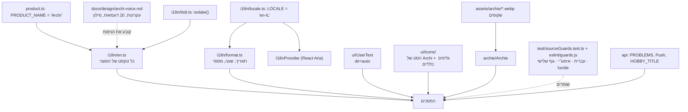

# S39 — Archi א׳, יסוד השפה: תוכנית עבודה

> **For agentic workers:** REQUIRED SUB-SKILL: Use superpowers:subagent-driven-development (recommended) or superpowers:executing-plans to implement this plan task-by-task. Steps use checkbox (`- [ ]`) syntax for tracking.

**מטרה:** המוצר עובר לאנגלית ול-LTR בשם **Archi**, מדבר בגוף ראשון, בלי אף אימוג׳י, עם סט אייקונים משלו ועם דמות על רקע שקוף; תוכן המשתמש (שמות מבחנים, משימות, אירועים) נשאר בשפה שלו ומוצג נכון. בסוף יש הדמיה מעודכנת ש-S32, ‏S34 ו-S33 בונים לפיה.

**השער במפת הדרכים:** "כל טקסט ממשק מגיע מ-`en.ts`, בדיקה אוטומטית נכשלת על אימוג׳י בקוד, וכותרת בעברית מיושרת נכון בתוך ממשק אנגלי".

**גישה:** שכבת יסוד אחת שנכתבת פעם אחת (מילון `en.ts`, קבוע ה-locale, הרכיב `UserText`, סט האייקונים, נכסי הדמות), ואחריה מעבר רוחבי על כל תיקייה ב-`web/src` שמחבר אליה את המסכים. שלושה שומרים אוטומטיים (עברית, אימוג׳י, גוף שלישי) מונעים נסיגה ב-scopes הבאים.

**כלים:** React 19, ‏TypeScript strict, ‏Tailwind 4, ‏React Aria Components, ‏Vitest, ‏ESLint; ב-API ‏Python 3.14. **בלי תלויות חדשות** ב-`web/` וב-`api/` (הסרת הרקע נעשית בסביבת Python זמנית מחוץ לריפו). **אין מיגרציה.**

**מסמכים:** `docs/design/2026-11-21-archi-ux-audit.md` (סעיפים 1, 2, 3, 6, 13, 14 ורשימת הנכסים; הוא גובר על כל מסמך ישן), מסמך התכנון 7.9, ‏`docs/design/design-language.md`.

## כללים לכל המשימות

- אפס אימוג׳י בקוד, בטקסטים, בבדיקות ובהדמיה. אייקון = רכיב מ-`web/src/ui/icons/`.
- Archi מדבר ב-`I` / `me` / `my` ופונה ב-`you`. אף פעם לא "Archi will…", ולא "we".
- אין אות עברית ב-`web/src` מחוץ לקובצי בדיקה (נתוני דמה של תוכן משתמש ובדיקות BiDi) ולרשימה מפורשת של קובצי נתוני דמה.
- תאריכים, שעות ומספרים: `Intl` עם `LOCALE = 'en-IL'`; שבוע מיום ראשון; שעון 24 שעות; אזור הזמן `Asia/Jerusalem` לא משתנה.
- פרומפטים ל-Claude ותוכן שנוצר מהחומרים לא משתנים.
- ב-`api/` נוגעים רק במחרוזות שמגיעות למשתמש (S44 ו-S45 רצים שם במקביל).
- git רק בשיחה הראשית; קבצים לפי שם; `git status --short --untracked-files=all` לפני כל commit; gitleaks לפני push.
- מסד הבדיקות: `STUDYFLOW_TEST_DB=studyflow_test_s39`.

## איך החלקים מתחברים

- **למה `en.ts` שומר על המבנה של `he.ts` (אותם מפתחות, כמעט אותן חתימות):** 128 קבצים קוראים ל-`he.<section>.<key>`. אם המבנה נשמר, המעבר בכל מסך הוא שינוי שם מכני (`he` ← `en`), והעבודה האמיתית מתרכזת במקום אחד: הניסוח. זה גם מה שמקטין את ההתנגשויות ב-rebase של S32 ו-S34: אצלם משתנה רק שורת ה-import ושם האובייקט.
- **למה `en-IL` ולא `en-US` או `en-GB`:** השפה אנגלית, אבל ההרגלים של האזור הם של ישראל: `en-US` נותן שעון 12 שעות וחודש לפני יום, ו-`en-GB` פותח את השבוע ביום שני. ‏`en-IL` נותן `16:05`, ‏`22 November 2026`, ‏`Sun, 22 Nov` ושבוע שמתחיל בראשון, גם ב-`Intl` וגם בלוח השנה של React Aria. הקבוע כתוב במקום אחד.
- **למה `UserText` ולא `dir="auto"` מפוזר:** תוכן המשתמש מופיע בעשרות מקומות. רכיב אחד הופך את הכלל ("תוכן משתמש תמיד מבודד ומקבל כיוון משלו") למשהו שאפשר לבדוק ולשנות במקום אחד. בתוך מחרוזת (aria-label, toast) אין אלמנט, ולכן שם משתמשים ב-`isolate()`, שעוטף בתווי FSI/PDI: אותו רעיון, לטקסט פשוט.
- **למה האייקונים הכלליים (חץ, X, פח) נשארים של lucide אבל מיובאים רק דרך `ui/icons`:** ציור מחדש של 38 גליפים כלליים לא מוסיף אופי, ומוסיף סיכון. מה שנותן ל-Archi אופי הוא האייקונים "שלו" (עלה, ניצוץ, ספל, שמש וירח, סוגי המשימות), והם מצוירים ביד באותה רשת 24 ובאותו קו עגול, עם מילוי נייר שקוף. כלל ESLint אוסר לייבא `lucide-react` מחוץ ל-`ui/icons`, כך שכל מסך רואה סט אחד, והחלפה עתידית של גליף היא שינוי בקובץ אחד.
- **למה `HOBBY_TITLE` מזהה גם את השם הישן:** השרת מזהה את "הזמן לעצמי" של המשתמש לפי הכותרת של ההתחייבות. אין מיגרציה ב-S39, ולכן שורות קיימות נשארות עם הכותרת העברית: הקריאה מזהה את שתי הכותרות, והכתיבה משתמשת בחדשה. (הכותרת הישנה היא תוכן שנשמר, ו-`UserText` מציג אותה נכון.)

## החלטות של מי שבונה

1. **יישור של תוכן משתמש:** כותרת של שורה אחת (שם מבחן, משימה, אירוע) שומרת על הקצה של הממשק (שמאל) ומקבלת כיוון משלה לסדר האותיות ולחיתוך (`…` בסוף הטקסט, לא בתחילתו). פסקה של תוכן משתמש (נימוק של משימה, "על מה זה מבוסס") מיושרת לפי השפה שלה. הנימוק: מסך שבו כל כותרת עברית קופצת לימין וכל שורת מטא אנגלית נשארת בשמאל נראה שבור; כך נוהגים גם Google Calendar ו-Gmail. ההחלטה יושבת במקום אחד (`UserText`), ואפשר להפוך אותה בשורה אחת.
2. **`we` הופך ל-`I`:** גם הודעות שגיאה ("לא הצלחנו") נכתבות בגוף ראשון יחיד של Archi ("I couldn't…"). אין "we" במוצר.
3. **רבים בעברית ← `you`:** כל הפניות ("שלכם", "נסו") הופכות ל-`you` / `your`.
4. **מילת האישור למחיקת חשבון:** `delete` (לא תלוי רישיות).
5. **פונט:** Rubik ו-Amatic SC נשארים, אחרי בדיקה בעין של הלוגו "Archi" ושל כותרת באנגלית. קובצי העברית של שני הפונטים נשארים, כי תוכן המשתמש בעברית.
6. **השומר על עברית** סורק את כל `web/src` חוץ מקובצי בדיקה, `src/test/**`, ורשימה מפורשת של קובצי נתוני דמה (`dev/sampleContent.ts` ודומיו). גם הערות בקוד נכתבות בלי עברית.
7. **טקסטי השרת** (`PROBLEMS`) באנגלית בגוף ראשון, אבל הם רק גיבוי: ה-web מתרגם קוד לטקסט ב-`en.codes`.
8. **דף הרכיבים (`/dev/components`)** עובר לאנגלית, כי הוא חלק מ-`web/src`. נתוני הדמה של תוכן המשתמש בו נשארים בעברית, בקובץ אחד.

## מבנה הקבצים

| קובץ | אחריות |
|---|---|
| `web/src/product.ts` | `PRODUCT_NAME = 'Archi'` |
| `web/src/i18n/en.ts`, ‏`enCrash.ts`, ‏`enPwa.ts` | המילון (מחליפים את `he*.ts`, שנמחקים) |
| `web/src/i18n/locale.ts` | `LOCALE`, ‏`TIME_ZONE_DEFAULT` |
| `web/src/i18n/bidi.ts` | `isolate(text)` |
| `web/src/i18n/format.ts` | `formatNumber`, ‏`longDate`, ‏`shortDay`, ‏`dayMonth`, ‏`weekdayShort`, ‏`weekdayLetter` |
| `web/src/ui/UserText.tsx` | תוכן משתמש: `inline` (ברירת מחדל), ‏`truncate`, ‏`prose` |
| `web/src/ui/icons/` | `Icon.tsx` (בסיס), קובץ לכל משפחה, `index.ts` |
| `web/src/test/sourceGuards.test.ts` | עברית, אימוג׳י, גוף שלישי, שם ישן |
| `web/eslint/guards.js` | אימוג׳י במחרוזות ו-JSX, איסור `lucide-react` מחוץ ל-`ui/icons`, הודעות מעודכנות |
| `web/src/assets/archie/*.webp` | ששת האיורים, שקופים, 450 ו-900 |
| `docs/design/archi-voice.md` | מסמך הקול |
| `docs/design/prototype/all-screens.html` | ההדמיה המחייבת (הישנה: `all-screens-he-2026-11-18.html`) |

## סדר ביצוע ומקביליות

| גל | משימות | במקביל? | מודל ונימוק |
|---|---|---|---|
| 1 | T1 מסמך קול + `en.ts` + `format.ts` (ראשית) · T2 אייקונים · T3 הסרת רקע · T4 טקסטי השרת · T5 צילומי "לפני" | כן: קבצים נפרדים | T1 ‏fable (הקול קובע את איכות המוצר); T2 ‏fable (עיצוב חזותי); T3 ‏opus (עבודת תמונה עדינה, נבדקת בעין); T4 ‏sonnet (העברת מחרוזות עם בדיקות); T5 ‏sonnet (צילומים) |
| 2 | T6 היסוד ב-web: שינוי שם `he`←`en`, שורש LTR, ‏`UserText`, השומרים (ראשית) | לא: נוגע בכל קובץ | הראשית: שינוי מכני בסקריפט ורכיב קטן |
| 3 | T7 תיקוני LTR (opus) ← ואז T8a–T8e מעבר לפי תיקייה (5 סוכני sonnet במקביל) · T9 `Archie` שקוף (fable) · T10 ההדמיה (fable) | T7 לפני T8; ‏T8a–e, ‏T9, ‏T10 במקביל (תיקיות נפרדות) | T7 ‏opus (כיווני חיצים, תאריכים ולוח שנה: טעות שקטה); T8 ‏sonnet (עדכון בדיקות וטקסט לפי רשימות); T9, ‏T10 ‏fable (מראה) |
| 4 | T11 מסמכים, צילומי "אחרי", מעבר על הצילומים (ראשית + sonnet לצילום) | אחרי שהכול אוחד | |
| 5 | T12 סקירה סופית (fable), תיקונים, מיזוג | | fable: סקירה של כל הענף |

**קבצים משותפים:** `en.ts` (רק הראשית עורכת; סוכן שצריך מפתח חדש מדווח), `dev/` (רק T8e), `archie/` (רק T9), `ui/` (T6 ואז T7 ואז T8a), `eslint/guards.js` (רק הראשית).

---

### Task 1: מסמך הקול, `en.ts` ו-`format.ts` (ראשית, fable)

**Files:** Create `docs/design/archi-voice.md`, ‏`web/src/i18n/en.ts`, ‏`enCrash.ts`, ‏`enPwa.ts`, ‏`locale.ts`, ‏`bidi.ts`, ‏`format.ts`, ‏`format.test.ts`.

**Produces:**
- `export const en = { … } as const` באותו מבנה מפתחות של `he`. חתימות שמשתנות: `board.weekdays` ו-`board.day` יוצאים (במקומם `shortDay(date)` מ-`format.ts`); `progress.days.weekdayLetters` יוצא (במקומו `weekdayLetter(index)`); טווחי השעות ב-`onboardingSchedule.windows` בלי תווי LRI.
- `LOCALE = 'en-IL'`; ‏`isolate(text: string): string`.
- `format.ts`: ‏`formatNumber(n)`, ‏`longDate(isoDate)` ← `22 November 2026`, ‏`shortDay(isoDate)` ← `Sun, 22 Nov`, ‏`dayMonth(isoDate)` ← `22/11`, ‏`weekdayShort(isoDate)` ← `Sun`, ‏`weekdayLetter(0–6)` ← `S M T W T F S`. כולם קוראים תאריך `YYYY-MM-DD` כ-UTC, כדי שאזור הזמן של המכשיר לא יזיז יום.

- [ ] מסמך הקול: 6 עקרונות, 20 זוגות עשה / אל תעשה, מילון (Learning / Practice / Simulation / Review, Streak, XP, Level, Busy time, Defer, Skip, Exam, Task, Block, Plan, Calendar).
- [ ] בדיקות `format.test.ts` (הערכים שלמעלה, ויום ראשון = אינדקס 0), ואז המימוש.
- [ ] `en.ts` לפי מסמך הקול. כל פונקציה שמקבלת תוכן משתמש עוטפת אותו ב-`isolate()`.
- [ ] Commit.

### Task 2: סט האייקונים (fable)

**Files:** Create `web/src/ui/icons/Icon.tsx`, ‏`archi.tsx` (עלה רצף, ניצוץ XP, ספל תה, נבט, אבן, פריחה), `dayparts.tsx` (Morning, Noon, Evening, Night), `kinds.tsx` (Learning, Practice, Review, Simulation), `actions.tsx` (FreeTime, NextSlot, PickTime, PracticeExam, Offline, Work, Class), `glyphs.ts` (ייצוא מחדש של גליפי lucide שבשימוש, באותם שמות), `index.ts`, ‏`icons.test.tsx`.

**Produces:** כל אייקון הוא רכיב `({ size = 20, label, className }: IconProps)`: ‏`viewBox="0 0 24 24"`, ‏`stroke="currentColor"`, עובי 1.75, קצוות ופינות עגולים, ומילוי נייר `fill="currentColor"` עם `fill-opacity` של 0.14 על הצורה הראשית. עם `label`: ‏`role="img"` ו-`aria-label`; בלעדיו `aria-hidden="true"`. ‏`KIND_ICON: Record<TaskKind, IconComponent>` ו-`DAYPART_ICON`.

- [ ] בדיקה: לכל אייקון ב-`index.ts` יש `viewBox` של 24, ‏`currentColor`, אין צבע קבוע, ‏`aria-hidden` בלי `label` ו-`role="img"` עם `label`.
- [ ] ציור, רינדור של גיליון בדיקה ל-PNG ב-16, 20, 24 ו-32px על `--bg` ועל `--surface`, ומעבר בעין.
- [ ] Commit (הראשית).

### Task 3: הדמות על רקע שקוף (opus)

**Files:** Modify `web/src/assets/archie/{mood}-{450,900}.webp` (12 קבצים, שקופים); Create `docs/design/prototype/archie/cut/{mood}.png` (המקור השקוף ברזולוציה מלאה, לשימוש ההדמיה).

- [ ] הסרת רקע בסביבת Python זמנית ב-scratchpad (`rembg` או מסכה לפי צבע מהגיליון `archie-source-sheet.png`, לפי מה שנותן קצה נקי יותר), ניקוי הילה בקצוות, חיתוך לתיבה התוחמת עם שוליים שווים.
- [ ] בדיקת קצוות בעין בהגדלה של 300% על `#eef0e4` ועל `#f8f7f0`, לכל אחד מהשישה. דיווח על הממדים החדשים ועל נקודת הפנים (`face`) המעודכנת.
- [ ] Commit (הראשית).

### Task 4: טקסטי השרת (sonnet)

**Files:** Modify `api/app/errors.py` (הכותרות ב-`PROBLEMS`), `api/app/domain/notifications.py` (טקסטי ה-Push), `api/app/services/hobby.py` (`HOBBY_TITLE = "Me time"`, ‏`LEGACY_HOBBY_TITLES = ("זמן לעצמי",)`, והקריאה מזהה את שניהם), והבדיקות שנשענות עליהם.

- [ ] קודם הבדיקות: Push ‏`"In 10 min · 09:00–10:30 · הסתברות"`, ‏`"Starting now"`, ‏`"Started 1 min ago"`, ‏`"Started 5 min ago"`, ‏`"In 1 min"`; התחביב: משתמש עם שורות בכותרת הישנה מזוהה, ועדכון לא יוצר כפילות.
- [ ] המימוש; ‏`uv run pytest`, ‏`ruff check`, ‏`ruff format --check`, ‏`mypy`.
- [ ] Commit (הראשית).

### Task 5: צילומי "לפני" (sonnet)

- [ ] סביבת צילום `~/studyflow-manager/s39-shots-harness/` (העתק של s31, פורט 4239) מול עותק נקי של `origin/main`; צילומים ב-390×844 וב-1280×800 ל-`~/studyflow-manager/s39-screens/before/`.

### Task 6: היסוד ב-web (ראשית)

**Files:** כל קובץ שמייבא `i18n/he`; ‏`web/index.html`, ‏`src/app/AppProviders.tsx`, ‏`src/pwa/manifest.ts`, ‏`src/pwa/notification.ts`, ‏`src/pwa/bootTexts.ts`, ‏`vite.config.ts`, ‏`src/product.ts`; Create `src/ui/UserText.tsx` + בדיקה, `src/test/sourceGuards.test.ts`; Modify `eslint/guards.js` + בדיקה. Delete `src/i18n/he.ts`, ‏`heCrash.ts`, ‏`hePwa.ts`.

**Produces:** `UserText({ children, as = 'bdi', truncate, prose, className })`: ברירת מחדל `<bdi dir="auto">`; ‏`truncate` ← אלמנט בלוק עם `dir="auto"` ועם המחלקה `user-text-truncate` (יישור לקצה הממשק, `…` בסוף הטקסט); ‏`prose` ← בלוק `dir="auto"` עם יישור טבעי.

- [ ] בדיקות `UserText` (שלושת המצבים), ובדיקות השומרים: עברית מחוץ לרשימה נכשלת, אימוג׳י נכשל, `/\bArchi(e)? (will|is|has|can|builds|…)/` ב-`en.ts` נכשל, `ארצ׳י` / `Archie ` בטקסט נכשל.
- [ ] שינוי השם בסקריפט; `lang="en" dir="ltr"`; ‏`I18nProvider locale={LOCALE}`; manifest ו-Push ב-`en` / `ltr`.
- [ ] כלל ESLint לאימוג׳י (`Literal`, ‏`TemplateElement`, ‏`JSXText`) ולייבוא `lucide-react`; הודעות הכללים באנגלית של LTR.
- [ ] typecheck עובר (הבדיקות עוד אדומות: הן מתוקנות ב-T8). Commit.

### Task 7: תיקוני RTL ← LTR (opus)

**Files:** `week/WeekPage.tsx` (חיצים), `exam/ExamPage.tsx` (חץ "חזרה"), `ui/DatePicker.tsx`, ‏`ui/Switch.tsx`, ‏`ui/TimeField.tsx`, ‏`ui/OptionGrid.tsx`, ‏`board/time.ts`, ‏`exam/dates.ts`, ‏`progress/format.ts`, ‏`progress/DayStrip.tsx`, ‏`i18n/codes.ts`, ‏`onboarding/ExamsStep.tsx` (פורמט התאריך), `exam/Timeline.tsx` (מיקום הגלילה), `settings/DeleteAccountPage.tsx` (סדר הכפתורים), והבדיקות שלהם.

- [ ] קודם בדיקה לכל תיקון: "הקודם" הוא `ChevronLeft`; חץ ימינה עובר ליום הבא ב-`SegmentedControl`; ה-knob של `Switch` זז ימינה; `TimeField` מיושר לתחילת השדה; כל `Intl` עם `LOCALE`; השבוע מתחיל בראשון.
- [ ] המימוש, והרצת הבדיקות של הקבצים האלה. Commit (הראשית).

### Task 8a–8e: מעבר לפי תיקייה (5 × sonnet, במקביל)

| | תיקיות |
|---|---|
| 8a | `ui/`, ‏`theme.test.ts` |
| 8b | `board/`, ‏`today/`, ‏`week/`, ‏`calendar/`, ‏`pages/` |
| 8c | `exam/`, ‏`plan/` |
| 8d | `onboarding/` |
| 8e | `app/`, ‏`auth/`, ‏`notifications/`, ‏`pwa/`, ‏`settings/`, ‏`progress/`, ‏`availability/`, ‏`api/`, ‏`config/`, ‏`i18n/`, ‏`dev/`, ‏`test/`, ‏`eslint/` |

בכל תיקייה, באותו סדר:
- [ ] כל מקום שמציג תוכן משתמש (לפי הרשימה שנאספה) עטוף ב-`UserText`, עם בדיקה; `<bdi>` קיים מוחלף.
- [ ] הבדיקות מצפות לטקסט האנגלי דרך `en.<key>` (לא מחרוזת מועתקת), ונתוני הדמה של תוכן המשתמש נשארים בעברית.
- [ ] אין עברית בקוד ובהערות שאינם בדיקה; אין אימוג׳י; `lucide-react` מיובא רק דרך `ui/icons`; אייקון של Archi מחליף את הגליף הכללי איפה שיש (רצף, XP, הפסקה).
- [ ] הבדיקות של התיקייה, lint ו-typecheck עוברים. Commit לכל תיקייה (הראשית).

**בדיקת הקבלה של BiDi (8a + 8b + 8c):** כותרת עברית בתוך בלוק ביומן (`DayTimeline`), בשורת רשימה (`ListRow` דרך `BlockRow`) ובכותרת מסך (`PageHeader` דרך `ExamHeader`) נמצאת בתוך אלמנט עם `dir="auto"`.

### Task 9: `Archie` בלי רקע (fable)

**Files:** `web/src/archie/Archie.tsx`, ‏`moods.ts`, ‏`archie.css`, ‏`motionLayer.tsx`, ‏`Archie.test.tsx`, ‏`app/Logo.tsx`.

- [ ] בדיקה: אף גודל לא מקבל `bg-sky`, גרדיאנט, `rounded-full`, ‏`overflow-hidden` או `shadow`; ‏`avatar` מציג את הדמות כולה בלי עיגול; שכבות התנועה נשארות, ונעצרות עם reduced motion.
- [ ] המימוש לפי הממדים של T3; צילום של שלושת הגדלים על `--bg` ועל `--surface`. Commit (הראשית).

### Task 10: ההדמיה המחייבת (fable)

**Files:** `git mv docs/design/prototype/all-screens.html all-screens-he-2026-11-18.html`; Create `all-screens.html` חדש.

- [ ] כל המסכים הקיימים, בטלפון ובמחשב: אונבורדינג (כשיחה ש-Archi מוביל: קודם Archi והשאלה, מתחתיו רק הפקדים), יומן יום ושבוע, גיליונות (דחייה, "יש לי זמן עכשיו", זמן תפוס), מבחנים ומבחן, התקדמות, הגדרות, מצבי קצה (לא מקוון, ריק). אנגלית ו-LTR, גוף ראשון לפי `archi-voice.md`, תוכן לדוגמה בעברית עם `dir="auto"`, האייקונים של T2 (SVG מוטמע), Archi שקוף של T3, אפס אימוג׳י.
- [ ] לא נכנסים: Focus, סגירת מבחן, Dusk.
- [ ] צילום של ההדמיה ב-390 וב-1280 ומעבר בעין; השומר על אימוג׳י סורק גם אותה. Commit (הראשית).

### Task 11: מסמכים וצילומי "אחרי" (ראשית + sonnet)

- [ ] מסמך התכנון: 7.9 וטבלת ההחלטות ("עברית ו-RTL" מוחלפת, 21.11.2026, עם הנימוק); `design-language.md` (שפה, פונט, אייקונים, הדמות, `UserText`); `CLAUDE.md` (הכלל "כתיבה בעברית" חל על מסמכים, המוצר באנגלית); הלשונית "מסמך תכנון v2" ב-artifact.
- [ ] צילומי "אחרי" באותם מסכים, עם תוכן משתמש בעברית; מעבר על כל זוג; תיקון של מה שנמצא.

### Task 12: סקירה סופית ומיזוג (fable + ראשית)

- [ ] סקירה של כל הענף מול המסמך הזה ומול מסמך הביקורת; תיקונים.
- [ ] `api/`: ‏`pytest`, ‏`ruff check`, ‏`ruff format --check`, ‏`mypy`. ‏`web/`: ‏`test`, ‏`lint`, ‏`typecheck`, ‏`build`.
- [ ] `git fetch` ו-`rebase origin/main`, כל הבדיקות שוב, gitleaks, ‏`git push origin s39-language-foundation:main`, בדיקה שהצליח, ורק אז מחיקת הענף ב-`origin`.
- [ ] מפת הדרכים: S39 "הושלם"; פריטים שנדחו נרשמים.

## מה לבדוק במיוחד בסקירה

1. **שם מבחן באנגלית או מעורב** ("Calculus 1", "חדו״א 1 (מועד ב׳)", "גרפים ו-BFS") בתוך משפט אנגלי ובתוך aria-label: הסדר לא מתהפך, והסוגריים והמספר נשארים במקום. נבדק ב-`UserText.test.tsx` וב-`en` (בדיקת `isolate`).
2. **כותרת עברית ארוכה שנחתכת:** ה-`…` בסוף הטקסט, וההתחלה נראית. נבדק בצילום של `calendar-long`.
3. **יחיד ורבים באנגלית:** "1 task" מול "2 tasks", "1 day" מול "2 days", בכל פונקציה עם מספר. נבדק ב-`en.test.ts`.
4. **שעה ותאריך אחרי חצות ובמעבר שעון:** השעה תמיד 24 שעות (`00:30`, לא `24:30` ולא `12:30 AM`). נבדק ב-`format.test.ts`.
5. **משתמש קיים עם "זמן לעצמי" בעברית:** ההגדרות מזהות אותו, ושמירה לא יוצרת כפילות. נבדק ב-T4.
