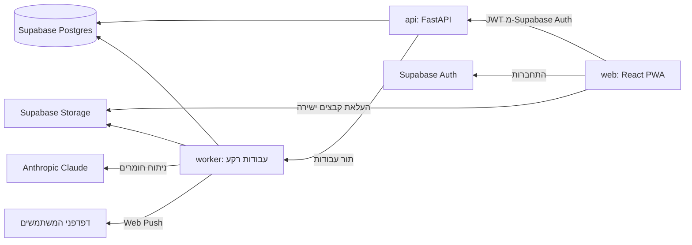

# StudyFlow v2 — מסמך תכנון ליסודות החדשים

**תאריך:** 2026-10-19 · **סטטוס:** מאושר · **מקור:** [מסמך המיפוי והתוכנית](https://claude.ai/code/artifact/29a3c52e-d399-425e-90b6-7c05e9146bfa)

המסמך מתאר איך בונים מחדש את היסודות של StudyFlow, כך שמי שבונה יוכל לתכנן ולעבוד בלי לחזור לשאול. ההחלטות שקיבל בעל המוצר מסומנות ככאלה; החלטות שלי מסומנות **(החלטה שלי)**, ומה שנשאר פתוח למי שבונה מרוכז בסעיף 12.

---

## 1. מה ולמה

StudyFlow היא אפליקציית PWA לסטודנטים באוניברסיטאות בישראל, בתקופת מבחנים — חודשיים עד שבועיים לפני המבחן. הסטודנט מעלה סילבוס, סיכומים ובעיקר מבחני עבר עם פתרונות, ומקבל תוכנית לימודים יומית ושבועית חיה. המטרה: שהסטודנט לא יצטרך להחליט "מה עושים מחר בבוקר".

**הכיוון לטווח ארוך (לא בגרסה הזו):** סימולציות הן הלב של המוצר. בעתיד, הסטודנט יפתור מבחן ניסיון, יעלה את הפתרון, יקבל ניתוח של איפה איבד נקודות, והתוכנית תתעדכן לפי הביצועים. v2 לא בונה את זה, אבל מודל הנתונים צריך להשאיר לזה מקום (ראו 7.4).

**למה עכשיו:** הקוד הקיים הוא אב-טיפוס עובד, אבל יש בו באגים שאומתו בהרצה: משימות נעלמות מהלוח, מחיקה שנועלת את המסד, מיפוי שגוי בין משימות לימים, שני פורמטים של זמן במסד ו-XSS דרך פלט ה-AI. אין משתמשים אמיתיים ואין נתונים להעביר, ולכן בנייה מחדש של היסודות זולה עכשיו יותר מאי-פעם.

## 2. מטרות

| # | מטרה | איך יודעים שהושגה |
|---|---|---|
| G1 | סטודנט חדש מקבל תוכנית ראשונה מהר | אונבורדינג של עד 5 מסכים; תוכנית ראשונה תוך 5 דקות מהכניסה |
| G2 | אף משימה לא נעלמת בשקט | כל משימה משובצת, או מופיעה בדוח "לא נכנס" עם סיבה |
| G3 | הזמנים נכונים תמיד | אחסון ב-UTC ואזור זמן IANA; בדיקות למעבר שעון קיץ/חורף |
| G4 | חוויה בעברית, מובייל קודם | ממשק RTL מלא, PWA שאפשר להתקין, תזכורות Push |
| G5 | בטוח להכניס זרים | ריפו פרטי, Supabase Auth, RLS, מכסות AI, ניטור שגיאות, גיבויים |
| G6 | הליבה מכוסה בבדיקות | בדיקות יחידה למתכנן, בדיקות API, כמה בדיקות E2E |
| G7 | התוספות מהגרסה הקודמת חוזרות, אחרי הליבה | סקירת בוקר, גרירה, גיימיפיקציה, שינוי לו"ז בשפה חופשית |

## 3. לא בגרסה הזו

- בדיקת פתרונות של סימולציות ומשוב על ביצועים (הגרסה הבאה).
- תשלומים. המודל העסקי נסגר לפני הבטא; המימוש מגיע עם ההשקה.
- אפליקציה נייטיב. PWA בלבד.
- שפות נוספות. עברית בלבד, אבל כל הטקסטים בקובץ אחד כדי שתרגום יהיה אפשרי.
- סנכרון עם Google Calendar, שיתוף בין סטודנטים, ממשק ניהול מלא.

## 4. מה יהפוך את זה לכישלון גם אם זה "עובד"

- התוכנית זזה לסטודנט מתחת לרגליים: כל שינוי קטן בונה מחדש את כל הלוח.
- כשלים שקטים: ה-AI נכשל והמשתמש רואה "הצלחה" עם לוח ריק.
- אובדן נתונים: תוכנית חדשה, אונבורדינג או מחיקה שמוחקים היסטוריה והתקדמות.
- פסי התקדמות מזויפים, וחלונות קופצים בכל פתיחה.
- עלות AI שגדלה בלי גבול עם כל משתמש.
- "שעות מילוי" גנריות שמוצגות כלימוד אמיתי.

## 5. אילוצים

- **מפתח יחיד, פחות מ-15 שעות בשבוע.** כמה שפחות רכיבים לתחזק; שירותים מנוהלים עדיפים.
- **יעד:** בטא בתקופת המבחנים של סמסטר ב' (בערך יוני–יולי 2027).
- **קהל:** סטודנטים בישראל. ממשק בעברית ו-RTL; תוכן ה-AI בעברית, עם מונחים מקצועיים בשפת המקור.
- **פרטיות:** חומרי הלימוד ונתוני התכנון הם מידע אישי. חובה לגלות שהחומרים נשלחים לעיבוד אצל Anthropic.
- **תקציב:** 30–100 דולר בחודש לתשתית ול-AI, בפיתוח ובבטא. בפיתוח מסתפקים במסלולים חינמיים; לקראת הבטא עוברים ל-Supabase בתשלום, עם גיבויים יומיים ובלי השהיה. בחירת המודלים ב-eval נעשית בתוך התקציב הזה.

## 6. החלטות שבעל המוצר קיבל

| נושא | החלטה |
|---|---|
| קהל ושפה | סטודנטים בישראל, עברית ו-RTL |
| גישה | שלד חדש, והעברת הלוגיקה הטובה מהקוד הקיים |
| ממשק | React + TypeScript |
| תשתית | Supabase (Postgres, Auth, Storage); FastAPI ל-AI, לשיבוץ ול-worker |
| AI | Anthropic Claude |
| היקף | הליבה, ואחריה: סקירת בוקר, גרירה בלוח, גיימיפיקציה (XP ותגים), שינוי לו"ז בשפה חופשית |
| מודל עסקי | נסגר לפני הבטא |
| זמן | פחות מ-15 שעות בשבוע; בטא בסמסטר ב' |
| ריפו | אותו ריפו, פרטי, במבנה חדש; הקוד הנוכחי עובר ל-`legacy/` לעיון בלבד |
| תקציב | 30–100 דולר בחודש לתשתית ול-AI, בפיתוח ובבטא |
| שם | שם חדש ייבחר עד שלב 4; עד אז עובדים בשם StudyFlow, וכל שם המוצר בממשק מגיע ממקום אחד בקוד |

## 7. ארכיטקטורה

### 7.1 מבנה הריפו

```
studyflow/
├── web/                  React + TypeScript + Vite (PWA, עברית RTL)
├── api/                  FastAPI + worker (Python, מנוהל עם uv)
│   ├── app/
│   │   ├── main.py
│   │   ├── config.py         הגדרות מ-env (pydantic-settings)
│   │   ├── auth.py           אימות JWT של Supabase
│   │   ├── db/               חיבור וטרנזקציה בשם המשתמש (RLS)
│   │   ├── domain/           לוגיקה טהורה: זמן, מתכנן, גיימיפיקציה
│   │   ├── services/         תרחישי שימוש: מבחנים, חומרים, תוכנית, התקדמות
│   │   ├── ai/               לקוח Claude, פרומפטים, סכמות
│   │   ├── jobs/             משימות רקע ו-worker
│   │   └── routers/          endpoints דקים
│   ├── migrations/           Alembic, עם SQL מפורש
│   ├── tests/
│   └── eval/                 golden cases לבדיקת הפרומפטים
├── docs/superpowers/     מסמכי תכנון ותוכניות עבודה
└── legacy/               הקוד הישן, לעיון בלבד; נמחק אחרי ההעברה
```

אין תיקיית `supabase/`. ה-CLI של Supabase צריך Docker כדי להריץ סביבה מקומית, ואין Docker במק. הבדיקות רצות מול Postgres מ-Homebrew (סעיף 7.12).

### 7.2 רכיבים ותקשורת



- **web** מדבר עם Supabase רק לשני דברים: התחברות, והעלאת קבצים ישירות ל-Storage. כל שאר הנתונים עוברים דרך ה-API. **(החלטה שלי)** — כך כל הלוגיקה העסקית יושבת במקום אחד ונבדקת ב-pytest.
- **api** קצר ומהיר: אין בו קריאות ל-Claude ואין עבודה ארוכה בתוך בקשת HTTP.
- **worker** הוא אותו קוד Python בתהליך נפרד: ניתוח חומרים, יצירת תוכנית, שליחת התראות וניקוי.
- **התור** יושב ב-Postgres (למשל ספריית procrastinate, או טבלת עבודות עם `FOR UPDATE SKIP LOCKED`), בלי Redis. **(החלטה שלי)**

### 7.3 מודל הזמן

זה התיקון הכי חשוב, כי רוב הבאגים בקוד הישן נבעו ממנו.

- כל רגע בזמן נשמר כ-`timestamptz` (UTC). אין יותר מחרוזות זמן.
- לכל משתמש יש `timezone` בפורמט IANA (למשל `Asia/Jerusalem`). הדפדפן שולח אותו (`Intl.DateTimeFormat().resolvedOptions().timeZone`) בכל פתיחה, וה-API מעדכן אם השתנה.
- כל חישוב של "יום מקומי" (היום, חלונות לימוד, ימי מנוחה) נעשה עם `zoneinfo`, אף פעם לא עם הפרש קבוע בדקות.
- תאריך מבחן נשמר כ-`date` (תאריך מקומי). שעות קימה ושינה נשמרות כ-`time`.
- ה-API מחזיר ISO 8601 עם offset; הממשק מציג לפי אזור הזמן של המשתמש.
- **שעה שלא קיימת או שחוזרת:** שעה שנופלת בפער של המעבר לשעון קיץ זזה קדימה באורך הפער (02:30 הופכת ל-03:30). שעה שחוזרת פעמיים במעבר לשעון חורף מתפרשת כמופע הראשון. חלון שמתחיל בפער ונגמר לפני ההתחלה המוזזת הוא חלון ריק. שם של אזור זמן נבדק מול רשימת IANA, כולל אותיות גדולות וקטנות. העזרים ב-`api/app/domain/time.py`.
- **בדיקות חובה:** הלילה של המעבר לשעון חורף ולשעון קיץ ב-`Asia/Jerusalem`, בלוק שחוצה חצות, ומשתמש שפותח את האפליקציה מאזור זמן אחר.

### 7.4 מודל הנתונים

כל טבלאות האפליקציה יושבות בסכמה `app`, שלא נחשפת דרך ה-REST האוטומטי של Supabase, ועל כולן מופעל RLS לפי `user_id = auth.uid()`. **(החלטה שלי)** — ב-Supabase, טבלה בסכמת `public` בלי RLS קריאה לכל מי שמחזיק את מפתח ה-anon.

**איך RLS נאכף מול ה-API:** ה-API מתחבר עם תפקיד ייעודי, `studyflow_api`, שאין לו הרשאות משלו ואין לו `BYPASSRLS`. כל בקשה רצה בטרנזקציה שעוברת לתפקיד `authenticated` וכותבת את ה-claims המאומתים ל-`request.jwt.claims`, ולכן `auth.uid()` מחזיר את המשתמש ו-RLS חל, כמו ב-PostgREST של Supabase. קוד ששוכח את הטרנזקציה מקבל שגיאת הרשאה, ולא נתונים. המיגרציות ועבודות המערכת רצות בתור `postgres`, שעוקף RLS.

מפתחות זרים בין טבלאות האפליקציה כוללים את `user_id`, ולכן אי אפשר לקשר שורה לשורה של משתמש אחר.

כל טבלה נוצרת במיגרציה של ה-scope שצריך אותה. S05 יוצר את `profiles`, `exams`, `tasks` ו-`blocks`, בלי `exams.status`, `tasks.topic_id`, `tasks.material_id`, `blocks.plan_version_id` ו-`blocks.notified_at`. אחר כך: `plan_versions` ב-S08, `materials` ו-`jobs` ב-S10, `topics` ב-S11, `ai_usage` ב-S12, `push_subscriptions` ב-S16, `xp_events` ו-`badges` ב-S19.

| טבלה | שדות עיקריים | הערות |
|---|---|---|
| `profiles` | `id` (= `auth.users.id`), `display_name`, `timezone`, `wake_time`, `sleep_time`, `daily_study_minutes`, `study_windows` (בוקר/צהריים/ערב/לילה), `rest_days_before_exam`, `notify_lead_minutes`, `onboarding_completed_at` | העדפות שנאספו באונבורדינג ובהגדרות |
| `exams` | `id`, `user_id`, `name`, `exam_date` (date), `difficulty` (1–5), `status`, `deleted_at` | הקושי משמש לחלוקת השעות בין מבחנים במקביל |
| `materials` | `id`, `exam_id`, `user_id`, `storage_path`, `filename`, `kind` (syllabus / summary / past_exam / solution / notes / other), `mime`, `size_bytes`, `page_count`, `ingest_status`, `text_by_page` | `solution` נשמר כבר עכשיו, למערכת הפידבק העתידית |
| `topics` | `id`, `user_id`, `exam_id`, `name`, `weight`, `evidence` | נושאים שה-AI מצא, עם הפניה לשאלות במבחני העבר. בעתיד: ביצועים לפי נושא |
| `tasks` | `id`, `user_id`, `exam_id`, `topic_id`, `title`, `kind` (learn / practice / review / simulation / simulation_review / custom), `estimated_minutes`, `focus` (1–10), `depends_on_task_id`, `material_id`, `status` (todo / done / skipped), `source` (ai / user), `deleted_at` | `material_id` מקשר סימולציה למבחן העבר שלה |
| `blocks` | `id`, `user_id`, `task_id` (FK עם `ON DELETE CASCADE`), `starts_at`, `ends_at`, `part_index`, `part_count`, `pinned`, `status` (planned / done / missed / skipped), `notified_at`, `plan_version_id` | `pinned` מחליף את `is_manually_edited`: בלוק שהמשתמש קבע לא זז בתכנון מחדש |
| `plan_versions` | `id`, `user_id`, `reason`, `created_at`, `snapshot` (JSONB של הבלוקים העתידיים) | בסיס ל"ביטול" של כל שינוי בתוכנית |
| `jobs` | `id`, `user_id`, `kind`, `status`, `stage`, `percent`, `error`, `created_at`, `finished_at` | סטטוס אמיתי למסך "בונים לך תוכנית" |
| `push_subscriptions` | `id`, `user_id`, `endpoint` (unique), `p256dh`, `auth`, `user_agent`, `last_success_at`, `failure_count` | |
| `xp_events` | `id`, `user_id`, `block_id` (unique), `xp`, `created_at` | יומן XP; הרמה והסכום מחושבים ממנו. ה-unique מונע XP כפול |
| `badges` | `user_id`, `badge_key`, `earned_at` | |
| `ai_usage` | `id`, `user_id`, `job_id`, `model`, `input_tokens`, `output_tokens`, `created_at` | מכסות ומעקב עלויות |

- מחיקה של מבחן או משימה היא מחיקה רכה (`deleted_at`) עם אפשרות ביטול; מחיקה סופית רצה בעבודת ניקוי. מחיקת חשבון מוחקת הכל, כולל הקבצים ב-Storage.
- **הרצף (streak) נספר לפי ימי לימוד** — יום מקומי עם לפחות בלוק לימוד אחד שהושלם — ולא לפי כניסות לאפליקציה. **(החלטה שלי)**

### 7.5 צינור ה-AI (Claude)

**שלב א — קליטת חומרים (worker):**
1. הממשק מעלה את הקובץ ישירות ל-bucket פרטי `materials`, בנתיב `{user_id}/{exam_id}/{material_id}`, ורושם אותו ב-API.
2. ה-worker מוריד את הקובץ. ב-PDF: מחלץ טקסט לכל עמוד עם PyMuPDF. עמוד עם מעט מאוד טקסט מסומן "סרוק".
3. עמודים סרוקים ותמונות נשלחים ל-Claude כמסמך או כתמונה, בלי OCR נפרד.
4. מגבלות: גודל קובץ, מספר עמודים ומספר קבצים למבחן, כולן בקונפיג. קובץ שנחתך מקבל אזהרה גלויה.

**שלב ב — ניתוח קורס (worker, קריאה אחת לכל מבחן):**
- **קלט:** תוכן החומרים, פרטי המבחן והקושי, ותקציב הדקות למבחן. את התקציב מחשב הקוד — ימים זמינים × דקות ביום, מחולק בין המבחנים לפי קושי — ולא ה-AI.
- **פלט:** JSON לפי סכמה קבועה, דרך tool use, ונבדק עם Pydantic:
  - `topics[]`: `key` (למשל `T3`), `name`, `weight`, `evidence`
  - `tasks[]`: `key` (למשל `K12`), `title`, `kind`, `topic_key`, `minutes`, `focus`, `depends_on` (key), `material_id`, `reason`
  - `gaps[]`: נושאים בסילבוס בלי חומר
- **מזהים יציבים** (`K12`) במקום אינדקסים. השרת ממפה אותם למזהים במסד. זה סוגר את משפחת הבאגים של ה-Strategist.
- **כללי התוכן** מהפרומפט הקיים: משימת סקירה ראשונית לסילבוס או לסיכום; לכל מבחן עבר סימולציה מלאה ותחקיר שתלוי בה; משימות ממוקדות של 30–90 דקות; כותרות בעברית.
- סכום הדקות צריך להיות בטווח של ±10% מהתקציב. אם יש חריגה, הקוד מוריד קודם משימות תרגול במשקל נמוך. אם חסר, הזמן נשאר פנוי — אין "מילוי".
- **כשל:** אם התשובה לא עוברת את הסכמה, ניסיון חוזר אחד עם הודעת השגיאה. אם גם הוא נכשל, העבודה מסומנת כנכשלת והמשתמש רואה הודעה עם "נסה שוב". שום כשל לא נבלע.
- **מודלים:** שמות המודלים ב-env (`AI_MODEL_ANALYSIS`, `AI_MODEL_LIGHT`), ונבחרים לפי בדיקות ה-eval (סעיף 10). אין שמות מודלים בקוד.
- כל קריאה נרשמת ב-`ai_usage`. מכסה יומית לכל משתמש בקונפיג.
- טקסט מהחומרים הוא נתונים ולא הוראות; פלט ה-AI לא מוצג אף פעם כ-HTML.

**שלב ג — שיבוץ:** בקוד דטרמיניסטי, בלי LLM (סעיף 7.6).

**שינוי לו"ז בשפה חופשית (תוספת, אחרונה):** Claude ממיר את הבקשה לרשימת פעולות מתוך סט סגור:
- `move_exam(exam_id, new_date)`
- `day_off(date)`
- `block_time(date, start, end)`
- `set_daily_minutes(from, to, minutes)`
- `add_task(exam_id, title, minutes)`
- `remove_task(task_id)`

המתכנן מריץ את הפעולות במצב תצוגה מקדימה ומציג מה ישתנה, והמשתמש מאשר. פלט ה-AI לא נוגע בבלוקים ישירות. **(החלטה שלי)** — זה מחליף את `regenerate-delta`, שזיהה ימים לפי שם בשבוע ולכן התבלבל בין שני ימי שני.

### 7.6 המתכנן (domain/planner)

פונקציה טהורה: `plan(profile, exams, tasks, existing_blocks, now) -> PlanResult(blocks, unscheduled, warnings, shortfalls)`. בלי `datetime.now()` בפנים ובלי גישה למסד, כדי שאפשר יהיה לבדוק אותה. הקלט הוא טיפוסים של הדומיין (`Profile`, `Exam`, `Task`), ולא שורות מהמסד. ה-API ממפה אליהם, והם בודקים את אותם טווחים כמו ה-`CHECK` במסד. שלבים 1–3 הם `assign_days(profile, exams, tasks, now, busy) -> DayAssignment(days, unscheduled, warnings)`, ו-`plan()` צורך אותה. **(החלטה של מי שבונה, S06)** מ-`existing_blocks`, רק בלוק שהושלם או ננעל (`pinned`) נכנס כזמן תפוס. בלוק מתוכנן שלא ננעל, `missed` ו-`skipped` לא תופסים זמן. S07 לא מקטין משימה לפי הבלוקים האלה: זה, והיציבות של בלוקים עתידיים, שייכים ל-S08. **(החלטה של מי שבונה, S07)**

1. **זמינות לכל יום מקומי:** חלונות הלימוד שהמשתמש בחר, בין שעת הקימה (פלוס שעה, כמו בקוד הישן; ניתן לשינוי) לשעת השינה. מעבירים את `_get_windows_for_day` ו-`_subtract_range` מהקוד הישן, עם התאמה ל-`zoneinfo`. הפירוט, **(החלטות של מי שבונה, S06)**:
   - החלונות: בוקר 06:00–12:00, צהריים 12:00–17:00, ערב 17:00–21:00, לילה 21:00–02:00. חלונות סמוכים מתאחדים לחלון רציף אחד.
   - יום לימוד הוא שעות הערות שמתחילות בתאריך המקומי, גם כשהשינה אחרי חצות. החלונות נלקחים מהיום שלפני, מהיום עצמו ומהיום שאחרי, ונחתכים לשעות הערות. כך גם מי שקם מאוחר או עובד בלילה מקבל את החלונות שבחר.
   - השעה שאחרי הקימה היא ברירת מחדל בטיפוס של הדומיין. עמודה בפרופיל תתווסף רק אם מסך ההגדרות יחשוף אותה.
   - אין fallback: כשהחלונות לא חופפים לשעות הערות, אין זמן לימוד, והתוצאה כוללת warning בשם `no_study_time`.
   - מקטע קצר מ-30 דקות לא נספר.
   - "היום" מתחיל ב-`now`, מעוגל קדימה לדקה שלמה. מי שעדיין ער אחרי חצות עדיין ביום של אתמול.
   - זמן תפוס (`busy`), למשל בלוקים שהושלמו או ננעלו, יורד מהזמינות. הפסקות קבועות לא קיימות ב-v2, והתחביב (11.13) ייכנס כזמן תפוס כשיודלק.
2. **חלון לכל מבחן:** מהיום עד `exam_date − rest_days − 1`. ביום המבחן אין משימות לאותו מבחן. הלילה שלפני יום מנוחה או מבחן נגמר בחצות, לכל המבחנים. **(החלטה של מי שבונה, S06)**
3. **שיבוץ לימים:** Earliest-deadline-first עם משקל לפי קושי. סדר לפי תלויות. סקירות ולמידה מוקדם; סימולציות מפוזרות לאורך התקופה, לא יותר מאחת ביום, והאחרונה לפני ימי המנוחה; תחקיר ביום הלימוד שאחרי הסימולציה. העדפה רכה למבחן אחד ביום. הפירוט, **(החלטות של מי שבונה, S06)**:
   - בין מבחנים: EDF לפי תאריך המבחן, וקושי גבוה יותר שובר שוויון. EDF נותן עדיפות למועד הקרוב, ומשקל שמקדים מבחן קשה על פני מבחן מוקדם יותר יכול להפיל את המוקדם. הקושי מחלק את השעות בין המבחנים דרך תקציב הדקות לכל מבחן (7.5).
   - מבחן אחד ביום יוצא מה-EDF: יום מתמלא במבחן הדחוף, ומבחן אחר נכנס כשאין לראשון משימה מוכנה שנכנסת, או ביום של סימולציה.
   - בתוך מבחן: `review` ו-`learn` קודם, אחריהם `practice` ו-`custom`. סדר הקלט שובר שוויון. כשהמשימה הבאה לא נכנסת, נכנסת משימה מוכנה קטנה יותר.
   - משימה נכנסת שלמה ליום אחד. רק משימה שלא נכנסת לאף יום מתפרסת על הימים הבאים, בחלקים של 30 דקות לפחות, והיא נכנסת כולה או נכנסת לדוח כולה. כשמשימה כזו לא נגמרת, השיבוץ רץ מחדש בלעדיה (בכל פעם רק משימה אחת: של המבחן הדחוף ביותר, וממנו זו שהתחילה ראשונה), כדי שהימים שתפסה יחזרו למשימות אחרות.
   - תלות במשימה שהושלמה, דולגה או נמחקה לא מעכבת. משימות על מעגל תלויות נכנסות לדוח. משימה שתלויה בסימולציה נכנסת ביום לימוד שאחריה, וסימולציה שתלויה במשימה נכנסת ביום שאחרי שהמשימה נגמרה, כי ביום שלה הסימולציה ראשונה.
   - כל סימולציה מקבלת יום לפני השיבוץ: פיזור שווה על ימי הלימוד של המבחן, והאחרונה ביום שלפני האחרון כשמשימה כלשהי תלויה בה. אם היום תפוס או קצר, נבחר יום קרוב, קודם קדימה. ביום שלה הסימולציה נכנסת ראשונה, ודורשת חלון רציף ותקציב יומי שמחזיקים אותה.
   - אחרי הסימולציה של היום, כל השאר נבחר לפי סדר המבחנים. בכל מבחן קודם התחקירים שלו, אחריהם ההמשך של משימה ארוכה שלו, ואחריהם שאר המשימות. לכן תחקיר נכנס ביום הלימוד שאחרי הסימולציה, אלא אם מבחן דחוף יותר צריך את היום: המועד קודם להעדפה. תחקיר של סימולציה שהושלמה נכנס כבר היום, באותם תנאים.
   - כל יום עומד בתקציב היומי ובכלל הקיבולת של שלב 4.
4. **שיבוץ לשעות:** אריזה לחלונות עם הפסקות של 10 דקות והפסקה ארוכה אחרי חצי מהמכסה; משימות במיקוד גבוה בחלון הראשון של היום. משימה ארוכה מתפצלת לחלקים של 30 דקות לפחות. **סימולציה לעולם לא מתפצלת**: היא מקבלת חלון רציף, ואם אין כזה היא נכנסת לדוח.
   - **החוזה עם שלב 3 (החלטה של מי שבונה, S06):** ההפסקה הארוכה היא 30 דקות, אחרי הבלוק שבו עוברים חצי מהדקות של היום. הפסקה, גם הארוכה, באה רק בין שני בלוקים באותו חלון, והמעבר בין חלונות מחליף אותה. הסימולציה יושבת בתחילת החלון הקטן ביותר שמחזיק אותה (בשוויון, המוקדם), ואם אחריה ואחרי ההפסקה נשארות בו פחות מ-30 דקות, החלון יוצא מהחשבון. האריזה עוברת על החלונות לפי הסדר, ומפצלת בסוף חלון. שלב 3 שם ביום רק מה ש-`day_fits` מאשר: `Σדקות + 10·(n−1) + 20 + 70·(k−1) ≤ Σחלונות`, כש-20 נוספות רק כשיש ביום לפחות שני בלוקים (כולל הסימולציה), ואחרי שהסימולציה ועוד 10 דקות ירדו מהחלון שלה. 70 דקות הן הכי הרבה שחלון מבזבז לפני שהאריזה עוברת לחלון הבא. לכן כל יום שעבר את הכלל נארז במלואו.
   - **האריזה (החלטות של מי שבונה, S07):** `pack_day` אורזת יום אחד, ו-`plan()` קוראת לה לכל יום עם משימות.
     - הסדר בתוך היום הוא טופולוגי לפי התלויות שבתוך היום. מבין המשימות המוכנות, `focus` גבוה קודם, ובשוויון הסדר של שלב 3. החסם לא תלוי בסדר, אז כל סדר כזה נארז.
     - הבלוק של ההפסקה הארוכה הוא היחיד שבו `before·2 < total ≤ after·2`, לפי הדקות המצטברות בסדר הזמן, כולל הסימולציה.
     - פריט שלא נכנס: אם נשארו בחלון 30 דקות לפחות, נכנס חלק של `min(free, m − 30)` דקות, אם הוא 30 לפחות, והשאר עובר לחלון הבא בלי הפסקה. אחרת הפריט כולו עובר. לא מפצלים כדי לשמור משימה שלמה כשהחלון הבא מחזיק אותה, כי החסם של 68 דקות לחלון מניח את הפיצול הזה.
     - לזנב של חלון הסימולציה אין מקרה מיוחד: מה שנכנס בו נכנס. החסם לא סופר אותו, ולכן הוא רק מקטין את מה שצריך בחלונות האחרים.
     - יום שלא נארז זורק `RuntimeError`: זה באג בחוזה בין השלבים, ולא נכנס לדוח. בדיקות ה-property מחפשות בדיוק את זה, ובסקירה של S07 נבדקו מעל 4 מיליון ימים בלי כשל.
     - הבלוקים של כל משימה ממוספרים לפי סדר הזמן: `part_index` מ-1 עד `part_count`.
5. **פלט:** בלוקים, ודוח של מה שלא נכנס ולמה (למשל "חסרות 4 שעות לפני המבחן בפיזיקה"), עם הצעות: להעלות את הדקות היומיות או לוותר על משימות במשקל נמוך. הסיבות הן קודים, והדוח מתרגם אותם לעברית: `no_study_days`, ‏`not_enough_time`, ‏`no_contiguous_window`, ‏`dependency_cycle`, ‏`dependency_not_scheduled`, ‏`dependency_too_late`, ‏`longer_than_daily_minutes`. **(החלטה של מי שבונה, S06)**
   - **הדוח (החלטות של מי שבונה, S07):** `longer_than_daily_minutes` היא סימולציה ארוכה מ-`daily_study_minutes`, ובאה אחרי סיבות התלות ולפני `no_contiguous_window`. `ExamShortfall(exam_id, minutes, daily_minutes)` ניתן לכל מבחן שיש לו משימות בדוח. `minutes` לא כולל משימות על מעגל תלויות. `daily_minutes` הוא הערך הקטן ביותר בקפיצות של 30, מעל התקציב הנוכחי ועד 960, שבו שלב 3 לא משאיר למבחן כלום בדוח, או `None` אם אין כזה. החיפוש לינארי, כי לשיבוץ greedy אין מונוטוניות, ולכן הערך שנמצא באמת מספיק. "לוותר על משימות" תמיד אפשרי, ומשקל למשימות יגיע עם הנושאים (S11). הדומיין מחזיר קודים ומספרים, והטקסט בעברית נכתב ב-`he.ts` (סעיף 7.9), כי שם המבחן לא נמצא בדומיין.
6. **תכנון מחדש:** רק מ"עכשיו" והלאה. בלוקים שהושלמו ובלוקים `pinned` נשארים במקומם. בלוק עתידי שעדיין תקף נשאר איפה שהוא, ורק מה שחייב זז. כל תכנון מחדש יוצר `plan_version` עם snapshot, כדי שאפשר לבטל.
7. **הנחת משימה בודדת** ("למקום הפנוי הבא") היא פונקציה נפרדת. סקירת הבוקר ודחייה משתמשות בה, בלי לבנות את כל הלוח.
8. **מה מפעיל תכנון מחדש:**
   - שינוי קטן (דחייה, סקירת בוקר, משימה שנוספה או נמחקה): הנחת משימה בודדת, בלי תצוגה מקדימה, עם "בטל".
   - שינוי גלובלי (מבחן שנוסף, נמחק או שתאריכו זז; שינוי בשעות ביום או בחלונות): תכנון מחדש מ"עכשיו" עם תצוגה מקדימה ואישור.
   - מבחן שנוסף אחרי האונבורדינג מנותח לבד; שאר המבחנים לא מנותחים שוב.

**אינווריאנטים לבדיקה (גם בבדיקות property-based):** אין חפיפות; הכל בתוך חלונות; אין לימוד למבחן ביום המבחן או בימי המנוחה שלו; כל משימה משובצת או בדוח; תלויות נשמרות; סימולציות לא מפוצלות; תכנון מחדש לא מזיז בלוקים שהושלמו או שננעלו.

### 7.7 API

- **אימות:** כל בקשה נושאת JWT של Supabase, שנבדק מול ה-JWKS של הפרויקט. מזהה המשתמש הוא `sub`.
- **מבנה:** routers דקים, services עם הלוגיקה, וטרנזקציה אחת לכל פעולה.
- **שגיאות:** פורמט אחיד (`application/problem+json`) עם הודעה בעברית למשתמש, בלי פרטים פנימיים.
- **Endpoints לליבה:**

| פעולה | Endpoint |
|---|---|
| פרופיל והעדפות | `GET /me`, `PATCH /me` |
| מבחנים | `GET/POST /exams`, `PATCH/DELETE /exams/{id}` |
| חומרים | `POST /exams/{id}/materials` (רישום קובץ שהועלה), `DELETE /materials/{id}` |
| יצירת תוכנית | `POST /plans/generate` → מזהה עבודה; `GET /jobs/{id}` |
| קריאת התוכנית | `GET /plan?from=&to=`, `GET /today` |
| בלוקים | `POST /blocks/{id}/complete`, `POST /blocks/{id}/uncomplete`, `POST /blocks/{id}/defer`, `PATCH /blocks/{id}` |
| משימות | `POST /tasks`, `PATCH /tasks/{id}`, `DELETE /tasks/{id}` |
| תכנון מחדש וביטול | `POST /plan/replan` (עם `preview=true`), `POST /plan/undo` |
| התראות | `POST /push/subscriptions`, `DELETE /push/subscriptions/{id}` |
| חשבון | `GET /me/export`, `DELETE /me` |
| תוספות | `GET /progress`, `POST /plan/change-requests` |

- `complete` רץ בטרנזקציה אחת: סטטוס הבלוק, סטטוס המשימה, רשומת XP, רצף ותגים. לא שתי קריאות נפרדות כמו היום.

### 7.8 עבודות רקע

| עבודה | מתי | הערות |
|---|---|---|
| `ingest_material` | אחרי רישום קובץ | חילוץ טקסט וסימון עמודים סרוקים |
| `generate_plan` | אחרי אונבורדינג, או לפי בקשה | ניתוח לכל מבחן ואז שיבוץ; מעדכן `jobs.stage` ו-`percent` בכל שלב |
| `send_due_notifications` | כל דקה | "תופס" כל בלוק עם `UPDATE … WHERE notified_at IS NULL RETURNING`, כך שאין שליחה כפולה גם עם כמה workers |
| `cleanup` | פעם ביום | קבצים יתומים, מחיקות רכות ישנות, מנויי Push שנכשלו |

### 7.9 Frontend

- Vite, React ו-TypeScript במצב strict. ניתוב עם React Router; נתוני שרת עם TanStack Query.
- Tailwind מקומפל, עם `dir="rtl"` ו-logical properties. הרכיבים מ-React Aria Components, עם locale עברי, ומשם מגיעים ה-RTL, הנגישות ורכיבי התאריך. **(החלטה של מי שבונה, S04)**
- מנהל החבילות הוא npm. גרסה צעירה מ-7 ימים לא מותקנת (`min-release-age`), ותלויות לא מריצות סקריפטים (`ignore-scripts`). **(החלטה של מי שבונה, S04)**
- כל הטקסטים בקובץ `he.ts`, בלי טקסט קשיח בתוך רכיבים.
- PWA דרך vite-plugin-pwa, עם service worker שמטפל גם ב-Push. ה-build מייצר קבצים עם hash, כך שאין צורך יותר בטריק `?v=AUTO`.
- **מסכי ליבה:**
  - כניסה
  - אונבורדינג: מבחנים (שם, תאריך, קושי) → חומרים (לא חובה) → שתי שאלות (שעות ביום, ומתי נוח ללמוד) → "בונים לך תוכנית" עם התקדמות אמיתית → מסך "היום"
  - היום: המשימה הבאה, הבלוקים של היום, סימון ביצוע, דחייה
  - שבוע
  - מבחן: ציר עד המבחן, נושאים ומשימות עם עריכה במקום
  - הגדרות: העדפות, התראות, ייצוא ומחיקת חשבון
- אשף הסקירה בשלושה שלבים (נושאים, פערים, משימות) לא חוזר. התוכנית נוצרת מיד, והעריכה נעשית במסך המבחן. **(החלטה שלי)**
- **התוספות:**
  - סקירת בוקר: כרטיס בתוך מסך "היום", לא חלון קופץ
  - גרירה: רק לשטח פנוי באותו יום, בקפיצות של 15 דקות. הבלוק שנגרר ננעל (`pinned`), ושכנים לא נדחפים **(החלטה שלי)**
  - לוח התקדמות: XP, רמה, רצף ותגים, בטון שקט
  - שינוי בשפה חופשית: עם תצוגה מקדימה לפני אישור
- **אין `alert` ו-`confirm`.** הודעות מוצגות כ-toast, ופעולה הרסנית מקבלת "בטל" ל-10 שניות.
- **נגישות:** לכל פעולה יש כפתור גלוי, לא רק מחווה; תוויות לקוראי מסך; ניגודיות AA.

### 7.10 התראות

- Web Push עם מפתחות VAPID חדשים, שמורים ב-env.
- הטקסט מגיע מתבניות קבועות בעברית, בלי קריאת LLM לכל התראה.
- לקחים מהקוד הישן שעוברים כמו שהם: עותק של ה-claims בכל שליחה; מחיקת מנוי רק על 404 או 410, לא על 403.
- ב-iOS, Push עובד רק באפליקציה מותקנת. הסבר ההתקנה מוצג פעם אחת, ונשמר שהוצג.

### 7.11 אבטחה ופרטיות

- ריפו פרטי, בלי סודות בקוד, ו-Dependabot פעיל. כל push נסרק עם gitleaks על כל ההיסטוריה, כי בריפו פרטי אין סריקת סודות חינמית של GitHub.
- RLS על כל הטבלאות, וסכמת `app` לא חשופה.
- bucket פרטי עם מדיניות לפי `user_id`.
- מכסות: ניתוחי AI ביום, בקשות לשינוי בשפה חופשית ביום, ומגבלות העלאה.
- כל פלט מוצג דרך React (escaping אוטומטי); `dangerouslySetInnerHTML` אסור.
- ייצוא ומחיקה של חשבון; מדיניות פרטיות שמגלה עיבוד אצל Anthropic.

### 7.12 תפעול

- **סביבות:** מקומית: `uvicorn` ו-`vite` מול פרויקט ה-dev ב-Supabase, ו-Postgres 17 מ-Homebrew לבדיקות. אין Docker במק, ולכן אין `supabase start`. אחר כך staging ו-production.
- **אירוח:** ה-API וה-worker כקונטיינר על PaaS; ה-web על אירוח סטטי. הספקים הם החלטה של מי שבונה, באזור קרוב לישראל.
- **CI ב-GitHub Actions:**
  - api: ruff, type-check, pytest
  - web: eslint, tsc, vitest, build
  - בדיקת מיגרציות: pytest מריץ את כל המיגרציות על Postgres 17 נקי, הלוך וחזור, ובודק שלכל טבלה ב-`app` יש RLS
  - Playwright על main
- **ניטור:** Sentry ב-web, ב-API וב-worker; אנליטיקת מוצר לאירועי הליבה (הרשמה, אונבורדינג שהושלם, תוכנית שנוצרה, בלוק שהושלם, יום פעיל).
- **גיבויים:** הגיבויים של Supabase, ועוד dump שבועי.

## 8. מה עובר מהקוד הישן

| מקור ב-`legacy/` | יעד | איך |
|---|---|---|
| `backend/brain/scheduler.py` (`_get_windows_for_day`, `_subtract_range`) | `api/app/domain/planner` | מועבר עם התאמה ל-`zoneinfo`; לולאת המילוי נכתבת מחדש. ה-fallback לכל שעות הערות, `fixed_breaks` ושעת התחביב לא עוברים (7.6) |
| פרומפט ה-Auditor ב-`backend/brain/exam_brain.py` | `api/app/ai/prompts` | כללי העיגון והכותרות בעברית נשמרים; הפורמט עובר ל-tool use עם סכמה |
| `backend/notifications/utils.py`, `frontend/sw.js` | `api/app/jobs`, `web/` | כולל הלקחים מסעיף 7.10 |
| `backend/gamification/utils.py` | `api/app/domain/gamification` | נוסחת ה-XP והרמות נשמרות; הרצף לפי ימי לימוד; תג "שבירת רצף" יוצא |
| `backend/eval/golden_cases.json`, `judge_logic.py` | `api/eval/` | 2 תרחישים בלבד היום; צריך להרחיב (סעיף 10) |
| `backend/uploads/` (מקומי, לא ב-git) | fixtures מקומיים לבדיקות | מבחנים אמיתיים לבדיקת קריאת PDF |

כל השאר — ממשק ה-JS, `database.py`, `auth/` וה-routes — נכתב מחדש ולא מועבר. `legacy/` נמחק בסוף שלב 4.

## 9. סדר הבנייה

סדר הבנייה מנוהל במפת הדרכים שב-[artifact](https://claude.ai/code/artifact/29a3c52e-d399-425e-90b6-7c05e9146bfa): משימות S01–S24, כל אחת scope אחד עם תוכנית עבודה משלה. השלבים והשערים:

| שלב | תוכן | שער |
|---|---|---|
| 0 — ייצוב וביטחון | ריפו פרטי, Pages כבוי, מפתחות חדשים, ניקוי, `legacy/` | ריפו פרטי ונקי |
| 1 — שלד | `web/`, `api/`, אימות, CI | כניסה עם Google למסך ריק בעברית, CI ירוק |
| 2 — נתונים, זמן ושיבוץ | סכמה, מודל זמן, המתכנן עם בדיקות, גרסאות תוכנית | בדיקות ירוקות, כולל מעבר שעון ו-3 מבחנים |
| 3 — AI עם Claude | קליטת חומרים, ניתוח קורס, תור עבודות, eval, מכסות | מבחן אמיתי הופך לתוכנית, וכשל מוצג למשתמש |
| 4 — מסכי הליבה | אונבורדינג, היום, שבוע, מבחן, Push, מיתוג בסיסי | 5 סטודנטים מסיימים אונבורדינג לבד תוך 5 דקות |
| 5 — התוספות | סקירת בוקר, גרירה, גיימיפיקציה, שינוי בשפה חופשית | כל תוספת עובדת, והבדיקות ירוקות |
| 6 — מוכנות לייצור | production, Sentry, אנליטיקה, מסמכים משפטיים, דף נחיתה, מודל עסקי | רשימת ייצור מלאה ושחזור מגיבוי שנבדק |
| 7 — בטא | 30–50 סטודנטים בסמסטר ב' | יעד שימור שנקבע מראש |

אם משהו מתעכב, חותכים מהסוף: שינוי בשפה חופשית יוצא ראשון.

## 10. בדיקות וקריטריוני קבלה

- **מתכנן:** בדיקות יחידה ו-property-based (עם hypothesis) לכל האינווריאנטים בסעיף 7.6, כולל `Asia/Jerusalem` במעברי שעון.
- **API:** pytest מול Postgres מקומי; כל endpoint בודק בעלות (משתמש ב' מקבל 404 על משאבים של משתמש א').
- **AI:**
  - eval עם לפחות 10 סטים של חומרים אמיתיים, כולל PDF סרוק ותמונה: מה שיש ב-`uploads`, ועוד חומרים שבעל המוצר יאסוף מחברים.
  - בדיקות אוטומטיות: הפלט עובר את הסכמה; סכום הדקות בתוך התקציב; יש סימולציה לכל מבחן עבר; כל תחקיר תלוי בסימולציה.
  - בדיקה ידנית של איכות הכותרות.
- **E2E (Playwright):** אונבורדינג → תוכנית → סימון ביצוע → ביטול → דחייה.
- **כל הבאגים מהמיפוי מקבלים בדיקת רגרסיה:**
  - מחיקת חלק ממשימה מפוצלת
  - שינוי משך במשימה מפוצלת
  - מיפוי משימות אחרי הסרה
  - משימות שנעלמות
  - XSS בכותרת
  - כניסה ממכשיר שני
  - דליפה בין משתמשים

## 11. החלטות שקיבלתי בעצמי (כדאי לעבור עליהן)

1. web מדבר עם Supabase רק להתחברות ולהעלאת קבצים; כל השאר דרך ה-API.
2. טבלאות בסכמה `app` עם RLS על כולן.
3. תור עבודות ב-Postgres, בלי Redis.
4. התחברות עם Google ועם קישור במייל (magic link), בלי סיסמאות; SMTP מותאם בייצור.
5. מזהים יציבים (`K12`) בפלט ה-AI, ושיבוץ ימים בקוד במקום ה-Strategist.
6. בלי "שעות מילוי": זמן פנוי מוצג כפנוי.
7. סימולציה לא מתפצלת לעולם.
8. גרסאות תוכנית עם snapshot, בשביל ביטול.
9. אשף הסקירה בשלושה שלבים לא חוזר; עורכים במסך המבחן.
10. גרירה רק לשטח פנוי באותו יום; בלי דחיפת שכנים.
11. רצף לפי ימי לימוד, לא לפי כניסות; תג "שבירת רצף" יוצא.
12. שינוי בשפה חופשית דרך סט פעולות סגור עם תצוגה מקדימה.
13. בלוק "זמן לעצמי" (התחביב) כבוי כברירת מחדל, ואפשר להדליק בהגדרות.
14. התראות מתבניות, בלי LLM.
15. ימי מנוחה לפני מבחן: ברירת מחדל יום אחד, ניתן לשינוי בהגדרות ולא נשאל באונבורדינג.
16. שינוי קטן מסודר במקום עם "בטל"; שינוי גלובלי מקבל תצוגה מקדימה ואישור (סעיף 7.6).
17. חומרים שהועלו נשמרים עד שהמשתמש מוחק אותם או את החשבון, כי מערכת הפידבק העתידית תשתמש בהם.

## 12. מה נשאר להחלטת מי שבונה

- הספריות בתוך הסטאק: ספריית התור. רכיבי ה-UI ומנהל החבילות נקבעו ב-S04 (סעיף 7.9). המיגרציות, הגישה למסד ומודל הזמן נקבעו ב-S05: Alembic עם SQL מפורש, psycopg 3, ו-`zoneinfo` עם החבילה `tzdata` במקום ספריית תאריכים. ספריית הבדיקות ה-property-based נקבעה ב-S06: hypothesis.
- ספקי האירוח של ה-API ושל ה-web, בתנאי שהם מנוהלים, זולים וקרובים לישראל.
- המודלים של Claude לכל שלב, לפי תוצאות ה-eval.
- המספרים המדויקים של המכסות והמגבלות.
- העיצוב הוויזואלי, בתוך הכללים שבסעיף 7.9.

## 13. שאלות פתוחות

אין. שתי השאלות שנשארו אחרי הקריאה כבונה נסגרו: התקציב (סעיף 5) והשם (סעיף 6). המודל העסקי נסגר בשלב 6, לפי השיחות עם הסטודנטים.
